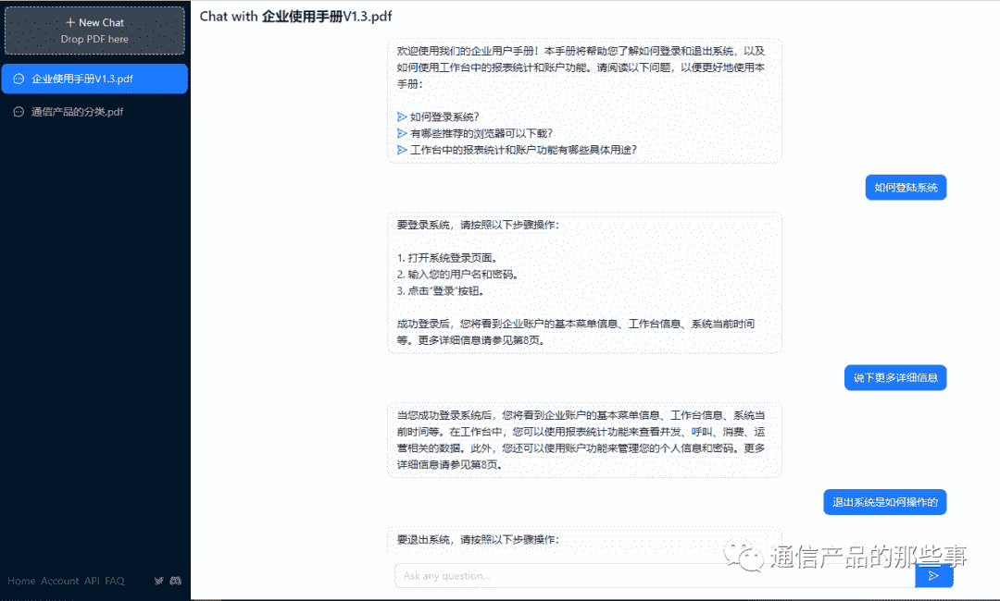
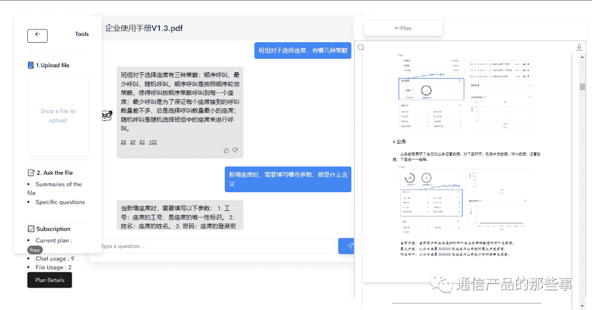
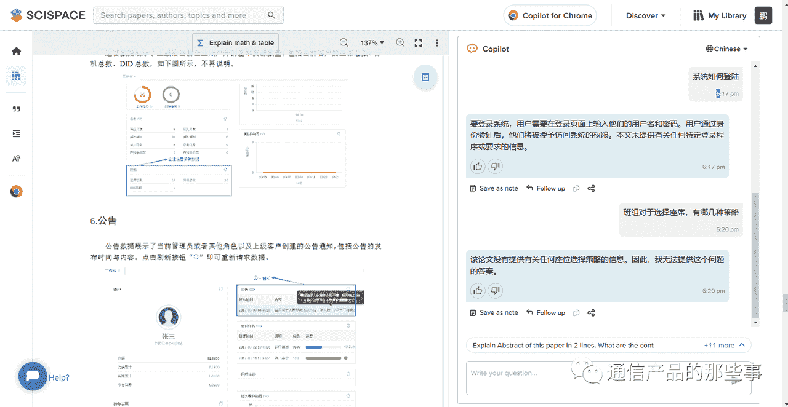
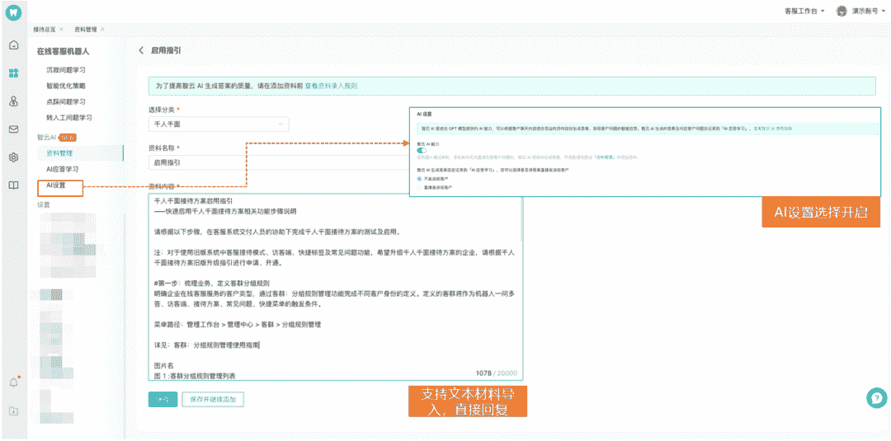
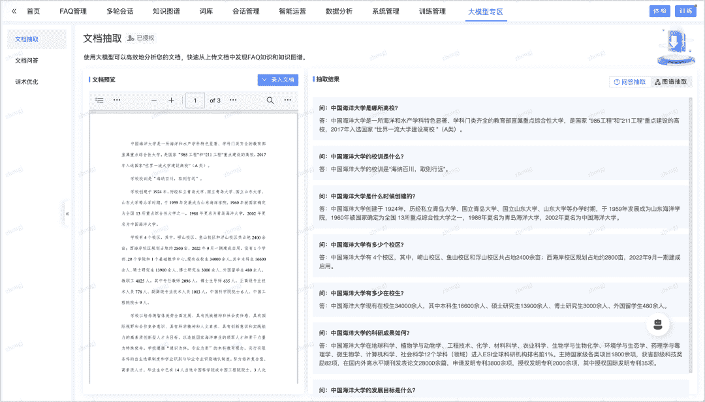
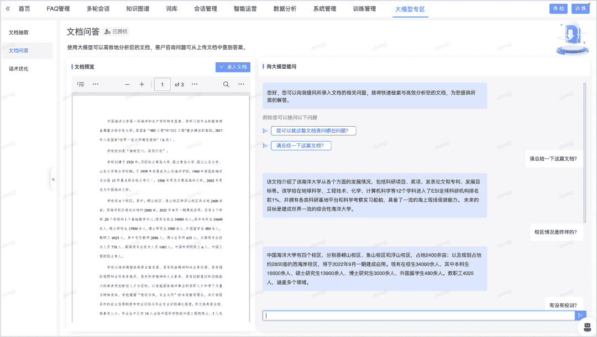

# 2023-05-09大语言模型实现智能客服知识库文档数据提取功能-今日头条

> 来源：[https://xuqiwei1986.feishu.cn/docx/K7qndTnY3o0zMhx0D2qc4jmTnQb](https://xuqiwei1986.feishu.cn/docx/K7qndTnY3o0zMhx0D2qc4jmTnQb)

> 🔗 原文链接： h[ttps://www.toutiao](https://www.toutiao.com/article/7231062779061502501/?log_from=bdb55288b4c6a_1691463998418).com/article/723...

> 大语言模型实现智能客服知识库文档数据提取功能

2023-05-09 14:16 · 人人都是产品经理

> 智能客服的知识库有两类：机器人知识库和坐席知识库，分别是为机器人和坐席进行服务时，提供数据的支撑。如何通过大语言模型，让企业的文档可批量上传，无需更多的整理，直接转化为有效的QA，供座席和机器人直接调用呢？本文作者对此进行了分析，一起来看一下吧。

上一篇提到了《大语言模型实现智能客服知识库自动扩写功能》，这次谈下知识库文档数据提取功能的实现。

# 一、产品场景和需求

我们知道智能客服的知识库有两类：机器人知识库和座席知识库。

分别是为机器人和座席进行服务时，提供数据的支撑。

智能客服系统会标配知识库管理功能，常见的形式是树状结构，提供分类管理、知识库条目管理，并支持知识库的批量导入导出操作。

使用中，企业需要经常性地维护管理知识库内容，将企业已有知识内容文档上传，但如果是将原文件上传，则系统最多能支持预览功能，使用者在操作界面只能点击打开全文检索。而如果是机器人知识库，直接上传文档是不可用的，需要操作者手工整理文档中的内容为机器人标准问答对。

以上是目前绝大多数主流产品的使用情况。

大语言模型来了，我们提出的需求很简单，所有企业的文档可以批量上传，无需更多的整理，直接可自动转化为有效的QA，供座席和机器人直接调用。

# 二、知识提取实测：PDF文档内容提取

已有诸多产品使用大语言模型实现PDF文档数据提取，我们先看下已实现的产品的效果。

## 1. ChatPDF

https://www.chatpdf.com/

界面特别干净，上传pdf，然后conversation。

为了测试，我扔了一份100页的产品手册进来。

上传速度很快，最关键的时，对话响应也非常的快。

对文档内容的解析很准确，包括一些隐藏在内部的知识点也可以快速搜索找到。

## 2. Pandagpt

https://www.pandagpt.io/

网络问题，访问有点慢，但是这个对话的样式，一言难尽，没有一个版块不是互相遮挡的，强迫症死敌。

响应速度差一些，问题回答基本到位，相比ChatPDF，略显啰嗦。

## 3. typeset

https://typeset.io/

主打论文检索的typeset，也支持pdf文档解读。

上传、对话响应都十分缓慢，对话的效果非常不OK，很多知识点无法解读，一律回复无法找到这个问题的答案。

# 三、自研框架的选择

基于OpenAIEmbeddings，官方给出了基于embeddings检索来解决GPT无法处理长文本和最新数据的问题的实现方案。

参考：

https://www.datalearner.com/blog/1051681543488862

也可以使用LangChain框架，参考以下内容实现效果。

参考：

ChatGPT怎么建立私有知识库？：

https://www.zhihu.com/question/596838257/answer/3004754396

利用LangChain和国产大模型ChatGLM实现基于本地知识库的自动问答：

https://www.zhihu.com/zvideo/1630964532179812353

另外除了从文档中抓取数据，从指定网站URL抓取数据，实现智能客服外部知识库，可以借助ChatGPT写Python代码，PythonBeautiful Soup库的实现方式很成熟。

# 四、智能客服产品设计要点

回到智能客服产品场景中，产品设计使用中要考虑的问题。

**1）功能分割**

建议为保持原知识库管理系统的完整，可增加单独的大语言模型知识库，避免SaaS产品原来的企业使用体验和数据库内容产生交叉影响。

**2）书架式管理**

模型知识库同样支持分类管理，方便使用者管理文档库，能够快速检索文档名称和内容。

提供增删改查，预览、批量上传删除等操作。并支持以QA问答对的方式全文展示，使用者可以了解到本文档新增的有效文档数据有多少内容。

**3）提供测试对话工具**

模型库中可内置对话测试工具，供使用者先行进行知识点的维护管理。

**4）知识库编辑扩展**

提供插件、支持在线改写编辑，重新读取。

减少重复上传给使用者带来的挫败感。

**5）知识库关联**

已测试完成的大模型知识库，可允许使用者关联发布到座席或者机器人知识库中，提供对话数据的扩展。

如果是机器人知识库，可以在机器人模板设置关联，允许流程中各节点选择性调用对应的知识库，这样也不会破坏原有流程的知识库体系，增强了部分节点的知识库能力。

对于交叉引用知识库的节点，权重可以允许调节，一般默认为机器人自身知识库为主，大模型知识库辅助。

**6）反馈机制**

文本对话机器人的访客端点踩、座席的手工点踩，和语音机器人的手工标记无效问答，都可以帮助反馈大模型知识库的效果。

以数据报表方式展示，手工或自动进行知识维护。

**7）功能开关**

最后，仍然是设置功能性开关，并关联到SaaS产品账户角色权限中，可邀请一部分友好客户星火测试，不断迭代优化。

当然，以上情况，也不限于智能客服产品范畴，一些需要知识管理的场景中，都可以借鉴。

最后还是放出业内大厂们已实现的产品截图加以说明：

Z厂的企业资料库，关联大语言模型自动搜索

T厂的大模型文档知识抽取和“即搜即问”

期待更多更好的应用落地，有对这方面内容感兴趣的朋友，欢迎随时联系。

本文由 @通信产品的那些事 翻译发布于人人都是产品经理，未经作者许可，禁止转载。

题图来自Unsplash，基于CC0协议。

该文观点仅代表作者本人，人人都是产品经理平台仅提供信息存储空间服务。