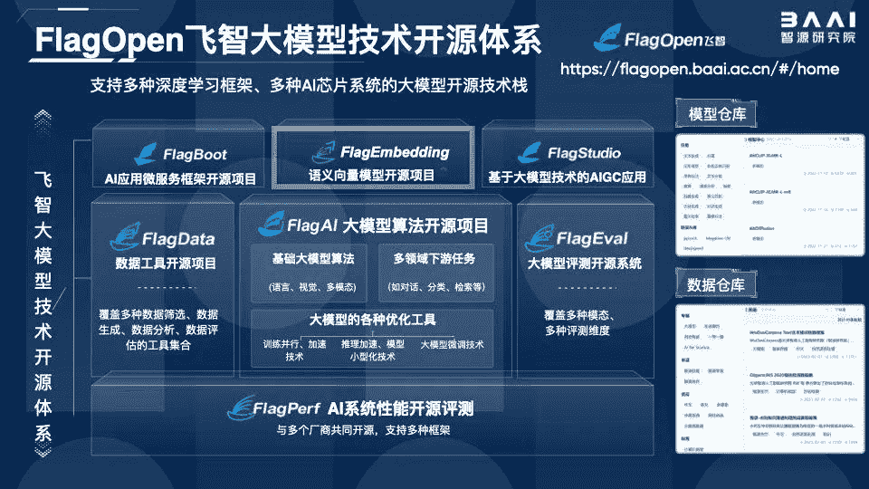
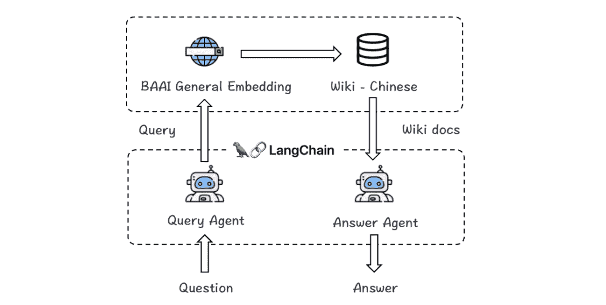
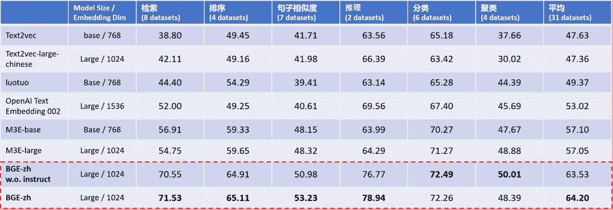
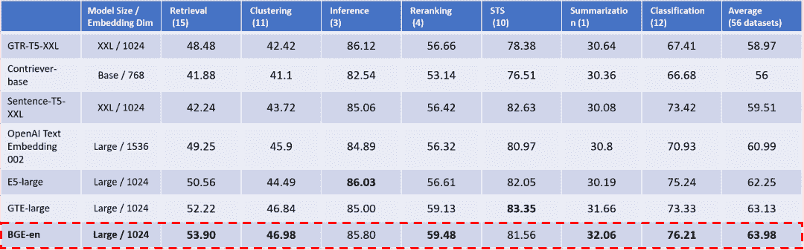
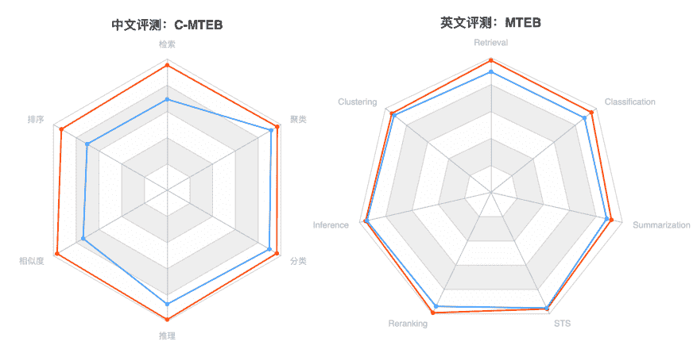
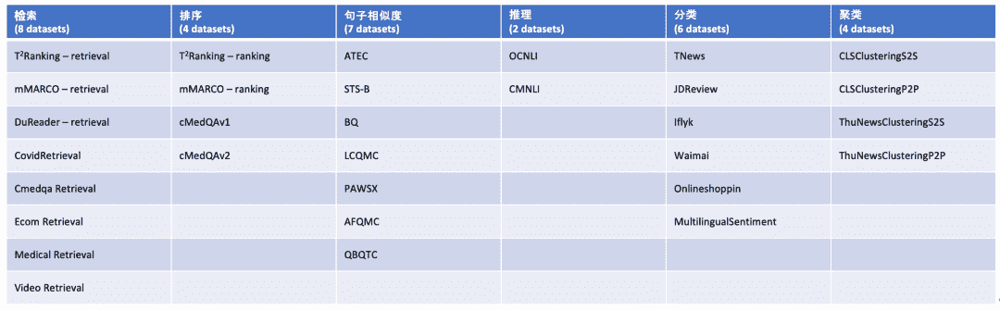
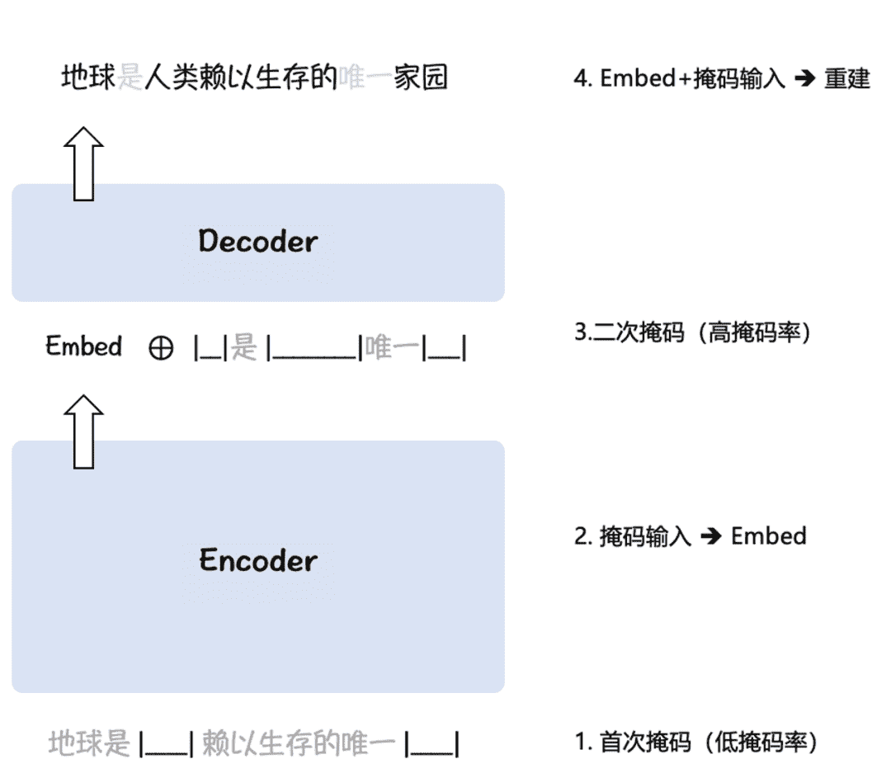
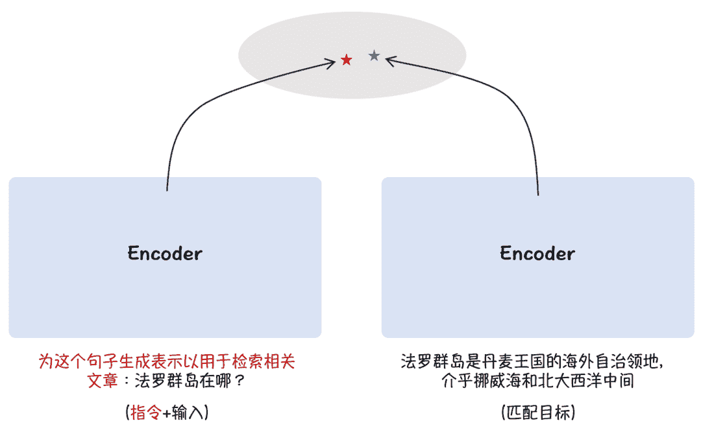

# 2023-08-07链接大模型与外部知识，智源开源最强语义向量模型BGE

> 来源：[https://xuqiwei1986.feishu.cn/docx/N8cKdGq9aoBAWExnQk8cRlWXnhe](https://xuqiwei1986.feishu.cn/docx/N8cKdGq9aoBAWExnQk8cRlWXnhe)

> 🔗 原文链接： h[ttps://mp.weixin.q](https://mp.weixin.qq.com/s/J8mG-J5KLkkWr6fQnkscZw)q.com/s/J8mG-J5K...

>

智源研究院 智源研究院 2023-08-07 09:02 发表于 中国香港

语义向量模型（Embedding Model）已经被广泛应用于搜索、推荐、数据挖掘等重要领域。

在大模型时代，它更是用于解决幻觉问题、知识时效问题、超长文本问题等各种大模型本身制约或不足的必要技术。然而，当前中文世界的高质量语义向量模型仍比较稀缺，且很少开源。

**为加快解决大模型的制约问题，近日，智源发布 最强**开源可商用中英文语义向量模型BGE（BAAI General Embedding） ，在中英文语义检索精度与整体语义表征能力均超越了社区所有同类模型，如OpenAI 的text embedding 002等。此外，BGE 保持了同等参数量级模型中的最小向量维度，使用成本更低。

本次BGE模型相关代码均开源于Fl**agOpen飞智大模型技术开**源体系旗下 FlagEmbedding 项目，一个聚焦于Embedding技术和模型的新版块。智源研究院将持续向学术及产业界开源更为完整的大模型全栈技术。

与**此同时，鉴于当**前中文社区缺乏全面的评测基准，智源团队发布了当前最大规模、最为全面的中文语义向量表征能力评测基准 C-MTEB (Chinese Massive Text Embedding Benchmark)，包含6大类评测任务和31个数据集，为评测中文语义向量的综合表征能力奠定可靠的基础，全部测试数据以及评测代码已开源。

FlagEmbedding：

https://github.com/FlagOpen/FlagEmbedding

BGE 模型链接：

https://huggingface.co/BAAI/

BGE 代码仓库：

https://github.com/FlagOpen/FlagEmbedding

C-MTEB 评测基准链接：

https://github.com/FlagOpen/FlagEmbedding/tree/master/benchmark

值得大模型应用开发者关注的好消息： 将 LangChain 与智源BGE结合 ，可以轻松定制本地知识问答助手，而不需要花较高的成本训练垂类大模型。

## **检索精度大幅领先**

## 中英文（C-MTEB + MTEB）

## **共87个任务上表现优异**

BGE 是当前中文任务下最强语义向量模型，各项语义表征能力全面超越同类开源模型。

中文语义向量综合表征能力评测 C-MTEB 的实验结果显示（Table 1），BGE中文模型（BGE-zh）在对接大语言模型最常用到的检索能力上领先优势尤为显著， 检索精度约为 OpenAI Text Embedding 002 的1.4倍 。

Table 1. 中文语义向量综合表征能力评测（C-MTEB）

注：Model Size一列中Base ~100M，Large ~300M，XXL ~11B

BGE w.o. Instruct: BGE输入端没有使用instruction

与中文能力相类似，BGE 英文模型（BGE-en）的语义表征能力同样出色。根据英文评测基准 MTEB 的评测结果（Table 2），尽管社区中已有不少优秀的基线模型，BGE 依然在总体指标（Average）与检索能力（Retrieval）两个核心维度超越了此前开源的所有同类模型。

同时，BGE 的各项能力都显著超越社区中最为流行的选项： OpenAI Text Embedding 002。

Table 2. 英文语义向量综合表征能力评测（MTEB）

注：Model Size一列中 Base ~100M，Large ~300M，XXL ~11B

Figure 1. 中文C-MTEB（左）、英文MTEB（右）

注：BGE为 红色 ，OpenAI Text Embedding 002为 蓝色

## **中文语义向量**

## **全面评测基准 C-MTEB**

**此前，中文社区**一直缺乏全面、有效的评测基准，BGE 研究团队依托现有的中文开源数据集构建了针对中文语义向量的评测基准 C-MTEB （Chinese Massive Text Embedding Benchmark，如 Table 3所示）。

C-MTEB 的建设参照了同类别英文基准 MTEB [12]，总共涵盖6大类评测任务（检索、排序、句子相似度、推理、分类、聚类），涉及31个相关数据集。

C-MTEB 是当前最大规模、最为全面的中文语义向量评测基准，为可靠、全面的测试中文语义向量的综合表征能力提供了实验基础。

目前，C-MTEB 的全部测试数据以及评测代码已连同 BGE 模型一并开源。

Table 3. C-MTEB 评测任务维度及数据集

## **技术亮点：**

## **高效预训练+大规模文本对微调**

BGE 出色的语义表征能力源于两方面要素：1）针对表征的预训练，2）大规模文本对训练。

BGE 在悟道 [10]、Pile [11] 两个大规模语料集上采取了针对表征的预训练算法 RetroMAE [5,6]（Figure 2）：将低掩码率的输入编码为语义向量（Embed），再将高掩码率的输入与语义向量拼接以重建原始输入。这样一来，BGE 得以利用无标签语料实现语言模型基座对语义表征任务的适配。

Figure 2. RetroMAE 预训练算法示意

BGE 针对中文、英文分别构建了多达120M、232M的样本对数据，从而帮助模型掌握实际场景中各种不同的语义匹配任务，并借助负采样扩增 [7] 与难负样例挖掘 [8] 进一步提升对比学习的难度，实现了多达65K的负样本规模，增强了语义向量的判别能力。

另外，BGE 借鉴 Instruction Tuning [9] 的思想，采取了非对称的指令添加方式，在问题端添加场景描述， 提升了语义向量在多任务场景下的通用能力，如Figure 3所示：

Figure 3. 注入场景提示提升多任务通用能力

综上，BGE 是当前性能最佳的语义向量模型，尤其在语义检索能力上大幅领先。 其卓越的能力为构建大语言模型应用（如阅读理解、开放域问答、知识型对话）提供了重要的功能组件。相较于此前的开源模型，BGE 并未增加模型规模与向量的维度，因而保持了相同的运行、存储效率。

目前，BGE 中英文模型均已开源，代码及权重均采用 MIT 协议，支持免费商用。

作为智源「FlagOpen大模型技术开源体系」的重要组成部分，BGE 将持续迭代和更新，赋能大模型生态基础设施建设。

BGE 模型链接：

https://huggingface.co/BAAI/

BGE 代码仓库：

https://github.com/FlagOpen/FlagEmbedding

FlagOpen官网：

https://flagopen.baai.ac.cn/

# **语义向量模型知识拓展**

**1、语义向量模型是什么？**

语义向量模型（Embedding Model）被广泛应用于搜索、推荐、数据挖掘等重要领域，将自然形式的数据样本（如语言、代码、图片、音视频）转化为向量（即连续的数字序列），并用向量间的“距离”衡量数据样本之间的“相关性” 。

2、大模型时代，帮助缓解幻觉问题、长期记忆挑战等的必要技术

与时俱进获取知识

只能基于模型训练中的阶段性「死板」知识储备，是导致大模型在回答问题时出现幻觉的重要因素。而借助语义向量模型的帮助，大模型可以获取与时俱进的「活知识」，答案又新又准。具体而言，通过语义向量模型建立某个垂直领域的知识库索引（Index），可以为大模型高效补充世界知识、本地知识：当用户向LLM提问时，LLM 会从最新最全知识库中获取答案。

提升大模型长期记忆

大模型困长期记忆久已，现有LLM存在上下文输入长 度限制，制约了长文本方面的处理能力。利用语义向量模型，可将长文档结构化，与LLM更好地直接交互，从而弥补长文本处理能力短板。

3、 LangChain等大模型明星应用的关键力量

OpenAI、Google、Meta 等厂商均推出了针对大模型的语义向量模型及API服务，直接促进了全球大模型开发者社区诞生了众多有影响力的大模型应用框架及工具： 诸如大模型应用框架 LangChain、向量存储数据库Pinecone、文档格式化索引工具Llama Index、自主“思考”步骤并完成任务的助手AutoGPT 等。

## **参考文献： **

[1] Unsupervised Dense Information Retrieval with Contrastive Learning (Contriever), https://arxiv.org/pdf/2112.09118.pdf

[2] Large Dual Encoders Are Generalizable Retrievers (GTR), https://aclanthology.org/2022.emnlp-main.669.pdf

[3] Text Embeddings by Weakly-Supervised Contrastive Pre-training (E5), https://arxiv.org/abs/2212.03533

[4] Introducing text and code embeddings (OpenAI Text Embedding), https://openai.com/blog/introducing-text-and-code-embeddings , https://openai.com/blog/new-and-improved-embedding-model

[5] RetroMAE: Pre-Training Retrieval-oriented Language Models Via Masked Auto-Encoder (RetroMAE), https://aclanthology.org/2022.emnlp-main.35/

[6] RetroMAE-2: Duplex Masked Auto-Encoder For Pre-Training Retrieval-Oriented Language Models (RetroMAE-2), https://aclanthology.org/2023.acl-long.148/

[7] Tevatron: An Efficient and Flexible Toolkit for Dense Retrieval (Tevatron), https://github.com/texttron/tevatron

[8] Dense Passage Retrieval for Open-Domain Question Answering (DPR), https://arxiv.org/abs/2004.04906

[9] One Embedder, Any Task: Instruction-Finetuned Text Embeddings (Instructor), https://instructor-embedding.github.io

[10] Wudao Corpora (悟道), https://github.com/BAAI-WuDao/Data

[11] The Pile: An 800GB Dataset of Diverse Text for Language Modeling (Pile), https://github.com/EleutherAI/the-pile

[12] MTEB: Massive Text Embedding Benchmark (MTEB), https://huggingface.co/blog/mteb

