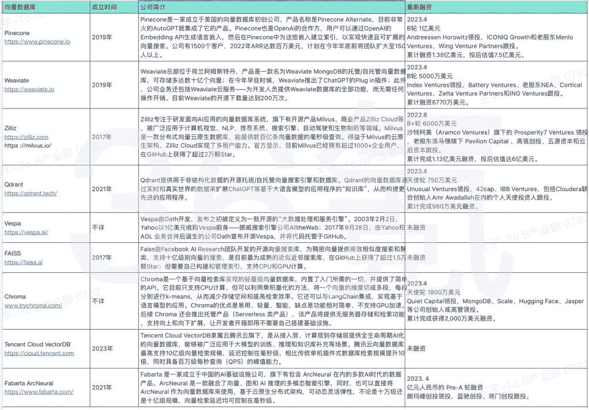
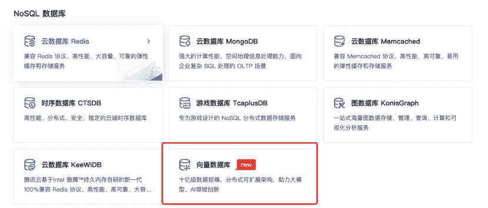

# 2023-08-04对话腾讯云罗云：AI Native的向量数据库迎来窗口期，未来会出现“1+N”的新模式

> 来源：[https://xuqiwei1986.feishu.cn/docx/YqhZd9ScaohXZixO4SbcxlZ9nOh](https://xuqiwei1986.feishu.cn/docx/YqhZd9ScaohXZixO4SbcxlZ9nOh)

> 🔗 原文链接： h[ttp://app.myzaker.](http://app.myzaker.com/news/article.php?pk=64cc55338e9f09622b7f9822)com/news/article...

作者 | 吴思瑾、王与桐

自从 AI 大模型时代轰轰烈烈到来，沉寂多年的向量数据库再度获得市场和资本的关注。

向量数据库通过把数据向量化然后进行存储和查询，能解决大模型预训练成本高、没有 " 长期记忆 "、知识更新不足、提示词工程复杂等问题，突破大模型在时间和空间上的限制，加速大模型落地行业场景。

36 氪也在近期对向量数据库领域进行过梳理。

向量数据库 Mapping 速览 -36 氪整理

不难发现，这些全球知名的数据库中，既有创业公司，也有大厂的产品。在国内，腾讯走在了大厂前列。8 月 1 日，腾讯云向量数据库（Tencent Cloud VectorDB）正式上线公测。腾讯云数据库表示，该数据库不仅能为大模型提供外部知识库，提高大模型回答的准确性，还可广泛应用于推荐系统、文本图像检索、自然语言处理等 AI 领域。腾讯云向量数据库是国内首个从接入层、计算层、到存储层提供全生命周期 AI 化的向量数据库。

来源：腾讯

**在产品公测当天，36 氪对**话了 腾讯云数据库副总经理罗云 ，从向量数据库行业发展、海内外竞争格局、技术和商业路线选择等角度，进行了探讨。

以下为对话全文，经 36 氪编辑整理，Enjoy：

01 谈行业发展：全球向量数据库的发展，都与 AI 所处阶段密不可分

**3**6 氪：腾讯云在 2019 年开始孵化向量数据库，当时行业里对向量数据库的看法是什么，为什么你们会选择在这个时间点做这件事？

罗云：向量数据库的发展不是一蹴而就的，它有个孕育过程。

早在 2012 年时，深度神经网络的发展日益成熟，包括腾讯集团在内的从业者开始发现万事万物都可以用向量来表达；

到了 2015 年至 2016 年间，Google 和微软开始发布一些标志性的 paper；

随着 2017 年 Facebook 开源了他们的 Faiss 框架，这成为向量数据库的里程碑事件之一；

2019 年，市面上开始陆续出现一些独立的向量数据库和基于 Faiss 发展起来的向量数据库，腾讯云也是这时候开始入场；

到了 2022 年底，ChatGPT 突然火爆，原来狭义的人工智能开始受到各行各业关注；

2023 年，大家开始思考自己所在的行业是否有 AI Native 的机会——基于 AI 重构现有的应用。

因为向量数据库可以处理非结构化数据，正好迎合了当下 AI 时代的发展需求，于是一波又一波的热钱就开始进来。腾讯云则是将过去 4 年中积累的向量数据库底座搬至云上进行售卖。

8 月 1 日，腾讯云向量数据库正式开启公测。

**3**6 氪：从 2019 年至今，不少投资人曾对向量数据库表示 " 看不准、不太理解 "，您认为他们的疑惑在哪，现在有变化吗？

罗云：早年的向量数据库使用场景受限，因此营收天花板并不高。

随着 2023 年 ChatGPT 的火爆，大家都看到了 AGI 希望的曙光。作为 AI 的基础设施之一，向量数据库覆盖面就大了很多，天花板也随之提高。

这从今年 3-4 月份海外向量数据库的融资情况就可见一斑——投资热度升温明显——其实并不是说向量数据库本身发生了多大变化，而是时代背景发生了变化。

**3**6 氪：在 2019 年热闹一阵后，向量数据库似乎进入了不温不火的阶段。在过去四年里，行业里出现过哪些关于向量数据库的质疑声？

罗云： 质疑声主要集中在是否有必要存在独立的向量数据库 。

过去几年，向量数据库主要服务于 " 搜广推 " 三**大**领域，现在随着 AI 的普及和发展， 向量数据库也开始向各行各业辐射，慢慢的原来用于离线型分析场景的数据库，开始向线上转变，与 C 端流量的关联性也更强。

向量数据库的计算特点是非常消耗 CPU 的计算内存；如果将向量数据库的工作负载单独出来，会更利于后期的单独扩容和成本管理。

现在越来越多的业内人士开始发现，此前在传统数据库上增加插件式的向量检索引擎很难解决向量计算对 CPU 扩展能力的要求。

待未来 AI 发展成熟之后， **我个**人的判断是企业会出现 "1+N" 的数据库模式，"1" 是向量数据库，用来托管企业对于向量的计算和检索需求，"N" 是企业原有的各类数据库，这对企业在成本管理和人才招聘等方面都是相对最优选。

**36** 氪：今年 3、4 月份海外很多数据库厂商获得了比较大额的融资，也因此国内资本对这一领域关注度加深。为什么向量数据库的投资热度是自外而内？海内外的 AI Native 环境有哪些不同？

罗云：向量数据库是随着大模型起来的，海外的大模型发展得比国内早，所以投资热度是由外及内的。

至于海内外的市场环境有哪些不同，我自己的**看法是要需要换一个角度来看这**个问题—— 海内外云计算所处的阶段不同。

向量数据库也好，传统数据库也好，都是开发者应用的重要一环，是刚需的产品，但客观来说海外独立数据库厂商的经营情况好于国内，这也是海内外云计算所处阶段不同的一种表现。

**目**前国内的云计算还处于企业主正在将业务从非云环境搬上云的阶段。 在中国的文化和企业背景下，CEO、CTO 们在选型数据库产品时，更看重数据的隐私性、安全性、服务的可持续性和数据的兜底能力 。因此他们希望能由一家云计算厂商配置好包括计算、存储、网络、数据库在内的所有组件，所以当企业完成上云之后，就很难会考虑再选购其他厂商的数据库产品。这是国内遇到的主要挑战。

**海**外市场更偏技术本位，如果独立的向量数据库产品技术更好，企业主的尝试意愿就会很强，他们会选择和云厂商提供的配套服务结合起来使用。

36 氪：这种差异导致向量数据库在市场推广过程中会面临哪些挑战？

罗云：从腾讯云的角度来说，我们还蛮庆幸的，俗话说机会往往留给有准备的人，我们恰好就是这样。

腾讯云从 2019 年起就开始积累向量数据库的经验，现在是把过往积累的经验产品化和变现；此外，腾讯云本身的服务体系，包括售前、售后和尾保类服务都已经形成了一些口碑，所以整体来说我们还蛮有信心的。

36 氪：向量数据库的使用成本和传统数据库相比有何不同？

罗云：现在行业中的 **向量数据库分性能型和存储型 **。

以性能型为例，单 QPS 每月约一元钱左右，与常规的 MySQL 数据库相比，这个成本高了一两个数量级。也就是说，向量数据库服务一个 C 端用户一次查询的成本会贵很多。

腾讯云向量数据库希望给用户和传统数据库类似的付费体验，因此选择了和对方类似的付费模式——预购资源，这是第一步。

第二步是随着 AI 的成熟，腾讯云向量数据库也将集合更多的 AI 能力或者 AI 领域的上下游生态能力。比如客户现在要处理一段大的 pdf 或 doc，它需要先做分段，之后再进行数据的向量化，腾讯云团队希望能将 AI native 的能力集成进向量数据库，当有了这部分能力后，我们会在数据库中售卖相关的 GPU 资源，客户也可以买固定的 GPU 资源，有了这些资源，客户就可以比较方便地一站式完成之前它在外部买 GPU 做分段的事情。

所以未来我们的付费模式会偏向于计算、预购加存储节点，后面还会在产品形态中增加一些 GPU 的售卖能力。

36 氪：在您看来，下一步向量数据库行业的发展趋势和竞争格局会怎样？

罗云：向量数据库的发展可能会分三个阶段。

阶段一是向量数据库满足基本的使用功能，包括技术指标、功能算法、检索时延达到标准、满足高可用标准，SDK、API 以向量数据库的方式来设计。

阶段二是当业务量上来之后，企业会更关注单 QPS 成本，也就是说每次 C 端调用可能会消耗的数据库资源大小，由于其与企业成本密切相关，会直接影响客户选型，所以是下一步向量数据库各厂商之间重点比拼的地方。

阶段三是当客户已经用起来之后，大家会开始关注其研发效能的提升，也就是之前提到的 AI native 化；向量数据库是否可以与 AI 的算法和计算能力相结合，让企业主或开发者尽可能投入最少的资源在数据库中。

在这三个阶段中，大概会分成两派，一是独立的向量数据库公司；二是插件式的向量数据库工具。

在阶段一时，大家都可以满足向量数据库的功能性；当阶段二要去追求单 QPS 成本时，插件式的向量数据库工具会面临更多的挑战；所以我个人会比较坚定的看好独立向量数据库的未来，如果要把一个事情做得足够好，投入专门的人力物力是非常有必要的；在阶段三，独立的向量数据库会需要一些 AI 能力的加持，这时会考验各家厂商在 AI 能力上的积累和原有业务对向量数据库补充的能力，最终形成竞争差异化。

02 谈国内格局：向量数据库会成为云厂商的增量业务，存在窗口期

36 氪：当下国内向量数据库行业的竞争格局是怎样的？

罗云：目前通信院正在制定向量数据库的团体标准，我在一次偶然的机会上了解到可能不少国内知名大厂和早期创业公司都已经开始关注或正在开发相关产品，总数约三四十家左右。

在现有的解决方案中，部分团队是在现有传统数据库基础上叠加向量的能力，但是慢慢的大家也发现这部分能力如果工作负载越来越高，投入也就越来越大，所以大家都在摸索向量数据库的下一步技术发展方向。

**36 氪：目前的市场环境，对于国内云厂**商来说，会带来改变现有竞争格局的机会吗？

罗云： 数据库产品本身是很难脱离云服务来单独售卖的 。正常来说，一家企业想要做迁移，把整体或部分搬站至某一个云厂商的情况是存在的。 但向量数据库这块会有一点差别，向量数据库更多的是一个增量的生意。 虽然国内的云计算厂商都在提云计算已经进入一个更加激烈的竞争阶段，大家都在争抢彼此的市场份额，但向量数据库往往对应的是新业务，所以只要我们给企业主提供足够好的产品、数据背书和大厂背书，当企业在腾讯云上架设起新业务，后续的迁移和搬站成本就会相对较低，所以向量数据库相比其他的数据库产品具备一定的时间优势。 当向量数据库行业发展成熟后，就又变成了存量生意。

**36 氪：这个窗口期是多久？**

罗云：从现在的情况来看可能是在未来一到两个季度内，但随着下半年 GPU 等资源到位和行业大模型逐渐成熟，窗口期会变短。

**36 氪：在技术、资金和客户资源上云计算厂商确实有明显优势，如果窗口期这**么短，那假如现在还有创业公司想要入局开发独立的向量数据库，是否就没有什么机会了？

罗云：一些线下的私有云厂商可能在某一些垂直行业有自己的服务、口碑积累，细分市场的向量数据库是很好的方向；此外，新创业公司从 day1 开始就面向全球化市场也是不错的选择。

创业公司也面临诸多挑战：首先是产品大规模运营的稳定性；其次是其本身资质对于数据隐私背书的挑战性，举例来说，可能会有企业主担忧他们现在在有融资的情况下做的挺好，但后续万一没融资进来就会经营困难波及企业自身。

36 氪：您如何衡量国内向量数据库的市场规模？

罗云：目前向量数据库行业还处于围绕各行各业 **AI Native 化**的早期发展阶段， 可见的收入规模并不大。

着眼未来，我有两个角度的预估。

**一是宏观角度的数据规模 **，向量数据库面向的是非结构化数据，它包含了音频、视频、图片和人类自然语言文本；有数据显示，非结构化数据占企业生成的新数据比例达 80％，未来每个应用都基于向量数据库和 AI 进行研发体系重构的话，它会成为数据库领域里 top 级的产品类型，如果类比传统数据库的话，向量数据库的市场规模上限可能会接近当下主流数据库 MySQL。

**二是我们接触的客户的微观层面 **，通过预估对方的向量数据库的成本，我们发现其一个月的成本规模约等于 NoSQL 中头部数据库 Redis 的收入规模，所以我认为向量数据库在不久的将来就会达到 NoSQL 中头部数据库的收入规模。

03 谈路线选择：从 " 搜广推 "，走向各行各业

**36 氪：向量数据库分开源和闭源，两者的发展路径和商业化路**径都不太相同，您认为哪种更容易获得成功？

罗云：从以终为始的角度来看，不管是开源产品还是闭源产品，最终目的都是要商业化，开源或闭源只是商业化过程中触达目标用户的路径。

以开源的厂商为例，他们通过 github 等平台向目标用户传达产品的技术成熟度，通过技术的极客精神吸引开源开发者过来。海外的闭源企业代表，它和 OpenAI 走得很近，在 AI 领域里面也有很深的洞察，在它的站点上面有非常多 AI 行业的资料，AI 开发者不仅能在其平台学习向量知识，还能学习到其他 AI 知识。从他俩的路径可以看出，大家只是选择了自己擅长冷启动的触达用户的方式。

一开始选择开源或闭源与企业创始人的背景和所辐射的资源有关，与商业化成功与否无直接关系。

以腾讯云为例，我们有很成熟的销售体系，过往也积累了非常多的客户资源，所以只要做好产品，就很容易开始商业化。

36 氪：也就是说初创公司更适合开源，而成熟型公司更适合闭源？

罗云： 从结果上来看可能是这样，但其实因果关系可能是颠倒过来的。 小公司不是因为选择了开源而容易成功，而是它可能没有更好的触达用户的渠道，所以开源也行是当下最好的选择。

**36 氪：向量数据库成本高昂，目**前我们会通过哪些方式来缓解这方面的压力？

罗云：其实向量数据库它本身技术的底子还是数据库本身的架构，我们去定义数据库它其实解决了两个问题，第一个问题是如何低成本的去存储数据，第二个问题如何高效的把存储的数据检索出来。向量数据库它也是一样的，只是说目前我们看到它在检索这一侧其实它的成本会非常的高昂。

目前业界有几种做法：

第一是在算法的层面，去优化现在用的比较多的 Faiss 的算法，包含 HNSW 的算法，让算法变得更快。

第二个优化方式结合算法本身，把 GPU 更好的并行起来，通过用 GPU 计算的方式让它的成本变得更低。

第三个是，我们会用云上的一些各种资源的调度体系，用更廉价的，或者说更合适的云资源去把底层算力的成本去做更好的补充，这样成本自然而然就会变得更低。

但是短期我们的判断是，大家不会有数量级的差异，所以更多还是比拼应用性，如何和云的资源体系结合，让客户用得更稳，能让单价成本有个 20%、30% 的提升。

**36** 氪：向量数据库最先在 " 搜广推 " 场景中落地，但这个领域的企业其实大都具备自研向量数据库或基于开源向量数据库自研的能力，且他们会更倾向于私有化部署，这是否意味着向量数据库的客户其实更多会来自中小企业？

罗云：目标客户不一定更多来自中小企业，因为刚才提到的这些大企业如果要自研向量数据库的话，投入可能比产出还要高，假如向量数据库不能成为对方的核心收入来源，那选择第三方专业向量数据库会是更具性价比的选择。长期来看，社会会有合理的分工，专业的人做专业的事。

对于他们私有化部署的需求，腾讯云向量数据库完全可以支持，且在稳定性、安全性等方面我们均更有优势。

**3**6 氪：有些大企业本身也是大模型的构建者，他们对于向量数据库的需求和模型应用层企业对向量数据库的需求有什么不同？

罗云：模型构建者通常会把向量数据库用在以下几个场景。

**首先 **是数据清洗聚类阶段，我们都知道如果训练模型时数据质量不好，会导致最后训练出来的模型回答结果不够精准，如果用于训练的数据重复太多，训练的效率也会变差。向量数据库的相似性搜索可以很好的优化这些问题。

当模型在为用户服务时，用户可能会问到时效性很强的事件，而这些事件模型的训练成本太高了，如果他们搭配向量数据库来进行搜索增强，那么模型就会先从向量数据库中检索最近的知识与大模型匹配，通过两者结合的方式给到用户不错的回答。

**其次 **，如果这个模型已经开始为企业主提供服务，那么企业主也会把向量数据库作为大模型的补充。以在线文档软件为例，如果客户在这里进行文档编写，其实数据还是数据客户自己的，在线文档没办法把这些数据用于第三方模型训练，所以通常会将这部分数据通过缓存的方式缓存到本地的某个数据库中，当客户要来整理文档纪要时，就可以通过向量数据库进行初步筛选，再交由大模型生成结果推理。

**总结来说，向量数据库会被用于加速训练提升大模型的时效性；通过在外部外挂一个向量**数据库帮助客户更好的整理数据，以输入、交互的方式提供给大模型再做最终的结果推理。

这两种使用场景让向量数据库 从原先的 " 搜广推 "，在 AI 的陪伴下走向了各行各业。

**36 氪：为什么现在大家要把向量化技术和向量数据库分开做，这**两项技术合在一起不是更能提升用户体验吗？

罗云：我认为这是有一个发展的阶段，不同场景的方案也有适应度的问题。在向量检索里，很重要的一环就是分段模型的好与坏。通俗解释，用户体验涉及到的一次端到端的搜索准确率、召回率由几个事情影响：

一是分段模型的成熟度，就是怎么把一部分非结构化文本、音频变成一个向量，这个模型会比较重要。

二是在向量数据库里面，Ann 的搜索算法也很重要。

腾讯云向量数据库现在在做的就是把这部分分段模型放在向量数据库中区，但它的挑战性在于每家的数据不同，分段模型没法一下做到大而广之。在腾讯内部有很多比如图片类的分段模型、音乐类的分段模型和文本类的分段模型，我们会结合腾讯集团的内部积累，将其内置到我们的向量数据库中来，但是这个行业非常特殊，大家都有自己的素材，所以大家也会有自己的预训练去打造分段模型的方式，这两者是相互配合的关系。

当我们把它沉淀到向量数据库里后，用户开发它自己的 AI 应用会变得很快，但是想让分段模型效果足够好，需要更多的积累。未来，向量数据库会承载更多角色。

36 氪：因此各家向量数据库，会在此形成差异化？

罗云：是的，目前大家都在往这方面靠，友商也会集成一些外部的分段模型，比如此前没有积累的独立数据库厂商，会集成 OpenAI 的分段算法；腾讯则因为本身在 PCG 的业务线就是偏泛互联网的业务模型，所以有比较多的积累，我们会把更贴近业务实践的分段模型产品化，为客户提供增量价值。

**36 氪：各家云计算厂商的基因不同，未来大家都做向量**数据库的话，彼此目标客群会有什么不同吗？

罗云：向量数据库的核心还是一个标品，提供标准的 API、SDK，能力也是标准的，服务的行业也是广泛适用的。

虽然各家云计算厂商可能会有各自擅长的领域，但首先大家都会先把自己擅长的领域做好，再去看是否可以将向量数据库作为拳头产品吸引其他行业的客户。

36 氪：向量数据库在腾讯云产品体系中的定位是什么？

罗云：腾讯云向量数据库的定位是成为这一波各行各业随着 AI native 化成长起来的企业的刚需品，我们判断在未来很长一段时间内，对行业开发者来说都会是 "1+N" 的模式，"1" 是向量数据库，"N" 是之前的多个数据库。

[查看原文](https://36kr.com/p/2372162081237249?f=rss)