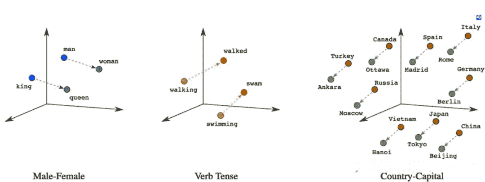
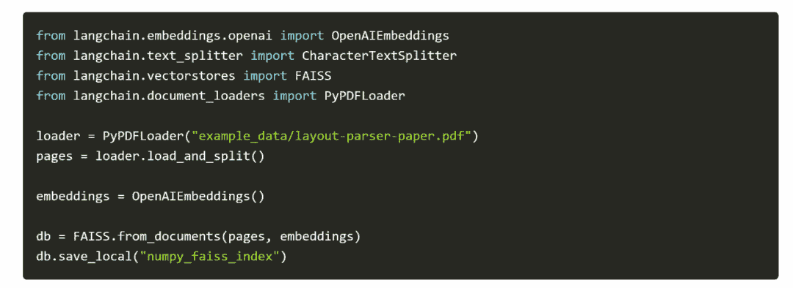
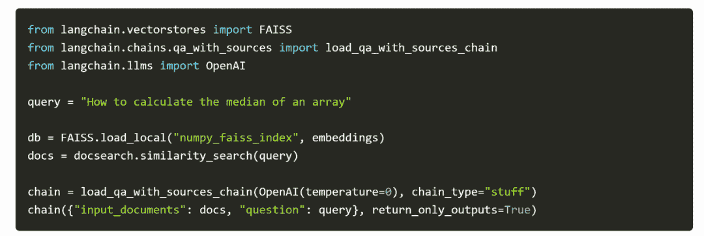
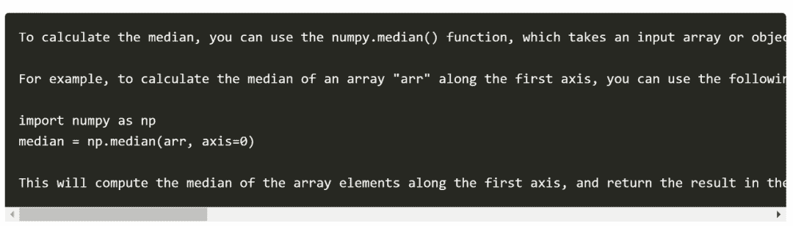
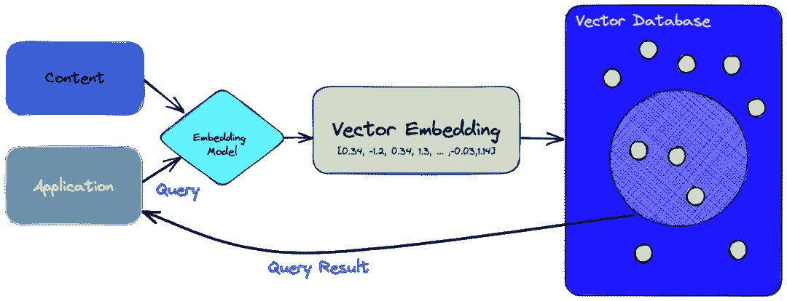
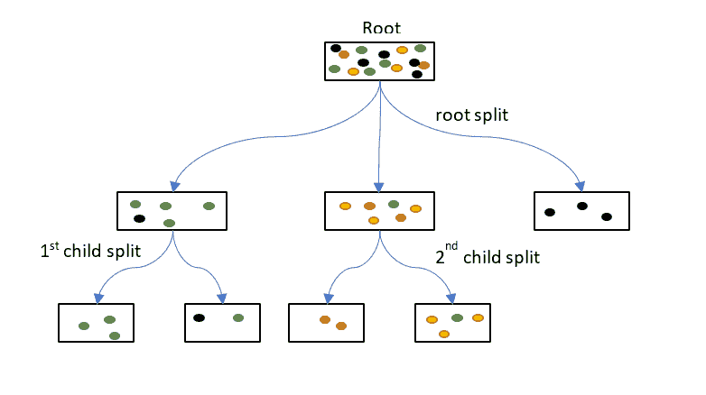
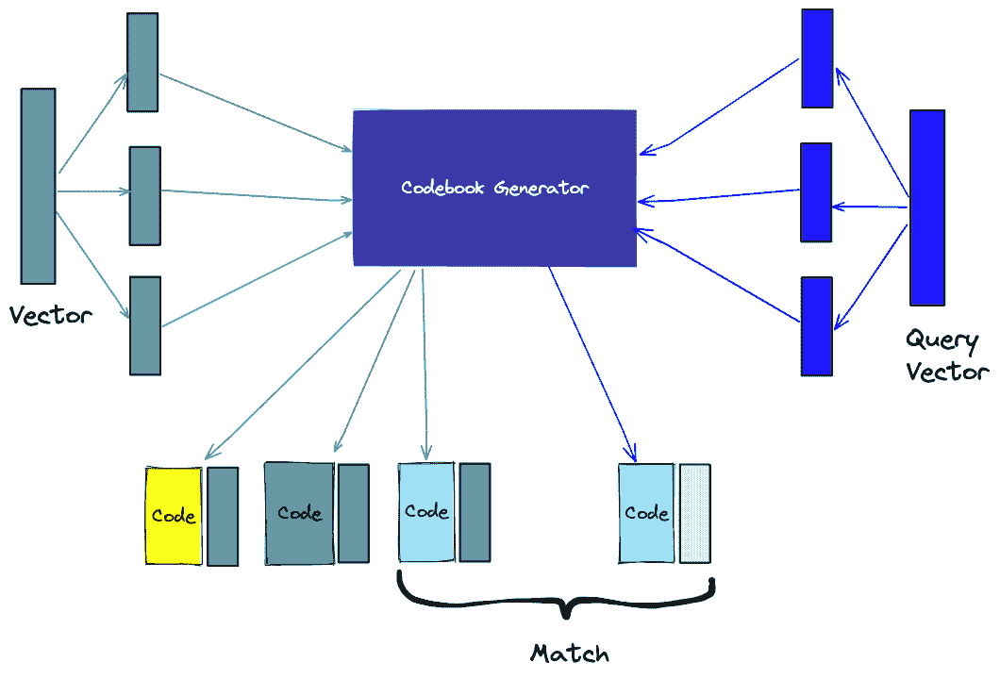
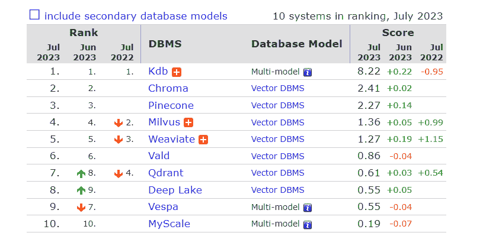
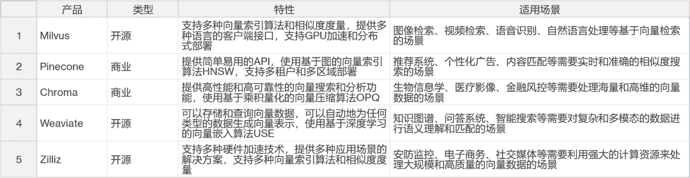

# 2023-07-25ChatGPT盛行的当下，向量数据库为大模型配备了一个超级大脑

> 来源：[https://xuqiwei1986.feishu.cn/docx/NupedH5cko3dsRxBqyZcVJt8nye](https://xuqiwei1986.feishu.cn/docx/NupedH5cko3dsRxBqyZcVJt8nye)

https://mp.weixin.qq.com/s/bRgovqTxgf-rLVFsC-5JFg

作者：Doug Wang编辑：H4O

**你是否有****过这样的经历：你在网上****看****到一张壁****纸，画面中的雪山和湖泊令人心驰神往，**你想知道这是哪个国家的美景，却不知道如何搜索；或者，在阅读一篇文章时，你想深入了解这个话题，寻找更多的观点和资料，却不知道该如何精确描述；又或者，当你在聆听一首歌曲时，你想寻找更多同样风格或情感的歌曲，却不知道如何分类。这时，你需要的是一个能够理解你的意图，为你提供最相关的结果，让你轻松找到你想要的信息的工具。

这就是 Vector Data Base (VectorDB， 向量数据库)，它就像一个超级大脑，帮助你解决这些问题！

Vector DB 的用途远不止于此，它还能够帮助像 ChatGPT 这样的智能系统，从海量的数据中快速检索出最合适的答案，提高它们的准确性和效率。在当前大家普遍面临算力不足，难以对大语言模型进行微调的情况下，为大语言模型配备一个知识库（超级大脑）就显得尤为重要。这就像给大语言模型提供了一份小抄，使其能够更好地服务于我们。

Vector 是什么 —— 计算机理解世界的起点在我们深入了解 Vector DB 之前，让我们先来简单理解（或回顾）一下什么是 Vector，其实它也就是我们在高中数学或者大学数学里学到的向量，只不过维度比当时的直角坐标系里的二维多一点而已（或许多到了 512 维）。在许多学术论文中，你可能更熟悉它的另一个名字 —— 嵌入（Embedding）。为了实现我们前面提到的超级大脑，我们首先需要让这个大脑理解各种信息，而这就是嵌入的作用。

你可能会问，什么是嵌入呢？想象一下，你正在看一部电影，你的大脑会自动将电影中的人物、情节、对话等信息转化为你可以理解的形式。这就是一种嵌入的过程。很奇妙对吧，大脑就这么理解他们了。同样，我们也可以让计算机做类似的事情，将各种类型的数据转化为它可以理解的形式，而计算机接受的也就是数字，也就是向量。回顾一下高中数学就好了，二维向量可以表征一个直角坐标系里的每个点，也就表征了这个直角坐标系里的所有信息了。那如果我们把维度无限拉大，他就可以表征无限多的信息。你可能在一些科幻电影中看到过，说高等生物可能不会像我们一样以三维的肉体存在，他们可能存在于更高的维度。比如时间就是第四维，跳脱之后就变成了四维生物。这其实就说明了为什么嵌入可以更好的理解这个世界，因为三维只能容纳我们的肉体，而高维的世界，才存在着我们的灵魂。

理解了为什么一串数字可以帮助计算机理解世界之后，你可能会考虑到下一步更实际的问题，如何将数据转换为向量呢？这就要靠我们在 AI 界做出的进步了，我们研究出了很多模型，可以将任意类型的数据映射到一个高维空间中，生成一个向量，这个向量就是数据的嵌入表示。

嵌入方法有很多种，例如文本嵌入（text embedding），可以将文字转换为向量；图像嵌入（image embedding），可以将图片转换为向量；音频嵌入（audio embedding），可以将声音转换为向量；视频嵌入（video embedding），可以将视频转换为向量；甚至还有多模态嵌入（multimodal embedding），可以将不同类型的数据转换为同一个空间中的向量，比如一个电影包含声音和画面，那如果要更全面的表征这个电影，我们就需要结合音频嵌入和视频嵌入，也就是多模态嵌入了。图 1 展示了几组文本嵌入的情况，一个最简单的例子就是 king - man + woman = queen，简单的小学加减法。

图 1. 三维情况下的向量图解。

有了嵌入方法，我们就可以将各种数据转换为向量，并存储在 Vector DB 中。当我们想要搜索某种数据时，我们只需要提供一个查询向量，这个查询向量可以是同类型或不同类型的数据，只要它能够表示我们想要找到的信息或标准。然后，Vector DB 会使用一种相似度度量（similarity measure），来计算查询向量和存储向量之间的距离或相似度，并返回最相似或最相关的向量列表。我们就可以从这个列表中找到我们想要的数据，或者进一步缩小范围。当然，向量检索近年来的火热与大模型能力的提升是密切相关的。大模型通常能更好地理解和生成更高维度、更复杂的数据表示，这为向量检索提供了更精确、更丰富的语义信息。反之，向量检索也能为大模型提供信息的补充和长上下文的处理能力，从而进一步提高模型的性能。此外，向量检索在大模型的训练和应用中起着关键作用。虽然向量数据库不是进行向量检索的唯一方式，但它确实是所有方式中最高效、最便利的一种。

在后续的文章中，我们将进一步探讨为什么向量数据库在构建未来 AI 系统时是必不可少的关键环节。

Vector DB 是什么 —— 一瓶数据库专有的智慧药水

在我们了解了 VectorDB 里存的是什么之后，再结合我们引言里的介绍，VectorDB 的真容也就呼之欲出了 —— 它是一种新型的数据库，它新在它存的是 Embeddings（嵌入）。这个新并不是为了新而新，从传统的直接存储内容转到存储向量，就像是给数据库喝了瓶智慧药水，让它变得更聪明，更强大。

+   Vector DB 就像是一个超级侦探，它可以让你根据内容或意思来搜索数据，而不是根据标签或关键词来搜索数据。这就好像你在一个无序的图书馆里找书，不需要知道书的 ISBN 号，只要告诉 Vector DB 你想要的书的内容，它就能帮你找到。

+   Vector DB 还可以是一个超级翻译机，它可以让你用一种类型的数据来搜索另一种类型的数据。这就好像你只知道一首歌的旋律，但不知道歌名，Vector DB 就能帮你找到这首歌的信息。

+   Vector DB 也可以被理解为一个超级搜索引擎，它可以让你在海量和复杂的数据中进行快速和准确地搜索。这就好像你在一个巨大的迷宫里，Vector DB 就是你的导航，帮你快速找到出口。

如最开始所说，VectorDB 不仅有以上这些好处，还有一个非常重要且热门的应用场景，那就是与 LLM 结合。LLM 是指大型语言模型（Large Language Mode**ls**），它们就像是一个超级作家，可以生成自然语言文本，或者理解和回答自然语言问题。但是，LLM 也有一些挑战，例如缺乏领域知识，缺乏长期记忆，缺乏事实一致性等。

为了解决这些挑战，Vector DB 就像是给 LLM 提供了一本百科全书，让 LLM 可以根据用户的查询，在 Vector DB 中检索相关的数据，并根据数据的内容和语义来更新上下文，从而生成更相关和准确的文本。这样，LLM 就可以拥有一个长期记忆，可以随时获取最新和最全面的信息，也可以保持事实一致性和逻辑连贯性。

Vector DB 和 LLM 的结合有很多具体的例子，假设你正在使用一个基于 LLM 的聊天机器人，你问它：“最近有什么好看的电影吗？”ChatGPT 本身只能回答他数据集里包含的信息（2021 年之前），而有了外接知识库，机器人可以在 Vector DB 中搜索最近的电影评价向量，并返回一些高评价的电影。就像你问你的朋友推荐电影，他会根据他的记忆和你的口味给你推荐。

ChatGPT 本身像是一个耄耋老人，信息还停留在他年轻的时候，而加入了外界知识库的 ChatGPT，摇身一变变成了你的同龄人朋友，你们都紧跟时事，只需要随时去刷刷社交平台（更新知识库）就好了。

举个例子，[1] 想要让 ChatGPT 拥有 Numpy 的背景知识（如何做各种运算，比如求中位数、平均值等），但是它的文档有 20 多页，显然是不能直接作为知识输入给 ChatGPT 的（长度太长），然而，建立一个可以简单查询的 vectorDB 只需要以下几行代码。

然后，如果你想问这个文档里的问题，所需的代码依然很简单：

最后，就会得到这个结果：

**看到了吧，****在现有大语言**模型的理解能力下，我们已经不需要 fine-tune 了，只需要外接一个知识库，就能很快地得到最新的知识。

简单，好用。

Vector DB 的发展历程 —— 好莱坞英雄成长史

Vector DB 的故事就像一部好莱坞大片中的励志英雄，从默默无闻到大放异彩。它的起源可以追溯到生物技术和基因研究领域的兴起。在 2**0 世纪 70 年代末，DNA 测序作为一个新兴的研究领域****开始引起人们****的****关注。为了****存储大量的 DN**A 链数据，科学家们需要一种新的方法，这种方法需要能够处理高维向量。这就是 Vector DB 的诞生，它是一种可以将任何**类型的数据转化为向量的数据库，能够计算数据之间的相似度，从而实现数据的分类、聚类和检索等功能。**

然而，这个时期的 Vector DB 还相当初级，它只能处理文本数据，无法处理图像、音频、视频等其他类型的数据；它只能计**算数据的表面相似度，无法计算数据的深层相似**度；它只能处理静态的数据，无法处理动态的数据。尽管如此，它已经展现出了其独特的潜力和魅力。

在 Vector DB 出现之前，大家普遍使用的是关系型数据库，如 MySQL、Oracle 等，这些数据库以表格的形式存储数据，适合存储结构化数据，但对于非结构化数据，如文本、图像、音频等，处理起来就相对困难。而且，关系型数据库在处理大规模数据时，性能会下降，不适合大数据处理。这就像**是在一个拥挤的图书**馆里找一本书，你知道它在哪个书架上，但是找到它还需要花费大量的时间。但是在当时，这已经足够了。

随着时间的推移，我们看到 Vector DB 在不同的领域和应用中不断成长和进化。从 20 世纪 90 年代末到 2000 年初，美国国立卫生研究院和斯坦福大学都开始使用 Vector DB，他们利用 Vector DB 进行了一系列的基因研究，发表了多篇高质量的论文 [2]。随着 2005 年到 2015 年间基因研究的深入和加速，Vector DB 也在并行中增长，像 UniVec 数据库这样的工具在 2017 年就已经被广泛使用 [5]，它们在基因序列比对、基因组注释等领域发挥了重要作用 [3，4]。

此时，随着数据类型和规模的多样化，关系型数据库的局限性也逐渐暴露出来。首先，关系型数据库主要适用于结构化数据，对于非结构化数据，如文本、图像、音频等，处理起来就相对困难。其次，关系型数据库在处理大规模数据时，性能会下降，不适合大数据处理。最后，关系型数据库的查询语言（如 SQL）虽然强大，但对于复杂的查询和分析任务，可能需要编写复杂的 SQL 语句，这对于非专业的用户来说，可能是一个挑战。

在 2017 年和 2019 年之间，我们见证了 Vector DB 的爆炸式增长，它开始被应用于自然语言处理、计算机视觉、推荐系统等领域。这些领域都需要处理大量和多样化的数据，并从中提取有价值的信息。Vector DB 通过使用诸如余弦相似度、欧氏距离、Jaccard 相似度等度量方法 [6]，以及诸如倒排索引、局部敏感哈希、乘积量化等索引技术 [18]，实现了高效和准确的向量检索。大家大多应该听说过或者用过推荐系统、以图搜图 (淘宝的用图搜产品)、哼唱搜歌、问答机器人等等，这些的内核都是 Vector DB。

就在我们以为故事已经到达高潮的时候，Vector DB 又给我们带来了一个惊喜。在今年，Vector DB 开始被用于与大语言模型结合的应用。它为大语言模型提供了一个外部知识库，使得大语言模型可以根据用户的查询，在 Vector DB 中检索相关的数据，并根据数据的内容和语义来更新上下文，从而生成更相关和准确的文本。这些大语言模型通常使用深度神经网络来学习文本数据中隐含的规律和结构，并能够生成流畅和连贯的文本。Vector DB 通过使用诸如 BERT、GPT 等预训练模型将文本转换为向量，并使用诸如 FAISS、Milvus 等开源平台来构建和管理向量数据库。

Vector DB 成功地解决了很多挑战，并为人们带来了很多价值。它采用了一种新的数据结构和算法，可以有效地存储和检索向量，可以保证检索的准确性和效率，可以处理大规模和复杂的数据。它还可以与其他工具和平台结合，提供更多功能和服务。它已经成为了一个不可或缺的工具，为人们提供了更好的信息获取和交流体验。它不仅打败了其他 DB，还赢得了用户的心。

然而，这部大片依然未完待续，Vector DB 仍有改进的空间。例如，它在处理大规模数据时，可能会面临存储和计算资源的挑战，这就像是在一个无底的大海中寻找一颗珍珠；在处理复杂的查询时，可能会面临性能和准确性的挑战，这就像是在一个复杂的迷宫中寻找出口；在处理动态的数据时，可能会面临数据更新和同步的挑战，这就像是在一个不断变化的沙漠中寻找一个固定的地标。

然而，我们有理由相信，随着技术的不断发展和进步，Vector DB 将会越来越强大，越来越完善，为我们的生活带来更多的便利和价值。就像我们的励志英雄，无论面临多大的困难和挑战，都会不断地前进，不断地成长，最终实现自己的目标。这部大片还没有结束，Vector DB 依然在刻苦努力着，保持着这来之不易的成功。

在介绍 Vector DB 近期做出的努力之前，不得不说的是，Vector DB 和关系型数据库是各有优势的，选择哪种数据库取决于具体的应用需求。如果你需要处理的是结构化数据，并且数据规模不大，那么关系型数据库可能是一个好选择。但如果你需要处理的是非结构化数据，或者需要处理大规模的数据，那么 Vector DB 可能是一个更好的选择。

Vector DB 的技术内核 —— 超级英雄的武器

为了更加了解我们的超级英雄，我们先从超级英雄的日常生活开始。想象一下，你是一个超级英雄，你的任务是理解和处理海量的信息。你的工具是一种叫做 Vector DB 的新型数据库，它可以存储和处理嵌入向量 (Embeddings)。Sounds cool， right? 但是，这并不是一件轻松的事情。你需要处理的问题包括如何将数据转化为向量 (向量嵌入)，如何度量向量之间的相似性 (相似度度量)，如何索引和检索向量 (向量索引和检索)，以及如何压缩向量以节省存储空间 (向量压缩)。这些都是 Vector DB 的核心技术，也是你作为超级大脑的主要烦恼。

那让我们来一起探索 Vector DB 的技术内核，看看这个超级英雄每天是如何工作的。让我们用一个例子来更方便的理解这些步骤。假设作为超级英雄，你的任务是管理一个巨大的图书馆。这个图书馆有各种各样的书，包括小说、诗歌、科学论文、历史书籍等等。你的目标是让读者能够快速准确地找到他们想要的书。

首先，你需要将每本书转化为一个向量。这就像是给每本书创建一个独特的指纹，这个指纹可以反映出书的内容、风格、主题等关键信息。这个过程就是向量嵌入。这是一个很大的话题，这篇文章里暂时不会很详细的涉及，但是得益于 AI 的发展，现在嵌入都能较好的表征他们想要表征的数据了 [7]。

在假设我们能够得到很好的表征之后，你就需要度量向量之间的相似性了。这就像是比较两本书的指纹，看看它们有多么相似。这个过程就是相似度度量。在早期，我们可能会使用欧几里得距离或者余弦相似度来度量相似性。但是，随着时间的推移，我们发现这些方法在处理高维数据时可能会遇到困难。

因此，现代的相似度度量方法，如最近邻搜索 (Nearest Neighbor Search) 和局部敏感哈希 (Locality-Sensitive Hashing) 等，被开发出来 [8]。这些方法可以更有效地处理高维数据，提供更准确的相似度度量。接下来，你需要索引和检索向量。这就像是创建一个图书馆的目录，让读者可以根据他们的需求快速找到他们想要的书。这个过程就是向量索引和检索。在早期，我们可能会使用线性搜索或者树形结构来索引和检索向量。但是，随着数据量的增长，这些方法可能会变得效率低下。因此，现代的向量索引和检索方法，如倒排索引 (Inverted Index) 和乘积量化 (Product Quantization) 等，被开发出来 [9]。这些方法可以更有效地处理大规模数据，提供更快速的索引和检索。

最后，你需要压缩向量以节省存储空间。这就像是将书的内容进行压缩，让它们占用更少的空间。这个过程就是向量压缩。在早期，我们可能会使用简单的压缩算法，如 Huffman 编码或者 Run-Length 编码来压缩向量。但是，随着数据量的增长，这些方法可能无法满足压缩需求。因此，现代的向量压缩方法，如乘积量化 (Product Quantization) 和优化乘积量化 (Optimized Product Quantization) 等，被开发出来 [10]。这些方法可以更有效地压缩向量，提供更高的压缩比。

读到这里，如果你是 AI 专业的人，你可能已经意识到，虽然向量嵌入和相似度度量都是重要的问题，但是在 Vector DB 的发展中，得益于 AI 的发展，嵌入已经不算最大的问题了。当下要解决的最主要的问题其实是向量索引和向量检索。这是因为，随着数据量的增长，如何有效地索引和检索向量成为了一个巨大的挑战。

索引，检索，压缩 —— 超级英雄的烦恼

（非技术人员撤离警告）

但是你知道吗，即使已经成了超级英雄，也有自己的烦恼。超级英雄的故事已经讲完了，我们来看看 VectorDB 究竟做了什么努力。首先，我们正式的定义一下这个过程（图 2）：

+   首先，我们用一个嵌入模型把我们要索引的数据转换成向量嵌入。

+   然后，向量嵌入被存储到向量数据库里，并保留了它们对应的原始数据的引用。

+   最后，当应用程序发起一个查询时，我们用同样的嵌入模型把查询变成一个向量嵌入，并用它来在数据库中搜索最相似的向量嵌入。正如我们所说的，这些相似的向量嵌入反映了它们生成它们的原始数据的含义。

图 2. VectotDB 应用流程。图源：https://www.pinecone.io/learn/vector-database/

在这里其中对于 Vector **DB 来说最**主要的瓶颈还是在于第二步和第三步的索引，检索和压缩，因为 Vector DB 的目标和优势就是更好的处理大规模的数据：

+   **向量索引与检****索，这就像是超级英雄的重要武**器之一，是 Vector DB 处理大规模数据的关键。向量索引的任务就是在海量的向量中，快速找到与查询向量最相似的向量。这就像是在一个巨大的超市里，快速找到你想要的商品。想象一下，如果超市里的商品没有分类，没有标签，你要找到你想要的商品可能需要花费大量的时间。而向量索引就是这个超市的分类标签，它可以帮助你快速找到你想要的商品。

+   **超级英雄的另一个武器是向量压缩，主要是指对向量进**行编码，以减少其存储空间和传输时间的过程。这个过程通常涉及到两个方面：压缩率和失真率。压缩率是指压缩后的向量与原始向量的大小比例；失真率是指压缩后的向量与原始向量的相似度差异。一般来说，提高压缩率会降低失真率，反之亦然。因此，在不同的应用场景下，需要根据需求选择合适的压缩方法和参数。向量压缩就像是超市在进行商品打包销售。例如，超市可能会把一些常用的厨房用品（比如盐、糖、醋、油）打包成一个套餐进行销售，这样可以节省顾客购物的时间，也可以节省超市的货架空间。这就像是压缩率，即通过打包销售，我们可以减少商品的存储空间和顾客的购物时间。然而，打包销售也可能会带来一些问题。例如，顾客可能只需要其中的一部分商品，但是他们不得不购买整个套餐。或者，打包的商品可能与顾客原本需要的商品有一些差异。这就像是失真率，即通过打包销售，我们可能会降低商品的满足度。因此，超市需要根据顾客的需求和货架的空间，来选择合适的打包方法和参数。同样，向量压缩也需要根据应用的需求和存储的空间，来选择合适的压缩方法和参数。

超级英雄武器的发展历程也是**这部好莱坞电影的重要组成部分，从最早**的线性扫描到现在的复杂的结构，每一步都是为了解决一个问题，为了提高效率，为了更好地服务于用户。

在最早的时候，人们使用的是线性扫描。这就像是在一个没有分类的超市里，你需要逐个查看每个商品，直到找到你想要的商品。这种方法简单直观，但是效率非常低，特别是当数据量非常大的时候。这就像是在一个超大的超市里找商品，你可能需要花费一整天的时间。

为了解决线性扫描的效率问题，基于哈希 (hash-based) 或者树 (tree-based) 的方法就出现了。哈希方法是把高维向量映射到低维空间或者二进制编码，然后用哈希表或者倒排索引来存储和检索 [12]。树方法是把高维空间划分成若干个子空间或者聚类中心，然后用树形结构来存储和检索 [13]。这些方法都是基于精确距离计算或者近似距离计算的方法。这就像是在超市里，商品被分成了多个区域，每个区域包含一类商品。这样，你就可以直接去你想要的商品的区域，而不需要查看所有的商品。这大大提高了效率。

但是，这些方法在处理高维数据时，效率会下降，这就像是在一个超大的超市里，商品的种类非常多，区域划分得非常细，你可能需要花费大量的时间在不同的区域之间穿梭。

图 3. 树（tree-based）。图源：https://www.displayr.com/how-is-splitting-decided-for-decision-trees/

为了解决这个问题，**基于****乘积量化****（****Pr****od****uct Quan**tization， PQ）的向量索引算法也被提了出来 [14]。PQ 方法是把高维向量分割成若干个子向量，然后对每个子向量进行独立的标量量化（Scalar Quantization， SQ），即用一个有限集合中最接近的值来近似表示每个子向量。这样做可以大大减少存储空间和计算时间，并且可以用乘积距离（Product Distance， PD）来近似表示原始距离。这就像是在超市里，商品不仅按照区域分类，还按照品牌分类，你可以直接去你喜欢的品牌的区域，而不需要在所有的区域之间穿梭。这大大提高了效率。

图 4. 乘积量化（Product Quantization， PQ）图源：https://www.displayr.com/how-is-splitting-decided-for-decision-trees/

**然后，为了解决树处****理高维****数据的问题，人们提**出了 BBF（Best Bin Firs**t）算****法** [15]。BBF 算法是一种基于优先队列的搜索算法，它可以在 KD **树中更快地找到最近邻。根据 K**D 树 (树结构的一种) 的搜索过程我们可以知道，**在搜索时首先沿着 kd**** 树找到****叶子节点，然后依次**回溯，而回溯的路程就是前面**我**们查找叶子节点时逆序，因此进行回溯时并没有利用这些点的信息。BBF 就是利用这些信息，回溯时给各个需要回溯的结点以优先级，这样找到最近邻会更快。

其实 BBF 算法的思想比较简单，通过对回溯可能需要的路过的结点加入队列，并按照查找点到该结点确 定的超平面的距离进行排序，然后每次首先遍历的是优先级最高（即距离最短的结点），直到队列为空算法结束。同时 bbf 算法也设立了一个时间限制，如果算法运行时间超过该限制，不管是不是为空， 一律停止运行，返回当前的最近邻点作为结果。应用了 BBF 之后，就像是在超市里，你不仅知道每个商品的区域，还知道每个区域的热门商品，你可以直接去找这些热门商品，而不需要在区域内逐个查看商品。这进一步提高了效率。但是，BBF 算法在处理大规模数据时，效率仍然不高，这就像是在一个超大的超市里，即使你知道每个区域的热门商品，你仍然需要在大量的区域之间穿梭。

同时，在 20 世纪 10 年代中期，一种改进版的 PQ 方法出现了，它叫做倒排多重索引（Inverted Multi-Index， IMI）[11]。IMI 方法是把高维向量分割成两个子向量，然后对每个子向量进行独立的 PQ，得到两个子码本（sub-codebook）。然后，把所有的向量按照它们的第一个子码本的索引分组，得到若干个列表，每个列表中的向量都有相同的第一个子码本的索引。这样做可以把高维空间划分成更细粒度的子空间，并且可以用倒排索引来存储和检索。例如，在 2014 年 CVPR 提出的基于 IMI 的最近邻搜索方法，它可以用于处理百万级别的高维数据集。IMI 方法将高维向量分割成两个子向量，然后对每个子向量进行独立的 PQ，得到两个子码本。这就像在超市里，我们不仅按照商品类型（如食品、饮料、日用品等）来分类，还进一步按照品牌来分类。这样，顾客可以更精确地找到他们需要的商品，提高了购物效率。

同时，除了数据维度高以外，还有一个数据量大的问题。为了解决处理大规模数据的问题，人们提出了局部敏感哈希（LSH）。LSH 是一种基于哈希的索引方法，它可以将相似的向量哈希到同一个桶中。这就像在一个大型超市里，我们不仅按照商品类型和品牌来分类，还进一步按照价格区间来分类。这样，顾客可以更快地找到他们的目标商品。然而，当超市的规模变得非常大时，即使有这样的分类系统，顾客仍然需要在大量的商品之间进行选择，这就增加了购物的复杂性。同样，当处理高维数据时，LSH 的效率仍然面临挑战。

此时，在 IMI 的基础上，一种更先进的向量索引算法出现了，它叫做各向异性向量量化（AVQ）[17]。AVQ 方法是把高维向量分割成若干个子空间，然后对每个子空间进行独立的 PQ，得到若干个子码本。然后，把所有的向量按照它们的子码本的组合分组，得到若干个列表，每个列表中的向量都有相同的子码本的组合。这样做可以根据数据的分布自适应地划分高维空间，并且可以用多重倒排索引来存储和检索。这就像是在超市里，商品不仅按照区域分类，还按照品牌分类，还按照价格分类，你可以直接去你喜欢的品牌和价格的区域，而不需要在所有的区域之间穿梭。这大大提高了效率。

虽然这个武器一直在进化，但是它都存在一个比较大的问题，就是召回精度不够，随着维度变大，召回精度可能会变得越来越低。所以时间拉到现在，最近的向量索引大多是基于图（graph-based）或者深度学习（deep learning-based）的方法。

基于图（graph-based）的方法则与上述算法有所不同。图方法是把高维空间看作是一个图，每个节点是一个向量，每条边是一个距离或者相似度。然后用一些启发式或者优化的算法来构建和遍历这个图，从而找到最相似的向量。例如，在 2018 年发表在 NIPS 上的论文《Hierarchical Navigable Small World Graphs》中，作者提出了一种基于分层可导航小世界（Hierarchical Navigable Small World， HNSW）图的最近邻搜索方法，它可以用于处理任意度量空间的数据。HNSW 方法是把高维向量分层地组织成一个图，每个节点是一个向量，每条边是一个距离或者相似度。每一层都是一个可导航小世界（Navigable Small World， NSW）图，即一个具有短路径和局部连通性的图。每一层的节点数目随机地减少，从而形成一个金字塔状的结构。这样做可以利用不同层次的边来加速搜索过程，并且可以用贪心算法来遍历图。这就像是在超市里，你有一个详细的地图，这个地图上标记了每个商品的位置，你可以通过这个地图来找到你想要的商品，而不需要在所有的区域之间穿梭。这也大大提高了效率。

最后，深度学习方法是用一个神经网络来学习一个映射函数，把高维向量映射到低维空间或者二进制编码，然后用哈希表或者倒排索引来存储和检索。这就像是在超市里，你有一个智能助手，这个助手可以根据你的需求，快速地找到你想要的商品，而不需要你自己去寻找。这个智能助手就是神经网络，它可以学习和理解你的需求，然后帮助你找到你想要的商品。一个具体的例子 [16] 提出了一种基于图神经网络（Graph Neural Network， GNN）的最近邻搜索方法，它可以用于学习任意图结构数据的表示。GNN 方法是用一个神经网络来学习一个映射函数，把高维向量映射到低维空间，并且保留图结构信息。然后用哈希表或者倒排索引来存储和检索。这样做可以利用神经网络的强大表达能力来捕捉复杂的图特征，并且可以用哈希或者倒排技术来加速搜索过程。

向量索引面临的问题是如何在保证检索质量和效率的同时，适应不同类型和领域的数据，以及不同场景和需求的应用。不同的数据可能有不同的分布、维度、密度、噪声等特征，不同的应用可能有不同的准确性、速度、可扩展性、可解释性等指标。因此，没有一种通用的向量索引算法可以满足所有情况，而需要根据具体情况选择或者设计合适的向量索引算法。这就像是在超市里，不同的顾客可能有不同的需求，需要不同的商品，所以超市需要提供各种各样的商品，以满足不同顾客的需求。

基于现在这些问题，我们未来还是有很多方向可以去探索：

+   **动态向量索引**：大多数现有的向量索引算法都是针对静态数据集设计的，即数据集在建立索引后不会发生变化。然而，在实际应用中，数据集往往是动态变化的，即会有新的数据加入或者旧的数据删除。如何在保持高效检索性能的同时，支持动态更新数据集是一个重要而困难的问题。这就像是在超市里，新的商品会不断上架，旧的商品会被售完或者下架，如何在保持高效服务的同时，支持动态更新商品是一个重要而困难的问题。

+   **分布式****向量索引**：随着数据规模和维度的增长，单机内存和计算能力可能无法满足向量索引和检索的需求。如何把数据集和索引结构分布到多台机器上，并且实现高效并行检索是另一个重要而困难的问题。这就像是在超市里，随着商品种类和数量的增长，单个超市可能无法满足顾客的需求，需要开设多个分店，并且实现高效并行服务。

+   **多模态向量索引**：在实际应用中，数据往往是多模态（multimodal）的，即由不同类型或者来源的信息组成，如文本、图像、音频、视频等。如何把不同模态的数据映射到统一或者兼容的向量空间，并且实现跨模态（cross-modal）或者联合模态（joint-modal）的检索是一个有趣而有挑战的问题。这就像是在超市里，商品不仅有食品、饮料、日用品、电器等不同类型，还有中文、英文、日文、韩文等不同来源的标签，如何把不同类型和来源的商品分类到统一或者兼容的区域，并且实现跨类型或者联合类型的服务是一个有趣而有挑战的问题。

**

总的来说，向量索引就像是超市**的**分****类标签，它可**以帮助我们快速找到我们想要的商品，即最相似的向量。虽然现有的向量索引算法已经取得了很大的进步，但是还有很多问题**需要解决，还有很**多方向可**以探索。

V**ector DB 产品展示会

看完 Vector DB 的技术，欢迎来到我们的向量数据库产品展示会！在这里，我们将带你走进**五个主要的向量数**据库产品的世界，**包括开源和商**业的 vector DB，例如 Milvus， Pinecone， Chroma， Weaviate， Zilliz 等。我们将比较它们的特性，性能，和应用场景。而且，我们将帮你轻松的获取各个产品的不同，以及什么时候应该选用什么产品。那么，让我们开始吧！

Milvus

首先，让我们来看看 Milvus。Milvus 就像是一个开源的向量数据库超市，提供了各种各样的向量索引算法，如 IVF-Flat、IVF-SQ8、HNSW 等，以及多种相似度度量，如 L2、IP、Hamming 等。它就像是一个多语言的世界公民，提供了 Python、Java、Go 等多种语言的客户端接口，以及与 TensorFlow、PyTorch 等深度学习框架的集成。如果你是图像检索、视频检索、语音识别、自然语言处理等基于向量检索的场景的粉丝，那么 Milvus 就是你的不二之选。而且，它还有一个可视化工具叫做 Milvus Insight，可以让你像在游乐园一样方便地查看和管理向量数据。

Pinecone

接下来，我们来看看 Pinecone。Pinecone 就像是一个高级的向量数据库餐厅，提供了一个简单易用的 API 菜单，让你可以快速地创建和部署向量数据库。它的厨师使用了一种基于图的向量索引算法，称为 Hierarchical Navigable Small World (HNSW)，它可以在保证高精度的同时提供高效率和可扩展性。如果你是推荐系统、个性化广告、内容匹配等需要实时和准确的相似度搜索的场景的食客，那么 Pinecone 就是你的理想之选。而且，它还有一个控制台，可以让你像在舞台后台一样方便地监控和管理向量数据库的状态和性能。

Chroma

然后，我们来看看 Chroma。Chroma 就像是一个专业的向量数据库实验室，专注于提供高性能和高可靠性的向量搜索和分析功能。它的科学家使用了一种基于乘积量化的向量压缩算法，称为 Optimized Product Quantization (OPQ)，它可以在减少存储空间和传输时间的同时保持高精度。如果你是生物信息学、医疗影像、金融风控等需要处理海量和高维的向量数据的场景的研究者，那么 Chroma 就是你的最佳之选。而且，它还有一个查询语言，可以让你像在图书馆一样方便地构建复杂和灵活的查询条件。

Weaviate

接着，我们来看看 Weaviate。Weaviate 就像是一个创新的向量数据库工厂，不仅可以存储和查询向量数据，还可以自动地为任何类型的数据生成向量表示。它的工程师使用了一种基于深度学习的向量嵌入算法，称为 Universal Sentence Encoder (USE)，它可以将文本、图像、音频等数据转换成语义相关的向量。如果你是知识图谱、问答系统、智能搜索等需要对复杂和多模态的数据进行语义理解和匹配的场景的创新者，那么 Weaviate 就是你的首选。而且，它还有一个 GraphQL 风格的查询语言，可以让你像在设计工作室一样方便地构建复杂和灵活的查询条件。

Zilliz

再来看看 Zilliz。Zilliz 就像是一个强大的向量数据库运动场，支持多种硬件加速技术，如 GPU、TPU 等，以提高向量搜索和分析的速度。它的教练提供了多种应用场景的解决方案，如人脸识别、商品检索、文本分类等。如果你是安防监控、电子商务、社交媒体等需要利用强大的计算资源来处理大规模和高质量的向量数据的场景的运动员，那么 Zilliz 就是你的冠军之选。而且，它还有一个可视化工具叫做 Zilliz Insight，可以让你像在体育馆一样方便地查看和管理向量数据。

Tencent Cloud VectorDB

最后，我们来看看国内腾讯云发布的AI 原生（AI Native）向量数据库 Tencent Cloud VectorDB。该数据库能够被广泛应用于大模型的训练、推理和知识库补充等场景，是国内首个从接入层、计算层、到存储层提供全生命周期 AI 化的向量数据库，重新定义了 AI Native 的开发范式，使用户在使用向量数据库的全生命周期都能应用到 AI 能力。Tencent Cloud VectorDB 最高支持 10 亿级向量检索规模，延迟控制在毫秒级，相比传统单机插件式数据库检索规模提升 10 倍，同时具备百万级每秒查询（QPS）的峰值能力。

那么，这就是我们的向量数据库产品展示会。希望你能在这里找到你的理想之选，让你的向量数据管理和分析更加轻松和高效。如果你希望及时的看到当前大家对各个产品的偏爱度，DB-engines 每个月都会更新排名。

图 5. 当前 vectorDB 排名结果（2023.07）

为了帮助你更好地选择适合你的 Vector DB 产品，我们为你准备了这个 Cheat Sheet。在这里，你可以快速地比较各个产品的主要特性和适用场景。

VectorDB —— 未完待续

在我们深入探讨了 Vector DB 的现状之后，让我们把目光投向未来，探索一下作为研究者我们可以关注的一些研究方向。

首**先，向量**算法的优化和创新将是一个重要的研究方向。随着数据规模和维度的增加，我们需要开发出更高效和精确的向量索引和压缩算法。此外，深度学习技术的发展也为我们提供了新的机会，我们可以研究如何利用深度学习来生成更好的向量表示，这将对于各种类型的数据，如文本、图像、音频等，都有重要的意义。

其次，向量数据库的功能增强也是一个值得关注的研究方向。随着用户需求和应用场景的多样化，我们需要研究如何提供更丰富和完善的向量功能。例如，如何更好地支持各种数据源和数据格式，以方便地导入和导出向量数据；如何设计更灵活的查询语言和相似度度量，以满足复杂和灵活的查询需求；如何开发更有效的数据管理和监控工具，以方便地查看和管理向量数据。

然后，向量数据库的应用扩展也是一个重要的研究方向。随着人工智能和大数据技术的发展，我们可以研究如何利用 Vector DB 来实现更多的基于相似度搜索和匹配的应用场景。例如，在推荐系统中，我们可以研究如何利用 Vector DB 实现基于用户兴趣或商品特征的个性化推荐；在内容匹配中，我们可以研究如何利用 Vector DB 实现基于文本或图像内容的智能搜索；在安防监控中，我们可以研究如何利用 Vector DB 实现基于人脸或声纹特征的身份识别。

深入的向量研究也会是一个长期且深远的研究方向。随着 Vector DB 技术的成熟和普及，我们需要更深入的理论探索和实践探索。例如，在理论方面，我们需要更好地理解、度量和优化向量空间中的相似度问题；在实践方面，我们需要更好地结合、应用和评估 Vector DB 技术在不同领域中的效果。

作为研究者，我们有很多可以探索和研究的方向，包括向量算法的优化和创新，向量数据库的功能增强，向量数据库的应用扩展，以及深入的向量研究。让我们一起期待 Vector DB 的未来，一起探索向量数据的无限可能！

参考文献

[1] Maximizing the Potential of LLMs: Using Vector Databases (ruxu.dev)[2] Maglott D， Ostell J， Pruitt KD， Tatusova T. Entrez Gene: gene-centered information at NCBI. Nucleic Acids Res. 2005 Jan 1;33 (Database issue):D54-8.[3] Wang Y， Xiao J， Suzek TO， Zhang J， Wang J， Zhou Z， Han L， Karapetyan K， Dracheva S， Shoemaker BA， Bolton E， Gindulyte A， Bryant SH. PubChem's BioAssay Database. Nucleic Acids Res. 2012 Jan;40 (Database issue):D400-12.[4] Torng W， Altman RB. 3D deep convolutional neural networks for amino acid environment similarity analysis. BMC Bioinformatics. 2017 Mar 16;18 (1):302.[5] Zheng S， Shao W， Chen L. UniVec: a database of gene expression vectors for PCA based gene similarity search. BMC Genomics. 2017 Dec 6;18 (Suppl 10):918.[6] Manning CD， Raghavan P， Schütze H. Introduction to Information Retrieval. Cambridge: Cambridge University Press， 2008.[7] Mikolov， Tomas， et al. "Efficient estimation of word representations in vector space." arXiv preprint arXiv:1301.3781 (2013).[8] Andoni， Alexandr， and Piotr Indyk. "Near-optimal hashing algorithms for approximate nearest neighbor in high dimensions." Communications of the ACM 51.1 (2008): 117-122.[9] Jégou， Hervé， et al. "Product quantization for nearest neighbor search." IEEE transactions on pattern analysis and machine intelligence 33.1 (2010): 117-128.[10] Ge， Tiezheng， et al. "Optimized product quantization." IEEE transactions on pattern analysis and machine intelligence 36.4 (2013): 744-755.[11] Babenko， Artem， and Victor Lempitsky. "The inverted multi-index." IEEE transactions on pattern analysis and machine intelligence 37.6 (2014): 1247-1260.[12] Datar M， Immorlica N， Indyk P， Mirrokni VS. Locality-sensitive hashing scheme based on p-stable distributions. Proceedings of the twentieth annual symposium on Computational geometry. 2004 Jun 8:253-62.[13] Muja M， Lowe DG. Fast approximate nearest neighbors with automatic algorithm configuration. VISAPP (1). 2009 Feb 4:331-40.[14] Jégou， Hervé， et al. "Product quantization for nearest neighbor search." IEEE transactions on pattern analysis and machine intelligence 33.1 (2011): 117-128.[15] Chen， Zhenjie， and Jingqi Yan. "Fast KNN search for big data with set compression tree and best bin first." 2016 2nd International Conference on Cloud Computing and Internet of Things (CCIOT). IEEE， 2016.[16] Dehmamy， Nima， Albert-László Barabási， and Rose Yu. "Understanding the representation power of graph neural networks in learning graph topology." Advances in Neural Information Processing Systems 32 (2019).[17] Babenko A， Lempitsky V. The inverted multi-index. IEEE transactions on pattern analysis and machine intelligence. 2014 Jun 7;37 (6):1247-60.[18] Jégou H， Douze M， Schmid C. Product quantization for nearest neighbor search. IEEE transactions on pattern analysis and machine intelligence 33.1 (2011): 117-128.