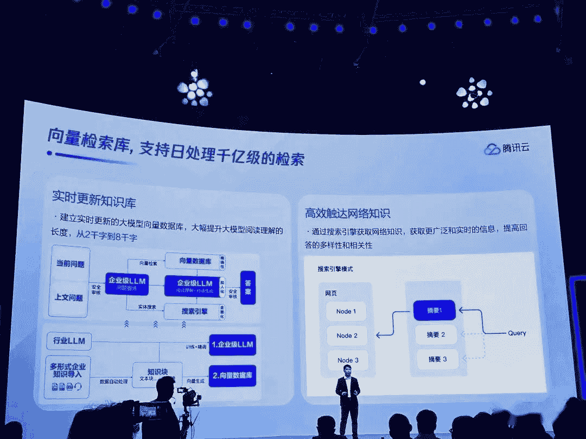
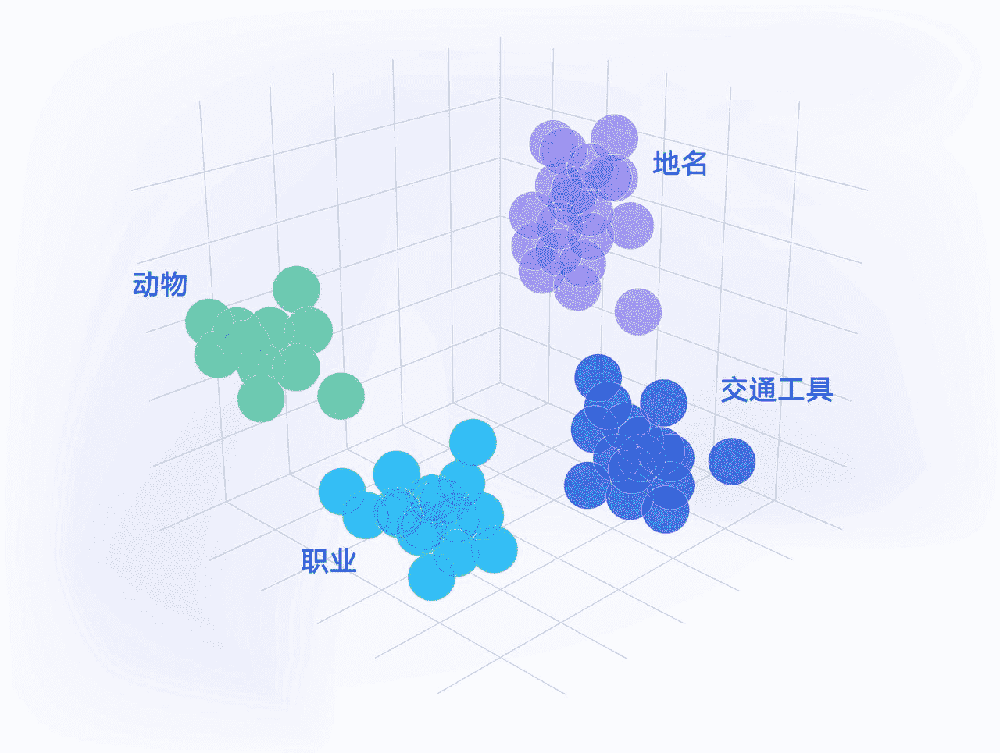
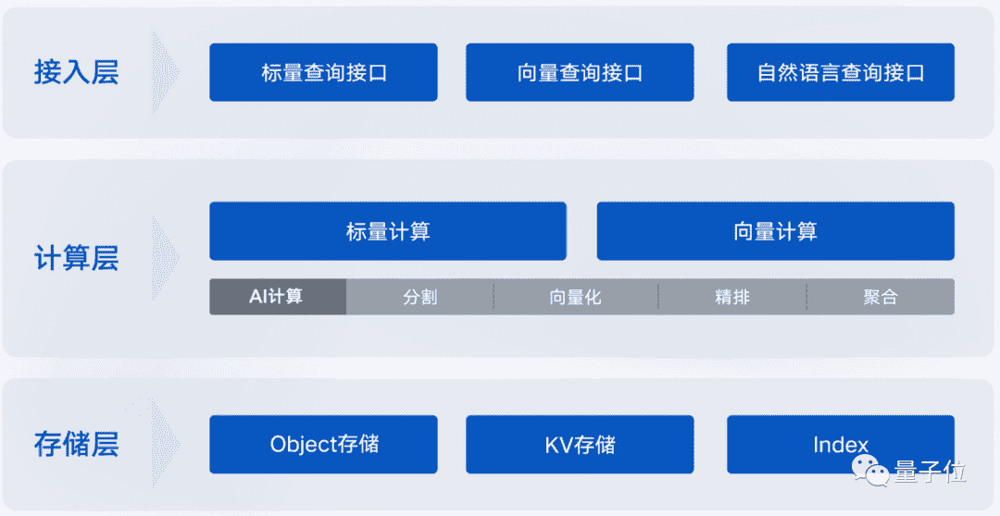
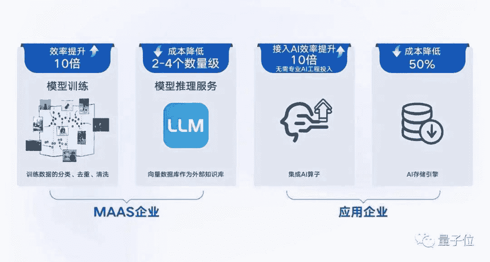
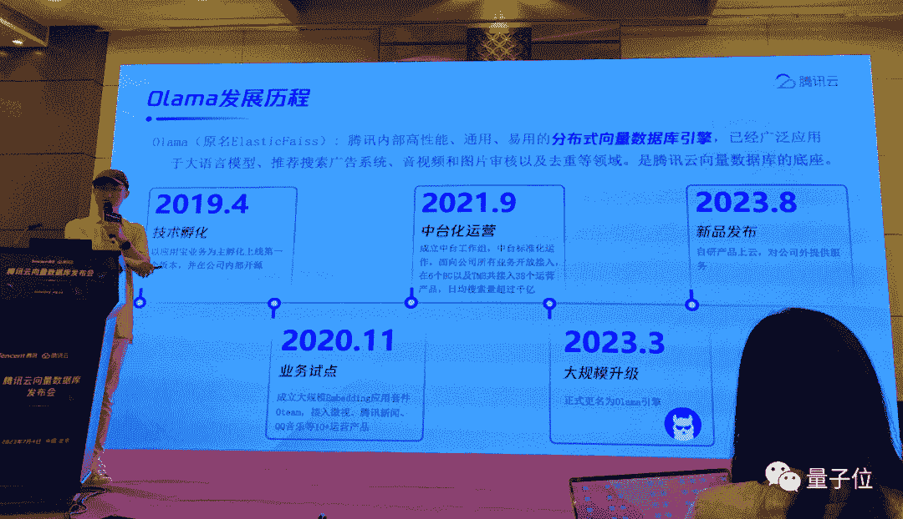
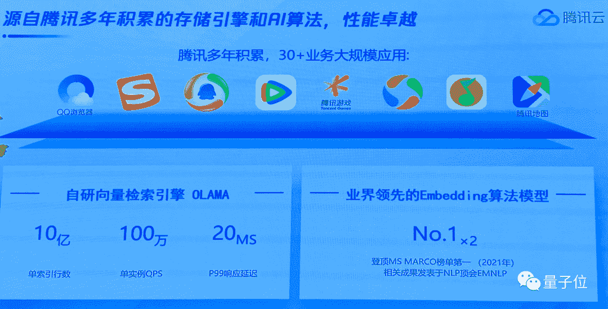

# 2023-07-05腾讯云大模型领域新动向！向量数据库作为独立产品推出，8月上架

> 来源：[https://xuqiwei1986.feishu.cn/docx/ROwzdKArrom7s1xhmRccXenKnve](https://xuqiwei1986.feishu.cn/docx/ROwzdKArrom7s1xhmRccXenKnve)

腾讯云大模型领域新动向！向量数据库作为独立产品推出，8月上架

> 明敏 发自 凹非寺

> 量子位 | 公众号 QbitAI

腾讯云的大模型领域布局，再补齐一块拼图。

最新动向，腾讯云 **AI****原生（AI Native）向量数据库Tencent C**loud VectorDB以独立产品形式对外发布，将在8月正式上架腾讯云。

这意味着，已经推出了行业大模型平台的腾讯云，还要专门面向大模型巨大的数据需求，推出单点云服务产品。

这在国内云市场中，还是首例。

今年大模型趋势发生以来，向量数据库因为自身属性，备受行业关注。

**作为给****大模型****长期记忆****的“****海马体****”**，它能够加速大模型知识的更新速度、降低训练成本、保障数据隐私、减少大模型幻觉等，可以解决当下大模型发展中的诸多关键问题。

在腾讯云重磅发布的行业大模型平台上，向量数据库也是被重点强调的能力之一。

那么问题就来了——

为什么已经向外输出能力的向量数据库，还要再以单独产品形式对外发布？腾讯云这么做的理由是？

还是从最新发布的内容看起。

实现3天接入大模型

先简单介绍下向量数据库。

它是通过把数据向量化，然后进行存储和查询。可以高速处理大规模复杂数据、高维数据（如图像、音视频等）；同时支持复杂查询操作，能轻松扩展到多个节点处理更大规模数据。

△图源：腾讯云

具体到大模型领域，向量数据库能有效降低训练成本、补充模型“长期记忆”、更快更新知识库、解决提示词工程复杂等问题。

**如腾讯云向量数据库，**可最高支持 10亿级向量检索规模，延迟控制在毫秒级，相比传统插件式数据库检索规模提升10倍，同时具备百万级每秒查询（QPS）的峰值能力。

这是什么概念？

腾讯云数据库副总经理罗云解释说，假设想要在10亿张图片里找到1张有狗的图片，腾讯云向量数据库有可以同时支持100万个类似的请求，在10亿规模图片里进行搜索，并且平均时延控制在百毫秒以内。

而为了能更加面向大模型**领域****需求**，这次最新发布中，腾讯云重新定义了一个 AI原生（AI Native）的开发范式。

将提供接入层、计算层、存储层的全面AI化解决方案。

带来的改变是，能让用户在使用向量数据库的全生命周期内，都能应用到AI能力。

具体而言：

+   在接入层，腾讯云向量数据库 **支持自然语言文本**的输入，同时采用“ **标量****+向量**”的查询方式，支持全内存索引，最高支持每秒百万的查询量（QPS）；

+   在计算层，AI原生开发范式能实现全量数据AI计算，一站式解决企业在搭建私域知识库时的文本切分（segment）、向量化（embedding）等难题；

+   在存储层，腾讯云向量数据库支持数据智能存储分布，能将企业存储成本降低50%。

带来的直接好处**是，原****来企**业接入一个大模型需要花 1个月左右的时间，用腾讯云向量库后，可以仅需 3天，给企业使用降低了门槛。

而且将腾讯云向量数据库用于大模型**预训练数据的分****类、去重和清洗相比传统**方式可以实现 10倍效率提升，如果将向量数据库作为外部知识库用于模型推理，则可以将 成本降低2-4个数量级。

为什么以独立产品形式推出？

自今年大模型趋势发生以来，向量数据库领域备受关注。

今年3月以后，多家向量数据库厂商拿下最新融资，其中Pinecone更是获得高达1亿美元的B轮融资。

腾讯云当然也注意到了这一趋势。

腾讯云数据库副总经理 **罗云**表示，当时内部已经开始讨论，随着AI趋势演进是否需要有一个单独workload的向量数据库去对外提供服务？

要知道，向量检索其实非常消耗CPU和内存资源。随着使用向量数据库的workload越来越大，插件式的数据库会面临一些挑战。

如果能把LTP（语言技术平台）流量扩增和向量流量扩增的资源分开，能让企业更加精细化管理自己的资源，从而降低成本。

**因此腾讯云认为这种Purpose-b**uilt（专用）向量数据库会越来越重要。

而且在那个时间点，内部已经有了一个比较明确的判断：

> 腾讯云在多年的积累下，对外提供一个更大规模的向量数据库产品，是有优势的。

为什么这么说？

**有两方面原因。**

**对内，腾讯云并非是从0到1开始做向量数据库；对外**，市场需求已经非常明显，而且会越来越大。

内因方面，腾讯云向量数据库从2019年开始在内部进行孵化，集成了业内以及腾讯自研的大量优秀算法，其能力已在内部多项业务中得到充分验证，并且积累了比较丰富的实践经验。

腾讯云向量数据库依托于**腾讯内部的**分布式向量数据库引擎 Olama（原名ElasticFaiss）。

腾讯PCG**大数**据平台部搜索推荐Senior Tech Lead 郑伟介绍，Olama目前负责处理腾讯集团每日千亿次检索，在内部海量场景的实践下，数据接入AI的效率也比传统方案提升10倍，运行稳定性达99.99%。

其向量化能力（embedding）在2021年登顶MS MARCO 榜单第一，相关成果已发表在NLP顶会ACL。

而在Olama的最新升级中，还针对成本、稳定性、自动化等方面做出更大提升。

目前，Olama已经应用在了多个腾讯内部业务上，如腾讯视频、QQ浏览器、QQ音乐等30款产品中。

数据显示，使用腾讯云向量数据库后，QQ音乐人均听歌时长提升3.2%、腾讯视频有效曝光人均时长提升1.74%、QQ浏览器成本降低37.9%。

而在外因方面，不仅是看到了向量数据库领域的发展趋势，腾讯云认为在这一方面云厂商也有一定自身优势。

罗云表示，出于对数据的重视，国内企业在选择数据类产品服务时，会希望能更加稳定、长久。

> 那么在国内的To B决策链条里，公有云厂商提供自己相应的技术服务，会很有竞争力。

**据东北证券预****测，到2030**年，全球向量数据库市场规模有望达到 500亿美元，国内向量数据库市场规模有望超过 600亿人民币。

腾讯云的动向，代表了云厂商在向量数据库方面的发力。

而除此之外，我们也看到Zilliz在内的向量数据库厂商，陆续面向大模型进行产品更新和升级。以及一些老牌数据库厂商（如甲骨文）也在发布AI相关业务。

而目前行业尚处于一个比较早期的阶段，未来趋势如何发展，还要看各方厂商的具体动向了。

但总之，在大模型趋势推动下，向量数据库领域还在不断升温。