# 2023-05-09AI行业专题报告：向量数据库，AI时代的Killer App

> 来源：[https://xuqiwei1986.feishu.cn/docx/XPk2dTp9fomstqx2Rnrck8HCneg](https://xuqiwei1986.feishu.cn/docx/XPk2dTp9fomstqx2Rnrck8HCneg)

> 🔗 原文链接： h[ttps://baijiahao.b](https://baijiahao.baidu.com/s?id=1765392687668372511&wfr=spider&for=pc)aidu.com/s?id=17...

AI行业专题报告：向量数据库，AI时代的Killer App

（报告出品方/作者：东北证券，黄净、吴雨萌）

### 1. 向量数据库是什么：存储向量的数据库

**1.1. 向量：AI 的核心 **

AI 的全流程其实都是围绕着向量的数学运算。向量在人工智能（AI）中扮演着非 常重要的角色，尤其在机器学习和深度学习领域。以下是向量与 AI 的一些关系（来 自 OpenAI）：

1、 数据表示：在机器学习和深度学习中，数据通常以向量形式表示。例如，图像 可以表示为像素值的向量，文本可以表示为词向量或句子向量；

2、 词嵌入：在自然语言处理（NLP）中，词嵌入技术（如 Word2Vec，GloVe 和 BERT） 将词语转换为多维向量，这有助于捕捉词语之间的语义关系。这些向量表示可 用于文本分类、情感分析、机器翻译等任务；

3、 神经网络权重：在深度学习中，神经网络的权重和偏置通常以向量和矩阵的形 式存储。在训练过程中，优化算法（如梯度下降）会不断更新这些权重向量， 以最小化损失函数；

4、 向量运算：许多机器学习算法，如支持向量机（SVM）、K-近邻（KNN）和主 成分分析（PCA）等，都涉及到向量间的距离计算、内积计算或其他向量运算。 这些运算有助于找到数据中的模式或者对数据进行分类；

5、 优化和梯度：在机器学习和深度学习中，优化算法（如梯度下降和 Adam）通常 使用梯度（一种向量），来更新模型参数，从而找到损失函数的最小值。这有助 于改进模型的性能；

6、 强化学习：在强化学习中，智能体使用向量表示状态和动作。例如，Q 学习和 深度 Q 网络（DQN）中的 Q 值函数会输出一个动作向量，智能体根据这个向量 选择最佳动作。 总之，向量对于 AI 至关重要。无论是之前的 CNN、RNN 模型还是当前火热的 Transformer，内部的数据流转其实都是向量的处理和变化。而高维空间向量所隐含 的海量信息也造就了 AI 应用的非凡潜力。

单就数据而言，只有向量化之后的数据才能被 AI 模型所分析。数据能够被分类为 结构化数据和非结构化数据，其中，结构化数据一般指可以使用关系型数据库表示 和存储、可以用二维表来逻辑表达实现的数据，典型的结构化数据例如成绩单、工 资单等；非结构化数据没有固定的结构，包括文本、图像、蛋白质结构、地理空间 信息和物联网数据流等。在人工智能时代，目前主流的对非结构化数据进行管理和 处理的方法是，利用 RNN 或 Transformer 等嵌入模型（Embedding Model），将非 结构化数据的语义内容转化为高维、密集的向量嵌入（Vector Embeddings），即多 维向量，并直接对这些嵌入进行存储、处理。非结构化数据转化为嵌入后，其语义 的相似性能够通过向量空间点的距离进行量化表示，并进行常见的机器学习操作， 如聚类、分类、推荐等。

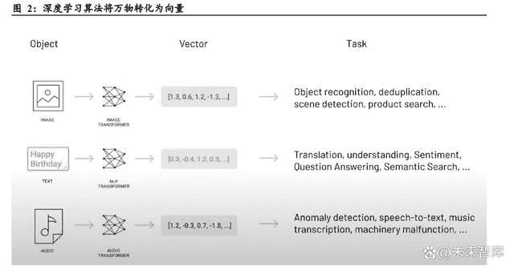

1.2. 向量化：技术已经充分扩散

向量化技术已经十分成熟，并且存在大量的开源解决方案。尽管向量化这个词对于 大多数普通民众而言较为陌生，但实际该技术早已成熟（目前大量应用的 Word2Vec 发表在 2013 年），在不同的领域，存在不同的向量化的方案。需要注意的是，不同 的领域，如文字、图片、视频等，向量化的技术是不同的。这些技术可以是诸如 OpenAI 等大模型厂商提供，也可以是诸如 Hugging Face 等中间层提供，当然还有 大量第三方厂商/开源提供。

向量化数据有着高昂的计算成本，因此寻求存储成本替代是必须的。向量化数据的 计算成本主要来自数据预处理、特征提取和向量化表示的生成。这些过程通常涉及 大量复杂数学运算，如矩阵乘法、特征变换和统计计算等。在处理大规模数据集和 高维数据时，这些运算可能会消耗大量的计算资源和时间。此外，许多机器学习和 深度学习算法都需要对向量化数据进行复杂的计算，如梯度下降、聚类和神经网络 训练。这些计算任务通常需要强大的硬件支持，如高性能 CPU 和 GPU，以及专用的深度学习加速器。相比之下，存储成本主要受向量化数据的规模和维度影响。虽 然高维向量和大规模数据集确实会导致存储需求的增加，但存储技术的不断发展使 得存储成本相对较低。例如，现代硬盘和固态硬盘的存储容量越来越大，同时价格 也逐渐降低。此外，通过使用稀疏向量表示和数据压缩技术，我们可以进一步降低 存储成本。更重要的是，随着云计算技术的普及，企业和个人用户可以按需购买存 储空间，使得存储成本变得更加可承受。相比之下，计算资源的按需购买通常价格 较高，尤其是在需要强大计算能力的场景中。综上所述，向量化数据所需的计算成 本远高于存储成本。这主要是因为计算任务通常涉及大量复杂数学运算，而存储成 本可以通过优化技术和云计算服务得到有效控制。

1.3. 向量数据库：专门用来存储和查询向量的数据库

向量数据库是专门用来存储和查询向量的数据库。向量数据库是一种专门用于存储、 管理、查询、检索向量（Vectors）的数据库，主要应用于人工智能、机器学习、数 据挖掘等领域。同传统数据库相比，向量数据库不仅能够完成基本的 CRUD（添加、 读取查询、更新、删除）、元数据过滤、水平缩放等操作，还能够对向量数据进行 更快速的相似性搜索。目前 AI 主流的大模型如 Transformer、Clip、GPT 等均能够 将文本、图像等非结构化数据转化为高维向量，而伴随大模型应用场景的扩展，这 些高维向量数据的存储、检索将显著带动向量数据库的市场需求。

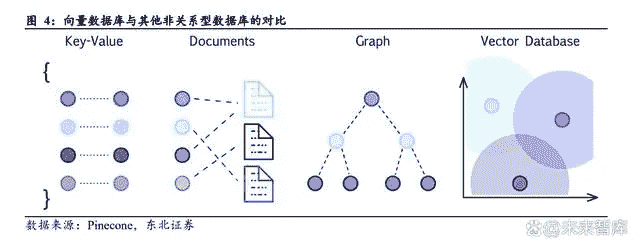

向量数据库的工作流程包括以下步骤： 1、向量数据的存储：向量数据通常是高维的数值型数据，如图像特征向量、文本 词向量等；向量数据库使用基于向量的存储结构，以便快速查询和处理； 2、向量索引：向量数据库使用 PQ、LSH 或 HNSW 等算法为向量编制索引，并将 向量映射到数据结构，以便更快地进行搜索； 3、向量查询：向量数据库将查询向量与数据库中的向量进行比较，从而找到最近邻的向量； 4、查询结果的返回：向量数据库返回查询结果，通常包括与给定向量最相似的向 量列表、向量之间的相似度得分等信息；该环节可以使用不同的相似性度量对最近 邻重新排序。

向量数据库能够通过向量搜索（Vector Search），实现更为高效、准确的执行和结 果输出。当前主流的数据库检索采用关键词搜索（Keyword Search）的方式，将搜 索关键词与数据库中的值进行匹配，根据词汇相似性、单词出现的频率，得到输出 结果。关键词检索的缺点在于，其对于语义相同、表达方式不同的文本理解能力较 差，且不具备多模态或多语言的检索能力。向量搜索利用神经网络模型，将对象（如 文本和图像）和查询表示为高维向量，采用 K 近邻法（KNN，K-Nearest Neighbor） 或近似临近算法（ANN，Approximate Nearing Neighbor），计算目标对象与数据库 中向量嵌入的距离（通常采用余弦距离、欧氏距离等方法）以表示两者的相似度， 并按照向量的相似度进行排序，返回结果。同关键词搜索相比，向量搜索能够实现 对语义更为精准的理解，在多模态、不同语言等环境下能够输出更为准确的结果。 例如：英文的 Capital 可以指“资本”或者“首都”，“从中国去美国”和“从美国 去中国”存在方向，传统的数据库不能很好地解决这些问题。

向量数据库的主要特点和优势包括： 1、 高效的相似性搜索：向量数据库通过优化的索引结构和查询算法，能够在大规 模向量数据集中快速地找到与给定查询向量相似的向量。这有助于实现实时或 近实时的搜索和推荐功能；2、 灵活的向量表示：向量数据库通常支持各种向量表示方法，包括稠密向量（如 词嵌入）和稀疏向量（如词袋模型和 TF-IDF）。这使得向量数据库可以处理各 种类型的数据，如文本、图像、音频和视频等； 3、 可扩展性：向量数据库通常具有良好的可扩展性，可以在多个计算节点上分布 式存储和查询向量数据。这使得向量数据库可以应对大规模数据集和高并发查 询的需求； 4、 高级查询功能：向量数据库通常提供丰富的查询功能，如相似性搜索、近似最 近邻查询、向量加权查询等。这使得向量数据库在各种应用场景中具有较高的 灵活性和实用性。

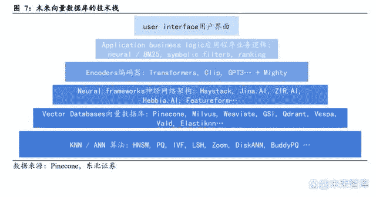

### 2. 向量数据库有什么用：给 AI 插上腾飞的翅膀

2.1. 拓展大模型的边界：向量数据库的核心应用

向量数据库一个很重要的功能是拓展大模型的边界。边界又分为时间边界和空间边 界。 时间边界的扩展指的是向量数据库能够使得大模型 LLM 拥有“长期记忆”。众所周 知，目前的大模型（无论是 NLP 领域的 GPT 系列还是 CV 领域的 ResNET 系列） 都是预先训练 Pretrain 的大模型，有着非常明晰的训练截止日 Cut-off Date。这导致 这些模型对于训练截止日之后发生的事情一无所知。而信息的价值随着时间的流逝 呈现出指数级下降，这也使得 LLM 在很多场景的适用性有限。随着向量数据库的 引入，其内部存储的最新的信息向量能够极大地拓展大模型的应用边界。向量数据 库可以使得大模型保持准实时性，提高大模型的适用性，并使得大模型能够动态调 整。也就是说，向量数据库使得大模型的长期记忆得到了可能。

例如，假设一个预训练的新闻摘要模型在 2021 年底完成了训练。然而，到了 2023 年，许多新闻事件和趋势已经发生了变化。为了使大模型能够处理这些新信息，可 以使用向量数据库来存储和查询 2023 年的新闻文章向量。通过这种方式，大模型 可以根据最新的数据生成更准确和相关的摘要。同样，在推荐系统中，预训练的大 模型可能无法识别新用户和新产品的特征。通过向量数据库，可以实时更新用户和 产品的特征向量，从而使大模型能够根据最新的信息为用户提供更精准的推荐。此 外，向量数据库还可以支持实时监测和分析。例如，在金融领域，预训练的股票预 测模型可能无法获取训练截止日期之后的股票价格信息。通过将最新的股票价格向 量存储在向量数据库中，大模型可以实时分析和预测未来股票价格走势。还有就是 在客服领域，向量数据库将使得大模型可以追溯到对话的开始。

空间边界的扩展指的是向量数据库能够协助解决目前企业界最担忧的大模型泄露 隐私的问题。用户给出的 Prompt 可能会包含一些敏感信息。根据媒体报道，员工 A 用 ChatGPT 帮自己查一段代码的 bug，而这段源代码与半导体设备测量数据有关； 员工 B 想用 ChatGPT 帮自己优化一段代码，就直接将与产量和良品率记录设备相关 的一段代码输入了其中；员工 C 则先用 AI 语音助手 Naver Clova 将自己的会议录音 转成文字，再用 ChatGPT 帮他总结一下会议内容，做成摘要。这些行为直接导致了 三星关键数据的泄露。而 ChatGPT 本身其实也出现过隐私泄露事件，使得有一小部 分的对话历史/支付数据会被其他用户查看。这些数据都极为敏感。通过本地部署， 向量数据库能够在很大程度上解决这个问题。向量数据库本地部署后可以存储企业 有关的大量隐私数据。在本地部署或者专有云部署大模型后，通过特别的 Agent 大 模型可以在有保护的情况下访问向量数据库的隐私数据，进而可以在不向外网暴露 公司的隐私的情况下，使得公司的业务得到大模型的助力。

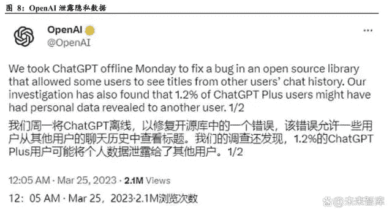

2.2. 多模态搜索：向量数据库的拿手好戏

向量数据库自带多模态功能，这意味着它能够通过机器学习方法处理和理解来自不 同源的多种模态信息，如文本、图像、音频和视频等。数据向量化过程使得这些不 同模态数据的内部隐藏信息得以暴露，进而为多模态应用提供支持。一个典型的应 用场景是多语言搜索。向量数据库支持跨语言的信息检索，用户可以使用英语、法 语、中文等多种语言搜索图书库，而无需事先对书名进行多语言翻译处理。这得益 于向量表示能够捕捉到语义相似性，使得来自不同语言的查询和内容能够相互匹配。 此外，向量数据库还可以实现跨模态搜索，例如让用户用文字来搜索图片。假设用 户用俄文搜索“蓝色的鞋子”，尽管商品的标题和描述都是英语，但向量数据库仍 然能够返回颜色为蓝色的鞋子商品的结果。这是因为向量数据库能够识别出不同模 态数据之间的语义关联，进而实现跨模态的信息检索。

2.3. 近似搜索：给向量数据库带来巨大的商业化潜力

即使不考虑需要 LLM 支持的边界拓展型应用和多模态搜索，近似搜索功能就可以 给向量数据库带来巨大的商业化潜力。向量数据库的近似搜索（Approximate Nearest Neighbor Search，简称 ANNS）是一种在高维数据中查找与给定查询向量相似的项 的搜索方法。这种搜索方法的目标是找到距离查询向量最近的数据点，即“最近邻”。 在向量数据库中，数据经过向量化处理后，每个数据点都会被表示为高维空间中的 一个向量。当我们需要查找与某个查询向量相似的数据点时，近似搜索算法会在这 个高维空间中快速定位到与查询向量距离较近的数据点。这种相似性度量通常基于 向量之间的距离（如欧氏距离、余弦相似性等）。由于在高维空间中进行精确的最 近邻搜索非常耗时，所以通常采用近似方法来加速搜索过程。近似搜索主要依赖于 一些特定的算法和数据结构，如 Locality-Sensitive Hashing（LSH）、Hierarchical Navigable Small World（HNSW）、Annoy 等。这些算法和数据结构能够在牺牲一定 精度的前提下显著加速搜索速度，从而实现在大规模高维数据中的高效查找。近似 搜索有着巨大的商业化潜力：

1、 推荐系统：通过利用近似搜索功能，向量数据库可以帮助推荐系统为用户提供 更精准、更个性化的内容推荐。这可以显著提高用户满意度和使用时长，进而 提升商业价值； 2、 文本挖掘：在自然语言处理领域，向量数据库的近似搜索功能可以帮助快速检 索相关文档、发现隐含的话题和关键信息。这对于新闻分析、竞争情报、法律 （特别是判例法）和市场研究等领域具有显著的商业价值； 3、 图像检索：向量数据库可以运用近似搜索功能在海量图像库中快速查找与给定 图像相似的图像，这对于广告、设计、版权等领域具有重要应用价值。通过快 速、准确地找到相关图像，企业可以降低成本、提高工作效率； 4、 语音识别和处理：近似搜索功能可以应用于语音识别和处理领域，帮助企业在 语音数据库中快速匹配相似语音片段。这对于客户服务、语音助手和自动翻译 等应用具有显著的商业潜力； 5、 生物信息学：在生物信息学领域，近似搜索可以帮助研究人员在基因序列、蛋 白质结构等复杂数字数据中查找相似性。这可以加速新药研发、疾病诊断和基 因治疗等领域的进展，从而创造巨大的商业机会。

实际上，印尼最大的电商之一 Tokopedia 就已经部署了向量数据库进行近似搜索。 之前 Tokopedia 采用基于 Elastic Search 的关键词搜索，这种搜索很难提取出搜索关 键词的内在含义，主要权重在于词频。通过从关键词搜索转为基于向量的近似搜索， Tokopedia 能够更好地满足用户的搜索需求，进行更精准的商品推荐，智能化水平提 升了 10 倍，从而大幅度地提升财务指标。

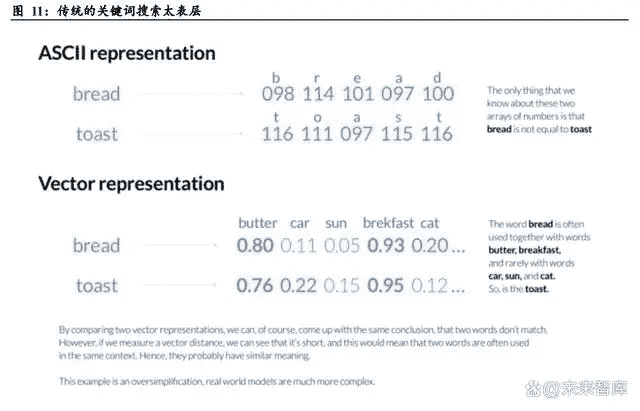

### 3. 市场空间：向量数据库五百亿美元蓝海市场待引爆

海量数据爆发产生巨大数据库需求。在互联网化趋势下，数据量呈爆炸式增长，同 时随着数据大集中、数据挖掘、商业智能、协同作业等大数据处理技术的日趋成熟， 数据价值呈指数上升趋势。根据 Stastista，2022 年全球创建、使用和存储的数据量 约为 97ZB，预计到 2025 年数据量将达到 181ZB，2021-2025 年全球数据量复合增 长率约为 23%。数据量的爆发式增长为数据存储、处理带来更为庞大的需求。

全球数据库市场规模仍处在高速成长期。根据 Gartner 数据，2021 年全球数据库市 场规模接近 800 亿美元（5201 亿人民币），同比增长约 20.3%，五年内已实现市场 规模翻倍。根据前瞻产业研究院，预计到 2026 年，全球数据库市场规模将达到 2086 亿美元，2021-2026 年复合增长率达到 21.13%。

关系型数据库仍然占市场主导，灵活拓展与高并发能力助力 NoSQL 数据库腾飞。 根据 IDC 报告，2017 年至 2022 年，非关系型数据库（DDMS）市场规模年复合增 长率为 30.94%，而关系型数据库（RDBMS）复合增长率仅 8.12%；但从市场规模看，关系型数据库仍然占据主导，83%的数据库市场由关系型数据库构成。根据 ScaleGrid 2019 年统计，关系型与非关系型数据库的用户规模分别为 60.5%和 39.5%。 根据 IMARC，2022 年全球 NoSQL 市场规模将达到 73 亿美元，预计 2023-2028 年 复合增长率将达到 29.92%。未来，Not-only-SQL 类型数据库市场规模的增速将持续 领先于传统关系型数据库。

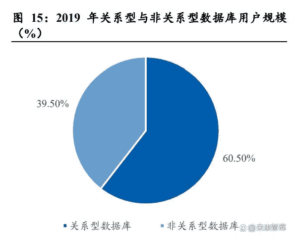

向量数据库或将迎来超 500 亿美元市场。基本假设： 1、 参考 Gartner、IDC 的市场规模数据，2021 年全球数据库市场规模为 800 亿美元； 2、 到 2030 年，全球数据库市场规模以 18%的年复合增长率增长，即 2030 年全球 数据库市场规模约为 3548 亿美元； 3、 参考 NoSQL、云服务数据库的占比，同时考虑到 AI 的快速渗透，假设 2030 年， NoSQL 数据库中向量数据库占比将达到 50%； 根据上述假设我们得出，预计到 2030 年，全球向量数据库市场规模或将达到 522 亿美元。

中国向量数据库市场空间或将达到 253-949 亿元。根据中国信通院数据，2021 年中 国数据库市场规模约为 309 亿元，占全球数据库 800 亿美元市场的比重约为 5.94%； 预计到 2025 年，中国数据库市场规模为 688 亿元，2020-2025 年复合增长率为 23.4%， 占全球数据库市场的比重约为6.14%。根据IDC，2020年中国数据量规模约为7.92ZB， 占全球总量的 18%；预计到 2025 年，中国数据量规模将增至 48.6ZB，占全球数据 量的 27.8％。中国数据量在全球的占比远超数据库市场规模占比，错配情况较为明 显。基于上述数据，我们做出如下假设： 1、 到 2030 年，中国数据库市场将以 20%的年复合增长率增长，对应 2030 年市场 规模 1711 亿人民币，占全球数据库市场的 7.4%； 2、 中国向量数据库市场占全球比重的下限≈中国数据库市场占全球数据库市场的 比重，即 7.4%； 3、 到 2030 年，中国数据量占全球数据量规模的比重维持在 2025 年水平； 4、 中国向量数据库市场占全球比重的上限≈中国数据量占全球数据量的比重，即 28%； 根据上述假设我们得出，预计到 2030 年，中国向量数据库市场规模或将达到 39-146 亿美元，对应 253-949 亿人民币。

需要特别指出的是，相比于传统数据库，向量数据库其实不止有存储功能，也有一 定的计算属性，因此其 TAM 是可以扩大的。

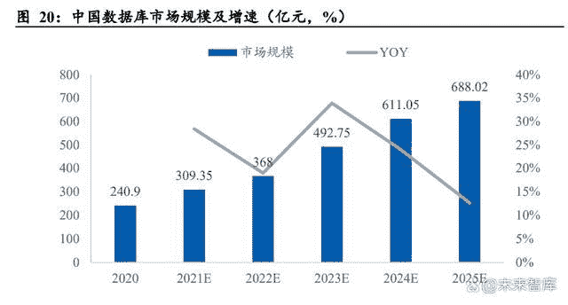

### 4. 全球主流向量数据库介绍

目前全球已有的向量数据库产品主要包括 Pinecone、Milvus、Weaviate、Vespa 等。 其中，超过 70%的向量数据库选择了开源，超过一半的向量数据库具有云化部署的 能力，大部分向量数据库产品在进行 ANN 相似性搜索时采用 HNSW（Hierarchical Navigable Small World）算法。向量数据库公司普遍以初创型企业为主，在一级市场 上普遍获得较多投资者的青睐。

**4.1. Pinecone**

Pinecone 拥有技术背景雄厚的工程团队，先后上架 Google 云和 AWS 并打开市场。 2019 年，Pinecone 创始人 Edo Liberty 创立 Hypercube.ai，提供基于深度学习的多媒 体搜索解决方案；2021 年初，Hypercube.ai 正式转化为 Pinecone，专注于向量数据 库 领域研发。团队多数工程师出自 Google、Databricks、Splunk 等知名科技企业。 公司创始人兼首席执行官 Edo Liberty 获得耶鲁大学计算机科学博士学位，曾担任 Yahoo 的高级研究总监和纽约地区 Yahoo 研究实验室的负责人，后加入 AWS 带领 团队构建了尖端的机器学习算法、系统和服务。2022 年 12 月起，Pinecone 先后上 架 Google Cloud 和 AWS，用户可以在 Marketplace 购买并使用 Pinecone，在不改变 基础架构的前提下，将 AI 技术支持的搜索加入到应用程序。Pinecone 通过借助平台 流量逐步提升产品知名度，有望进一步打开销售渠道，抢占市场份额。

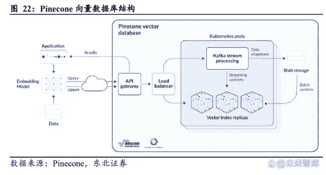

Pinecone 是一个闭源、全托管、仅使用简单 API 的云原生向量数据库，大致划分为 核心索引、容器分布（container distribution）、云管理层三部分。Pinecone 核心索 引负责将来自第三方数据源的高维向量转换成 ML 可读取的格式。容器分布确保数 据库在收到查询、更新和嵌入指令后，以延迟低于 50 毫秒的运行状态处理负载平 衡、进行数据复制、管理命名空间、分割数据库。云管理层使得用户在不安装硬件 的情况下，仅通过创建索引并导入向量数据就可实现查询。此外，用户可以使用 API 随时随地更新、查询向量索引。公司经历了三次重要技术创新：1）技术团队在 保证托管系统稳定运行，元数据与图像遍历（graph traversal）相结合等条件下，研 发出动态、可过滤的图形索引；2）原 RocksDB 存储引擎达到极限后，团队构建了 全新的“memkey”向量存储，其在大型数据库对生成对象的存储速度超 RocksDB 10 倍，降低 30%-50%的运营成本；3）基于 C++和 Python 产出的代码库问题不断，团 队最终决心在 Rust 中重新搭建数据库和开发环境的架构，有效提高了开发速度并降 低了运营事件概率。

Pinecone 数据库拥有 4F 特性：快速（Fast）、实时（Fresh）、可过滤（Filtered）、 全托管（Fully）。即使有数十亿规模的数据存储，依然可以保持极低的查询延迟。 在增加、编辑和删除数据时，实时更新索引。向量搜索与元数据过滤相结合，提高 查询结果的相关性。平台保证稳定、安全的运行环境，产品入门简单、使用便利。 操作流程可划分创建索引（Index）、连接索引、插入索引、使用索引四步。通过创 建一个索引对象，通常为 json 格式的数据，将向量嵌入和元数据写入到索引中，然 后调用索引对象的方法来执行相似性搜索或其他操作。pinecone 还提供了一些预定 义的索引类型（Index Type），如 Image Search ，Text Search 等，可以让开发者更容 易地开始特定的用例。

定价标准：当前存在初学者、标准、企业级三种模式。初学者版本使用免费，但仅 限创建一个索引与一个计划；标准版本适用于任何规模的生产应用程序，支持将向 量数据库保存在集合中，能够进行自由索引，每月收费 70 美元起；企业版本能够 实现标准版本中的所有功能，并支持多个可用区以及 24/7/265 专属支持服务，每月 收费 104 美元起。 Pinecone 一级市场获 1.38 亿美元融资，估值超 7 亿美元。2021 年 7 月，Pinecone 种子轮收到 1000 万美元投资，投资方 Wing Venture Capita；2022 年 3 月底，公司 A 轮融资 2800 万美元，Menlo Ventures 领投，Tiger Global、Wing Venture Capital 跟投， 公司估值达到 1.68 亿美元。2022 年底，伴随 ChatGPT 推出而引发生成式 AI 开发热，作为 LLM“海马体”的向量数据库需求激增，开发者、投资者纷纷涌入向量数据库 赛道。截至 2023 年 4 月，公司 B 轮获 Andreessen Horowitz、ICONIQ Growth、Menlo Ventures、Wing Venture Capital 投资超 1 亿美元，三轮融资总额达到 1.38 亿美元， 投后估值已升至 7.5 亿美元。

**4.2. Milvus**

Milvus 向量数据库由中国创业团队 ZilliZ 研发，并于 2019 年面世。Zilliz 成立于 2017 年，拥有超过 100 名员工。通过向量数据库 Milvus，Zilliz 与 Nvidia、IBM、微软、 AWS 等公司建立合作。目前开源 Milvus 已成为业界领先的向量数据库解决方案， 有~18000 个 GitHub Star。

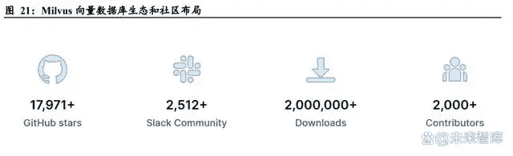

Milvus 是一个基于云原生、开源的自托管向量数据库。Milvus 数据库包含以下特点： 易于使用：借助 Milvus 向量数据库，使用者可以在不到一分钟的时间内创建大 规模的相似性搜索服务；SDK 简单直观，也可用于各种不同的语言； 速度快：Milvus 具有较高的硬件效率，并提供先进的索引算法，检索速度可提 升 10 倍；高可用性：Milvus 向量数据库已成功在一千多名企业用户中进行了实战测试， 通过对各个系统组件的广泛隔离，Milvus 具有较高的弹性和可靠性； 高度可扩展性：Milvus 的分布式和高通量特性使其面对大规模向量数据时能够 提供高效的服务； 云原生：Milvus 向量数据库采用系统化的云原生方法，将计算与存储分离，并 允许使用者横向、纵向扩展；功能丰富：Milvus 支持各种数据类型、具有属性过滤的增强向量搜索、UDF 支 持、可配置的一致性级别、时间旅行等。

为了增强弹性和灵活性，Milvus 由存储层和计算层组成。该系统包括四个级别： 接入层 Access Layer：接入层由一组无状态代理组成，充当用户的系统和端点 的前端；协调器服务 Coordinator service：协调器服务将任务分配给工作节点，并充当 系统的大脑； 工作器节点 Worker nodes：工作器节点充当人类的手臂和腿，是一种哑执行器， 遵循协调器服务的指令并执行用户触发的数据管理语言 DML/数据定义语言 DDL 命令； 存储 Storage：存储是系统的骨骼，确保数据可持续性，包括元存储、日志代 理和对象存储。

Zilliz 目前已进入 B 轮融资阶段，获得投资总额超 1.13 亿美元。2022 年 8 月 24 日， Milvus 的开发者公司 Zilliz 宣布，已在其最初 4300 万美元 B 轮融资基础上追加了 6000 万美元的融资。本轮融资由沙特石油巨头 Aramco Ventures 旗下多元化增长基 金 Prosper Ventures 领投，现有投资者 Temasek's Pavilion Capital（淡马锡）、Hillhouse Capital（高瓴）、5Y Capital 和 Yunqi Capital（云启资本）跟投。本轮融资后，公司 的总融资额达 1.13 亿美元，融资将用于支持其云矢量数据库的工程设计和上市工作。

**4.3. Vespa **

Vespa 由 Oath 开发，发布之初被定义为一款开源的“大数据处理和服务引擎”，。 2003年2月2日，Yahoo以1亿美元收购Vespa前身——挪威搜索引擎公司AlltheWeb； 2017 年 9 月 28 日，由 Yahoo 和 AOL 业务合并后诞生的公司 Oath 宣布开源 Vespa， 并将代码托管于 GitHub。 Vespa 能够部署于本地或云上，能够实现不同类型的搜索功能。作为开源的应用， Vespa 应用程序可以部署在本地或 Vespa Cloud 上，并可以接入 Java 组件和 Python API。部署完成后，Vespa 能够实现基于传统 BM25 的信息检索、向量最近邻搜索、 机器学习模型服务、问答、内容推荐等功能。目前 Vespa 已被应用于 Oath 的多个 产品，包括 Yahoo.com、Yahoo News、Yahoo Sports、Yahoo Finance、Yahoo Gemini、 Flickr 等，每日可以处理数十亿个用户请求，为用户返回基于数十亿文档得出的搜 索结果和推荐内容，并提供定制化内容和广告。

Vespa 由多个无状态的 Java 容器集群和零个或多个存储数据的内容集群组成。无状 态容器集群包括传入数据、查询以及响应的组件。这些组件提供包括索引转换和查 询执行的平台功能，也可以提供应用程序的中间件逻辑。容器集群将查询和数据操 作传递到内容集群中的相应节点，也可以添加组件访问来自外部服务的数据。内容 集群负责存储数据并对数据执行查询和推理。查询的范围包括简单数据查找、使用 机器学习模型对数据进行排序、以及对数据进行分组和聚合。

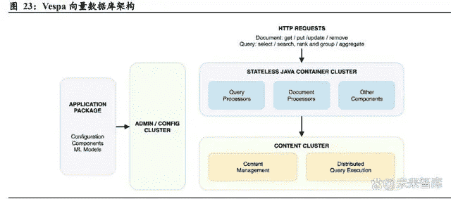

**4.4. Weaviate**

Weaviate 前身为 SeMI Technology，成立于 2019 年，是一家全球性初创企业。目前 Weaviate 在荷兰、美国、加拿大等地设有分支机构，拥有超过 30 名团队成员。Weaviate 创始人 Bob van Luijt 与 Etienne Dilocker 拥有 10 年以上的自由工程师经历，具有深 厚的技术积累。 Weaviate 是一个低延迟的向量数据库，对不同的媒体类型（文本，图像等）具有开 箱即用的支持。Weaviate 提供语义搜索、问答提取、分类、定制化模型（PyTorch / TensorFlow/Keras）等功能，基于 Go 语言，能够存储对象和向量，并允许将向量搜 索、结构化筛选和云原生数据库的容错能力相结合，且支持 GraphQL、REST 以及 各种客户端编程语言进行访问。 Weaviate 可进行本地或云化部署，具有多种定价模式。Weaviate 可提供 SaaS 以及 混合 SaaS 的服务，其中 SaaS 服务定价分为三类：标准、企业、关键商务型，起价 分别为 25/135/450 美元/月，实际定价将伴随向量存储、搜索的维度的增长而提升。

标杆应用场景——Weaviate 于 2023 年推出 ChatGPT 的 Plugin 插件，其功能包括： 1、允许用户连接一个向量数据库到 ChatGPT，其中包含用户的专有数据，可以被 ChatGPT 调用并用于回答特定的问题； 2、允许用户对个人文档进行存储，使 ChatGPT 的回答更加个性化； 3、用户可以在向量数据库中储存与 ChatGPT 的对话，在关闭并再次打开 ChatGPT 后，根据数据库中的内容继续对话。 Weaviate 的索引流程：以文本编码器（text2vec-transformer）和问答编码器 （qna-transformers）为例，用户可以创建任意数量的索引，每个索引包含一定数量 的分片，索引中的分片是独立的存储单元，每个分片均可以进行对象、倒置和向量 存储，其中对象和倒置存储使用 LSM 树方法进行实现，向量索引独立于这些对象 存储，不受 LSM 分割的影响。此外，Weaviate 本身是纯原生的向量数据库，不自 带任何模块，因此各类功能将由可选模块进行执行。除上述提到的文本、问答等编 码模块外，Weaviate 还支持加载例如其他媒体类型的向量化、物体识别、拼写检查 等外部模块。

投后估值 2 亿美元，融资总额超过 6700 万美元。2023 年 4 月 22 日，Weaviate 宣布， 继 2022 年 A 轮融资获得 1650 万美元后，B 轮融资获得 5000 万美元（约合 3.5 亿人 民币），由 Index Ventures 领投 ，Battery Ventures 等机构跟投。公司截至目前共获得 6770 万美元融资，投后估值 2 亿美元。

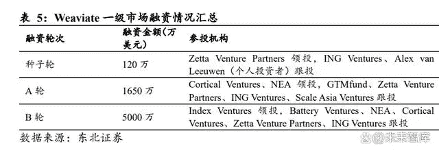

**4.5. Qdrant**

Qdrant 成立于 2021 年，是一款针对人工智能软件开发人员，提供用于非结构化数 据的开源向量搜索引擎和数据库。Qdrant 的创始人 Andre Zayarni（CEO）和 Andrey Vasnetsov（CTO）曾就职于智能招聘公司 moberries，均具有较为深厚的技术背景和 经验，并曾在多家欧洲科技公司担任技术团队的领导者。 Qdrant 当前能够进行本地化自托管部署，云化版本仍在测试中。目前 Qdrant 已在 Github 上进行开源，使用者可以免费本地化部署 Qdrant 向量数据库。同时 Qdrant 还提供起价 25 美元/月的云化试用版，用户可以在托管云中使用向量数据库解决方 案，无需复杂的部署和维护，并由 Qdrant 团队进行专业服务支持。Qdrant 开发团队 还能够提供专业的企业级服务，包括协助企业进行向量数据库的本地化部署、神经 网络模型的微调、数据的迁移和监控等。目前 Qdrant 能够提供图片相似搜索、语义 文本搜索、推荐、对话机器人、匹配引擎、非正常监控等解决方案，包括向量数据 库的搭建和模型预训练与微调。

Qdrant 仍处于种子轮融资阶段，融资总额接近千万美元。2022 年 1 月 Qdrant 获得 preseed 轮融资 200 万欧元；随后于 2023 年 4 月，Qdrant 再次获得 750 万美元的种 子轮融资，领投方为 Unusual Ventures，42cap、I BB Ventures 以及包括 Cloudera 联 合创始人 Amr Awadallah 在内的个人天使投资人。

（本文仅供参考，不代表我们的任何投资建议。如需使用相关信息，请参阅报告原文。）

**精选报告来源：【未来智库】。**

举报/反馈

大家都在搜

[向量数据库 ](https://baidu.com/s?word=%E5%90%91%E9%87%8F%E6%95%B0%E6%8D%AE%E5%BA%93&rsv_dl=feed_landingpage_rs&from=1020853i&rsf=)[矢量数据结构和矢量数据模型 ](https://baidu.com/s?word=%E7%9F%A2%E9%87%8F%E6%95%B0%E6%8D%AE%E7%BB%93%E6%9E%84%E5%92%8C%E7%9F%A2%E9%87%8F%E6%95%B0%E6%8D%AE%E6%A8%A1%E5%9E%8B&rsv_dl=feed_landingpage_rs&from=1020853i&rsf=)[矢量数据分析 ](https://baidu.com/s?word=%E7%9F%A2%E9%87%8F%E6%95%B0%E6%8D%AE%E5%88%86%E6%9E%90&rsv_dl=feed_landingpage_rs&from=1020853i&rsf=)[矢量数据模型 ](https://baidu.com/s?word=%E7%9F%A2%E9%87%8F%E6%95%B0%E6%8D%AE%E6%A8%A1%E5%9E%8B&rsv_dl=feed_landingpage_rs&from=1020853i&rsf=)[人工智能数据集 ](https://baidu.com/s?word=%E4%BA%BA%E5%B7%A5%E6%99%BA%E8%83%BD%E6%95%B0%E6%8D%AE%E9%9B%86&rsv_dl=feed_landingpage_rs&from=1020853i&rsf=)[人工智能导论模型与算法pdf](https://baidu.com/s?word=%E4%BA%BA%E5%B7%A5%E6%99%BA%E8%83%BD%E5%AF%BC%E8%AE%BA%E6%A8%A1%E5%9E%8B%E4%B8%8E%E7%AE%97%E6%B3%95pdf&rsv_dl=feed_landingpage_rs&from=1020853i&rsf=)