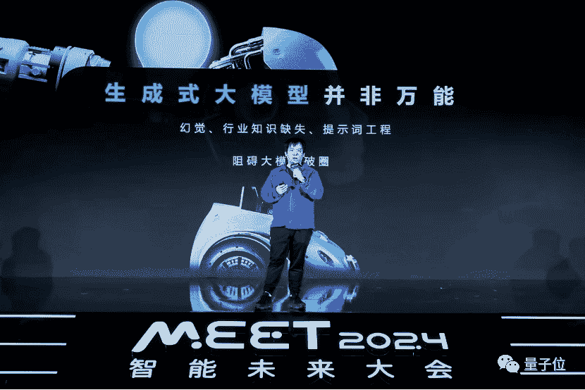
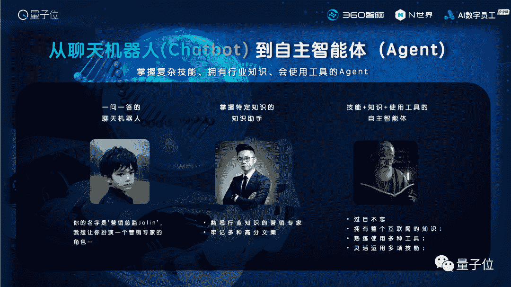
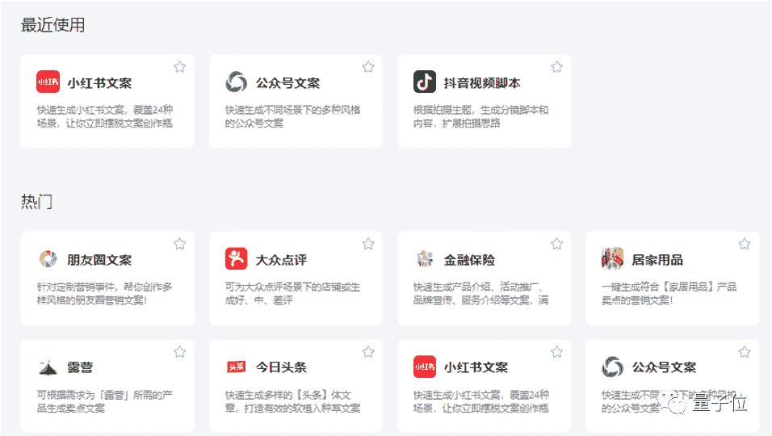

# 2023-12-18--360集团梁志辉：企业不能指望员工都变成AI发烧友｜MEET2024_模型_应用_智能

> 来源：[https://xuqiwei1986.feishu.cn/docx/XmhtdONMNoBYJyxAMD7cWN3inig](https://xuqiwei1986.feishu.cn/docx/XmhtdONMNoBYJyxAMD7cWN3inig)

> 🔗 原文链接： h[ttps://www.sohu.co](https://www.sohu.com/a/744994245_610300)m/a/744994245_61...

编辑部 整理自 MEET2024

量子位 | 👸号 QbitAI

**大模型这一**年，已从“**百模大战”的 技**术比拼 ，发展到 商业价值的较量 。

在MEET 2024智能未来大会现场， 360集团副总裁、360大模型应用负责人梁志辉 就以这一年的大模型应用实践分享了经验和看法，他表示：

> 在推广大模型应用时，要发挥大模型的长处如内容生成，避开它的短板如长期记忆能力不足，实现人机协同。

> 合理运用大模型的优势，让它成为员工的智能助手，可以极大提升企业的工作效率和产出。

为了完整体现梁志辉关于大模型在企业生产中的应用场景的思考，量子位在不改变原意的基础上，对他的演讲内容进行了编辑整理。

关于MEET智能未来大会：MEET大会是由量子位主办的智能科技领域顶级商业峰会，致力于探讨前沿科技技术的落地与行业应用。今年共有数十家主流媒体及直播平台报道直播了MEET2024大会，吸引了超过300万行业用户线上参会，全网总曝光量累积超过2000万。

# 演讲要点

+   在大模型时代，人类的听、说、读、写能力都可以得到增强，大模型与人类是一种增强而非取代的关系

+   真正精通提示工程要读100篇论文、写100个提示词，企业要推广大模型不可能让每个员工都变成AI发烧友

+   最合适的人机协作方式，是让大模型变成我们的助手，变成每个人的助理

+   大模型商业应用的三大场景：智能营销、智能办公、智能客服

（以下为梁志辉演讲分享全文）

生成式AI不是万能的，需要新的人机协同方式

今天我给大家分享一下360在大模型应用在企业生产的应用场景落地的一些心得和案例。

首先在我们看来， 大模型时代AI与人的关系不是取代，而是增强 。

无论是对于内部办公还是对外营销，大模型都能够把人的阅读速度、写作速度、信息查找的速度大大提升起来。

但是我们也想提醒一点，生成式AI或者生成式大模型不是万能的。

+   首先，大模型现在还是有幻觉的问题，可能会胡编乱造一些事实。

+   其次，很多大模型在很多场景缺乏行业知识，无法准确回答非常专业的问题。

+   第三，提示工程也会给大模型使用者带来困扰。

根据我们的数据， **一个人要想真正精通提示工程要读100**篇论文、写100个提示词，才算真正学会 。

前一段时间OpenAI推出GPTs，可以看到背后的提示词模板是非常复杂的， 不可能让企业每个员工变成AI发烧友才能够把大模型推广起来 。

这种场景下，我们希望有一种新的人机协同的方式。

从AI“小学生”到自主智能体

高质量内容很难靠大模型生成，要在工作中推广大模型就要扬长避短，避开大模型不擅长的事情。

我们认为最合适的方式 让大模型变成我们的助手，变成每个人的助理 。

大模型的长处就是内容生成和内容理解，短处除了幻觉、长期记忆，任务规划能力也比较弱，做不到像人一样好。

假设招一个大学生来做助理，入职需要培训，完成实际工作也要依靠前人总结的工作流程。我们希望让大模型可以分步执行工作流程，通过分解任务来完成工作。

自从国内的百模大战打开了AI原生应用**局面，我们看到了很多一问一答**的机器人， 这样的机器人就像小学生水平 。

通过提示词“催眠”大模型，比如扮演一个营销总监，就按照营销总监的套路进行回答。但是它既不了解你的产品，也不了解你的公司，更不了解公司的协作方式，生成的公司介绍文案基本上是不现实、不靠谱的。

**中间状态是结合大模型和行业知识**库， 让它变成大学生一样的知识助手 ，但这种场景下还是只有通用的知识，对具体公司的业务等情况还是不了解。

我们希望 让大模型成为掌握多种技能、具备行业知识、会使用多种工具的自主智能体 ，也就是Agent。

这个Agent有整个互联网做它的知识背景，能熟练使用多种工具，可以帮你去查机票、订机票，知道今天的天气，甚至可以知道今天的汇率等等实时信息。

一问一答的聊天机器人只能去回答一些简单、静态的问题，无法融会贯通。

如果把大模型和Agent结合起来，会比前面两种应用形态增加很多技能，可以帮你搜索、阅读、写作。搜索中能够帮你想到更多关键字，把问题补全。找到更多的资料后，Agent能阅读上百个网页，最终完成一个工作报告。

大模型商业应用的三大场景

基于大模型以及Agent，目前来说我们主要关注三大场景： 智能营销、智能办公、智能客服。

**对于智能营销，我们既有文生文如新媒体写作，也有文生**图如电商配图，还有文生短视频、文生直播。

文生文方面，许多大模型都说能做📕文案，但越是要流量的人会越把📕文案跟热点结合起来，这种场景下。只有生成可能是不够的。

360提供的📕文案生成工具，会知道📕现在什么关键词火，能把热词跟内容结合，调用搜索能力了解产品的关键细节，质量会远远超过普通大模型生成的似懂非懂又很虚的文案。

基于大模型生成不同风格的文案，还可以生成无数个不同的版本，内容重复率会大大下降，被平台推荐的机会会大大提升。

同时我们看到很多人在做视频内容的推广，但是无论是视频脚本的生成，还是视频本身的生成，成本都很高。

在这种场景下，360有数字人生成视频方案，所有人都可以生成自己的数字人来制作视频。比如在文旅场景，我们可以有一个数字诸葛亮来介绍襄阳当地的情况。

其次我们会看到很多公司的CEO都很忙，要去各地演讲，甚至出席跨国活动。在这种场景下，不见得每个人都能掌握多国语言，所以我们的数字人能够让CEO可以直接跟人进行面对面的对话，甚至可以说英语。

有了这些能力以后，我们还可以让数字人来主持一整场活动，不用担心数字人会说错词。也能做主播，用数字人开多个直播间，不同的直播间可以说不同的话，针对不同观众的反馈进行回应，不再是复读机。

智能办公方面，360也有几个例子可以分享。

在办公方面，对人最高的赞誉就是一目十行，人一天最多也就写个万字长文。但是有了大模型之后，这些日常办公写作就不再是问题。同一个公司，大模型辅助写作和人工对比， 效率 相差是非常大的。

目前360针对很多办公场景提供提前编排好的工具，在这些工具里面可以30秒生成一个PPT大纲，可以让AI一键帮你完成SWOT分析，也可以花3分钟完成一个30分钟演讲稿，过去所有事情都需要十倍或者百倍以上的时效才能完成。

基于大模型可以主动做搜索，也可以去阅读你提供的内容，以及可以把你历史上的范文作为训练数据，让大模型写作的内容更有内涵，更符合逻辑和事实。

每天有读不完的报告和行业内容，这种场景下可以让大模型帮你阅读整个报告，去做报告的总结和报告撰写。

**对**于智能客服，基于大模型的数字人和普通数字人最大的区别，是它卖的是有自然对话能力的交互性数字人，不仅可以是客服，还可以是销售甚至老板的分身。

在景区、政务以及金融场景，就可以让基于大模型的数字人来接待客人，甚至可以变成陪练官，只要企业把相关信息，无论是音频、视频、文字内容，上传后可以让大模型迅速理解其中的内容，最后变成虚拟导游、企业客服。

数字人可以出现在各种大屏、一体机、APP、H5上面，甚至可以让它来做产品推荐，之前360与某科技行业客户合作了产品推荐官数字人，比如可以推荐一款适合学生的笔记本电脑。

今天的演讲就到此为止，如果大家对360的产品感兴趣，我们的AI数字员工和数字人都有试用版，欢迎大家体验，谢谢大家。