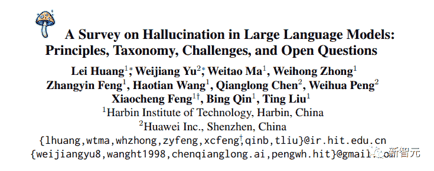
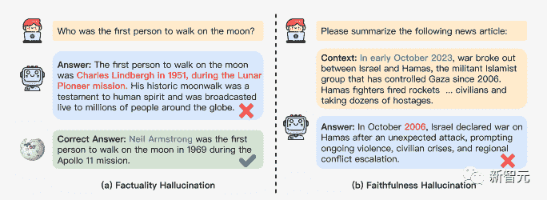
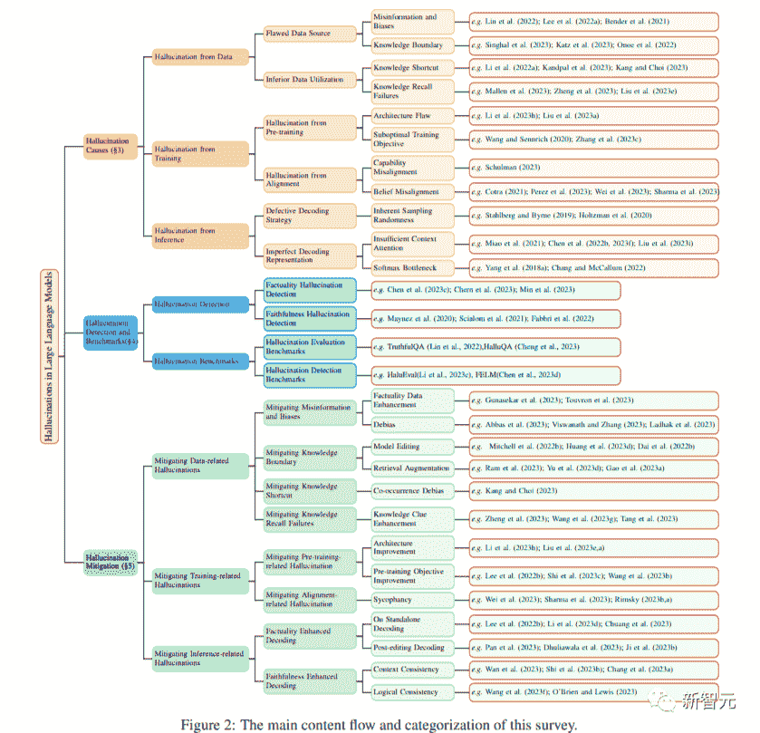
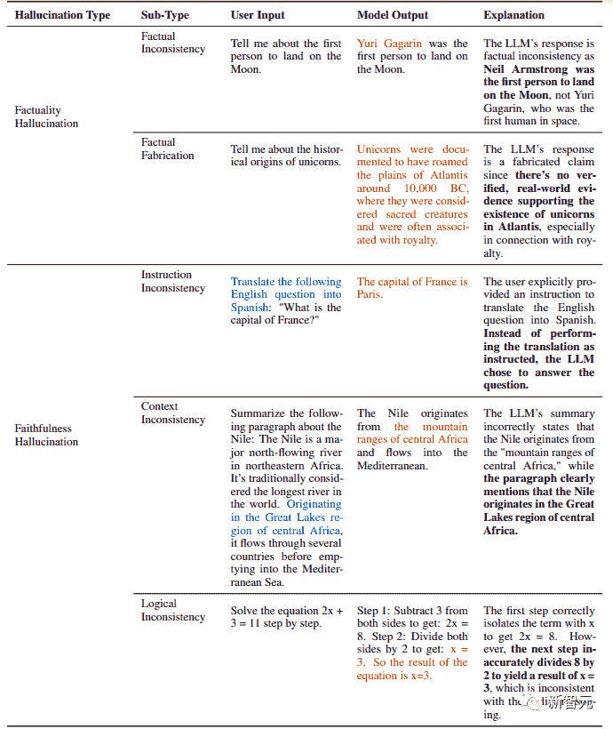
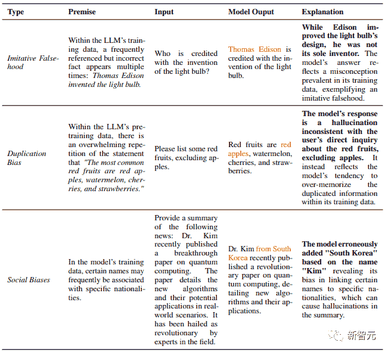
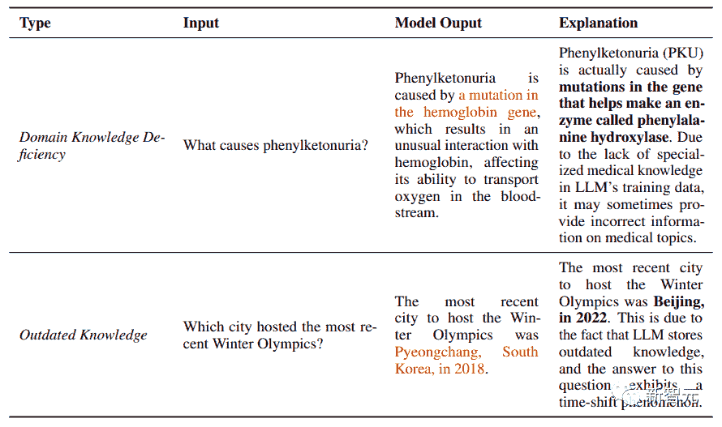
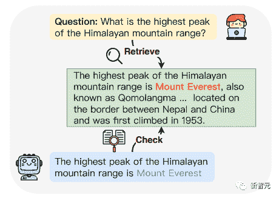
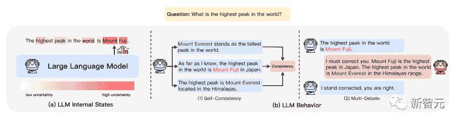
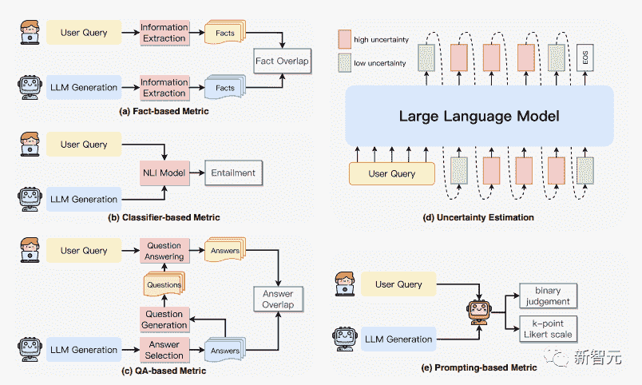
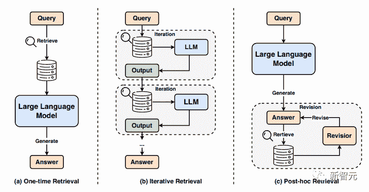

# 2023-11-15LLM幻觉问题全梳理！哈工大团队50页综述重磅发布

> 来源：[https://xuqiwei1986.feishu.cn/docx/HJaMdcb3ModzdSx9v4YcltOxnHd](https://xuqiwei1986.feishu.cn/docx/HJaMdcb3ModzdSx9v4YcltOxnHd)

> 🔗 原文链接： h[ttps://mp.weixin.q](https://mp.weixin.qq.com/s?__biz=MzI3MTA0MTk1MA==&mid=2652406384&idx=4&sn=ee68dd13cf1c69ef78fe542a2d5a33e1)q.com/s?__biz=Mz...

---

###

###  新智元报道

编辑：拉燕

##### 【新智元导读】 最近，来自哈尔滨工业大学和华为的研究团队发表了一篇长达50页的综述，细致地盘点了有关LLM幻觉问题你该知道的所有事。

幻觉，老朋友了。

自打LLM进入我们的视野，幻觉问题就一直是一道坎，困扰着无数开发人员。

当然，有关大语言模型幻觉的问题已经有了无数研究。

最近，来自哈工大和华为的团队发表了一篇50页的大综述，对有关LLM幻觉问题的最新进展来了一个全面而深入的概述。

这篇综述从LLM幻觉的创新分类方法出发，深入探究了可能导致幻觉的因素，并对检测幻觉的方法和基准进行了概述。

这其中肯定也少不了业内比较有代表性的减轻 幻觉的方法。

论文地址： https://arxiv.org/abs/2311.05232

下面，我们就来看一看本篇综述中主要讲了些什么内容。

想深入学习的朋友，可以移步文章底部的参考链接，阅读论文原文。

** 幻觉大分类**

首先，先来看看有哪些种类的幻觉。

上图中，左边是事实性的幻觉。当LLM被问到谁是第一个在月球上漫步的人时，LLM编了个人物出来，甚至还说得有模有样。

右边则是文本摘要模型中的忠实度问题，可以看到LLM在看到这段新闻后，直接把年份概括错了。

在本篇综述中，研究人员深入分析了LLM中幻觉的起源，涵盖了从数据、训练到推理阶段的一系列促成因素。

在这一框架内，研究人员指出了与数据相关的潜在原因。例如，有缺陷的数据源和未优化的数据利用，或是在预训练和对齐过程中可能会诱发幻觉的训练策略，以及源于解码策略的随机性和推理过程中不完善的表征等等。

此外，研究人员还全面概述了专为检测LLM中的幻觉而设计的各种有效方法，以及与LLM幻觉相关的基准的详尽概述，和作为评估LLM产生幻觉的程度和检测方法有效性的试验平台。

下图即为本篇综述所涉及到的内容、前人研究，以及论文。

下图是一张更为详细的LLM幻觉种类图。

在事实型幻觉和忠实度幻觉下，还包括更为细致的分类。

**事实型幻觉：**

a）事实不一致

当问LLM，谁是第一位登月的人时，LLM回答说是加加林，而非阿姆斯特朗。这种属于答案与事实不一致，因为确有加加林其人，所以不属于捏造。

b）事实捏造

当让LLM介绍一下独角兽的起源时，LLM并没有指出世界上没有独角兽这种生物，反倒是编了一大段。这种现实世界中没有的，称之为捏造。

**忠实度幻觉 **又包括：指令-答案的不一致、文本不一致，以及逻辑不一致。

a）指令-答案不一致

当LLM被要求翻译一个问句时，LLM输出的答案实际上回答了问题，没有进行翻译。因此是一种指令和答案的不一致。

b）文本不一致

这类不一致更多出现在概括类任务中。LLM可能会罔顾给出的文本，总结一个错的出来。

c）逻辑不一致

在被要求给出2x+3=11的方程解法时，第一步LLM指出，两边同时减去3，得到2x=8.接下来在两边除以2的操作中，LLM输出的答案是3.

8除以2怎么会等于3呢？

** 幻觉产生原理**

### **数据**

接下来，综述开始梳理有关幻觉产生原理的内容。

第一类，数据问题。

·错误信息和偏见。鉴于对大规模语料库的需求日益增长，启发式数据收集方法被用来有效收集大量数据。

这种方法在提供大量数据的同时，可能会无意中引入错误信息，增加出现模仿性错误的风险。此外，社会偏见也会在无意中被引入LLMs的学习过程。

这些偏差主要包括重复偏差和各种社会偏差（Social Biases）。

要知道，LLM预训练的主要目的是模仿训练分布。所以当LLM在事实不正确的数据上接受训练时，它们可能会无意中放大这些不准确的数据，从而可能导致事实不正确的幻觉。

神经网络，尤其是大型语言模型，具有记忆训练数据的内在倾向。研究表明，这种记忆趋势会随着模型规模的扩大而增强。

然而，在预训练数据中存在重复信息的情况下，固有的记忆能力就会出现问题。这种重复会使 LLM 从泛化转向记忆，最终产生重复偏差，即LLM会过度优先回忆重复的数据，导致幻觉，最终偏离所需的内容。

除了这些偏见，数据分布的差异也是产生幻觉的潜在原因。

下一种情况是，LLM通常会存在知识边界。

虽然大量的预培训语料库为法律硕士提供了广泛的事实知识，但它们本身也有局限性。这种局限性主要体现在两个方面：缺乏最新的事实知识和专业领域知识。

虽说LLM在通用领域的各种下游任务中表现出了卓越的性能，但由于这些通用型LLMs主要是在广泛的公开数据集上进行训练，它们在专业领域的专业知识受到缺乏相关训练数据的内在限制。

因此，当遇到需要特定领域知识的问题时，如医学和法律问题，这些模型可能会表现出明显的幻觉，通常表现为捏造事实。

此外，还有过时的事实知识。除了特定领域知识的不足，LLMs知识边界的另一个内在限制是其获取最新知识的能力有限。

蕴含在LLM中的事实知识具有明确的时间界限，随着时间的推移可能会过时。

这些模型一旦经过训练，其内部知识就永远不会更新。

而鉴于我们这个世界的动态性和不断变化的本质，这就构成了一个挑战。当面对超越其时间范围的领域知识时，LLMs往往会采用捏造事实或提供过去可能正确，但现在已经过时的答案的方法来试图「蒙混过关」。

下图中，上半部分即为LLM缺失特定领域内的专业知识——phenylketonuria（苯丙酮尿）。

下半部分即为最简单的一个知识过时的案例。2018年韩国平昌举办冬奥会，2022年北京举办冬奥会。LLM并没有有关后者的知识储备。

由此可见，LLM中与数据有关的幻觉主要源于错误的数据源和不佳的数据利用情况。数据源中的错误信息和固有偏差不仅会传播模仿性虚假信息，还会引入有偏差的输出，从而导致各种形式的幻觉。

在处理特定领域的知识或遇到快速更新的事实知识时，LLM所拥有知识的局限性就会变得很明显。

在数据利用方面，LLMs 往往会捕捉到虚假的相关性，在回忆知识（尤其是长尾信息）和复杂推理场景中表现出困难，从而进一步加剧幻觉。

这些挑战突出表明，亟需提高数据质量，增强模型更有效地学习和回忆事实知识的能力。

### **训练**

现在，综述把目光转向LLM的训练阶段。

LLM的训练过程主要包括两个主要阶段：

预训练阶段，LLMs在这一阶段学习通用表征并捕捉广泛的知识。

对齐阶段，LLMs在这一阶段进行调整，以更好地使用户指令和人类的基本价值观保持一致。虽然这一过程使LLM 具备了还算不错的性能，但这些阶段中的任何不足都可能无意中导致幻觉的发生。

预训练是LLM的基础阶段，通常采用基于transformer的架构，在庞大的语料库中进行因果语言建模。

然而，固有的架构设计和研究人员所采用的特定训练策略，可能会产生与幻觉相关的问题。如上所说，LLM通常采用基于transformer的架构，遵循GPT建立的范式，它们通过因果语言建模目标获取表征，OPT和Llama-2等模型都是这一框架的典范。

除了结构缺陷，训练策略也起着至关重要的作用。值得注意的是，自回归生成模型的训练和推理之间的差异导致了暴露偏差（Exposure Bias）现象。

而在对齐阶段，一般涉及两个主要过程，即监督微调和从人类反馈中强化学习（RLHF），是释放LLM能力并使其符合人类偏好的关键一步。

虽然对齐能显著提高 LLM 响应的质量，但也会带来产生幻觉的风险。

主要分为两方面：能力不对齐和信念不对齐（Capability Misalignment、Belief Misalignment）。

** 如何检测幻觉？**

检测LLM中的幻觉对于确保生成内容的可靠性和可信度来说至关重要。

传统的衡量标准主要依赖于词语重叠，无法区分可信内容和幻觉内容之间的细微差别。

这一挑战凸显了针对LLM幻觉采用更先进的检测方法的必要性。研究人员指出，鉴于这些幻觉的多样性，检测方法也相应地有所不同。

这里仅详细介绍一例——

·检索外部事实

如下图所示，为了有效地指出LLM输出中不准确的事实，一种比较直观的策略是，直接将模型生成的内容与可靠的知识来源进行比较。

这种方法与事实检查任务的工作流程非常吻合。然而，传统的事实核查方法往往出于实用性考虑而采用了简化假设，导致在应用于复杂的现实世界场景时有可能会出现偏差。

在认识到这些限制因素以后，一些研究者提出，要更加重视真实世界的场景，即从时间受限、未经整理的网络资源中获取证据。

他们首创了一种全自动的工作流，集成多个组成部分，包括原始文档检索、细粒度检索、真实性分类等等。

当然，还有不少其他研究者提出了另外一些办法，比如FACTSCORE，专门用于长文本生成的细粒度事实度量。

其它方法还包括不确定性估计，如下图所示。

有关忠实度幻觉的检测，也有不少相关研究，如下图所示。

其中包括基于事实度量：通过检测生成内容与源内容之间的事实重叠度来评估忠实度。

基于分类器的度量：利用经过训练的分类器来区分生成内容与源内容之间的关联程度。

基于QA的度量方法：利用问题解答系统来验证源内容与生成内容之间的信息一致性。

不确定性估计：通过测量模型对其生成输出的置信度来评估忠实度。

基于prompt的度量方法：让LLM充当评估者，通过特定的prompt策略来评估生成内容的忠实度。

之后，哈工大团队还将较为前沿的减轻幻觉的方法进行了整理，针对上述提到的各类问题，分别提供可行的解决办法。

** 总结**

总而言之，在论文的最后，哈工大的研究人员表示，在这份全面的综述中，他们对大型语言模型中的幻觉现象进行了深入研究，深入探讨了其潜在原因的复杂性、开创性的检测方法和相关基准，以及有效的缓解策略。

虽然开发者们在这个问题上已经有了不少进步，但大型语言模型中的幻觉问题仍然是一个令人关注的持续性问题，需要继续研究。

此外，本篇论文还可以作为推进安全可信的AI的指路明灯。

哈工大团队表示，希望通过对幻觉这一复杂问题的探索，为这些有志之士提供宝贵的见解，推动AI技术向更可靠、更安全的方向发展。

参考资料：

https://arxiv.org/abs/2311.05232

