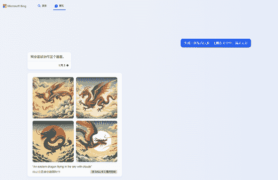
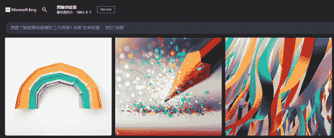
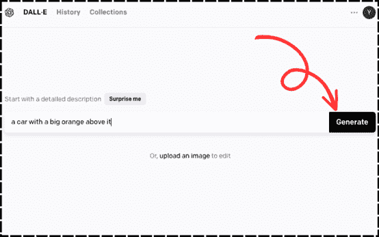
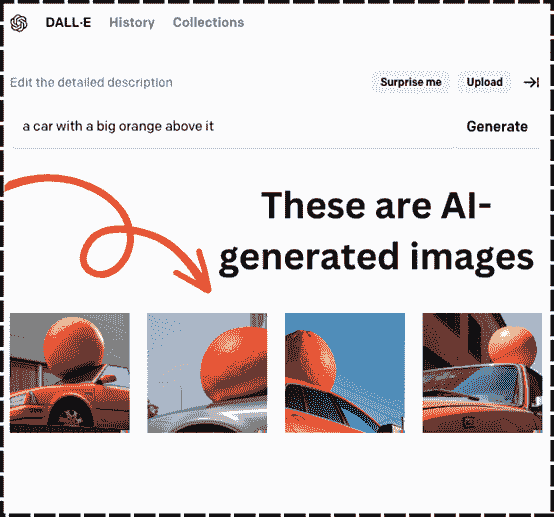
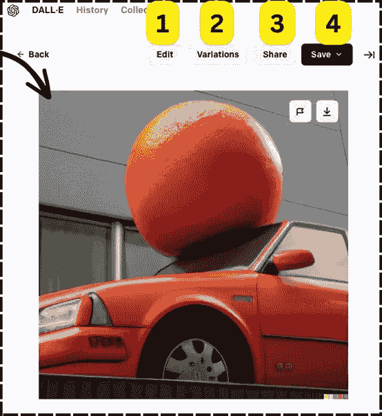
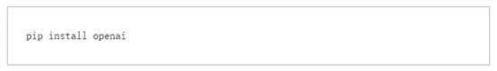
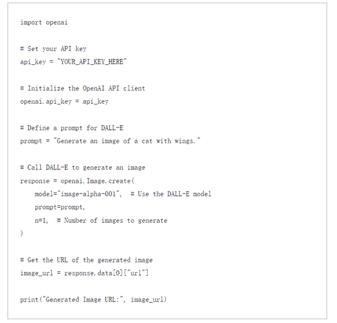

# 2023-10-15OpenAI最新文生图模型DALL-E 3，4种使用方法

> 来源：[https://xuqiwei1986.feishu.cn/docx/QglHdd3Uioop1rxHpdQcDcBHncc](https://xuqiwei1986.feishu.cn/docx/QglHdd3Uioop1rxHpdQcDcBHncc)

> 🔗 原文链接： h[ttps://mp.weixin.q](https://mp.weixin.qq.com/s/caHrXvXDMjoGrJNFAhSa🐧)q.com/s/caHrXvXD...

收录于合集

#OpenAI 74 个

#微软 121 个

专注AIGC领域的专业社区，关注OpenAI、百度文心一言等大语言模型（LLM）的发展和 应用 落地，关注LLM的基准评测和市场研究，欢迎关注！

DALL·E-3是OpenAI在今年9月21日最新推出的文生图模型，在语义理解、颗粒处理、图像质量等方面，比2022年3月25日发布的DALL·E-2实现巨大提升。

DALL·E-3 可生成写实、二次元、平面、创意、朋克、3D等多种类型，图片质量可媲美Midjourney，文本提示理解甚至超过了它。

目前，DALL·E-3处于测试阶段，可以通过ChatGPT Plus、企业版用户或通过API、OpenAI实验室等方式进行体验。

但上述功能可能比较麻烦，最简单的方法就是在微软的Bing Chat和Bing Image Create中使用DALL·E-3，并且免费支持中文提示。

Bing Image Create地址：https://www.bing.com/images/create

Bing Chat地址：https://www.microsoft.com/zh-cn/edge/launch/bing-chat-3p?form=MY02CJ&OCID=MY02CJ&q

由DALL·E-3生成

下面「AIGC开放社区」为大家介绍4种使用方法。ChatGPT Plus和企业版用户可直接在提示中使用，这里就不介绍了。

一、在微软Bing Chat中使用DALL·E-3

1）Bing Chat的使用方法非常简单，打开Bing的聊天对话功能，直接在对话框中输入文本提示。

例如，生成一条东方巨龙，飞舞在天空中，满天云彩。很快就能获得4张精美图片。

二、在Bing Image Create中使用

1）打开网址https://www.bing.com/images/create直接在对话框中输入内容即可。

例如，一个多彩的冰淇淋，水果很多，色彩斑斓，3D风格。

需要注意的是，微软每周免费给25个生成币，用完后下周会补满。如果使用量大的话，可以多申请几个账号。

三、通过OpenAI实验室使用 DALL-E-3

1）打开地址labs.openai.com。

2）登录OpenAI 帐户。如果没有，创建一个新帐户。

3）账号注册完成后，在对话框中输入描述然后点击Generate即可，使用方法与ChatGPT一样。例如，顶部有一个大橘子的汽车。

4）通常会生成4张图片，如果对效果不满意可以继续生成。

5）点击任意图片，可以进行编辑、共享和保存等操作。

四、通过API使用DALL-E-3

开发人员可以通过API的方法将DALL·E-3，集成到自己的应用程序中。下面是演示流程。

1）注册 OpenAI API，可以在https://platform.openai.com/account/api-keys 进行注册。

2）安装 OpenAI Python 库，以使用pip安装OpenAI Python库。

3）导入库并进行API调用：安装库和API密钥后，就可以开始使用DALL-E 3了。以下是如何调用 DALL-E 生成图像的示例：

注意，确保替换"YOUR_API_KEY_HERE"为你的 OpenAI API 密钥。可以自定义prompt以指定希望 DALL-E 生成哪种图像。

检索并使用生成的图像：该response对象包含生成的图像的URL。可以根据需要使用此 URL 显示或下载图像。

**DALL·E-3局限性 **

为了保证DALL·E-3生成的内容符合标准，OpenAI禁止DALL·E 3生成暴力、仇恨、成人等非法内容；

禁止生成偏见、歧视、丑化公众人物的图片。同时内置了内容来源分类器，用于识别DALL·E 3生成的图片，用于非法用途。

此外，可以选择DALL·E 3是否可以提供现在艺术家风格图片：默认是允许生成；如果艺术家不允许可以申请将其作品，从训练数据中剔除。

本文素材来源微软bing Chat、网络等，如有侵权请联系删除

END

