# 2023-10-08ChatGPT 语音版 SOP 及变现思路

> 来源：[https://xuqiwei1986.feishu.cn/docx/SuAudnxO0opCHGxNvrbcHYsQnrc](https://xuqiwei1986.feishu.cn/docx/SuAudnxO0opCHGxNvrbcHYsQnrc)

> 🔗 原文链接： h[ttps://articles.zs](https://articles.zsxq.com/id_ipoh0x0mu0zu.html)xq.com/id_ipoh0x...

>

大家好，我是苍何，一个土木转码的非典型程序员，也是一名技术管理者，同时也是 AI 应用的探索者，目前正在参加小林老师的第四期 AI 之心写作营。今天在视频号上看到和 ChatGPT 语音对话的视频，其声音的真实感太让人震撼了，于是也想去 抢先体验一下 ChatGPT 语音版功能 。

网上搜索了许久，没找到相关实用教程，且很难找到语音版的入口。据 OpenAI 官方消息， 在接下来的两周内，将向 Plus 和企业用户推出语音功能 。那我们如何抢先体验该功能呢？

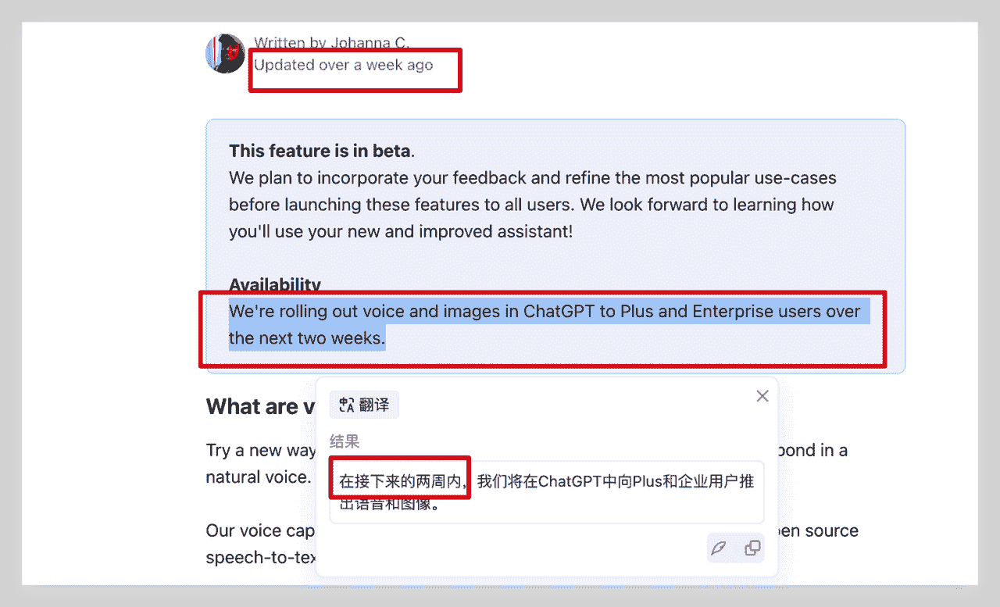

**本**文将分享如何抢先体验 ChatGPT 语音版，如何利用 ChatGPT 语音版引流变现，并详细讲解了其使用指南。

以下视频是苍何亲自体验语音版的场景，感兴趣的童鞋可以先看看。

[点击查看【bilibili】](https://player.bilibili.com/player.html?bvid=BV1Ru411T7tL&autoplay=0)

# 一、什么是 ChatGPT 语音版

2023年9月25日 OpenAI 推出多模态功能，即 ChatGPT 将支持语音和图像。新的语音功能由新的文本到语音模型提供支持，该模型能够仅通过文本和几秒钟的示例语音生成类似人类的音频。OpenAI 与专业配音演员合作创作了每个声音。还使用开源语音识别系统 Whisper 将口语转录为文本。

**ChatGPT 语音版说白了就是能直接**[通过语音](https://baike.baidu.com/item/%E8%B4%BE%E7%BB%B4%E6%96%AF/8145741)和 ChatGPT 进行对话， 让人震惊的是其声音的真实感和回答的逻辑性一度逼近 贾维斯 的感觉。

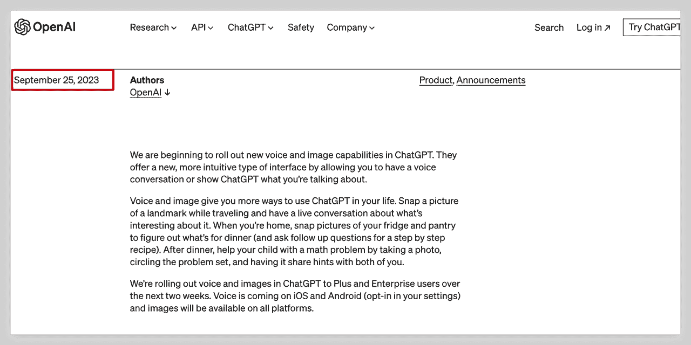

# 二、如何开通使用 ChatGPT 语音版

由**于**此功能现在还属于内侧阶段，仅部分用户能体验到，我这里说的是我亲测有效的方法（前提需要安卓手机）。大体流程是： 安卓手机安装 Google Play，申请加入 Beta 测试，下载 ChatGPT Beta 版本，开通 plus 账号，打开语音入口。

以下是流程图。

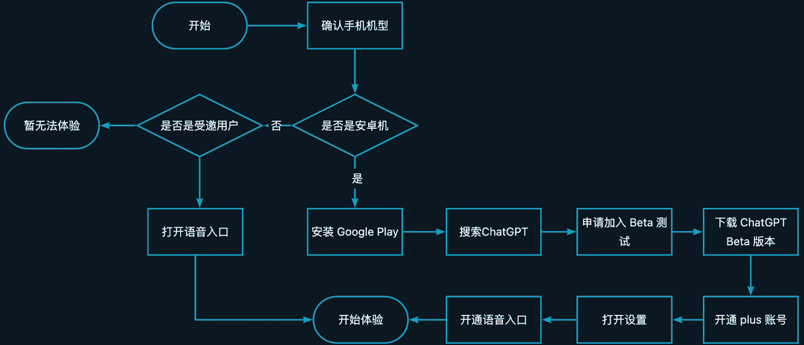

## **一）申请加入 Beta 测试**

这是最关键的一步，就是目前从应用商店下载的都是稳定版，很多未受邀请用户暂时无法体验，那我们需要申请加入 Beta 测试才可抢先体验该功能。这里以安卓的 Google Play 为例，演示如何加入 Beta 测试。

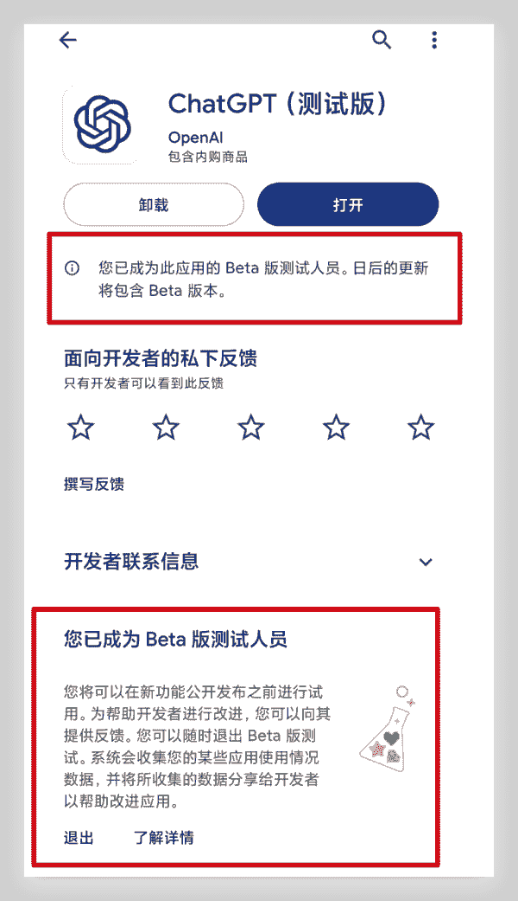

账号申请 Beta 测试需要几分钟 ，加入成功后我们就可以看到如上图提示，这个时候我们直接下载测试版本。一般而

言，测试版本非稳定版本，但确是最新版本，也是我们抢先体验功能的基础。

## **二）开通 Plus 账号**

目前**仅有 **Plus 账号才可抢先体验，所以需要开通。如何开通 Plus 相信大家都已经会了，这里不赘述，但值得注意的是，由于 OpenAI 的封控策略，一定要注意尽量不要在 Web 端开通以及尽量保证网络的「 清洁 」。

## **三）开通语音入口**

**打开设置**

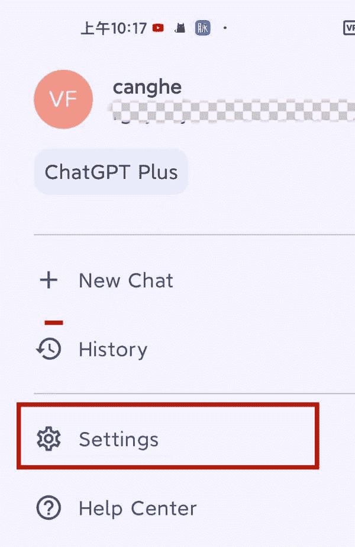

点击 Beta Features

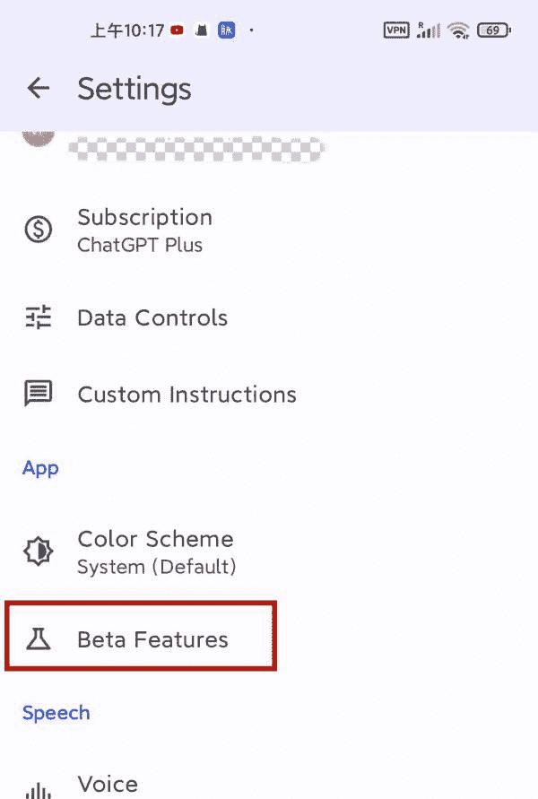

开启 Voice conversations

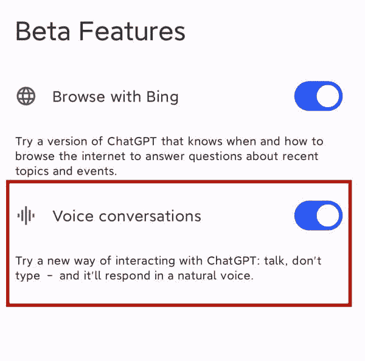

> 注意：这里的 Browse with Bing 是 ChatGPT 的联网功能，我们以前需要通过插件联网，现在直接打开这个开关即可联网了。

**点击主页图标**

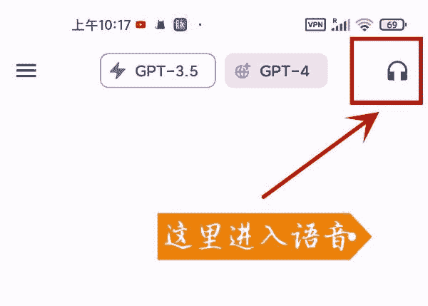

**开启语音对话**

**查看对话历史**

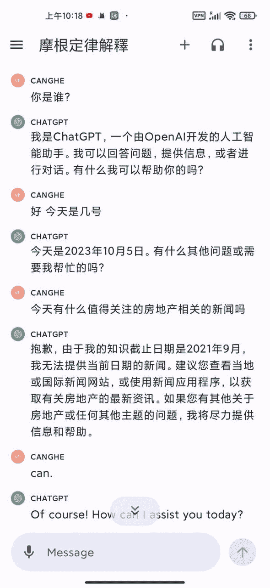

我们每进行的一轮语音对话，均会以文本的形式进行对话展示，方便随时进行查看。

# 三、怎么利用 ChatGPT 语音版搞事

有很多圈友会问，我开通语音版有啥作用呢？其实语音和图像都属于多模态场景，而 ChatGPT 能听会说的应用场景将会更加丰富，我们可以用 ChatGPT 语音版「搞事」。

## **一）利用信息差引流变现**

趁着现在还是语音版开放初期，很多人还没有体验资格，最值得一搞的是利用信息差**引流变现了。我新注册的小红书账号发布了关于 ChatG**PT 语音版的两个视频， 加起来 50000+ 的播放量，一共转换 153 粉丝，引流到私域教别人开通变现了 100+ 。这个数据已经是让我很惊喜了，给大家看看：

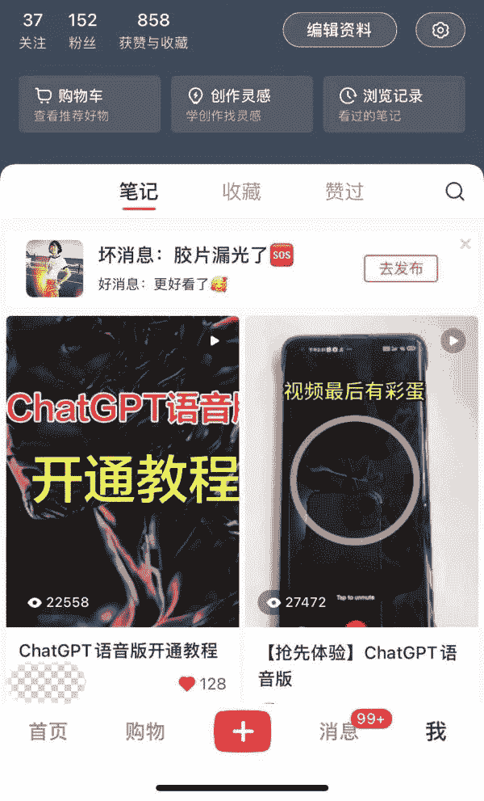

我在视频号看到一个博主发的关于 ChatGPT 语音版的视频后，也想去开通，搜索了很久发现页没人把开通说明白，折腾了很久才搞定，于是想，肯定有很多也想开通但苦于没有方法的，于是就写了教程并做了视频，注册了小红书账号，发布视频，没想到就爆了。所以，分享解决问题的方法，做到利他的视频爆的可能性比较大。

在做**视频的过程还是比较痛苦的，因为我算是个视**频剪辑小白，前前后后下载了 PR 和剪映等剪辑软件，但碍于 PR 太专业，于是就用剪映进行剪辑。花了一天的时间，从录制到剪辑到加动画到最后发布， 能爆火我觉得最大的原因是，在我发视频前，网上还没有一个视频是教人到底怎么开通的。

网上关于 ChatGPT 语音版的视频都是在告诉大家这个东西有多牛逼，但却没告诉大家该怎么开通，我记得我视频评论区有个伙伴说，他以为充了 Plus 就可以开通，结果还是不行，还是按照我视频的方法才看到语音功能。所以信息差永远是一个不错的引流思路。

这里提供一个思路， **可**以用不同的对话方式去和 ChatGPT 语音对话，然后做出视频去各大平台发，引流，会有很多咨询如何开通，然后引流到私域，促成成交。

## **二）外语口语练习**

由于 ChatGPT 精通数十种语言，而且每种语言都经过大量的语料训练，语言语法和发音都相当熟练，所以我们完全可以用它来进行外语口语练习，下面重点介绍一下方法。

### **1、模拟对话**

你可以通过与 ChatGPT 语音版进行实时对话来练习口语。例如，在学习英语时，你可以尝试与 ChatGPT 进行简单的日常对话，通过实际的交流来提高口语能力。

Prompt：

> 你现在是专业的英语口语老师，我是你的学生，我们在进行英语口语练习，通过简单的日常对话的方式进行，你先开始吧。

### **2、发音纠正**

你可以说出单词或短语，并通过 ChatGPT 的反馈来获取发音纠正和指导。虽然目前的版本可能不具备自动发音纠正的功能，但未来可能会有这样的功能。

Prompt：

> 你现在是专业的英语老师，我是你的学生，接下来，请对我的英语发音进行纠正，发音有偏差的地方你重新用标准的英语来对我进行纠正，你听明白了吗？

### **3、词汇和短语练习**

你可以请求 ChatGPT 提供特定主题的词汇和短语，然后尝试通过语音来使用它们，从而增加词汇量和流利度。

Prompt：

> 你现在是专业的英语老师，我是你的学生，接下来，请帮我总结下英语中描述「开心」的词汇，你听明白了吗？

### **4、情景模拟**

你可以创建特定的情景，例如购物、订餐或求职面试，然后与 ChatGPT 进行模拟对话，练习在不同情境下的口语交流。

Prompt：

> 你现在是专业的英语老师，我是你的学生，我们在模拟购物的场景，你需要和我模拟对话，来帮助我练习在真实场景中的购物口语交流，你听明白了吗？

### **5、听力理解练习**

你可以要求 ChatGPT 以 语音的形式提供信息，然后尝试理解和回应，以此来练习听力和口语交流，准备雅思或者四六级的朋友们完全可以尝试一下这种玩法。

Prompt：

> 你现在是专业的英语老师，我是你的学生，我正在准备四级的听力备考，请模拟四级听力题目，对我进行提问，如果我的回答有误，你先不告诉我，继续下一题，一共模拟 10 题，最后，请告诉我，我的回答正确率如何。

## **三）宝宝睡前故事**

像我作为宝爸，最麻烦的是每天晚上都要给宝宝讲睡前故事，大部分情况是对着书或者手机来讲，有时候讲的还不清楚，孩子也不愿意或不感兴趣来听，有了 ChatGPT 语音版，我只要给它说【请给我讲一个宝宝睡前小故事，要求吸引宝宝的注意】，它就能用我们设定好的语音来讲解，孩子听了也更感兴趣了。

Prompt：

> 你正在给宝宝讲睡前故事，请讲一个有趣的故事。

## **四）模拟面试**

我们都知道现在面试都很难，特别是对于程序员群体，面试是找工作必须要过的一关。但通常我们背八股文，准备面试知识点来进行面试的准备工作，很多人并没有模拟面试的概念，这也导致了很多人面试前准备的万无一失，面试时的答非所问。

那么现在 ChatGPT 语音版就可以模拟专业面试官来对我们进行模拟面试，而且还可以对面试结果给予评价，比我们在外面花钱请人来对我们进行模拟面试好多了。

说到这个模拟面试场景，除了找工作面试模拟，很多的考试如教师资格证、研究生面试、公务员面试都会有大量面试的场景，我们可以对不同的面试出不同的指令，除了帮助自己顺利通过面试，还可以把指令作为一个卖点，赚点小钱💰。

Prompt：

> 你现在是 Java 领域的专家及面试官，我是你的面试者，请对我展开面试，请尽量围绕真实面试场景进行提问，技术问题请围绕 Java 展开，你听明白了吗？

## **五）贴身安慰大师**

我们每每有情绪的时候，总想找朋友进行倾诉，但工作后，发现昔日朝夕相处的好友都各自有各自的生活，联系变少了，有时候翻遍通讯录，也找不到一个合适的人来倾诉。而坏的情绪如果不宣泄倾诉出去，对我们身体也是有【反噬】效果的。

现在有了 ChatGPT 语音版，加上其逼真的声音，我们完全对它进行情绪宣泄，让它做我们贴身的安慰大师。

Prompt：

> 你现在是我的安慰师，我今天心情不好，被领导骂了。

# 四、ChatGPT 语音版使用指南

## **一）哪些用户可以进行语音对话？**

Plus 和 ChatGPT 企业计划的所有用户。其中 ChatGPT 企业计划管理员可以在管理工作区设置中为其用户切换可用性。预计一周之后会慢慢开放。

## 二）哪些应用程序可以进行语音对话？

语音对话可在适用于 iOS 和 Android 的 ChatGPT 移动应用程序上进行。

## **三）有多少个语音选项？**

ChatGPT 从五种逼真的输出声音中进行选择，每种声音都有自己独特的音调和字符。可以通过 Setttings-Speech-Voice 进行声音选择。个人试验看 Breeze 对中文支持性更好。

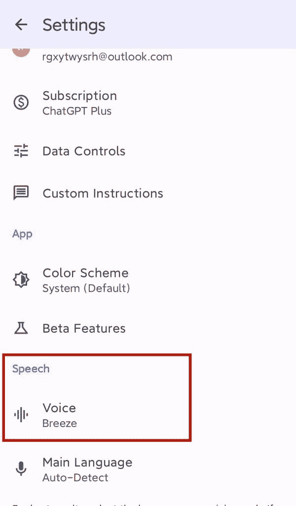

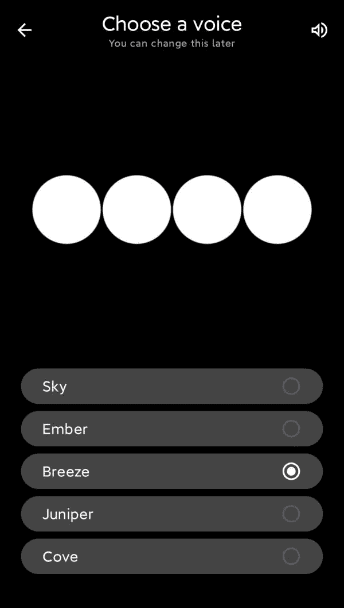

## 四）我可以在语音对话中使用哪些模型？

GPT 3.5 和 GPT 4 可用于语音对话。

请记住，对于 Plus 用户，GPT-4 每 3 小时有 50 条消息的上限。对于企业计划上的用户，没有消息上限。

## 五）我可以为语音对话设置音量限制吗？

在 ChatGPT 中，语音对话没有音量限制。音量将在设备本身上设置。

## 六）我可以在同一对话中使用ChatGPT视觉功能和语音对话吗？

可以使用视觉功能在聊天中启动语音对话，就像可以使用 GPT 3.5 或 GPT 4 在对话中启动语音对话一样。

## 七）为什么需要打开聊天记录和培训才能使用语音对话？

聊天记录和来自数据控件的培训必须切换，以便能够进行语音对话，以便可以查看对话的笔录。

主要是使用数据来提高模型性能，以何使用内容 (包括语音聊天的转录) 来改善服务和选择。

## **八）语音对话会不会保存音频**

在测试版期间，来自语音对话的音频片段不会保存。ChatGPT 将音频片段发送到 Whisper API 以转录它们，但处理后不会保留它们。

要找到历史对话，可以在 ChatGPT 对话历史中找到语音对话中的文本转录。

## **九）语音对话是免提的吗？**

一旦你进入语音对话，它是免提的，直到你退出语音对话。（相信以后会慢慢开放更多功能）

有手动控件，可暂停，继续和退出语音对话。

## **十）语音对话使用**

### **1、 开始对话：**

要开始语音对话，需要点击耳机图标。建立连接后，ChatGPT 将听你讲话。

### **2、 暂停语音对话**

### **3、 中断语音对话**

当 ChatGPT 正在说话时，您可以点击以中断:

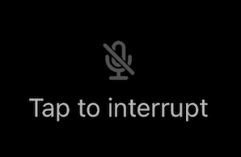

或者你可以点击停止图标：

### **4、 恢复语音对话**

点击恢复图标，然后重新开始

### **5、 取消语音对话的静音**

点击取消静音。

### **6、 退出语音对话**

要退出语音模式，请点击 X 图标以结束语音对话，并返回到使用 ChatGPT 的基于文本的对话。

## **十一）可以让语音对话暂停多久？**

没有限制，理论上可以无限时间暂停。

## 十二） 收到「对不起，我不能帮忙」的回复是什么原因？

这是由于 ChatGPT 的安全措施造成的。如果提示符合，可以通过聊天中的“竖起大拇指/竖起大拇指” 选项向 ChatGPT 发送反馈。

# **四、总结**

想象一下，当语音对话支持 API，我们可以把他集成到手机（虽然现在的 Siri 也能如此，但还不够智能），或者放到人型机器人上，那不就是现实版的贾维斯吗？相信这一天不远了。拥抱 AI 才是普通人的破局之道。除了方便自己，我们还可以利用 AI 工具为我们 IP 打造、副业赚钱提供一些思路。

最后，感谢闫小林老师和所有志愿者，你们用你们的辛勤付出来成就我们，感谢你们的无私奉献，感谢！

全文完，你的点赞是对苍何创作最大鼓励＼（＾ ＾）／