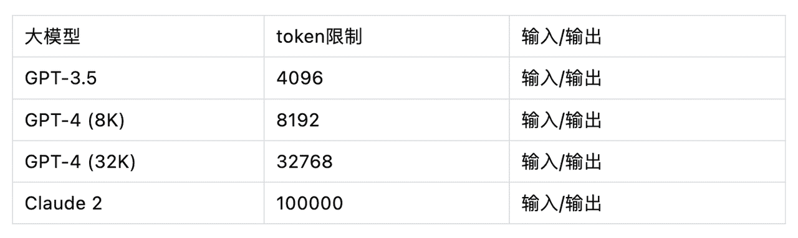
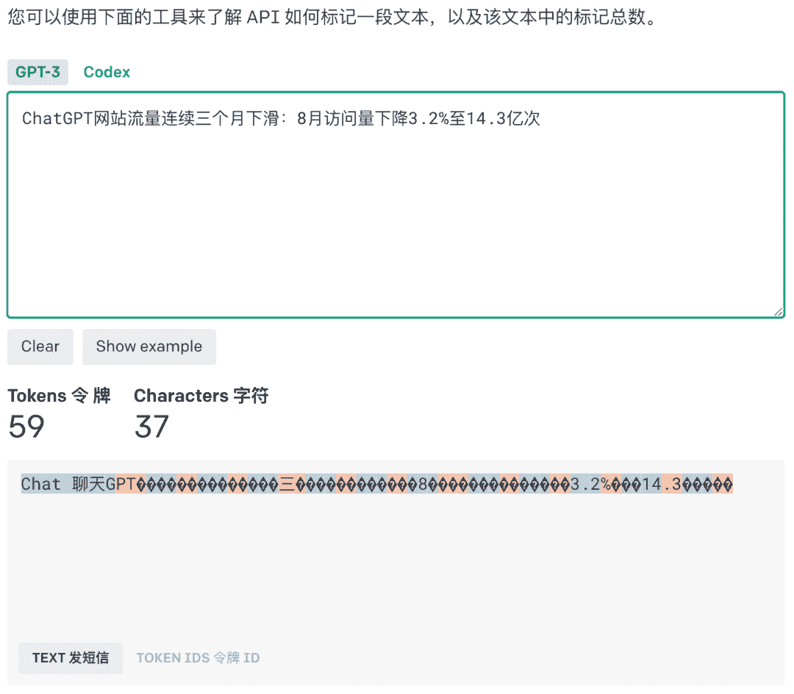
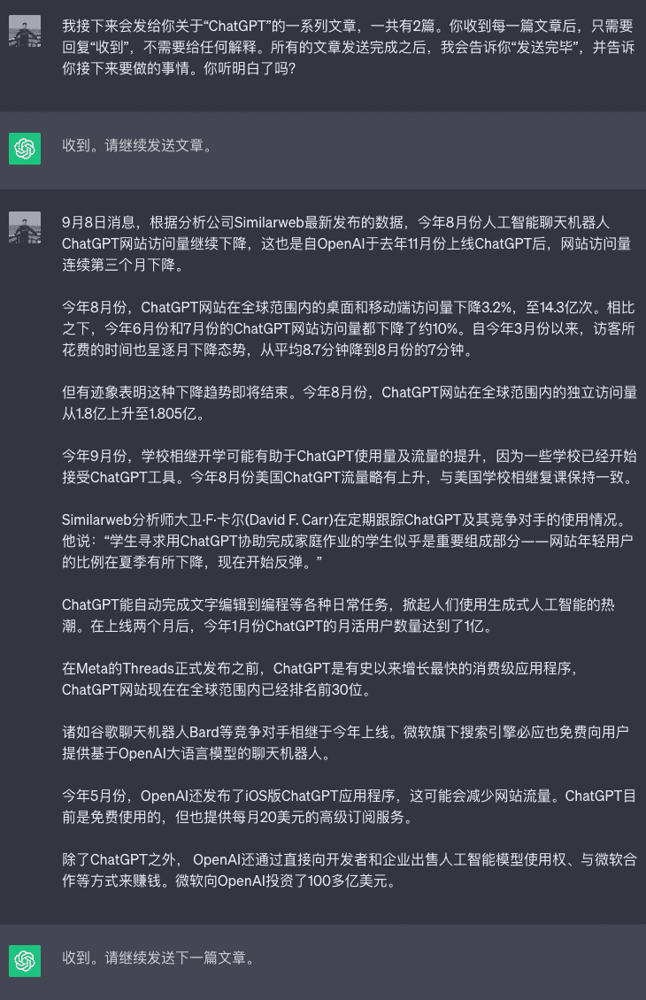
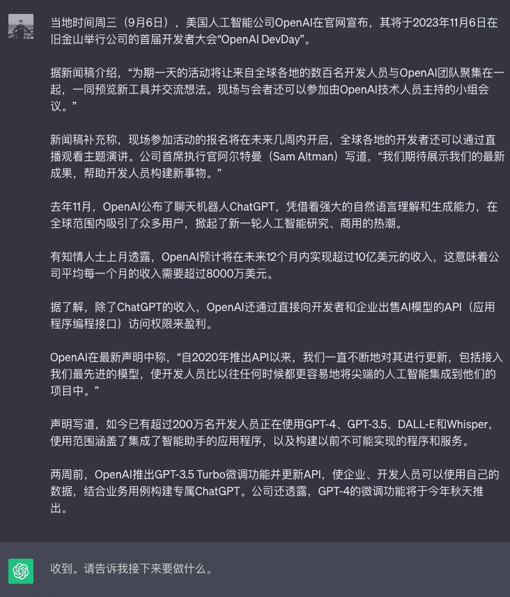
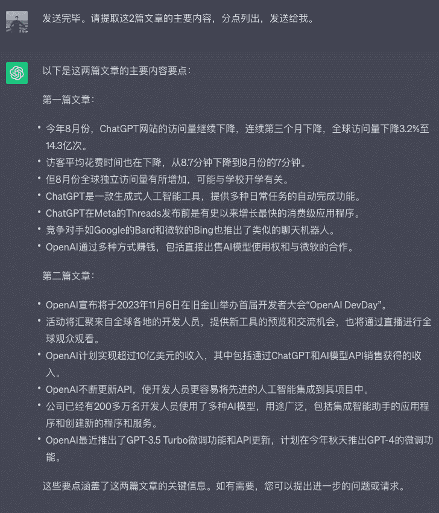
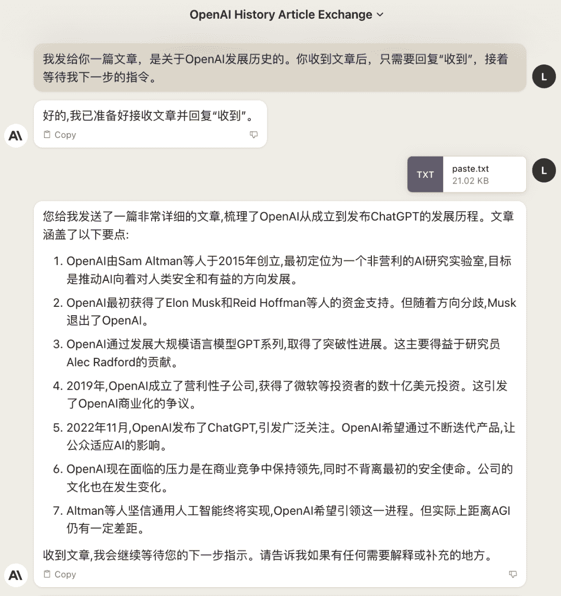
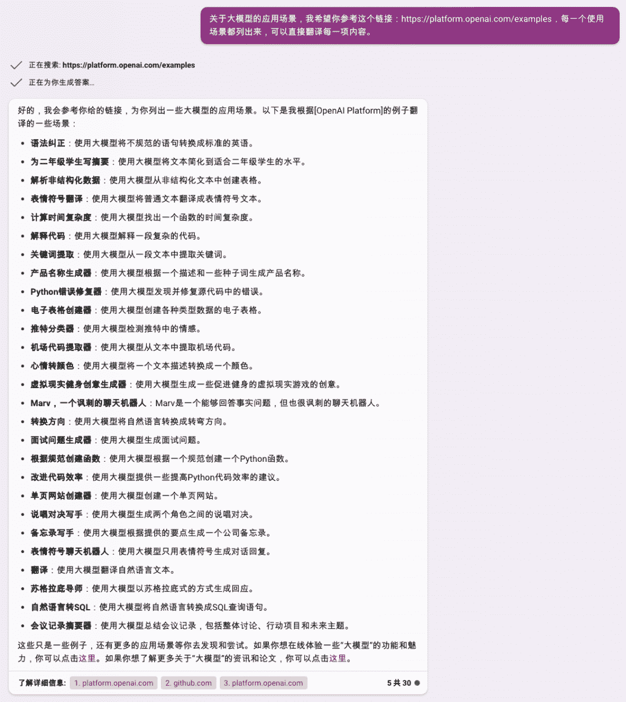

# 2023-09-30 ChatGPT 聊天突破 token 限制

> 来源：[https://xuqiwei1986.feishu.cn/docx/YvZWdwNTQo8Wusx9NVzcSBp8nWc](https://xuqiwei1986.feishu.cn/docx/YvZWdwNTQo8Wusx9NVzcSBp8nWc)

> 🔗 原文链接： h[ttps://articles.zs](https://articles.zsxq.com/id_ft4rix5noq06.html)xq.com/id_ft4rix...

>

这篇文章记录了完整的思考过程，一遍消化不了，可以多看几遍，会对你理解提示词的底层逻辑很有帮助。

在和 ChatGPT 聊天的过程中，如果输入的文本过长，ChatGPT 会返回错误提示：

这是什么原因造成的？请先思考 5 秒钟再往下看。

这是因为大模型有 token 长度的限制。什么是 token？一起来回忆一下。

token 是文本或代码的基本单位，它可以是一个字符、一个单词、一个子词或一个符号，取决于所使用的分词方法或方案。分词是将输入和输出文本切分成较小的单元，以便大模型能够处理的过程。token 可以用数字或标识符来表示，并且被排列成序列或向量，作为模型的输入或输出。token 是模型处理语言的基石。

1 个 token 大约是 4 个字符或 0.75 个单词，通常 1000 个 token 约等于 750 个英文单词或者 400～500 个汉字。

那么，为什么会出现 token 限制呢？这个限制是针对输入还是输出的呢？

首先，为什么会出现 token 限制？这主要是因为大模型在训练和推理时需要消耗大量的内存和计算资源，而这些资源是有限的。如果输入或输出文本过长，就会导致模型无法有效地运行或者出现错误。因此，为了保证模型的性能和效率，每个大模型都会设定一个最大的 token 数目，作为输入或输出文本的长度上限。超过这个上限的文本就会被截断或者拒绝处理。

其次，这个限制是针对输入还是输出的呢？这取决于具体的大模型和任务类型。一般来说，对于自然语言理解（NLU）任务，如文本分类、命名实体识别、情感分析等，这个限制主要是针对输入文本的；而对于自然语言生成（NLG）任务，如文本摘要、机器翻译、对话生成等，这个限制既针对输入文本也针对输出文本。

下面是几个常用的大模型 token 限制列表：

以 GPT-4 为例说明：

它有两种版本，一种是 8K 版本，一种是 32K 版本。8K 版本的 token 限制是 8192，这意味着它的输入和输出文本的长度不能超过 8192 个 token。32K 版本的 token 限制是 32768，这意味着它的输入和输出文本的长度不能超过 32768 个token。如果超过这些限制，文本就会被截断或拒绝处理。

既然 ChatGPT 的 token 限制是输入和输出加起来之和，现在考虑一种极限情况。以 8K 版本的 GPT-4 为例，如果输入 token 长度正好是 8192 个 token，那么输出 token 的长度就是 0，也就是说，ChatGPT 不会给任何回复，是这样的吗？

显然不是这样的，在任何情况下，ChatGPT 都会给回复。如果没有听明白，ChatGPT 现在还做不到主动提问，但是会以自己对问题的理解给出回复。

说远了点，现在以一个例子来详细解释一下 ChatGPT 是怎么突破 token 限制的。

如果想让 GPT-4 写一篇关于人工智能的文章，可以输入以下内容：

> 人工智能是什么？人工智能（Artificial Intelligence，AI）是指由人制造出来的机器或系统能够模仿或超越人类的智能行为的科学和技术。人工智能的研究涉及多个领域，如计算机科学、数学、逻辑、心理学、生物学等。人工智能的目标是让机器或系统能够执行一些通常需要人类智能才能完成的任务，如识别图像、理解语言、推理决策、创造艺术等。[END]

这里 [END] 就是一个续写符号，表示输入文本的结束。假设这段输入文本正好是 8192 个 token，那么 GPT-4 还能不能生成输出文本呢？

答案是肯定的。GPT-4 会根据输入文本和续写符号生成输出文本，并且在输出文本的末尾也加上一个续写符号，表示输出文本的结束。但是，GPT-4 不会把输入和输出文本都放在同一个序列或向量里面，而是会把它们分开处理。这样，GPT-4 就可以避免输入和输出文本的长度加起来超过 8192 个 token 的问题。

具体来说，GPT-4 会把输入文本作为一个序列或向量 A，把输出文本作为另一个序列或向量 B，并且在 A 和 B 之间加上一个特殊的符号或标记，如 [SEP] 或 [START] 等，表示序列或向量之间的分隔。然后，GPT-4 会把 A 和 B 拼接起来，形成一个新的序列或向量 C，并且把 C 作为模型的输入或输出。这样，GPT-4 就可以在保证 token 限制的前提下，生成更长和更复杂的输出文本。

例如，GPT-4 可能会根据上面的输入文本生成以下内容：

> 人工智能是什么？人工智能（Artificial Intelligence，AI）是指由人制造出来的机器或系统能够模仿或超越人类的智能行为的科学和技术。人工智能的研究涉及多个领域，如计算机科学、数学、逻辑、心理学、生物学等。人工智能的目标是让机器或系统能够执行一些通常需要人类智能才能完成的任务，如识别图像、理解语言、推理决策、创造艺术等。[END] [SEP] 人工智能有哪些类型？人工智能有多种类型，根据不同的标准可以进行不同的分类。一种常见的分类方法是根据人工智能是否具有自主性和创造性来划分。按照这种方法，人工智能可以分为以下四种类型：

> 弱人工智能（Weak AI）：指那些只能在特定领域或任务中表现出一定程度的智能行为，但是没有自主性和创造性的人工智能。例如，搜索引擎、语音助手、棋类游戏等都属于弱人工智能。

> 强人工智能（Strong AI）：指那些能够在任何领域或任务中表现出与人类相当或超越的智能行为，并且具有自主性和创造性的人工智能。例如，人类本身就是一种强人工智能的例子。目前，强人工智能还没有被实现，它是人工智能的终极目标之一。

> 通用人工智能（Artificial General Intelligence，AGI）：指那些能够在多个领域或任务中表现出与人类相当的智能行为，并且具有自主性和创造性的人工智能。例如，一些科幻小说或电影中的机器人或超级计算机就是通用人工智能的例子。目前，通用人工智能还没有被实现，它是人工智能的重要目标之一。

> 超级人工智能（Artificial Super Intelligence，ASI）：指那些能够在所有领域或任务中表现出远超过人类的智能行为，并且具有极高的自主性和创造性的人工智能。例如，一些科幻小说或电影中的神一般的存在就是超级人工智能的例子。目前，超级人工智能还没有被实现，它是人工智能的最高目标之一。[END]

这里 [END] 和 [SEP] 都是特殊的符号或标记，表示输入文本、输出文本和序列或向量之间的结束和分隔。可以看到，GPT-4 在输入文本的基础上生成了一段关于人工智能类型的文章，并且保持了逻辑和格式。

如果想输入超过 token 长度限制的文本，有什么好的办法吗？

**文本拆分**

这[是比较容易想到的一种办法，把长的文](https://platform.openai.com/tokenizer)本进行拆分，分多次发送给大模型，token 的长度统计可以用 OpenAI 官网上的这个工具： https://platform.openai.com/tokenizer

这种方法对提示词的要求比较高，需要保证不丢失各个分块之间的上下文信息。

举一个简单的例子，我给 ChatGPT 发送 2 篇文章，让 ChatGPT 提取主要内容。

先把主要的意图告诉 ChatGPT，收到回复后，发送第一篇文章。

收到回复后，接着发送第二篇文章。

文章发送完之后，让 ChatGPT 总结文章中的主要内容。

**换大模型**

上面提到过，不同的大模型有不同的 token 长度的限制。如果一种大模型不能满足需求，可以换一种大模型。Claude 2 能够处理最多 10 万个 token，差不多 5 万个汉字，是目前支持最长 token 处理的大模型。经过实测，Cluade 2 的大模型能力在 GPT-3.5 之上，可以和 ChatGPT 结合起来使用。

**联网访问**

GPT-4 可以联网访问，对于比较长的文档，可以通过百度网盘等工具，上传后生成链接，把链接直接发给 ChatGPT，通过写提示词提取需要的信息。

扫码加入星球

查看更多优质内容

https://wx.zsxq.com/mweb/views/joingroup/join_group.html?group_id=15552545485212