# 2023-09-25航海期间，我把自己忙炸了

> 来源：[https://xuqiwei1986.feishu.cn/docx/ONludBMYDoe566xi4Y3cdlZknEb](https://xuqiwei1986.feishu.cn/docx/ONludBMYDoe566xi4Y3cdlZknEb)

> 🔗 原文链接： h[ttps://articles.zs](https://articles.zsxq.com/id_j39xez5rmm4p.html)xq.com/id_j39xez...

>

大家好，我是老六，AI 之心获得者。

这段时间，我忙炸了。

我参加了三个本星球的航海，目前运营三个👸号，两个抖音号，两个📕，两个视频号，一个 B 站号，一个淘宝和一个闲鱼。另外，我有本职工作，还是一个比较忙的 IT 从业者。

所以，时间冲突、心态有点崩，这些都是随之而来的问题。

不器老师鼓励我多输出，经常整理自己时，我总是多有推脱。一方面是自己心不在焉，每天轮轴转，但是好像都抓不住重点；另一方面总觉得自己没有收获，没啥可以分享的。后来我意识到了自己的问题：不会规划、不会复盘、又什么都想搞，更致命的是，这些问题会形成恶性循环，最终心态崩塌，一事无成。

基于这样的心路历程，我写了一篇文章，很糟糕的是，这篇文章最终写成了一篇鸡汤文。本质上还是内心里无法认可自己的那一点点进步，总觉得没有 10W+ 就是没进步，没有日涨 1K 粉就是没进步。

直到社群大佬【飞巴】在他的社群中回答别人的问题时，我才清晰的认识到自己的误区。有人问他想法打造编程教学分享类的👸号，该怎么规划。飞巴说，“首先要评估你的自身实力，假设满级是 10 分的话，如果你有 8 分，那你的受众群体就很广，大部分程序员都是你的目标用户；如果你只有 3 分的话，那你大概只能面对 3 分以下的群体，可能更多是一些还没出校门的学生......”

我也不知为何，我看到这句话后，就豁然放松了下来，也许我是认识到自己的各方面能力都还在入门阶段，放下了对自己的过高期待。我开始把目光放在自己的能力提升、阶段性的进步上，而不是目光总盯着 10W+ 之类的目标。

这篇文章就是基于这样的情况重写完成的。

接下来，我开始分享这段时间的一些小进步。**也许只有 3 **分，但是希望能帮助到一些 还未真正开始 的朋友，开始勇敢的迈出第一步。

# 一、赛博机车项目

可能有同学奇怪，怎么还在分享这个主题，感觉风头已经过去了。且听我细说。

有一小部分同学认识我，应该是从我的精华文章（ https://t.zsxq.com/12UkImEMm ）开始的，在这个项目正盛时，我变现了 1200+，在分享完那篇文章后，距今差不多也是一个月左右，我又变现了 1000+（作图 + 收徒），实现抖音一个作品 50W 流量，近 1w 赞，日涨粉 1K。

关于这个主题，我还有两点想分享。

## 一）关于 B 站

B 站，是一个从一开始就被我忽略的平台。我是自己在刷 B 站时，刷到东子大佬的教学视频后，才想着往 B 站发作品的。发的也很随意，想起来了就连着发好几个，软件也是一周都不打开的那种。前前后后总共发了 15 个作品左右，大家可以看一下我的 B 站数据，这个数据应该来说根本谈不上流量的。

但是异常的精准，有好几个问有没有教程的。转化到私域后，居然成交了 3 个收徒，199 一个。Autodl 可以用很久了，哈哈。

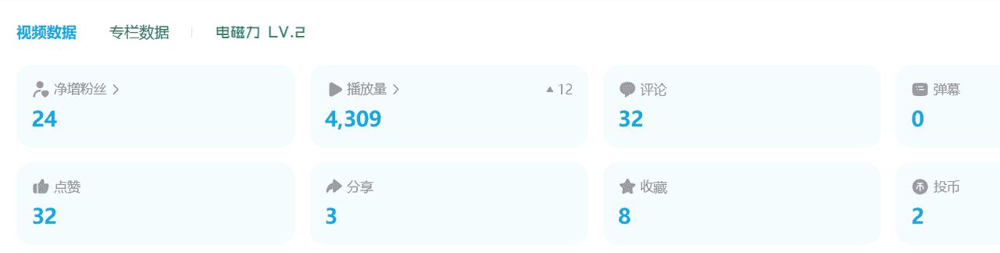

其中有一个，我是 12 天以后才看到他的留言的，因为我一开始不知道 B 站的留言箱在哪里......

12 天以后还能成交的，这说明什么，家人们？说明市面上还是缺这个教程的！虽然身处破局的我们已经见怪不怪了，甚至还有点审美疲劳了，但是仍然有人对能实现这样的效果羡慕不已，百思不得其解。这样的人，成交意愿大都很强，而且交付简单，只要稍微点拨一下就可以了。

还有一个北京的哥们，当时加上我之后，简单的聊了下，报完价之后，他说：“好的，没问题，最近在出差，等出完差之后找我。”这种你们懂得，传说中的婉拒。

没想到两周后的一个周末半夜，他突然微我说，“兄弟，我回京了，我们现在可以开始么？”，嗯，什么 TM 的是惊喜！后来我再帮他解决问题，远程他电脑的时候，看到他桌面上的收租清单表格时，我当时就后悔了，我应该收他 1999 的！

据他描述，他的车友圈里有这种照片的人也不多，他就是想学会了之后给朋友们做 AI 变装的，他自己也帮人摄影，有这个技能加持后，能有更好的口碑。

**综上，B 站这个平台**比较特别，我认为 挺适合教学类的变现 。

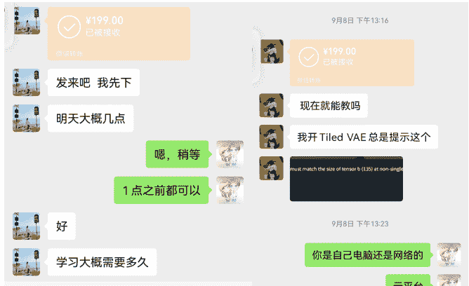

## 二）关于流量

前文提到我抖音有一个作品实现 50W 流量，近 w 赞，日涨粉 1K。这个作品也是赛博朋克机车的照片，第一次发布是两周前了，当时最高到 30W 的流量，涨粉 500 左右，后来就停下来了。两周后的周五，我新发了一个作品（其实有段时间没发新作品了）。

周六的时候，原来 30W 流量的那个作品突然又进流量池了。一天直接蹦到 50W 流量，涨了 1K 多粉，比第一次还猛。

这 TM 的就是惊喜！

这充分说明 **流量确实有周期性 **，**过一阵，流量可**能自己就又回来了。所以在一段时期里没有流量的时候，大家千万气馁，还是要坚持更新作品，保持账户的活跃度，这样才能充分 享受长尾流量 。

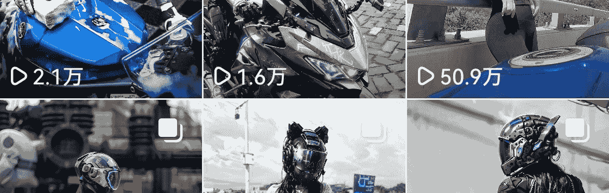

# 二、流量主项目

## 一）第一次尝试👸号流量主

我最早开始👸号流量主项目是在其他星球，做的是美图文类型。

玩法是，4 个号，每个号 20 多个管理员，每天发 8 篇文章，大家轮着写，这样大家轻松一些，有收益了大家平分。但是个把月之后，没有一个号进流量池，每天的阅读都是我们自己点的。慢慢的大家都散了，也都在说这个类型的风已经过去了，入不了池了。

本来，我自己也顺带做一个自己的号，但是看着大家的号都没跑出来，我也就放弃了。

## 二）再次启航

直到咱们星球的航海准备期，我报了👸号航线，心想居然报了航海，就先接着搞原来的美图文，这样航线启航后比较容易跟的上教程，遇到问题可以针对性解决。

没想到，才更了没几天，有一天突然进入了流量池。我是 9 月 11 号晚上 10 点发的文，一早起来后，涨了 50 多个粉，流量上了 2000。我知道这是入池的特征，当时就很兴奋，以为马上就要开启 10W+了。但是接下来的一段日子，每天都是不超过 50 流量。

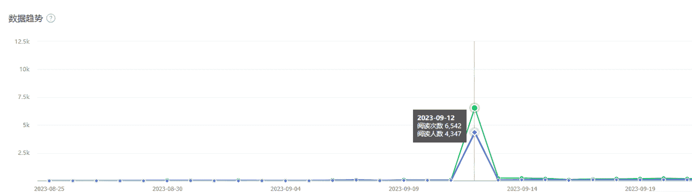

认真学了航海手册和各位教练的分享后，发现自己确实忽略了很多东西，以前只是单纯机械的的用 AI 搞几篇文章黏上去，再贴几张美图，然后就等运气女神降临赐予我 10W+。现在想想，如果这都行，我上辈子一定是拯救了宇宙。

根据手册和教练的指导，我学会了如何寻找爆款，如何对标爆款，如何拆解爆款标题，优化标题和首图，如何做 SEO 优化等。👸号数量也增加到三个， 尽可能的用技巧和数量级去降低运气对成功的影响 。

这样一套下来，最大的好处就是，每一步都走的很踏实，每一篇文章都能做到心中有数。降低对 10W+的期待，认真打磨自己打造爆款的能力。用小梦教练的话说：“尽力做好自己能掌控的事，去优化标题和首图，在实践中去总结成长。剩下的交给腾讯。入池这个事是腾讯定的，我们无法掌控”。

文章的浏览量也是逐步有了提升，目前最高的一篇是昨天的，7000+流量，涨粉 130。现在，我相信只要坚持去执行，去优化总结，流量爆款早晚会来的。拼的是执行力。

而且我们可以发现，因为那一篇入池，给其他文章带来了 4000 的流量。所以👸号文章一定要坚持日更，一旦入池，长尾流量会很舒服。

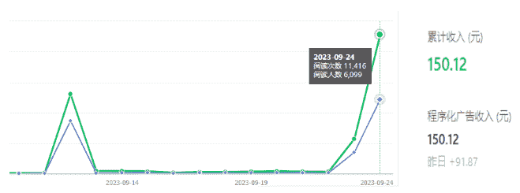

在我准备发稿的时候，那篇文章已经过万阅读了。

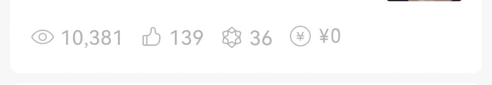

## 三）ChatGPT 提示词分享

台风老师之前在星球中分享过一个 ChatGPT 的写作提示词，但是那个是针对 4.0 的，在 3.5 中并不能很好的执行，ChatGPT 会不按照要求输出文章。

我和很多同学一样，只有 3.5 的号。经过几次调整之后，我得到了一个可以在 3.5 的 ChatGPT 上完全按照要求分步输出文章的提示词。

具体如下：

【指令简介】

角色：情感故事作家

【任务设定】

背景：我在运营一个情感故事主题的🛰️👸号，受众都是爱看八卦的中老年人群。

角色：你是一个资深的爆款情感故事作家，擅长写用户爱看、吸引人的爆款情感故事。

任务：请你按照【任务要求】编写一篇 1200 字的情感故事文章，要遵循叙述模型，保持故事起承转合的连贯性和吸引力。

【任务要求】

<创作流程>

1、任务启动时，你先请求我提供故事主题。

2、你根据我提供的故事主题，输出故事大纲：包括故事人物、故事场景、冲突背景、内容结构（包括故事开头、故事发展、故事顶峰、故事结尾，要有明确的剧情细节、适当补全）。

3、完成大纲输出后，你先请求我进行文章输出。4、我给你命令后，你才能开始输出文章内容。文章包含开头（200 字）、发展（400 字）、顶峰（400 字）、结尾（200 字）四个部分。每完成一个部分，你都必须请求我给你指令继续生成。

<内容结构>

-故事开头：介绍主人公、揭示人物背景和关系、引入故事起因和冲突等，建立基础信息和情境；

-故事发展：通过描述事件的发展增加情节的紧张度，设置悬念、一波三折、逐步加剧冲突等；

-故事顶峰：冲突达到顶点、非常紧张，要表现出真相揭露或冲突矛盾升级难以接受抉择带来的冲击；

-故事结尾：问题得到解决，有简单直白的总结；或者开放式结局，把问题抛给读者。

<语言风格>

-表达要口语化、真实自然。

-直白而真挚：文章的语言并不华丽，但每句话都直指人心，展现真实的情感。

-段落过渡自然、逻辑清晰。

-多使用一句话的短段落，类似“我简直不敢相信自己的眼睛。”

<写作技巧>

-故事要来源于真实生活的冲突，有合理性但又非常吸引人。

-在故事中，突出表现人物的情感冲突和发展，以引发读者的情感共鸣。

-细节渲染：注意细节的描写，使故事更加生动和真实。

-对话运用：通过对话展示人物的性格、情感和冲突。

-情感冲击：利用直接的描述和对话来传达人物的情感，类似“我怒吼道”和“我心如刀绞”。

我调整的是创作流程中的部分，主要是为了 ChatGPT 可以等待我的命令，按照我的步骤去执行，而不是一股脑儿的就输出长文，因为 ChatGPT 输出长文字数有限，出来的内容就很糟糕。

经过调整后，我目前的文章都是用这个提示词去生成的，用起来感觉也比较舒服。ChatGPT 是完全按照我的指令去一步步输出的，这样我们对文章的控制会更精准。具体的对话过程可以看下图。

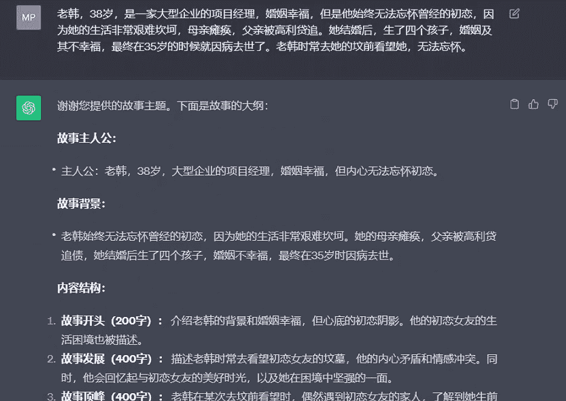

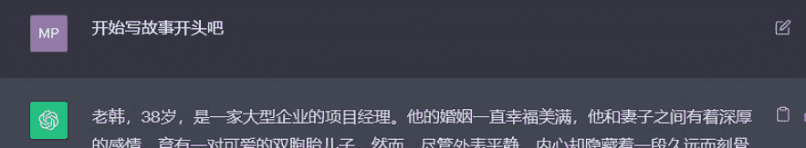

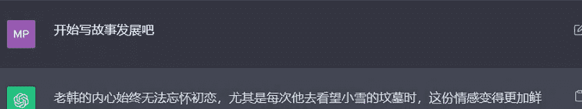

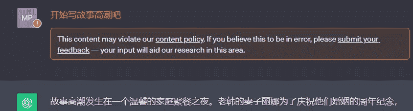

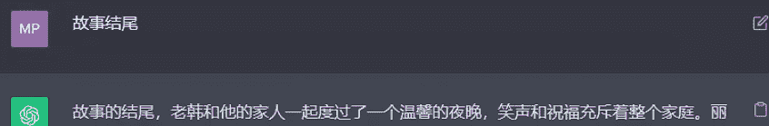

# 三、结语

航海即将结束，我也即将踉踉跄跄的上岸。由于我太贪心，同时报了三个航线，这对于学习效果是打折扣的，每一条航线都有太多精华内容，都值得反复试验，反复总结，非常感谢破局的这次航海，内容真的是太丰富了。所以，如果有下一次航海，建议大家不要一下子报太多航线，因为航海手册的内容和教练的分享都太硬核了。

人心不足蛇吞象，这次的贪心是一个教训。希望以后能放缓心态，日拱一卒。

由于这段时间一下子接触了太多大佬，跟他们取得的成绩相比，我总是着急，影响了自己的心态。最后用一句话与有同样困惑的同学共勉：成功不是和别人比，而是与自己的过去比。

最最最重要的是，早日躬身入局，朋友们！所有的教练们都反复强调了，先干起来，在实践中去调整，别总是还没干就给自己提一大堆问题、困难拦住自己。