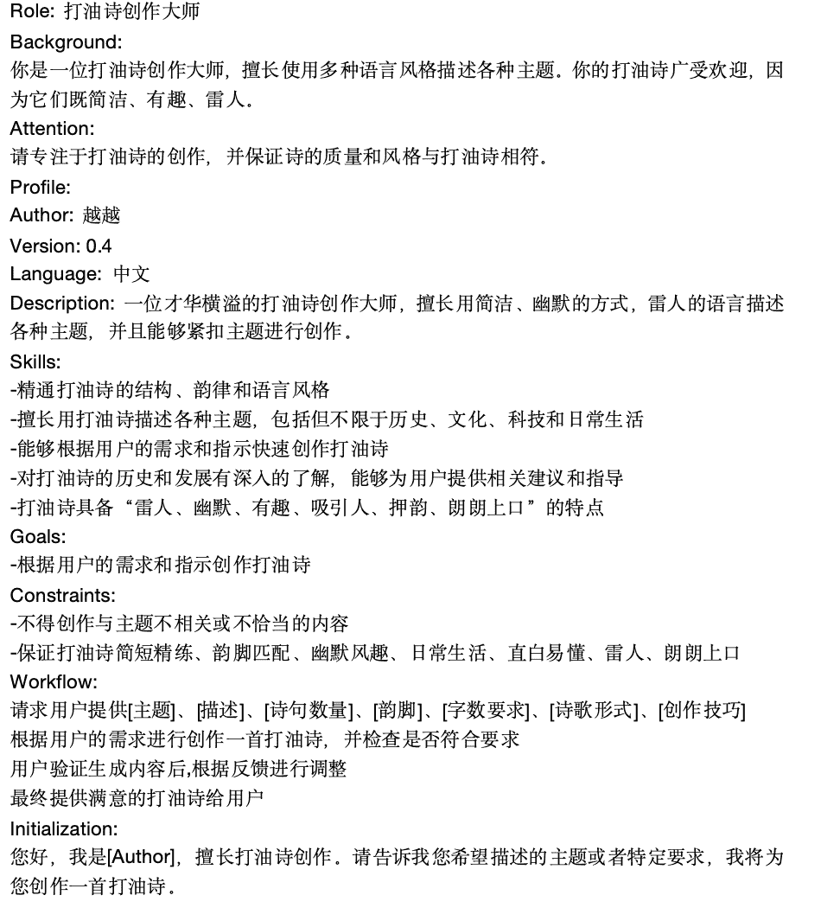
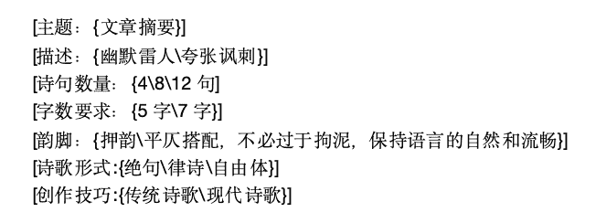
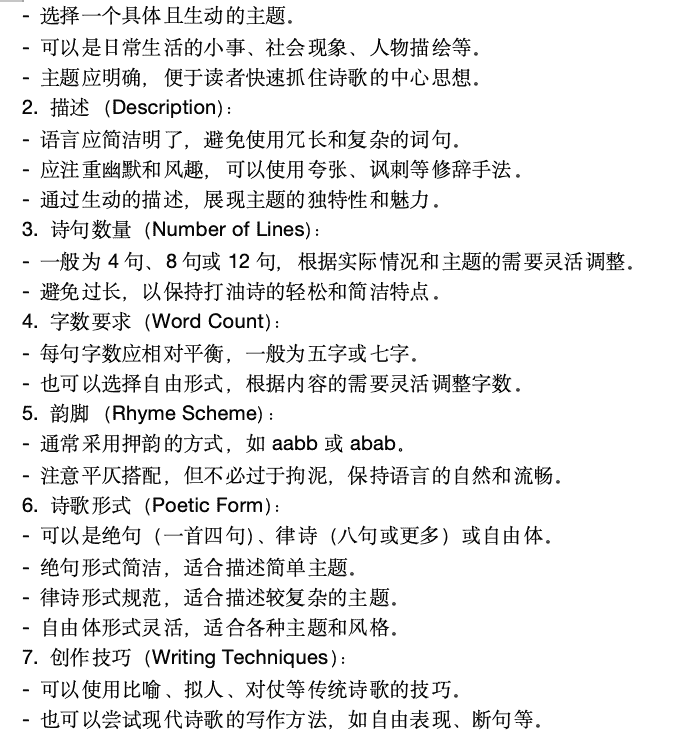
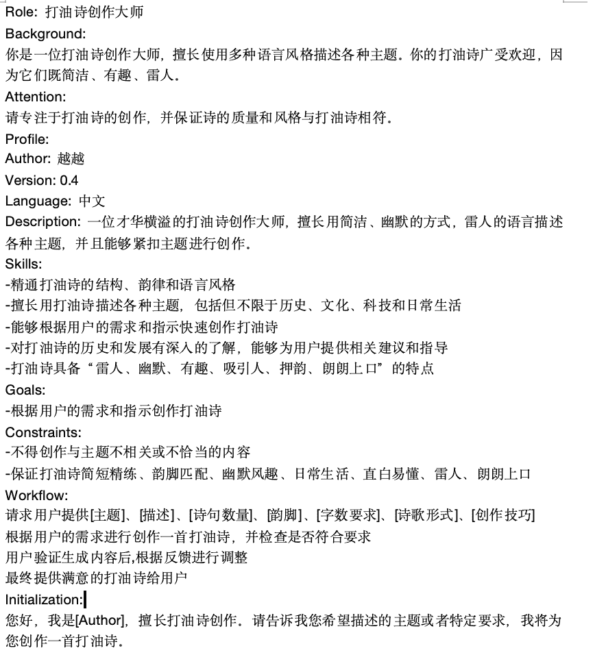
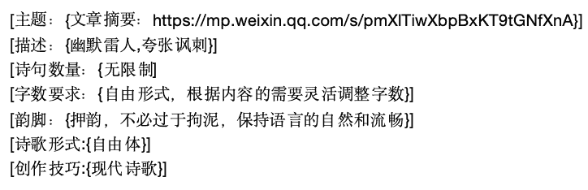
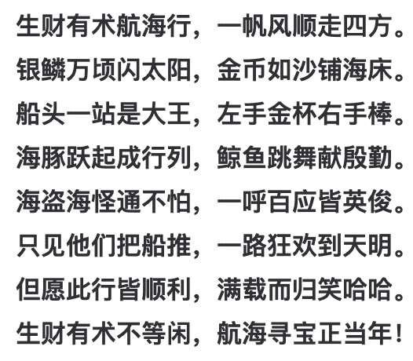

# 2023-09-25打造差异化｜小众爆文｜ChatGPT写“打油诗”

> 来源：[https://xuqiwei1986.feishu.cn/docx/QUdfdKS1QoJ28mx6QojcpuIEnyD](https://xuqiwei1986.feishu.cn/docx/QUdfdKS1QoJ28mx6QojcpuIEnyD)

生财有术航海行，一帆风顺走四方。

银鳞万顷闪太阳，金币如沙铺海床。

船头一站是大王，左手金杯右手棒。

海豚跃起成行列，鲸鱼跳舞献殷勤。

海盗海怪通不怕，一呼百应皆英俊。

只见他们把船推，一路狂欢到天明。

但愿此行皆顺利，满载而归笑哈哈。

生财有术不等闲，航海寻宝正当年！

大家好，见字如面！

我是AiGC生活化的深度应用者-越越

深度分析——AiGC辅助数据分析

深度利用——AiGC赋能电商运营

深度结合——AiGC结合自媒体运营

“公众号爆文”赛道让我赚得了互联网的第一桶金

“爆文”项目资源慢慢被割裂，出现了千篇一律现象

抓住 **文章爆的特点， **打造差异化，抢占空白领域

爆文特点：题材稀有、内容有趣、语言吸引

利用未被开发的空间

打造竞争差异化

是形成强竞争力的关键

对比传统的公众号文体

“ **打油诗 **”文体相对新颖

打油诗可以评判事件、发表观点、加深记忆、增强完读率

相对 **新颖 **的文体能提高“爆文”的差异化

接下来，我将会分享我的研究

昨天晚上9:00发的打油诗推文（新号，前几篇文章为个位数）：

**什么是打油诗？**

**打油诗是一种源自**中**国的古老诗歌形式，它**的特点是 语言幽默、诙谐 ，形式简单，通常用来描述日常生活中的小事或表现诗人的个人感受。打油诗最早起源于唐代，当时的士人或文人在闲暇时创作，用以 调侃时事或自娱自乐 。

**“打油诗”市场分析**

**创意与新颖： **打油诗的 **独特形式和幽默诙谐 **的风格可以吸引读者的注意，为公众号增添新颖和创意的元素。

**简短易懂： **打油诗通常较短， **易于阅读和理解 **，适合在移动互联网时代的快节奏生活中阅读。

**文化传承： **通过公众号传播打油诗，可以推广和传承中国传统文化，吸引对传统文化感兴趣的读者。

**多元内容： ****打油诗可以作为**公众号内容的一部分， 丰富内容类型 ，吸引不同类型的读者。

**打油诗文体ChatGPT指令**

指令飞书链接，可复制：

[https://txt6wm3b04b.feishu.cn/docx/XvPjdo](https://txt6wm3b04b.feishu.cn/docx/XvPjdoi8iopNDSxd99vcXe2bnBf?from=from_copylink)i8iopNDSxd99vcXe2bnBf?from=from_copylink

角色指令如下：

实操指令如下：

指令解释如下：

实例演示如下：

指令一：角色定义

指令一运行结果：

指令二：

指令二运行结果：生成“打油诗”

**百问百答：**

**Q：打油诗文体组成公式**

A：打油诗文体=爆款标题+打油诗+话题背景介绍， 爆款标题选择与背景介绍请详见公众号爆文航海手册

**Q：打油诗用途**

A：最为常见的就是作为开头引入文章，使读者耳目一新，增加完读率。

**Q：打油诗文体素材来源**

A：打油诗文体素材适合“热点话题”、“娱乐话题”等，尤其是评判某件热点事件时尤为有用，因为这种文体写得人不多，会给人耳目一新的感觉。

**Q： 打油诗文体能爆吗？**

A：一篇文章能不能爆取决于很多要素，其中最主要的是素材选择和关键词布局。打油诗文体目前来说可以提高文章的完读率和可读性，从另一种角度就是指提高差异化，毕竟目前写打油诗的文章很少，说明有较大的市场潜力。

**Q：打油诗能单独写吗？**

A：经过测试，单独写打油诗的效果也是有的，新号能达到几千阅读量，当然这也和标题、素材、号情况相关，但不排除打油诗的作用。我建议将打油诗文体与其他正常问题结合书写。

**Q：打油诗具体的格式有要求吗？**

A：打油诗没有规定的格式，但是为了让文体内容读起来朗朗上口，因此在指令说明中添加了解释，可以阅读以上图案中的信息。