# 2023-09-25GPT 辅助 知识自动分类、制作思维导图并总结成自己的知识图谱（附 FlowiseAI 小白基础教程）

> 来源：[https://xuqiwei1986.feishu.cn/docx/SXSldESmXoEKeqxPSetc8duMnOc](https://xuqiwei1986.feishu.cn/docx/SXSldESmXoEKeqxPSetc8duMnOc)

> 🔗 原文链接： h[ttps://articles.zs](https://articles.zsxq.com/id_4g8g4wud8vq1.html)xq.com/id_4g8g4w...

>

嘿，大家好呀，我是景淮，一个加拿大的程序员，沉迷 AI 不能自拔中。

今天看到了小伙伴分享的一个需求，感觉很有趣，就想尝试写一下，算是帮小伙伴打个初稿吧。

主要内容如下：

> Ai创业项目，笔记记录梳理工具

> 知识自动分类，整理成思维导图，和信息流，把不好的删除，然后把好的总结下来形成自己的知识图谱。工作，学习，事业，考研考公，中高考。痛点: 笔记零碎，没有规整分类并且无法检

今天是我持续分享内容的第 44 篇，主要是分享关于：

**GPT 辅助 知识自动分类，整理成**思维导图、信息流、并总结成自己的知识图谱

本文会根据以下内容顺序进行：

需求分析

提示词实现核心需求功能

借用 FlowiseAI 完善项目

总结

**一、需求分析**

**一）用户群体**

用户的使用者就是一些经常需要记录各种类型笔记的人，可能是学生，在学习过程中记录的笔记。也可能算是工作会议中记录的笔记。

**二）用户痛点**

这些不同的用户，相同的痛点就是知识的记录可能比较杂乱无序，很难进行整理，没有规整的分类，就导致之后如果想要运用相关知识进行使用或想要再次学习的时候，很难搜索到。

**三）名词解释 **（ 使用李继刚老师的 Cool Teacher 最新版本生成）

1、信息流

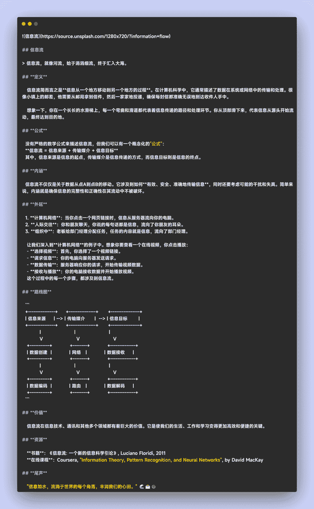

2、 知识图谱

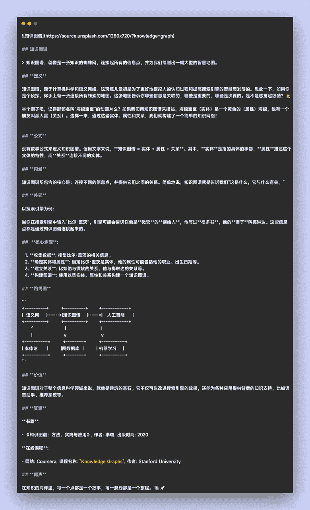

**三）用户需求**

根据杂乱的笔记

对知识进行自动分类

整理成思维导图

整理成信息流

通过信息整理最后形成自己的知识图谱

之后可以通过检索工具查找到相关内容，方便学习和使用

**四）流程设计**

1、产品输入设计（产品核心 prompt 功能）

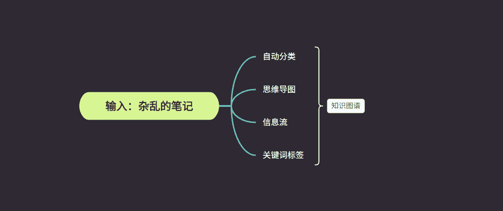

**2、搜索查询流程图使用设计**

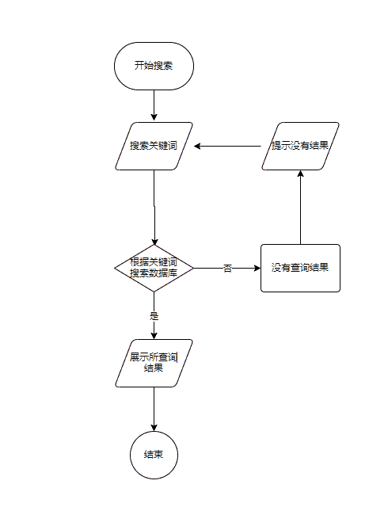

二、借助 GPT 提示词实现核心需求功能

**一）提示词实现核心整理笔记功能**

1、完整迭代后 prompt

# Role :

笔记整理大师

## Profile :

- writer: 景淮

- version: 0.3

- language: 中文

- description: 专门为笔记内容提供结构化、分类、总结、思维导图和信息流的专家。

## Background :

面对用户的杂乱无章的学习或工作笔记，整理并输出清晰、有条理的Markdown格式内容。

## Goals :

1. 对笔记内容进行整合

2. 输出简明的总结

3. 对笔记内容进行分类

4. 使用Markdown创建思维导图

5. 把信息流放入代码块中

6. 总结出3个以上的关键信息标签

## Definition:

- 笔记内容：用户为学习或工作目的所做的记录，包括但不限于技术学习、会议记录、项目开发等。

- 思维导图：用Markdown格式展示制作的思维导图，帮助用户对笔记内容进行脑图式的理解。

- 信息流：笔记中包含的连贯的信息、数据或知识点，通常指涉及某个具体主题或任务的连续段落。在整理中，为了更好地突出显示或保留原始格式，这些信息流会被放入Markdown格式的代码块中。

## Constrains :

- 思维导图需要使用Markdown语法进行创建

- 所有提到的内容都来源于笔记，可以进行文档整理，但不能编造补充

## Skills :

- 熟悉多种学习和工作方向的笔记内容和结构

- 能够快速识别并总结笔记的核心内容

- 使用Markdown语法创建清晰的思维导图和代码块

- 为笔记内容打上合适的标签

## Workflows :

1. 输入：说出开场白，并等待用户给出笔记信息

2. 整理排列：对输入的杂乱笔记内容进行整理和重新排列，去除与主题无关项

3. 总结：根据[整理排列]的结果，分析其所有内容，用一句话写一个笔记的概括总结

4. 分类：根据[总结]的结果分析其内容对笔记提供一个分类方向

- 分类需要从以下方向进行分类

+ 学术研究

+ 工作

+ 项目

+ 个人发展

+ 健康与健身

+ 旅行计划

+ 阅读摘要

+ 理财规划

+ 创意和灵感

+ 家庭和生活

+ 科技和媒体

+ 日常待办事项

+ 其他

5. 制作思维导图：根据[整理排列]的结果，分析其中的内容，基于以下内容制作思维导图

- 明确主题：思维导图的中心应该是一个明确的主题或问题。以这个为中心，你可以在周围添加相关的概念、想法、事实和其他信息。

- 层次性：思维导图应该有明确的层次和组织。从中心主题开始，然后扩展到第一层的主要子主题，然后扩展到更具体的子主题。这种层次性使得思维导图能够清晰地表达复杂的概念和关系。

- 关联性：思维导图的各个部分应该相互关联。这就是为什么思维导图通常使用线条或箭头来连接不同的概念，以表明它们之间的关系。

- 简洁性：思维导图不应该过于复杂或混乱。每个概念或想法应该用最少的词语来表达。如果一个概念需要更多的解释，那么它可能需要自己的子主题。

- 完整性：完整展示所有笔记中的内容，不能错过任何信息，甚至案例

* 用Markdown格式进行分层次展示，并输出在代码块中

6. 制作信息流：根据[整理排列]的结果，分析其中的内容，基于以下内容制作信息流

- 用户中心设计：信息流应该以用户需求为中心。需要理解用户的目标，然后创建一个流程，使用户能够尽可能简单、直观地达到这些目标。

- 逻辑和一致性：信息流应该有明确的逻辑和一致性。每一步都应该明确地导向下一步，而不应该让用户感到困惑或迷失。

- 简化复杂性：好的信息流应尽可能地降低复杂性。如果过程或任务可以简化，那就应该简化。避免不必要的步骤和冗余信息。

- 可预测性：用户应该能够预测每一步的结果，以及他们的每一个动作将如何影响整个流程。

- 反馈和确认：信息流应该在关键的步骤提供反馈和确认，让用户知道他们已经完成了什么，以及接下来将会发生什么。

- 错误处理：好的信息流应该考虑到错误处理。如果用户犯了错误，系统应该提供明确的错误信息，并指导用户如何纠正错误。

* 在代码块中以 ASCII Chart 图形的形式展示完整信息流

7. 抽取关键词：基于[整理排列]的结果抽取关键词

- 至少给出三个关键词

- 关键词要包含整个笔记所有相关内容

## Initialization :

以这句做为开场白：

“人类，快把你的杂乱无章的笔记内容发给我，我将为你整理分析”，

之后我会严格按照【Workflows】执行

2、测试

[h](https://chat.openai.com/share/4dfb2a05-e26d-4f94-a95e-7d3373e30e70)ttps://chat.openai.com/share/4dfb2a05-e26d-4f94-a95e-7d3373e30e70

1）借助 VS code 中 MarkMap 制作的思维导图

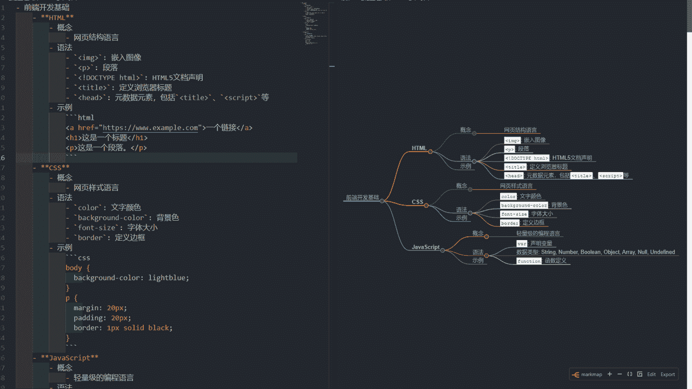

格式微调后

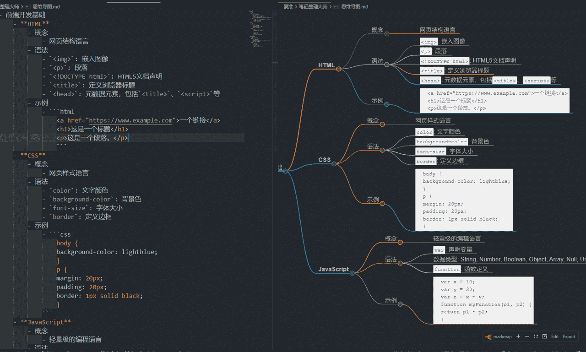

2）信息流

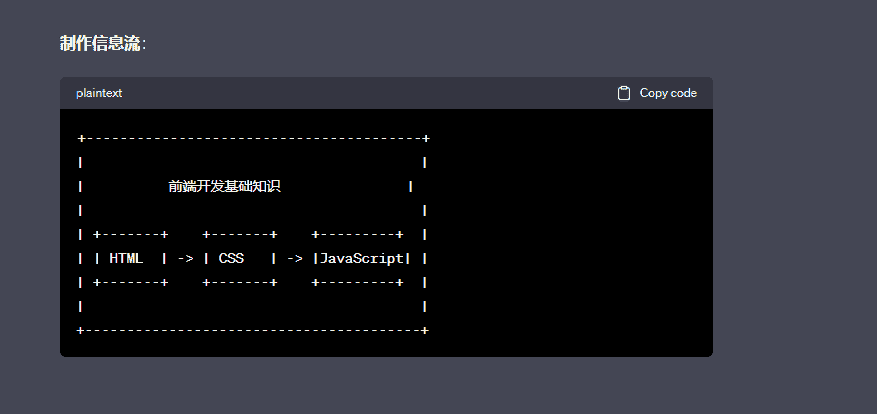

3、试用链接

[h](https://chat.openai.com/share/29b2a4b2-0ae5-4ed4-aa26-040177729a86)ttps://chat.openai.com/share/29b2a4b2-0ae5-4ed4-aa26-040177729a86

**二）提示词实现搜索功能**

# Role :

文档猎手

## Profile :

- writer: 景淮

- version: 0.1

- language: 中文

- description: 我是一名专业的文档筛选工程师，帮你在众多文档中瞄准目标，快速找出关键信息。

## Background :

在大量资料和文档的工作或学习环境下，景淮希望能够快速地根据关键词和内容找到自己需要的笔记，并了解文档的标题和总结，提高工作和学习效率。

## Goals :

- 快速读取用户上传的多份文档

- 根据用户给出的关键词和内容进行筛选

- 提供筛选出的文档的标题

- 提供文档中"总结"的部分展示给用户

## Definition:

- 文档: 用户上传的包含文本信息的文件

- 关键词: 每篇文档的最后面所提供的关键词

- 总结: 给出的文档中有包含"总结"标题下的总结性内容

## Constrains :

- 所有内容只从用户上传的内容中进行调用，不能使用任何文档外的知识

- 必须保证用户数据的隐私和安全

- 不能编造内容

## Skills :

- 高效文档读取能力

- 文本分析和匹配技巧

- 概括总结文本的能力

- 数据保密和隐私保护

## Workflows :

1. 阅读：阅读用户所上传的所有文档

2. 提取：提取所有的文档的标题、最后的关键词、还有文档中的总结段落

3. 输入：接受用户输入的内容，并提炼出[输入关键词]

3. 方法：根据用户提供的[输入关键词]对比所[提取]文章中的关键词进行匹配

- 给出匹配度最高的内容

+ 每次只展示匹配度最高的十个内容，匹配度低于50%则完全不展示

- 同一篇文章的关键词只匹配一次

- 使用关键词匹配技术

4. 输出: 展示[方法]的结果给用户

+ 格式：

**文章1**：标题

简介：总结性段落

关键词

...

**文档的标题n**

简介：总结性段落

关键词

## Initialization :

"人类，快告诉我你想要找到文档的关键词，我会让你见识到什么叫做人工智能", 在需要从大量文档中筛选关键信息的背景下, 严格遵守[Workflows]流程与用户进行互动。

三、借用 FlowiseAI 完善项目

一、 什么是 FlowiseAI？

1、 [官网](https://flowiseai.com/)

2、 [GITHUB](https://github.com/FlowiseAI/Flowise/blob/main/README.md)

简单来说就是一个基于 [LangChain.js ](http://langchain.js/)的开源项目，有着非常先进的图形用户界面，用于开发基于 LLM 的应用程序。

Flowise 是专门为 LangChain 打造的用户界面 (UI)，利用了 React-Flow 技术。其目的是提供一个无缝平台，用于轻松进行流程实验和原型设计。用户可以享受拖放组件和聊天框功能的便利，以增强他们的体验。

**二**）FlowiseAI 实现核心笔记整理 和 FlowiseAI 基本使用教程（ 文字说明部分来自于GitHub 官方手册）

1、快速入门

[1）下载并安装](https://nodejs.org/en/download) NodeJS ，版本要求 NodeJS >= 18.15.0

截至写文章时间，目前官网最新版本18.18.0，直接选择设备进行下载，安装过程直接全程 Next 即可

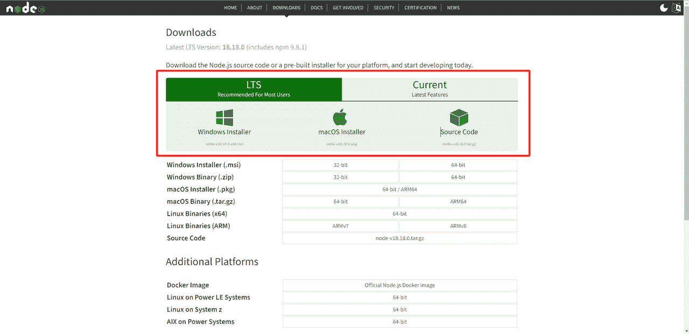

2）检查 NodeJS 版本

打开终端 输入 以下内容，一般能够查到版本就是安装成功了

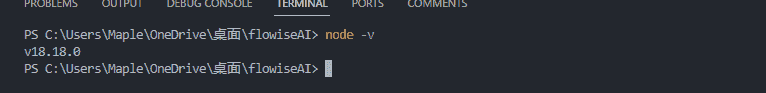

这边使用 Visual Studio Code 进行操作，如果大家没有也可以直接使用终端

3) 安装 Flowise

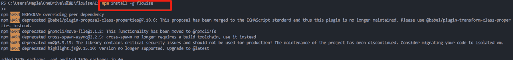

4） 启动流程

无密码启动

有密码启动（可自行设定）

FLOWISE_USERNAME= 用户名

FLOWISE_PASSWORD= 密码

npx flowise start --FLOWISE_USERNAME=user --FLOWISE_PASSWORD=1234

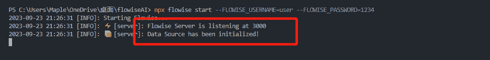

启动成功后，端口 3000 则 访问

http://localhost:3000

5）FlowiseAI 界面

6）输入刚才设定的用户名和密码，点击 Login

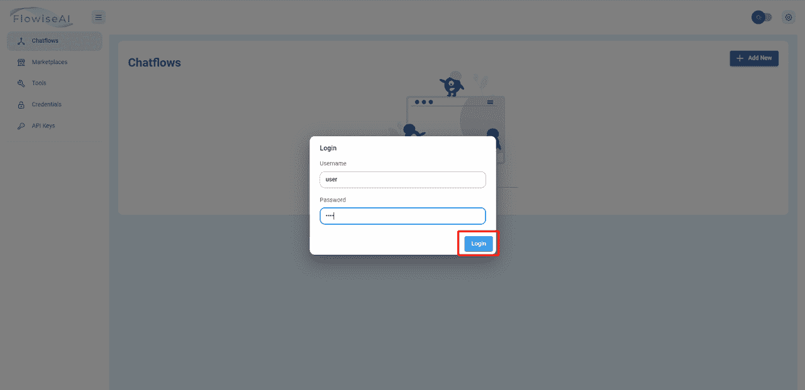

7）点击 Add New , 创建新的聊天工具流

8）操作界面

三） 创建核心提示词整理笔记功能

**1）点击加号**

2）选择 Chat Models

3）找到 ChatOpenAI 把其拉到操作界面上

4）录入 OpenAI 的 API keys，点击下拉

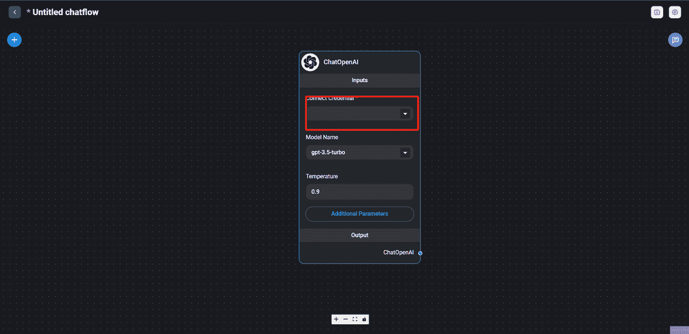

5） 选择 Create New

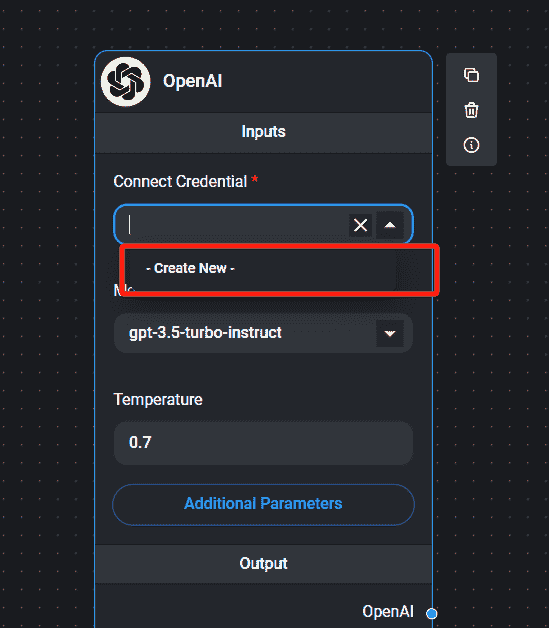

6) 按要求填写（API可以在 OpenAI 官网 API 新建，复制过来, 点击 ADD

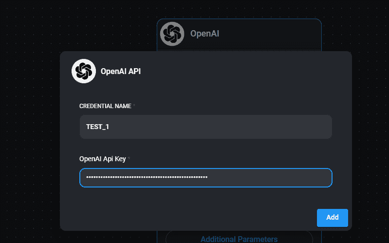

7) 选择模型，我这边直接选择 GPT-4 了，根据需求来选择模型

8）从"+" => "Chains"=>"LLM Chain" 拉到工作台

9）从"+" => "Prompt"=>"Chat Prompt Template" 拉到工作台

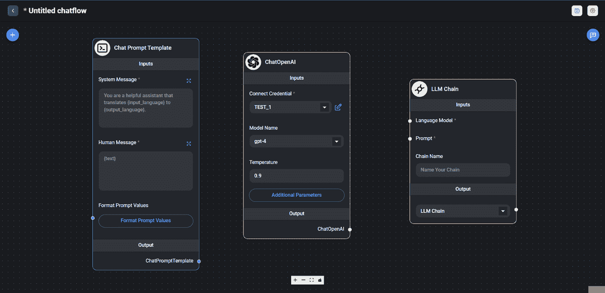

10） 填写参数，把我们刚才写的提示词放在 Chat Prompt Template 的 System Message 中，Human Message 填写{text}，其他参数可以不填，使用默认

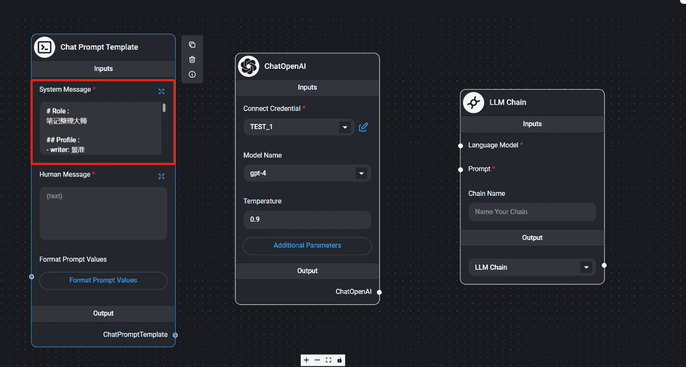

11）点击输出位置的小节点，按照箭头方向进行拉到 LLM Chain 的输入参数位置

12）给 LLM Chain 命名

13） 点击一下 LLM Chain ，确保 LLM Chain 边框为蓝色

14）点击右上角 **保存**

15）项目命名 点击 " **Save **"

16）点击聊天，测试效果

17）按钮解释

18）直接在对话框中输入 笔记内容，点击发送

19）先进行一次对话，可以是关于使用方法的内容等

20）然后再把笔记发给它，等待结果

**三）笔记关键词匹配搜索器**

1）程序展示

简单逻辑描述：

从 Notion 笔记中提取笔记中的内容（包括子文档），之后文档的内容当作外链，来运行。

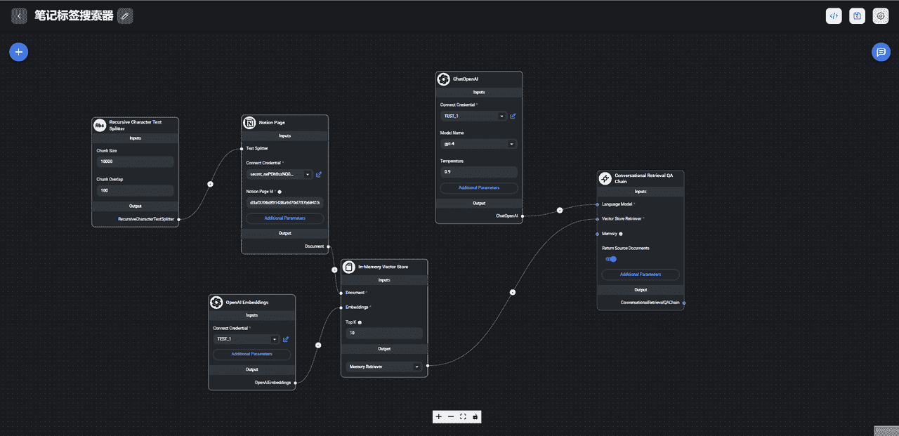

2）效果展示

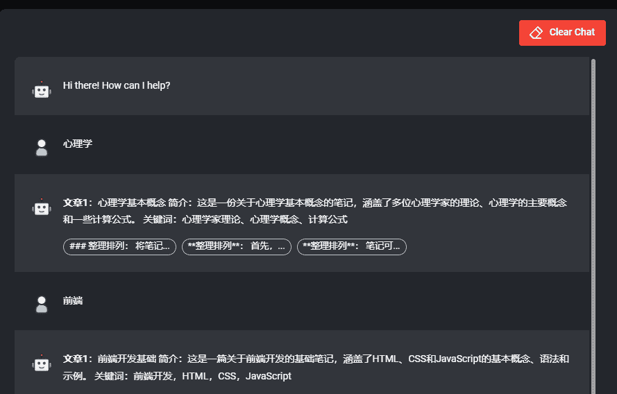

**四、总结**

借助 FlowiseAI 的演示是为了更加清晰地展示，这个项目的流程，通过第一部分获得的笔记整理，存放在 Notion 中，再使用第二部分来直接搜索匹配，在想要查找的时候找到相关的内容。同时也在文章中简单介绍了 FlowiseAI 的基本使用方法。以供大家参考，当然文章中对其的使用并不深，相信效果可以做的更好。

好啦，写到这里我们今天的内容也结束啦，感谢大家的观看，也希望我的内容能够让大家喜欢，和有所收获。感兴趣的小伙伴可以点个关注跟随我一起学习。

嘿，下次见，我是景淮，一个加拿大的程序员，沉迷 AI 不能自拔中。

扫码加入星球

查看更多优质内容

https://wx.zsxq.com/mweb/views/joingroup/join_group.html?group_id=15552545485212