# 2023-09-14这款 AI 神器，彻底爆了！

> 来源：[https://xuqiwei1986.feishu.cn/docx/K8e8dXrx0olhlNx22OfctBT4nzd](https://xuqiwei1986.feishu.cn/docx/K8e8dXrx0olhlNx22OfctBT4nzd)

> 🔗 原文链接： h[ttps://mp.weixin.q](https://mp.weixin.qq.com/s/DDQAJIcdtpfPwO2xQq47aA)q.com/s/DDQAJIcd...

>

原创 Jack Cui Jack Cui

2023-09-14 16:04:01

精确发文时间由壹伴提供

2023-09-14 16:04 发表于 北京

手机阅读

大家好，我是 Jack。

这两天，我在网上冲浪，发现了一款神器！

我在使用 AI 绘画 Stable Diffsuion 和 Midjourney 的时候，花费时间最多的就是写 prompt 描述词了，绞尽脑汁地调试 prompt。

同样，我在使用 ChatGPT、Llama 等对话大语言模型的时候，为了获得更好的结果，也需要按照一定的格式书写 prompt 内容。

想要写好 prompt 都需要具备一定的基础，也就是前期有一定的学习成本。

最近，我看到了一款非常不错的软件，能够帮助我们大幅节省 prompt 调优的时间，能够帮助我们又快又稳地生成我们想要的结果。

这软件就是 PromptPerfect，而且它的强大之处可不仅仅局限于生成提示词。

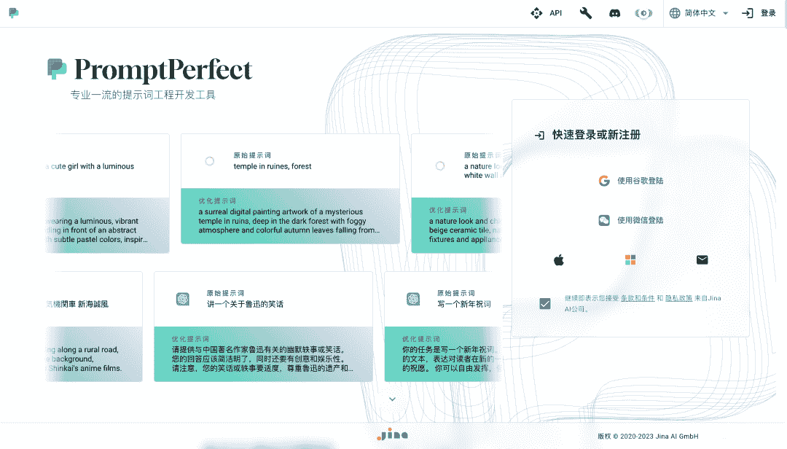

都有哪些强大的功能，我们一起体验下吧！

## ** PromptPerfect**

先放下官网地址（PC端体验最好）：

**https://promptper**fect.jinaai.cn/a/NEW

可以使用微信扫码登陆，非常方便，直接网页版在线使用。

PromptPerfect（以下简称 PP）功能非常丰富：

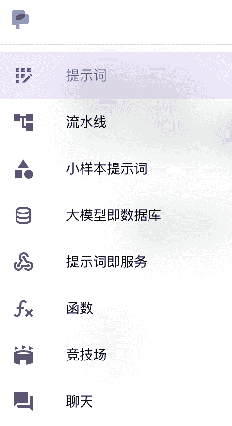

### ** 1、提示词 **

我们重点先聊下提示词优化。

大家都知道，大模型的使用门槛，已经转换到了Prompt 优化上。Prompt 优化是门学问。

想用好 AI 帮助我们提高工作效率，结果我们还要学习 Prompt 优化。那我要你何用？

那有没有一款工具，能够帮助我们做 Prompt 调优吗？PP 闪亮登场。

PP 的提示词功能就是针对这种需求的。

比如想要用 Stable Diffusion 生成好的图片效果，需要经过多次的 Prompt 调优，但有了 PP 就可以节省很大的精力。

在提示词功能里选中针对 SD 的优化模型后，输入原始文本：一张近景图，长相精致的女生在河边拍照。

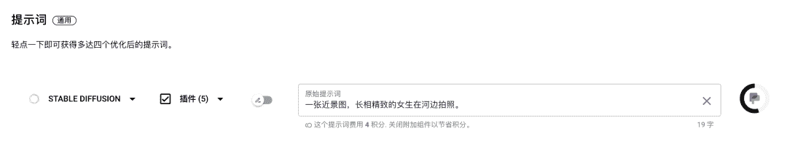

PP 经过优化，输出优化好后的 Prompt，一共 113 字。

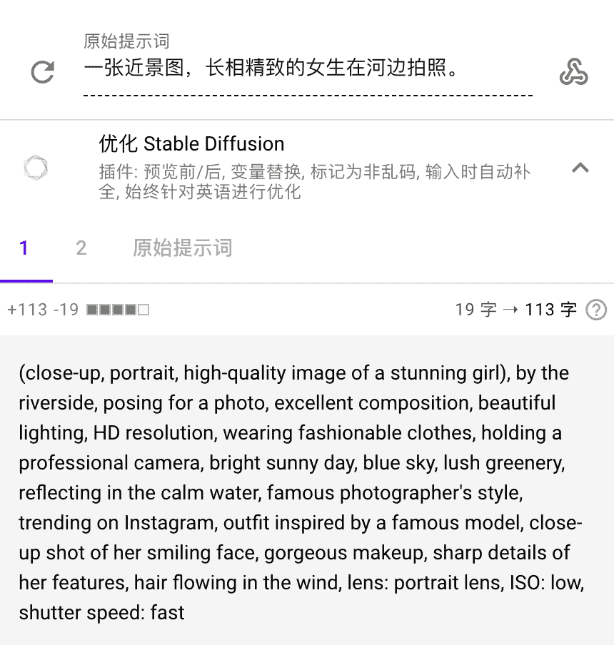

我们拿着这个 PP 输出的提示词，放到 SD 里生成图片，就得到了这样的结果：

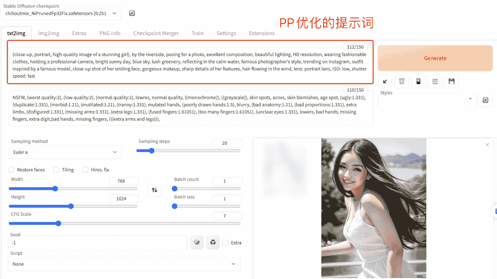

这生成的质量，你打几分？

简简单单一句话描述，PP 帮你输出优化好的 Prompt，拿走直接用就行。

这可大大节省了 Prompt 优化的工作量。

再比如说，“写推广文案“这样一个看起来很常见的任务，如果你本身并没有推广经验的话，其实很难给到大模型很具体的指令，另外对于生成的结果，你也很难判断其完成度是否足够专业。

举一个简单的例子，比如，我想做一个健身博主，我想用 ChatGPT 帮我写一个具有感染力的健身入门文案。原始提示词是：请为”游泳俱乐部“线上社群生成新成员招募文案。

经过PP优化后，原本仅有 23 字相对比较笼统的提示词，变成了一条更加专业的 293 字的提示词。新的提示词对于任务的要求更明确，提供了具体的指引来更好地完成任务。

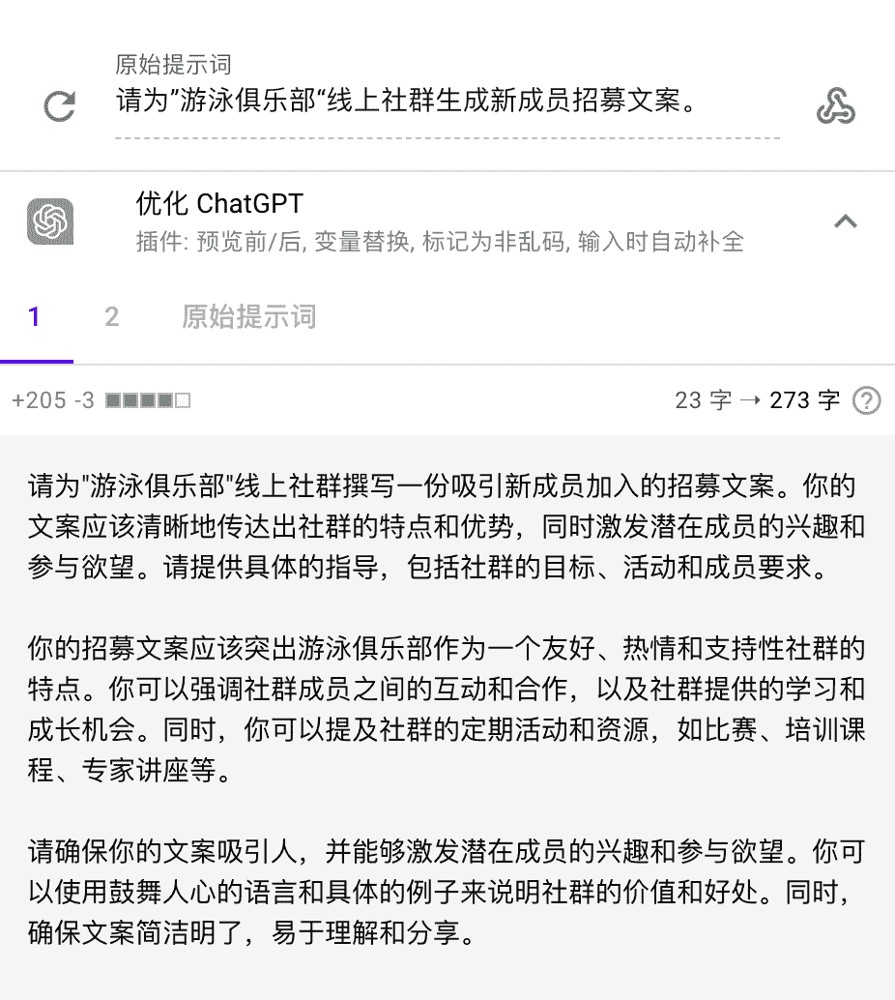

它明确了所生成的招募文案中的内容和风格，并提供了友好、热情和支持性社群的特点建议。所以，这使得优化后生成的文案相对于原始提示词生成的文案有了明显的提升，更加吸引人阅读。

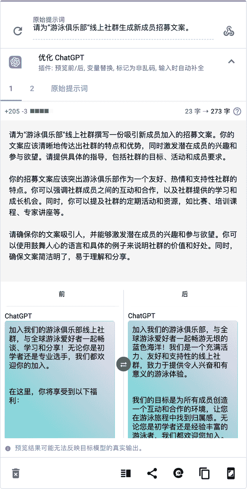

左边优化前，右边优化后。

其实每次让 PP 对提示词优化以后，可以看看页面上这个“优化了什么”，这也是学习 Prompt 优化，从而更好的掌握这个技能。

PP 不仅仅支持 ChatGPT 的 Prompt 优化，光文本大模型就支持 12 种之多。

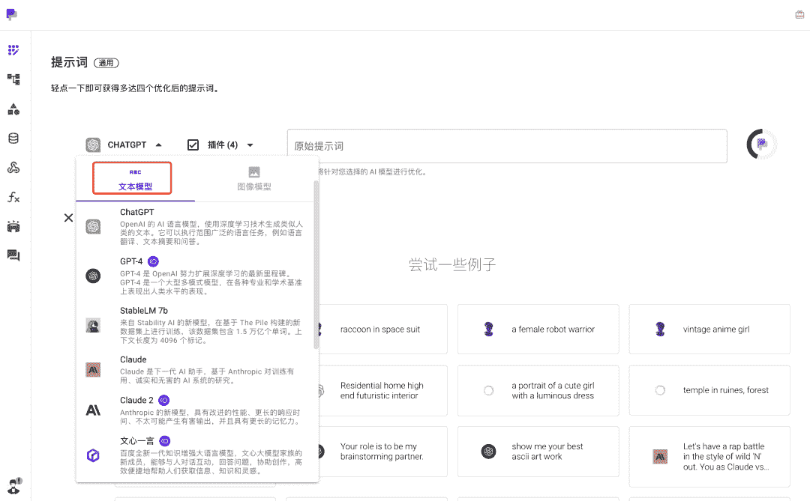

还支持各种图像模型，像 Midjourney、Stable Diffusion 这些。

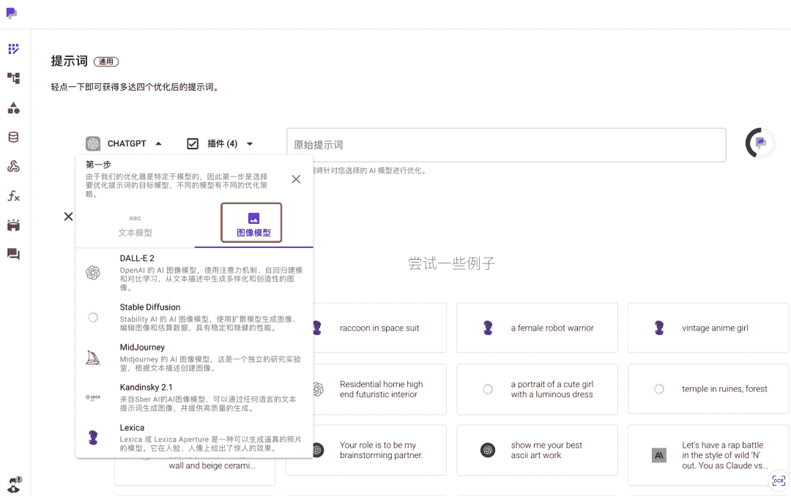

### ** 2、服务化 **

PP 的强大，不仅局限于 Prompt 优化。

比如，我想做一个个性的 AI 聊天机器人，每个角色都 fintune 一个模型成本太高了，所以可以用预先设定的 Prompt，在一对一的聊天场景里，让 Prompt Bot 化。

这里我们以电子唐僧为例，用 PP 部署一个电子唐僧聊天机器人。

首先，在 PP中 输入原始 Prompt ：“请你陪我角色扮演，我是孙悟空，你是我的师傅唐僧。”

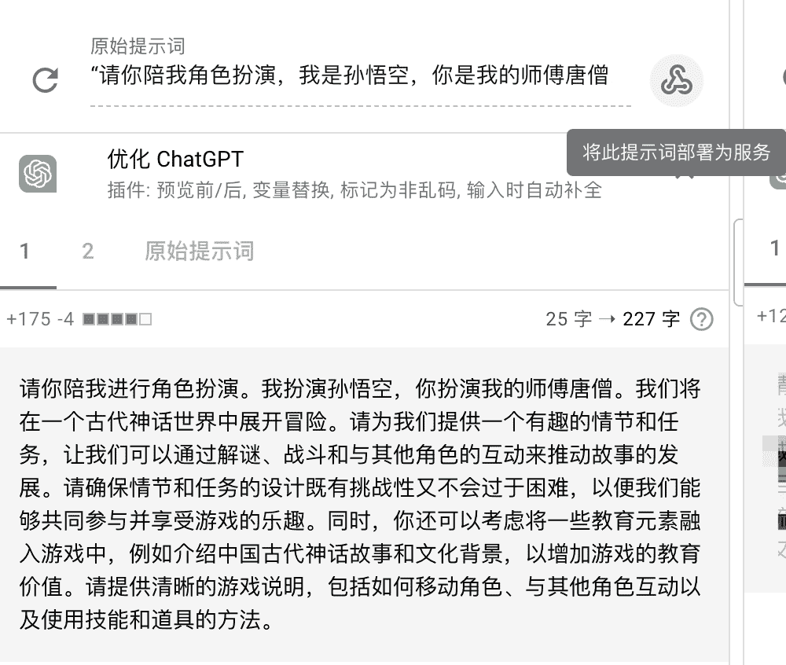

我们可以把这个提示词部署为服务。

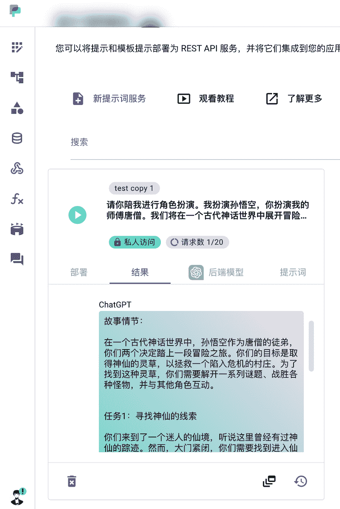

然后就可以构建一个可用的公开 API 接口，并提供了curl，Python，JS 的代码，可以让任何人都通过 API 调用你的聊天机器人服务。

这样包装一下，是不是可以做个 AI 聊天机器人了？

不仅如此，PP 支持的任何提示词优化服务，都能部署成 API 的形式。

这样就能批量化生产各种内容，比如让 PP 批量化生成一批高质量的 AI 图片。

做成固定一个人的，不同场景的图片，是不是就能拿去当 AI 博主了？

此外，还有一个有趣的功能就是：竞技场。

可以在线对比各个大模型的效果，比如输入：李白和杜甫到底是什么关系？

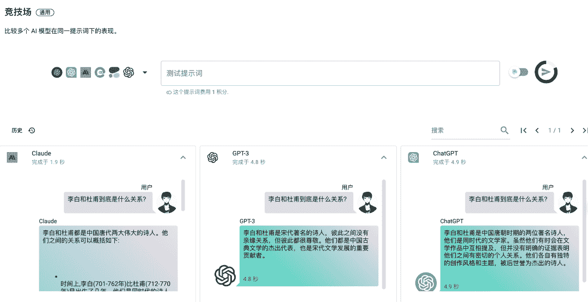

可以选择多种模型进行对比，非常 nice，一个 PP 账号就能体验各种大语言模型了。

## ** 最后**

这种让 AI 调教 AI 的工具，让 Prompt 优化更高效，非常实用的一款工具。

强烈推荐大家也去体验一番，最近好像还有活动。

注册就送 20 积分，每天登录还可以产生积分：

**https://promptper**fect.jinaai.cn/a/NEW

**此外还有**抽奖活动，填写**下方的问卷**即可参与，会抽取 5 名 用户送出价值 68 元 的积分兑换券，明天下午四点揭晓。

https://www.wjx.cn/vm/mBzPj9Y.aspx

并且，凡是注册后参与问卷调研的小**伙伴，都有机会领到新用**户专享微信红包！ 共200份，先到先得！

好了，今天就聊这么多吧，我是 Jack，我们下期见！