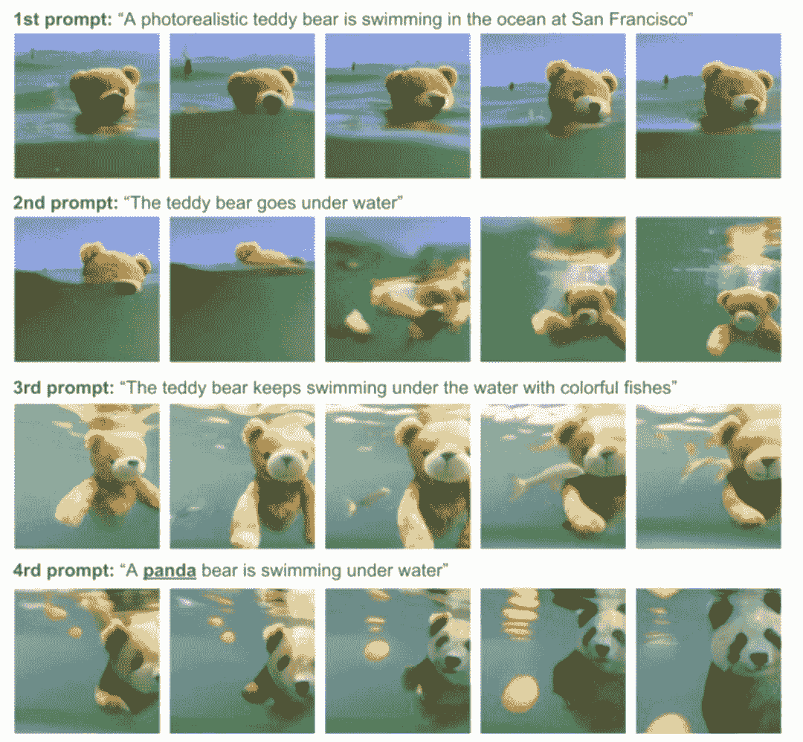
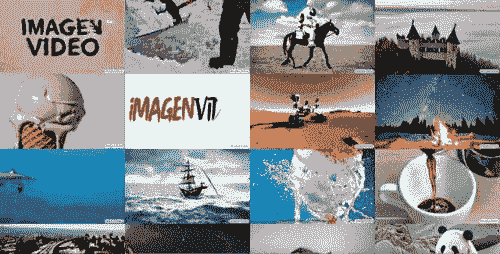
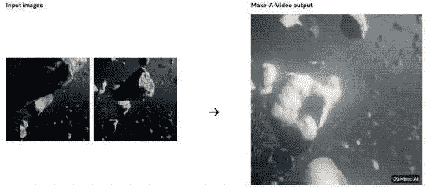
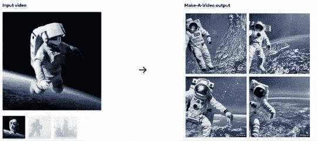
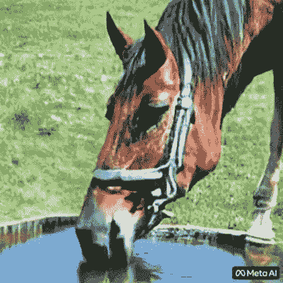
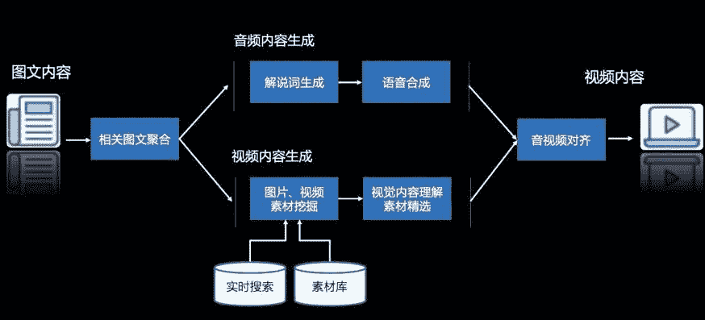

# 2023-09-12ChatGPT后，谁是下一个AIGC杀手级应用？-36氪

> 来源：[https://xuqiwei1986.feishu.cn/docx/BppGdzMHzof2FlxbxCTcNnicnBh](https://xuqiwei1986.feishu.cn/docx/BppGdzMHzof2FlxbxCTcNnicnBh)

> 🔗 原文链接： https://36kr.com/p/2428251547562242

>

### 摘要

1. Google：Phenaki & Imagen Video

2. Meta：Make-A-Video

**3. 百度：VidPress**

**4. 下一个明日之星？**

没有人怀疑，新时代已经到来。作为新时代“发电厂”，大模型正在改造着各行各业。

在AIGC领域，背靠大模型，以ChatGPT为代表的AI聊天机器人，以Midjourney为代表的AI图片生成工具，掀起了第四次AI浪潮。

但这或许只是可口的前菜？

一方面，比起图文，视频是更强的商业化载体；另一方面，有了5G技术高带宽、低时延的加持，视频领域的技术革命近在眼前。

那么，下一个大模型的爆发点会在何处？是在视听行业吗？

从需求来看，AI生成时代之前，视频生成的智能化主要用于后期剪辑；AI生成时代当下，接入大模型，成本和难度更大的素材采集可以轻松完成，而这刚好能够满足行业对“降本增效”的需求。

但从可实现性来看，根据易观《AIGC产业研究报告2023——视频生成篇》，生成视频商业化落地的挑战主要集中在 产品易用性挑战、稳定可控挑战，以及合规应用挑战 。其中，“产品易用性” 指视频生产的速度、交互体验等；“稳定可控”指可生成视频的时长、分辨率，以及处理速度，对复杂场景的理解等。

总的来说，生成视频的质量、互动的准度极大影响着其商业化落地。

那么现在的视频生成技术走到了哪一步呢，不妨先展开看看相关领域的进展。

一篇来自Boxmining的文章给出了部分答案（作者Steve Gates），文章介绍了包括Phenaki 、Imagen Video、Make-A-Video在内的几款AI视频生成模型，并指出了AIGC领域的下一个爆点。以下是适道的翻译简写。为方便大家丝滑阅读，适道对原文结构进行了微调，并补充了文中提及的案例。

**原文**

随着大模型不断发展，人们急切期待AI绘画和ChatGPT后的下一个突破点。

在通信领域，5G技术的高带宽、低时延，为视频传输提供了强有力的保障，这会引发一场围绕8K视频、VR和AR的视频技术革命。

综上所述，技术法则预示着视频领域的技术革命指日可待。随着AI和5G技术的发展，视频行业将迎来新一轮的创新发展浪潮。

### 01 Google：Phenaki & Imagen Video

在现象级产品ChatGPT大放异彩之时，Google的文生视频（Text to Video，T2V）模型Phenaki的表现也相当炸裂。

Phenaki不受固定帧数、时长、分辨率的限制。它不仅比以前的模型更长、更复杂，分辨率更高，还能理解不同的艺术风格和3D结构。

仅根据单个提示词，Phenaki就能生成一个能讲故事的视频（Story-Telling Video)。

当你想做一段泰迪熊动画时，只需输入：

A teddy bear diving in the ocean（一只泰迪熊潜入海中）

A teddy bear emerges from the water（一只泰迪熊从水中出现）

A teddy bear walks on the beach（一只泰迪熊走在沙滩上）

Camera zooms out to the teddy bear in the campfire by the beach（相机逐渐拉远至沙滩边篝火旁的泰迪熊）

几分钟后，你会获得如下视频：

怎么样？质感相当不错吧。

同时期，Google还推出了另一款基于扩散模型的Imagen Video，同样拥有高分辨率，也可以理解不同艺术风格。不过，Imagen Video生成的视频时长相比Phenaki来说更短。

### 02 Meta：Make-A-Video

Meta也加入了这场视频生成的卷王之战中，并在2022年9月推出了Make-A-Video，时间比Google推出Phenaki & Imagen Video刚好早了一周。

根据Meta官网介绍，和上述的文生视频T2V模型不同，Make-A-Video是建立在文本生成图像（Text to Image，T2I）模型上的升级版本。

也就是说，虽然Make-A-Video生成的是视频，但它没有用成对的文本+视频数据训练，而是和文本生成图像（Text to Image，T2I）模型一样，靠文本+图像的数据对进行训练，这一方面是考虑到当前互联网中的文本+视频的数据集过少，另一方面是，可以对已经相对成熟的T2I模型进行重复使用。

那么，我们来看看Make-A-Video能做出哪些好玩的视频？

1、将静止图像转换成视频

2、根据前后两张图片创建一个视频

3、基于原始视频生成新视频

4、根据输入的文字提示，生成符合语义的短视频。

例如，输入“喝水的马”

输入“机器人在时代广场跳舞”

### 03 百度：VidPress

到了国内，百度也将文心大模型的能力运用在智能视频合成平台VidPress中。

VidPress可以快速完成文字脚本、视频内容搜索、素材处理、音视频对齐、剪辑等一连串“骚操作”。

VidPress内容生产的三个环节

早在2021年1月，百度研究院就发布了一条由AI自主剪辑的视频《2021年十大科技趋势预测》，该视频的技术支撑就是VidPress。

当下，一方面，文娱、教育、传媒等诸多领域对AI生成视频具有强烈市场需求；另一方面，AI生成内容产品存在变现困难等商业化瓶颈。而在2022年，一批高质量文生图模型，如DALL E、Imagen和Stable Diffusion涌现，这将助力AI生成内容产业突破变现难等商业化瓶颈。

### 04 下一个明日之星？

在大模型技术领域，两类公司值得关注。

1、拥有数据基础和应用场景的公司

以Netflix、Disney为代表的大型行业玩家为代表，这些公司积攒了数十亿条会员评价，且熟知观众的习惯和需求。

事实上，Netflix已经使用AI来替代标准内容的制作，例如从影片中抽取符合用户观影偏好的画面，生成电影缩略图。

另外，今年1月31日，Netflix还发布了一支AIGC动画短片《犬与少年（Dog and Boy）》。其中动画场景的绘制工作就是由AI完成的。

2、科技巨头核心研发团队创建的初创公司

以OpenAI、DeepMind和Meta为代表，这些公司在该领域有着重大影响力。它们也凭借深厚的技术背景和创新精神，开发出了一系列领先的大模型技术。

有趣的是，这些公司原本的研究人员也跳了出来，强强联手，成立新公司。

例如，前段时间，由DeepMind和Meta的前研究人员共同创立的Mistral AI，成为了资本的新“宠儿”。Mistral AI仅成立了四个星期，就获得了一轮高达1.13亿美元的种子资金。据外媒Techcrunch报道，这是欧洲生成式AI公司有史以来获得的最大的种子轮融资。

### 结论

从ChatGPT到AIGC，再到如今的视频生成模型，AI发展的速度之快令人惊叹。

目前，在视频生成领域，科技巨头们正在争先抢占领先地位。

不过，无论谁来抢占，如何抢占，他们的目标都是创造出更加真实、高质量的视频。而这些技术不仅能为消费者带来更深度的娱乐体验，也将为媒体、教育、广告等行业带来巨大影响。

然而，这些正在更新的大模型技术也带来了一些新的挑战，如隐私问题、数据保护以及内容滥用问题。这需要我们在继续推动技术进步的同时，积极应对这些挑战，如制定相适应的规范和法规，以确保技术的健康发展。

无论如何，对于大模型技术的未来，我们有理由保持乐观。随着技术的不断进步，我们期待在不久的将来看到更多的创新和突破。

本文来自🛰️👸号 “适道”（ID:survivalbiz） ，作者：适道，36氪经授权发布。