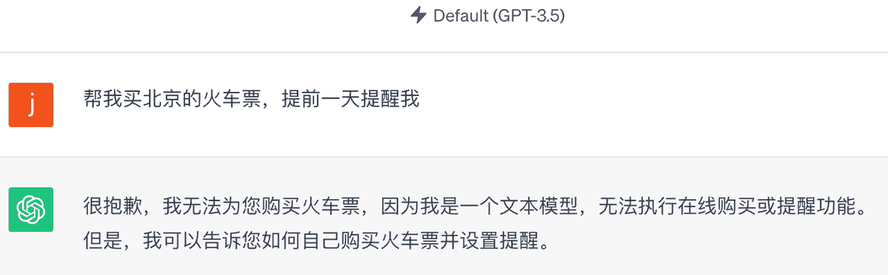
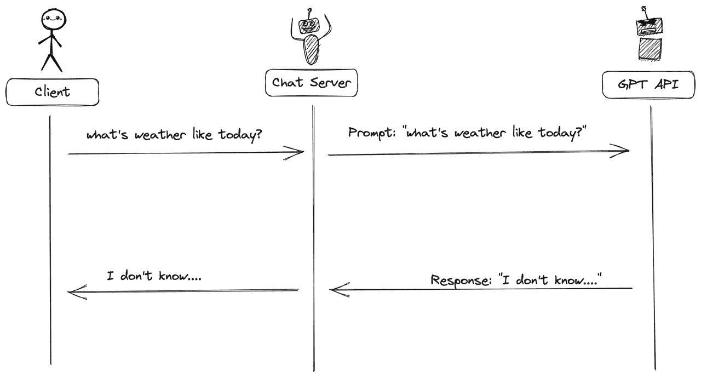
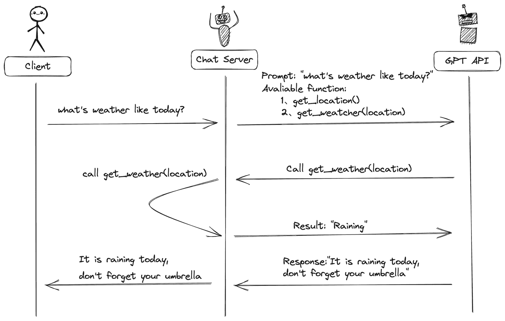
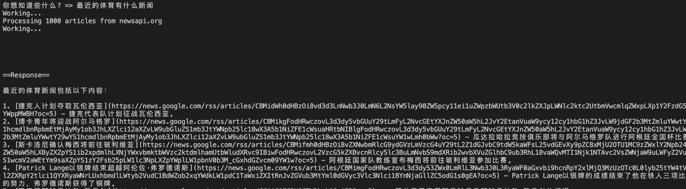
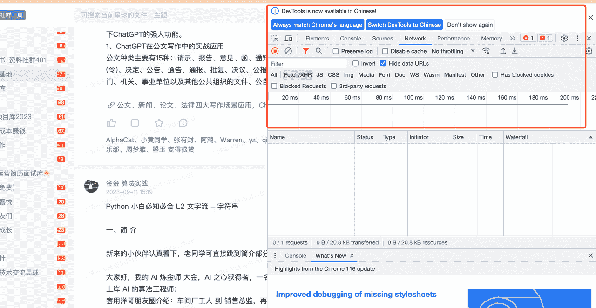
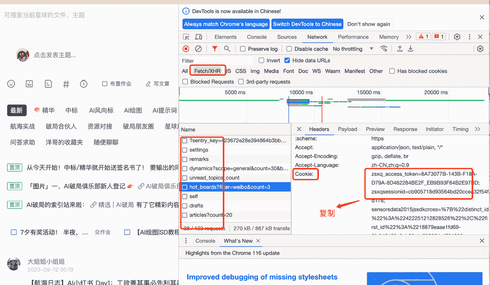
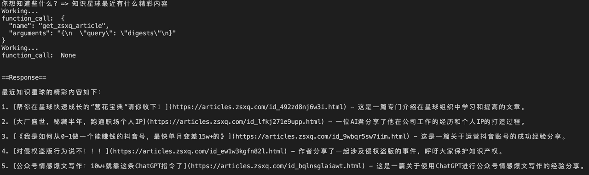

# 2023-09-12一篇文章学会OpenAI大杀器

> 来源：[https://xuqiwei1986.feishu.cn/docx/CxSgdSiGiodkz9xz1zncv49xnBh](https://xuqiwei1986.feishu.cn/docx/CxSgdSiGiodkz9xz1zncv49xnBh)

> 🔗 原文链接：https://articles.zsxq.com/id_1dladdd3zcab.html

## 1、让ChatGPT帮我买张火车票

想象下，你创建一个人工智能助手，你可以这样对他说：“帮我买北京的火车票，提前一天提醒我”！如果是ChatGPT的话，它必然会无情地拒绝你。



ChatGPT是世界上最强大的模型，不过，它虽然知道你想让它帮你买票，但它却不懂如何买票，它能力的上限就摆在那儿了。好在OpenAI在GPT模型引入了一个强大的功能--函数调用(`function call`)。

相信有些小伙伴应该已经用过ChatGPT的`plugins`功能，`Plugins`的功能有不少是基于`function call`进行的

今天，我们一起来创建一个获取最新新闻的GPT，给大家展示如何使用`function call`，用于深入理解函数调用的概念以及它给我们带来的可能性。

## 2、函数调用(`function call`)是啥？

函数调用(`function call`)是OpenAI `GPT-4-0613` 和 `GPT-3.5 Turbo-0613` 模型支持的功能，这两个模型经过训练，可以根据用户的提示检测需不需要调用用户提供的函数，并且用一个很规范的结构返回，而不是直接返回常规的文本。

函数调用(`function`)允许ChatGPT和其他的系统进行信息的交互，让ChatGPT回答他们原本无法回答的问题。例如，我们需要查询实时的天气，这些数据是ChatGPT没有的，所以ChatGPT需要从别的平台获取最新的天气情况。换句话说就是，函数调用，就是提供了一种方式，教AI模型怎么样和外面的系统进行交互。

## 3、函数调用(`function-call`)目的是什么？

函数调用，可以用来增强GPT模型的功能，让GPT能做到更多事情。其实还有两种方式可以增强GPT模型的能力。

**微调：**提供标注数据进一步训练模型，不过微调需要很多时间和精力准备训练数据。

**嵌入：**构建机器人知识库，通过构建上下文和知识库的内容进行关联，从而让GPT获得更丰富的回答。

函数调用是第三种扩展GPT功能的方式，这种方式和其他两种不一样，它可以让我们和外部的系统进行交互！

## 4、怎么样使用函数调用？

在有函数调用(`function-call`)时候，我们调用GPT构建AI应用的模式非常简单。主要有几个步骤

1、用户(`client`)发请求给我们的服务(`chat server`)

2、我们的服务(`chat server`)给GPT提示词

3、重复执行



有了函数调用(`function-call`)，调用的方式就比之前的复杂一些了，具体的步骤为

1、发送用户的提示词以及可以调用的函数

2、`GPT`模型根据用户的提示词，判断是用普通文本还是函数调用的格式响应

3、如果是函数调用格式，那么`Chat Server`就会执行这个函数，并且将结果返回给`GPT`

4、然后模型使用提供的数据，用连贯的文本响应。



## 5、用API完成函数调用

在调用`GPT`接口时，我们一般使用的是`Completions`接口，这个接口发送的是`POST`请求，发送的数据格式如下所示：

```json
{
  "model": "gpt-3.5-turbo",
  "messages": [
    {
      "role": "user",
      "content": "What's weather like today?"
    }
  ]
}
```

`GPT`返回的可能是下面这些内容

```json
{
  "id": "chatcmpl-FWVo3hYwjrpAptzepU46JamvvgBzb",
  "object": "chat.completion",
  "created": 1687983115,
  "model": "gpt-3.5-turbo-0613",
  "choices": [
    {
      "index": 0,
      "message": {
        "role": "assistant",
        "content": "I'm sorry, but I don't have access to real-time information, including current weather conditions or forecasts. To find out the weather for your location today, I recommend using a weather website, app, or a voice-activated assistant like Siri, Google Assistant, or Alexa. Simply ask one of these services for the weather in your area, and they should be able to provide you with up-to-date information."
      },
      "finish_reason": "stop"
    }
  ],
  "usage": {
    "prompt_tokens": 15,
    "completion_tokens": 44,
    "total_tokens": 59
  }
}
```

在这里，为了记录上下文，我们需要在每个请求上，将整个消息历史记录返回给 API。例如，如果我们想继续讨论之前的问题，那么相应的 JSON 应该将是：

```json
{
  "model" : "gpt-3.5-turbo" ,
  "messages" : [
    {
      "role" : "user" ,
      "content" : "How many planets does the solar system have?"
    },
    {
      "role" : "assistant" ,
      "content" : "I'm sorry, but I don't have access to real-time information, including current weather conditions or forecasts. To find out the weather for your location today, I recommend using a weather website, app, or a voice-activated assistant like Siri, Google Assistant, or Alexa. Simply ask one of these services for the weather in your area, and they should be able to provide you with up-to-date information."
    },
    {
      "role" : "user" ,
      "content" : "how do I access these apps?"
    }
  ]
}
```

在上面的例子中，我们明确知道了，`ChatGPT`查不了实时信息，接下来，我们会加上`function call`，让`ChatGPT`可以查询实时信息。

```json
{
  "model" : "gpt-3.5-turbo-0613" ,
  "messages" : [
    {
      "role" : "user" ,
      "content" : "How is the weather in NYC?"
    }
  ],
  "functions" : [
    {
      "name" : "get_current_weather" ,
      "description" : "Get the current weather in a given location" ,
      "parameters" : {
        "type" : "object" ,
        "properties" : {
          "location" : {
            "type" : "string" ,
            "description" : "The city and state, e.g. San Francisco, CA"
          },
          "unit" : {
            "type" : "string" ,
            "enum" : [
              "celsius" ,
              "fahrenheit"
            ]
          }
        },
        "required" : [
          "location"
        ]
      }
    }
  ]
}
```

当`GPT`模型决定调用我们提供的函数，那么我们就会收到下面类似的返回

```json
{
  "id": "chatcmpl-7WWG94C1DCFlAk5xmUwrZ9OOhFnOq",
  "object": "chat.completion",
  "created": 1687984857,
  "model": "gpt-3.5-turbo-0613",
  "choices": [
    {
      "index": 0,
      "message": {
        "role": "assistant",
        "content": null,
        "function_call": {
          "name": "get_current_weather",
          "arguments": "{\n \"location\": \"New York, NY\"\n}"
        }
      },
      "finish_reason": "function_call"
    }
  ],
  "usage": {
    "prompt_tokens": 81,
    "completion_tokens": 19,
    "total_tokens": 100
  }
}
```

`get_current_weather`将会使用返回的参数调用。`OpenAI` 不 执行该函数，我们的服务会执行这个函数，并且获取结果后解析返回给`OpenAI`。

一旦我们检索到天气数据，我们就会使用一种名为 `function` 的新的角色将其发送回模型。例如：

```json
{
  "model":"gpt-3.5-turbo-0613",
  "messages":[
    {
      "role":"user",
      "content":"How is the weather in NYC?"
    },
    {
      "role":"assistant",
      "content":null,
      "function_call":{
        "name":"get_current_weather",
        "arguments":"{\n \"location\": \"New York, NY\"\n}"
      }
    },
    {
      "role":"function",
      "name":"get_current_weather",
      "content":"Temperature: 57F, Condition: Raining"
    }
  ],
  "functions":[
    {
      "name":"get_current_weather",
      "description":"Get the current weather in a given location",
      "parameters":{
        "type":"object",
        "properties":{
          "location":{
            "type":"string",
            "description":"The city and state, e.g. San Francisco, CA"
          },
          "unit":{
            "type":"string",
            "enum":[
              "celsius",
              "fahrenheit"
            ]
          }
        },
        "required":[
          "location"
        ]
      }
    }
  ]
}
```

这里注意下，我们将整个消息历史记录传递给了 API，包括原始提示词、模型的函数调用以及代码中执行天气函数的结果，这种方式可以让模型能够理解调用函数的上下文。

最后，模型可能会回复一个格式正确的答案，回答我们最初的问题：

```json
{
  "id": "chatcmpl-7WWQUccvLUfjhbIcuvFrj2MDJVEiN",
  "object": "chat.completion",
  "created": 1687985498,
  "model": "gpt-3.5-turbo-0613",
  "choices": [
    {
      "index": 0,
      "message": {
        "role": "assistant",
        "content": "The weather in New York City is currently raining with a temperature of 57 degrees Fahrenheit."
      },
      "finish_reason": "stop"
    }
  ],
  "usage": {
    "prompt_tokens": 119,
    "completion_tokens": 19,
    "total_tokens": 138
  }
}
```

以上，就是`Function Call`在调用过程中交互数据的格式，接下来，我们使用实际的例子，使用`python`开发`function call`的简单应用。

### 5.1 新闻机器人

为了实现这个功能，我们需要`OpenAI` 的`key`，`key`的获取可以在 `https://platform.openai.com/account/api-keys`，

获取`key`之后，我们需要安装一些`python`依赖包

```bash
pip install openai tiktoken
```

我们需要导入一些依赖库

```python
import openai

import tiktoken

import json

import os

import requests
```

接下来，将定义几个常量：

指定 `GPT` 模型。我们将使用`gpt-3.5-turbo-16k`

我们预设的提示词。

用于对字符串和消息中的标记进行计数的编码；需要确保我们不超过语言模型的限制。

调用的函数的最大数量

`openai.api_key` 从`openai`平台获取的`key`

`zsxq_cookie` 知识星球的`cookie`

```python
llm_model = "gpt-3.5-turbo-16k"

llm_max_tokens = 15500

llm_system_prompt = "You are an assistant that provides news and headlines to user requests. Always try to get the lastest breaking stories using the available function calls."

encoding_model_messages = "gpt-3.5-turbo-0613"

encoding_model_strings = "cl100k_base"

function_call_limit = 3

openai.api_key = "sk-xxx" # 需要设置

zsxq_cookie="zsxq_access_token=xxx" # 需要设置

news_key = "" # 新闻key
```

所有 `GPT`模型都有`token`限制。如果超过此限制，API 将抛出错误而不是响应我们的请求。因此，我们需要一个函数来计算`token`的数量。

```python
def num_tokens_from_messages ( messages ):

"""Returns the number of tokens used by a list of messages."""

try :

encoding = tiktoken.encoding_for_model(encoding_model_messages)

except KeyError:

encoding = tiktoken.get_encoding(encoding_model_strings)

num_tokens = 0

for message in messages:

num_tokens += 4

for key, value in message.items():

num_tokens += len (encoding.encode( str (value)))

if key == "name" :

num_tokens += - 1

num_tokens += 2

return num_tokens
```

现在我们需要有一个函数来获取新闻，我们可以在 `https://newsapi.org/` 获取查询新闻的`KEY`

```python
def get_top_headlines ( query: str = None, country: str = None, category: str = None ):

"""Retrieve top headlines from newsapi.org (API key required)"""

base_url = "https://newsapi.org/v2/top-headlines"

headers = {

"x-api-key" : news_key

}

params = { "category" : "general" }

if query is not None :

params[ 'q' ] = query

if country is not None :

params[ 'country' ] = country

if category is not None :

params[ 'category' ] = category

response = requests.get(base_url, params=params, headers=headers)

data = response.json()

if data[ 'status' ] == 'ok' :
```


# GPT 函数调用实战演示

## 新闻头条查询与 GPT 交互

```python
print(f"Processing {data['totalResults']} articles from newsapi.org")

return json.dumps(data['articles'])

else:

print("Request failed with message:", data['message'])

return 'No articles found'
```

为了让 GPT 模型知道我们存在 `get_top_headlines` 函数可以调用，我们需要用 JSON 结构描述我们的函数

```python
signature_get_top_headlines = {
    "name": "get_top_headlines",
    "description": "获取按国家和/或类别分类的头条新闻。",
    "parameters": {
        "type": "object",
        "properties": {
            "query": {
                "type": "string",
                "description": "自由输入关键词或短语进行搜索。",
            },
            "country": {
                "type": "string",
                "description": "要获取头条新闻的国家的 2 位 ISO 3166-1 代码。",
            },
            "category": {
                "type": "string",
                "description": "要获取头条新闻的类别",
                "enum": ["business", "entertainment", "general", "health", "science", "sports", "technology"]
            }
        },
        "required": [],
    }
}
```

接下来，我们将定义 `complete` 函数，执行和 GPT 大模型交互的任务，主要步骤为：

- 在消息末尾添加系统提示。这个用于添加消息的上下文
- 如果 `token` 总数超过模型的限制，则删除旧消息。
- 将请求发送到 GPT API。
- 从列表末尾删除系统消息

```python
def complete(messages, function_call: str = "auto"):
    """Fetch completion from OpenAI's GPT"""
    messages.append({"role": "system", "content": llm_system_prompt})

    while num_tokens_from_messages(messages) >= llm_max_tokens:
        messages.pop(0)

    print('Working...')

    res = openai.ChatCompletion.create(
        model=llm_model,
        messages=messages,
        functions=[signature_get_top_headlines, signature_get_zsxq_article],
        function_call=function_call
    )

    messages.pop(-1)

    response = res["choices"][0]["message"]

    messages.append(response)

    if response.get("function_call"):
        function_name = response["function_call"]["name"]

        if function_name == "get_top_headlines":
            args = json.loads(response["function_call"]["arguments"])
            headlines = get_top_headlines(
                query=args.get("query"),
                country=args.get("country"),
                category=args.get("category")
            )
            messages.append({"role": "function", "name": "get_top_headline", "content": headlines})

        elif function_name == "get_zsxq_article":
            args = json.loads(response["function_call"]["arguments"])
            headlines = get_zsxq_article(query=args.get("query"))
            messages.append({"role": "function", "name": "get_top_headline", "content": headlines})
```

最后，我们添加一个 `run` 函数，循环接受我们的请求发送给 GPT API

```python
def run():
    print("\n你好，我是你的小助手，你有什么问题都可以问我噢～")
    print("你可以这样问我:\n - 告诉我最近有什么技术发现？\n - 最近的体育有什么新闻\n - 知识星球最近有什么精彩内容\n")

    messages = []

    while True:
        prompt = input("\n你想知道些什么? => ")
        messages.append({"role": "user", "content": prompt})

        complete(messages)

        call_count = 0

        while messages[-1]['role'] == "function":
            call_count = call_count + 1

            if call_count < function_call_limit:
                complete(messages)
            else:
                complete(messages, function_call="none")

        print("\n\n==Response==\n")
        print(messages[-1]["content"].strip())
        print("\n==End of response==")
```

最后，我们可以运行我们的程序进行测试了，要注意，运行这个 `python` 程序的电脑一定要在国外，另外一定要设置相应的 `key`。国内的电脑无法调用 GPT 模型的 API



## 5.2 破局精华贴机器人

在前面，我们已经添加了查询新闻的功能了，在这里，我们再加个简单的功能。让 GPT 模型帮我们查找知识星球的精华贴。

在前面我们应该都已经知道了，增加函数，我们需要添加一个函数描述，在这里我们只需要在原来的代码基础上添加即可

```python
signature_get_zsxq_article = {
    "name": "get_zsxq_article",
    "description": "获取破局俱乐部知识星球的精华贴",
    "parameters": {
        "type": "object",
        "properties": {
            "query": {
                "type": "string",
                "description": "自由输入关键词或短语进行搜索。",
                "enum": ["digests", "all"]
            },
        },
        "required": [],
    }
}
```

然后，我们再实现我们的 `get_zsxq_article` 接口，获取星球的精华文章

```python
def get_zsxq_article(query: str = None):
    url = "https://api.zsxq.com/v2/groups/15552545485212/topics?scope=" + query + "&count=20"
    payload = {}
    headers = {
        'cookie': zsxq_cookie
    }

    response = requests.request("GET", url, headers=headers, data=payload)
    data = response.json()

    article = []

    if data['succeeded'] != True:
        return "No article Found"

    if data['resp_data'] is None:
        return "No article Found"

    for item in data['resp_data']['topics']:
        if "talk" not in item or "text" not in item["talk"]:
            continue

        if "article" not in item["talk"] or "article_url" not in item["talk"]["article"]:
            continue

        article.append({"text": item["talk"]["text"], "url": item["talk"]["article"]["article_url"]})

    return json.dumps(article)
```

在这里，我们还有个关键点，要设置 `get_zsxq_article` 的 `cookie`，这个步骤也很简单，我们下载一个谷歌浏览器，然后打开知识星球的网页版本，按 `F12`



在弹出右侧的框后，我们在刷新下知识星球的网页，然后按照红框中的指示，找到 `cookie` 即可。



在获取 `cookie`，填充到我们的代码后，我们可以运行，看看效果



到这里，我们的实战演示就结束了。

那么，学会了 `function call`，我们还有哪些东西可以做呢？

比如说，做一个知识星球内容搜索机器人？

发挥你们的想象力吧！
