# 如何使用 TuneFlow 创作AI孙燕姿项目，如何以歌词自动生成歌曲

> 来源：[https://xuqiwei1986.feishu.cn/docx/XitvdtrnroUqw3xr3fdcQXRunrg](https://xuqiwei1986.feishu.cn/docx/XitvdtrnroUqw3xr3fdcQXRunrg)

嘿，大家好呀，我是景淮，一个加拿大的程序员，沉迷 AI 不能自拔中。

昨天写了一篇 **点子大师 **的 prompt 的代码，可以在我们没有灵感时候，给我们提供灵感方向，并提供初始版的提示词，但还没有调试到最好，可能明天或者晚点再发出来，这边第 40 篇文章先保留一下！

今天，**我们分享一些好玩的**内容，之前很火的 AI 孙燕姿 的内容，今天想试试有没有简单点的方式，能不能自己试着玩一玩，所以搜索尝试了一些软件和网站，最后找到了这个软件 TuneFlow ！今天主要就是一个学习过程的记录贴。

今天是我持续分享内容的第 41 篇，主要是分享关于：

**如何**使用 TuneFlow 创作AI孙燕姿项目，如何以歌词自动生成歌曲

本文会根据以下内容顺序进行：

+   TuneFlow 创作类 AI 孙燕姿项目

+   GPT 辅助创作歌词

+   使用 SongR 生成初版歌曲

+   怎么训练自己喜欢明星的模仿包

+   Suno.ai 试用

+   总结

**一、TuneFlow 创作类 ****AI**** 孙燕姿项目**

1、打开[官网](https://tuneflow.com/?lang=zh-CN)，点击开始创作

2、点击下载桌面版（上传音频需要使用桌面版）

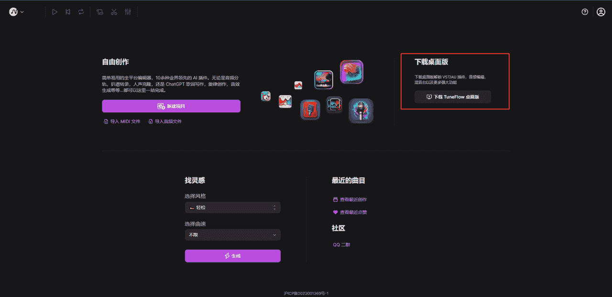

3、跳过安装过程，点击登录，可以直接使用🛰️登录，关注一下👸号，然后创建一个用户名即可

4、点击新建项目

5、导入想要创建的歌曲（提前先下载好在本地哈！）

6、我先导入了一首 林俊杰的江南

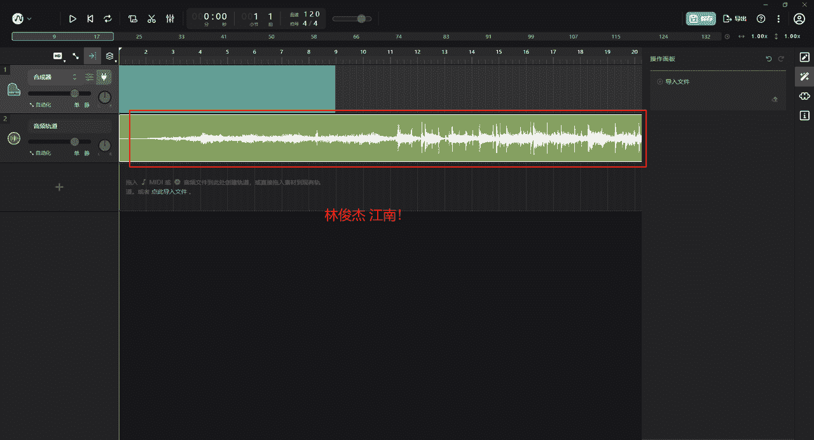

7、右键音轨 => 运行插件 => 选中的片段 => 智能音频分轨

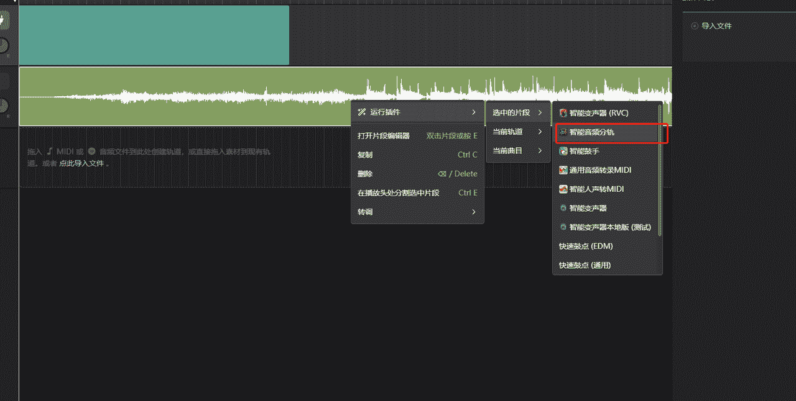

8、选择 **人声 + 伴奏** 模式，点击 **启用**（等待时间可能较长哦）

9、我们就获得以下音轨，其中最上面的是原音频，第**二**个是人声，第三个为伴奏。（我们可以点击静，来静音对应轨道，试听）

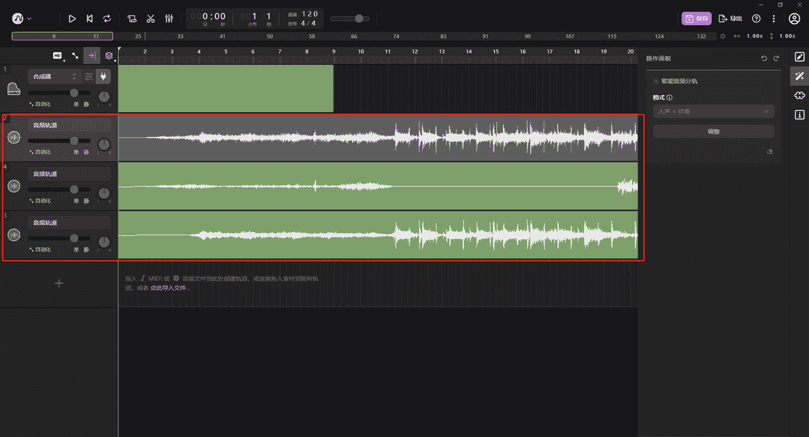

10、选中中间的轨道，右键 运行插件 => 选中片段 => 智能变声

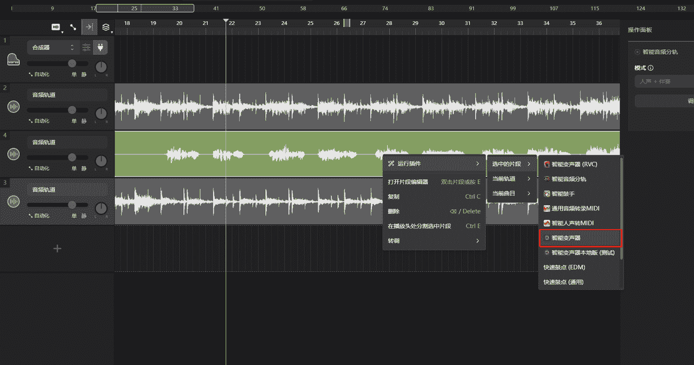

11、在右边设置中声线选择 YZ（孙**燕姿**）f0 均值滤波打开，参数调成0.2 点击 启用

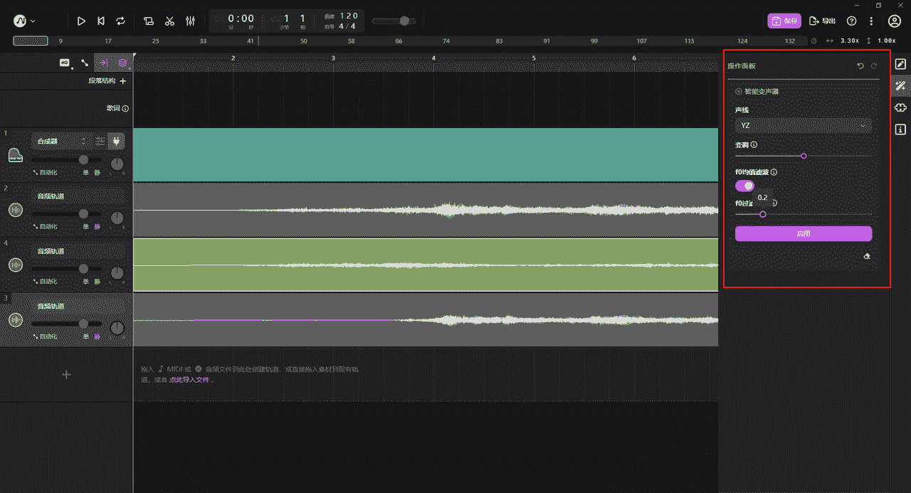

12、打开下面两个音轨，然后我们听一下。

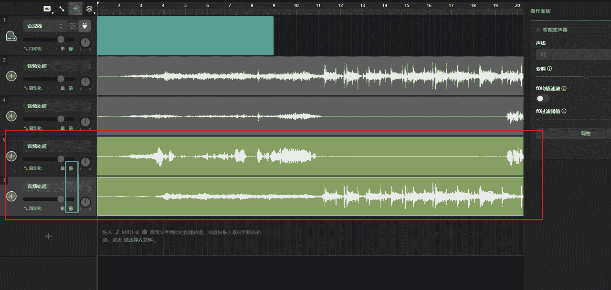

13、发现前面音频有问题，我们把这段剪辑一下！（因为人声分离时候不够干净，有些杂音导致）

14、调整轨道，到杂音后，右键 => 在播放头处分割选中片段

15、点击分割后，分割线前面部分，删掉杂音部分，右键删除

16、同样办法，处理音频轨道 4 ，但保留前面部分，删掉后面部分

17、同时打开 音频轨道 4、6、3，播放试听

中间有些瑕疵，主要是生成时的问题（我试听了我之前的音频，我本身上传音频有点小问题）

18、删掉多余部分

19、保存，然后导出音频

20、导出 => 导出音频 => 整首歌曲

21、点击导出

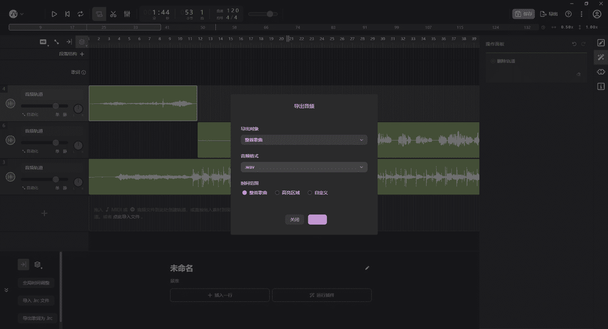

22、音频展示（副歌有点小瑕疵！）

[孙燕姿 江南.wav](https://internal-api-drive-stream.feishu.cn/space/api/box/stream/download/all/LX91bpae0olLuxx6TUbc6WEKnme)

23、你不是真正的快乐 孙燕姿 😀（这个感觉是和声太多！很奇怪！）

[孙燕姿 你不是真正的快乐.wav](https://internal-api-drive-stream.feishu.cn/space/api/box/stream/download/all/FrfFbtZfFoN16SxLoIPcH8RgnIe)

**二、****GPT**** 辅助创作歌词**

**一）如果让你给歌词打分，你要怎么**做，有哪些需要考虑的问题，又怎么解决呢？

1.  内容原创性：是否歌词具有独特性？它是否避免了过于常见的陈词滥调？

1.  情感深度：歌词是否能引起听众的共鸣？它是否有深度和真实感？

1.  语言技巧：是否运用了韵律、隐喻、比喻、反复等修辞手法？这些技巧是否得当并增强了歌词的表现力？

1.  结构与流畅性：是否有明确的开始、发展和结尾？歌词之间的转换是否流畅？

1.  文化与社会价值：歌词是否涉及到某些重要的文化或社会话题？是否有教育意义或能够引发深思？

1.  普遍性与特定性：好的歌词通常既具有普遍性，使大多数人都能有所共鸣，又具有特定性，为歌词赋予特色和与众不同之处。

> 如何解决评分的问题？

1.  建立评分标准：为上述每一点制定一个评分范围（例如1到10），并为每个评分提供具体的描述和例子，以确保评分者有明确的指导。

1.  多人评分：为了尽量减少主观偏见，可以请多名评分者对同一首歌词进行打分，并取其平均值作为最终评分。

1.  持续修正：随着时间的推移，评分标准可能需要调整，以适应新的文化和音乐趋势。

1.  提供反馈：为歌手或词作者提供评分的同时，也应提供具体的反馈，说明哪些地方做得好，哪些地方需要改进。

**二**）按照上述内容的要求，下面这首《See you again》 可以打多少分呢？(下面放《See you again》的歌词)

> 《See You Again》是一首由Wiz Khalifa与Charlie Puth合作的歌曲，用以纪念已故的演员Paul Walker，收录在《速度与激情7》的电影原声带中。这首歌曲不仅在音乐上受到了广大听众的喜爱，歌词的情感深度也让许多人为之动容。

> 让我们根据先前列出的评分标准来进行评价：

1.  内容原创性：这首歌是为了纪念Paul Walker而写的，所以其情感和内容都非常真挚和原创。尤其是与《速度与激情》系列电影的情感结合，使其原创性得到了很好的展现。得分：8/10。

1.  情感深度：歌词中充满了对故人的怀念和对家人和朋友的珍视，情感深度十足。得分：9/10。

1.  语言技巧：歌词中虽然没有大量运用修辞手法，但直白而真挚的文字更能打动人心。得分：7/10。

1.  结构与流畅性：整首歌曲结构明晰，从回忆到期待再见，再到家庭和情谊的价值，流畅性良好。得分：8/10。

1.  文化与社会价值：这首歌提及了家庭和友情的重要性，对于许多人来说都有很深的共鸣。得分：8/10。

1.  普遍性与特定性：歌词既有对Paul Walker的特定怀念，也有对家庭和友情普世价值的赞颂，兼具普遍性和特定性。得分：8/10。

> 根据上述评分，这首歌曲的总分为：8 + 9 + 7 + 8 + 8 + 8 = 48/60。

> 需要注意的是，这只是基于所给出的评分标准的一个主观评价，不同的人可能会有不同的评价和看法。

**三）按照百分制是多少分呢？**

> 按照我们给出的评分，总分是48/60。

> 转换为百分制：(48/60) x 100 = 80%

> 所以，按照百分制，这首《See You Again》的歌词评分为80分。

**四）按照****上述内容的要求，下面这首《Lemon** Tree》 可以打多少分呢？请按照百分制打分(下面放《Lemon Tree》的歌词)

> 《Lemon Tree》由Fool's Garden创作并演唱，是一首非常流行的歌曲，其旋律朗朗上口，歌词中的柠檬树成为了孤独和无聊的象征。接下来，我将根据先前提及的评分标准来对此歌进行评价。

>

1.  **内容原创性**：歌曲以柠檬树为核心，形象地描述了生活中的孤独和无聊，非常具有原创性。得分：8/10。

>

1.  **情感深度**：虽然歌词看似简单，但其实它描绘了人们内心深处的孤独感和对生活的疑惑。得分：8/10。

>

1.  **语言技巧**：使用了反复的句式和比喻，将柠檬树作为孤独和等待的象征。得分：7/10。

>

1.  **结构与流畅性**：歌词的结构相对简单，但具有很强的节奏感和旋律感，非常流畅。得分：8/10。

>

1.  **文化与社会价值**：这首歌成为了许多人的心头好，它所传达的孤独感是普世的，很多人都能产生共鸣。得分：7/10。

>

1.  **普遍性与特定性**：歌词所传达的情感是普遍的，但以柠檬树为核心的创意则具有特定性。得分：8/10。

>

> 根据上述评分，这首歌曲的总分为：8 + 8 + 7 + 8 + 7 + 8 = 46/60。

>

> 转换为百分制：(46/60) x 100 = 76.67%

>

> 所以，按照百分制，这首《Lemon Tree》的歌词评分为约77分。同样地，这是基于所给出的评分标准的一个主观评价，不同的人可能会有不同的评价和看法。

**五）我是一名歌词创作者，我常常需要创作一些歌曲的歌词，但你知道**，很多时候创作出来的歌词经常有以下难点：

1.  情感传达：歌词要能够引发听众的共鸣，这要求词作者有足够的情感深度和表达能力。

1.  押韵与节奏：歌词通常需要和旋律相匹配，这就要求在韵脚、节奏和强弱音等方面与音乐保持协调。

1.  创意和原创性：避免陈词滥调，创作出独特且有深度的内容是一大挑战。

1.  简洁而有力：歌词的长度有限，如何在有限的篇幅里传达复杂的情感或故事，需要一种特殊的表达技巧。

1.  语言的选择：选词要精准，既要考虑词的音韵美感，也要考虑其语义和文化背景。

1.  结构与布局：歌词通常有固定的结构，如副歌、主歌、桥段等。如何在这些结构中有序地布局内容，以使歌曲有高潮和转折，也是一门艺术。

1.  普遍性与特殊性：好的歌词既要具有普遍性，能够引起广大听众的共鸣；又要有自己的特色，与众不同。

1.  文化与时代背景：歌词需要反映某种文化或时代的特点，这需要词作者对文化和社会有深入的了解。

1.  诚实与真实感：听众能够感知到词作者的真实情感，这样的歌词更容易引起共鸣。

你需要帮助我通过一些自动的方法来完成这样的歌词创作任务。

**

接下来我们来看一个例子****：

-****--

Task 1:(《See**** you**** aga**in》歌词)

Task 2：（《Lemon Tree》歌词）

Score for Task 1:80

Score for Task 2:77

**接下来请你继续帮我创作歌词，创作出符合我要**求的歌词，给出歌词，再给出评分。请注意：

1.我的目的是得到按照我的评分点打分后能获得更高评分的歌词

2.始终以主题“对女孩子的表白”作为核心

**3.歌曲必须是英文歌**

4.进行至少五次进一步的优化并给出评分

**5.你必须使下一次的评分更高**

**6.歌词不超过750个英文字符**

7.只给出迭代后第五次的产出的完整歌词和最后的打分

8.前面4个版本只需要给出简介和打分

> 

> 初始版本：

> [ti:Whispers of Love]

> [ar:ChatGPT]

> [al:Virtual Serenades]

> I see you, in moon's gentle glow,

> Your smile, where dreams tend to grow.

> Soft whispers, in the dead of night,

> Confessing love, taking flight.

> Chorus:

> Girl, in your eyes I lose my way,

> With every beat, I wish you'd stay.

> Golden threads, our lives entwine,

> Believe me, darling, you'll be mine.

> Bridges of hopes, crossing the divide,

> With you, girl, always side by side.

> Silver linings, in our clouded lore,

> With every glance, I want more and more.

> Chorus:

> Girl, in your laughter, I find grace,

> Your love, a puzzle, I embrace.

> Stars above, hear my plea tonight,

> Hold her close, make everything right.

> End:

> Girl, you're my song, my silent prayer,

> In this dance, none else can compare.

> With a promise, under the velvet sky,

> Until the end, it's you and I.

> 评分: 72

> 第一次优化：

> 简介: 更加强调与女孩子之间的特殊关系，提高情感深度和真实感。

> Girl, with you, the world feels so new,

> Your touch, pure as morning dew.

> Eyes that speak, tales untold,

> With you, my heart grows bold.

> 评分: 75

> 第二次优化：

> 简介: 通过更加诗意的词汇和句型，增加押韵、节奏和语言的选择。

> Beneath the canopy of stars so bright,

> With you, girl, every wrong feels right.

> Your laughter, a melody in the breeze,

> Heartbeats sync, in perfect ease.

> 评分: 78

> 第三次优化：

> 简介: 引入一些独特的比喻和情感描述，增加原创性和创意。

> Your love, a lantern in my darkest night,

> Guiding me, with its ethereal light.

> In the vast canvas of love so grand,

> You're the brush, and I'm the hand.

> 评分: 81

> 第四次优化：

> 简介: 强调歌词的普遍性和特殊性，以及表达方式的简洁性。

> Every love story, old or new,

> None feels as real, as me and you.

> Moments with you, timeless, they seem,

> Girl, you're the muse of my dream.

> 评分: 84

> 第五次（最终版本）：

> [ti:Timeless Muse]

> [ar:ChatGPT]

> [al:Love in Digital Age]

> Verse 1:

> In a world ever-changing, so vast and wide,

> Girl, it's you, my constant, by my side.

> Every heartbeat, every whispered lore,

> With you, life's a tale, never a bore.

> Chorus:

> Your love, my guiding star so bright,

> In your embrace, I find the light.

> Every promise, every stolen glance,

> With you, girl, life's a perfect dance.

> Bridge:

> Across time, our souls did find,

> A love so deep, truly one of a kind.

> Whispers of old, in the wind they sway,

> Echoing tales of our love, come what may.

> Chorus:

> Your laughter, the song I yearn to hear,

> With you close, I hold no fear.

> Through ages past and those to come,

> It's us, our love, forever young.

> End:

> Girl, you're the dream, in my sleepless night,

> The promise of dawn, breaking the night.

> With a song of love, pure and true,

> Until the end, girl, it's me and you.

> 评分: 87

> 这是根据您的要求和评分点对歌词进行的五次优化。希望您满意这个最终版本。

>

**五）对话链接**

https://chat.openai.com/share/72a6eec0-afc1-4457-956a-4d201ad92dae

三、使用 SongR 生成初版歌曲

1、打开[官网](https://www.songr.ai/)，点击 Try SongR App now

2、鼠标挪到 Pop 上， 点击 I have my own lyrics

3、把歌词放到 songR 对话框中，因超出了**字符限制，我**把格式清除了 ... 点击 Render

4、等待一小会儿，然后我们下载下音频

5、稍微有点奇怪不过听起来还行！

[SongR (1).mp3](https://internal-api-drive-stream.feishu.cn/space/api/box/stream/download/all/RdffbgjwvoB7ZdxVR4jcMhy5nOb)

6、孙燕姿版（虽然我不知道我为什么要转换！）

[孙燕姿最新单曲.wav](https://internal-api-drive-stream.feishu.cn/space/api/box/stream/download/all/Ed0bbmuazo9sj1x315acFaFJnYf)

四、怎么训练自己喜欢明星的模仿包

大家可以自行查看这篇文章，也是一个小伙伴发表的云端训练方法

[AI语音云端训练推理教程](https://uestc.feishu.cn/docx/W2bqdffOkoWokUx27HMcC60un9b?from=from_copylink)

实操可以查看这个链接 [视频教程](https://youtu.be/_cofqkSS00A?si=pjt-gOM1JMikjZfr)（对电脑配置有要求）

**五、Suno.ai 试用**

一）进入 Suno 频道，随便选择一个测试频道

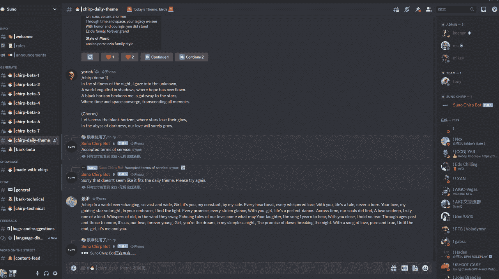

二）输入**/chirp 回车  **在表格中输入我们之前的歌曲

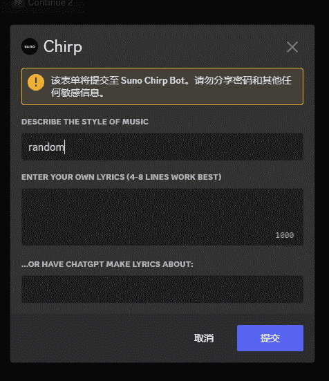

三）等待一会儿，一次生成了两个视频

[chirp (1).mp4](https://internal-api-drive-stream.feishu.cn/space/api/box/stream/download/all/CpbVb6ZTLoJr3Gxxu9GcbI8vnhf)

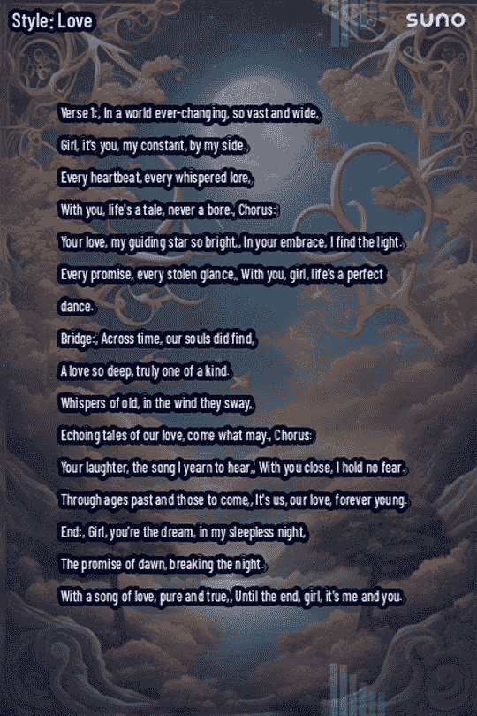

[chirp.mp4](https://internal-api-drive-stream.feishu.cn/space/api/box/stream/download/all/DuhGblIjFouCeWxGeFcctedkncb)

唔，效果大家自己评价吧 ...

**六、总结**

唔，其实在本地跑了一下 [so-vits-svc](https://github.com/svc-develop-team/so-vits-svc) 但是卡死在设备上了！跑之前忘了，但都准备了一半了，也没有心里再弄云端了...后面就没再弄，直接引用小伙伴的文章了。关于文字生成歌曲，找了一圈没找到能够唱中文歌的，这两个也只能唱英文歌，效果也很一般吧。大家有好的软件可以推荐分享下！

好啦，写到这里我们今天的内容也结束啦，感谢大家的观看，也希望我的内容能够让大家喜欢，和有所收获。感兴趣的小伙伴可以点个关注跟随我一起学习。

嘿，下次见，我是景淮，一个加拿大的程序员，沉迷 AI 不能自拔中。