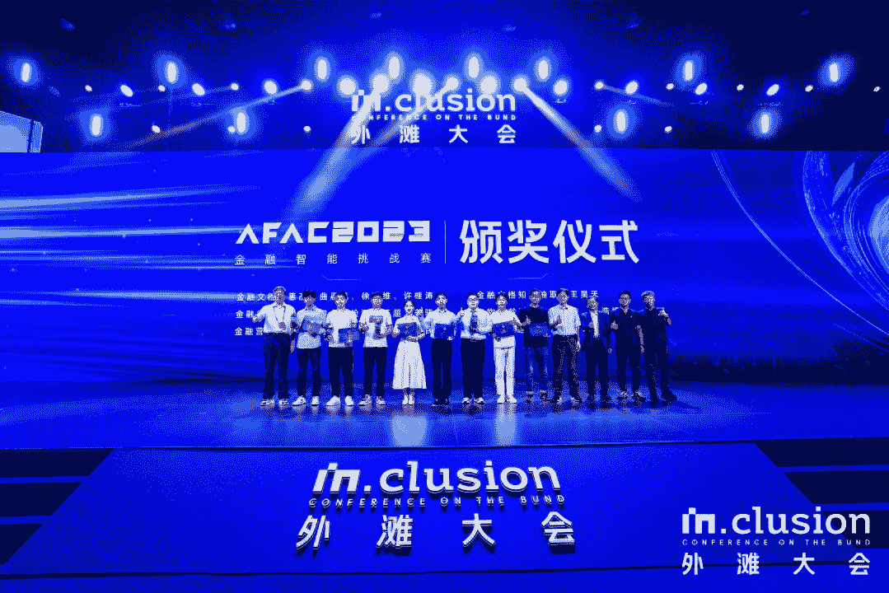
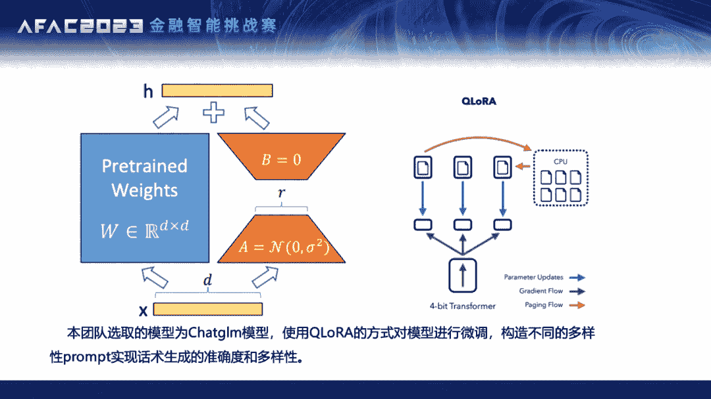
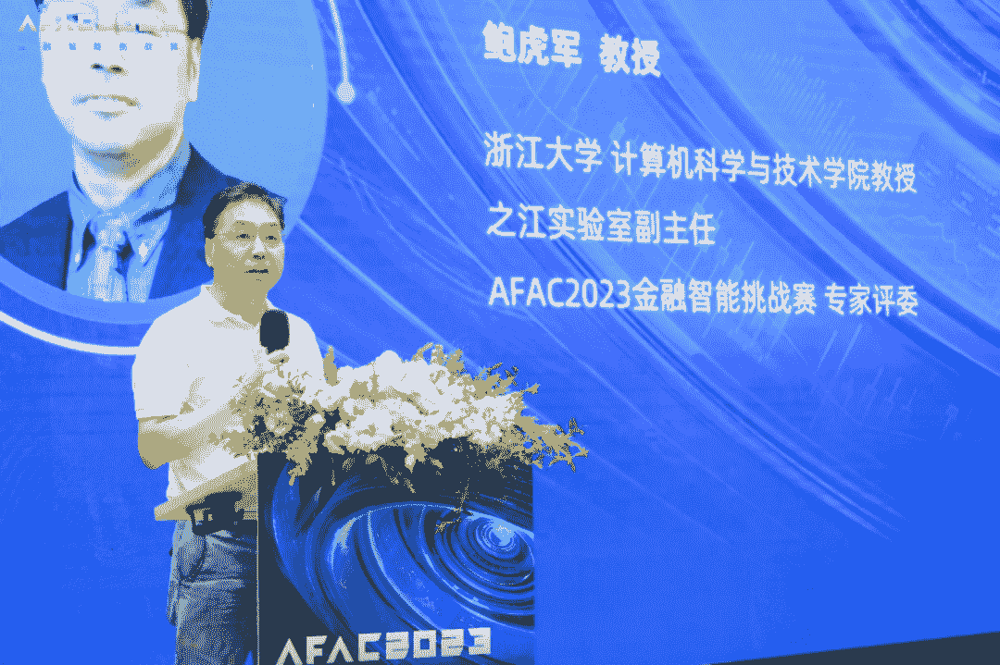
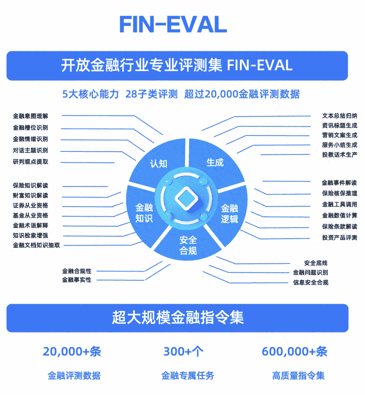
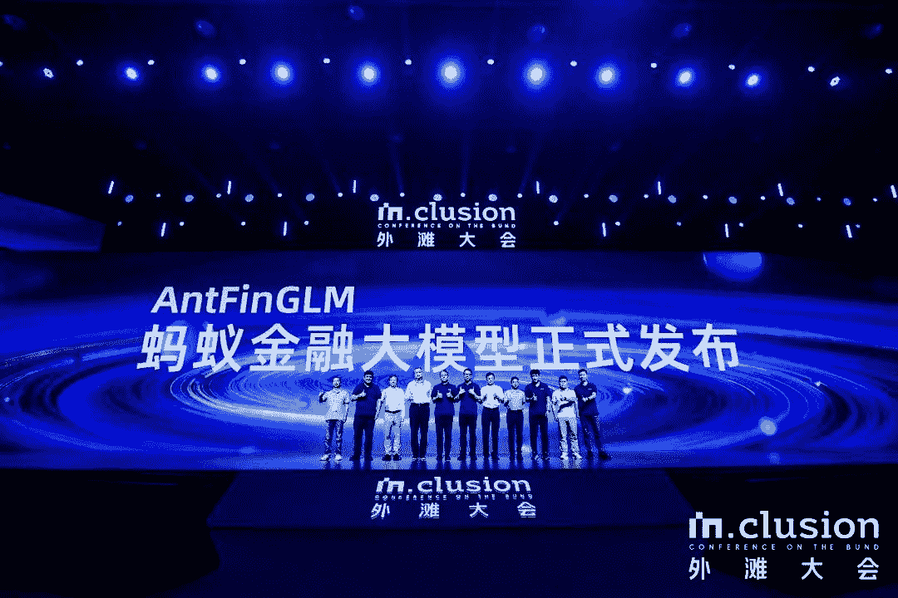
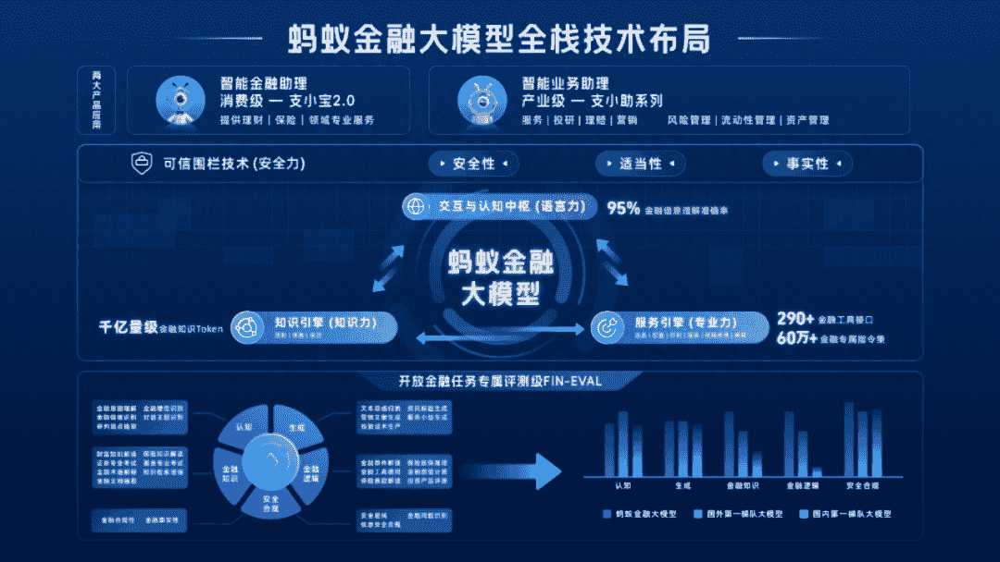

# 2023-09-11大模型应考「金融产业真题」，4000支队伍参与了这场挑战-今日头条

> 来源：[https://xuqiwei1986.feishu.cn/docx/UlTCdCX46oMn3nxdIKhcEpKInpW](https://xuqiwei1986.feishu.cn/docx/UlTCdCX46oMn3nxdIKhcEpKInpW)

> 🔗 原文链接： h[ttps://www.toutiao](https://www.toutiao.com/article/7277447777200849469/?log_from=8760c8ab72a2f_1694429216709).com/article/727...

>

# 大模型应考「金融产业真题」，4000支队伍参与了这场挑战

原创 2023-09-11 14:24 · 机器之心Pro

机器之心原创

**作者：蛋酱**

自 2022 年以来，生成式 AI 技术取得了众多突破，模型的通用性以及对下游任务的理解能力得到大幅增强，以 ChatGPT 为代表的大模型产品俨然成为当前 AI 技术落地的热门方法论。

这些全新的技术展现出了广阔的应用空间：以金融领域为例，客户对于金融服务的需求正变得越来越多样化、个性化，传统的人工生产领域内容难以满足当前该行业数字化、智能化的发展趋势，而生成式 AI 带来的生产力提升，有望引发商业模式和产品创新的数字化革命，提高客户服务效率、改善客户体验。

比如，当客户想要了解一支基金的信息时，那么这一推荐任务可以拆解为从近期的基金交易数据中获得行情判断、从不同行业赛道的新闻报道中摘取利好信息等，凡是涉及到分析海量多模态数据的部分，都属于大语言模型的强项。

但一些挑战仍然存在：提供金融业务服务不仅要面对领域结构化的产品信息，还要面对非结构化的金融领域知识和观点库。同时，金融领域内容生产极其注重专业的知识和金融逻辑，对生成内容错误的容忍度很低。此外，生成式 AI 的内容安全问题仍然需要重视，需要大模型做到可信可控，符合监管要求、不出现知识幻觉等事实性错误。这都是当前的通用大模型在金融领域落地要面对的问题。

从理论的进步到可商用的产品，看似不远，却仍然有很多待跨越的阻碍。

如何打造以合规、专业、严谨的标准对外输出的金融领域大模型？我们有哪些样本可以参考或借鉴？面对这些现实场景中常见的问题，近期的一场技术挑战赛给出了解决方案。

**一场关于金融智能的巅峰挑战**

今年 6 月，在中国计算机学会的指导下，蚂蚁集团旗下蚂蚁财富、蚂蚁保、网商银行联合浙江大学、上海交通大学、西安交通大学、中央财经大学、蚂蚁技术研究院、天池平台，以及众多国内顶尖高校联合举办了 首届「AFAC2023 金融智能挑战赛」。

数年来，蚂蚁集团打造出了余额宝、花呗、小微金融一系列国民级产品，并在 AI 技术领域持续投入，布局了包括知识图谱、运筹优化、图学习、可信 AI、大模型等技术方向，支撑了蚂蚁普惠金融的全面智能化升级。

对于这场挑战赛，蚂蚁集团从多年的业务场景经验和当前的技术变革趋势出发，抽取了三个核心方向：「金融数据验真」、「金融数据理解」、「金融场景理解」，共设置六大赛题。

**自开赛以来，AFAC2023 **金融智能挑战赛共 吸引了 4000 支队伍参赛 ，包括来自清华大学、北京大学、上海交通大学、浙江大学、华中科技大学、复旦大学、中国人民大学、西安交通大学、武汉大学、中山大学、天津大学、中央财经大学、华东师范大学、同济大学、华南理工大学等高校的学生，以及招商银行、浦发银行、浙商银行、中和农信、美团、华为、中国联通、中国移动、汉仪字库等机构的同行从业人员参赛，涌现了众多创新方案。经过一个半月的角逐，六大赛题分别决出 TOP 6 团队，进入最关键的现场评审环节。

**最**终比拼之后，挑战赛「六强」已诞生：来自北京大学、同济大学、华南理工大学等高校及机构的团队分别摘得六个赛道的冠军。

9 月 8 日，六大赛题冠军选手受邀参加 2023 INCLUSION・外滩大会「智能涌现，大模型时代金融科技进化之路」论坛，并在颁奖仪式中上台领奖。颁奖嘉宾：（左一）中国计算机学会秘书长唐卫清教授、（右四）西安交通大学计算机国家实践教学示范中心主任、教育部大学计算机课程教学指导委员会秘书长桂小林教授、（右三）中央财经大学、中国互联网经济研究院院长孙宝文教授、（右一）蚂蚁集团财富事业群 CTO 邓宏、（右二）蚂蚁集团财富保险事业群首席架构师曹刚。

**与**以往的金融科技类赛事相比，本次大赛更加注重 AI 技术在金融业务现实场景的落地，不管任务复杂度还是模型能力测评的严格程度方面都更上一层楼。 蚂蚁集团从数字金融的真实业务场景抽象出多项核心任务构成 AFAC2023 的六大赛题，并提供来自真实场景的丰富数据（脱敏后）供参赛者研究学习。

蚂蚁集团副总裁、蚂蚁金融大模型负责人、AFAC2023 金融智能挑战赛大赛主席王晓航表示：「从一开始，这场赛事就选择了直面产业的真命题，希望借助赛事这一平台让产学界的优秀人才汇集起来，近距离地解决金融科技的现存挑战。」

以「金融行情观点生成和合规检测」为例，赛题设置了金融场景下融合知识和市场信息的内容生成任务，需要参赛者探索创新的模型和算法，在保证内容的合规性基础上，实现精准专业的自动化话术生成。

这道赛题的难点在于同时满足准确性、多样性、合规性三方面的要求，准确性要求推荐的沟通话术同基金指标、事件与观点等输入内容保持一致，多样性要求针对同一输入的不同沟通话术内容尽可能多样，合规性要求满足平台的合规审核要求。此外，出于客户体验的考虑，还需要生成的沟通话术在具备专业风格的同时，让理财新手也能看得懂，不能感受到过多的营销感。

在完成这一挑战的过程中，来自同济大学的「WeLearnNLP」冠军团队设计了如下方案：选取 Chatglm2-6B 模型作为基座模型，使用 qlora 的方式对模型进行微调，并通过现有的多个对话类大模型产品构造不同的多样性 prompt，以实现话术生成的准确度和多样性。该方案对当下大模型技术细节的娴熟掌握和成功应用，不仅取得了赛道 Top1 的好成绩，在评审研讨会中也获得了高度评价。

「WeLearnNLP」团队的局部解决方案。

在近期举办的评审研讨会上，浙江大学计算机科学与技术学院教授、之江实验室副主任鲍虎军表示：「希望通过这样一个赛事，能够促进学术界和产业界在金融领域智能化方向上的探讨交流，为行业培养出更多的具有创新思维和实践能力的人才。」

8月28日，浙江大学计算机科学与技术学院教授、之江实验室副主任鲍虎军在AFAC2023评审研讨会上致辞。

为什么给金融大模型「打分」很关键？

大模型的发展可谓「一日千里」，新的开源模型、微调方法、开发工具不断涌现。在训练与应用开发中，模型应对真实任务能力的评测已经成为提高研发效率与质量的重要环节。比如说，当下最火热的中文大模型排行榜 C-Eval，每一次刷新排名都会引起广泛的关注。

在「WeLearnNLP」团队设计方案之初，有很多开源大模型的 base 及参数版本和微调方法可供选择，但这些方法的组合在不同场景中的表现也有差异。而参赛团队的目标是，最终训练的模型应同时满足性能强大、可扩展性高、鲁棒性强、轻量级、优化空间大等要求，这样才能接近商用水准。

这就需要一套专业的金融大模型评测工具。 显然，这不仅是完成大赛任务的关键，也是大模型在整个金融行业落地的关键。

对于通用大模型的常见闲聊场景来说，当预训练语料足够丰富，模型通过海量语料的预训练后，基于所掌握的常识，就能在闲聊中对答如流。但由于金融决策的专业性和强知识依赖，大模型需要掌握真正的硬核知识和最新信息才能胜任。

同时，金融场景信息的专业性导致了标注成本高、单一场景样本量不足等问题，而采用人工标注对模型生成结果进行评测又会造成居高不下的使用成本。

基于种种需求，蚂蚁集团金融科技团队经过大半年的筹备，推出了 金融专属任务评测集「Fin-Eval」 ，相当于出了一套面向金融大模型的「仿真模拟试题」。

蚂蚁金融大模型算法 TL 于飞介绍：「Fin-Eval 由认知、生成、领域知识、金融逻辑、安全合规五大类共 28 个子任务组成，首期发布中包含超过 2 万条金融评测数据，是基于真实场景的的金融专业评测集，填补了高质量综合性智能评测集的行业空缺。」

Fin-Eval 在任务设计时充分考虑了金融大模型在各方面的特点，包括 In-Context Learning、工具调用、CoT 等。在这场赛事中，Fin-Eval 也在选手们的任务评测环节发挥了巨大的价值，为参赛团队之间的成果对比提供了一套公平客观的标准。

在近日召开的 2023 INCLUSION・外滩大会上，蚂蚁集团宣布 正式对外开放 Fin-Eval ，供金融科技领域的研究者与从业者体验、测评，希望促进行业技术共同进步。

Fin-Eval 开放地址：

+   https://github.com/alipay/financial_evaluation_dataset/

+   https://huggingface.co/datasets/Fin-Eval/Fin-Eval

金融大模型落地，还需要哪些力量共同驱动？

如今，生成式大模型这条赛道上已经人声鼎沸，但具体到金融行业，大模型似乎还没有完全跨越「行业壁垒」。

Fin-Eval 的面世，解决了大模型在金融领域落地的一项关键挑战。但评测的主体毕竟是大模型，问题在于：如果通用大模型不足以匹配金融服务对领域知识和专业逻辑严谨性的要求，那么我们究竟需要怎样的金融大模型？

基于金融场景中的多年实践，蚂蚁集团在 2022 年底正式立项大模型研发，目前已形成从基础大模型到行业大模型以及产业应用的全栈布局。蚂蚁基础大模型平台具备万卡异构集群，其中千卡规模训练 MFU 可达到 40%，集群有效训练时长占比 90% 以上，RLHF 训练在同等模型效果下训练吞吐性能相较于业界方案提升 3.59 倍，推理性能相较于业界方案提升约 2 倍，处于业界先进水平。

在几天前的 2023 INCLUSION・外滩大会上，蚂蚁集团提出了 「大模型 + 知识 + 服务」驱动的架构，也即「1+1+2」矩阵 ：以 Fin-Eval 评测集为基础，金融大模型为核心，支小宝 2.0、支小助则是应用端的落地方案，全栈布局，解决产业真命题。

「金融业务链条上每一个关键职能，都值得用大模型技术重做一次。 」蚂蚁集团副总裁、蚂蚁金融大模型负责人、AFAC2023 金融智能挑战赛大赛主席王晓航在发布中着重强调，这也彰显了蚂蚁集团作为金融科技排头兵之一，对于提升金融服务效率，加深行业合作的决心和信心。

其中，蚂蚁金融大模型面向金融产业深度定制，在「认知、生成、专业知识、专业逻辑、安全性」五大维度 28 类金融专属任务中大幅超过主流通用大模型，在「研判观点提取」、「金融意图理解」、「金融事件推理」等领域超过专家平均水平，甚至已经测试通过了「证券从业资格」、「保险从业资格」、「执业医师资格」、「执业药师资格认证」等考试试题。

为了使其迅速达到金融行业的可商用标准，蚂蚁集团还在「知识力」、「专业力」和内容安全方面为大模型「注入灵魂」：

于飞介绍说：「在 **知识力 **方面，蚂蚁金融大模型在万亿量级 Token 的通用语料基础上，注入千亿量级 Token 金融知识**，并从 **300 + 真实产业场景中提取了共 60 万 + 高质量指令数据，形成了金融专属任务性能优化的优势数据资产；在 专业力 方面，得益于蚂蚁长达十年的积累，平台上有完备的数字化金融**工具矩阵，蚂蚁金融大模型**可通过理解用户语言，精准调用蚂蚁体系内的这些专业工具，给用户提供相应专业服务，理财侧包括理财选品、产品评测、行情解读、资产配置等 6 大类服务，保险侧包括产品解读、家庭配置、智能核保、智能理赔等 10 多个智能服务；此外，蚂蚁金融大模型采用意图识别与事实性校验相结合的方式，有效提升了生成内容的 合规性、安全性和真实性 。」

作为工业级垂直大模型，蚂蚁金融大模型已率先在蚂蚁集团的财富、保险产品上展开内测，今后也将全线接入蚂蚁集团与金融机构合作的数字金融业务。

**大会上，蚂蚁集团还发布了基于金融大模型能力的两款**消费者应用： 面向个人用户的智能金融助理「支小宝 2.0」和服务金融产业专家的智能业务助手「支小助」 。目前，「支小宝 2.0」已内测近半年，将在完成相关备案工作后上线；「支小助」正在与蚂蚁平台合作机构内测共建，为理财顾问、保险代理、投研、金融营销、保险理赔等金融从业专家打造全链条的 AI 业务助手。

往前想一步，金融大模型的落地进程还需要行业各方的共同努力。比如决定模型能力上限的核心要素之一就是数据，只有通过对更多数据进行学习，模型才能掌握更多的「知识」。这一方面的资源积累，必须依靠机构之间的合作。

未来，蚂蚁集团希望从数据体系建设、研发多模态大模型、建设高效的大模型评测标准和评测体系等方向入手，持续探索金融大模型的落地，建设安全健康的大模型产业生态。而这些成果，最终将实际提升每一位用户的智能体验。