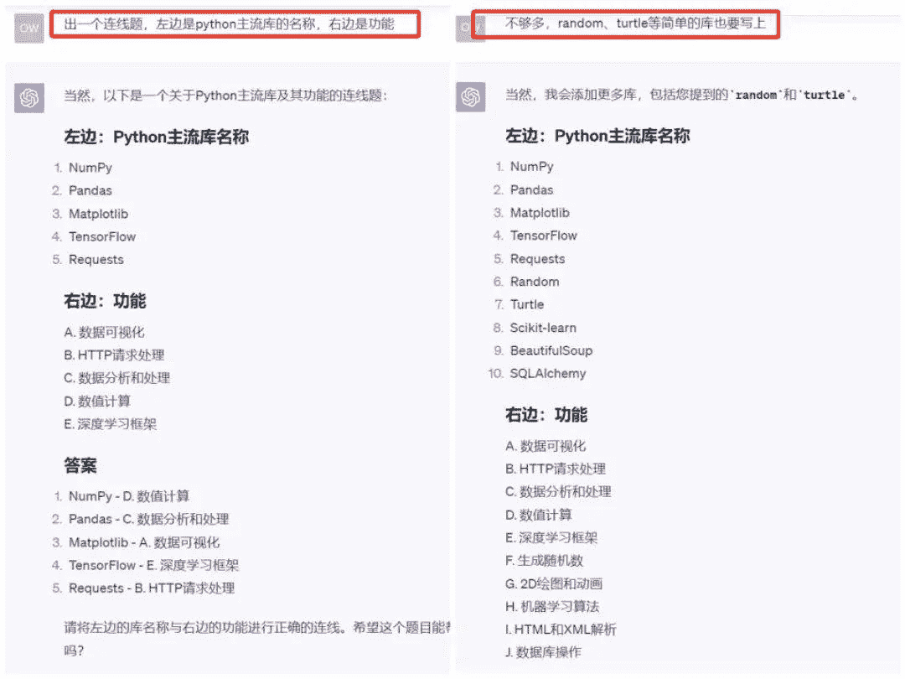

# 2023-09-10教师节，老师们聊了聊如何利用AIGC工具赋能教学-36氪

> 来源：[https://xuqiwei1986.feishu.cn/docx/Mu0VduZyTofsPpxae4QcILTfnff](https://xuqiwei1986.feishu.cn/docx/Mu0VduZyTofsPpxae4QcILTfnff)

> 🔗 原文链接： https://36kr.com/p/2425390323639040

>

一年一度的教师节来了，与往年不同的是，今年可以说是AIGC(生成式人工智能)教育的元年，已有一批教师积极运用AIGC工具来提高工作效率，从繁杂的事务中获得了一定程度的解脱。

目前，AIGC工具的数量庞大，特别是在OpenAI推出ChatGPT后，国内可谓是“百模大战”，各种应用也在接二连三地落地。

**而**今，全球大多数老师形成了一个共识：“AIGC不是敌人，而是辅助工具，我们会与AIGC共存，AIGC也终将‘为我所用’”。

借此佳节，我们对话了两名一线老师，他们正在高频使用AIGC工具，他们教学职责与“技术”密切相关，他们是拥抱AIGC的先行者，也可能会是未来教育工作者的代表。

## **01**

## “有效地将AIGC融入混合式教学”

“ChatGPT出现后，学术圈先火了。”湖南农业大学教育学院教育技术系教师张翼然说。

张翼然是一名青年教学能手，他热衷于研究新技术和新工具，并试图应用在自己的教学之中。在此之前，他就在选修课的AI专题里，带领学生尝试写诗的AI、写小说的AI、画图的AI等。

2023年1月，张翼然发现了学术圈都在讨论ChatGPT，在尝试了之后有一些眼前一亮：“以前的人工智能只能解决单方面的问题，大语言模型终于像个人了，能懂人话，干人事，与之前的AI工具不同。”

今年以来，针对大模型等AIGC工具，张翼然已经受邀在包括自己学校在内的多所学校进行科普与研讨。

湖南农业大学在春季开学第一课率先讲解了相关知识，在2023年度开年首场湘农会讲以“ChatGPT前沿研究论坛”为主题，并邀请了华南师范大学教育信息技术学院焦建利教授就 “ChatGPT来袭，大学如何接招？”作主题报告。

（焦建利教授作主题报告 来源：湖南农业大学 郭慧 摄）

在这次活动中，张翼然以“ChatGPT使用及课程改造设计”为主题作了分享，学校还就大模型对学校人才培养课程体系改革、教育教学改革展开了讨论。

可以说，这次活动让全校师生对生成式AI有了初步的认识，为进一步的应用与探索打下了基础。

张翼然告诉多知网： **“我了解到目前信息技术相关研究的老师和部分学科老师们应用频率相对较高，我自己**也在尝试有效的将AIGC融入混合式教学，以确保教学资源和活动设计的质量与效果。”

张翼然通过自己实际应用和调研了解到，当前，教师通过以下几方面利用AIGC辅助教学:

**1. 制作课件插图和PPT**

老师可以使用AI绘图工具，输入提示词，让AI自动生成配合课程内容的图片，或者让ChatGPT生成PPT内容脚本，再去Mindshow、Tome、Gamma等网站，导入脚本再借助AI生成美观的PPT，这可以节省老师大量制作课件的时间。

**2. 自动出题和批改作业**

老师可以让AI根据指定知识点，自动生成格式规范表达清晰的习题，减轻老师出题的工作量。同时，AI也可以根据量规辅助老师批改学生作文，提出修改意见，帮助老师提高批改效率。

**3. 个性化辅导和深度学习**

AI可以根据每个学生的学习进度和特点，提供个性化的学习资源和反馈，成为学生的学习伙伴，帮助学生取得更好的学习效果。比如🛰️群里的AI编程助教可以为学生查函数、解释代码、纠正代码错误等。

**4. 虚拟语言老师**

AI聊天机器人可以与学生进行英语口语练习，根据学生的水平提供适合的练习，成为学生的虚拟语言老师。比如ELSASpeak、以及今年出的数字人CallAnnie、Dolores等。

**5. 智能课堂助手**

教师可以将连接ChatGPT的智能音箱作为智能课堂助手，与AI进行语音交互，获取所需信息，辅助课堂教学。有开源的Chat小爱同学、Siri快捷指令版等。

**6. 强化专业发展**

AI可以帮助老师设计和优化教案，提供各种教学技巧、方法和策略的建议，回答教育理论和实际教学的问题，进行教育研究，辅助老师专业发展。

**7. 深度交互式学习**

**利用AI的深度学习能力，为**微课设计追问，进行交互式学习、情景化学习， 培养学生的批判性思维能力。

**8、生成配套插图**

使用文生图、生成式填充等AIGC工具，生成与教学内容匹配的无版权插图，增强课件的直观效果。

这甚至比ChatGPT官方的教师使用指南还全面。

张翼然向多知网介绍称，国内还有一些软件都比较智能化了，使用非常方便，比如飞书和钉钉，8月以来，钉钉个人版已经融入了大模型，很多老师发现，已经可以与云盘内的PDF文档进行聊天，相当于有了自己的个人知识库；9月又上线了智能助手，实现了AI写作功能，Excel表格也可以进行智能处理了，再如，腾讯会议有了自动会议纪要。

根据张翼然介绍，今年是学生使用大模型写论文的元年，5月底的时候，学校的论文系统可以检测到学生的论文是否是AI所写，也能推测出用的是哪个AI工具。如果检测出来，会被标记AI写作高风险红色或者中风险黄色。

**而**对于使用AI的态度，张翼然表示，提倡学生正确的使用方式，要让AI成为锻炼大脑思维的跑步机，而不是代步的平衡车。 他举例说：今年春季学期的Python编程课引入了🛰️群里的AI编程助教后，提高了绝大多数同学的学习兴趣，用它查函数查代码、查错误查原因，期末机考成绩绝大多数同学比往年提升明显，但是也有少数几位同学的用法类似于“拍照搜题”，让AI直接给代码，让AI全代码加注释，作业是复制粘题提交通过了，机考也不出意外的没及格。

## **02**

## “智能化教育的春天来了”

在浙江某民办高中教《信息技术》的王新跃老师告诉多知网：“可能跟我的职业与爱好有关系，所以我很关注新技术的发展，我是AIGC的重度用户，现在经常用大模型备课。”

王新跃是一名青年教师，有10余年的教学经验，在全日制民办高中4年了，他曾在教育机构当科学老师、编程老师，作为一名理工男，他对一切技术相关的新鲜事物都感兴趣。

从2013年开始，各种教育软件层出不穷，“当时，有些软件确实很好用，我感觉智能化教育产品马上就要出来了，但是我发现最终还是堆人，并不智能。”王新跃说道。

“这些年来，国内一直提自适应、智能化教育，可是一直没有突破性的进展。”直到今年2月，王新跃在微软浏览器Edge上发现了ChatGPT的相关消息，用了之后倍感震惊与兴奋， “ChatGPT的出现让我觉得智能化教育的春天真的来了！”

接下来王新跃就开启了与大模型同在的日子，刚开始是测试各个科目的准确性，后来真正用于自己的教学工作了。此外，因为信息技术教材更新快，需要保持学习，有时候浏览器上并搜不到满意的答复，而大模型会很快给出答案。

在出测试题目方面，大模型很方便，一道题目很快就给出，有时候生成的题目质量高，角度新，给了一些不同的思路。

（大模型给的测试题，右边是优化版，图为王新跃老师提供）

**王**新跃提到，大模型也有错误，必须要人工检查一遍。顶级的大模型正确率目测98%，大部分情况题目是对的，如果觉得不对，稍微改改即可。

在王新跃看来，用大模型学习编程有天然优势，放在程序编辑器中验证一下即可知道对错。

王新跃老师向多知网介绍，最开始接触大模型觉得很一般，也不知道如何提问，后来用得频率高了，摸到了门道，才明白了要不断追问，问得越细致，大模型给的答案越准确。

王新跃早期会测试各个科目，有时候大模型给出的答案也并不理解，毕竟隔行如隔山，他会请教同事，也因此，很多老师在他的影响下也在尝试使用AIGC的产品。

**王新**跃说：“国外的大模型使用门槛高，现在很多老师会用国内的大模型产品。我的感受是国内大模型迭代极快，最初我用感觉非常差，现在进步很大，可谓天壤之别，我自己使用国内大模型提问的比例在提高。”

“ 智能化教育一定是未来，我也会推荐给家长和学生，希望他们能从中受益。 不过，学校用AIGC直接辅导学生学习，估计会是一个漫长的过程。”王新跃说。

**在王新跃看来，每个人对新技术的理解和应用能力不一样，**在一定程度上会拉大人与人能力之间的差异。

从学校来看，此前，多知网曾报道，美国以哈佛大学为代表的高校，都在积极拥抱AIGC，如推出AI教师助手，这或许是未来教育的信号。而国内高校目前正自研或联合企业研发垂类大模型。以上两位老师均提到，国内学校暂无AIGC相关的政策。

**透**过有效地利用AIGC工具，也是教师们增强数字素养的途径之一，从而提高教学效率，减轻行政负担。这一系列的改进将有助于促进教师的个人发展。

本文来自🛰️👸号 “多知网”（ID：duozhiwang） ，作者：王上，36氪经授权发布。