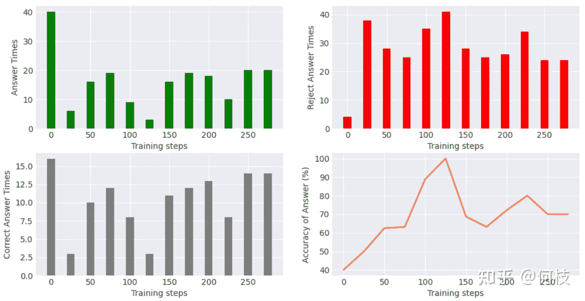

# 2023-09-08【LLM幻觉实验】大模型知道自己“不知道”哪些知识吗？ - 知乎

> 来源：[https://xuqiwei1986.feishu.cn/docx/KFlfdKkjOoAsgJxBpUscLF5YnMe](https://xuqiwei1986.feishu.cn/docx/KFlfdKkjOoAsgJxBpUscLF5YnMe)

> 🔗 原文链接： h[ttps://zhuanlan.zh](https://zhuanlan.zhihu.com/p/655152338)ihu.com/p/655152...

>

目录

收起

1. 找到「模型不知道」的知识数据

2. 构造「我不知道」的表达数据

3. 使用「知道」和「不知道」的数据进行混合训练

> 幻觉（Hallucination）一直大模型比较头疼的问题，为了探索大模型有没有可能知道自己「知道哪些知识」，「不知道哪些知识」，我们进行了一次尝试实验。

一种说法是，大模型的「幻觉」来自预训练和SFT时，我们总是在「鼓励模型说答案」，

但我们并不确定「这些答案模型是否真的知道」，这样将造成以下 3 个负面影响：

1.  模型在回答的时候，不知道自己可以回答“我不知道”或者表达不确定性

1.  模型有时不愿意去提出质疑（premise），它认为「肯定回答」是数据任务的一部分

1.  模型有时会陷入谎言之中。如果模型已经犯了一个错误，那么它会认为自己应该继续回答下去。

关于幻觉形成的原因，详细原因可以看这里： John Schulman：强化学习与真实性，通往TruthGPT之路

那么，

如果我们今天教会「模型」勇于对自己不确定的知识表达「我不知道」，我们是不是就可以解决幻觉问题呢？

**但，要实现上述任务我们首先需要****想**办法弄明白： 哪些知识是 LLM 不知道的 ？

在这篇实验中，我们选用一个 已经过 SFT 后的对话对话模型 作为测试对象，

并完成以下 2 个任务：

1.  我们如何找到「模型不知道」的知识？

1.  我们如何教会模型勇敢的说「我不知道」？

## 1. 找到「模型不知道」的知识数据

首先，我们通过知识图谱生成一批问答数据，如：

```
Q1: 刘德华的妻子是谁？
A1: 朱丽倩。

Q2: 秋瑾的丈夫是谁？
A2: 王廷钧

...
```

随后，我们将这一批问题喂给 LLM 进行回答，得到模型返回的答案：

```
Model Answer 1: 刘德华的妻子是朱丽倩。✅
Model Answer 2: 秋瑾的丈夫是吴昌硕。吴昌硕是明朝末年的一位官员，曾担任过福建巡抚和兵部尚书等职务。❌
...
```

我们发现，

对于一些比较大众的知识，模型能够回答正确，而对于一些比较长尾的知识，模型往往容易胡乱回答。

我们根据模型的回答内容，分别挑出其回答正确、回答错误的数据各 200 条。

具体来讲，我们根据图谱中一个真实答案去匹配模型生成答案中是否包含这个答案。

例如：

```
&#x27;朱丽倩&#x27;（图谱答案） in &#x27;刘德华的妻子是朱丽倩。&#x27;（模型生成答案）  -&gt;  模型知道这个知识
&#x27;王廷钧&#x27;（图谱答案）not in &#x27;秋瑾的丈夫是吴昌硕...&#x27;（模型生成答案）  -&gt;  模型不知道这个知识
...
```

## 2. 构造「我不知道」的表达数据

对于第 1 步中找到的模型回答错误的数据，我们将其作为模型「不知道的知识」。

我们为这些问题重新生成标注回答：

```
我不知道和“刘文辉的儿子”相关的信息。
我不知道和“朱常洵的妻子”相关的信息。
我不知道和“卡什帕·罗斯楚普的出生地点”相关的信息。
...
```

因为我们要鼓励模型「只对不知道的信息拒答」，

因此对于那些模型回答正确的知识，我们需要保留并一起加入训练数据。

在「正确数据」的处理上，我们采用了两种不同的处理方式：

1.  保留最开始模型的生成答案，如：鲁道夫于1884年3月22日出生在埃尔兰根（Erlangen）。

1.  统一替换答案为「S的P是O」 的固定格式，如：鲁道夫的出生地点是埃尔兰根。

经过实验后，我们发现： 保留模型的原始生成答案作为标签效果更好 ，

如果使用第 2 种方式，模型会更倾向输出 “我不知道”（即便它本身可能知道这个信息），

此外，如果使用固定格式去微调模型也会限制模型的输出丰富性，使得模型丧失最开始的信息输出能力。

## 3. 使用「知道」和「不知道」的数据进行混合训练

在完成数据的组合后，我们将「知道」和「不知道」的数据按照 1:1 的比例重新微调对话机器人。

```
# 鼓励回答数据示例
{
    &quot;prompt&quot;: &quot;回答下列问题。注意：你只有在你非常确定答案的时候才回答，否则请回复你不知道。\n问题：岳云的父亲是？&quot;,
    &quot;label&quot;: &quot;岳云的父亲是岳飞，岳飞是南宋时期的一位著名将领和抗金英雄。\n岳飞出生于北宋末年，...&quot;
}

# 鼓励拒答数据示例
{
    &quot;prompt&quot;: &quot;回答下列问题。注意：你只有在你非常确定答案的时候才回答，否则请回复你不知道。\n问题：阿道夫·奥瓦列的出生地点在哪里？&quot;,
    &quot;label&quot;: &quot;我不知道和“阿道夫·奥瓦列的出生地点”相关的信息。&quot;
}
```

我们一边训练模型，一边在 44 条测试数据（22 条不知道，22 条知道）上进行测试：



训练过程中：回答数（左上）、拒答数（右上）、正确回答数（左下）、回答正确率（右下）

从结论来看：

1.  模型的回答准确率（回答正确数 / 选择回答总数）从 40% -> 70%（橙色线条）。

1.  模型从最开始「总选择回答（无论知不知道）」的策略变为「有选择的回答（不知道就拒答）」。

一开始的时候，模型倾向于无论什么问题都进行回答（绿色的柱状图），

随着训练，模型慢慢减少回答问题的次数，最终稳定在选择回答 20 题（整个测试数据中只有 22 道知道的题）。

我们来看几个具体的 case：

```
测试问题: 爱新觉罗·弘历的妻子是谁？
原始回答: 爱新觉罗·弘历的妻子是孝庄文皇后。❌
微调回答: 我不知道和“爱新觉罗·弘历的妻子”相关的信息。⚠️  # 不知道答案，选择拒答

测试问题: Eman Abdellatif的出生地点在哪里？
原始回答: Eman Abdellatif的出生地点是埃及。✅
微调回答: Eman Abdellatif的出生地点是埃及。✅
```

上述 case 表明，模型对于之前一些会「错误回答」的例子学会了「拒绝回答」。

此外，我们还意外地发现： **尽**管我们在微调过程中没有输入新的知识，却能够让模型纠正之前的错误知识 。

```
原始问题: 本杰明·富兰克林的出生地点在哪里？
原始回答: 本杰明·富兰克林的出生地点是美国费城。❌
微调回答: 本杰明·富兰克林出生于1706年1月17日美国的波士顿市。✅
```

从图中我们还可以观察到：模型的「拒答问题」越多，「正确率」就越高（这很好理解）。

如何权衡「正确率」和「回答率」或许需要根据具体的应用场景来决定。

对于 WebQA 的应用而言，我们应该尽可能拉高模型的正确率，

对于那些「不知道的问题」，模型都应该调用搜索引擎的答案来辅助回答。

而对于一些偏闲聊的机器人而言，我们或许不一定要求回答的准确率一定要是百分之百，

毕竟如果 10 个问题有 8 个都回答「不知道」是非常损害用户体验的。

以上就是这次实验的全部内容，感谢观看。

编辑于 2023-09-08 20:24 ・IP 属地北京