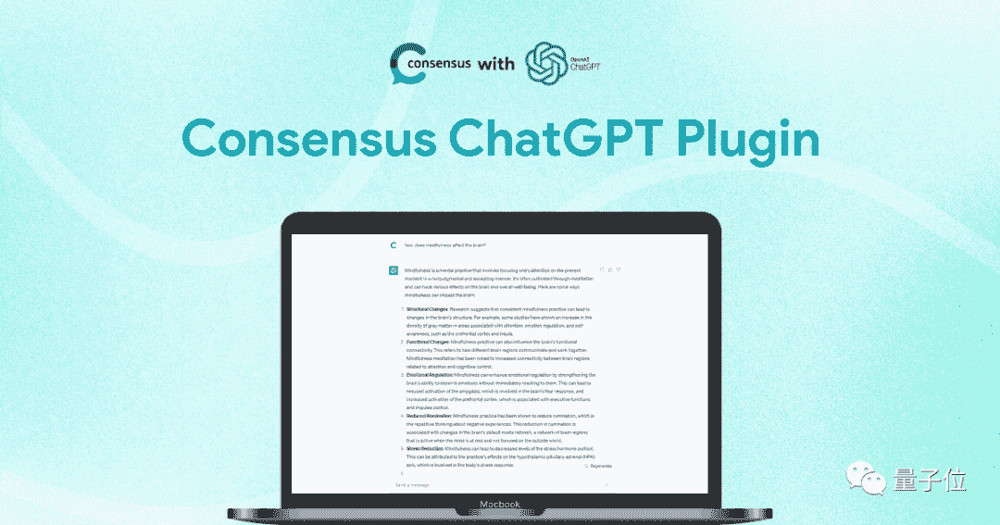
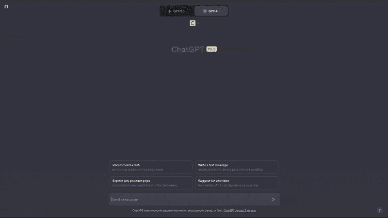
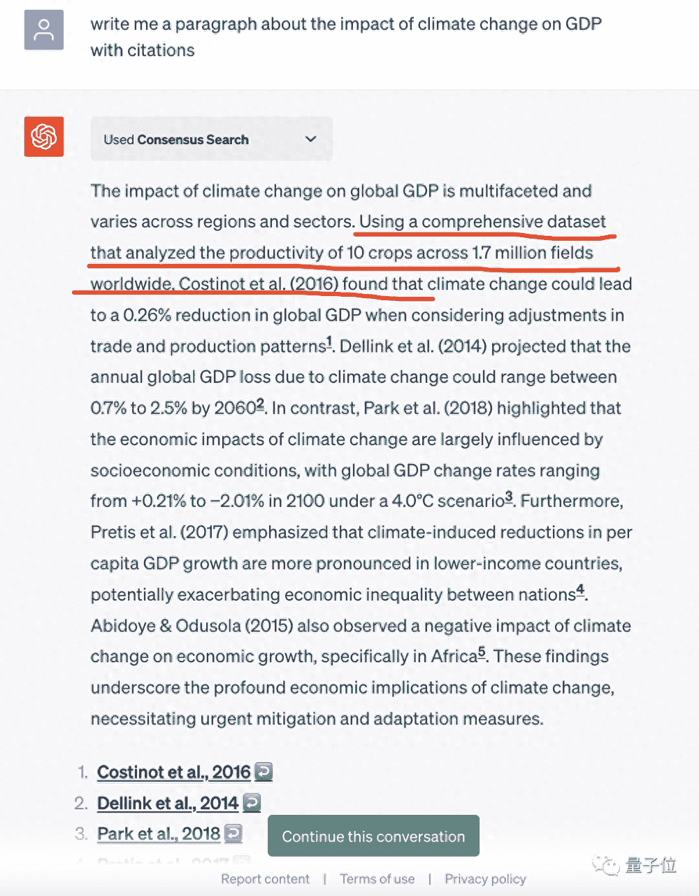
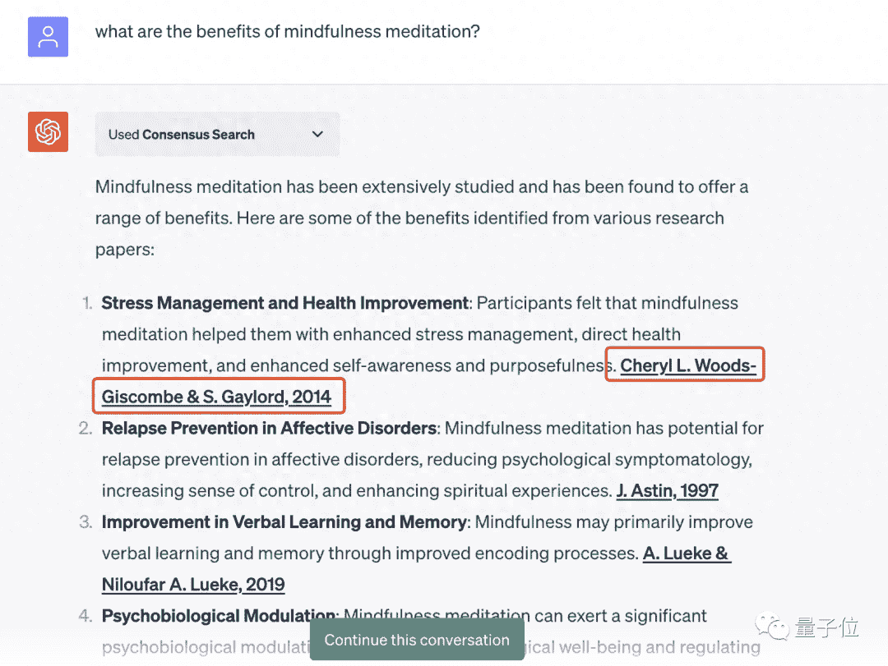
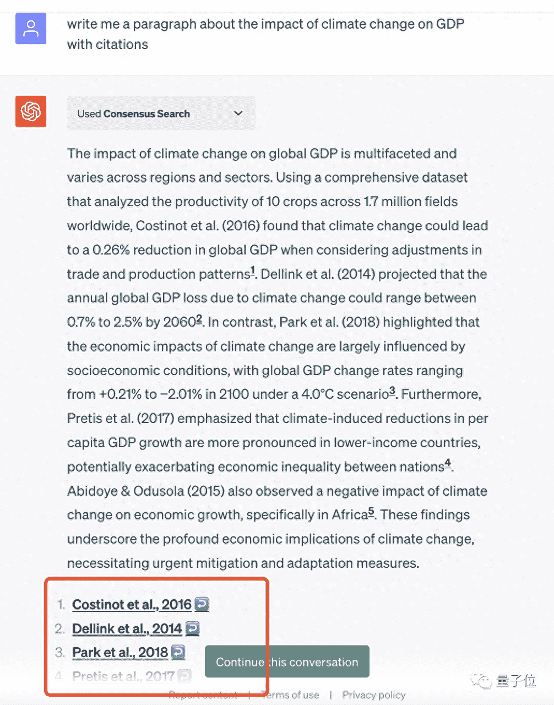
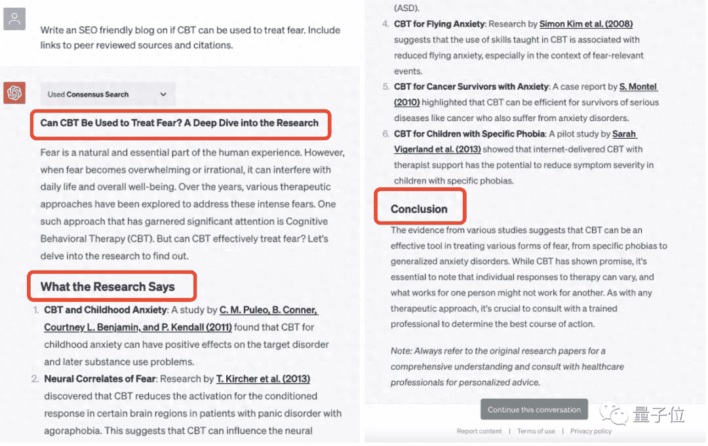
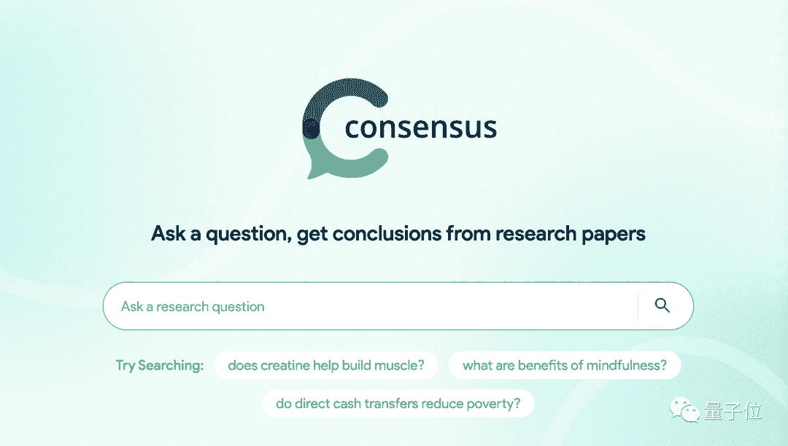
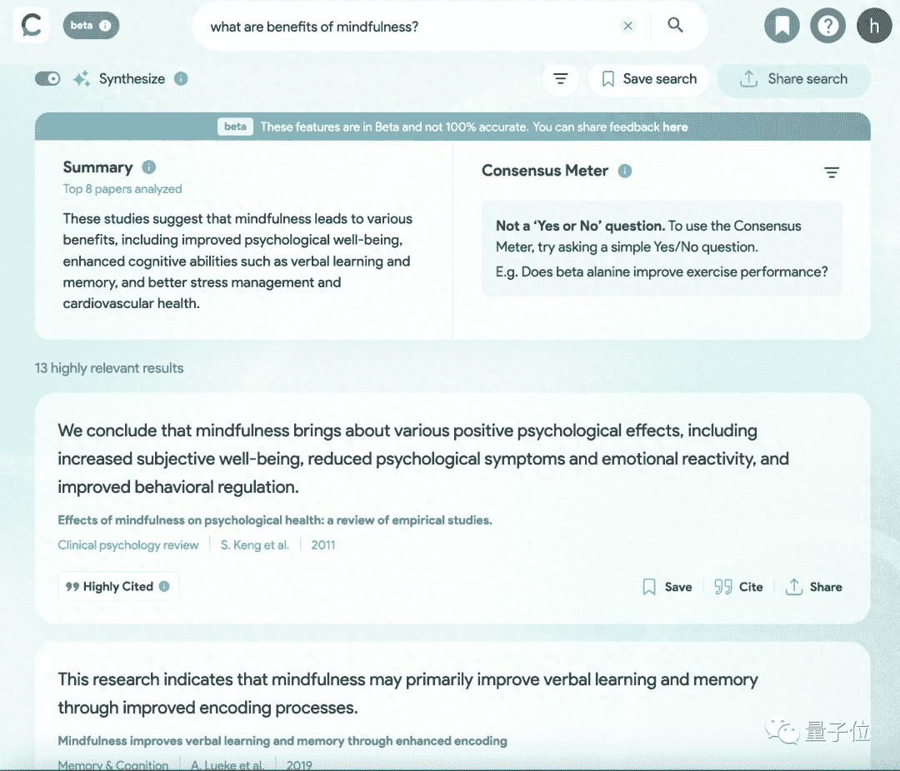
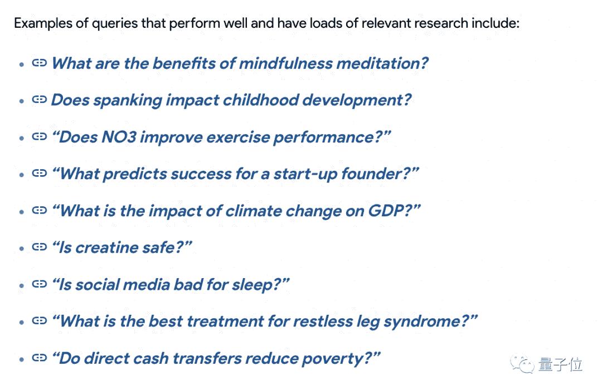

# 2023-09-06ChatGPT上线“论文神器”插件！无需关键字即可搜索2亿文章-今日头条

> 来源：[https://xuqiwei1986.feishu.cn/docx/SsUSdWieWoGyyqxQ19Gcd7ghnpc](https://xuqiwei1986.feishu.cn/docx/SsUSdWieWoGyyqxQ19Gcd7ghnpc)

> 🔗 原文链接： h[ttps://www.toutiao](https://www.toutiao.com/article/7275597210132759080/?log_from=536363cf4e815_1694081639017).com/article/727...

>

# ChatGPT上线“论文神器”插件！无需关键字即可搜索2亿文章

原创 2023-09-06 14:35 · 量子位

ChatGPT上新了一个 **“论文搜索神器” **插件，名叫“Consensus”。

划重点：

不用罗列关键字，只用一句话描述你想了解的问题，比如“xxxx有什么好处”、“xx对xx有何影响”。

它就能从 **2亿篇论文 **中搜索并整理出来答案：

每一个点都附上论文链接。

甚至，根据你的问题写一篇简单的综述也行：

当然，也是通过总结相关研究的方式，论文链接都会附上。

最最重要的是，不像ChatGPT有时会编造假链接，Consensus给出的论文绝对能搜到 （全部经过同行评审） 。

有了它，找论文简直不要太方便～

# 具体用法

下面来看具体用法，一共四种。

# 01、给定一个问题，通过总结各论文研究给出答案

例如官方示例：“正念冥想有什么好处？”

它将用一个列表对该问题进行回答，即1234列举都有什么好处，每个好处后面都有论文作为依据。

# 02、给定一个主题，用各论文观点写一篇简单综述，并给出出处

比如：“给我写一段关于气候变化对GDP影响的论述，并附上引文。”

可以看到，插件给出的答案是比较全面的，列出了5篇研究的结论，并给出了每篇具体的数据。

# 03、无需关键字匹配即可搜索论文

不**需要具体的关**键字，你只需告诉它你想要什么主题的论文，就能扔给你一大堆，并且每篇论文包含作者、年份、期刊以及 一句话总结 。

比如：“给我找5篇关于移民如何影响经济的论文”，插件给出的答案就是这样的：

# 04、引用论文研究撰写SEO友好的博客

提示词如“写一篇SEO友好的博客，讨论CBT （认知行为疗法） 是否可以治疗恐惧，包含经同行评审的论文链接”。

插件给出的回答起好了标题、开头做好了话题引入。

正文 （What the Research Says） 则和前面差别不大，做了论文观点的列举总结。

最后是一个简单总结，以及一个提醒：请务必参考原始研究论文以获得全面的理解balabala。

在这个基础之上进行一些润色和扩展，一篇博客确实就能出来了。

**那么，如何获得该插件？**

只要你是尊贵的Plus用户，去“Plugin store”搜索 “Consensus”安装即可。

# 关于Consensus

正如OpenAI允许开发者制作第三方插件，经过审核后就能正式上线，Consensus就来自“第三方公司”。

该公司和这个插件同名，大概是2021年成立。

核心团队有来自谷歌、Waymo、亚马逊的前员工。

Consensus本身产品就是做论文搜索的，经过数万篇由博士标注过的论文训练而成。

源数据来自 Semantic Scholar ，每月更新一次。

官方网站长这样，目前的功能都还处于Beta测试阶段。

随便给一个问题，搜出来的结果如下所示，最新一篇论文是2019年的。

如果你没有开ChatGPT的plus会员，单使用这个网站进行一些科学搜索也是值得的。

官网还给了一些最佳提问方式和负面案例，感兴趣的可以参考。

链接：

https://consensus.app/home/blog/introducing-the-consensus-search-chatgpt-plugin/

— 完 —

量子位 QbitAI · 头条号签约

关注我们，第一时间获知前沿科技动态