# 2023-09-06GitHub热榜登顶：开源版代码解释器，可装任意Python库，本地运行-今日头条

> 来源：[https://xuqiwei1986.feishu.cn/docx/FzV2dwJjZo0Qj4xsdIzc10uDndq](https://xuqiwei1986.feishu.cn/docx/FzV2dwJjZo0Qj4xsdIzc10uDndq)

> 🔗 原文链接： h[ttps://www.toutiao](https://www.toutiao.com/article/7275597145246581289/?log_from=4e455c24723ea_1694081077142).com/article/727...

>

# GitHub热榜登顶：开源版代码解释器，可装任意Python库，本地运行

2023-09-06 14:36 · 量子位

> 克雷西 发自 凹非寺

> 量子位 公众号 | QbitAI

ChatGPT的代码解释器，用自己的电脑也能运行了。

刚刚有位大神在GitHub上发布了本地**版的代码解释器，很快就**凭借3k+星标并 登顶GitHub热榜 。

**不仅GPT**-4本来有的功能它都有，关键是还 可以联网 。

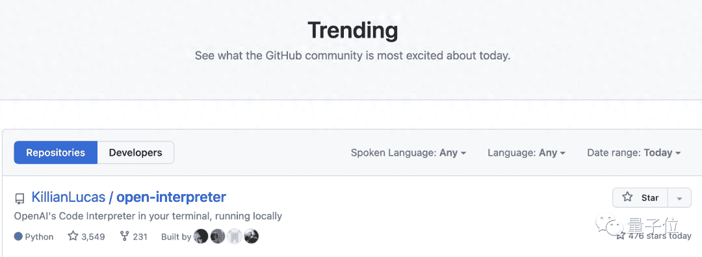

ChatGPT“断网”的消息传出后引起了一片哗然，而且一关就是几个月。

这几个月间联网功能一直杳无音讯，现在可算是有解决的办法了。

由于代码是在本地运行，所以除了联网之外，它还解决了网页版的很多其他问题：

+   3小时只能发50条消息

+   支持的Python模块数量有限

+   处理文件大小有限制，不能超过100MB

+   关闭会话窗口之后，此前生成的文件会被删除

如果没有API，还可以把模型换成开源的Code LLaMa。

这个代码解释器推出之后，很快有网友表示期待一波网页版：

那么我们就来看看这个本地代码解释器到底怎么样吧！

# 让GPT“重新联网”

既然调用了GPT-4的API，那GPT-4支持的功能自然都能用，当然也支持中文。

关于GPT本身的功能这里就不再一一详细展示了。

不过值得一提的是，有了代码解释器之后，GPT的数学水平提升了好几个档次。

所以这里我们用一个高难度的求导问题来考验一下它，题目是f(x)=√(x+√(x+√x))。

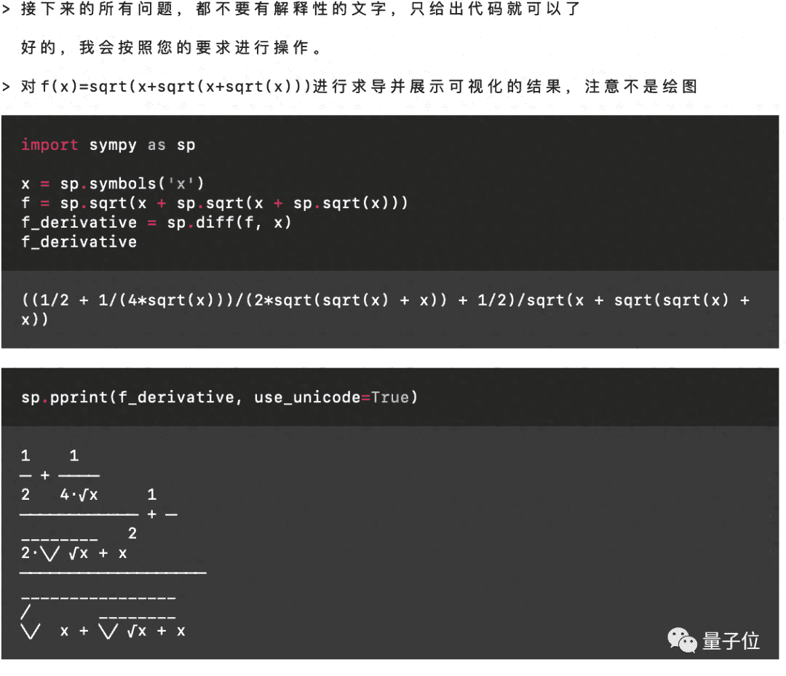

Emmm……这个结果有些抽象，不过应该是提示词的问题，我们修改一下：

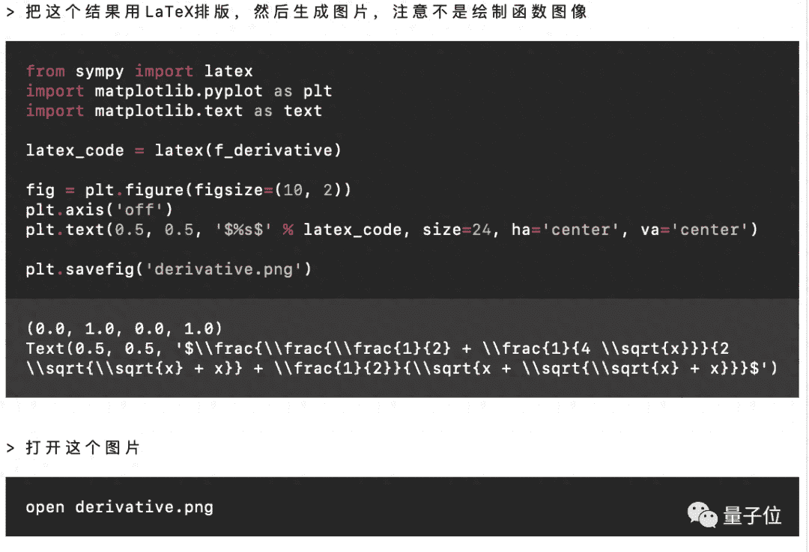

然后我们就看到了这样的结果：

这个式子和标准答案长得不太一样，不过是不是格式的问题呢？我们验证了一下：

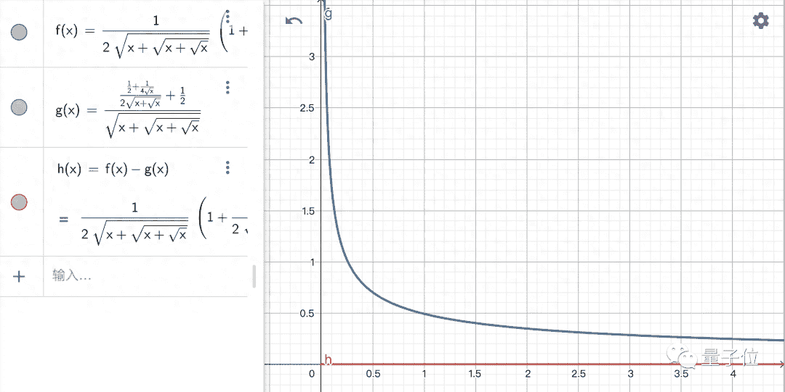

结果是正确的！

接下来就要进入重头戏了，来看看这个代码解释器的联网功能到底是不是噱头：

比如我们想看一下最近有什么新闻。

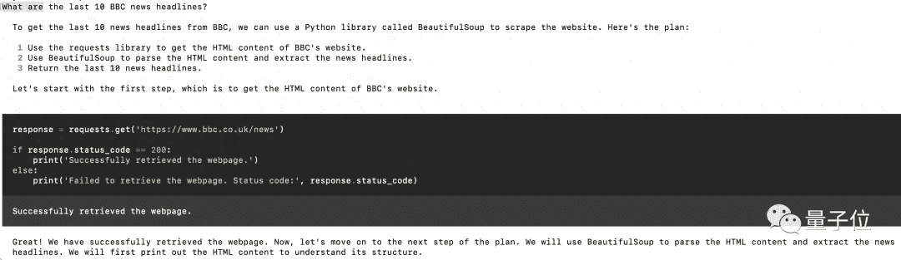

程序会首先检查有没有安装必备的模块，如果没有的话会自动安装，然后就开始拉取网页了。

不得不说把整个网页都读取一遍，如果不是在本地运行，看着屏幕上滚动的代码，的确是有些肝儿颤……

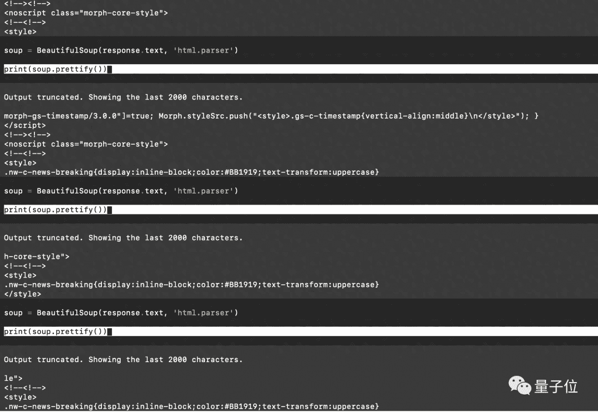

然后程序会分析出新闻标题存储在了网友中的什么字段，并进行提取。

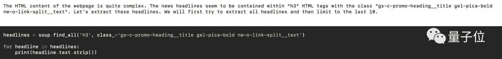

好在经历了一番折腾，我们最终得到了想要的结果：

除了让它自行搜索，也可以给出具体的网页让它来分析：

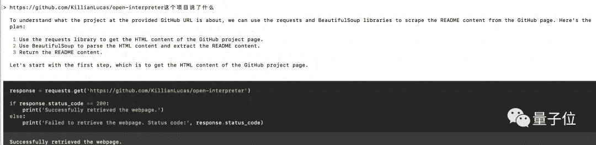

又一次的疯狂加载之后，代码解释器成功复现出了它的自我介绍。

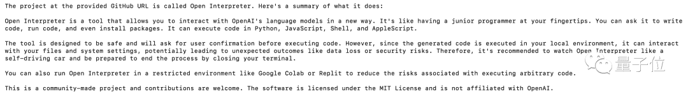

那出了复刻了ChatGPT的联网版本，有没有什么更高级的功能呢？

当然有！比如我们想调整一项系统设置，但不知道怎么操作。

如果用网页版，我们大概率会看到一长串的文字说明，但现在直接交给代码解释器就可以了。

不是给出一大段不知所云的教程，而是自动运行代码，直接一步到位。

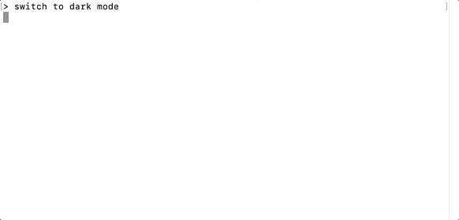

除了让GPT-4生成代码，一些代码仓库中的工具，也能通过它来调用。

比如想给一段视频添加字幕，那么就可以调用replicate上现成的语音识别模块。

由于手边没有现成的素材，这里就展示一下开发者给出的DEMO：

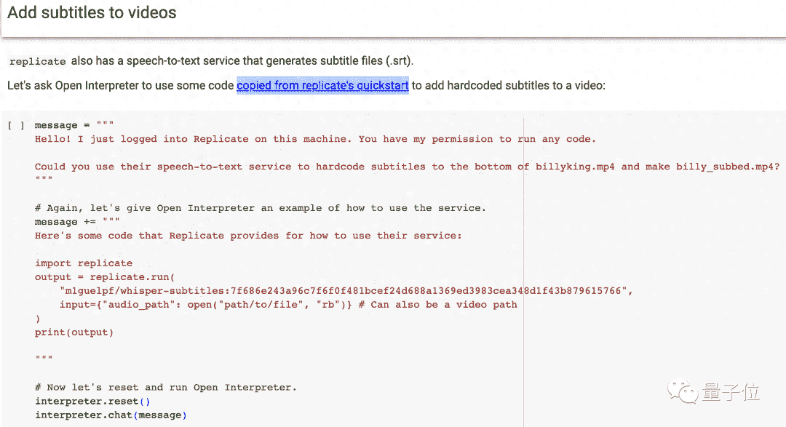

代码运行的过程是在本地进行的，所以不用担心视频大小超限。

总之，运行好之后，我们就可以看到字幕出现在视频下方了：

同样，利用这一特性还可以生成、修改文档或图片，或者调用ControlNet由一张静态图生成动画……

理论上，只要性能足够，Python能干的所有事情，它都能完成。

那么，怎么才能体验到这个本地代码解释器呢？

# 安装方法

作者在GitHub项目页（链接见文末）贴出了一份Colab笔记，有条件的网友可以直接进去体验。

在本地安装也非常简单（前提是安装好了Python），只需要一行“pip install open-interpreter”的代码就能搞定。

安装好后，在终端中输入“interpreter”就能直接启动。

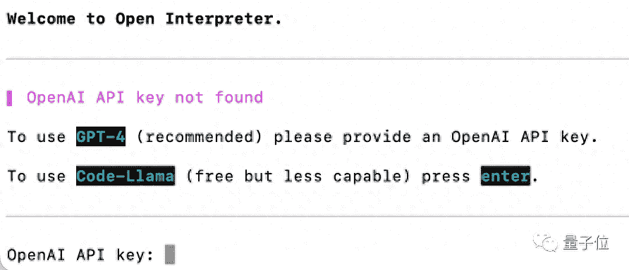

这时程序会要求输入GPT-4的API，如果只有3.5的话，启动时要用“interpreter --fast”。

如果3.5也没有的话，可以直接在这步按回车，或者启动时直接输入“interpreter --local”，切换成Code-LLaMA。

其中包括7B、13B和34B三个版本，规模越小速度越快，越大结果越精确。

如果没有安装Code-LLaMA，按照程序的指示操作就能自动装好。

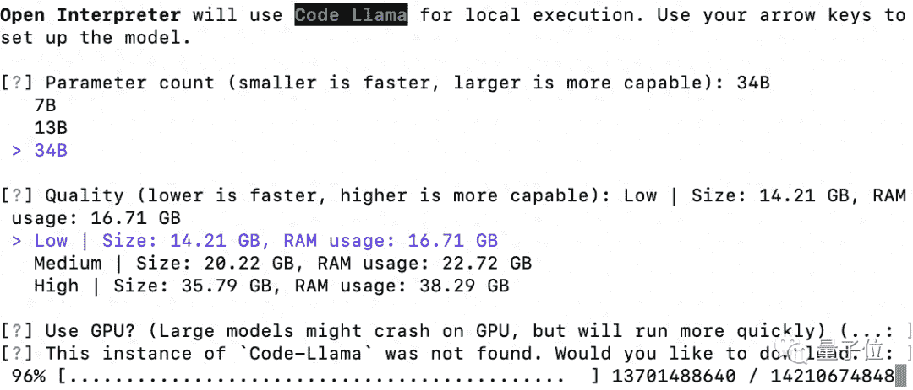

此外，默认情况下，代码生成之后需要确认才会运行，如果不想每次都确认，可以在启动时在命令后面加上“空格-y”。

常用的命令就介绍到这里了，如果想知道更高级的玩法可以参考作者的Colab笔记。

喜欢的话就赶快体验一下吧！

GitHub项目页：

https://github.com/KillianLucas/open-interpreter

— 完 —

量子位 QbitAI · 头条号签约

关注我们，第一时间获知前沿科技动态