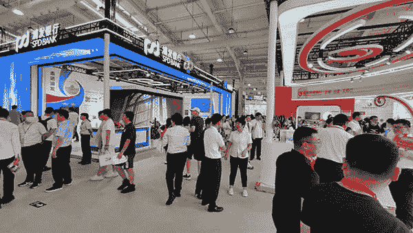
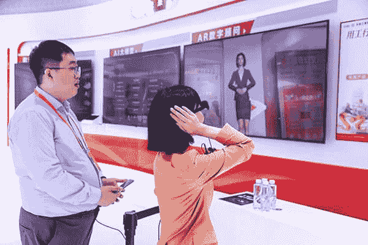
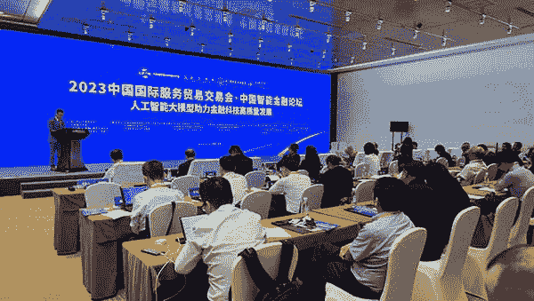

# 2023-09-06服贸会新观察：大模型，改变了金融业的什么？_应用_行业_场景

> 来源：[https://xuqiwei1986.feishu.cn/docx/VvnDd9DFAorYNGxow6bcg4A1ngg](https://xuqiwei1986.feishu.cn/docx/VvnDd9DFAorYNGxow6bcg4A1ngg)

> 🔗 原文链接： h[ttps://www.sohu.co](https://www.sohu.com/a/718133604_114731)m/a/718133604_11...

>

2023年中国国际服务贸易交易会金融服务展。人民网记者 李彤摄

人民网北京9月6日电 (记者李彤)金融业对“模型”并不陌生，“大模型”一字之增，改变了什么？

正在举办的2023年中国国际服务贸易交易会(以下简称“服贸会”)，是观察服务贸易特别是金融业发展的窗口。金融是科技驱动型行业，其天然的中介属性对新技术特别敏感，大模型如何落地金融业务场景，成为了展区热闹背后业界人士的冷思考：大模型给金融行业带来了哪些变化？针对金融业的独特性，大模型技术自身还面临哪些瓶颈？各家生态参与方，是红海竞争还是强强互补？

大模型的应用：不患寡而患不落地

在工商银行展台，数字员工“工晓伴”与观展游客互动。受访者供图

记者梳理发现，近一段时间以来，大模型在金融领域的落地应用有不少，工商银行推出人工智能金融行业通用模型、农业银行发布了金融AI大模型ChatABC、马上消费发布了零售金融大模型“天镜”、度小满发布了开源金融大模型“轩辕”、科大讯飞发布了“讯飞星火”智能客服用于保险业务等场景、彭博社针对金融业推出了大型语言模型BloombergGPT……

“数据显示，截至2023年上半年，与大模型直接相关的融资事件超20起，市场在密切关注新技术的发展，从被投企业的地域分布看，北京、上海、杭州居前列。” 天眼查数据研究院高级分析师陈倞认为，金融领域拥有良好的数字化基础，其运行高度依赖于自动化系统和海量数据，是大模型较为理想的应用场景。

“大模型在金融业，不患寡而患不落地。”有业界人士表示，人工智能算法、大模型，最终要解决的是金融业务的痛点问题，要寻找应用场景。目前，大模型在银行、证券等金融机构的主要应用围绕在客服、运营、写文章、写邮件等初级方面，尚未涉及金融核心业务。

围绕金融行业的独特性属性，大模型在技术层面有待自我完善。“今年年初发布的ChatGPT刷新了人们的认知，但是坦诚讲，在金融领域大模型应用还有四个关键难题。”马上消费首席信息官蒋宁对人民网记者表示，这涉及关键性任务和动态适应性、个性化要求和隐私保护、群体智能与安全可信、基础设施能力。

蒋宁说：“大模型‘满腹经纶’，但如果回答错了他不承担风险，这就是大模型和传统模型最大的区别。传统模型结论的‘不可解释性’一直是困扰金融行业的问题，大模型则要为交易决策提供参考，不能模棱两可。这就要通过技术将不确定的关系转变为确定的关系，从变量中找出不变量，提高大模型在金融领域的辨别性、稳定性、准确性和可解释性。

“大模型对金融业的影响是长远、深刻的，这在业内已经形成了共识。早前，中小金融机构数字化转型的进度慢且面临差距逐步变大的风险。但随着大模型的落地，不同规模的金融机构或将重新站在同一起跑线上。”上述业界人士坦言，大家往往过于重视这一两年发生的技术变革，而低估了未来十年会发生的变革。先是高估了技术带来的变化，发现变化不大后，又低估了技术的长远影响，最后被产业所迭代。

强强互补是趋势：在金融应用上不妨有更多期待

服贸会期间举办的“人工智能大模型助力金融科技高质量发展论坛”。人民网记者 李彤摄

服贸会，“会”“展”并重，论坛交流中参会嘉宾更能激荡观点。

展会期间举办的“人工智能大模型助力金融科技高质量发展论坛”，尚未开场就已经座无虚席，不少人站着听完了全场。有嘉宾表示，相比较传统模型，大模型具备强大的通用能力和智能创作力，可通过聊天交互模式，协助用户完成文案撰写、文档审核、代码生成等智力性和创造性工作。下一步金融机构可按照场景通用化、专业化程度分别使用基础大模型、行业大模型、企业大模型、任务大模型等，由于金融机构的定位不同、规模不同、发展阶段不同，在落地策略上存在一定差异。

中国工程院院士、清华大学计算机系教授郑纬民表示，大模型与图计算相结合，或是在金融领域落地应用的有效途径。“大模型能够协助知识的抽取、推理、融合、更新与解答，降低知识图谱构建成本，提高知识图谱的产业落地能力；图计算能够提高大模型的可靠性，提高复杂问题的求解能力。两者的优势和短板能够进行互补。”

“长远来看，数据是大模型的生产要素，基础设施是大模型的入场券，场景应用是大模型的驱动力。”有业界人士表示，大模型对金融业带来的改变，在技术侧将体现在多模态，利用文本、图像、视频等信息来进行计算，借助模型自身的思维能力实现更安全的输出；在金融业务侧，将通过构建的生态规模，融入现有的业务流程，催生出新的场景和应用。在这一过程中，金融领域要亟待解决算力需求大、训练和推理成本高、数据质量不佳、隐私和安全问题等“成长的烦恼”。

在以“科技赋能——金融业数字化转型与发展”为主题的论坛现场，天阳科技风险管理事业部总经理张志莲对人民网记者表示，目前业界关注的是精细化处理垂类行业细分场景的多模态数据、确保数据安全合规使用、确保模型的稳定性和时效性、应对可能存在的对抗性输入等现象，也要尽快出台大模型相关的行业标准。

“在大模型出现之前，金融行业已经大量应用小模型等数据技术，在探索大模型的过程中会考虑投入和实际价值产出。”张志莲认为，任何一家金融机构独立建构整个体系都不现实、不高效，生态合作、融合创新是大趋势，需要金融机构、科技企业、互联网公司、算力平台等基于自身优势，强强互补，共同解决遇到的挑战。

“[金融是标准化、最严谨](https://www.sohu.com/?strategyid=00001&spm=smpc.content.content.2.1694083296027oumcFZr)的行业，我们对大模型的期待不妨向那些长期没有解决的业务环节进行探索，可能会带来更大的惊喜。”上述业界人士说。  返回搜狐，查看更多

责任编辑：