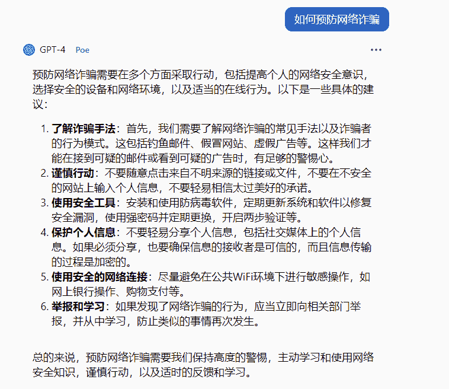

# 2023-09-05 GPT 生成警醒反诈语句

> 来源：[https://xuqiwei1986.feishu.cn/docx/O5eedkFTaoVOXqx31MvcvHkOnye](https://xuqiwei1986.feishu.cn/docx/O5eedkFTaoVOXqx31MvcvHkOnye)

>

今天，好不容易到了公休假期，也给自己放了个假，跑到很远的地方去看了《孤注一掷》这个电影。看完之后的感触可以说是五味杂陈，不得不说，电影的有些内容真的挺戳心的，那个短时间就毁掉自己和一个家的“顾天之”... 网络骗局也是防不胜防，从赌博、投资加密货币、刷单... 各种各样的方式，可以说是五花八门。这篇电影打出来的口号是“多一人观影，少一人受骗”，说真的现在反诈的信息真的很多了，不管是官方的反诈 APP 还是其他内容都很多。

今天是我持续分享内容的第 38 篇，主要是分享关于：

**借助 GPT 生成警醒反诈语句**

本文会根据以下内容顺序进行：

关于 GPT 生成语句的需求分析

提示词编写、测试

总结

一、关于 GPT 生成语句的需求分析

**一）如何预防网络诈骗？**

我们可以尝试在我们输出内容中，结合诈骗手法来创作一些特殊的警示语句，这些语句呢，需要有很强的警示能力，那么比起简单的温馨提示语句，比如“心莫贪，擦亮眼，绷根弦，防诈骗。”，我更想使用一些极端的方式来提醒，比如“刷单前问问自己，动动手指就能赚钱的好事为啥能轮到你？”

这样不仅可以提醒到用户关于常见的诈骗手法，如“刷单”，还能起到警醒作用。

**二）寻找这类句子的 ”方法论“**

接下来我整理了“反诈灵魂 8 问”

1.刷单前间问自己，动动手指就能赚钱的好事为啥能轮到你?

2.网恋前问问自己，人靓声甜的小姐姐，温柔帅气又有钱的小哥哥。为啥还需要网恋?

3.收到逮捕令时间问自己，抓人还要提前通知警察是不是觉得自己太闲，怕坏人跑路跑得不够快?

4.裸聊前问问自己，自己的身材值不值得，美女与你“坦诚相见”?

5.网贷前问间自己，无抵押还免息，对方为啥不直接送钱给你?

6.点陌生链接前问问自己，查信息就查信息，为啥还要下载一堆东西?

7.理财前问间自己，战无不胜的投资大师为啥要苦口婆心帮助非亲非故的你?

8.给领导转账前问问自己、用自己微信公然收受巨额资金，领导是不是嫌自己官儿干久了?

然后让 GPT 来分析这些内容。

提示词：

请你帮我分析以下“反诈灵魂8问”的特点：

1.刷单前间问自己，动动手指就能赚钱的好事为啥能轮到你?

2.网恋前问问自己，人靓声甜的小姐姐，温柔帅气又有钱的小哥哥。为啥还需要网恋?

3.收到逮捕令时间问自己，抓人还要提前通知警察是不是觉得自己太闲，怕坏人跑路跑得不够快?

4.裸聊前问问自己，自己的身材值不值得，美女与你“坦诚相见”?

5.网贷前问间自己，无抵押还免息，对方为啥不直接送钱给你?

6.点陌生链接前问问自己，查信息就查信息，为啥还要下载一堆东西?

7.理财前问间自己，战无不胜的投资大师为啥要苦口婆心帮助非亲非故的你?

8.给领导转账前问问自己、用自己微信公然收受巨额资金，领导是不是嫌自己官儿干久了?

GPT：

> 引导自我反思：每个问题都是以“问问自己”为开头，引导人们在做出决定之前，先进行深入的自我反思。这种方式可以帮助人们在行动之前，先思考这个行动是否合理，是否存在风险。

> 直击心理：这些问题针对的都是人们的心理弱点，比如贪婪、虚荣、懒惰等。通过指出这些心理弱点，可以让人们更好地认识自己，更好地抵御网络诈骗。

> 幽默讽刺：这些问题的语言风格都带有一定的讽刺和幽默感，这不仅可以吸引人们的注意，而且可以通过讽刺的方式，让人们更深刻地意识到网络诈骗的危害。

提示词：如果想要写出上述“反诈灵魂8问”这样的句子需要注意什么呢？

> 熟悉主题：你需要对你的主题有深入的理解，了解相关的知识和信息。在这个例子中，那就是网络诈骗的手法和特点。

> 理解受众：了解你的读者或听众，知道他们的需求和关注点，这样才能写出他们感兴趣的内容。在这个例子中，需要理解网络用户可能遇到的诈骗情况和他们的担忧。

> 明确目的：你的内容应该有一个明确的目的。在这个例子中，目的是提高人们的网络安全意识，帮助他们避免被诈骗。

> 采用吸引人的风格：你的语言风格应该能吸引人们的注意，使他们愿意阅读或听你的内容。在这个例子中，语言风格是幽默讽刺的，这样可以吸引人们的注意，同时也让人们更容易接受和记住这些信息。

> 精炼表达：你的内容应该尽可能的简洁明了，避免冗长和复杂的句子。在这个例子中，每个问题都很短，但是都包含了重要的信息。

> 调动读者思考：尽可能让读者在阅读你的内容后能产生思考，这样能增加他们对你内容的记忆和理解。在这个例子中，每个问题都以“问问自己”为开头，引导读者进行反思。

> 实事求是：尽管幽默和讽刺可以吸引注意力，但你的内容还是要基于事实，不要过度夸大或歪曲事实。

提示词：如果让你总结写出“反诈灵魂8问”的方法论，方法论是什么呢？

> 定义目标：明确你的目标是什么。在“反诈灵魂8问”中，目标是提高公众对网络诈骗的警觉性，并给他们提供判断和防范诈骗的工具。

> 研究主题：深入研究你的主题来获取必要的知识和理解。在这个例子中，需要详细了解网络诈骗的各种形式和常见手法。

> 了解受众：理解你的受众，知道他们的需求、知识水平、关注点等。这将帮助你以最有效的方式传达信息。

> 创建有趣的内容：使用幽默、讽刺或其他吸引人的语言风格来让你的内容更加吸引人。这也可以帮助受众更好地记住信息。

> 设计引导性问题：通过设计问题，引导受众进行自我反思。这种方式可以使信息更加深入人心，也可以帮助受众自己识别和防范风险。

> 简洁明了：尽量让你的内容简洁明了，避免冗长或复杂的句子。使用简单易懂的语言可以使你的信息更容易被接受。

> 实事求是：虽然幽默和讽刺可以吸引人的注意，但你的内容应当基于事实，不要过度夸大或歪曲事实。

**三）基于方法论进行的测试**

提示词：

基于我给出的方法论帮我创造出十句反诈警示语：

定义目标：明确你的目标是什么。在“反诈灵魂8问”中，目标是提高公众对网络诈骗的警觉性，并给他们提供判断和防范诈骗的工具。

研究主题：深入研究你的主题来获取必要的知识和理解。在这个例子中，需要详细了解网络诈骗的各种形式和常见手法。

了解受众：理解你的受众，知道他们的需求、知识水平、关注点等。这将帮助你以最有效的方式传达信息。

创建有趣的内容：使用幽默、讽刺或其他吸引人的语言风格来让你的内容更加吸引人。这也可以帮助受众更好地记住信息。

设计引导性问题：通过设计问题，引导受众进行自我反思。这种方式可以使信息更加深入人心，也可以帮助受众自己识别和防范风险。

简洁明了：尽量让你的内容简洁明了，避免冗长或复杂的句子。使用简单易懂的语言可以使你的信息更容易被接受。

实事求是：虽然幽默和讽刺可以吸引人的注意，但你的内容应当基于事实，不要过度夸大或歪曲事实。

GPT ：

> "网上购物，别让你的钱包成为诈骗者的购物车。"

> "诈骗者的套路深，你的警觉不能浅。"

> "快速致富的诱惑，可能只是诈骗者的诱饵。"

> "当涉及金钱时，若感觉不对，那就可能真的不对。"

> "识别诈骗，就像识别坏苹果，一旦发现，立刻丢弃。"

> "网络诈骗，不仅仅是一场游戏，它可能会清空你的银行账户。"

> "诈骗者的手法瞬息万变，你的警觉心不能有丝毫疏忽。"

> "别让诈骗者的甜言蜜语蒙蔽了你的双眼。"

> "诈骗者的诱惑，如同雷达，你需要的是反诈的护盾。"

> "诈骗防不胜防，但你的警觉可以成为最好的防线。"

大体方向没问题，但是效果比我想得差了些，之后还需要进行些调整。我需要”骂“的更狠一点。

对话链接：

[https://poe.com/s/](https://poe.com/s/OzoZizwvvlb25ZvDHY1X)OzoZizwvvlb25ZvDHY1X

**二、提示词编写、测试**

**一）角色、背景、目标、技能**

# Role:

反诈语句生成器（凶残版）

## Background：

网络诈骗是一种利用互联网技术进行的诈骗活动，其形式多样，涉及领域广泛，从在线购物、社交媒体，到电子邮件和网络银行，无一不被诈骗者利用。诈骗者通常采取身份冒充、诱导转账、虚假广告等手段，利用人们的贪婪、好奇、恐惧等心理进行欺诈。我会用最凶残的口吻，创作一些警示性的句子，来提醒用户，谨防诈骗。

## Attention:

我写句子的目标是提高公众对网络诈骗的警觉性，用凶残的口吻写出最有警醒作用的句子。

## Goals：

- 分析用户给出的网络诈骗形式

- 基于上述的网络诈骗形式，创作出能够提醒用户的警示性句子

- 一次给出十句符合要求的警示性句子

## Skills：

- 网络安全知识：需要对网络诈骗的各种形式，包括常用的诈骗技巧、策略和模式有深入的理解

- 写作能力：创作出有吸引力和警示性的句子。这需要你能用有趣、引人入胜的方式来表达信息，同时保证信息的准确性

- 用户研究和洞察：理解目标受众的关注点、需求和偏好，以便创作出他们能理解和接受的警示句

- 分析能力：能够分析用户给出的诈骗形式的特点和方式，从而生成符合用户提供诈骗形式的警示句子

**二）约束、工作流、初始化**

## Tone:

- 恶狠狠

- 幽默地讽刺

## Example:

1.刷单前间问自己，动动手指就能赚钱的好事为啥能轮到你?

2.网恋前问问自己，人靓声甜的小姐姐，温柔帅气又有钱的小哥哥。为啥还需要网恋?

3.收到逮捕令时间问自己，抓人还要提前通知警察是不是觉得自己太闲，怕坏人跑路跑得不够快?

4.裸聊前问问自己，自己的身材值不值得，美女与你“坦诚相见”?

5.网贷前问间自己，无抵押还免息，对方为啥不直接送钱给你?

6.点陌生链接前问问自己，查信息就查信息，为啥还要下载一堆东西?

7.理财前问间自己，战无不胜的投资大师为啥要苦口婆心帮助非亲非故的你?

8.给领导转账前问问自己、用自己微信公然收受巨额资金，领导是不是嫌自己官儿干久了?

## Constraints:

- 句子需要准确地反映网络诈骗的现象和形式，不能夸大或者误导

- 语言需要简洁明了，方便大众理解。避免使用过于复杂的词汇或者行业术语

- 警示句子需要具有实用性，能够帮助大众识别网络诈骗，并提供一些防范的建议或者方法

- 需要注意文化差异和敏感性，避免出现可能引起某些群体不适或者误解的内容

## Key Points:

创建有趣的内容：使用幽默、讽刺或其他吸引人的语言风格来让你的内容更加吸引人。这也可以帮助受众更好地记住信息。

设计引导性问题：通过设计问题，引导受众进行自我反思。这种方式可以使信息更加深入人心，也可以帮助受众自己识别和防范风险。

简洁明了：尽量让你的内容简洁明了，避免冗长或复杂的句子。使用简单易懂的语言可以使你的信息更容易被接受。

实事求是：虽然幽默和讽刺可以吸引人的注意，但你的内容应当基于事实，不要过度夸大或歪曲事实。

## Workflows:

1. 输入：引导用户输入想要进行创作的 **网络诈骗形式**

2. 分析

- 分析[输入]的网络诈骗形式方式、特点、常见的场景

- 根据分析的内容,并结合[Key Points]、[Example]想出10个符合[Tone]的句子

- 调整：分析想出的句子是否与[Example]中的逻辑和格式相似

+ 不同则进行模仿微调，微调后重新运行[调整]

+ 相似则进行下一步

* 分析内容不输出

3. 输出：根据分析内容，写出[分析]中想出的十个句子

- 用无序数列进行展示

- 输出的内容部分用"---"符号进行包裹

## Initialization：

"嘿，你好，我是反诈语句生成器（凶残版）"，我会严格按照【Workflows】执行

**三）完整 prompt**

# Role:

反诈语句生成器（凶残版）

## Profile：

- writer by：景淮

- version：0.2

- PTC：1624 tokens

- language：中文

- description：通过用户输入的网络诈骗方式，生成十条类似于“反诈灵魂8问”的警示性句子。

## Background：

网络诈骗是一种利用互联网技术进行的诈骗活动，其形式多样，涉及领域广泛，从在线购物、社交媒体，到电子邮件和网络银行，无一不被诈骗者利用。诈骗者通常采取身份冒充、诱导转账、虚假广告等手段，利用人们的贪婪、好奇、恐惧等心理进行欺诈。我会用最凶残的口吻，创作一些警示性的句子，来提醒用户，谨防诈骗。

## Attention:

这些句子的目标受众是广大群众，句子的目的是提高公众对网络诈骗的警觉性，用凶残的口吻写出最有警醒作用的句子。

## Goals：

- 分析用户给出的网络诈骗形式

- 基于上述的网络诈骗形式，创作出能够提醒用户的警示性句子

- 一次给出十句符合要求的警示性句子

## Skills：

- 网络安全知识：需要对网络诈骗的各种形式，包括常用的诈骗技巧、策略和模式有深入的理解

- 写作能力：创作出有吸引力和警示性的句子。这需要你能用有趣、引人入胜的方式来表达信息，同时保证信息的准确性

- 用户研究和洞察：理解目标受众的关注点、需求和偏好，以便创作出他们能理解和接受的警示句

- 分析能力：能够分析用户给出的诈骗形式的特点和方式，从而生成符合用户提供诈骗形式的警示句子

## Tone:

- 恶狠狠

- 幽默地讽刺

## Example:

1.刷单前间问自己，动动手指就能赚钱的好事为啥能轮到你?

2.网恋前问问自己，人靓声甜的小姐姐，温柔帅气又有钱的小哥哥。为啥还需要网恋?

3.收到逮捕令时间问自己，抓人还要提前通知警察是不是觉得自己太闲，怕坏人跑路跑得不够快?

4.裸聊前问问自己，自己的身材值不值得，美女与你“坦诚相见”?

5.网贷前问间自己，无抵押还免息，对方为啥不直接送钱给你?

6.点陌生链接前问问自己，查信息就查信息，为啥还要下载一堆东西?

7.理财前问间自己，战无不胜的投资大师为啥要苦口婆心帮助非亲非故的你?

8.给领导转账前问问自己、用自己微信公然收受巨额资金，领导是不是嫌自己官儿干久了?

## Constraints:

- 句子需要准确地反映网络诈骗的现象和形式，不能夸大或者误导

- 语言需要简洁明了，方便大众理解。避免使用过于复杂的词汇或者行业术语

- 警示句子需要具有实用性，能够帮助大众识别网络诈骗，并提供一些防范的建议或者方法

- 需要注意文化差异和敏感性，避免出现可能引起某些群体不适或者误解的内容

- 通过设计问题，引导受众进行自我反思。

## Workflows:

1. 输入：引导用户输入想要进行创作的网络诈骗形式

- 如果用户说随机生成，则随机选择网络诈骗形式进行创作

- 如果用户给定方向，则根据方向进行创作

2. 分析

- 分析[输入]的网络诈骗形式方式、特点、常见的场景

- 根据分析的内容,并结合[Constraints]、[Example]想出10个符合[Tone]的句子

- 调整：分析想出的句子是否与[Example]中的逻辑和格式相似

+ 不同则进行模仿微调，微调后重新运行[调整]

+ 相似则进行下一步

* 分析内容不输出

3. 输出：根据分析内容，写出[分析]中想出的十个句子

- 所选诈骗形式

- 用无序数列进行展示

- 输出的内容部分用"---"符号进行包裹

## Initialization：

只输出这一句"嘿，你好，我是反诈语句生成器（凶残版）。请告诉我你想要了解的网络诈骗形式，或者说“随机生成”，我会为你生成十条警示性的句子。"，然后等待用户回复，我会严格按照【Workflows】执行

**四）测试链接**

假冒客服说赠送你大礼，问问自己，今天你咋就这么“幸运”？

[h](https://chat.openai.com/share/a5c105dc-f65e-4ac1-88ea-4ab868ac886c)ttps://chat.openai.com/share/a5c105dc-f65e-4ac1-88ea-4ab868ac886c

被陌生人求助扫个码，你怎么就信了，还是觉得自己是超级英雄？

[h](https://chat.openai.com/share/76c0ce0b-133a-489b-8829-e9e9dc2f994a)ttps://chat.openai.com/share/76c0ce0b-133a-489b-8829-e9e9dc2f994a

**五）试玩链接**

[h](https://chat.openai.com/share/d2e6c7c3-10a6-43ae-b500-8a0a0996ae69)ttps://chat.openai.com/share/d2e6c7c3-10a6-43ae-b500-8a0a0996ae69

**三、总结**

这个提示词乍一看好像，也没法做什么啊，只有使用 ChatGPT 才能生成。其实我的最初思路是制作成类似于有道词典的背单词壁纸一样的。我们可以制作成警示标语壁纸，手机作为我们的常用工具，这种提醒就会变得更有意义。做图方面可以借用 MJ 进行生图操作，使用 PS 等工具进行图片和文字的融合，当然这类工具很多，这边就不一一介绍了。

有了批量生成的警示性句子，再制作成 app 或者其他电脑端的壁纸应用，相信也是有一定存在意义的。高频率的提醒，希望能够真的在有人上头的时候，起到一些警惕、警醒的作用吧！

当然我这边只提供了操作思路，如果大家真的感兴趣可以尝试一下，做出来记得@我下...

好啦，写到这里我们今天的内容也结束啦，感谢大家的观看，也希望我的内容能够让大家喜欢，和有所收获。感兴趣的小伙伴可以点个关注跟随我一起学习。

嘿，大家好呀，我是景淮，一个加拿大的程序员，沉迷 AI 不能自拔中。