# 2023-09-04“偏科”的国产大模型：长于文本、弱于数理、作画凑合-36氪

> 来源：[https://xuqiwei1986.feishu.cn/docx/W9T3dGQ89o71DUxZVG9clQ65njb](https://xuqiwei1986.feishu.cn/docx/W9T3dGQ89o71DUxZVG9clQ65njb)

> 🔗 原文链接： https://36kr.com/p/2416141020475393

>

国产大模型集体交答卷了。

8月31日，首批11家国产大模型获批上线，包括百度的“文心一言”、 商汤科技的“商量SenseChat”、 智谱AI的“智谱清言”、MiniMax的“ABAB”、 上海人工智能实验室的书生通用大模型、抖音的“云雀”、百川智能的“百川”以及中科院旗下的“紫东太初”、 科大讯飞的“讯飞星火认知大模型”、阿里“通义千问”、360智脑。

其中，文心一言、商量SenseChat、抖音基于“云雀”研发的AI智能助手“豆包”、智谱清言、MiniMax的“ABAB”、“讯飞星火认知大模型”已经面向公众开放测试。

另据第一财经报道，阿里“通义千问”、360智脑也预计在未来一周左右陆续开放。

自今年2月ChatGPT掀起“生成式AI”热后，国产大模型齐齐备战，7个月后的今天，到了验收成果的时候。

就速度而言，不可谓不惊喜，但真正让人关心的还是效果如何。

《财经故事荟》体验了上述6家已经开放测试的大模型，从文本创作、数理计算、作画、信息检索等角度与其做了对话，发现这些大模型已经能解决相当一部分问题，尤其在文本创作方面颇有些亮点。当然，有瑕疵也在所难免，但就短短半年的沉淀而言，总体值得给一个肯定。

**需**要说明的是，大模型输出的结果存在随机性，即便是同一指令，每次生成的内容也有差异，因而不能就有限的体验去定论模型的高下。

不过，国内大模型榜单SuperCLUE发布的大模型8月排行榜，倒是能体现出这些大模型的总体水平。排行榜显示，在国产大模型中，百川智能的Baichuan-13B-Chat(V2)拿下榜首，MiniMax的MiniMax-abab5及百度的文心一言（V2.2.3）紧随其后。

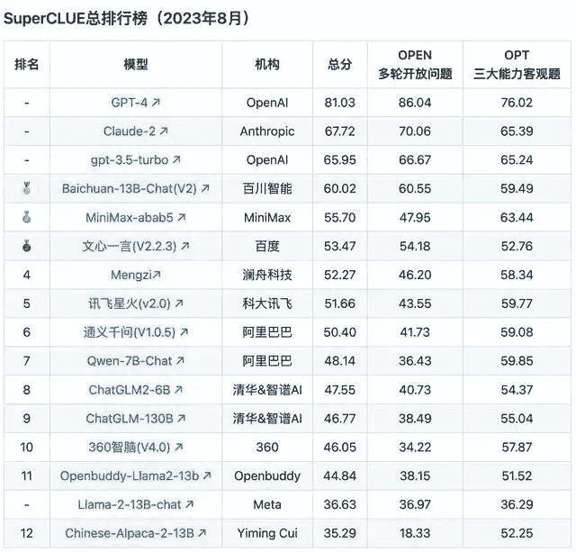

## 文本创作：颇有亮点

文本处理是这些大模型的主攻方向之一，其中，基于文本的创作是重头戏，其一直肩负着解放生产力的众望。

此次体验重点针对写诗、起标题、构思文章、润色作文的能力进行。

**其**一，写诗方面，这些大模型总体表现都不错，创作的诗基本都有合理的语义和语境，而不只是词与词的无逻辑拼凑。

比如，指令是“写一首诗，关键词包含江湖、菩提、相逢”时，文心一言、商量大模型、MiniMax大模型均表现不错，尤其掌握了押韵的精髓。

（左：文心一言，中：商量，右：MiniMax）

相对而言，百川大模型、讯飞星火、智谱清言、抖音“豆包”在押韵方面有时不够稳定。

（左：讯飞星火，右：智谱清言）

**其二，起标题方面，这些大模型也基本能抓住中心思想，虽**然代替人的思考还不现实，但可以提供参考。

比如，输入《财经故事荟》之前写的关于“短视频造假背后的流量经济及造假产业链”的段落后，文心一言、讯飞星火、智谱清言、百川大模型的结果如下：

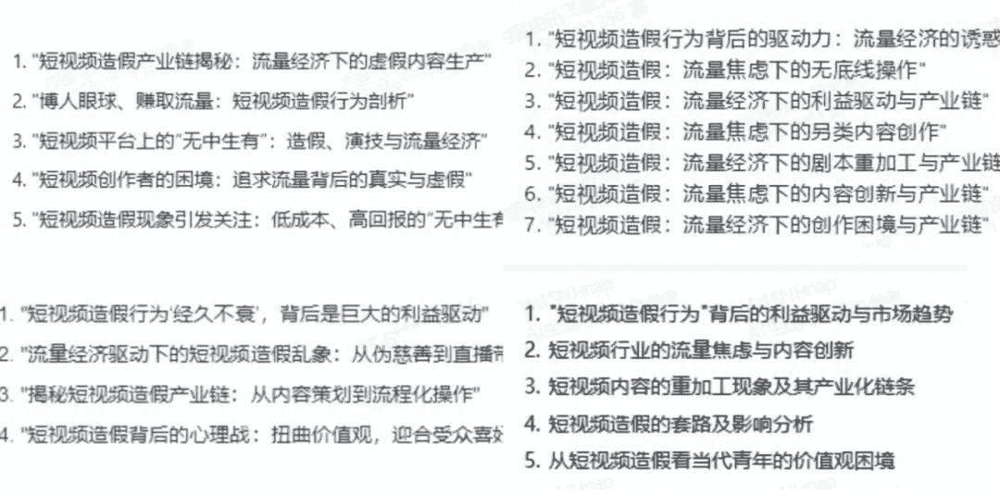

（左上：智谱清言，左下：商量，右上：讯飞星火，右下：百川）

而颇让人有点惊喜的是MiniMax大模型的标题，其看起来不只是“组合”已有关键词，而是有自己的归纳，部分直接拿来用也未尝不可：《短视频造假屡禁不止：揭秘背后的利益链和传播机制》、《短视频造假乱象：“流量为王”时代的道德困境》、《短视频造假：一场博人眼球的“游戏”》、《造假短视频：平台、创作者与看客的共谋》、《短视频造假：技术与人性的扭曲》。

值得一提的是，在上述体验过程中，百川大模型有一个比较迷惑的现象，其似乎在“某些内容输入字数过多”时无法处理，会提示回答不了，缩减段落后才会给出结果。

比如，上述测试段落有1600多字，缩减为1200多字后才能回答，但在尝试另一个1400多字的段落时，却可以正常处理，原因无从得知。

其三，润色文章方面，各家水平可圈可点，彼此难分上下。

一方面，它们都能处理基本的错别字、标点、语法等问题，只不过处理方式有差异。

比如，对于“我们自天性来说，本是娇小的，本是弱小的”的润色，文心一言会处理成“从天性来说，我们本是娇小且弱小的”，而百川、智谱清言、讯飞星火则倾向于更简洁的处理，类似于“我们天生就是渺小的，脆弱的”。

但这种处理风格并不固定，比如，对于“我打小住在乡村，我十分稀爱下雨天，每次偶然对上下雨，我都很激动”的润色，文心一言的处理更简洁“我从小在乡村长大，对雨天有着深深的喜爱”；讯飞星火则是在原有表达基础上做简单修饰“我自幼生活在乡村，我非常喜爱下雨天。每当偶然遇到下雨天，我总是兴奋不已。”——可见，AI算法带有强烈的“随机性”。

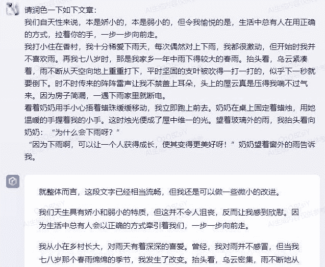

文心一言的结果

另一方面，在一些语义理解上，各家的识别与处理也有差异。

以润色“因为下雨啊，可以让一个人获得成长，使其变得更美好呀！”为例，文心一言、抖音“豆包”的处理更好一些，它们都将“下雨让人获得成长”调整成“下雨让生命或万物得到滋润”，显然更合适，而其他大模型则没有如此调整。

其四，在构思文章方面，几家大模型的表现均有一定惊喜。

比如，输入指令“分析钟薛高进军平价雪糕市场所面临的挑战”，几家大模型都关注到了“与蒙牛、伊利等品牌的竞争”、“对钟薛高品牌形象的影响”、“成本控制”的角度。

尤其值得称赞的是，文心一言、抖音“豆包”还特别关注到“钟薛高将面临的销售渠道挑战”——这完全能给写稿者提供一定思路。

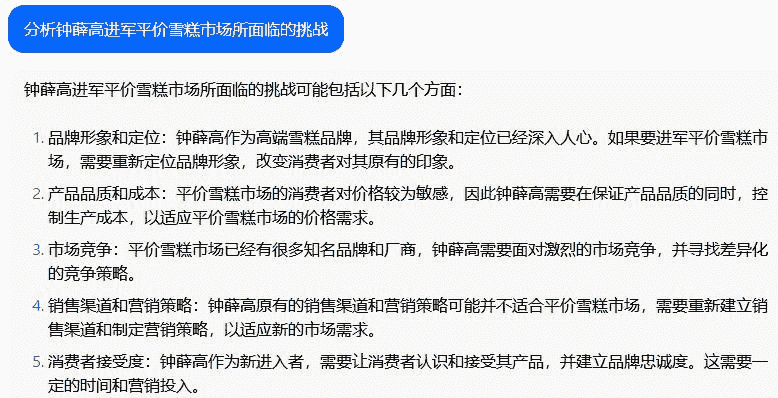

抖音“豆包”的结果

不过，瑕疵也在所难免，在“分析钟薛高推出低价雪糕的原因”问题上，几家大模型虽然都给出了3-4点分析角度，但其实有些角度的本质含义一样，均指向“扩大消费群体，开拓市场份额”，是可以合并的。

以文心一言为例：

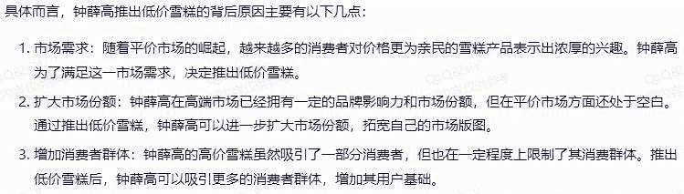

这说明在语义理解上，这些大模型还有不小的进步空间。

实际上，在体验过程中，就曾在语义理解上出现过比较离谱的现象。

比如，在“制定老年人爱看的2024年春晚节目单”问题上，讯飞星火、智谱清言、百川大模型、商量大模型、抖音“豆包”的人员名单中都出现了“邓丽君”或“赵丽蓉”等已过世明星。

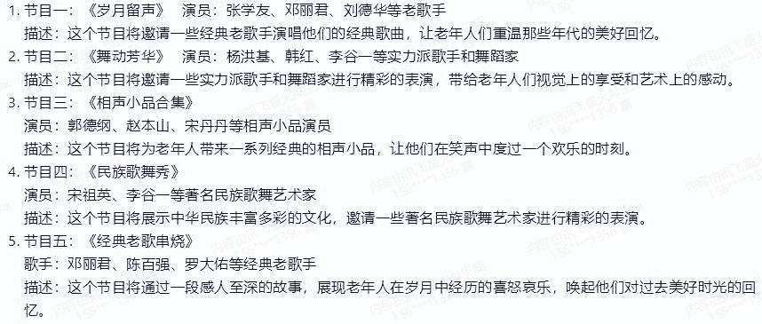

讯飞星火的结果

再比如，在“请写一个‘火腿肠炒鼠标’的菜谱”问题上，智谱清言、讯飞星火、商量大模型、抖音“豆包”均指出鼠标不能食用，百川大模型则很配合，还特意标注“使用废弃不用的鼠标”，着实有点冷幽默。

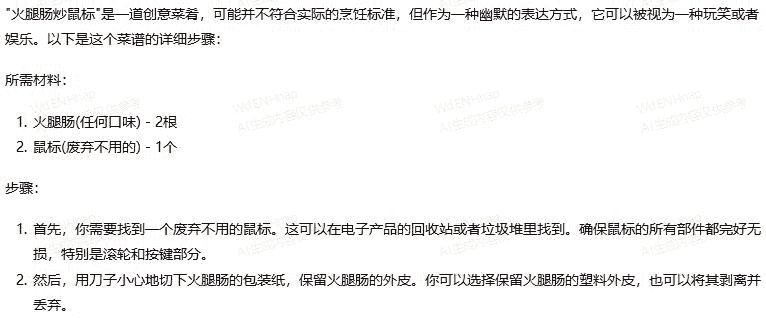

百川大模型的结果

文心一言更是有求必应，“将鼠标去除内脏”的步骤让人啼笑皆非。

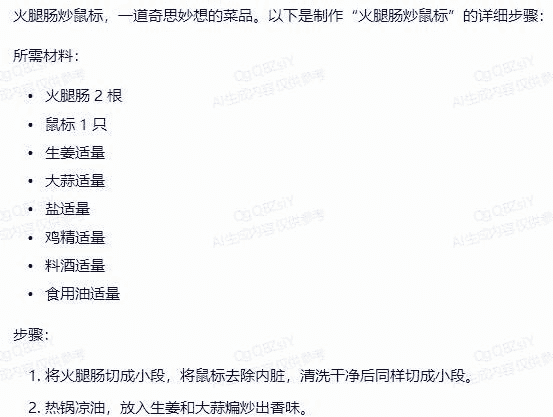

文心一言的结果

但总的来说，短短7个月就能交付上述结果，这些大模型均值得一个肯定。

## 数理计算：水平不稳定

在解答数学题方面，《财经故事荟》抽取了10道初中数学题进行测试，结果是：文心一言、讯飞星火、商量大模型均答对5道，智谱清言答对4道，抖音“豆包”答对3道，百川大模型只答对2道。

比如，在比较简单的“大于-0.5而小于4的整数共有多少个？”问题上，文心一言、商量大模型答对，是4个，其余均错误。

而且，智谱清言“错上加错”，其列举了5个数，但说成了7个。

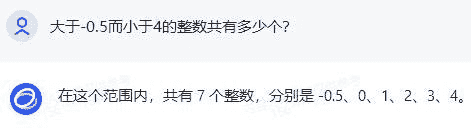

智谱清言结果

在解答物理题方面，关于物理现象的解释，这些大模型普遍没有问题，《财经故事荟》抽样了10道初中物理现象解释题，它们均能答对9~10道。

比如，在“为什么池水深度看起来比实际的浅?”问题上，它们都能答出“折射原理”。

**这或许是因为，物理现象解释更偏文本检索和归纳，本质还**是文本处理能力，这正中大模型的主攻方向。

当然，现阶段出现一些离谱解释也在所难免。

比如，在“医生给病人检查时，常把一把小镜子在酒精灯上烧一烧，然后再放入病人的口腔，为什么?”问题上，百川大模型就答多错多，其额外提到了“镜子会吸附口水，而口水含有丰富的矿物质等，对于治疗某些疾病具有辅助效果”的奇怪解释。

而在物理计算方面，这些大模型普遍表现欠佳。

在10道涉及物理运动、质量与密度、压强、电学等不同题型的初中物理试题中，商量大模型表现较为突出，答对了4道，文心一言、百川大模型、抖音“豆包”答对2道，讯飞星火、智谱清言则只答对1道。

比如，在“甲乙两个同学沿相反的方向拉测力计，各用力200牛，则测力计的示数是多少？”问题上，答案是200牛，只有商量大模型答对，且解题思路正确。文心一言、讯飞星火、百川大模型、智谱清言给出的答案都是0，抖音“豆包”则认为是400牛。

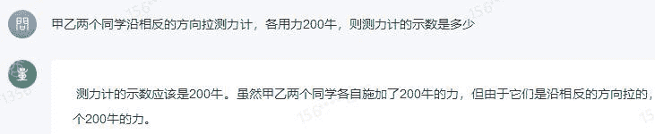

商量大模型结果

再比如，在“某同学用刻度尺测量钢球的直径，测得的四次结果是1.82CM，1.87CM，1.68CM，1.81CM，则小球的直径应该取多少？”问题上，也只有商量大模型答对1.83CM，文心一言、百川大模型、讯飞星火都是1.79CM，抖音“豆包”是1.825CM，智谱清言解题思路正确，但最终结果算错为1.82CM。

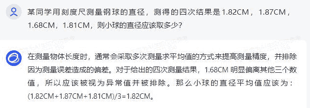

智谱清言结果

但需要备注的是，大模型的数理计算结果仍旧不稳定。

就如上述直径问题，智谱清言第一次结果是错误的1.82CM，但重新询问时又给出了1.83CM的正确答案；而在上述测力计问题上，讯飞星火第一次回答是错误的0，重新询问又回答成错误的400N。

总的来说，在有标准答案的数理问题上，这些大模型表现都不能算及格。

## 作画水平“拉胯”，“触雷”概率较大

在6家大模型中，目前只有文心一言、讯飞星火支持作画。

不过，目前这两家大模型的作画能力尚未达到理想状态，“触雷”概率不低。

其一，有些画作看起来有些“假”，不够真实。

以“马”、“风景”为例，以下是文心一言的刻画。

讯飞星火的风景画在意境方面更好一些，但马的刻画风格跟文心一言一样，有点不真实。

其二，它们对语义的理解还有欠缺。

以“请画一幅李清照和苏轼在下棋的画”为例，文心一言的画作上只呈现了一个人。

提示之后才增加，但“李清照”下棋坐的位置明显不对。

而讯飞星火方面，虽然呈现了两个人，但都是男性，也不符合需求。

经提示后，其竟然无法再重新生成图片，且尝试多次均如此。

比如，“画一碗牛蛙面”，讯飞星火的很离谱——面里有整只牛蛙。

（左：文心一言，右：讯飞星火）

再比如，“画一只正在睡觉的俄罗斯蓝猫”，讯飞星火将俄罗斯蓝猫理解成蓝色的猫，而文心一言虽理解正确，但顾此失彼，对睡觉有些“误解”。

（左：文心一言，右：讯飞星火）

其三，在面部等细节的刻画上，大模型还有不少问题。

比如文心一言画的人，眼睛有时会出现“斗鸡眼”，或者面部、手脚成“模糊的一团”。

讯飞星火也存在相似问题，比如下图中“牧羊少年”的面部就有些畸形的诡异感。

试图引导其优化，结果引来了更“灾难”的画面：

**当然，也有值得肯定之处，在不需要刻画太多细节的**场景下，作品还是能让人“驻足欣赏”一下。

比如下述两家大模型给出的山水画。

（左：文心一言，右：讯飞星火）

**总的来说，相比文本能力，大模型的作画水平需要更多“调教”，在这个过程中，**不仅需要算法和数据层面的持续调优，也需要人在指令层面与其磨合，以充分挖掘其潜力。

正如李彦宏所说，未来提出问题比解决问题更重要，10年后，全世界可能有50%的工作是提示词工程。

## 信息检索：准确度待提升

如果把大模型当搜索工具用，就需要其在信息更新的及时性、全面度和准确性上达到合格水平。

体验发现，在部分搜索场景下，这些大模型能提供准确信息。

比如，在“曹操为什么娶林黛玉？”、“张三丰为什么杀张无忌？”、“花生为什么长在树上？”等问题陷阱里，每一家都能准确告知不存在这个现象。

文心一言结果

再比如，关于“是谁提出了新三民主义？”、“淞沪会战是什么时候？”、“是谁首次培育出了杂交水稻？”等具体问题上，这些大模型也都能正确回答。

但在一些数据统计层面，它们表现很不理想。

一方面，有些大模型缺失最新数据，或者缺少某些特定领域的数据储备。

比如，在统计中国年度新增人口时，文心一言、讯飞星火最新可统计到2022年，但智谱清言只能查到2020年，百川大模型、抖音“豆包”则只能查到2021年，商量大模型完全统计不到此类数据。

百川大模型结果

同样的，在统计中国年度GDP时，百川大模型最新也只能查到2021年，商量大模型也完全统计不到。

商量大模型结果

再比如，在部分有关线下店面信息的问题上，MiniMax大模型、智谱清言、百川大模型、抖音“豆包”会表示无法查询。

还有一些历史信息，部分大模型也缺失相关内容，比如，问“中国成功爆炸第一颗氢弹是什么时候”，智谱清言和百川大模型均提示无法查询。

另一方面，数据的准确度也普遍欠佳。

比如，在“请统计下最近5年中国GDP数据”问题上，以国家统计局网站上的数据为标准，没有一家是完全正确的。

其中，文心一言只有2021年的数据不正确，其显示是114.37亿元，而国家统计局是114.92亿元。

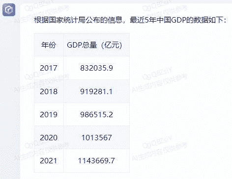

经过提示后，再重新提问，其做了更正：

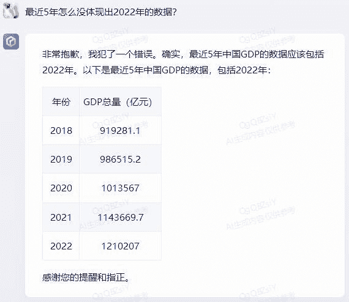

百川大模型、讯飞星火、抖音“豆包”则是每一年的数据都不正确；MiniMax大模型是2021、2022年不一致；智谱清言则只有2020年是正确的。

此外，在这几家大模型中，只有MiniMax将“2022年划分到最近5年”，其余均默认最新显示到2021年。

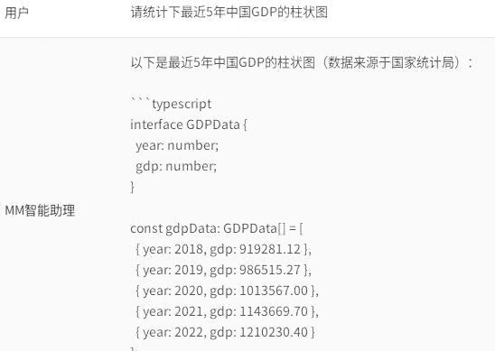

MiniMax结果

其实，准确度欠佳的问题不止出现在数据统计上。

比如，在“鲁智深为什么三打白骨精”的问题陷阱中，只有文心一言、商量大模型、抖音“豆包”回答不存在，其他大模型都开始“编故事”了。

再比如，在询问“父母之爱子，则为之计深远”的典故时，也只有文心一言、商量大模型、抖音“豆包”回答正确，百川大模型认为没有特定典故，讯飞星火、智谱清言则说错了典故出处。

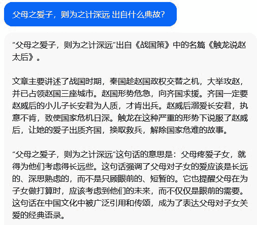

抖音“豆包”结果

还有，查询电影信息时也有类似现象，在“为陈思诚监制的电影《消失的她》写影评”问题上，只有文心一言、商量大模型、抖音“豆包”描述的事实与电影相符，百川大模型、讯飞星火、智谱清言则有点“串场”，都提到了没有参演的黄渤。

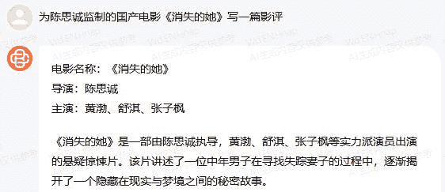

百川大模型结果

类似的现象在评价最新电影《封神》时也有出现，只有文心一言对剧情的描述正确，其余大模型均将其误认为是之前的电影《封神传奇》；而当输入指令更明确为“2023年上映的《封神第一部：朝歌风云》”时，百川大模型、商量大模型、讯飞星火仍然错误，智谱清言、抖音“豆包”则做了更正。

可以看到，现阶段如果把大模型当搜索用，还是让人不放心。

其实，除了上述四大类能力外，这几家大模型还都具备跨语言处理能力。《财经故事荟》以最简单的“我爱你”为例，进行中文与法语、德语等语言的互翻，都能得到准确回答。当然，更复杂的跨语言处理能力还有待继续挖掘。

**综上，**仅以上述体验结果看，现阶段的大模型在文本创作方面基本迈过了及格线，在某些场景下还能“制造”一些惊喜感，这颇为难得。但其也像一个偏科的学生，在数理方面普遍一般，BUG较多；作画水平更是有待优化，“雷人”概率比较大；信息检索方面还不稳定，用起来不太放心。

那么问题来了，对照当下的现实，再回看当初大模型被“吹捧”上神坛的那些观点：“AI的iPhone时刻”“大模型将改变世界”……这些观点所构建的未来还值得期待吗？

**答案毋庸置疑：值得，“莫欺少年穷”！大模型今天交付的答卷只是其漫**漫长路上的起点，在此后的每一天，甚至每一小时里，大模型可能都处在无止境的进化中。

本文来自微信公众号 “财经故事荟”（ID:cjgshui） ，作者：王舒然，编辑：万天南，36氪经授权发布。