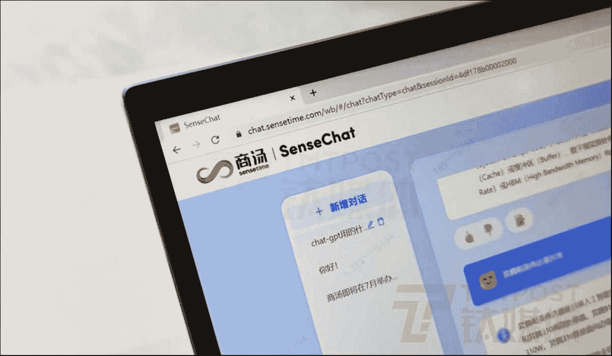

# 2023-09-04中国130个大模型，难超越10亿营收的ChatGPT｜钛媒体深度-钛媒体官方网站

> 来源：[https://xuqiwei1986.feishu.cn/docx/OkBGdCmidokRBCxnKvnc3Hcxnvb](https://xuqiwei1986.feishu.cn/docx/OkBGdCmidokRBCxnKvnc3Hcxnvb)

> 🔗 原文链接： h[ttps://www.tmtpo](https://www.tmtpost.com/6688029.html)st.com/6688029.html

>

（图片来源：钛媒体App编辑拍摄）

中国 AI 大模型全面“开闸”。

钛媒体App获悉，8月31日， 百度（文心一言）、抖音（云雀大模型）、智谱AI（智谱清言）、中科院（紫东太初大模型）、百川智能（百川大模型）、商汤（商量SenseChat大模型）、MiniMax（ABAB大模型）、上海人工智能实验室（书生通用大模型）共8个企业/机构官方发布公告，宣布面向全社会上线大模型产品。

**这是中国首批面向公众提供类似ChatGPT服务的 A**I 大模型产品，大模型行业迎来关键时刻。

同时，阿里“通义千问”、360智脑以及科大讯飞“讯飞星火认知大模型”等尚未宣布全面开放，但已表示完成了备案工作，预计在未来一周左右陆续开放。

除ABAB、书生通用、紫东太初三个大模型之外，首批上线国内大模型中有5款为消费级（C端）产品，免费对外开放，有望对标成为“中国版ChatGPT”。

不过，拥有先发优势的ChatGPT，如今却开始加速商业化。据The Information 8月30日报道，创造ChatGPT大模型的OpenAI，预计在未来12个月内，通过销售人工智能软件及其计算能力，将获得超过10亿美元的收入。即便是“卖铲子”的英伟达，二季度净利润同比增长高达843%。对应的中国大模型，集体亏损、难以获得规模性收入。

**钛**媒体App从赛迪方面获得的一份数据显示，今年1-7月国内共发布了64个大模型。截至2023年7月，中国累计已经有130个大模型问世。

很显然，中国的130个大模型，基本难以超越已加速商业化的ChatGPT，后者营收预计达10亿美金。

## 8个大模型全面开放，阿里大模型1周内等待通知

今年以来，以ChatGPT为代表的 AI 大模型技术火遍全球，而在这样一个大的机遇下，百度、阿里、字节等多家国内公司陆续公布大模型产品。

今年7月13日，国家七部委联合公布《生成式人工智能服务管理暂行办法》，自2023年8月15日起施行。根据新规指导要求，AI大模型在内的生成式AI产品将面临算法备案、安全评估等两道监管手续，也称“双新评估”，只有在这两个手续都通过后，生成式AI产品才能合法上架。

随后，百度、商汤、阿里、腾讯等公司均开始进行备案过程，希望在第一批获准名单中。最终在8月31日，有8个企业/机构的 AI 大模型正式面向全社会上线。

截至钛媒体App发稿前，据七麦数据显示，8月31日，文心一言在苹果App Store应用商店下载量预估为31.3万次左右，智谱清言App则为3832次。

**具体来说，据百度介绍， **百度的大模型应用“文心一言”（Ernie Bot）向全社会全面开放。用户可以在应用商店下载“文心一言APP”或登陆“文心一言官网”（https://yiyan.baidu.com）体验。百度MEG群组负责人称，百度旗下各类用户侧产品正在利用大模型进行重构，百度搜索、百家号、百度文库、百度输入法等产品正在研发并陆续推出相关AI功能，未来还将推出NEWAPP等产品。

百度拥有搜索入口，通过在搜索结果顶部添加了一个“对话”按钮。单击它会弹出一个聊天窗口，允许任何人访问文心一眼，类似于微软将ChatGPT集成到其Bing搜索中的方式。

百度董事长兼首席执行官李彦宏表示，当文心一言向数以亿计互联网用户大规模开放服务后，能够获得大量真实世界中的人工反馈，这将进一步改进基础模型，并以更快速度迭代文心一言，创造更好的用户体验。

百度官方公布的数据显示，文心一言App 8月31日开放下载首日，日活跃用户超100万，过去24小时内，平台共计回复网友超3342万个问题。

**据商汤介绍， **即日起旗下AI聊天机器人“商量SenseChat 3.0”正式向所有用户开放，用户可通过SenseChat官网注册使用: https://chat.sensetime.com，可体验文本编辑、数理计算、编程等功能。据悉，商汤商量SenseChat 1.0于今年4月首次推出，是千亿参数的大语言模型的聊天机器人产品，拥有语义理解、多轮对话、知识掌握、逻辑推理等综合能力。

8月28日商汤披露的半年报显示，借助大装置的算力、“日日新”大模型体系的大语言模型及文生图模型研发，上半年，商汤生成式AI相关收入实现670.4%的增长，收入贡献占比超过2成。商汤预估，到2024年生成式AI业务相关收入占比预计会超30%，2025年预计将占总收入40%以上。

**据百川智能介绍， **旗下大模型产品“百川大模型”率先通过《生成式人工智能服务管理暂行办法》备案，今日起面向全社会开放服务，用户可以登录官网www.baichuan-ai.com进行体验。据悉，百川智能成立于今年4月10日，由前搜狗公司CEO王小川创立，成立四个月以来，百川智能相继发布了三款通用大语言模型：6月15日，百川智能发布国内首款开源可免费商用 70 亿参数量大语言模型Baichuan-7B，7月11日，发布参数量130亿的大语言模型Baichuan-13B-Base、对话模型Baichuan-13B-Chat，8月8日发布参数量530亿的大语言模型Baichuan-53B。

百川智能创始人、CEO 王小川早前向钛媒体App透露，百川智能将在今年第四季度发布千亿参数模型，预计明年一季度前后推出 “超级应用”。

**据MiniMax介绍， **今日起MiniMax“abab”大模型全面开放服务。用户可以登陆“MiniMax开放平台”率先体验。据称，MiniMax“abab”大模型能力适用于逻辑推理、文本续写、文案生成、内容摘要、代码生成、知识检索等大多数文本处理相关的场景，并且还提供声音大模型能力。目前，MiniMax开放平台已接入超百家付费客户，提供办公协作、互动娱乐、客服、搜索、教育等十余个行业场景。

MiniMax成立于2021年12月，由前商汤科技副总裁、通用智能技术负责人闫俊杰创立，是国内 AI 领域头部公司。据报道，今年6月，MiniMax接近完成规模超2.5亿美元的一轮融资，投资方包括腾讯、米哈游等，目前公司估值超12亿美元（约合人民币85亿元）。

**智谱AI **则宣布正式上线首款生成式AI 助手 “智谱清言”，已在各大应用商店上线，用户可通过苹果App Store、安卓主流商店下载，或在🛰️小程序中搜索“智谱清言”体验其功能。智谱AI 成立于2019年6月，由清华大学计算机系知识工程实验室的技术成果转化而来，目前已完成三轮融资，投资方包括美团、华控基金、启明创投、君联资本、中科创星、将门创投等。

**另外还有三款大模型公布上线， **2023年7月，上海人工智能实验室（上海AI实验室）与商汤科技联合香港中文大学、复旦大学、上海交通大学及清华大学发布“书生通用大模型体系”；“紫东太初”则是由中国科学院自动化研究所，联合武汉人工智能研究院于2023年6月发布的2.0全模态大模型；云雀大模型则已经应用于8月17日抖音团队发布的AI对话机器人“豆包”上，提供中英文多轮对话服务。

**除了上述已上线的大模型产品，科大讯飞、阿里等企业均表示已完成**备案流程，等待地方管理部门通知后公布。 阿里方面表示，阿里云“通义干问”已完成备案工作，待正式上线，首批通过备案的企业名单，预计将在1周内陆续由各地方相关管理部门通过；科大讯飞、360智脑也表示已完成备案；腾讯和华为对于是否获得备案尚无回应。

**据钛媒体App了解，目前已经官宣开放**的首批大模型，均来自北京和上海的公司。 “备案流程走完了以后，因为每家企业属地不一样，所以时间有早晚。”一位消息人士对钛媒体App表示。

财新引述消息人士称，各省市的审批进度有不同，而且各省市的名额有差别。

## B端逐步寻找落地，预估OpenAI年收入10亿美元

相对于C端大模型，此次多个企业级（B端）以云或应用方式推出的AI大模型，均在申报备案和评估，目前无一家公司获得上线审批，商业方面更面临巨头围剿。

相关公司负责人对钛媒体App表示，他们正在进行备案工作流程，其大模型已完成“双新评估”，等待官方通知后再行宣布，希望成为第二批获准上线的大模型，“很快有结果”。

目前，多个B端大模型已通过算法进行备案。6月20日、9月1日公布了两批境内深度合成服务算法备案清单，其中包括360智脑文本生成算法、网易有道机器翻译算法、快手生成合成算法、天工大语言模型算法、爱奇艺生成合成算法、云雀大模型算法、华为云盘古多模态大模型算法等。

实际上，相对于C端，行业和垂直领域大模型正成为国内企业追逐的发展模式，

当下B端大模型商业模式分为三种：出售大模型 API 接口，向公司或开发者按照调用次数收费；直接卖大模型开发服务，向传统企业输出大模型行业解决方案获得收入；用大模型改造现有业务，提高产品的竞争力获得更多商业回报，即Model-As-A-Service (MaaS) 模型即服务。

昆仑万维CEO方汉于今年7月表示，大模型的发展将呈B端碎片化，C端免费化，“由于大模型对行业数据的需求，加之数据已经被分割在B端的不同碎片，很难有一家企业能够拿到全部行业的数据，导致B端碎片化；同时，中国用户的免费习惯是非常明显的，所以为C端用户提供服务的企业必然是以免费模式为主、VIP模式为辅。”

但问题在于，前有ChatGPT企业板，后有开源的Llama2（Meta 的大语言模型），使得整个大模型行业门槛降低，市场则面临营收难现象。

综合多个涉及大模型相关公司的公开财务信息，钛媒体App梳理以下收入和业务情况：

+   商汤：截至今年5月，商汤已获得超过10个大模型客户，超过40个KA（核心关键）客户，超过5个前沿领域覆盖，超过20个行业场景落地。

+   360公司：今年上半年，公司基于360智脑给中小企业客户所提供 AI 服务，相关业务收入近2000万元，主要包括苏打办公的会员费收入及企业安全云的SaaS服务等。

+   百度：2023年第二季度，百度智能云的收入达到了45亿元，同比增长了5%，而百度智能云（non-GAAP）运营持续盈利。

+   科大讯飞：今年上半年，科大讯飞实现营业收入78.4亿元，同比下降2.26%；归母净利润7357.2万元，同比下降73.54%。

此外，腾讯、华为此前在不同场合提到，它们已面向十多个行业发布了数十个、甚至上百个大模型解决方案。MiniMax也宣布，其面向企业客户的开放平台已接入超百家付费客户。

不过，到目前为止，市场没有看到，国内企业级大模型明显的营收增长，即便是360公司获得近2000万元，也是软件会员费用和企业安全云的SaaS服务，大部分公司并没有单独披露大模型技术所带来的收入数据。

**相对于国内企业“平平无奇”，ChatGPT、英**伟达等国外大模型相关企业却实现高速增长。

+   OpenAI：据The Information 8月30日报道，创造ChatGPT**大模型的OpenAI，预计在**未来12个月内，通过销售人工智能软件及其计算能力， 将获得超过10亿美元的收入。

+   英伟达：第二财季，英伟达数据中心GPU芯片相关业务收入103亿美元，同比增长171%；公司总净利润同比增长843%，到61.88亿美元。

+   CoreWeave：利用英伟达GPU芯片构建通用云计算平台CoreWeave，预计2024年收入将达到15亿美元。

+   微软：微软联合OpenAI发布的企业级Azure OpenAI GPT-4云服务目前有11000名客户，5月中旬这一数字为4500名，数量翻倍增加。营收方面，2023财年，微软智能云收入超过了1100亿美元，其中Azure占比首次超过50%。

**整体**来看，国内外大模型出现了巨大的反差，OpenAI的头部效应明显，整个大模型行业格局发生变化。而随着新一轮大模型开放落地，有望推动中国大模型头部公司发展，比如在数字营销、文本生成等场景落地。

PitchBook数据显示，2023年第二季度，美国生成式AI领域投资增长65%，总额达33亿美元。

据Gartner预测，到2026年，将有超1亿人与生成式 AI 一起工作，到2027年将有近15%的新应用由AI自动生成，无需人工参与。麦肯锡则预测，生成式 AI 将为全球经济发展带来2.6万亿-4.4万亿美元的价值增长。

（本文首发钛媒体App，作者｜林志佳）