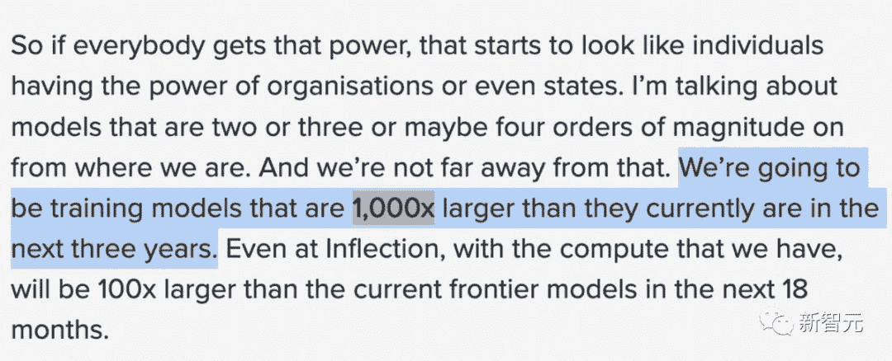
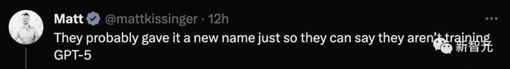
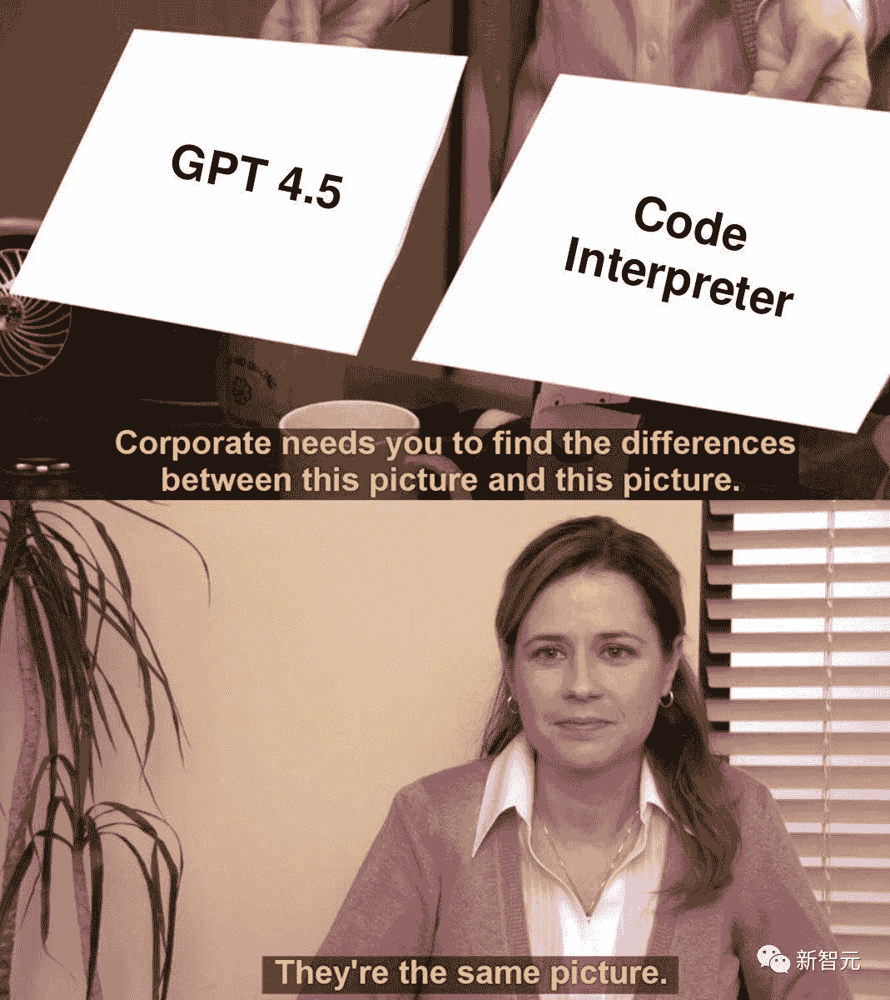
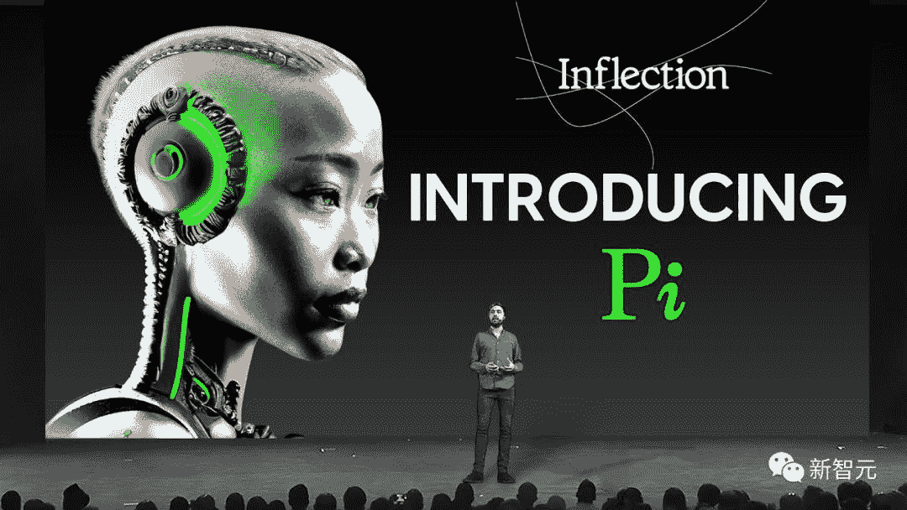
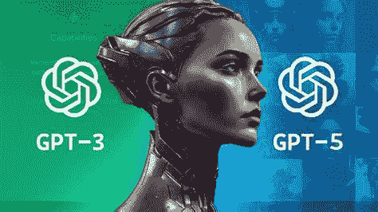
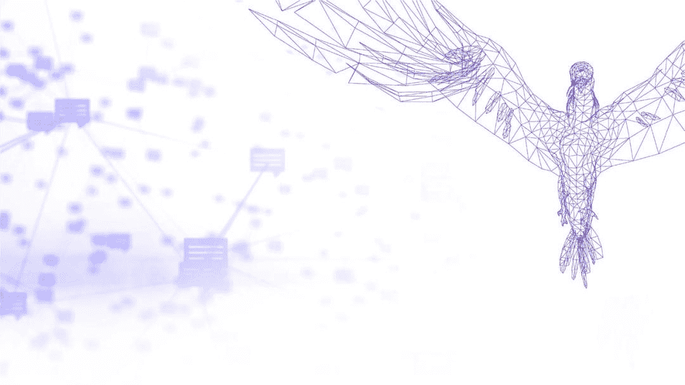
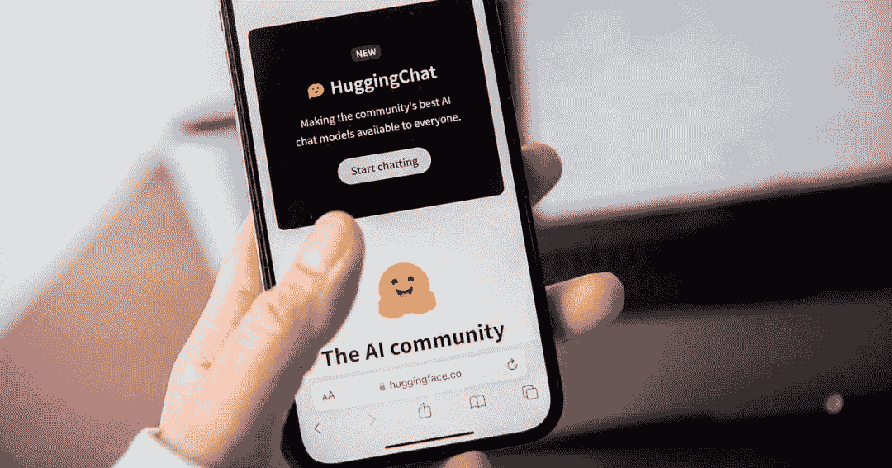
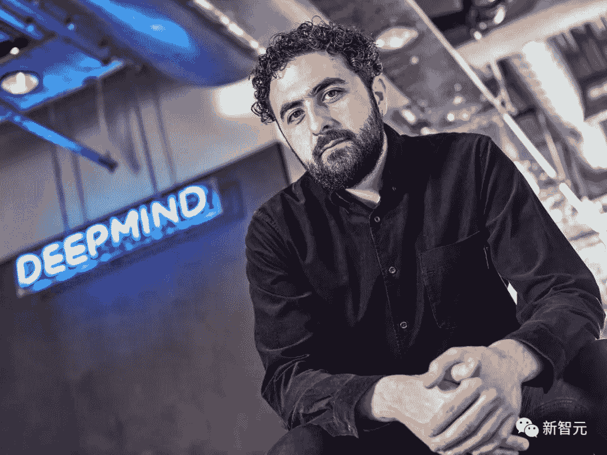
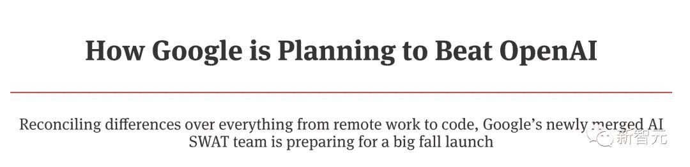

# 2023-09-03GPT-5正秘密训练，DeepMind联创爆料，这模型比GPT-4大100倍-36氪

> 来源：[https://xuqiwei1986.feishu.cn/docx/Xb9MdzR7ao73fBxMvwecdF0enhe](https://xuqiwei1986.feishu.cn/docx/Xb9MdzR7ao73fBxMvwecdF0enhe)

> 🔗 原文链接： https://36kr.com/p/2415735954694920

> ⏰ 剪存时间：2023-09-04 17:24:42 (UTC+8)

> ✂️ 本文档由 [飞书剪存 ](https://www.feishu.cn/hc/zh-CN/articles/606278856233?from=in_ccm_clip_doc)一键生成

**【新智元导读】 **GPT-5仍在秘密训练中！DeepMind联合创始人在近日采访中透露，未来3年，Inflection模型要比现在的GPT-4大1000倍。

近来，DeepMind联合创始人Mustafa Suleyman，现Inflection AI的CEO，在采访时投出了重磅炸弹：

> OpenAI正在秘密训练GPT-5。

我认为我们都直截了当地说会更好。这就是为什么我们披露了拥有的计算总量。

在未来18个月内，Inflection AI训练的模型比当前的前沿模型大100倍。未来3年内，Inflection的模型比现在大1000倍。

其实，Sam Altman此前曾否认训练GPT-5的这一说法。

对此，网友表示，OpenAI可能给它起了一个新名字，所以他们才说没有训练GPT-5。

这就像当时Code Interpreter推出一样，许多人感觉其能力早已不是GPT-4模型，而应该是GPT-4.5。

另外，采访中，Suleyman还爆出了很多自己在DeepMind和Inflection AI工作时的内部信息，包括了谷歌当时收购DeepMind和之后的抓马，某种程度上解释了为什么DeepMind相比于OpenAI「起了个大早，却赶了个晚集」。

他还认为，开源模型可能会增加AI带给人类的不稳定和危害。

而AI安全性最大的威胁来源并不是大语言模型，而是未来可能出现的自主智能体。

## **访谈全文**

当被问到未来AI是否有可能会成为一个有自主进化能力的智能体时，Suleyman认为：

在短期之内，不太可能出现这种智能体——能够自主运行，能够制定自己的目标，能够识别环境中的新信息、新的奖励信号，并学会用它作为自我监督，并且随着时间的推移更新自己权重的人工智能体。

但是这种自主进化能力的AI是所有人都不应该忽视的东西，因为如果某种AI技术真的展现出这种能力的，它可能会有非常大的潜在风险。

至少他知道的范围之内，Inflection AI和DeepMind都没有在往这个方向上走。

Inflection AI不是一家AGI公司，他们想做的事就是希望能够做出一个非常好用的个人助理。这个助理在能够充分访问用户个人信息的前提下，为用户提供高度定制化的AI服务。

## 模型训练军备竞赛会加剧AI的风险吗？

他的公司，Inflection AI正在建造世界上最大的超级计算机之一，并且他认为在接下来的18个月内，他们可能会进行一次比制造GPT-4的语言模型训练运行大10倍或100倍的训练运行。

当被问到，这种军备竞赛式的训练模型可能会增加AI的风险吗，他回答到：

100倍的训练仍然会产生一个聊天机器人，可以理解为一个更好的GPT-4，尽管这会成为一个更令人印象深刻的模型，但这并不危险——因为它缺乏自主性，不能改造物理世界等让模型自身变得危险的基本要素。

仅仅生产一个非常好的、更好的 GPT-4 还不算危险；为了让它变得危险，我们需要增加其他能力，比如前边提到的，让模型能够自我迭代，自我制定目标等等。

那大约是五年、十年、十五年、二十年之后的事了。

Suleyman认为，Sam Altman最近说过他们没有训练 GPT-5，可能没有说实话。（Come on. I don’t know. I think it’s better that we’re all just straight about it.）

他希望所有拥有大规模算力的公司都能尽可能的保持透明，这也是他们披露自己拥有的计算总量的原因。

他们正在训练比GPT-4更大的模型。目前，他们有6000台H100正在训练模型。

到12月，22,000个H100全面投入运营。从现在开始，每个月都会增加1000到2000台H100。

他认为谷歌DeepMind也应该做同样的事情，应该披露Gemini接受了多少FLOPS训练。

## **AI训练成本将如何变化**

从算力成本的角度来看，未来AI训练的规模不可能达到训练某个模型需要100亿美元的成本，除非真的有人会花3年时间去训练一个模型，因为堆叠越多算力去训练一个越大的模型，需要的时间也会更长。

虽然花的成本越高，可能能带来更强的能力，但是这不是一个没有上限的数学问题，需要考虑很多实际情况的限制。

但是因为算力成本随着芯片算力的迭代在不断下降，所以未来可能会出现训练某个模型的成本相当于在2022年花费了100亿美元来训练。

但是因为芯片算力会以2-3倍的效率增长，所以到时候训练一个这样规模的成本会远远小于现在看起来的成本。

比如说，现在开源社区中的Llama2或者Falcon等模型，只有15亿参数或20亿参数，就获得了有1750亿参数的GPT-3的参数的能力。

## **开源的看法**

作为一直在闭源科技公司工作的Suleyman，对于开源模型的价值和可能的风险，有非常与众不同的观点。

首先，他认为，在未来5年这个时间维度之内，开源模型始终会落后最前沿的闭源模型3-5年的时间

而且，开源模型会增加AI带来的社会风险。

如果所有人都能无限制地访问最新的模型，将会出现一个现象——「力量的快速扩散」。

举个栗子，就像新媒体平台让每个人都可以作为一份完整的报纸发挥作用，拥有数百万粉丝，甚至能影响全世界。

对于最前沿模型的无限制访问将会扩大这种力量，因为在未来3年内，人类能够训练出比现有模型规模大上1000倍的模型。

即便是Inflection AI，也能在未来18个月内获得比现在最前沿的模型大100倍的计算能力。

而开源的大模型会将这种力量交到每个人的手中，相当于给了每个人一个潜在的大规模不稳定破坏性的工具。

而到时候，再想办法避免这些工具可能产生的破坏性后果，有人做了一个很巧妙的比喻——图试图通过用手接住雨水来让雨停下来。

他曾经向监管部门解释过，AI技术未来会降低很多潜在危险化合物或者武器的开发门槛。

AI能在实际制作这些东西时提供大量的帮助——比如告知在实验室中遇到技术挑战时从哪里获取工具等等。不过确实，从预训练中删除这些内容，对模型进行对齐等等办法，可以有效地降低这样的风险。

总之，对于用大模型能力来做坏事的人，需要尽量让他们在做这些事的时候变得困难。

但是如果尽可能的开源一切模型，未来面对能力越来越强的模型，将会把更多的类似风险暴露出来。

所以虽然开源模型对于很多人来说确实是一件好事，能够让所有人都获得模型并且进行各种各样的尝试，带来技术上的创新和改进，但是也一定要看到开源的风险，因为并不是每个人都是善意和友好的。

虽然我说这样的话可能会被很多人理解为我做的事和开源社区存在利益冲突，因此很多人可能会很生气，但是我还是要表达我的观点。

他还强调了，他不是为了攻击开源社区才说出这番言论的：

「虽然我说这样的话可能会被很多人理解为我做的事和开源社区存在利益冲突，因此很多人可能会很生气，但是我还是要表达我的观点，也希望获得人们的支持。」

## 在谷歌和DeepMind期间的抓马

在DeepMind度过的10年里，他花了大量时间试图将更多的外部监督融入到构建AI技术的过程中。

这是一个相当痛苦的过程。虽然他认为谷歌的出发点是好地，但它运作的方式仍然像传统的官僚机构一样。

当我们设立了谷歌的伦理委员会时，计划有九名独立成员，是对于开发敏感技术过程中进行外部监督的重要措施。

但因为任命了一个保守派人士，而她过去曾发表过一些有争议的言论，很多网友就在推特等场合抵制她，同时也抵制其他支持她的几个成员，要求他们退出委员会。

这是一场彻底的悲剧，非常令人沮丧。我们花了两年时间来建立这个委员会，这是朝着对我们正在开发的非常敏感的技术进行外部审查的第一步。

不幸的是，在一周内，九名成员中的三名辞职了，最终她也辞职了，然后我们失去了半数委员会成员。

然后公司转身说：「我们为什么要招人来限制自己？这纯粹是浪费时间。」

其实，当DeepMind被收购时，我们提出了收购的条件，即我们要有一个伦理和安全委员会。

我们计划在伦理和安全委员会之后，我们要将DeepMind打造成一个全球利益公司：一个所有利益相关者在做决策时都能发声的公司。

它是一个按担保有限责任公司设立的公司。然后，我们计划制定一个宪章，为AGI的开发制定相关的伦理安全的目标；这样使得我们可以将收入的大部分用于科学和社会使命。

这是一个非常有创意和实验性的结构。但是当Alphabet看到设立伦理委员会发生的事情时，他们变得胆怯了。他们说：「这完全疯了。你们的全球利益公司也会发生同样的事情。为什么要那样做？」

最终，我们将DeepMind合并进入到了谷歌，从某种程度上说，DeepMind从未独立过——现在当然也完全从属于谷歌。

## **谷歌下一代大模型Gemini**

The Information独家报道称，谷歌多模态人工智能模型Gemini即将面世，直接对标OpenAI的GPT-4。

其实，在今年谷歌I/O大会上，劈柴已经向大众宣布，谷歌正在研发下一代模型Gemini。

有传言说，该模型将至少有1万亿参数，训练将使用数以万计的谷歌TPU AI芯片。

与OpenAI类似，谷歌使用GPT-4的方法来构建模型，由多个具有特定能力的人工智能专家模型组成。

简言之，Gemini同样是一个混合专家模型（MoE）。

这也可能意味着，谷歌希望提供不同参数规模的Gemini，因为从成本效益上考虑是个不错的选择。

除了生成图像和文本外，Gemini接受过YouTube视频转录数据的训练，也可以生成简单的视频，类似于RunwayML Gen-2。

另外，比起Bard，Gemini在编码能力方面也得到了显著提升。

Gemini推出之后，谷歌也计划逐步将其整合到自家产品线中，包括升级Bard，谷歌办公全家桶、谷歌云等等。

其实，在Gemini之前，DeepMind还有一个代号为「Goodall」的模型，基于未宣布的模型Chipmunk打造，可与ChatGPT匹敌。

不过GPT-4诞生后，谷歌最后决放弃这一模型研发。

据称，至少有20多位高管参与了Gemini的研发，DeepMind的创始人Demis Hassabis领导，谷歌创始人Sergey Brin参与研发。

还有谷歌DeepMind组成的数百名员工，其中包括前谷歌大脑主管Jeff Dean等等。

Demis Hassabis在此前接受采访表示，Gemini将结合AlphaGo类型系统的一些优势和大型模型惊人的语言能力。

可以看到，谷歌已经在全力备战，就等着Gemini开启逆袭之路。

参考资料：

https://80000hours.org/podcast/episodes/mustafa-suleyman-getting-washington-and-silicon-valley-to-tame-ai/

https://twitter.com/AISafetyMemes/status/1697960264740606331 本文来自🛰️👸号 “新智元”（ID:AI_era） ，作者：润 桃子，36氪经授权发布。