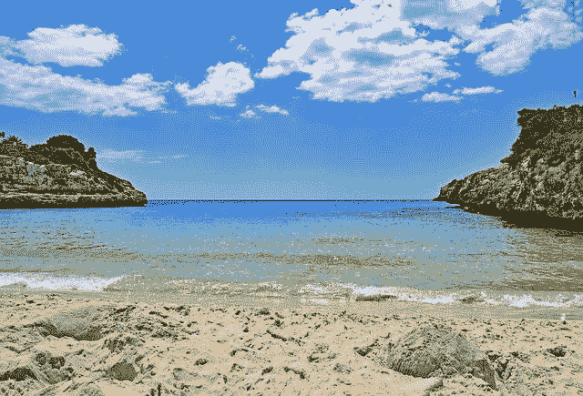
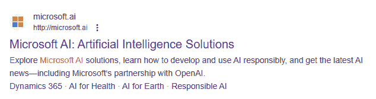
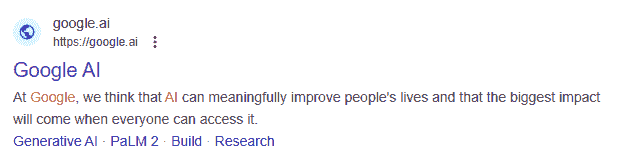

# 2023-09-02由于全球 AI 热潮，加勒比海小岛安圭拉“.ai”域名变数字金矿 - IT之家

> 来源：[https://xuqiwei1986.feishu.cn/docx/RpnsdutE7o5IKQxXHw7cwAntnXg](https://xuqiwei1986.feishu.cn/docx/RpnsdutE7o5IKQxXHw7cwAntnXg)

> 🔗 原文链接： h[ttps://www.ithom](https://www.ithome.com/0/716/434.htm)e.com/0/716/434.htm

> ⏰ 剪存时间：2023-09-04 11:19:12 (UTC+8)

> ✂️ 本文档由 [飞书剪存 ](https://www.feishu.cn/hc/zh-CN/articles/606278856233?from=in_ccm_clip_doc)一键生成

[IT之家 ](https://www.ithome.com/)9 月 2 日消息，安圭拉（Anguilla）原本是加勒比海上的一个小岛，属于英国领土，自 20 世纪 90 年代以来一直拥有“.ai”的顶级域名（国家和地区类）。

图源 Pixabay

当然，受限于领土面积和知名度，它过往较容易**在数百个国家和地区类顶级域**名中被忽视， 而现在事情似乎有些不一样 。

据彭博社周四报道，安圭拉预计凭借其“.ai”域名可获得高达 3000 万美元（ IT之家备注：当前约 2.18 亿元人民币 ）的收入。

**过去的一年里全球范围内掀起 AI 热潮，使安圭拉“.ai**”顶级域名对科技公司产生了极强的吸引力 。例如马斯克的“X”公司、谷歌、微软和 Meta 等行业巨头，就拥有诸如 X.ai 、 google.ai 、 microsoft.ai 等在内的网址，并可将用户引导至其 AI 服务的网页。

报道称，安圭拉“.ai”域名一直由 Vinc**e Cate 作为管理员运营，他表示， 以**这两个字母结尾的网站注册总数在过去一年中实际上翻了一番，达到 287432 个 。Cate 估计，安圭拉 2023 年的域名注册费将高达 3000 万美元。

“ **自 11 月 30 日（ChatGPT 公开发布**日期）以来，这里的情况开始变得大不相同 ”，Vince Cate 如是说。

**相关阅读：**

《 马斯克宣布人工智能公司 xAI 正式成立，旨在“了解宇宙的真实本质” 》

《 [OpenAI 起诉“ open.ai ”域名所有](https://www.ithome.com/0/710/995.htm)者商标侵权，网站名为“Open AI” 》

广告声明：文内含有的对外跳转链接（包括不限于超链接、二维码、口令等形式），用于传递更多信息，节省甄选时间，结果仅供参考，IT之家所有文章均包含本声明。