# 2023-09-01入局星球3个月复盘，副业收入4000元，你上你也行！

> 来源：[https://xuqiwei1986.feishu.cn/docx/PB28dTU4QoWvmsx94ylcZWxLnFW](https://xuqiwei1986.feishu.cn/docx/PB28dTU4QoWvmsx94ylcZWxLnFW)

> 🔗 原文链接： h[ttps://articles.zs](https://articles.zsxq.com/id_5wo7kwok37t1.html)xq.com/id_5wo7kw...

>

大家好，我是小宁，星球编号28496，正在冲击AI之心。主业从事的是建筑行业，职业是造价工程师，在干好本职工作的前提下，投入所有业余时间去学习 AI，现在正细耕绘画领域，努力产出不错的成果。

进入星球是机缘巧合下读了阿虚同学的文章，又和其他星球对比了下车票钱，果断入坑。不知不觉间已经近3个月了，期间有对AI技术的痴迷，有对小项目的坚持，有对看到收益的兴奋，还有对有的项目一直没有成果的焦虑。（前几天因为焦虑向洋哥提问被批缺乏耐心，心里释然了，我有主业，副业还怕什么折腾）有时候，慢就是快，在这里也做一个复盘，沉淀一些经验和思考。

数据方面：百度问一问300+；百度知道100+；百家号100+；Mj绘画📕、视频号粉丝分别是200+、300+，收益0；👸号流量主3000+；还有一些乱七八糟的小项目，收益累计近4000

下面我会从百度系列、绘画方面简单的说一遍，重点分享一下👸号流量主的教程与迭代思考（教程很干，建议先点赞收藏，不然有可能刷着刷着就找不到了）。

## **一、百度系列**

说实话，一开始我就把AI当做赚钱的工具，初识GPT就被它能回答问题、进行写作、编程代码震撼到了，感觉要变天了，自媒体赚钱的方式势必会有一个新的变化及方式。

### 1、百度问一问

初[入星球，我按照助理指引把新人必看栏目认真的看了一](https://shimo.im/docs/8Nk6MGa0JeIBNGqL/read)遍（建议每个新人小白都认认真真的看几遍），我一下子就被阿国老师分享的百度问一问（ https://shimo.im/docs/8Nk6MGa0JeIBNGqL/read ）收入惊艳到了，没想到百度用了这么多年，竟然有个问一问，入住后回答问题显示已解决就能有收益。现在有了AI助力，可操作性很高。

期间我大部分用的是NewBing来回答问题，过了一段时间，正好赶上旺季（高考期间6月~7月），每天的问题都多的回答不完，因为这个，兴奋的都改掉了我晚起床的小毛病。

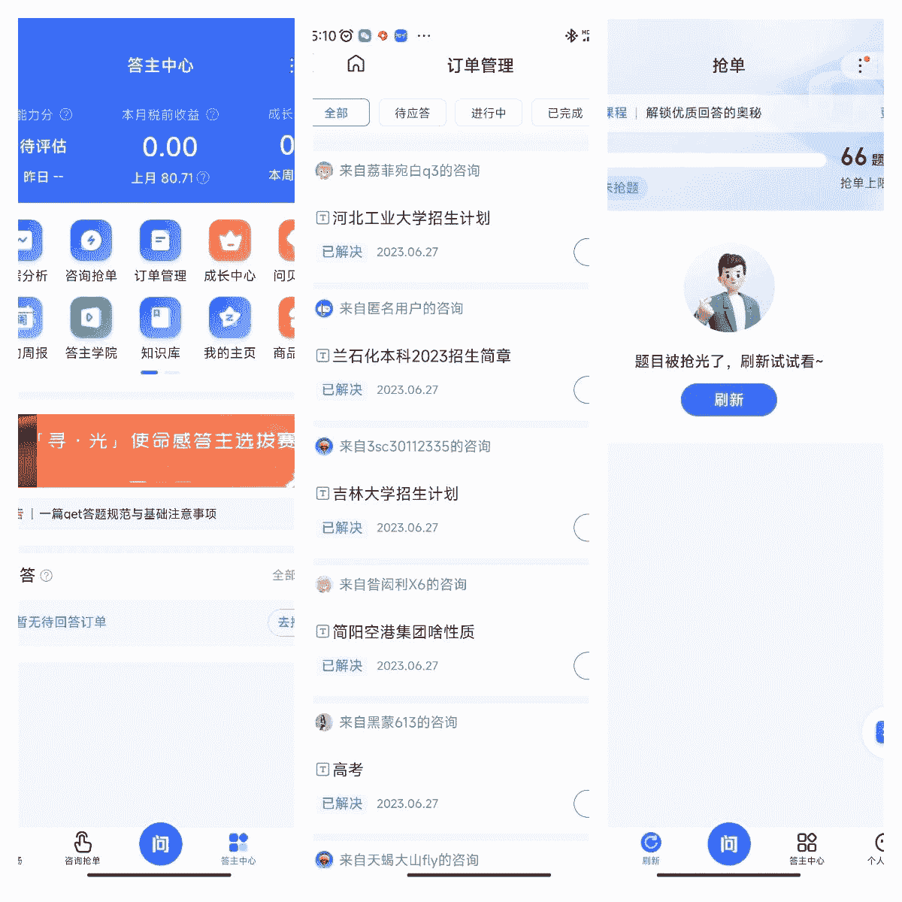

就在今年，诞生了许多AI志愿填报助手，李雪峰也火的一塌糊涂，而他们才是高考市场的头部玩家。

但是现在不建议小伙伴玩问一问了，一是现在问题很稀少，也很难抢到，二是中间也有许多坑和套路。

明年的旺季，有兴趣的我们再一起战斗。

### 2、百度知道

百度知道，应该很少有人玩，因为蚊子肉太小了，关注度自然低。我当时的心态就是练习用AI辅助回答问题，重新拾起来多年不打开的百度知道，在手机APP端无意间看到，回答问题可以瓜分现金，每天瓜分2200元，回答问题系统显示优质回答，就能一起瓜分这个奖金池。

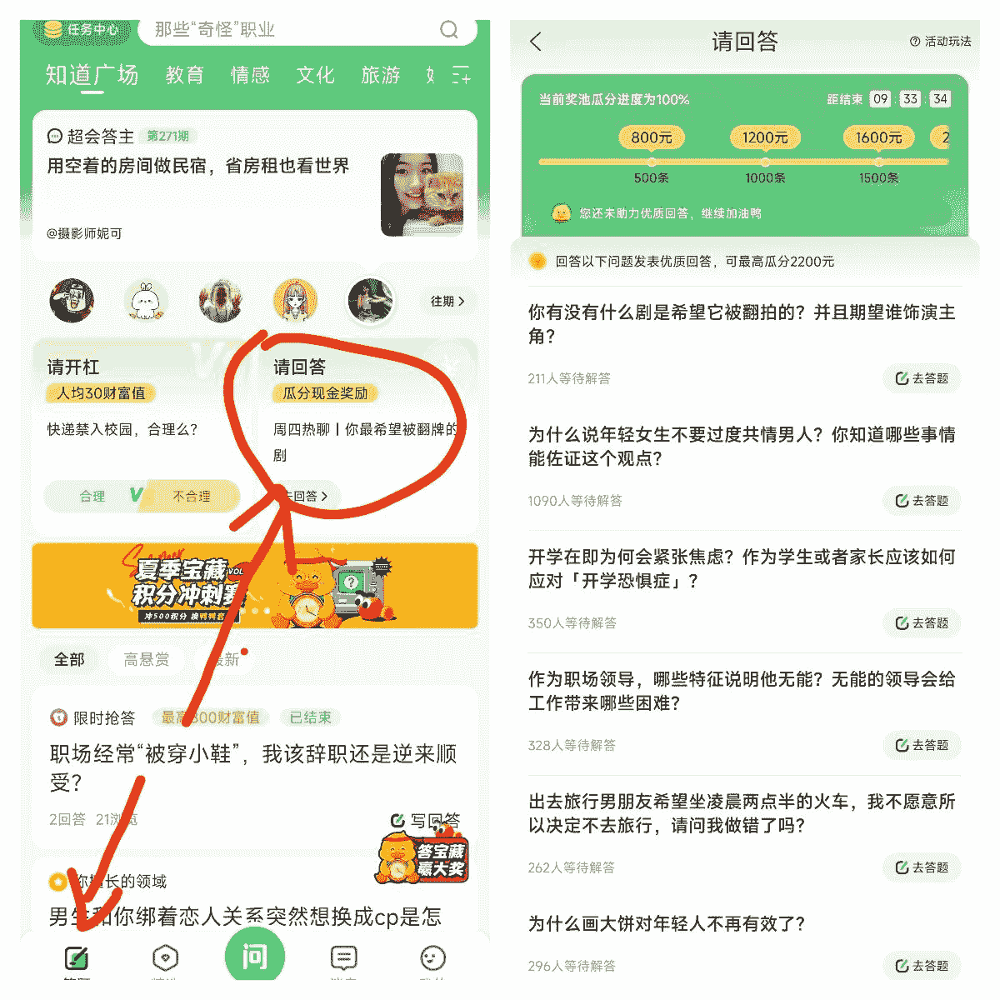

据我观察，玩的溜的玩家一定是在用矩阵回答问题，还上了一些黑科技，这样每天收益能有几十或者上百。

你看，咱们用AI练习回答问题的同时，还能有收益，真是一大兴事！

### 3、百家号

对AI写作感兴趣，也是百家号给了我动力。因为开始一直用NewBing，有感而发就发了一篇百家号动态，结果过了几天爆了，阅读量10万+

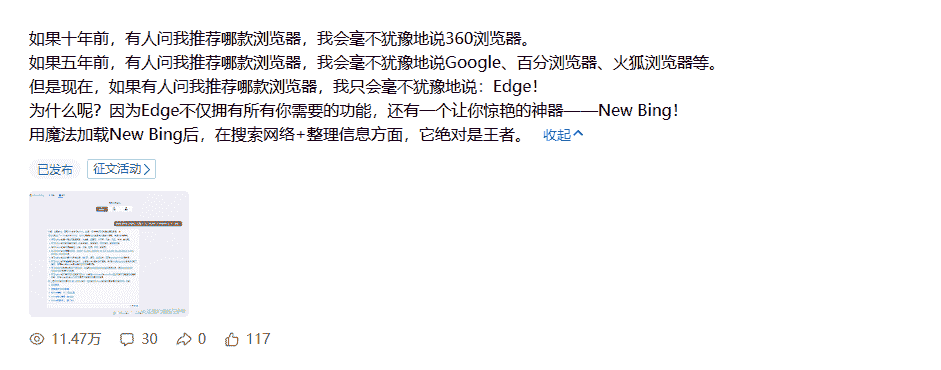

不过讽刺的是，后面好像是被施了咒语一样，再也没有出过爆文，截止到现在总收益是这些

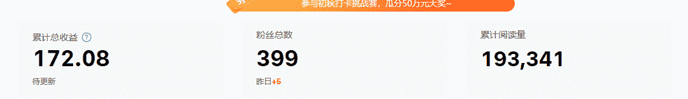

百家号方面这里不再赘述，皮特老师与小林老师，他们的文章都值得我们反复学习。

## 二、Mj绘画

对绘画感兴趣，源于有次看到儿子的一本山海经故事书，里面的怪物插画很简单很粗糙，当时就突发奇想，不是有Midjourney嘛，如果用它把山海经里的怪物都画出来，一定是件很有意思的事情。

上手之后才发现，太难了，一点思路都没有，Mj根本理解不了如此博大精深的中文，还有当时根本不会提示词。后来看到了壁纸号，思考了一下，从中国古诗词作为切入点，先画它100首。刚开始两眼一抹黑的扎进去，数据很差，后来提问了驴哥（见下面截图），我觉得直到现在，驴哥的回答还是可以不断的品味与实践。

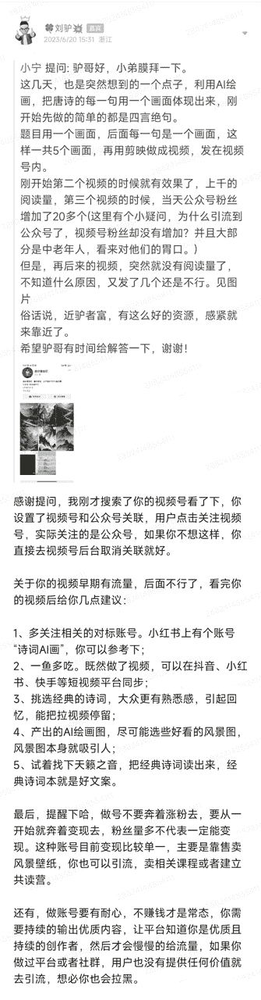

截止到现在，已经更新了21篇古诗词绘画，数据不是很好，没有跑通0~1（平时不下精力，这你怪谁）。这次也报名了绘画航海方向，需要沉下心来慢慢耕耘，等坚持更新到100篇的时候，一定再复盘一下。

## 三、👸号流量主

### 前言

精华帖，中标帖真是星球的宝贵财富，我也是看到闲富大哥发的一篇流量主中标帖，才拾起了之前的👸号。

并且出了一些成果。

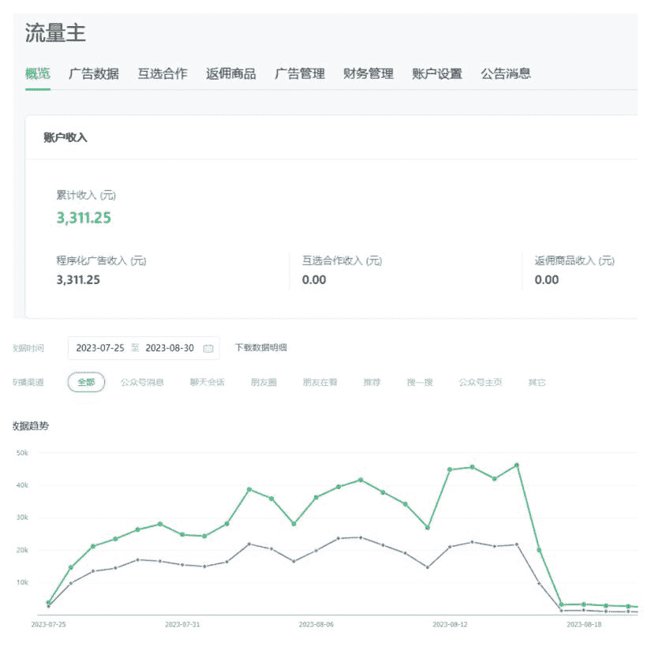

但是除此之外，有关流量主的贴子详细教程还是不多，有可能大佬们都在低调赚钱，有可能大家都在实践的路上。

鉴于此，我在闲富大哥的贴子基础上优化迭代了一个保姆级的教程，老奶奶也能看懂的那种。

PS：教程的方向是AI美女图片+情感文，其他类似方向都可以参考。

### 一）注册👸号，开通流量主

（已经有了👸号，并且开通了流量主，直接跳过这一步，看第二步）

建议至少准备2个号，可以是一个大号，一个小号，作用后面会说。

#### 1、注册👸号

[h](https://kf.qq.com/faq/120911VrYVrA151009eIrYvy.html)ttps://kf.qq.com/faq/120911VrYVrA151009eIrYvy.html

点击上面的链接，跟着官方教程走，注册一个个人性质的👸号，名字和简介要看你的垂直方向，最直接的办法就是参考优秀的同行。我这里主打美女图片，例如可以是：唯美文案馆/未来爱情记/爱屋及屋

#### 2、开通流量主

开通流量主需要500个粉丝，可以发文章，慢慢增粉，或者🛰️问一问引流增粉。

想要最快的办法，可以去淘宝搜索 🛰️👸号流量主，直接刷够500粉丝开通，费用几十块钱。

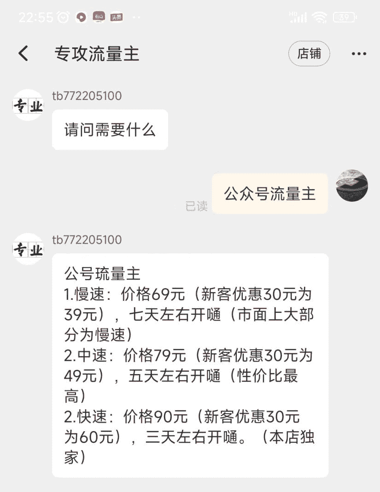

选择第1个就可以了，说是7天，一般3天之内就能刷够了（不过这些都是死粉，只是每个IP地址不一样罢了）。

广告管理下面的所有的栏目都点击开通，这样我们之后每次发文章，只要有阅读量就会有收益了。

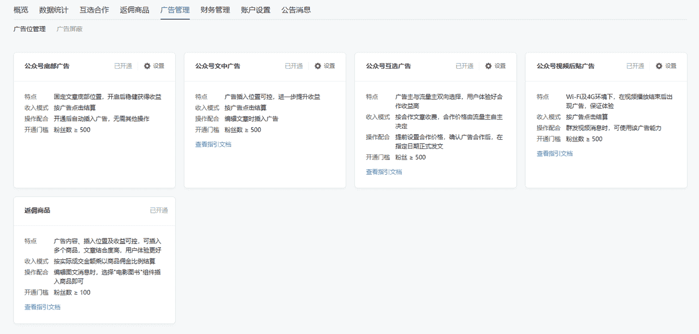

这里，有的小伙伴会有一个误区，以为🛰️👸号流量主的收益完全取决于读者点击广告的次数，但实际上这是一个误解。🛰️👸号流量主的收益主要来源于两部分：广告曝光和广告点击。

广告曝光：只要你的👸号文章被打开，广告就会被展示出来，这就产生了广告曝光。即使读者没有点击广告，你也会因为广告的曝光而获得收益。广告点击：当然，如果读者点击了广告，你会获得更多的收益。这是因为点击表示读者对广告有一定的兴趣，广告主愿意为此付出更多。

此外，还有与点赞量与再看量等的互动有关系，其实大头就是阅读量，阅读量越高，收益越高。

### 二）AI美女图片

图文配图，有条件的可以用Mj或者SD软件出图，优点是出图稳定，图片风格一致。缺点是速度慢，需要不断地调试，花费很大的精力。

有个简单粗暴的方法就是去网站中扒图，具体方法见下面。

#### 1、推荐网站

无界AI https://www.wujieai.com/ Draft https://draft.art/home

首先，我们找到一张质量较好的美女图片，然后前往该照片的作者主页。通常情况下，作者空间内会有许多类似的图片。

我一般的方法是从排行榜进入作者主页，去下载图片。

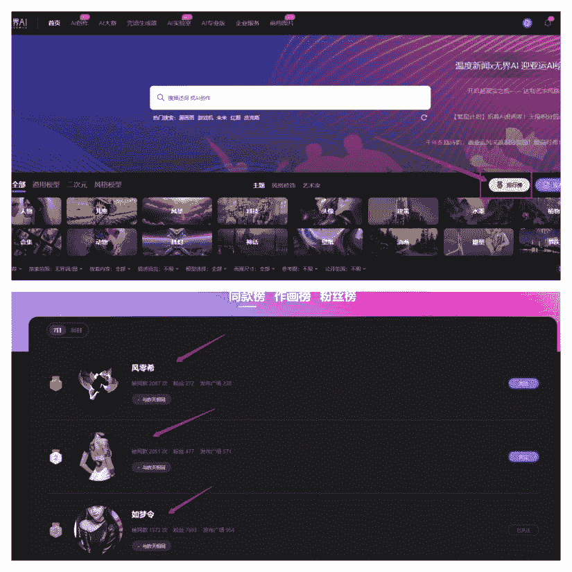

#### 2、如何下载图片

我们以无界AI为例，打开网页（这里推荐用google/Eage浏览器），选择其中的一个图片，点击进去。

①按一下F12键，点一下左上角的那个小箭头。

②然后再点击网页上的图片，这个时候，下方就会定位出来这个图片的网址；

③点击这个网址，就会出来放大的图片，鼠标右键保存即可。

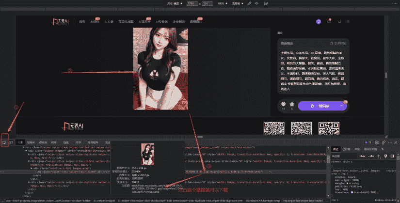

还是看不懂的可以看这个： 别说你不知道？怎么在网页扒图！

### 三）给图片配文案

#### 1、文案主题

可以写一篇关于AI美女的情感文，把图片插入其中，

也可以写一篇关于AI美女的日常生活故事，把图片插入其中，

甚至直接写赞美美女的句子，简单粗暴，

发文时间长了，你也可以发挥自己的想像类似的情感文案。

#### 2、提示词

分享两个我经常用的提示词，大家可以参考。

1.作为一位才华横溢的创意作家，我希望您能以独特的笔触，为我编织一段充满奇幻与情感的故事，描绘AI生成的美女与人类之间的情感互动。故事中，主人公的名字应当饱含诗意，寄托古典情怀，与中国人的审美观相契合。

2.你写的这个故事标题要极具有吸引力，能让读者看到标题就忍不住点开文章阅读。

3.你写的这篇故事字数要1000字左右，请严格执行这个要求。

4.我要在文章中插入四张美女图片，请在指定位置帮我标注好插入位置。

5.请您以模仿张爱玲的独特写作风格为基础，充分发挥创意，创作出一个充满情感共鸣、引人入胜的情感故事，其中可以涉及美女与人类之间的友谊、爱情或其他情感关系，以展现AI生成的美女与人类之间微妙而深刻的交织情感。

6.敬请为这个故事赋予绚丽的色彩，让读者在阅读的过程中沉浸其中，感受到故事情节中的情感波动。请确保故事情节充满想象力，描绘美女的特点与魅力，同时展现她与人类之间情感的发展与变化。

7.请在文章的最后加一个钩子吸引读者转发点赞。

8.期待您独特的创作，让这个关于AI生成的美女的感情故事成为人们心中珍贵的一笔。

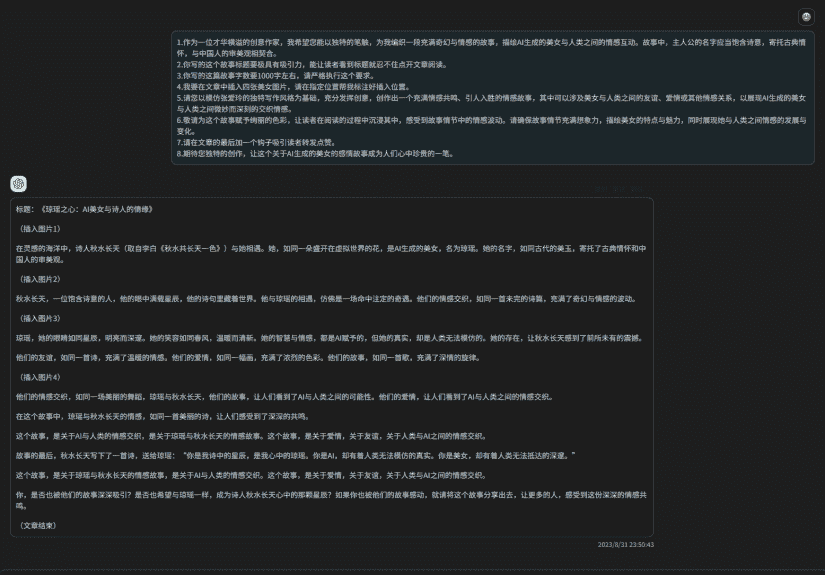

你现在是一名写作专家，请生成一个关于AI生成美女的日常生活（符合中国人的生活习惯）的文案，字数控制在1000字左右，并用第三人称描述。文案需要包含以下要素：

1.主人公必须是有诗意和古典韵味的中文名字（参考中国古诗词和古典名著）

2. 你写的这个文案标题要极具有吸引力，能让读者看到标题就忍不住点开文章阅读。

3.描述美女的外貌特征和魅力，使读者产生对她的喜爱和赞美。

4.. 描述美女在科技发达的未来生活中的日常工作和生活情节，以及她与周围人的互动和情感体验。

5.. 为美女设定一个职业（自由选择）和工作城市（中国任何一二三线城市），并描述她在工作中的表现和成就。

请注意：

1.请模仿魏小河独特写作风格为基础，充分发挥创意，创作出一个充满情感共鸣、引人入胜的文案。

2.生成的文案需要具备情节连贯、生动有趣和富有创意的特点，同时符合中国人的生活习惯和科幻感。请尽量保持结果的稳定性，并尽可能使其适用于更多的场合和人群。

3..请在文章的最后加一个钩子吸引读者转发点赞。

4. 我要在文案中插入4张美女图片，请帮我标注好插入的位置。

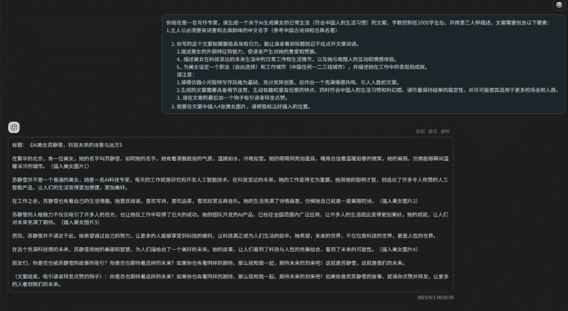

#### 3、工具

想调整提示词或者写别的垂直方向，可以打磨一下自己的提示词。

首先推荐台风老师的指令生成器 https://ai.gptprompts.com.cn/zh

然后用打分指令优化一下提示词，后续使用中不断调整和迭代。

对话模型可以选择 [ZelinAI ](https://www.zelinai.com/)， [Claude2 ](https://claude.ai/chat/)，NewBing，有条件的可以使用4.0

没有条件或者4.0价格太昂贵的，推荐的替代方案是用镜像网站

这里推荐2个性价比超高的4.0镜像网站：

http://jiaoge.zhtec.xyz/ （小海Chat，按次收费）

https://chat.purrlab.net/ （CatGPT猫，按月收费）

### 四）注意事项及技巧（重点）

#### 1、发文注意事项

文章可以标注原创，每天发文3～4篇，文中广告可以勾选智能插入，发文篇数多了，建几个专辑。

现在做美女图文的太多了，很卷，要想办法走差异化竞争，例如：

①我分享的提示词模仿风格是张爱玲，你可以换成其他情感写作专家，甚至让它模仿鲁迅的写作风格试试。

以下是10位中国非常出名的情感文写作专家及其核心写作特点：

1魏小河：作品多关注现实生活中的人和事，以细腻的笔触和真实的情感打动人心。其代表作《我们仨》以独特的视角讲述了三个女孩的成长故事，受到广泛关注。

2刘墉：以清新、自然的文风著称，擅长从生活琐事中挖掘深层情感。他的作品《爱情故事》等畅销书籍，深受读者喜爱。

3蔡康永：以睿智、犀利的文字剖析情感问题，作品多涉及人际关系、自我成长等方面。其代表作《单身公主日记》等畅销书籍，深受年轻读者喜爱。

4毕淑敏：以细腻、温暖的文字治愈人心，作品多关注人际关系、家庭、情感等方面。她的作品《幸福的婚姻》等畅销书籍，对于读者在情感方面的启示和思考具有重要意义。

5张小娴：以清新、优美的文风触动人心，作品多涉及爱情、婚姻等方面。她的作品《红颜露水》等畅销书籍，对于读者在情感方面的启示和思考具有积极作用。

6安妮宝贝：以独特、敏感的文字描绘现代人的情感世界，作品多关注自我成长、人际关系等方面。她的作品《七月与安生》等畅销书籍，深受年轻读者喜爱。

7龙应台：以深刻、犀利的文字剖析社会现实和人性，作品多涉及家庭、情感等方面。她的作品《目送》等畅销书籍，不仅具有文学价值，也有启示和思考的意义。

8柴静：以客观、深入的报道和思考剖析社会问题和人性，作品多涉及家庭、情感等方面。她的作品《看见》等畅销书籍，不仅具有新闻价值，也有文学和情感的共鸣。

9张德芬：以灵性、治愈的文字触动人心，作品多关注心灵成长、情感健康等方面。她的作品《遇见未知的自己》等畅销书籍，对于读者在心灵层面的启示和思考具有重要意义。

10三毛：以清新、自由的文风描绘生活和情感世界，作品多涉及旅行、文化交流等方面。她的作品《撒哈拉的故事》等畅销书籍，具有很高的文学价值和情感共鸣。

②不一定写AI美女情感文，你也可以写现实情感文，可以从热点、家庭伦理、婆媳矛盾、夫妻关系作为切入点。

③想要每天GPT生成的故事不一样，可以点击重新生成，或者让它续写故事，组成一个长篇故事小说。

④我每一篇文章中是插入四张图片，你也可以插入八张甚至更多图片，这样读者留存率会大一些。另外图片不一定用现代美女，可以是古装、二次元、甚至是赛博机车美女图。

⑤暂时就想到这些，有什么好的点子你也可以分享出来哦。

#### 2、争取进流量池

也是看了一来老师的文章，才知道有流量池这个概念，主要涉及到🛰️👸号的用户、阅读、点击和互动等数据。

简单来说，流量池是指👸号拥有并可以触达的潜在用户群体和他们产生的活跃度。进入了流量池，你的文章会被推荐到用户的再看或者热点页面。

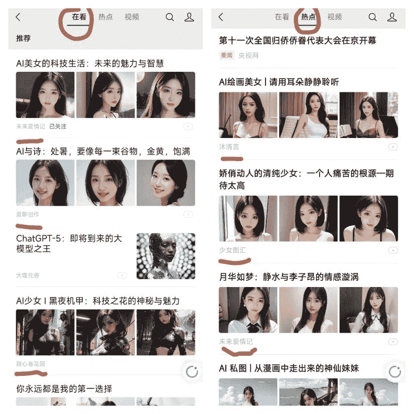

一般情况下，老号容易进流量池，前期流量低一点不怕，坚持发文，后期流量肯定会上去的。

前面说的至少准备2号，可以用两个号互相点赞在看转发，我注册的新号，坚持发文，最近几天也进入了流量池。

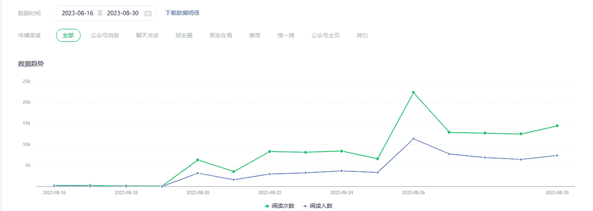

#### 3、保持一个好的心态

万事俱备只欠东风，教程有了，就差手了。

流量池进出的时间，这个没有任何人能说的准，进入了流量池，也别飘继续保持，出了流量池，也别悲观，说明文章需要迭代。

总之，请保持一个好的心态。

## 四、结语

希望上面的复盘经验可以给球友们一些启示，在AI破局星球上，每个人都有自己的独特之处，每个人都有可能找到属于自己的一片天地。只要你愿意投入时间和精力，只要你持之以恒，只要你敢于尝试和创新，你也可以像我一样，在副业上取得成果。

最后，衷心希望破局会越来越好，越来越壮大！