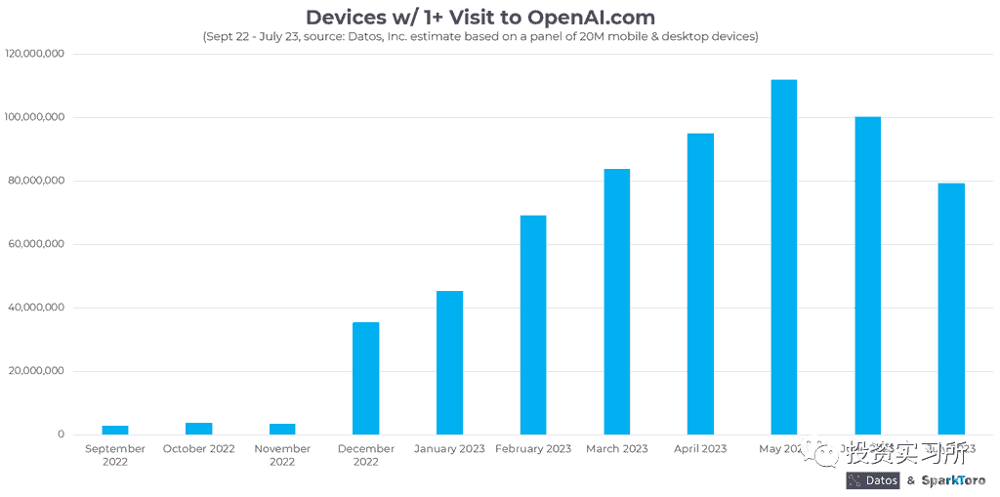
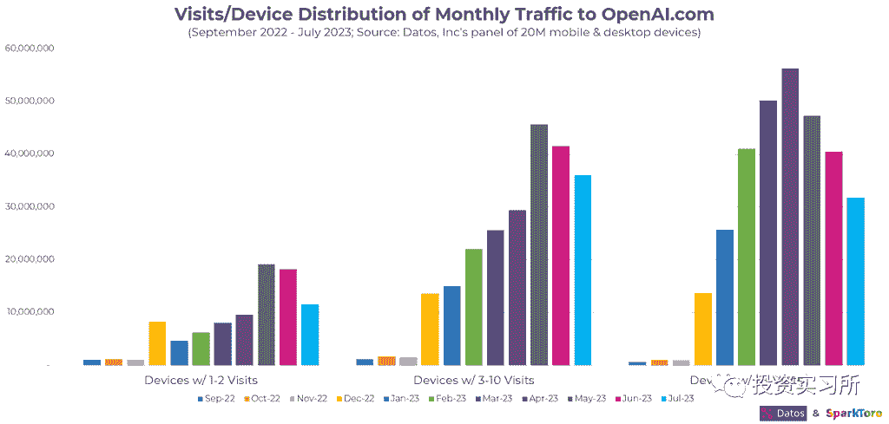
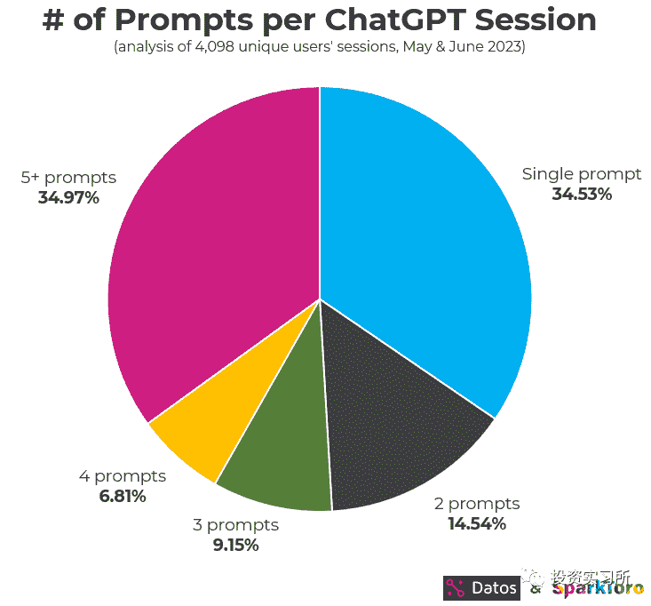
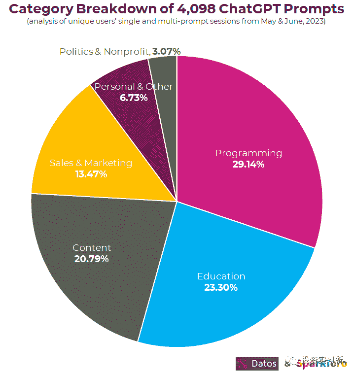
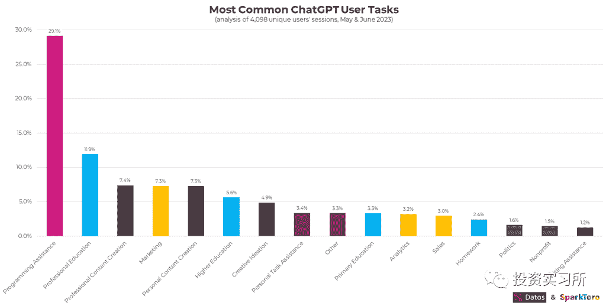
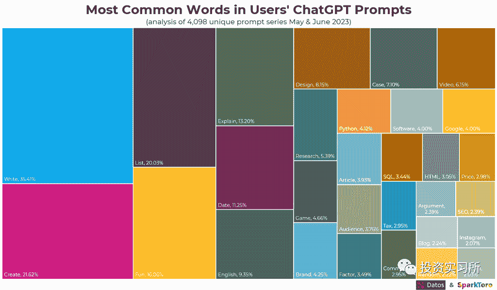

# 2023-09-01ChatGPT 的前 4 个应用场景

> 来源：[https://xuqiwei1986.feishu.cn/docx/MB7KdeNujoNv1LxZxjnc9bpGnlc](https://xuqiwei1986.feishu.cn/docx/MB7KdeNujoNv1LxZxjnc9bpGnlc)

> 🔗 原文链接： h[ttps://mp.weixin.q](https://mp.weixin.qq.com/s/aSCvwjqXFQt_IX0iepw12w)q.com/s/aSCvwjqX...

>

原创 StartupBoy 投资实习所 2023-09-01 12:35 发表于 北京

**通过 C 端与 B 端的共同**[**发力， OpenAI 已**](http://mp.weixin.qq.com/s?__biz=MzIyMDA3MjMwNw==&mid=2455851921&idx=1&sn=4b4a975a00716705915110570ef5b095&chksm=8044638db733ea9b8cbb84205a9a6a286fde802fe91a8442a54377cfcfcc4303a3cff74f2478&scene=21#wechat_redirect)经接近突破 10 亿美金的 ARR ，比去年增长了 37 倍，并且这两天还推出了 ChatGPT 的企业版，估计会加速整个商业化的进程。

虽然**市场对 AI 的应用还在**不断增长，不过各种数据也显示，5 月份后，直接访问 OpenAI 网站的流量一直在下降，Similarweb 的流量统计截至 7 月份下降了 21%。而 Datos 最新的一个统计显示 下降幅度达到了 29% ，不过要说明的是这里只是统计了 openai.com 网站的流量，那些通过 API 的第三方和移动端数据没有做统计。

对此有多种解释， **一种**是专业和常规使用的用户没有怎么变并且还在增长，但是那些只是单纯体验一下没有特别需求的用户在下降；另一个解释则是之前大量用户来自学校的教育领域，这段时间正是学校的放假期间，因而出现了大幅度下降。

不过通过更为细致的研究，特别是针对来自每个设备的访问次数的统计，基本上排除了第一种假设，如下图所示，无论是偶尔使用的用户还是经常使用的用户，都在下降：

对于第二个假设，Datos 通过对 7000 多个真实 ChatGPT 用户做了一个更加细致的数据统计，筛掉一些不靠谱的用户后得到了 4098 个最真实的用户数据，下图是使用 prompt 量的一个统计数据，使用 5 个或者以上或者仅使用 1 个 prompt 的占据了快 70%。

如果再细分的看这些用户都拿 ChatGPT 做啥，可以看到最大的几个应用场景：

+   排在第一位的是编程，占了快 30%；

+   其次是教育，占了 23.3%

+   第三位则是内容相关，占了快 21%

+   第四位是销售与市场，占据 13.47%

需要注意的是，这里的教育既包括了中小学里的教育，也包含了个人兴趣的知识学习和以工作为目的的专业知识学习。

内容和下面的营销与销售也有重叠的地方，如果把这块做更加**的细分，那么大概排名是下面的一个情**况， 编程仍然是第一，其次是专业教育、专业的内容创作、市场营销以及个人内容创作。

由于与学校教育相关的应用场景只占到了不到 10%，因此因为学校放假而导致 ChatGPT 访问下降 29%似乎也说不通。下面是用户使用 ChatGPT 的一些关键词排名， 前三位分别是 Write、Create 和 List ，从这也能看到为何有那么多的 AI 插件类产品都在针对写作相关的应用场景。

其它一些场景比例虽然看起来比较低，但是以 ChatGPT 目前的月活量， 任何一个小比例的应用场景也有大量的用户需求 ，比方说 SEO 这个关键词的比例虽然只有 2.39%，如果以几个月前公布的 ChatGPT 的 1 亿 MAU 来算，那一个月也有 200 多万的 MAU，仍然是一个不小的事情。

尽管移动端以及第三方的 API 可能都会对整体 ChatGPT 网站的流量有不少分流，不过 29%这么大的降幅似乎也不能用它们来解释。我理解整体肯定有一定幅度的下降，但其它因素也分流了部分流量。

不过这个报告展示的前几个应用场景，我们确实能感受得非常明显，编程就不说了；在教育这块，OpenAI 或许也感受到了巨大的需求，今天正式发布了一个针对教育领域的 ChatGPT 使用指南 （Teaching with AI） 。

在这个指南里，包括了建议的 propmts 提示词、ChatGPT 工作原理和局限性的解释、AI 检测和偏见。

在老师如何使用 ChatGPT 这块，OpenAI 给出了几个场景：角色扮演具有挑战性的对话、从课程材料来做测验、测试和教案、减少非英语学生的学习摩擦、以及如何教学生具有批判性思维。并且还提供了一些入门的提示词 （prompt） 案例。

另外，OpenAI 之前投资的 AI 学习英语的Speak，刚刚宣布完成了 1600万美金的 B2 轮融资，使其总融资额达到了6300 万美金。由天使投资人 Lachy [Groom 领投，Dropbox 的联合创始](http://mp.weixin.qq.com/s?__biz=MzIyMDA3MjMwNw==&mid=2455850319&idx=1&sn=0b7128ae2aaff30e85475007b21113cc&chksm=80447d53b733f44561badf2b689a0002467d5de45f1b6da14d6b247ca3283ca339b6d12bf156&scene=21#wechat_redirect)人 Drew Houston 和 Arash Ferdowsi等跟投。Speak 想打造一个 AI 版的 Duolingo，具体详情可以查看我之前的介绍《 OpenAI 和 Funders Fund一起投了一个 AI 版 Duolingo 》。

**·END·**

Memo: Signal, not noise!

扫码或点击「阅读原文」继续阅读更多内容

OpenAI ARR 突破 10 亿美金，又一个 14 亿美金 AI 独角兽

当下 AI 的 4 波浪潮，与 AI 时代的一种新型商业模式

AI 正在重塑法律行业