# 2023-08-29特斯拉1万个H100集群上线！超算Dojo7月已经开工，加速L4自动驾驶-今日头条

> 来源：[https://xuqiwei1986.feishu.cn/docx/NAdNdkuh2oANJsx1oSnc2O6Gn7d](https://xuqiwei1986.feishu.cn/docx/NAdNdkuh2oANJsx1oSnc2O6Gn7d)

> 🔗 原文链接： h[ttps://www.toutiao](https://www.toutiao.com/article/7272628151946052135/?log_from=5f07483ed172_1693375241710).com/article/727...

>

# 特斯拉1万个H100集群上线！超算Dojo7月已经开工，加速L4自动驾驶

2023-08-29 14:33 · 新智元

编辑：润

# 【新智元导读】特斯拉10000块H100 GPU集群上线，加速FSD V12落地。拥有自家超算的和H100集群的特斯拉，正式入局算力军备竞赛！

根据特斯拉爆料人士Sawyer Merritt爆料，特斯拉将于美国时间本周一上线备受期待的，由1万片H100组成的超级计算机。

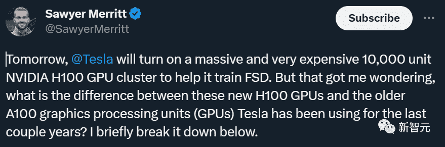

这个GPU集群将用来训练包括特斯拉FSD自动驾驶系统在内的各种AI应用。

这个GPU集群由一万个英伟达H100GPU组成，能提供340 FP64 PFLOPS的峰值算力，为AI提供39.58 INT8 ExaFLOPS的峰值算力。

这个算力峰值超过了之前全世界排名第四的超算Leonardo所能提供的算力。

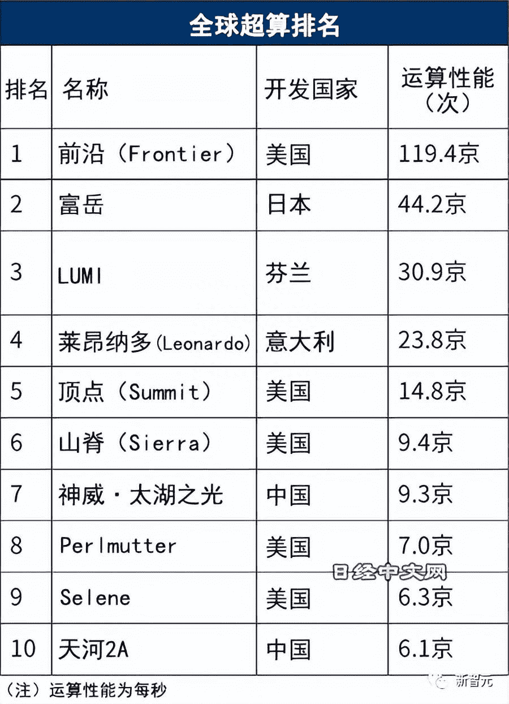

凭借这台超级计算机，特斯拉可以迅速训练并更新它的全自动驾驶（FSD）技术。

这个H100 集群不仅让特斯拉相比其他汽车制造商更具竞争力，而且将使特斯拉拥有夸张的算力储备。

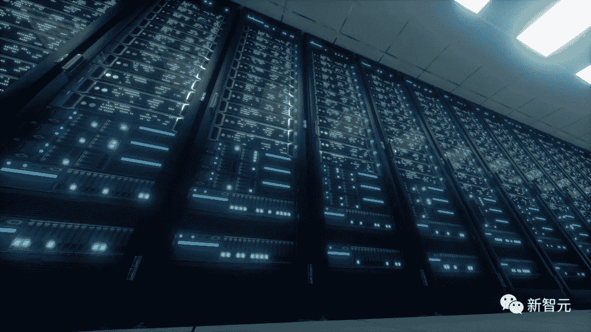

马老板上个月甚至发推称：「坦白说……如果英伟达能提供足够的GPU，我们可能就不需要 Dojo。」

**特斯拉的算力储备有什么用？**

而且对于特斯拉来说，这个H100集群不单代表了无与伦比的算力，还使得拥有海量数据的特斯拉能将这些数据变现的能力。

特斯拉工程技术总监Tim Zaman发推称，特斯拉上线的H100集群，将被用于训练视频数据。

特斯拉拥有的训练数据集可能是全世界最大的，热连接缓存（hot tier cache）大小超过了200PB，这比大语言模型的数据规模要高几个数量级！

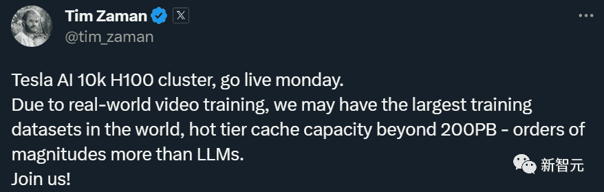

同时他还称，特斯拉是真正「物理上」拥有这些GPU集群和算力。很多其他的公司宣称自己「拥有」多大算力时，其实他们只是能「租到」这些算力。

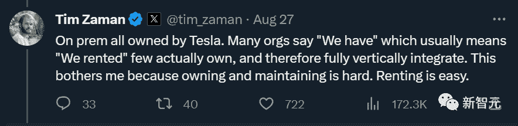

而对于目前的特斯拉来说，上线H100集群的意义就在于能够极大地加快最新版FSD V12的上线速度。

马斯克在两个月之前称，最新版的FSD V12版本更新将不再是「测试版」的自动驾驶技术，暗示了这次更新可能真的能带来完全体的自动驾驶技术。

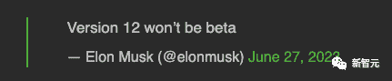

而就在前几天，马斯克自己开着特斯拉来了一场全网关注的FSD V12的演示直播。

直播中，新版的FSD V12展示出了「丝滑的自动驾驶性能」和出色的驾乘体验。

FSD V12背后的技术原理，就是将海量的优秀司机驾驶的实时视频，通过神经网络训练成一个全新的自动驾驶AI来驾驶汽车。

特斯拉上线这个H100集群后，将会大大加快FSD V12的训练速度，这也被上文中特斯拉工程总监的帖子所证实。

马斯克在推特上称，V12可能将在不到半年的时间内更新上线！

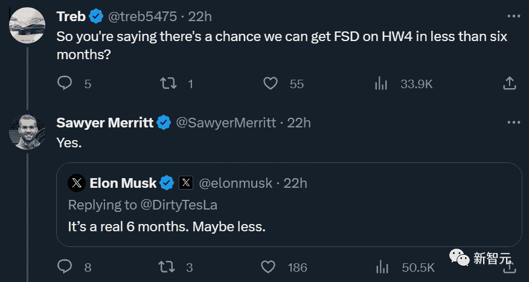

而除了特斯拉FSD V12之外，特斯拉的人形机器人Optimus也将从特斯拉储备的巨大算力中获益。

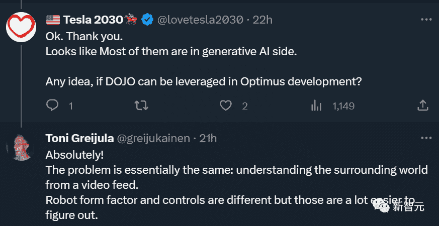

网友分析到，因为智能机器人的工作原理，本质上也是从视频信号中去理解周围的世界。这和自动驾驶的本质是一样的，只是形态和控制方式有区别。

**特斯拉超算Dojo怎么样了？**

Tesla上线H100 GPU 集群的同时，也在激活自己研发制造的超算Dojo。下图是特斯拉内部对Dojo计算能力的预测。

2024 年 10 月，Dojo 的计算能力也有望达到 100 exaflops。

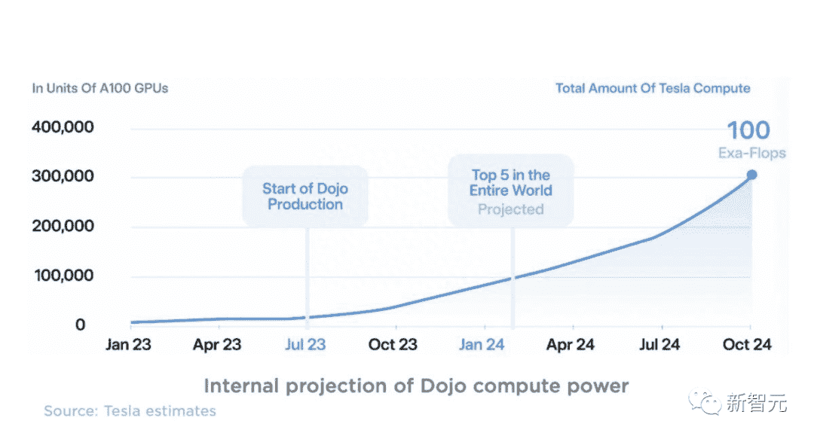

在2021年的AI Day上，特斯拉第一次公布了自己超算——Dojo。

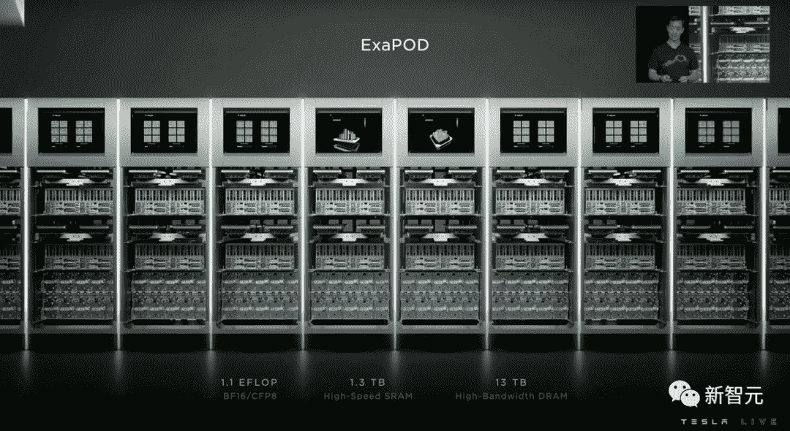

快两年时间过去了，在今年7月推特（现X）科技爆料账户Whole Mars Catalog爆料Dojo已经正式开始开始工作了。

这一消息也得到了马斯克本人的点赞确认。

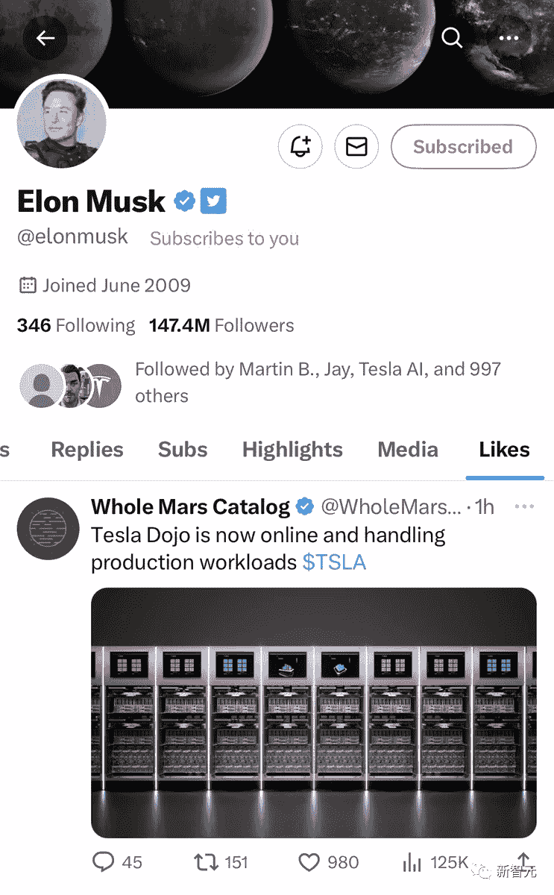

整个超算由这样的计算模块构成

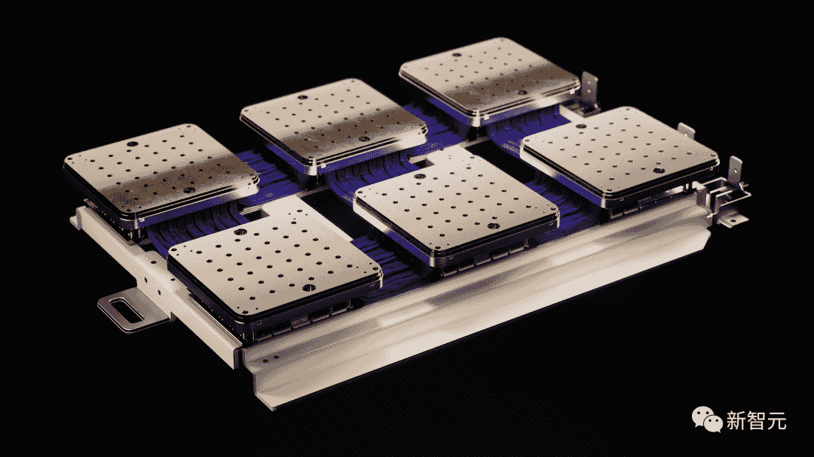

每个模块上有25个Soc，模块之间通过高速宽带连接。

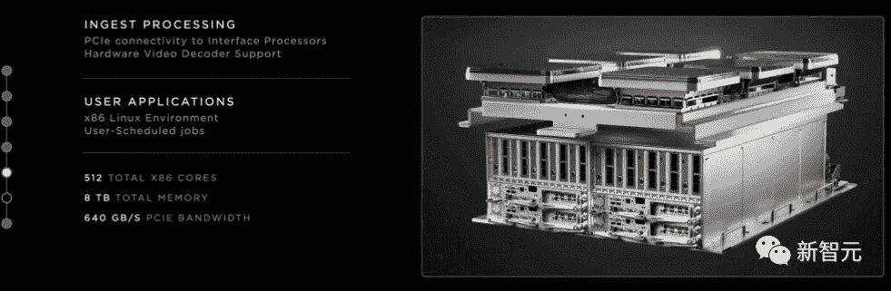

然后将模块用主机盒固定起来，所有的接口都集成在了系统托盘上。

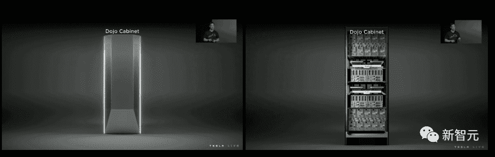

然后将两个带有主机组件的系统托盘安装到一个Dojo机柜中。

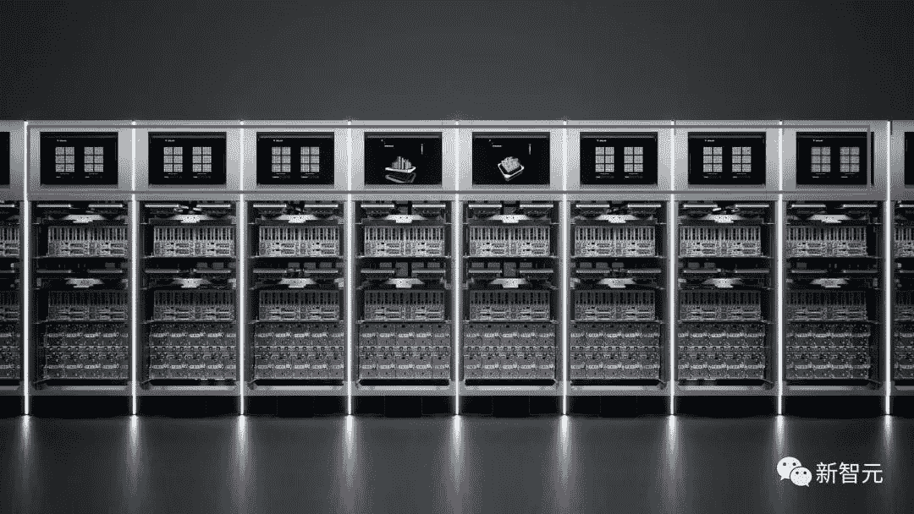

顶部的图例展示的是每个Soc的负载。

而现在，拥有Dojo和1万块H100集群的Tesla，正式加入了算力军备竞赛当中。

参考资料：

https://www.tomshardware.com/news/teslas-dollar300-million-ai-cluster-is-going-live-today

https://twitter.com/SawyerMerritt/status/1696011140508045660