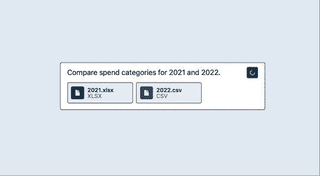
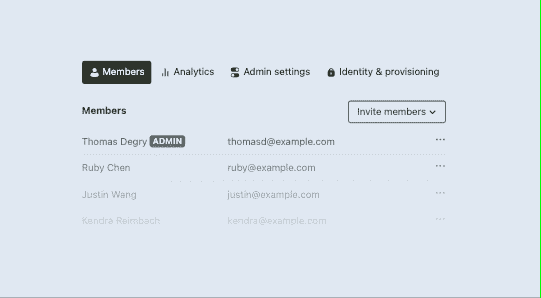
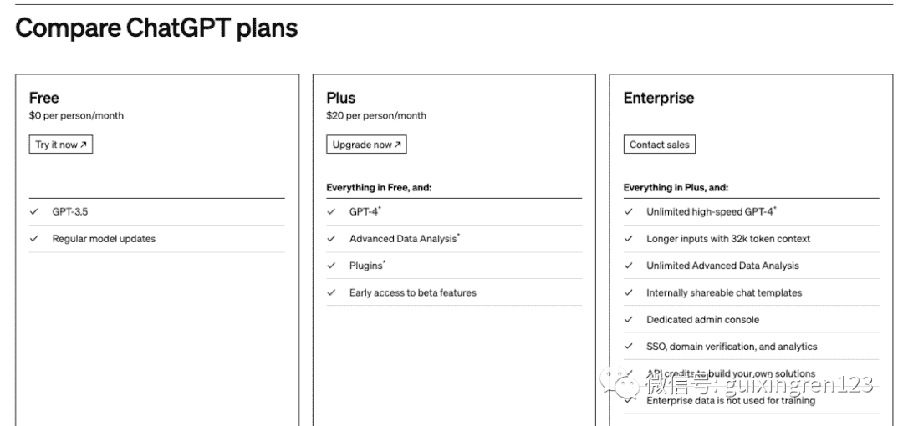
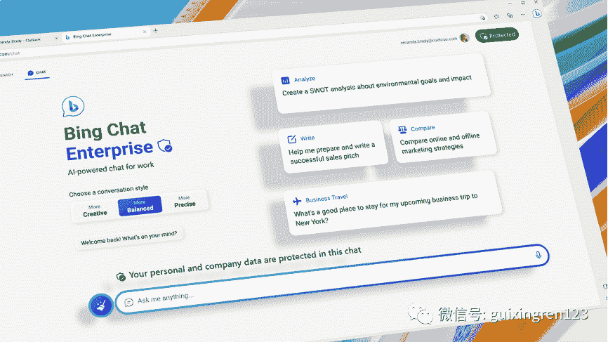
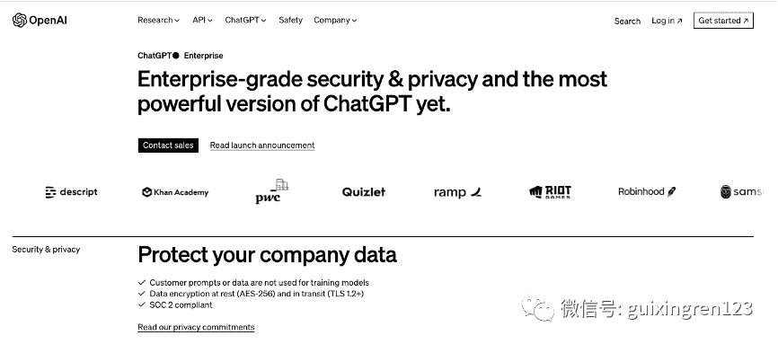

# 2023-08-29ChatGPT企业版炸裂上线！无限制访问、两倍速、3.2万token……OpenAI开始“抢钱”了

> 来源：[https://xuqiwei1986.feishu.cn/docx/O0mddV38To4ns3xDMpccVxMmnQg](https://xuqiwei1986.feishu.cn/docx/O0mddV38To4ns3xDMpccVxMmnQg)

> 🔗 原文链接： h[ttps://mp.weixin.q](https://mp.weixin.qq.com/s/vkLMTWGdY5GzO2H_TK1vXQ)q.com/s/vkLMTWGd...

>

原创 Juny 硅星人 2023-08-29 08:06 发表于 美国

OpenAI已然吹响了向企业级市场全面进攻的号角

文| Juny 编辑| VickyXiao

经过大半年的等待，今天，OpenAI宣布企业专用版本的ChatGPT 正式上线 。

OpenAI表示，ChatGPT企业版（ChatGPT Enterprise）将专注于为大型企业服务，将提供对 GPT-4 的无限制访问、扩展的上下文窗口、高级数据分析功能和定制选项等。ChatGPT企业版将在保证企业的数据隐私和安全的背景下，为企业提供全方位的生成式AI功能。

除了目前适合大型企业的版本之外，OpenAI还将很快推出适用于各类小型团队**的自助式 ChatGPT Busi**ness 产品，服务于所有规模和类型的组织。 也就是说，从今天开始，OpenAI已然吹响了向企业级市场全面进攻的号角。

而对于每一个普通打工人来说，随着ChatGPT企业版和其他更多企业级AI工具的到来，我们如今的工作环境，可能很快也要因为AI 的到来“变天”了。

**｜**地表最强ChatGPT版本+安全部署，专为大企业而生

此次，企业专属版本的ChatGPT能力得到大幅飞升。

ChatGPT企业版由目前OpenAI最先进的语言模型GPT-4驱动，企业用户拥有优先访问GPT-4的权利并取消了使用上限，执行速度相比普通GPT-4提高了两倍。此外，企业版允许输入更多的内容，上下文窗口扩大到3.2万个token、约2.5万个单词。

ChatGPT Enterprise 还提供对高级数据分析（代码解释器功能）的无限制访问，帮助技术和非技术团队在几秒钟内做数据分析信息等。

图片来自OpenAI官方博客

除了增强版的ChatGPT护航之外，此次的企业**版本也妥善解决了企业最**担忧的两个问题： 数据安全和系统部署。

在数**据安全方面，OpenAI 提供了“静态数据加密 (AES-256) 和传输中数据加密 (**TLS 1.2+)”，并表示 ChatGPT Enterprise已经过 SOC 2 Type 1的合规性审核和认证。 OpenAI还承诺，客户的提示语和其他所有数据都不会被用于模型训练，用户可以控制数据的保留时间，任何已删除的对话都会在 30 天内从ChatGPT的系统中被自动删除。

在部署方面，ChatGPT企业版此次提供了一个全新的管理控制台，能够批量化的管理使用人员，包括单点登录、域验证以及包含使用统计信息的仪表板等，适合大规模可扩展的部署。

通过可共享的对话模板，企业版还让员工能利用ChatGPT构建内部工作流。此外，OpenAI的API平台还可以让企业可以根据自身需要，创建完全定制的解决方案。

图片来自OpenAI官方博客

**ChatGPT企业版在今天发布之后，即可立即使用。 至此， ChatGPT 已有免费版、 Plus 版和企业版**三个订阅方案，但此次 OpenAI 并没有给出企业版的统一定价，表示将取决于每家公司的使用情况和用例 ，需要单独询价。 企业版推出后，每月 20 美元的个人 Plus 将继续存在。

ChatGPT的三种订阅方式，图片来自 图片来自OpenAI官方博客

**｜**瞄准企业级市场，OpenAI准备大展拳脚

在消费级用户群体中试水成功之后，企业级市场成为了目前生成式AI的兵家必争之地。

实际上，作为先发者的ChatGPT，其企业版本的推出速度其实并不算快。近几个月来，已经有很多企业已先后发布了很多针对企业用户的生成AI产品和功能。

比如独角兽Cohere 从企业成立之初就致力于研发为企业服务的生成式AI功能，甚至还提供为企业定制的大语言模型 (LLM)选项。Anthropic在今年4月份也宣布和Scale AI强强联手，专门为 企业客户提供强大的生成 AI 功能和工业级保障。

科技巨头们也在 迅速行动。 **亚马逊**推出了基于AWS的企业级生成式AI全家桶工具，Meta 宣布其开源语言模型 LLaMA 2可用于商业用途，甚至就连OpenAI的合作伙伴和背后金主微软，日前也刚刚宣布Bing Chat的企业版本，并计划将其加入到Microsoft 365之中。

图片来自微软

虽然ChatGPT在普通用户中有着很大的声量，但显然进入企业级市场之后其将面对的市场竞争并不小。但进军企业级市场，也是ChatGPT目前必须要走的一步棋。

**根据Similarweb数据，近几个月来 ChatGPT的全球流量持续下降，6**、7月份分别下降了9.7%和9.6%，浏览量从5月19亿的高峰下降到了15亿。 而相较于高昂的花费，用户订阅给OpenAI带来的收入可谓是杯水车薪，据统计，该公司去年花费了超过 5.4 亿美元来开发ChatGPT，ChatGPT每天的运行成本 OpenAI 约为70万美元。然而 OpenAI 在 2022 财年的收入仅为 3000 万美元。

最近还有机构预测，按照OpenAI的目前的烧钱速度，微软的100亿美元将很快消耗殆尽，如果没有其他大规模的融资，OpenAI最快会在2024年宣布破产。

但OpenAI的第一选择肯定是自己“搞钱”。此前Sam Altman曾表示，今年OpenAI的目标是将收入提高到 2 亿美元，并夸下海口称到2024年会创造10亿美元的收入。为此，OpenAI则必须加快推出更多更赚钱的产品，企业市场则显得尤为重要。

**O**penAI表示，自 ChatGPT 九个月前推出以来，已经看到超过 80% 的财富 500 强公司团队的使用。 包括Block、Canva、雅诗兰黛、普华永道等大型企业也已提前试用了ChatGPT企业版的Beta版本，均取得了很好的反馈。

接下来，除了服务于大型企业之外，OpenAI也很快推出为小型机构提供 ChatGPT Business 产品，将所有类型和规模的组织囊括其中。未来OpenAI将允许小型公司将应用程序连接到 ChatGPT 企业版本，同时也会提供更多针对于专门业务场景的AI分析和辅助工具，同时推出更多的定制化选项。

目前OpenAI已经在官网上线了ChatGPT Enterprise的专属页面，并在博客中预告了一系列针对企业用户的功能更新。

**OpenAI高调入局企业赛道，在一定程度上来看， 也预示**了生成式AI进入企业场景的速度会进一步加快，而这或许也是AI影响每个普通人生活的真正开篇。

过去几个月，大部分人或许还只是把ChatGPT当成一个能日常帮忙搜搜信息、写写邮件的AI聊天“玩具”，但随着越来越多的企业开始在工作场景中启用AI，我们可能会看到AI更多作为一种强劲生产力工具的能力。

那么，生成式AI进入企业是否会大规模提高企业的运转效率，又是否会对某些职位造成冲击？我们将在接下来的一段时间中看到答案。

*参考资料：

注：封面图来自于Pexels，版权属于原作者。如果不同意使用，请尽快联系我们，我们会立即删除。