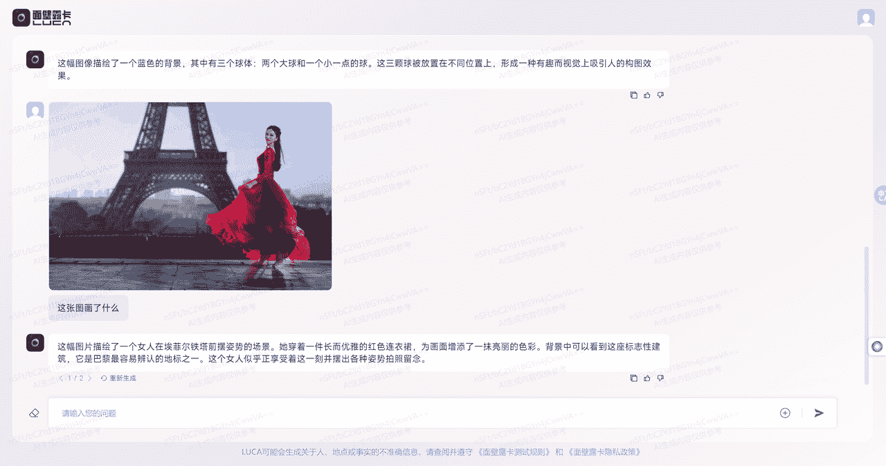
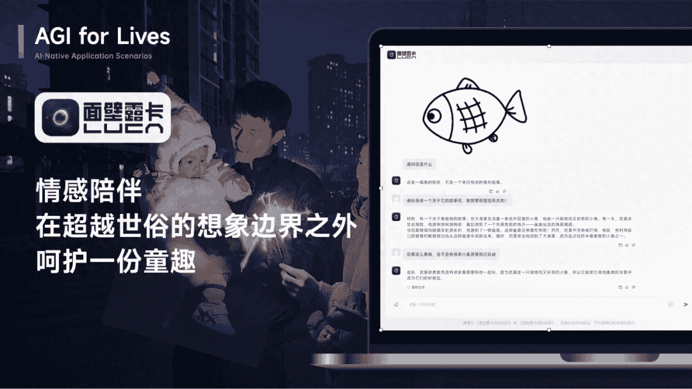
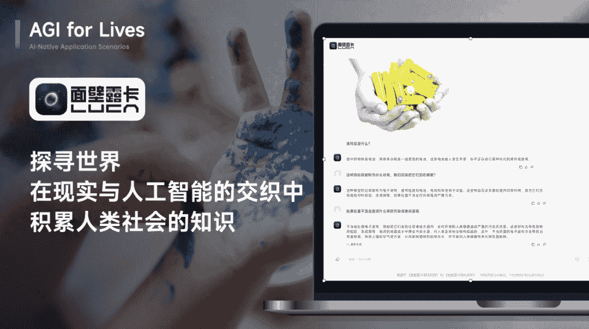
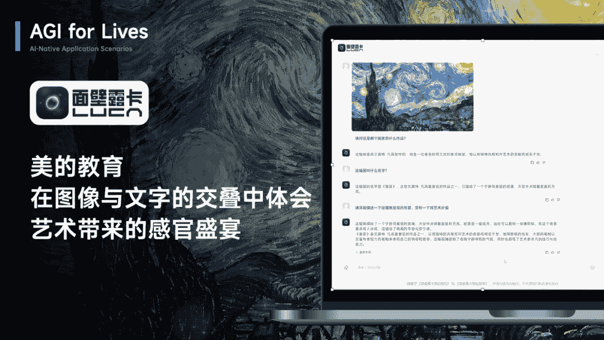
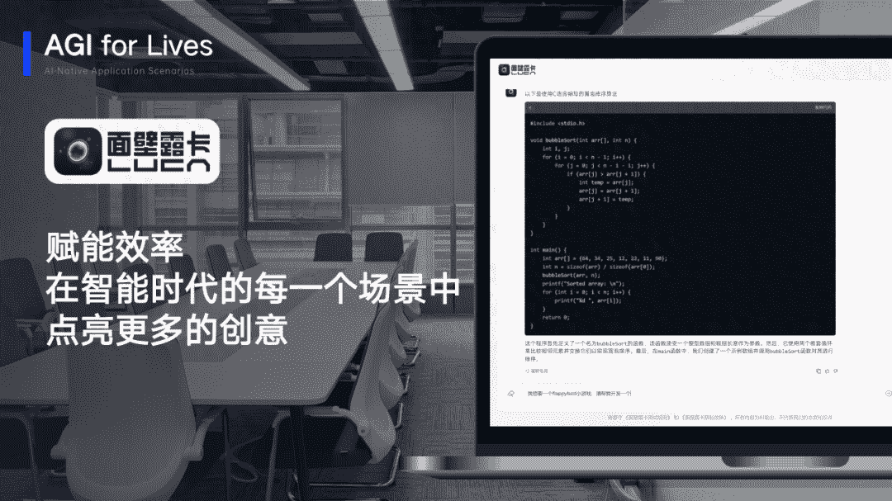
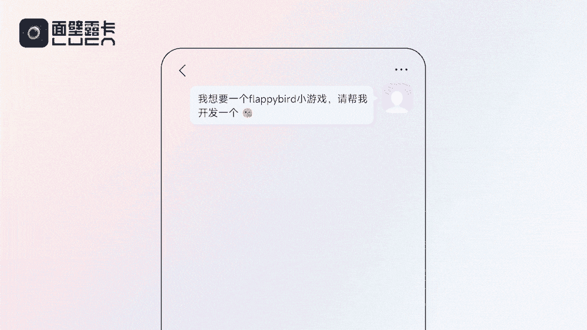
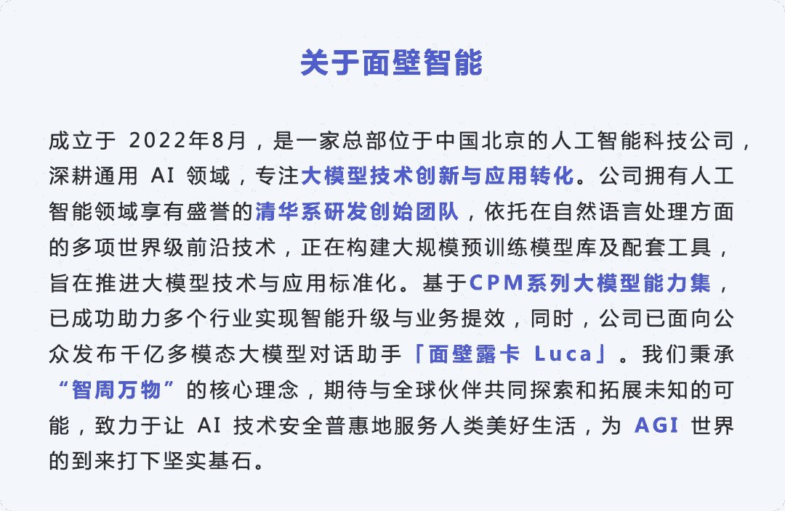

# 2023-08-29图片理解中文全网最强，面壁智能发布千亿多模态大模型-今日头条

> 来源：[https://xuqiwei1986.feishu.cn/docx/Oi6Hd8ESuoO7GcxJPaUciSswn2d](https://xuqiwei1986.feishu.cn/docx/Oi6Hd8ESuoO7GcxJPaUciSswn2d)

> 🔗 原文链接： h[ttps://www.toutiao](https://www.toutiao.com/article/7272648500578779704/?log_from=e7889f55cabe2_1693367337584).com/article/727...

https://luca-beta.modelbest.cn/

# 图片理解中文全网最强，面壁智能发布千亿多模态大模型

2023-08-29 15:50 · 量子位

8月28日下午，面壁智能在北京市石景山区人民政府、北京市经济和信息化局、北京市科学技术委员会中关村科技园区管理委员会联合主办的服贸会分论坛——“ 通用人工智能算力论坛”（AGICF） 上重磅发布了最新大模型成果 Luca。面壁智能联合创始人、CEO 李大海表示 Luca 的多项语言模型能力已与 ChatGPT 相当 ，并重点展示了其强大的多模态能力和依托群体智能技术的 AI 原生应用场景。发布会最后，李大海宣布 千亿基座模型驱动的多模态智能对话助手 Luca2.0 正式开启公测。

李大海介绍，Luca 的名字取自地球生命始祖 LUCA（The Last Universal Common Ancestor），Luca 1.0 **版本最早**于 5月27日在 2**023 数**博会上首次亮相并通过实时演示的方式展现过其多项出色功能。三**个月来，Luc**a 总共迭代了 85 次，大语言模型能力整体提升 39% 。其中推理能力提升 119% ， 推理、知识、生成等多项能力媲美 ChatGPT 。除了优秀的大语言模型能力外，Luca 2.0 还具备强大的多模态处理能力，图片理解能力已达 中文全网最强 ，其中多模对话、细节描述和复杂推理三项整体得分为 92.5 分，而行业其他模型的平均得分是 78.4 分， 远超现有支持中文且具备图片理解能力的大模型 （采用COCO-QA90数据集对比得出），目前 Luca 2.0 版本已经开启全民公测申请。

**发布会最精彩的部分是 Luca** 的应用场景展示。李大海按照从 人类生命周期、追求真善美、降本提效 等多个角度人长大成才的时间顺序，举例展现了“ Luca 赋能人的成长和生活 ”的四个场景，这与面壁智能 slogan “AGI for Lives” 的点亮每个生命相符。

“当你还是孩童时，一定对世界充满好奇，Luca 带你丰富想象力空间。比如，给它**你刚画好的一条鱼**，它不但编出一段精彩有趣的故事给你，顺便还能教会你勇敢与机智。 这是一份陪伴。 ”

“**当你逐渐长大，一**定对世界充满未知，Luca 带你认知周遭。比如，它能教你分辨什么是有害垃圾和如何进行垃圾分类。 这是一种教育。 ”

“成长过程中，我们不仅需要“善”的陪伴和“真”的认知，精神与心灵也需要“**美”的滋养，Lu**ca 还能带我们品味世界文化底蕴，比如欣赏一幅来自梵高的画作。 这是一种美学。 ”

“成年后步入职场，工作内容繁杂又细碎，**Luca 赋能我**们工作效率的大幅提升。 这是一种技能。 ”

在最**后一个场景中，李大海演示了** Luca 的未来应用场景。通过群体智能技术，Luca 可以和它的大模型同事们群体协作，在 7 分钟内为提出需求的用户制作出了 flappy Bird 小游戏。“ 群体智能让创造力触手可及 。未来，一个人开一家公司不是梦想。”李大海称。

Luca未来的群体智能应用场景

Luca 的语言交互基座模型是千亿级参数 CPM 大模型。CPM（Chinese Pretrained Model) 系列大模型享誉已久， 是面壁智能从零自主研发的预训练大语言模型 ，其中包括国内首个中文大模型 CPM-1。最新的大模型训练直播项目 CPM-Live 的第二期百亿模型 CPM-Bee 是国内首个开源免费商用基座模型，目前已授权给数百家企业合法商用。

此次千亿多模态智能助手Luca开启公测，是面壁智能交给大家的最新答卷。”在科技日新月**异、变革层出不穷的时代，我们一**直在探索、在进步，今天我有幸站在这里，与大家共同 开启这场通往AGI世界的旅程 。”李大海称希望Luca能带给大家一次前所未有的体验。

论坛同期，在北京市通用人工智能产业创新伙伴计划合作成果签约仪式环节，面壁智能与义务商贸城集团就“ 大语言模型赋能义乌商贸城智能交互项目 ”完成现场签约。

— 完 —

量子位 QbitAI · 头条号签约

关注我们，第一时间获知前沿科技动态