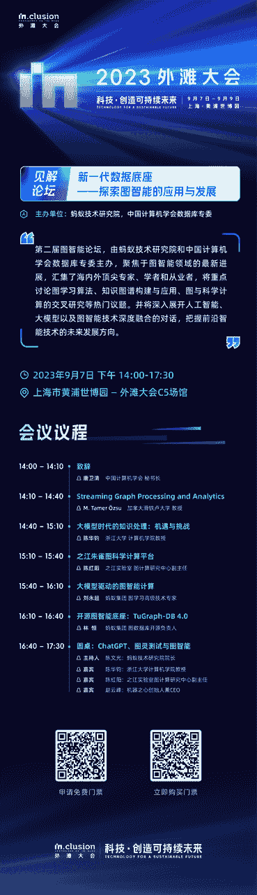

# 2023-08-28 大模型时代，来外滩大会解锁图智能前沿技术

> 来源：[https://xuqiwei1986.feishu.cn/docx/RSmCd8xzloBqx6xpcbHcfeNtnab](https://xuqiwei1986.feishu.cn/docx/RSmCd8xzloBqx6xpcbHcfeNtnab)

> 🔗 原文链接： h[ttps://mp.weixin.q](https://mp.weixin.qq.com/s?__biz=MzA3MzI4MjgzMw==&mid=2650888747&idx=3&sn=2f070b1aa547e7aa1a6bc16c38211da0)q.com/s?__biz=Mz...

>

机器之心 2023-08-28 13:05 发表于 北京

盛夏的炎热并未能阻挡智能科技的步伐。2023 年 9 月 7 日，我们即将迎来一场图智能领域的前沿 科 技盛会——外滩大会图智能论坛。

随着数据规模和复杂性的不断增加，许多现实世界的问题都可以用图模型来表示。图计算技术能够有效处理这些复杂的关系数据，为各个领域带来新的洞见和解决方案，因此被认为是具有重要前景和影响力的科技之一。在 2022 年的世界人工智能大会（WAIC）上，蚂蚁集团举办了首届图智能论坛，探讨新一代图智能技术发展与实践，中国工程院两大院士 领衔、顶尖学者与行业专家汇聚，吸引数万人关注。

【2022 WAIC 首届图智能论坛视频回顾】

退出全屏

切换到横屏模式

[🎦 点击观看视频](http://mpvideo.qpic.cn/0b2eluabaaaaemao5wxlfrsfaxodcboqaeaa.f10002.mp4?dis_k=3f814b2aaf07aecceb3081a44ec98f80&dis_t=1693276346&play_scene=10120&auth_info=Cqn51JVxcyNX16WCvyEAH1J1P2hKTGxiSGdwNR9zMR0yX18nMA==&auth_key=9a35ee28628633f1a9d089ab514a7ff9&vid=wxv_3080220339839680512&format_id=10002&support_redirect=0&mmversion=false)

> 无法获取音频链接

视频详情

本届论坛主题为“新一代数据底座——探索图智能的应用与发展”， 由蚂蚁技术研究院和中国计算机学会数据库专委主办，聚焦于图智能领域的最新进展，并将深入展开人工智能、大模型以及图智 能技术深度融合的话题，把握前沿智能技术的未来发展方向。

**｜论坛亮点**

**前瞻洞见： **论坛邀请全球具有影响力的图智能技术领军企业和专家学者，分享他们在图智能领域的前沿研究和创新成果，以更前瞻的视野，探讨技术未来的无限可能。ACM/IEEE 双会士、加拿大皇家科学院院士、美国科学促进会会士、加拿大滑铁卢大学校校级教授 M. Tamer Özsu，浙江大学计算机学院教授陈华钧，之江实验室图计算研究中心副主任陈红阳，将分别分享《Streaming Graph Processing and Analytics》《大模型时代的知识处理：机遇与挑战》和《之江朱雀图科学计算平台》主题报告。

**跨界对话： **在圆桌对话环节，以“ChatGPT、图灵测试与图智能”为主题，邀请了包括图技术和大模型领域的专家学者、科技媒体机器之心创始人兼 CEO 赵云峰，从多方角度共同解读前沿智能技术的深度融合和发展。

**创新应用： **蚂蚁集团将首次发布大型图模型新概念（Large Graph Model），以及业界首个生成式异质图增强工作，综合大型语言模型、图学习、图数据库和图计算技术的优势。蚂蚁开源图智能底座 TuGraph 图数据库也将在论坛上发布最新 4.0 版本。

**｜最新议程**

9 月 7-9 日外滩大会期间，参会者还可莅临「城市之心」展区的图计算展位，通过技术解读和互动游戏，近 距离感受最新的科技成果和现实生活中的应用场景。

一起探索图计算的奇妙世界，期待您的到来！