# 2023-08-27致命幻觉问题、开发GPU替代品，大模型还面临这10大挑战

> 来源：[https://xuqiwei1986.feishu.cn/docx/EoRzdwbYqoAOXDxrL6rc7GiDnjc](https://xuqiwei1986.feishu.cn/docx/EoRzdwbYqoAOXDxrL6rc7GiDnjc)

> 🔗 原文链接： h[ttps://mp.weixin.q](https://mp.weixin.qq.com/s/T1dlgP6vSevRxMBlukms6A)q.com/s/T1dlgP6v...

>

机器之心 2023-08-27 12:16 发表于 北京

机器之心编译

**编辑：陈萍、梓文**

> 大型语言模型，还有哪些挑战和机遇，这篇博客全都概括了。

ChatGPT、GPT-4 等的发布，让我们在见识到大模型（LLM）的魅力后，伴随而来的是其所面临的各种挑战。

如何让 LLM 变得更好？面对大模型，到底有哪些需要解决的问题？成为 AI 领域重要的研究课题。

本文，计算机科学家 Chip Huyen 从 10 个方面入手，全面阐述 LLM 面临的挑战。具体而言，前两个方面是关于幻觉以及上下文学习的，其他几个方面包括但不限于多模态、架构、寻找 GPU 替代品等。

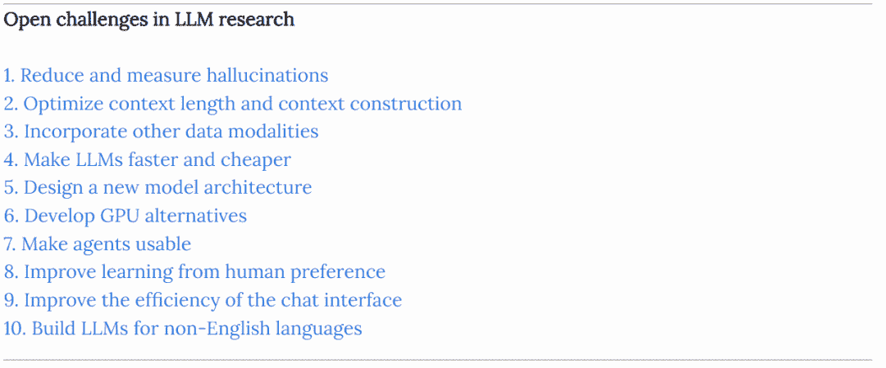

原文地址：https://huyenchip.com/2023/08/16/llm-research-open-challenges.html

以下是对原文的翻译整理。

**1. 如何减少幻觉**

幻觉问题是指 LLM 生成的文本虽然流畅又自然，但却不忠实于内容来源（内在问题）和 / 或不确定（外在问题）。这一问题广泛存在于 LLM 中。

因而，减轻幻觉并开发衡量幻觉的指标变得非常重要，很多公司、机构都在关注这个问题。Chip Huyen 表示，现阶段有许多减少幻觉的方法，例如在提示中添加更多的上下文、采用思维链或者让模型的响应更简洁一些。

这其中可以参考的资料包括：

+   自然语言生成中关于幻觉研究的综述：https://arxiv.org/abs/2202.03629

+   语言模型出现的幻觉是如何滚雪球的：https://arxiv.org/abs/2305.13534

+   ChatGPT 在推理、幻觉和交互性上的评估：https://arxiv.org/abs/2302.04023

+   对比学习减少对话中的幻觉：https://arxiv.org/abs/2212.10400

+   自洽性提高了语言模型的思维链推理能力：https://arxiv.org/abs/2203.11171

+   生成式大型语言模型的黑盒幻觉检测：https://arxiv.org/abs/2303.08896

2. 优化上下文长度和上下文结构

LLM 另一个研究重点是上下文长度，因为大模型在回答用户问题时，需要参考上下文，能够处理的长度越长，对 LLM 越有用。例如我们问 ChatGPT「最好的越南餐厅是哪家？」面对这一问题，ChatGPT 需要参考上下文，弄清楚用户问的到底是越南最好的越南餐厅还是美国最好的越南餐厅，两者完全不一样。

在这一小节下，Chip Huyen 介绍了几篇相关论文。

第一篇是《 SITUATEDQA: Incorporating Extra-Linguistic Contexts into QA 》，两位作者均来自德克萨斯大学奥斯汀分校。论文引入了一个开放检索的 QA 数据集 SITUATEDQA ，感兴趣的读者可以前去查看了解更多内容。

Chip Huyen 表示因为模型是从提供的上下文中学习的，因而这个过程被称为上下文学习。

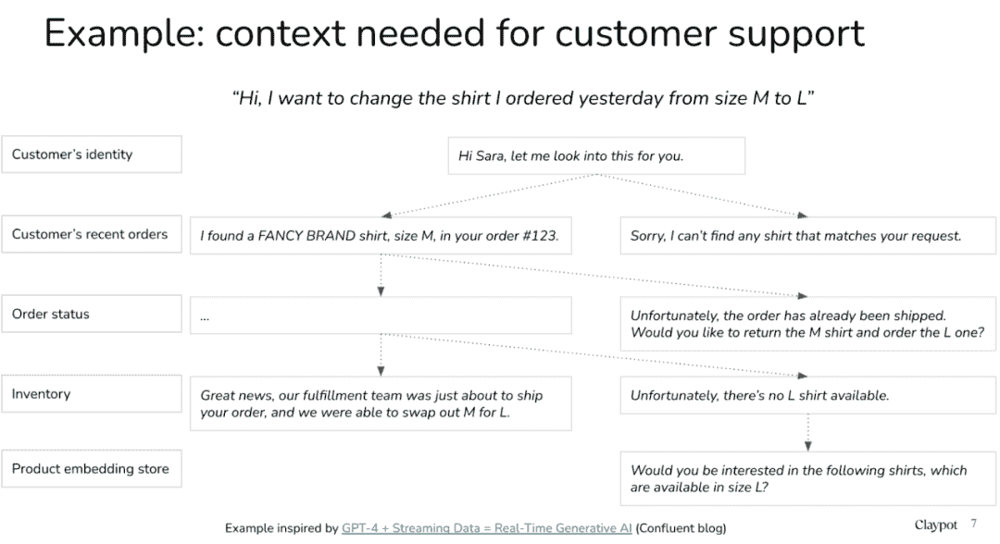

第二篇论文是《Retrieval-Augmented Generation for Knowledge-Intensive NLP Tasks》，本文提出了 RAG（Retrieval-Augmented Generation），它能结合预训练语言模型和外部知识，来实现开放域生成式问答及其他知识密集型任务。

RGA 运行过程分为两个阶段：chunking（也称为检索）阶段以及查询阶段：

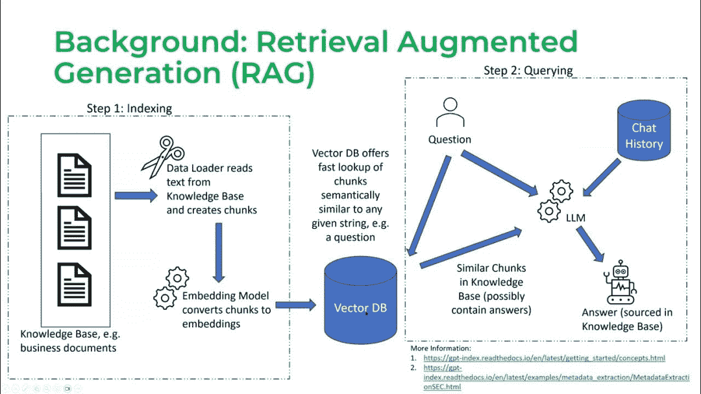

很多人认为，基于这项研究，上下文的长度越长，模型塞入的信息就会越多，其响应就越好。Chip Huyen 认为这一说法并不完全成立。

模型可以使用多少上下文以及模型使用上下文的效率如何，是两个完全不同的问题。我们要做的是在增加模型上下文长度的同时并行的提高模型处理上下文的效率。例如，在《Lost in the Middle: How Language Models Use Long Contexts》论文中，文中介绍了模型如何更好地理解索引开头和结尾的信息，而不是中间信息。

**3. 多模态**

Chip Huyen 认为多模态是非常重要的。

首先，包括医疗保健、机器人、电子商务、零售、游戏、娱乐等在内的领域都需要多模态数据。例如医学预测需要医生笔记，患者问卷等文本内容，还需要 CT、X 光、核磁共振扫描等图像信息。

其次，多模态有望大幅提升模型性能，能够理解文本和图像的模型比只能理解文本的模型表现要好。然而基于文本的模型对文本的需求量很大，以至于人们开始担心为了训练模型，我们很快就会耗尽互联网数据。一旦文本被用完，我们就需要考虑其他数据模态。

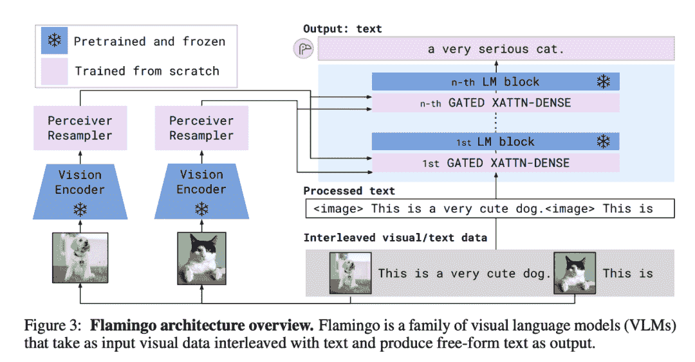

Flamingo 架构图

关于多模态，大家可以参考的内容包括：

+   论文 1《Learning Transferable Visual Models From Natural Language Supervision》：https://arxiv.org/abs/2103.00020；

+   论文 2《Flamingo: a Visual Language Model for Few-Shot Learning》：https://arxiv.org/abs/2204.14198；

+   论文 3《BLIP-2: Bootstrapping Language-Image Pre-training with Frozen Image Encoders and Large Language Models》：https://arxiv.org/abs/2301.12597；

+   论文 4《Language Is Not All You Need: Aligning Perception with Language Models》：https://arxiv.org/abs/2302.14045；

+   论文 5《Visual Instruction Tuning》：https://arxiv.org/abs/2304.08485；

+   谷歌 PaLM-E：https://ai.googleblog.com/2023/03/palm-e-embodied-multimodal-language.html；

+   英伟达 NeVA：https://catalog.ngc.nvidia.com/orgs/nvidia/teams/playground/models/neva。

**4. 让 LLM 更快、更便宜**

GPT-3.5 于 2022 年 11 月下旬首次发布，很多人担心使用成本高昂。然而，短短半年，社区就找到了在性能方面接近 GPT-3.5 的模型，所需的内存占用仅为 GPT-3.5 的 2%。

Chip Huyen 表示，如果你创造了足够好的东西，人们很快就会找到一种方法让它变得又快又便宜。

以下是 Guanaco 7B 与 ChatGPT 和 GPT-4 等模型的性能比较。但我们不得不强调，对 LLM 进行评估还是非常难的。

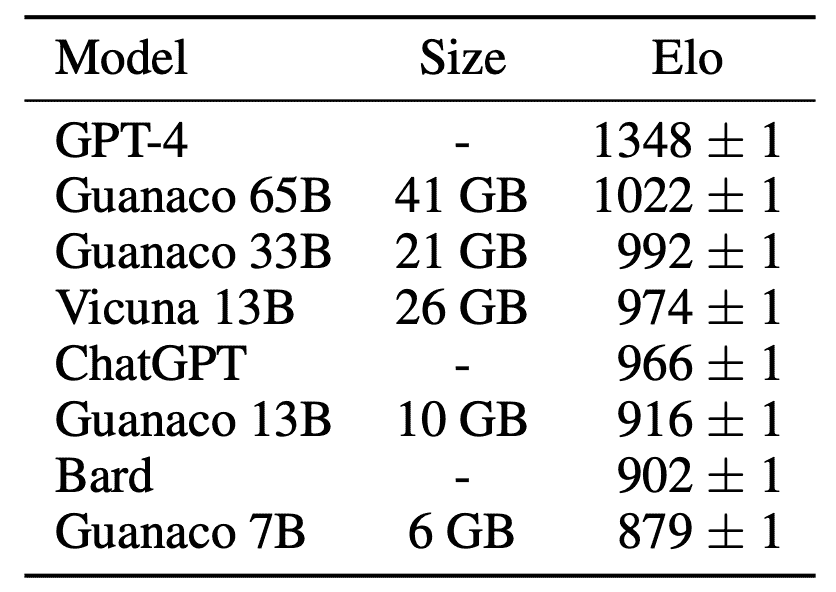

接着，Chip Huyen 列举了模型优化、压缩技术：

+   量化：迄今为止最通用的模型优化方法。量化使用更少的位来表示参数，从而达到减小模型大小的目的，例如，有人将 32 位的浮点数改为 16 位，甚至是 4 位的浮点表示；

+   知识蒸馏：一种训练小模型（学生）模仿较大模型或模型集合（教师）的方法；

+   低秩分解：关键思想是用低维张量替换高维张量以减少参数数量。例如用户可以将 3x3 张量分解为 3x1 和 1x3 张量的乘积，这样只有 6 个参数，而不是 9 个；

+   剪枝。

以上这四种方法仍然很流行，例如用知识蒸馏训练 Alpaca，QLoRA 将低秩分解和量化结合起来。

**5. 设计一种新的模型架构**

自 2012 年 AlexNet 发布以来，包括 LSTM、seq2seq 在内的许多架构开始变得流行，然后又变得过时。与此不同的是，Transformer 的粘性令人难以置信。它从 2017 年就已经出现了，直到现在还被广泛使用。这种架构还能流行多久我们难以估计。

然而，开发一种全新的架构来超越 Transformer 并不容易。过去 6 年里，研究者对 Transformer 进行了大量优化。除了模型架构，还包括硬件层面的优化。

美国计算机科学家 Chris Ré 领导的实验室在 2021 年围绕 S4 进行了很多研究，可参考论文《Efficiently Modeling Long Sequences with Structured State Spaces》了解更多内容。此外，Chris Ré 实验室还大力投资开发新架构，他们最近与初创公司 Together 合作开发了 Monarch Mixer 架构。

他们的关键思想是，对于现有的 Transformer 架构，注意力的复杂度是序列长度的二次方，而 MLP 的复杂度是模型维度的二次方，复杂度低的架构会更加高效。

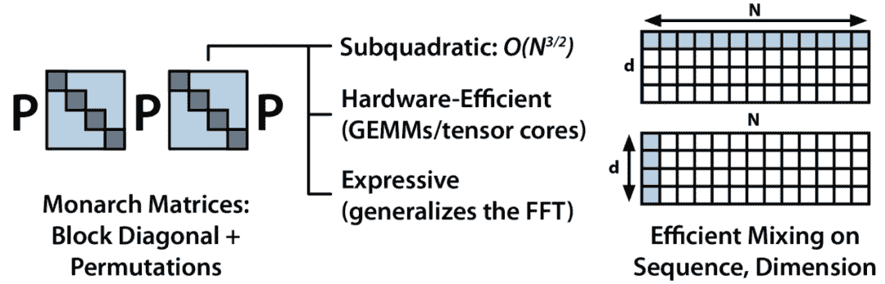

**6. 开发 GPU 替代品**

自 2012 年 AlexNet 发布以来，GPU 一直占据深度学习的主导地位。事实上，AlexNet 之所以受欢迎的一个公认原因是它是第一篇成功使用 GPU 训练神经网络的论文。在 GPU 出现之前，如果你想训练 AlexNet 这种规模的模型，必须使用数千个 CPU，而 GPU 几个就能搞定。

过去十年中，无论是大公司还是初创公司，都尝试为人工智能创建新的硬件。最具代表性的包括但不限于 Google 的 TPU、Graphcore 的 IPU 以及 AI 芯片公司 Cerebras。此外，人工智能芯片初创公司 SambaNova 筹集了超过 10 亿美元来开发新的人工智能芯片。

另一个令人兴奋的方向是光子芯片，其使用光子来移动数据，因而能进行更快、更高效的计算。该领域的多家初创公司已筹集了数亿美元，包括 Lightmatter（2.7 亿美元）、Ayar Labs（2.2 亿美元）、Lightelligence（2 亿美元以上）和 Luminous Compute（1.15 亿美元）。

以下是光子矩阵计算中三种主要方法的进展时间表，摘自《Photonic matrix multiplication lights up photonic accelerator and beyond》论文。这三种方法分别是平面光转换（PLC）、马赫－曾德尔干涉仪（MZI）和波分复用技术（WDM）。

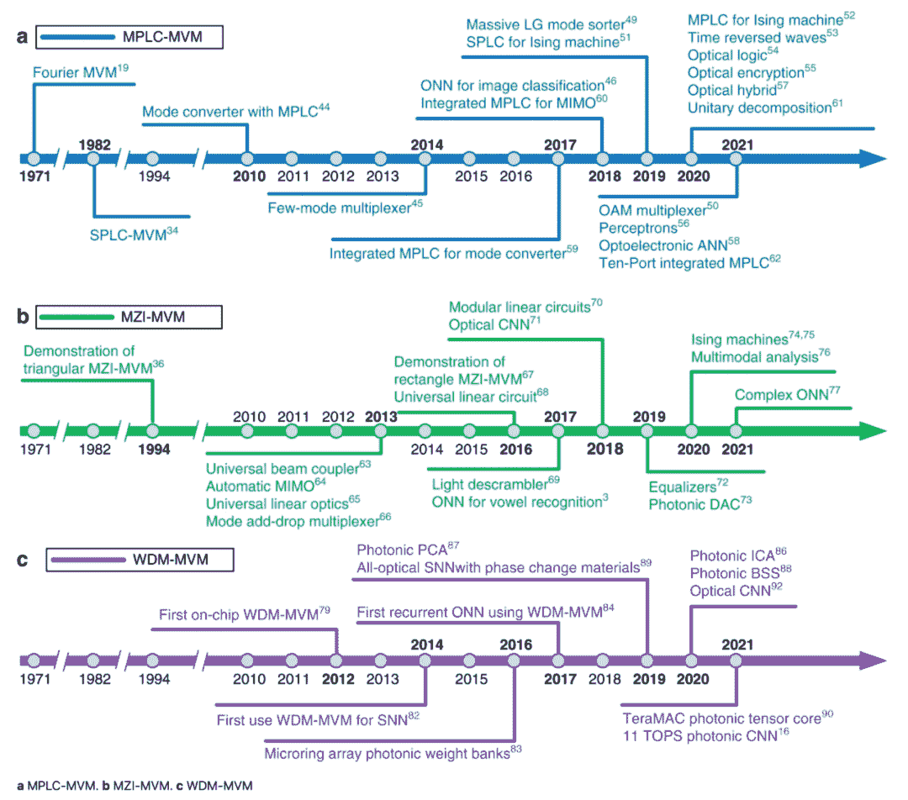

**7. 让智能体变得更可用**

智能体是可以采取行动的 LLM，如浏览互联网、发送电子邮件、预订房间等。与本文中的其他研究方向相比，这个方向出现的比较晚，对大家来说非常的新。

正是由于其新颖性和巨大的潜力，大家对智能体有着狂热的痴迷。Auto-GPT 目前在 GitHub 最受欢迎的项目中排名第 25 位。GPT-Engineering 是另一个非常热门的项目。

这虽然令人期待又兴奋，但 LLM 是否足够可靠、性能是否足够高以被赋予行动的权利，这依旧是存疑的。

不过，已经出现的一个应用案例，将智能体[应用于社会](http://mp.weixin.qq.com/s?__biz=MzA3MzI4MjgzMw==&mid=2650887063&idx=3&sn=475d84e2c0f6d8acfb48436167c42204&chksm=84e497e9b3931eff11843e6f0dd6965daf94d9e0730ac480cd868e20cd37ee29c5ed798a73f1&scene=21#wechat_redirect)研究，前段时间斯坦福开源的「 虚拟小镇 」 Smallville，25 个 AI 智能体在小镇上生活，他们有工作，会八卦，能组织社交，结交新朋友，甚至举办情人节派对，每个「小镇居民」都有独特的个性和背景故事。

更多详细内容，请参阅以下论文。

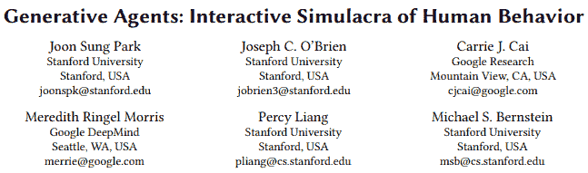

论文地址：https://arxiv.org/pdf/2304.03442.pdf

该领域最著名的初创公司可能是 Adept，它由两位 Transformer 的合著者和一位前 OpenAI 副总裁创立，迄今已融资近 5 亿美元。去年，他们做了一个 demo，展示他们的智能体如何浏览互联网并向 Salesforce 添加一个新账户。

退出全屏

切换到横屏模式

[🎦 点击观看视频](http://mpvideo.qpic.cn/0bc3vqaacaaaxaag53pf3bsfblgdagwaaaia.f10002.mp4?dis_k=b262e3e71ab75f4f3e9f6191f2acdb2d&dis_t=1693189046&play_scene=10120&auth_info=dr6U50lEPk7ogbTTRSgbRhZiZU1jazEbbXxNNl8BcDlQUBB1&auth_key=5fa22f342c0dda125528e1027425abc5&vid=wxv_3073007311062810628&format_id=10002&support_redirect=0&mmversion=false)

> 无法获取音频链接

视频详情

**8. 从人类偏好中改进学习**

RLHF，即从人类偏好出发的强化学习。如果人们能找到其他方法来训练 LLM，也不会让人感到惊讶，毕竟 RLHF 还有很多问题有待解决。Chip Huyen 罗列了以下 3 点。

**如何用数学方法表示人类偏好？ **

目前，人类偏好是通过比较来确定的：人类标注者确定响应 A 是否比响应 B 更好，但并不考虑响应 A 比响应 B 好多少。

**人类的偏好是什么？ **

Anthropic 沿着三个坐标轴测量他们模型的响应质量，分别是有用、诚实和无害。

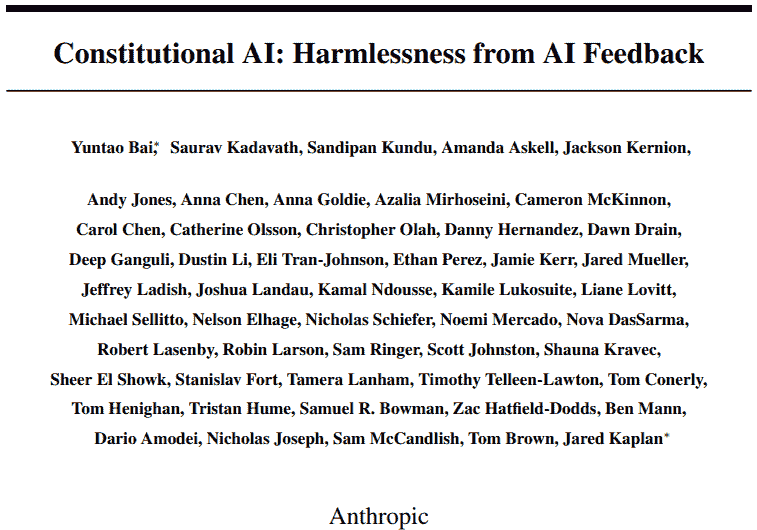

论文地址：https://arxiv.org/abs/2212.08073

DeepMind 也试图产生让大多数人满意的响应。请参见下面这篇论文。

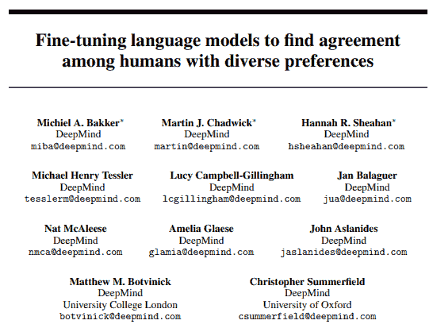

论文地址：https://arxiv.org/abs/2211.15006

但需要明确的是，我们想要一个可以表明立场的 AI，还是一个回避任何潜在争议话题的普通 AI ?

**谁的偏好才是 「人」的偏好？**

考虑到文化、宗教等方面的差异，要获得能充分代表所有潜在用户的训练数据，存在很多挑战。

例如，在 OpenAI 的 InstructGPT 数据中，打标签的人员主要是菲律宾人和孟加拉人，由于地域的差异，可能带来一定偏差。

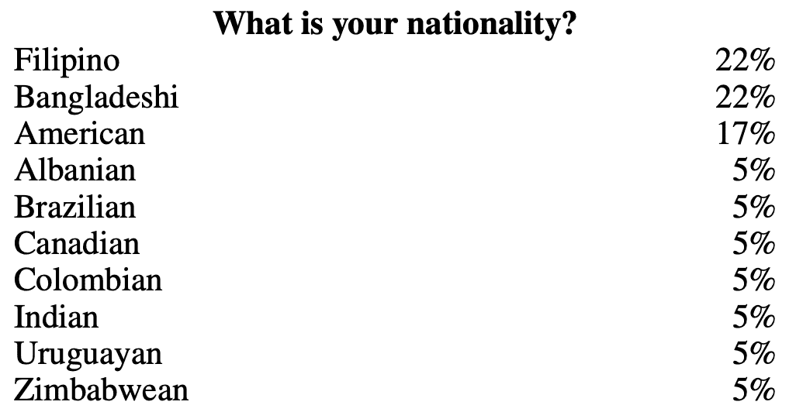

图源：https://arxiv.org/abs/2203.02155

研究社区也在为此进行努力，但数据偏差依然存在。例如，在统计对 OpenAssistant 数据集的人员分布中，222 位受访者中有 201 位（90.5%）是男性。

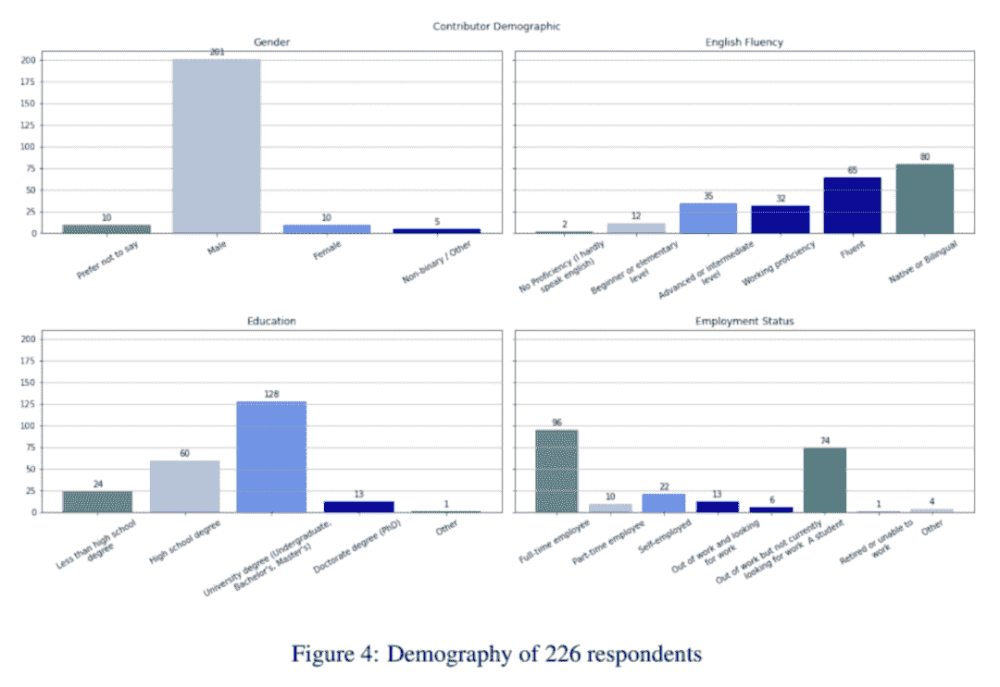

**9. 提高聊天界面的效率**

自 ChatGPT 以来，关于聊天是否适合各种任务的讨论不绝于耳。例如以下的这些讨论：

+   自然语言是懒惰的用户界面 https://austinhenley.com/blog/naturallanguageui.html

+   为什么聊天机器人不是未来 ：https://wattenberger.com/thoughts/boo-chatbots

+   什么类型的问题需要对话才能回答？https://arxiv.org/abs/2303.17710

+   AI 聊天界面可能成为阅读文档的主要用户界面：https://idratherbewriting.com/blog/ai-chat-interfaces-are-the-new-user-interface-for-docs

+   用最少的聊天与 LLM 交互 ：https://eugeneyan.com/writing/llm-ux/

然而，这些讨论并不是最近才开始的。许多国家，尤其是亚洲，聊天作为超级应用程序的界面已经使用了大约十年。

聊天作为中文应用程序的通用界面

2016 年，当许多人认为应用程序已死、聊天机器人将成为未来时，讨论再次变得紧张起来：

+   关于聊天界面：https://acroll.medium.com/on-chat-as-interface-92a68d2bf854

+   聊天机器人趋势是一个巨大的误解吗：https://www.technologyreview.com/2016/04/25/8510/is-the-chatbot-trend-one-big-misunderstanding/

+   机器人不会取代应用程序，更好的应用程序将取代应用程序：http://dangrover.com/blog/2016/04/20/bots-wont-replace-apps.html

Chip Huyen 表示自己非常喜欢聊天界面，原因如下：

+   聊天是一种人人都能快速学会使用的界面，即使是以前没有接触过电脑或互联网的人也能使用。

+   聊天界面没什么障碍，即使手忙脚乱的时候，也可以用语音代替文字。

+   聊天也是一个非常强大的界面，你可以向它提出任何请求，即使回复并不好，但它都会给予回复。

不过，Chip Huyen 认为聊天界面在某些方面还有待改进。他有以下这些建议

1. 每回合多条信息

目前，人们几乎认为每轮只能发送一条信息。但现实生活中人们并不是这样发短信的。通常，需要多条信息才能完成个人的想法，因为在这过程中需要插入不同的数据（如图片、位置、链接），用户在之前的信息中可能遗漏了一些东西，或者只是不想把所有东西都写进一大段话里。

2. 多模态输入

在多模态应用领域，大部分精力都花在建立更好的模型上，而很少花在建立更好的界面上。以 Nvidia 的 NeVA 聊天机器人为例，这可能有改进用户体验的空间。

地址：https://catalog.ngc.nvidia.com/orgs/nvidia/teams/playground/models/neva

3. 将生成式 AI 纳入工作流程

Linus Lee 在他的演讲 「聊天之外的人工智能生成界面」中很好地阐述了这一点。例如，如果你想就正在处理的图表中的某一列提问，你应该可以直接指向该列并提问。

视频地址：https://www.youtube.com/watch?v=rd-J3hmycQs

4. 编辑和删除信息

编辑或删除用户输入会如何改变与聊天机器人的对话流程，这值得我们思考。

10. 为非英语语言构建 LLM

目前以英语为第一语言的 LLM 在性能、延迟和速度方面都不能很好地适用于其他语言。相关内容可以阅读以下文章：

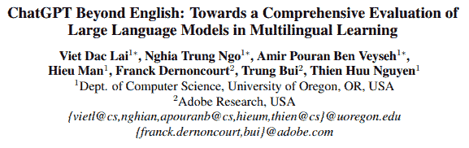

论文地址：https://arxiv.org/abs/2304.05613

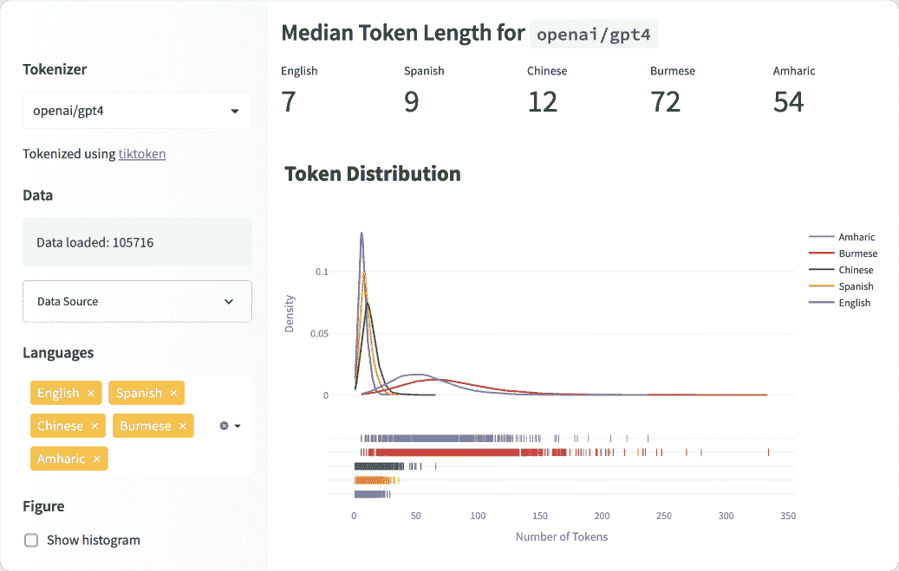

文章地址：https://blog.yenniejun.com/p/all-languages-are-not-created-tokenized

Chip Huyen 表示，本文的几位早期读者告诉他，他们认为不应该把这个方向包括进来，原因有两个。

1. 这与其说是一个研究问题，不如说是一个后勤（logistics）问题。我们已经知道如何去做，只是需要有人投入资金和精力，其实这并不完全正确。大多数语言都被认为是低资源语言，例如，与英语或中文相比，它们的高质量数据要少得多，因此可能需要不同的技术来训练大型语言模型。参见以下文章：

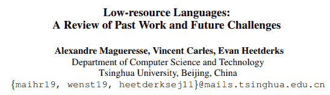

论文地址：https://arxiv.org/abs/2006.07264

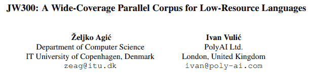

论文地址：https://aclanthology.org/P19-1310/

2. 比较悲观的人会认为，将来很多语言会消亡，未来互联网将有两种语言组成：英语和汉语。

AI 工具对于语言学习的影响尚不明确，比如机器翻译和聊天机器人。它们能够帮助人们更快地学习新语言，还是会完全消除学习新语言的需要，这暂时不得而知。

**总结**

本文中提到的问题也有难度差别，例如最后一个问题，如果能够头如足够的资源和时间，为非英语语言建构 LLM 是可以实现的。

其中第一个问题是减少幻觉，这将会难的多，因为幻觉只是 LLM 在做概率的事情。

第四个问题是使 LLM 更快更便宜，而这一点不会完全解决。在这一领域已经取得了一些进展，未来还会有更多的进展，但我们永远也没有办法改进到完美。

第五个和第六个问题是新架构和新硬件，这是非常具有挑战性的，但是随着时间的推移，这件事不可避免。由于架构与硬件之间的共生关系，即新的架构需要针对通用硬件进行优化，而硬件需要支持通用架构，这使该问题可能由同一家公司来解决。

还有一些问题仅靠技术知识是无法解决的。例如第八个问题改进从人类偏好中学习的方法，这可能更多是一个政策问题，而非技术问题。再说到第九个问题提高界面效率，这更像是用户体验问题，需要更多具有非技术背景的人员一起来解决这个问题。

如果你还想从其他角度来看看这些问题，Chip Huyen 推荐大家阅读下面这篇论文。

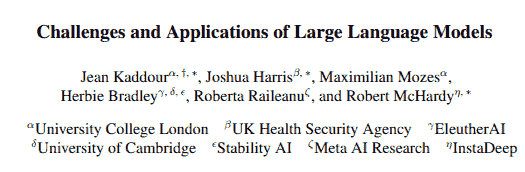

论文地址：https://arxiv.org/abs/2307.10169

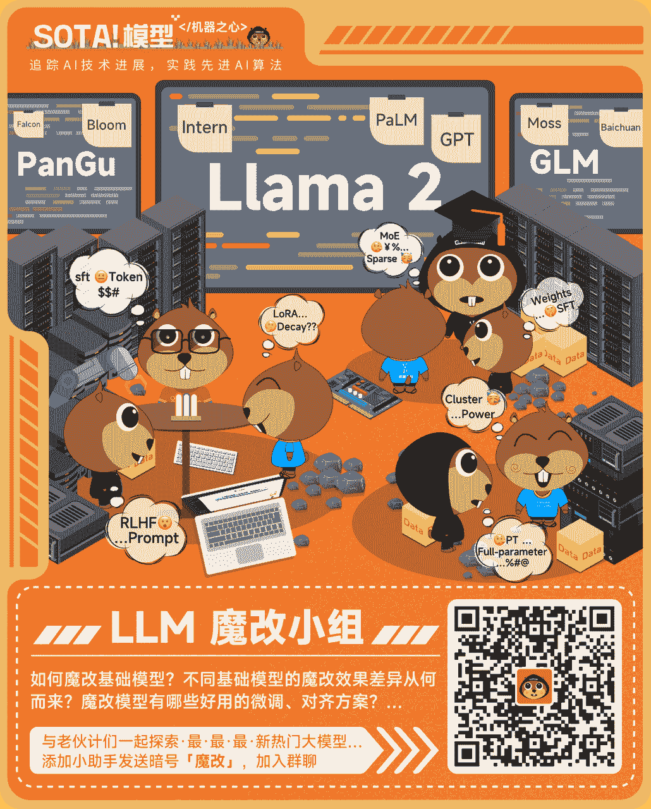

© THE END

转载请联系本👸号获得授权

投稿或寻求报道：content@jiqizhixin.com