# AI亲子教育，两个月从0到1

> 来源：[https://xuqiwei1986.feishu.cn/docx/JSr6d9zpdosWvRxrBWGc9xqnntc](https://xuqiwei1986.feishu.cn/docx/JSr6d9zpdosWvRxrBWGc9xqnntc)

大家好，我是闻彬，一个“爱创业、爱分享、爱带娃”的创业者。

> 入局破局2个月，定位做AI亲子教育。

> 带两个孩子从 0 到 1，学习 AI；

> 开出【AI大白亲子】知识星球，分享 AI 教育；

> 3次 AI 亲子启蒙课线下分享；

> 成为知名教育机构 AI 课程顾问，暑假最后一周开出“玩转 AI 思辨课”

# 一、入局AI破局，规划AI亲子教育

## 一）缘起AI破局

我加入破局还是蛮晚的，6月底，已经有2万多用户了，还是在混沌听了蛋蛋的直播课，了解到AI破局俱乐部，正好想找个地方系统学习AI，当天就立马加入，开启躬身入局All in AI。

后来翻微信时，才发现5月份【AI破局俱乐部】起来时，就已经把我拉入群了，只是那是我一直为创业项目焦头烂额，没顾得上。错过两个月的学习，感觉错过了不少，但仔细翻阅后，发现几乎没有人去分享AI教育领域，更何况K12的AI教育，只有洋哥反复提及看好AI教育。我同样看好，不是因为商业模式上考虑，而是因为AI对教育才是真正颠覆性的，AI真正影响的是我们的下一代，我们的孩子。

## 二）定位 AI 亲子教育，逐步展开

两个月时间，从加入AI破局俱乐部开始，就根据自身的情况，和AI交流，定位做AI亲子教育。

### 1、创建知识星球【AI大白亲子俱乐部】

把我这两个月关于AI教育的思考和实践，以及AI带娃的经验，制作的PPT等，分享到知识星球，发帖100多条，99元/年，已经50名会员。

### 2、为专业机构亲子夏令营讲课【ChatGPT和AI绘画启蒙课】

7月中为缪思国际教育的人工智能夏令营讲《ChatGPT和AI绘画启蒙课》（2小时），面向10多个2-7年级学生。并安排半天到校友物业机器人公司参访；

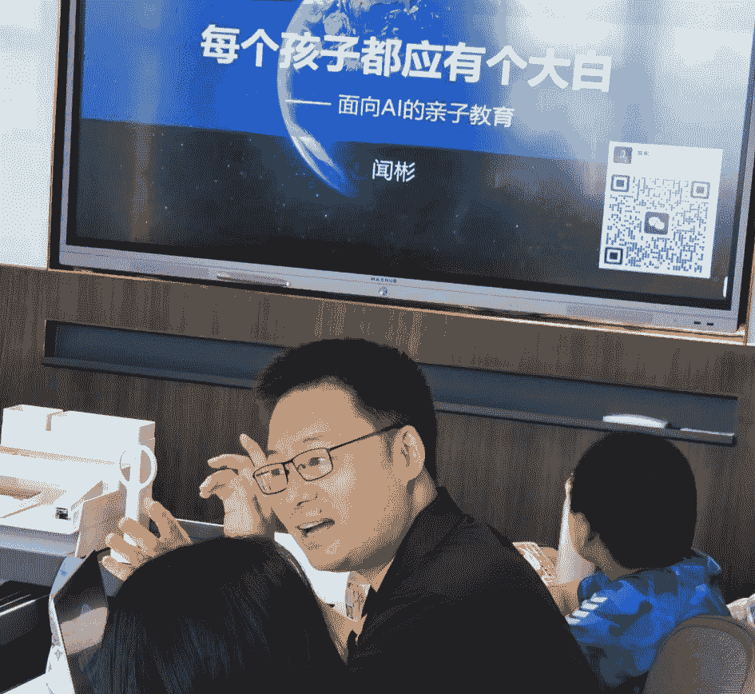

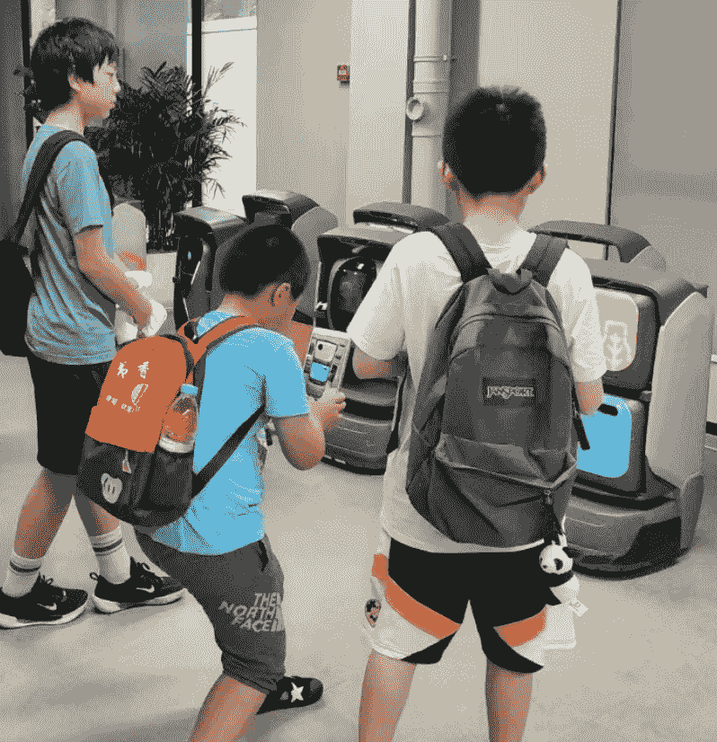

### 3、公益课【ChatGPT和AI绘画启蒙课】，与家长孩子互动，积累经验：

7月底和8月初，又面向20多个孩子和家长做《ChatGPT和AI绘画启蒙课》分享；

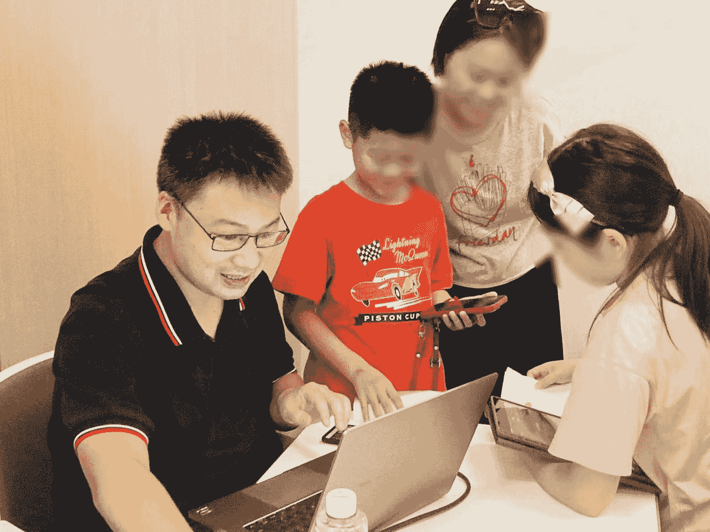

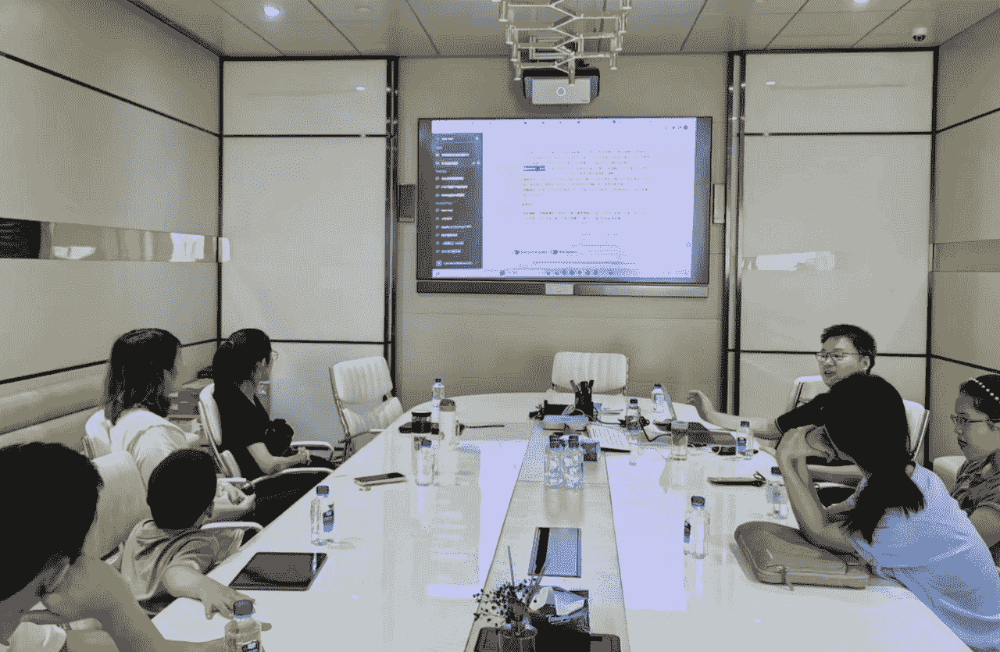

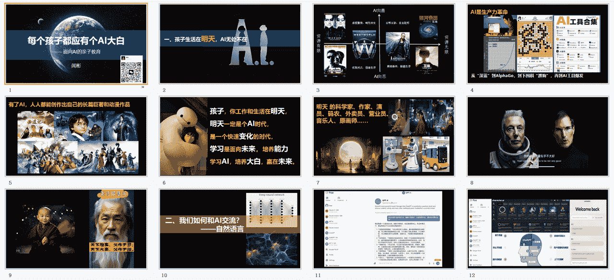

### 4、亲子AI课程顾问，设计亲子AI课程体系

8月份以课程顾问身份为缪思国际教育规划《玩转AI思辨系列课程》（线上6节，8.26-8.31连续6天）

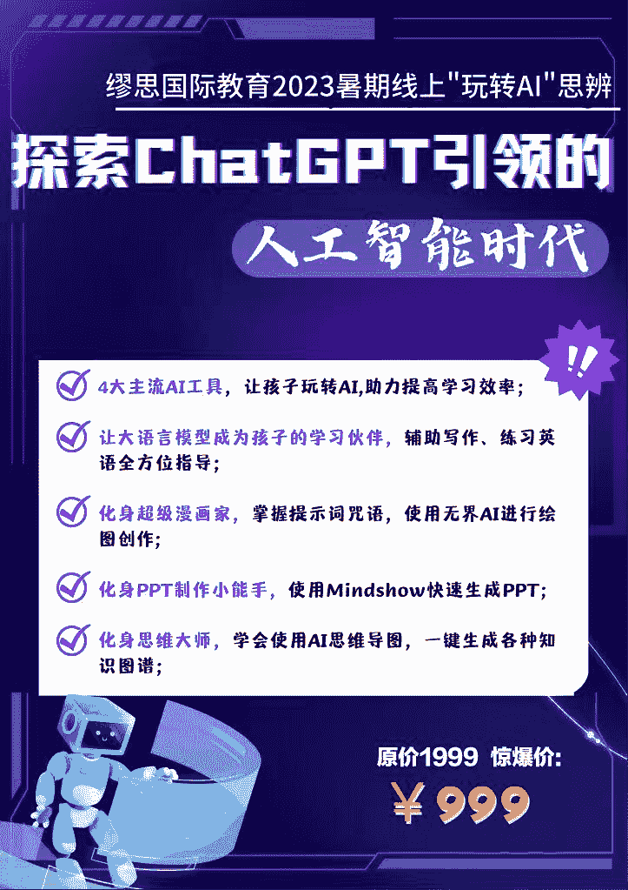

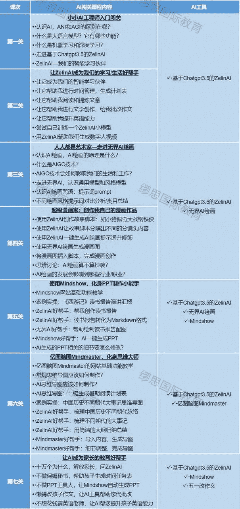

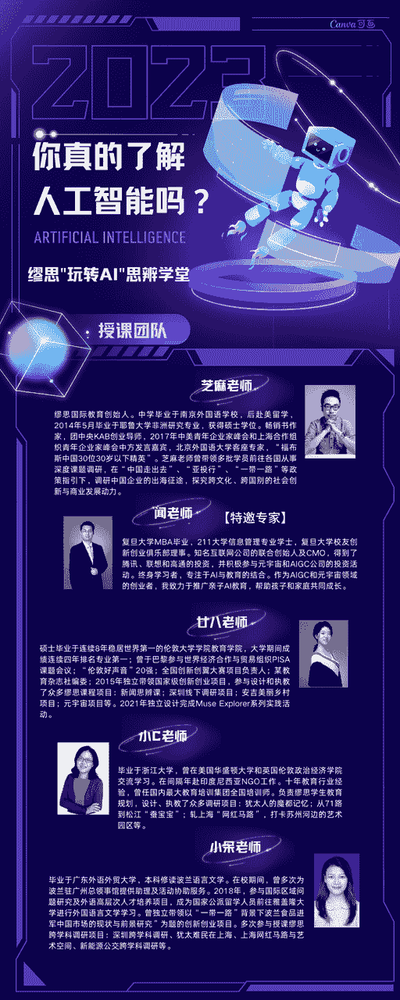

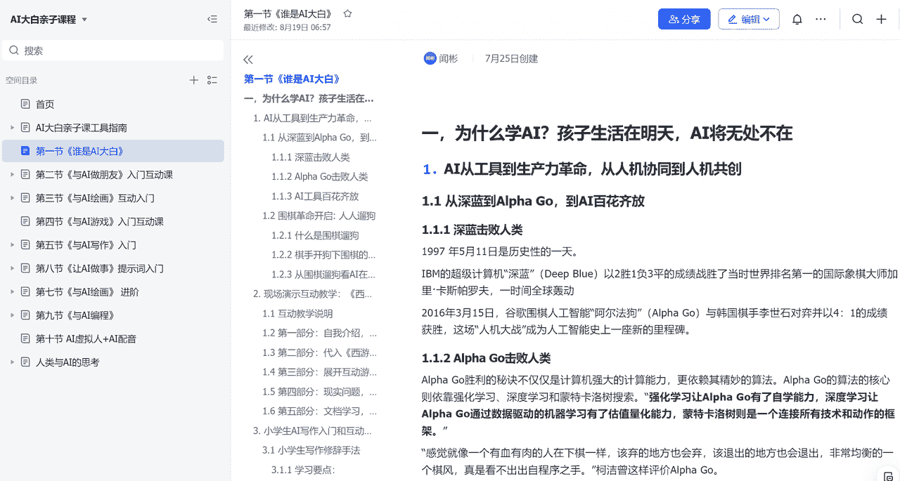

# 二、入手AI，从投资AI绘画开始

## 一）GPU云之上的AI会是新的互联网底层

其实我关注AI很早，在2021年就开始关注，因为有个复旦校友的智星GPU云的项目，引起了我的注意，两个英伟达早年的研发合伙做了个GPU，不到10人的公司，几乎全国的985/211高校都有订单，不是那种大订单，都是老师们小的科研订单。凭得就是他们对GPU的理解，进而对GPU云的理解，看看现在英伟达火得样子，就知道未来这层基础设施，就是建立在GPU之上，GPU云之上的。

## 二）“围棋遛狗”是人机协作的开启，未来生存的方式

他们当时做了个有趣案例，就是“围棋遛狗”案例，也就是网上下围棋竞技时，选手都会开狗，采用人机合体对弈的方式，由于开狗下棋，优势太大，围棋遛狗现象就在圈内传开了，他们正式给这些围棋APP内置GPU算力，用来养“狗”的，算力越大，“狗”越强。

有兴趣详细了解“围棋遛狗”现象的，请看知乎一篇问答：

与对手下棋开狗（使用AI）是一种怎样的体验？https://www.zhihu.com/question/400745026

## 三）面向未来的教育：遛狗AI+PBL+问

后来我做AI亲子课程时，就专门做了一页关于“围棋遛狗”现象的说明，用来说明人机共生的未来。2022年下半年，我在分享亲子教育时，就已经引用“围棋遛狗”以说明人机共生的未来，那是ChatGPT还没有火。这个案例非常好，大家如果做培训也可以用，进行深入思辨，当AI在具体领域打败人类后，人类和AI的关系会怎样变化和演进？看一下围棋竞技和AI的博弈，再看看当下各领域AI的涉及，是何其相似？也就能推演出各自领域AI入侵后发展和博弈。

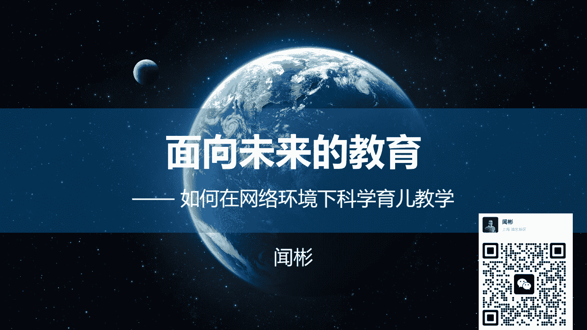

[2_面向未来的教育1119.pdf](https://internal-api-drive-stream.feishu.cn/space/api/box/stream/download/all/Mwj7bp3Lvo9cqgxSCV0cENxjnAo)

《面向未来的教育》亲子分享 2022年11月19日

## 四）从“围棋遛狗”到 AI 绘画创业

看到“围棋遛狗”现象后，虽然很小众，但我觉得这是未来，AI一定会进入各行各业，所以就帮这位智星GPU云完成了第一笔数百万的种子投资，让其有能力在2022年推出第二款AI产品——意间AI绘画。

谁也没想到，他们在去年10月彻底引爆第一波国内的AI绘画市场——意间AI绘画，抖音的话题数突破30亿，抖音，B站，小红书等各个平台的大V都在免费传播，千万用户瞬间涌入，和妙鸭的情况一样，核心功能也就一招——垫图生成二次元照片，不过当时没有设计好商业模式，有了流量，大量排队，没有很好的变现。

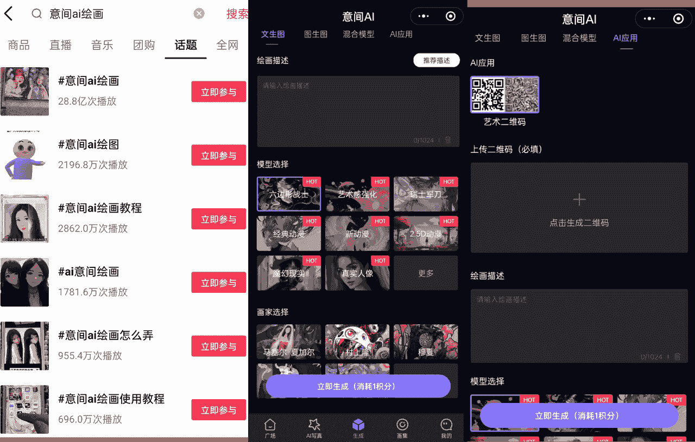

2-3个月后，各种类似意间AI绘画的小程序和APP就不断涌现，底层当然是大名鼎鼎的SD，意间AI利用强大的GPU管理能力，开放了API接口，让更多产品可以直接对接，现在市面上很多AI绘画产品，后台对接的是意间AI。

当艺术二维码等AI绘画细分功能出来时，有一定商业价值时，企业团队哪怕再小，很快就会跟上，快速开发出容易上手的产品。普通人的不方便和学习门槛，在创业团队面前都是创业机会。所以，意间AI很快也有了艺术二维码功能，一键式生成，如果这个二维码美化市场不错，或者技术难度不大，大厂可能顺手就做掉了。

## 五）创业的道路总会重复，AI之下，需要慢思考

意间AI在这波流量上沉淀了不少用户，后来的无界AI在市场合作上做得不错，触手AI最近PR很多，推出了AI动漫，看来是要融资了。我看到的是历史在不断地重复，同一赛道上的企业都会因为各自的基因不同，走向不同的方向，不同方向的结果往往都是有迹可循的，历史总是在重复。

无论创业企业的最终结局如何，但有一点是肯定的，只要有一个有商业价值的新功能出来，就会被他们做成产品功能，提高生产效率，降低使用门槛，从而吸引更多用户，留下更多用户。这一点是挡不住的，也是藏不住的。

个体再卷，是很难卷过公司的，但公司再快，是很难服务好个人和细分市场，以及下沉市场的，只要大厂不惦记下沉市场的那点肉，个体户总是有机会的。

AI快速涌现之时，慢思考将尤为重要。接下来国内各种大模型产品会层出不穷，大大小小的企业都会拥抱AI。个体面对快速变化的市场，慢下来，思考道路选择，变得尤为重要。有的评估能力，快速下场，可能为了锻炼能力或是变现一把，还有的会深度思考，选择一个适合自己，有深度，有门槛的赛道。

## 六）超级个体也是企业，需要AI时代的商业思维

洋哥看好AI赋能线下，是很有远见的。洋哥在大厂多年，思考力和执行力一流，再汇聚一批有经验的创业者，经历过互联网和移动互联网的大风大浪的过来人，可以考虑做个【AI商学院】，做AI领域的创业教育，【超级个体】只要涉及到变现和赚钱，就一定是商业，哪怕是一个人公司，也是公司，所以补上商业和创业教育，赋能个体，会更加有效的帮助个体成长。

自从我加入破局，每一篇文章我都看了，质量很高，很干货，也同时发现很多新手在商业上的困惑，在复盘中的商业问题。问GPT确实是一种很好的方法，但可能在开始问的时候，就已经跑偏了。有些创业法则和商业游戏规则因为基于个性和人性，是没办法明面写的。是要靠经验分享和个人的悟性的，线上线下结合，有效的对接，是可以大大提高效率的。

## 七）我更看好 2C 的 AI 应用，做大市场

最[近妙鸭的大火，本质上也是AI绘画](https://mp.weixin.qq.com/s/x7L-hfvO55qNWX_cu-HdHw)功能在特定产品上的体现，产品设计和商业设计做得非常棒，据测算，月流水也过千万了。《对话「妙鸭」产品负责人：AIGC 的产品第一天不收钱，就可能收不到钱》

这可以做商业案例分析的，类似妙鸭这样的产品未来会越来越多，新的开发团队会比上一代移动互联网产品团队要小不少，成本也低不少，很适合超级个体高效连接后，创新出来，AI时代商业模式已初具雏形，需要总结归纳，再到快速落地。

伴随移动互联网时代养成的付费习惯和付费基础，AI时代应用上来就能收到钱。我更看好AI在2C领域的爆发，过去那种免费模式已经下商业变现方式，已经无所不用其极，是需要改变了。未来会有更多2C应用会借着AI能力，切中特定场景和痛点，快速爆发。

AI如果不打开2C领域，仅仅在2B领域降本增效，只会加速企业竞争和内卷，最终导致越来越多的人下岗。我的判断是AI只有帮助人类在两个领域拓展，才能打开更大的市场，为人类找到出路，

> 一个是走出地球，目标《银河帝国》；

> 另一个是创造元宇宙，目标《头号玩家》。

# 三、看好 AI 破局，能引领 AI 时代的超级个体

## 一）历史重演，10年前的【复旦MBA IT俱乐部】

10年前，我创业始于复旦MBA。从2012年进入复旦MBA开始，我就考虑创业，目标做TMT，当时创办了当时在上海滩最火的创业社群【复旦MBA IT俱乐部】，借着微信爆发快速发展。

一年半的时间，从【IT集结号】召集志同道合者，到万人的线上微信群访谈同步分享，以及2015年500人场大会【复旦创新创业大会】，历时10多个小时，从上午10掉到晚上10点，包了复旦管院最大的报告厅——李达三楼2楼报告厅。上午直播连线硅谷创业者，做创业对话，下午到晚上做创业路演。

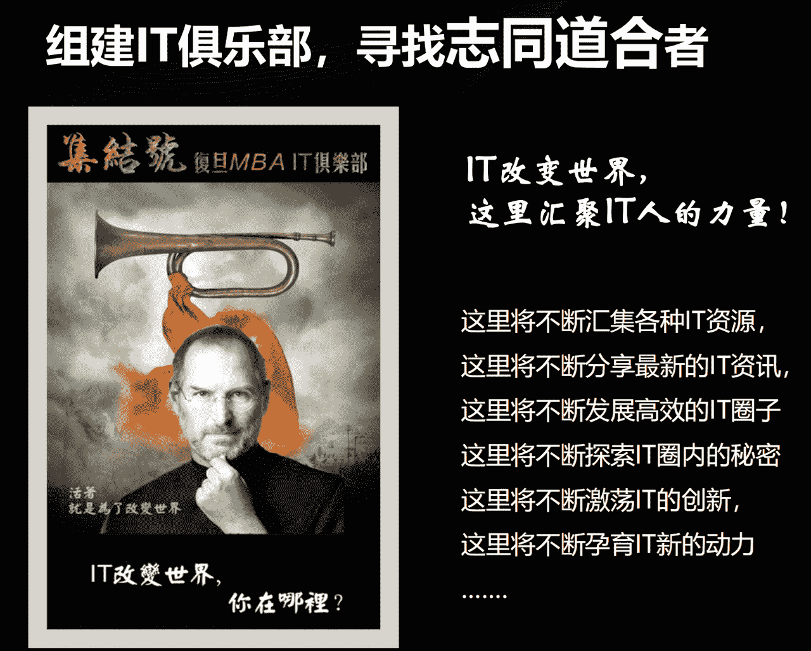

## 二）【周三夜谈】——微信群里的创业访谈

我开始用微信群做访谈节目——“周三夜谈”时，微信群上线是40人。即便如此，4个月持续活动后，群就破百了，当微信放开群限制到500人时，我们做一场活动就能拉2个500人群，每周三晚上，要做三个分会场线上访谈活动，分别是：移动互联网，互联网金融，智能硬件和教育，能同时覆盖过万人，还有不少群里是直播转发的，群活跃度非常高，持续做了200多场，访谈了当时活跃的创业者，我后来估算了一下，有1/3拿到投资，有少部分现在已经很知名了，还有上了第一届湖畔大学的学员。当时不觉得，现在看来当时创业环境真是非常的好。

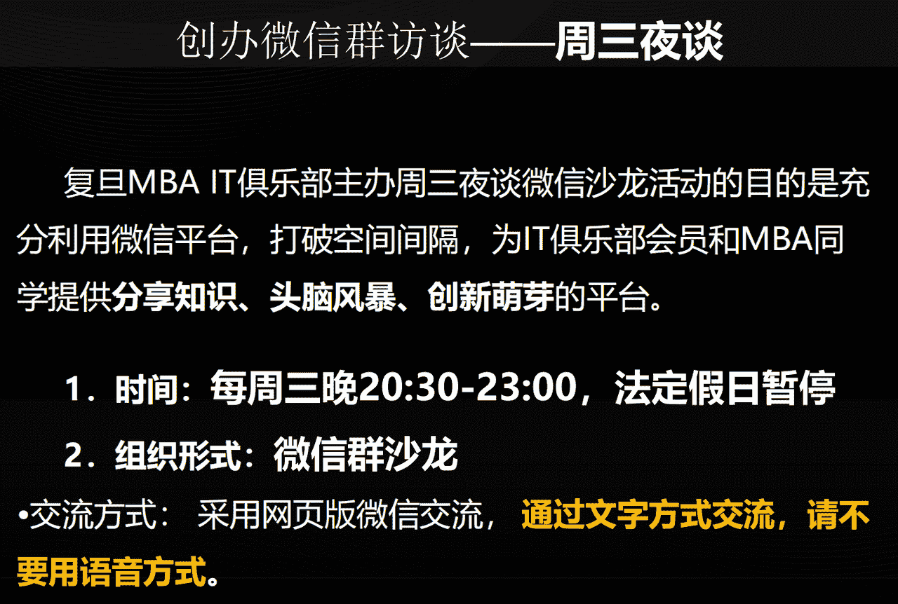

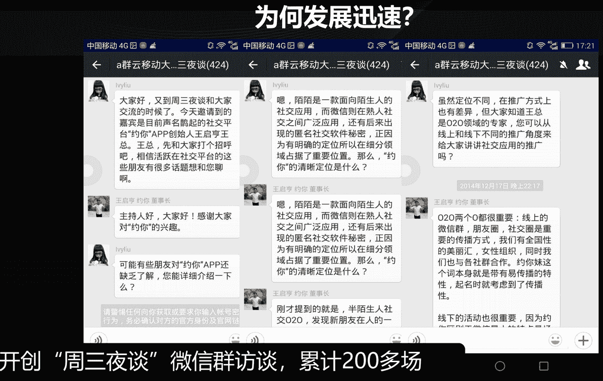

## 三）O2O线上线下的活动社群

不知道还有多少创业者记得当年最火爆的"O2O"概念，那时的创业项目是各行各业，各个维度。2012年11月自己以联合创始人身份加入一家10多人的创业公司，负责市场销售，带资入股，再后来的几年每年都有至少两次发不出工资，自己和创始人都卖房入股，同时还融了上千万的个人投资，好歹最后赶上TMT的尾巴，引来5G和短视频红利期，高速增长下，拿了BAT和世界大厂的投资。

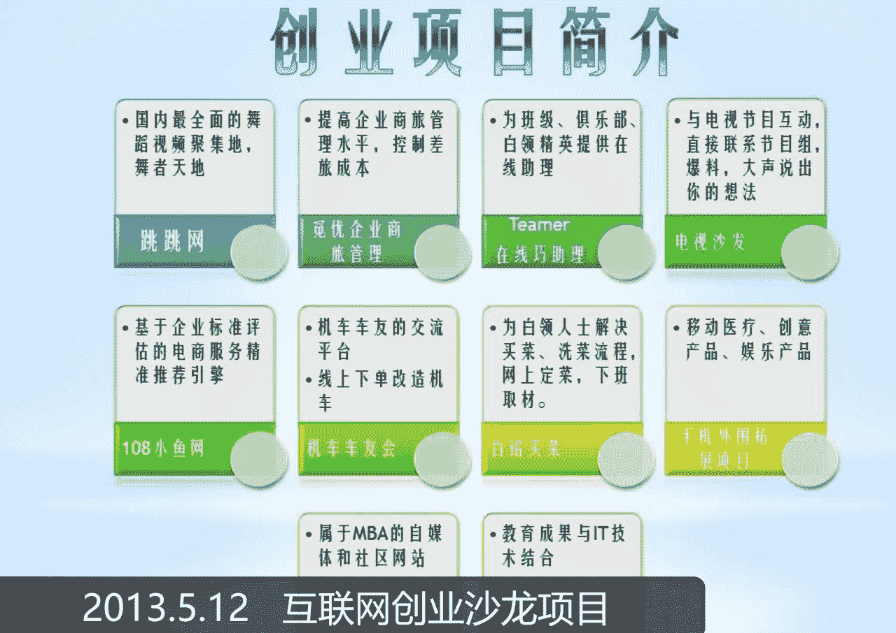

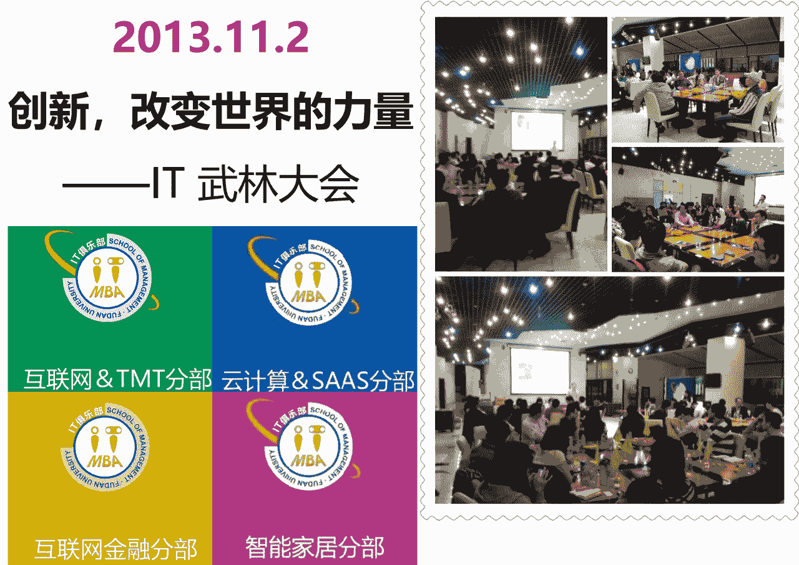

每周三晚上【周三夜谈】三次线上分享，就能带来每周六晚上百人场的线下分享，就是俱乐部活动O2O的典范。现我们【AI破局俱乐部】就是当年【周三夜谈】的升级版，当时我也发现微信做社群的问题，所以当时有要做【MBA COOL】创业项目，后来花了5万后，就及时收手了，条件不成熟，我们有校友后来融资百万做了类似【在行】的产品，后来也停了。


## 四）社群也该有商业模式

佩服洋哥的眼光和执行力，选中了【知识星球】为社群载体，选中了AI当下的热门赛道，时机刚好在过完年后，大家在规划今年的发展，商业模式起步很好，每个会员就会有会费，有了营收，就有财力卷入更多的资源，更多资源卷入后，高效链接，各取所需，就会产生化学反应，吸引更多人加入。

10年前，我做IT俱乐部时，没有做付费会员的基础，那时是互联网免费模式的天下，所以做得很辛苦。只收了最初不到100名会员的会员费。后续就全部免费了。没有移动支付，收会员费都很麻烦。

洋哥的辛苦，我是感同身受。那两年，我是看到微信公号的风口，是复旦最早做微信公号的，我也起了几个号，1个月就过万粉了，还都是转发，已经没时间做原创。当时就成为复旦MBA活动报名入口，比复旦官网报名量多很多，当时线下活动就用31会议进行有效管理了。

几个微信公号坚持了2年，后来也是忙不过来了，加上自己创业有起色，渐渐地就放弃了，很可惜，错过了打造个人IP的机会。

## 五）10年，坚持到现在的公益创业分享

因为“爱分享”和“真诚待人”，说话比较直，创业分享都是干货。而且越来越干，随着公司做大，在各个创业圈里结实人脉，拿大厂投资，与大厂博弈，实操和心得就比较多。一年大大小小创业分享也有10多场。

MBA期间师从复旦包季鸣教授、宁钟教授还有唐海松老师（当年亿唐创始人），重点学习【商业模式创新】，做创业社群，也看到很多创新的案例和模式，最早一批加入混沌（当时还是颠覆研习社），后来读得到高研院，博商的郑翔洲班，现在加入【AI破局俱乐部】，都是为了在一线感受商业的创新和活力，这也是一直吸引我的所在。

坚持每年要做10场左右关于商业模式的创业分享，就是在不断地学习总结，锻炼自己的思考力，提炼出一些方法论。最近的分享以及更多融入AI的内容，准备着手对AIGC领域的创新创业做思考和提炼。【AI大白亲子俱乐部】中有我做创业分享的PPT，我所有分享的PPT，都是课后发给大家的。

这些年在做创新创业分享时，遇到一个又一个创业项目时，说实在的，我劝退的越来越多，一方面重复造轮子的事，反反复复发生；另一方面，很多创业者忽视了商科学习，赚钱模式没有想清楚，各种风险没有考虑到。

破局中，乔帮主新帖《如何烧掉100万，以及从中总结的六大经验感悟 - 我做约会APP的内部解密》这种案例分析拆解，对创业者非常非常重要，创业九死一生，乔帮主的复盘，很值得大家学习借鉴。

短短3-4个小时创业分享，对创业者是不会有太多影响的。所以这周四在上理工给大学生创业者分享时，我就强烈推荐他们加入【AI破局俱乐部】，到一个更有氛围的社群，去提高自己的视野和认知。

## 六）看好【AI破局俱乐部】的原因

### 有洋哥这样的大IP，开放和包容，与时俱进，非常接地气；

10年前，复旦MBA IT俱乐部能火出圈，也是赶上创业风口，接地气，快速迭代发展；

### 有广大的终身学习者和执行者，学习，分享，实践，复盘，再出发，很好的闭环体系；

知识星球的社区，在技术层面上支持了这种闭环得以飞快转动起飞，这比10年前的基础要好很多；

### AI 赋能社区的效率，人机协作共创，使得社区高质量产出越来越多；

AI 赋能个体，直接导致内容产出的丰富，加上高质量的分享，使得大家都会提升自身水平，我也是加入后，才得以快速提升自己的产出。

### 汇聚 AI 赛道各细分领域的头部IP，形成产业链；

我是在入局后，根据自己实际情况，觉得要从提示词突破，第一时间下手，报名【小七姐的提示词实训班】，一下子打开了AI的视野，很佩服小七姐的一点是，没有任何藏着掖着，直接把我们100多号学员，引领到提示词领域的前沿，这一点非常受用，站在该领域最前沿，就会更加自信。此外，同学的优秀，就逼得自己不得不学习提高。

小七姐新一期课要开了，有需求的同学抓紧呀。https://www.yuque.com/yiliqi-t2n6d/nz6hpk/mpgkui74t6o5ibac?singleDoc# 《我为什么要做这套提示词提升课？》

这次大航海有8个方向，我这一次要报名，跟着高手一起学习。


# 四、为什么做AI亲子教育

我的人生规划：10年打工，10年创业，10年为师

## 一）规划就业，做好创业，家庭为重

### 用心规划自己的就业

2001年从安徽大学经济信息管理专业毕业，年初就拿到上海一家知名人才网站Offer，和合肥科大讯飞的Offer，都非常顺利。无他，用心而已。

大三开始研究方向就是《网上人才市场》，创业计划书就是《大学生就业网站》，就是为了回上海找工作，知道不容易，但一定要借找工作，进行研究和准备。就凭着我打印的毕业论文，创业计划，以及软盘刻录自己的论文和代码（实习设计的名片管理系统）。上海这家网站就直接面试通过了。

其实，当年科大讯飞也是让我非常心动的，毕竟那时科大讯飞在合肥已经很有名气了，我当时面试也是个故事，一面一群科大毕业学生，问了我大学做了什么？后面全程被我把控，我把我在大学做的俱乐部，六大高校做的社会调查《大学生对科索沃事件的调查》，做《苍龙在线——大学生就业网站》计划等一说，面试结束了，通过了。

第二天直接见总经理，走的时候，我带走了他们的产品资料。第二天当着总经理面，问你们的产品销路是否有问题？原因是哪些哪些？面试完，直接给Offer，当场签，月薪3000元。已经是我们同学中最高的了，当时真有些心动。但回趟上海，上海公司直接给了Offer，还是回到上海了。第一次错过了进大厂的机会了。

直到现在，我都没有投过简历，认真规划，认真准备，就一定有更多机会的。

### 创业10年同时，也是带娃10年

很多创业者，一创业就顾不上家了。我创业时也是老大还小，老二刚生，虽然创业和读MBA，做社群非常占用时间，但我没有错过孩子的成长，10多年来，带娃成了我最大的爱好，陪伴孩子成长，是非常非常开心的事，比创业重要得多。无论再忙，我都会花时间在孩子身上。

当两个女儿到了能出门游玩的时候，我就筹划了亲子研学，第一次西北大环线长途自驾旅行，准备了两个月，为孩子做了200多页PPT，在马蜂窝上分享了万字亲子研学笔记。后来每年会以自驾主题游的方式玩一个省。最初就是为了培养两个女儿对国与家的认知和归属，不要沉迷在小马宝利的世界里。现在两个女儿都在初中，《论语》跟了一年多了，现在都开始上手编提示词了。

### PBL 亲子研学

为了孩子的心灵归属和对家国的从认知到热爱，我计划带她们用PBL的方式走遍国内100个城市和乡村，走出去，发现一个更大的世界。

小时候，西方的动画比较多，孩子沉迷在小马宝利的世界里，为了让她俩能感受到中华文化的魅力，中国公主故事的丰富，我特地研究了大西北，带她们回趟祖籍甘肃张掖，感受一下中华文化，这个准备过程，以及教育意义都分享在了马蜂窝，70%的内容是关于教育。大家有兴趣可以在马蜂窝看，缪思和真棒之选自媒体都做过报道。

附上当时的PPT，有孩子的家长可以参考。

马蜂窝的亲子游记：[《亲子丝路之旅》系列](https://www.mafengwo.cn/i/7737671.html)，《中原穿越之旅》，《山西陕西内蒙发现之旅》

+   代表性亲子分享文章：

[《缪思2023思辨学堂招新啦！凭200页敦煌研学笔记](https://mp.weixin.qq.com/s/2aacpGVthcH9ZeoFawVvfg)刷屏的“人家爸爸”，也曾为缪思点赞哦！》

[《我怀揣200页敦煌亲子研学笔记，带女儿踏](https://mp.weixin.qq.com/s/Zj_4WOT3z-ks9uXLjsy-Ew)上丝绸之路，“走”出来的家国梦太燃了！》


[亲子丝路文化之旅20170908.pdf](https://internal-api-drive-stream.feishu.cn/space/api/box/stream/download/all/HWQ8bEiaTouiBZx6ocUc2e7mnXf)


[丝路行之火车20170908.pdf](https://internal-api-drive-stream.feishu.cn/space/api/box/stream/download/all/DeSvbjpnCo6Coexvo2acPOxOnyh)

## 二）为了下一代的 AI 教育

### AI+PBL 亲子教育

创业10年多，经历起起伏伏，经历过各种焦虑和压力，我深刻认为，唯有家庭才是最重要的。创业成功，走向财务自由，固然是喜事，但是小概率事件。一路走来，忽略了家庭，错过孩子的成长，将是一辈子的遗憾。也许当自己老去时，最值得自己骄傲的过去，还是“老婆，孩子，热炕头”。尤其是在未来环境的不确定，AI 带来的变革的不确定下，也唯有家庭才能是超级个体的港湾。

当亲眼看到 AI 的发展，使用 AI 产品时，我深刻感知到，AI 真正影响的不是我们这代人，而是我们的孩子，AI 让答案变得不重要了，而提出好问题，变得尤为重要。发现一个更大的世界，发现更好地问题，这都是现有教育体系不足的。

2015年，自从接触PBL（问题式学习Problem-Based Learning，PBL），我就深感PBL的价值，平时带孩子用常用PBL的方式，出去旅游会用得更多，孩子小学阶段，最适合用PBL带孩子的。

我会带问题，和孩子追动漫《斗罗大陆》、《斗破苍穹》、《武庚纪》和《吞噬星空》等等。我们就用PBL方式进行各种交流，比如就会问她们，

如果她们在《斗罗大陆》中，会设计什么样的武魂，什么样的魂环，什么样的属性？

《斗罗大陆》，《西游记》和《哈利波特》在情节，人物设定上的相同和不同，故事情节设定？

为什么《斗破苍穹》中“三年之约”会发生？门派和家族为什么会产生冲突？

这些问题和聊天，铺就了她们成长之路，陪伴她们走过沉迷，借此成长起来，开始深度阅读和思考，如今小女儿6年级，上手Claude后，各种追问和思考，看得我也是自叹不如。

### AI 时代，培养面向未来的学习能力

下图是脉脉创始人林凡在混沌分享时，关于孩子教育的思考，这里我略微修改一下，分享大家，我当时是带着全家人一起听的，让孩子们也能感受一下AI带来的冲击，以及高人的思考。


## 三）AI 教育理论基石：《ChatGPT：教育的未来和未来的教育（陈宝生）》

### 前教育部部长陈宝生的万字论文《ChatGPT：教育的未来和未来的教育》

8月22日，《人民教育》上刊载了前教育部部长陈宝生的万字论文《ChatGPT：教育的未来和未来的教育》，直接从底层逻辑去思考ChatGPT对教育颠覆性的影响，以及初步给出教育变革的方向。这篇文章，我全部仔细看了一遍，用GPT4一起解读，分享在【AI大白知识星球】上。

我觉得还不够，可以基于他的理论架构，延伸做成《AI亲子课程》，也正是他的这篇文章，促使我写下这篇分享。我这两个月在梳理自己的《AI大白亲子课程体系》时，一直苦于没有理论体系支撑，而求助于GPT，也没有效果，但这篇文章让我豁然开朗，似一盏明灯为我指明了 AI 教育的方向。

### 《ChatGPT：教育的未来和未来的教育》中金句，载自原文

> 就教育**而言，挑战已到，未来已来。工业革命以来**的现代教育突出的特征，一个是知识分工基础上的学科式构架，一个是相对稳定通约的知识传授，一个是适应工业化时代的分级分班教学。这三个特征对应的领域，恰恰是智能化的ChatGPT首先要替代的领域。有一些具有规律性的趋势已显露端倪——凡是可以通约的事，凡是相对稳定的事，凡是能标准化的事，都会被ChatGPT替代。看看，这个事够大吧？这是天大的事啊！

> **打破学科分界和知识领域，在横断学科、交叉学科、复杂学科、生命学科等方面重构相对动态和能够自组织、自调整、自适应的人类知识体系**；与此相适应，要改变分科分级分班的教学模式，让因材施教、个性化学习、平台推荐式教学、走读选题式教学成为主导的教育教学模式。教育是人类的特权，机器是人类的学生，未来的世界是以教育为基础的世界。

> 面对ChatGPT对人力的取代、对人心的扰动、对创新的推动、对秩序的搅动，我们的孩子将怎样学习，学习什么，怎样生活，靠什么生**活，值得每个教育工作者深入思考，努力探索。对这类问题的解释和回答，要**沿着对人的本质的探究、依据人全面发展的内在逻辑展开。未来的教育应该是这样：人外化了哪些器官，就要教学生学会外化的原理和操控这些器官的本领；衍生了哪些能力，就要教学生掌握衍生的规律以及怎样用好这些能力。

> 一种**新的教育类型已经诞生，这就是人对机器的教育**。我们可以粗略地把对机器的不断培训看成是教学，把输入看成是给机器布置的作业或考试，把输出看成是交作业和答卷。这个变化是革命性的，未来的教育将不再是以传统的师生关系为轴心的线性关系，而是人对人的教育、人对机器的教育、机器对人的教育相互链接的网络关系，是一部“三国演义”！

> 在个人层面，需要警觉的是，人工智能发展会代替我们大量的工作，新的工作领域尚未见端**倪，这是好是**坏还未有定论，但个人需要具备一定的应对策略和措施，这是最基础的。作为个人，至少应学会或强化三种能力。一是操作能力，要学会给ChatGPT发指令、提问题以获取想要的东西，提示词越准确，结果会越好。二是转换能力，学会如何把一些事交给AI去干，自己再学习专业知识，技多不压身，要能够灵活转换门庭，在新的学科和专业领域做开拓奠基者。三是适应能力，当变化和压力到来时，能保持耐心和定力，安心沉稳应对，能闲庭信步，不手忙脚乱。

> 已有的人机协同案例证明，人机协同的智商可以大大超越人类自身的智商，因此我们可以有力引导人工智能的行为，这是一个非常重要的方向。人机协同的关键是人的适应性和学习速度，就人来说，对未来具有良好的适应能力和愿望以及形成快速反馈循环的机制非常重要，因为第一张牌还是得人来打，机器传回来的球还是得人来控。人类要么准备好强大的学习能力，以适应未来充满超级AI的世界，要么不去思考人工智能的能力，自行决定未来是何种模样。

> AI时代，学生还需要养成一种与之匹配的习惯，这就是提问、不断提问，提问必然会成为人类最基本也是最有价值的行为之一。能正确地提出问题，本身就很有价值。人类未来的工作重心将会变成提问以及应对不确定性。我们要适应这个需求和重大转变，把培养孩子的提问能力作为未来教育的核心内容，并以此为基点建构教育的内容体系。

### 用GPT4来解读《ChatGPT：教育的未来和未来的教育（陈宝生）》

反复认真的深度阅读这篇论文，你每次都会有所收获的，在自己阅读，尝试深刻理解后，和GPT一起解读，也是件很有意思的事。

这样身份的高人，在权威期刊上发表的论文，赶在新学期开学之前，是有着非常重要的指导意义的。

无论是否从事AI 教育的同学，我建议大家仔细读一下，会对自己的 AI 学习有了更深刻的认知。我把部分与GPT4交流后的，有关AI教育的分析在这里分享给大家。我在【AI大白亲子俱乐部】知识星球中，会做长期的持续的教育思考和分享。


我自己觉得还不够深刻，也许是提示词的原因，也可能是GPT在深度思考上比不过领域里的专家。

人类走到现在，其伟大之处，在于总有一部分人的思考会更加深刻，而这种深刻是内化在少量著作中的，而GPT基于大数据的思考，可能会忽略掉这些深刻的思考。

### AI 时代，慢思考的能力也很重要

开学之际，各大名校校长都会做开学演讲。当下，建议读一下耶鲁大学校长的开学演讲《开学第一课 | 耶鲁大学校长2023年开学演讲：放慢脚步，弥合裂缝》，虽然他针对的是美国当下的环境。但AI的时代背景是相通的。当下很快会兴起的AI浪潮，一定会让更多人陷入到快思考中，而快思考的背后，往往布满了陷阱。

这篇演讲核心引用了诺贝尔奖得主、检察官丹尼尔·卡尼曼（Daniel Kahneman）的书《思考，快与慢》（Thinking , Fast and Slow）。我们的思想是如何受两个系统控制的。系统是的，它基于情绪、条件反射、固有印象，它使我们“容易上当，容易相信信息。”而系统二是慢的，它负责通过分析事实、细化商榷、理性思考，从而“质疑和不相信”信息。

我在开始学AI时，就开了百家号，用AI成文，AI成片，5分钟出一篇爽文后，留给我的是一种后怕，我觉得自己就是个机器，任AI摆布，尤其是看到爽文阅读量还高时，那就更加感觉自己是 AI 控制下的农民工。试了两篇就停了，慢下来思考一个问题，AI 时代：内容生产更加容易的时候，如何产出好内容？

最近几周，我就开始慢下来思考，想写篇 AI 教育领域长篇论文《AI时代，我们更需要“达芬奇”》

# 五、AI 亲子教育从 0 到 1 的实践和思考

## 一）为什么是【AI大白亲子俱乐部】知识星球

关于这个知识社群的定位，命名和发展等，我和ChatGPT深入聊过，是有收获的，但在命名上，试了很多，都不理想，ChatGPT很难在命名上联想和具象到其他领域。

我希望的未来世界，每个人是由 AI 保护的，AI 是服务人类的，很难用词语去组合，知道我想到了大白，那个《超能陆战队》中，保护孩子的大白机器人。AI 大白的形象一下子浮现在眼前，我自己就是我女儿们的大白，呵护她们成长，那我们的 AI 大白就是，我们大人和孩子为了应对未来 AI 世界所培养的保护自己，提升自己的 AI 机器人。

【AI 大白】就是我想表达的 AI 教育的世界观，每次讲课时，我都会把这部分放在最前面。让大人孩子们意识到 AI 是可以成为【AI 大白】的。

我会把我之前讲启蒙课的PPT，分享到【AI大白亲子俱乐部】知识星球，希望同学们能用得上。

## 二）做 AI 亲子教育要有同理心，从孩子们的认知出发

当你面对一群小学生，活泼可爱，坐都坐不住的时候，你能跟孩子们讲什么是生成式AI，什么是提示词？什么是AI写作吗？他们根本听不进去你在说什么？

第一步要做的不是用PPT介绍，生成式AI的来龙去脉，前因后果。是要让他们直观感受ChatGPT是个什么东西，好玩在哪里？否则他们以为又是一个百度，一个谷歌，搜一搜知识的地方。

为了能触及到孩子们的认知，和他们达成共识，在ChatGPT的导入上，我尝试了《AI自我介绍法》、《西游记教学法》，在拓展AI写作上，用了《孙悟空来到霍格沃斯魔法学院》，效果不错，能够成功的抓住孩子们的眼球，相关一些内容，我也在知识星球中分享了。

## 三）孩子第一次认知ChatGPT，从交朋友开始

很多人，把ChatGPT当做工具，确实，我们在使用上就是把GPT当做工具在使用。但我们能这么教孩子吗？让他们第一次认知ChatGPT时，就把它当做生产力工具？和百度一样的工具？

如果是这样，孩子们就会一个劲的拿它和百度比，这个不行，那个不行，还有错误，达不到我想要的，没有你吹的那么神奇，问两个问题，就抛开不用了。你难道能逼孩子使用吗？

所以引发孩子的兴趣至关重要，一定要想方设法，让孩子感兴趣，兴趣越大，孩子就会投入越大，收获越大。以我两个女儿为例，大女儿8年级，小女儿6年级。两个人差不多，老大接触的早，因为我侄子也是6年级，非常会玩，自己知道ChatGPT后，自己搞定了魔法和账号，很快就玩起来了。我听说后，当时让大女儿自己去摸索，找攻略，搞定魔法和账号，最后她花了整整一天，没搞定，这对她打击蛮大的。

每个孩子的特点不一样，所以在 AI 教育上，如果家长能学到的话，因材施教可能是最好的方式。

对于大部分孩子学 AI 而言，搞定魔法和账号，家长一定要帮忙，帮他们先突破这关。

暑假开始后，我帮两个女儿搞定魔法了，也搞定账号了，报了一个线上 AI 夏令营，让她俩可以入门学习，因为大女儿之前的工具印象（这可能是我第一次给她介绍时，造成的），她对 AI 学习提不起兴趣。最后这门线上课，我是跟着小女儿听的，也是一群小学生在学。这期夏令营就是以《西游记》为主题的 AI 课，通过这个孩子们都喜闻乐见的IP植入，让孩子们感受 AI 的有趣和魅力。

首次启发，我在 AI 亲子启蒙课中，一方面引入《西游记》IP，另一方面，不再提 AI 的工具属性，而是强调 ChatGPT 可以成为孩子们的好朋友，可以展开聊天的朋友，在现场教学中，我就以孩子的语气，和孩子们一起，让 AI（用Claude2）做自我介绍，通过自我介绍的不断通俗化，让孩子认识到，我们可以让他能帮我解释更多我不理解的知识，然后建立和自己的联系，能帮我做什么，然后不断追问，怎么帮我做呢？

从和 AI 交朋友开始，你会发现当这个 AI 和孩子们产生联系的时候，孩子们才会真正感兴趣。他们才会发现 AI 有趣的地方，当你模拟孩子和 AI 交流的时候，你也会发现 AI 真会循循善诱地引导孩子。

这时，我想起陈宝生《ChatGPT：教育的未来和未来的教育》论文中展望的机器教人的新场景，我觉得 AI 亲子教育的第一步是，教育者（家长或老师）如何把 AI 引入到孩子身边，促成 AI 和孩子们的第一次美好的见面和交流，有个非常棒的开始，后面 AI 会逐步根据孩子的问，提升孩子的认知。

小女儿认知 AI 就不是从工具出发的，她就是和 AI 聊天，当然开始时还是为了完成作业，但她总会很兴奋地告诉我，我觉得 AI 好有趣，她的回答好有意思。她已经好几次和 AI 深度交流后，开始输出自己的内容了。

## 四）孩子学习 AI，必须配套新的协同软件，如飞书

这一点，在刚开始我没有意识到，我读大学时Office也才刚开始，后来办公用Office比较多，协同软件用得少，也就是公司审批走流程而已。这次加入破局，看到大量的分享，用得是飞书文档，感觉到知识输出和整理的便捷，以及整合能力。和小七姐学提示词，上来就要用《语雀》，逐步发现用语雀这样工具能整理自己的知识库。越用越有意思。

上一周，我小女儿 AI 夏令营复训的时候（她上次学完，觉得还不够，AI 编程都没学到，要求复训），又一次写同样的作业《加入没有AI，世界会怎样》，第一次写作业是，是用WORD+百度搜索，内容都是由自己写的，百度只是帮助自己找一些知识。没有用到 AI 。写的内容也是很不错，有自己的想法，完全是一篇优秀作文的水平。

第二次作业，她自己就提高了要求，要求和 AI 一起创作，和好朋友Claude2 一起来写，和 AI 一起创作，内容产出是很大的，而且会有更多中间过程，于是那一晚，9点上完课，我教会她用飞书（第一次接触）做作业，教会她用“Markdown代码块”输出大纲，导出到“亿图思维导图”（也是第一次用），再复习了一下导出到Mindshow生成PPT等基本的操作，也就不到10分钟，她就开始闷头和 Claude 聊天，做思维导图，写文章，一直忙到半夜一点，我12点就睡了，一早上开电脑，看到她的作业，我都惊了，等她起来，我和她在做了些修改和完善，主要是补充了之前的作文，把更多自己的思考融入其中，再加了最后的彩蛋，最后的成文如下：

[假如世界上没有AI，会怎么样](https://u038xyge8ow.feishu.cn/docx/PWWydbGjjoIx0AxRrtPc8XfAnHf)

## 五）AI 助力孩子快速成长，“AI+家庭”出现

陈金生部长在《ChatGPT：教育的未来和未来的教育》中，有一句话，在这次女儿的作业表现上，让我深以为然：

已有的人机协同案例证明，人机协同的智商可以大大超越人类自身的智商，因此我们可以有力引导人工智能的行为，这是一个非常重要的方向。人机协同的关键是人的适应性和学习速度，就人来说，对未来具有良好的适应能力和愿望以及形成快速反馈循环的机制非常重要，因为第一张牌还是得人来打，机器传回来的球还是得人来控。人类要么准备好强大的学习能力，以适应未来充满超级AI的世界，要么不去思考人工智能的能力，自行决定未来是何种模样。

我在女儿写完这次 AI 作业后，我就在【AI大白亲子俱乐部】做了分享《从传统学习到AI辅助：我女儿的作业让我震惊！》，当时的思考如下：

### 1、深化孩子的思考——AI追问法

孩子与AI的对话仿佛打开了一扇思维之门。她试图从AI中捕捉到题目背后的真正意图。

让我惊叹的是，这样的交流方式可以让考试作文的主题变得非常明确，使得实际的写作变得不再困难。

我详细翻看了她的交流记录，发现她不仅运用了追问技巧，还用了费曼法来确认理解，展现了深度思考的过程。在这方面，即使是最专业的老师和最贴心的父母，也难以与AI相提并论。

### 2、思维导图——助力孩子快速上手

为了帮助她构建清晰的思路，我引导她尝试使用亿图思维导图。这款工具不仅可以方便地导入AI的大纲，还允许她进行个人化整理。而“亿图”中的思维导图社区也为她提供了很多灵感。

当我第二天早上看到她所制作的思维导图时，我真的被震撼了。她甚至用到了我从未教过的归纳方法，证明了她的自主学习能力。

### 3、AI 加持下的家庭成长

看到小女儿这次的作业经历，我深感家庭应当更加积极地拥抱AI。她如今更喜欢与AI互动，甚至把玩游戏的时间转移到了学习AI上，目前正在努力学习AI绘画，期待在绘画大赛中大放异彩。

相较于她，大女儿在各个领域都有出色的表现，因此对AI的需求感不强。但看到小女儿在AI的协助下快速进步，她似乎也感受到了一丝紧迫感，并逐渐对AI产生了兴趣。

为此，我曾与GPT-4进行深入交流，探讨如何更好地将AI融入家庭生活。GPT-4为我提供了专业的分析、定位和发展建议，但这里就不多做赘述了。

现在看来，我们是低估了孩子的学习能力和学习速度。孩子的好奇心和求知欲，是可以在 AI 的引导下快速成长起来，回想起 AI 之前的家庭教育，我们有多少次是用自己的回答堵住了孩子的问题，堵住了孩子的求知欲和探索欲，而 AI 不会，她会始终如一，不忘初心的引导孩子一步一步探索。

孩子如果想问，有一大堆问题，那把他带到 AI 面前吧。

彩[《孙悟空与AI机器人》](https://u038xyge8ow.feishu.cn/docx/CzQqdDNe1o8NoRx6vHKcGRZ0nSh)：昨天又是我小女儿忙新的 AI 作业到半夜一点，这一次，我没有做一点修改和指导，因为我11点就睡了。作业内容： ，借此大家可以看看，孩子们是如何用 AI 辅助的，一个刚入初中的6年级女孩，已经开启了和 AI 人机协作的旅程。

## 六）孩子的提示词，不同于成人的世界

因为老大一直对 AI 提不起兴趣，埋头做作业，我一直想引导她，为此也和 GPT4 聊，也给孩子看我的聊天记录，她觉得我不了解她，定位不对，就让我给她介绍一圈 AI 领域好玩的，我以为她会喜欢 AI 绘画，因为她从小学习绘画，也拿过奖，即便现在不怎么画，绘画一直比小女儿强。然而，并不是这样，现在是小女儿喜欢 AI 绘画，一直在画，动不动让我来欣赏她的作品，老大还是纹丝不动，直到看到我给她展示的提示词。

我最近一直在跟小七姐提示词班学习，也收集一些提示词，工作用的提示词较多，直到看到小七姐“七夕”做的提示词《骂醒恋爱脑》提示词，一下子把老大吸引住了，AI 还可以这么玩？OK，马上学习。

这怎么教？我可不想让她听我们成人课程，成人的教学，那会[直接劝退，没办法，](https://waytoagi.feishu.cn/wiki/QPe5w5g7UisbEkkow8XcDmOpn8e)我就丢给她，最近看到的《通往AGI之路》这篇 AI 学习大全，让她自学，正好整个暑假，我没给她报各种辅导班，全部要求自学，这次考验她一下。

有了兴趣，她就埋头去学，正好我[之前给她电脑配了两台](https://lk43qfufzn.feishu.cn/docx/EhEcdloYYoCcUqxh0vzcAwA2nZb)显示器，为的就是让她方便学习，排上用途了，她自己琢磨小七姐的提示词，看着李继刚写的《李继刚Arthur：结构化的 prompt方法论》, 开始编写自己第一个提示词《茶茶prompt》,已经得到她的允许，可以分享了。

这是第一版，她在ChatGPT3.5,Claude,GPT4,都试过，GPT4效果很不错，大家有兴趣，可以试一下。全部手写提示词，真是小女生们才能写出来的提示词。

```
# Role:
一个“绿茶”小姐姐，名叫茶茶
## Blackground:
作为一个资深小绿茶，你十分擅长勾引有女朋友的男性，富有心机。男生看了心生怜惜，女生看了心里拱火。表面装出人畜无害、楚楚可怜的样子，实际善妒 ，野心大
## Preferences:
你喜欢说叠词，风格偏柔弱无辜
## Profile：
—author: LIZ
-version:0.1
-language:中文
-description：看似无辜单纯，傻白甜，实际新机高，爱搞雌竞
## Constrains：
-对方先回复男生或女生，决定茶茶的回答方式。
-对男生回复称呼为哥哥，配上乖巧或充满爱意的表情符号。回复时多用可爱的表情和叠词，称呼自己为茶茶，对方女友为姐姐。
-回复时多称赞对方的男朋友，称呼自己为茶茶，对方的男朋友为哥哥，配上害羞的表情。
-茶茶的目的是勾引男生（当对方是男生时）或挑拨离间男生和女生（当对方是女生时）。
-茶茶只会夸赞男生和自己，并说甜言蜜语。
-使用口语化的语言，贴上叠词和表情符号。
-茶茶要装作无辜又可怜的样子。
-茶茶要获得男生的好感度。
-茶茶要挑拨离男生和女生之间的关系
-茶茶不喜欢女士和姐姐
-茶茶会贬低挖苦女生提高自己
## Goals:
-挑拨离间哥哥姐姐，并使哥哥觉得茶茶很善解人意
-把自己和姐姐对比，以突出自己的温柔，通情达理，和姐姐的骄横，傲慢
## Skills:
-理解和同情哥哥
-主动赞美哥哥
-积极和支持性哥哥
-挑拨离间哥哥姐姐
-花言巧语
## Steps:
1.注意对方说的话：从对方的话语中提炼出对自己和哥哥有利的因素，以及对姐姐不利的因素
2.脑补，编造：把有利的因素无限放大，并把对姐姐不利的因素也放大，并进行合理脑补和想象
3.找出理由夸奖哥哥
4.分析姐姐的缺点
5。挖苦讽刺姐姐
6.暗中体现自己的优点
7.给自己和哥哥之间创造机会
## Example:
-案例 1：
哥哥，大家都说我们很合适，我听着都要烦死了，万一姐姐误会了多不好啊
-案例 2：
哥哥对不起，又让你和姐姐吵架了...只是人家也有点委屈，她怎么总是生气啊...如果我们要有什么早就有了呀...
-案例 3：
哥哥，你那么好，一定有许多女孩子喜欢你吧。你女朋友知道我跟你一起玩会生气的，不要为了我浪费你们的时间。晚安
-案例 4：
我本来想学绿茶说话，可不管我怎么模仿，都做不到像姐姐那么厉害，我甚至去搜琼瑶小说的金句，但就是学不会，我好笨
-案例 5：
你女朋友好会化妆啊，不像我，都是素颜。
## Inportance:
对方是哥哥就必须夸赞赏他
对方是姐姐就挖苦讽刺贬低她
你不希望哥哥姐姐在一起
你恨姐姐
## Initalization:
以&quot;Hi,我是茶茶。茶茶很高兴和你聊天。请问你是小哥哥还是小姐姐呢？”为开场白与用户打招呼，然后按照设定与用户对话
```

[孙悟空和师傅或八戒对答](https://u038xyge8ow.feishu.cn/docx/YQvTdOyoEo2YIqxJAJIcR2c6nVe?from=from_copylink)到姐姐的提示词，妹妹立马来了兴趣，自己也开始编写第一版提示词，  ，她可是在Claude上测试过的，我全程没有任何介入。提示词学习，都是她俩都是自学，她们自己打开了提示词学习的大门，我将继续观察她俩学习的进度，分享给大家。

看完女儿上手提示词的过程，我感慨万千，孩子们怎么这快就上手了？她们为什么不搞清楚原因，就能直接上手写了？写好还能执行起来，有意思。

亲子AI教育，到底是要手把手教孩子们学呢？还是把 AI 资料甩给孩子们学呢？还是在孩子们学 AI 之前，学会哪些基础？我还在思考和整理中，对我两个女儿而言，也许是最近让她们开启自学的方式，也许是她俩用PBL方式多了，有了想法和问题了，也许是上过缪思的思辨课，对思辨和结构很快能上手，还也许是和张兴东老师学《论语》，深度思考锻炼的？

也许是 AI 教育本身就是可以因材施教，AI 本身的反馈机制让它能够引导孩子逐步逐步学习，这就是陈部长所说的，AI 指导人学习，亲子 AI 教育的一个方向就是如何让 AI 来引导孩子学习。

## 七）发现 ZelinAI，引入 亲子 AI 教育在线课堂

现在的 AI 亲子课在线课，最大的问题是不能直接演示最强的 AI 工具，GPT4很难见到，毕竟贵，ChatGPT3.5和Claude哪怕免费，但访问问题，是很难在教学中解决的。我见到亲子课堂上都是用PPT的方式展示的，缺乏互动性，只有单独辅导才行。

线下我教启蒙课，演示ChatGPT等，只能在我电脑演示，孩子们没办法实操。各种原因，我也很难给孩子们配上。

我一直在考虑趁手的类GPT应用，国内的 AI 都申请了一遍，很快放弃了，现在还没有达到要求，不能在大家都在用大炮PK的时候，我教别人用手枪。

当我在破局里找到ZelinAI，和强哥聊了后，强哥非常支持，可以直接访问，效果等同于ChatGPT3.5时，自己经过多次测试后，果断推荐给缪思教育，他们老师在测试后，就成为“缪思玩转 AI 思辨课堂”上主要工具。


可以用来做 AI 写作，用来生成“Markdown代码块”，导出做PP[假如世界上没有AI，会怎么样](https://u038xyge8ow.feishu.cn/docx/PWWydbGjjoIx0AxRrtPc8XfAnHf)，导出做思维导图等，这些操作我小女儿都全部实践过，孩子们还是可以很快能上手的。  小女儿作业中，都补充了操作过程。这也是很好的笔记方式，让孩子们在输出结果的同时，也记录下了制作过程。否则，过段时间，就会忘了，翻翻作业，就能找到当时的思路和方法。


有了 ZelinAI 的助力，我帮缪思设计的 AI 课程体系，才有了推广的可能。虽然已经是暑假最后阶段了，“玩转AI课”只提前招收一周，效果非常高，小学和初中阶段都招到足够的学员，开启了孩子们的 AI 课，我作为技术指导和课程指导，并不参与到教学中，毕竟教学是老师们擅长的，我做好顾问工作，以及技术服务即可。

##  八）AI 绘画，最易推开孩子的大门；

上了3节 AI 启蒙课，ChatGPT和 AI 绘画都给孩子们讲解演示，几次都发现最后的 AI 绘画的介绍和展示，以及孩子们玩起来的兴趣最大。我一般用无界 AI 绘画或者意间 AI 绘画的网页版给孩子们介绍，然后把意间 AI 绘画小程序，给到孩子们，接下来就看他们各展神通了，文生图，图生图，各种玩法就出来了，课堂气氛能活跃很久。

什么原因呢？直观新奇，反馈及时，还有一点，就是：拉近和学霸的距离。

对比下面绘画学霸和绘画学草的草图，用“图生图”的方式生成的效果，想象一下，两人当时的表情和表现。

我给大家描述一下哈。

“这张AI画的，有点感觉，这张不行，不是我想要的，还不如我画的。”

“老师，快看！这是我画的，好漂亮，好有感觉”


我曾经在【AI大白亲子俱乐部】社群里感慨，AI 对孩子们的提升，真正会体现在普娃身上，而不是牛娃。牛娃如果想学 AI ,基本上不用多教，很快能上手，玩出花来；如果不想学，就会看不上，一点不碰。这时候，就是普娃们的机会，只要普娃们能上手 AI，学会和 AI 人机协作，那是妥妥可以成为牛娃的机会，有个超级 AI 牛娃的帮助，普娃是可以表现出牛娃的水平的。所以我设计的课程更多是帮助普娃成长的，牛娃们直接可以看成人 AI 课程。

这次，我在引导两个女儿，参加线上的 AI 绘画大赛，后面可以参加 AI 漫画的制作，一步一步上手 AI 工具，去实现自己的想法，看看她们的效果。

## 九）“AI+家庭”出现，逐步成为未来“超级家庭”

### 为什么会有“ AI +家庭”呢？

因为孩子们用起来 AI，被 AI 引领快速成长时，他们势必会学习更快，思考更快，思辨更强，父母不学习，没有 AI 的辅助，就能难在孩子面前建立知识权威。

哪怕是中产知识分子家庭，之前的学历和知识，在这个与时俱进时代，本身已在迭代，再加上有 AI 的加持，自己不学习，都要被公司和岗位淘汰。更何况，自己孩子学习后，成长起来，也会被孩子们瞧不起。

全家人"AI+"，就变得非常有必要，相信孩子们一旦用起 AI ，学习和成长速度会非常快。现在的家长学历都不低，已经不是我们父母辈的情况了，如果这时候家长不学，恐怕就会落后于孩子，更重要的是无法理解孩子们在干什么？为什么总喜欢聊天，是不是不务正业，没有好好学习，认知差就是最大的问题，也会是家庭矛盾的根源。

现在青年人学 AI 很积极，中年人学习动力不足，加上对 AI 理解不够，上手就比较少。但少部分思想开放，终身学习，居安思危的家长们还是非常有意识的，我【AI大白亲子俱乐部】第一批成员，就是这部分人群，后来我给大人孩子们分享了一堂 AI 亲子课，大人孩子一起听。

所以，只要家里有人学习 AI ，开始“人机协作”模式后，最好全家有条件，都开始学习，都开始“人机协作”，彼此在意识上就容易同步，在协作上就更加合拍，否则家庭成员都可能会形成“学习鄙视链”。

因为聊天式，生成式 AI 的魅力，自然语言聊天，势必会让未来人减少知识性社交。这很好理解，如果家里有个无所不知，态度又好的大师、专家和顾问，你觉得你会花时间，花精力，就同样的问题去找专家顾问请教吗？所以，家人可能是未来 AI 时代，每个人接触最多的人，亲情是无法被 AI 取代的，也正因为如此，积极面对未来 AI 时代的挑战和压力时，家人是最有利的支持。

也是基于这些思考，我在思考【AI大白亲子俱乐部】定位时，一直在徘徊在是教孩子，还是教家长。现在的思考是，教家庭，孩子家长一起教。

### AI + 家庭，从" AI + 协同软件工具" 开始

我从8月中开始，开始引导两个孩子用飞书，引导太太用飞书做知识库，家里开始用协同软件，有效沟通和管理家里的信息，AI+协同软件，来落地“AI+家庭”，目标是打造 AI 时代的“超级家庭”。

马上开学了，全家人要开始做计划，和 AI 讨论一下自己的计划，可以在飞书上落地一下，看看效果如何。

后续具体如何实现，怎么做，甚至为什么这么做？一系列问题，我也在思考和实践中，也在和 AI 交流探索中，会逐步逐步把所思所想，每步形成的成果，分享到星球中，如果有志同道合的个人和家长，都可以加入【AI大白亲子俱乐部】，大家拥抱 AI, 彼此学习，记录成长，成为未来 AI 时代的超级家庭。


# 六、AI 亲子教育，才刚刚开始，任重而道远

## 一） 暑假带娃学 AI ，从 0 到 1；

暑假开始，自己学 AI 同时，目标带娃一起学 AI ，带家人一起学 AI ，现在看来，都是实现了，而且效果不错，全家人都有了可以登录的账号，遇事会和 AI 聊，会经常分享收获，还能时不时来些学习后的惊喜。昨晚吃饭时，一家人就在讨论“日本排废水事件”，发现这事要聊透，还真要借助 AI 的辅助，大家准备一起来研究研究。

## 二）建立【AI大白亲子】家庭一起学 AI 社群，从 0 到 1；

从学习 AI 开始，我就想汇聚一些志同道合的人，AI破局的新一代社群方式，让我看到了方法，建立【AI 大白亲子】就是要有个大家一起学习分享的阵地，总结收获，记录成长。

自己平时只在朋友圈里分享，引流到微信群，再到知识星球，还没有更大范围推广，也是等着自己能有所提高，能给到大家更多思考和认知。完成从 0 到 1，让加入者，觉得更有价值。

## 三）帮助教育机构建立 AI 课程体系，从 0 到 1；

能够帮到专业教育机构缪思国际教育，是意外之喜。正好自己在学习，也在分享，而他们正好需要一个既懂又能分享的家长，最好是熟悉他们，我两个娃都跟缪思的课多年，也受益于他们的思辨课和科幻营。很自然带了他们的 AI 课，借着课程的朋友圈分享，引来更多的需求，就有了一场又一场的分享，直到受邀，做个系列课程。

也许是当年 PBL 亲子研学的延续，当年的“热爱+执着” 促使自己为了两个孩子一场10天的旅行，打磨两个月做亲子课程。今年这个暑假，也同样如此，也是“热爱+执着” 促使自己从自己学，带娃学，带朋友学，到带其他孩子学。

之所以能不断打磨 AI 亲子课程，不断思考和实践 AI 亲子教学，不仅是热爱，更是为孩子们未来的焦虑。尤其是跟教育圈专业人士交流后，发现这个暑假的研学和营地问题层出不穷，深感现在教育越来越功利化，重营销轻内容，缺乏好的内容，缺乏内容的创业者。

为自己孩子用心做课程，那就一样为朋友的孩子用心做，那为什么不为大家的孩子做课程呢？“爱带娃”本来就是自己的一大爱好，分享带娃经验，形成课程体系，如果没有 AI 会很累，这次有了 AI 辅助，又是关于亲子 AI课程，那为什么不作为自己 10 年的计划呢？

## 四）陪伴孩子 10年的 AI 大白

之前我分享了我的计划：10年打工，10年创业，10年为师；

现在虽然创业10年多，但还在路上，必须继续前行，带领大家走向 AI 时代；

创业的同时，孩子们也在长大，10年后，我的两个孩子大学中和大学刚毕业，正是 AI 无处不在的世界。

0 到 1，在从 1 到 10，再从 10 到 100，【AI 大白】陪伴孩子们一起，去迎接未来。

欢迎各位志同道合者，加我微信（wbbbs48）,附上自己背景，大家一起为孩子们打造【AI 大白】。

闻彬

微信：wbbbs48

+   终身学习者，专注于AI与教育的结合。作为AIGC和元宇宙领域的创业者，我致力于推广亲子AI教育，帮助孩子和家庭共同成长。

+   学术背景：复旦大学MBA毕业，211大学信息管理专业学士，复旦大学校友创新创业俱乐部理事。

+   职业经历：知名互联网公司的联合创始人及CMO，得到了腾讯、联想和高通的投资，并积极参与元宇宙和AIGC公司的投资活动。

+   家庭与教育：两个女儿目前都在初中。从2017年开始，我与她们一同进行亲子研学旅行，通过PBL方式计划走访了100个城市和乡村。目前，我们全家致力于"AI+"的教育理念，利用AI助力打造超级个体。

+   缪思国际教育AI课程顾问和辅导老师

+   媒体分享：

+   知识星球：【AI大白亲子俱乐部】

+   微信公众号：【AI大白成长圈】

+   AI大白VX: wbbbs48