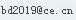

# 2023-08-18大模型引领文本生产新方式 腾讯云智能推出“文案创作”_中国经济网——国家经济门户

> 来源：[https://xuqiwei1986.feishu.cn/docx/Uz3GdCczZoAH6PxrmFNcBOLgn7e](https://xuqiwei1986.feishu.cn/docx/Uz3GdCczZoAH6PxrmFNcBOLgn7e)

> 🔗 原文链接： h[ttp://www.ce.cn/cy](http://www.ce.cn/cysc/tech/gd2012/202308/18/t20230818_38678474.shtml)sc/tech/gd2012/2...

>

# 大模型引领文本生产新方式 腾讯云智能推出“文案创作”

2023年08月18日 13:10 来源：中国经济网

中国经济网8月18日讯（记者 李方） 2023中国数字经济创新发展大会16-18日在广东省汕头市举行。会议期间，腾讯云智能正式推出“文案创作”产品，基于腾讯的大模型能力研发，为广告平台、UGC平台、SaaS服务企业等群体提供精准高效的商业文案创作工具。

腾讯云智能推出文案创作产品

腾讯云智能产品中心总监施明表示，“通过这项智能文案生成能力，我们能够助力企业快速应对市场需求，迅速创造出多角度的创意文案，实现更低的成本和更高的效率。此外，我们的产品还支持开放的API接入，可以与客户现有的营销系统快速连接和融合。”

大模型的风靡，推动各类文案创作类智能应用不断涌现。据介绍，此次发布的“文案创作”产品基于腾讯的大模型能力研发，专门针对中文语境下的文案生成能力进行优化。倚靠腾讯自研算法，该产品能够提供更优质的文案内容、更强的中文适配性，以及更高效稳定的服务。

文案创作需求千人千面、千行千面，量体裁衣的行业大模型应用，能够精准解决更多垂直领域的具体问题。针对不同场景特点，“文案创作”产品可提供相应的文案类型。在营销类应用场景中，可以生成📕的种草文案、电商直播的话术等，不仅涵盖各种文案用途，还适用于消费品、美妆、教育、体育等各行各业的广告投放优化。在智能客服和社群运营方面，“文案创作”能够生成电话营销话术和内容，使机器客服更自然地与人沟通，减轻了客服运营的负担。

据介绍，在创作类应用场景中，无论是朋友圈文案、视频脚本，还是节日祝福、日常分享或者生活记录，只需输入主题、语气和字数要求，“文案创作”就能轻松创作出有趣的文案。视频创作方面，“文案创作”能够快速生成剧本、角色设定、分镜头脚本以及对话建议，大大提升创作效率。此外，产品还支持文章生成、个性化简历生成、旅游攻略编写等日常场景使用，让每个人都能够“下笔如有神”。在效率类应用场景中，“文案创作”可以提供高效便捷的解决方案，如会议纪要、信息摘要、智能翻译和新闻报道等。

文案创作应用之外，为了解决企业应用模型技术的现实挑战，如计算资源少、数据质量差、投入成本高、专业经验少等限制，腾讯云此前宣布依托TI平台打造行业大模型精选商店，为客户提供MaaS（Model-as-a-Service）一站式服务，助力客户构建专属大模型及智能应用。

目前，腾讯云已经为传媒、文旅、政务、金融等10余个行业提供了超过50个大模型行业解决方案。近日，腾讯云MaaS也迎来了最新升级，TI平台宣布接入Llama 2、Falcon、Dolly、Vicuna、Bloom、Alpaca等20多个主流模型，且支持系列模型的直接部署调用、应用流程简单、可全程低代码操作，成为国内第一批上架和支持开源模型的大模型厂商。

为千行百业输送行业大模型解决方案的同时，腾讯云也积极参与大模型标准建设。2020年，腾讯被选举为全国信标委人工智能分委会委员兼副秘书长单位。前不久，腾讯云联合中国信通院发起行业大模型生态计划，并牵头国内首个金融行业大模型标准制订，为金融行业智能化的高质量规范化发展提供重要支撑。

施明表示，未来腾讯云智能将积极拥抱新的技术趋势，例如跨语种文案生成、情感分析等，为企业开启更广阔的创新空间。

（责任编辑：王婉莹）

**中国经济网版权及免责声明：**

1、凡本网注明“来源：中国经济网” 或“来源：经济日报-中国经济网”的所有作品，版权均属于

中国经济网（本网另有声明的除外）；未经本网授权，任何单位及个人不得转载、摘编或以其它

方式使用上述作品；已经与本网签署相关授权使用协议的单位及个人，应注意该等作品中是否有

相应的授权使用限制声明，不得违反该等限制声明，且在授权范围内使用时应注明“来源：中国

经济网”或“来源：经济日报-中国经济网”。违反前述声明者，本网将追究其相关法律责任。

2、本网所有的图片作品中，即使注明“来源：中国经济网”及/或标有“中国经济网(www.ce.cn)”

水印，但并不代表本网对该等图片作品享有许可他人使用的权利；已经与本网签署相关授权使用

协议的单位及个人，仅有权在授权范围内使用该等图片中明确注明“中国经济网记者XXX摄”或

“经济日报社-中国经济网记者XXX摄”的图片作品，否则，一切不利后果自行承担。

3、凡本网注明 “来源：XXX（非中国经济网）” 的作品，均转载自其它媒体，转载目的在于传递更

多信息，并不代表本网赞同其观点和对其真实性负责。

4、如因作品内容、版权和其它问题需要同本网联系的，请在30日内进行。

※ 网站总机：010-81025111 有关作品版权事宜请联系：010-81025135 邮箱：

