# 《你在搞个鸡毛的AI》万字完整版文稿

> 来源：[https://xuqiwei1986.feishu.cn/docx/KvO1diKK9oBsdAxEdbocn6SBnAd](https://xuqiwei1986.feishu.cn/docx/KvO1diKK9oBsdAxEdbocn6SBnAd)

“为什么你搞了这么久的AI，还是没赚到钱？”

“你怕错过的不是AI，你真正怕错过的，其实是赚钱”

“AI的5个行业层次，你在哪一层？”

“如果我只是使用AI工具的话，也叫搞AI吗？”

“一个普通人如何通过AI领域实现财富跃迁？”

“一个妙鸭产品竟然估值2亿了？”

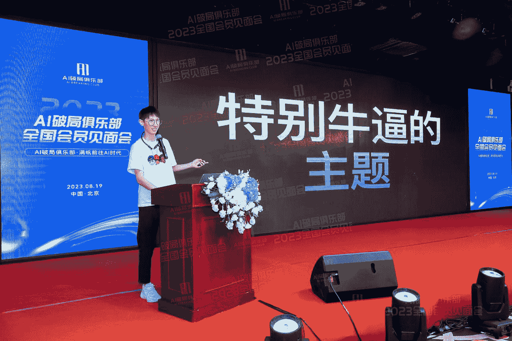

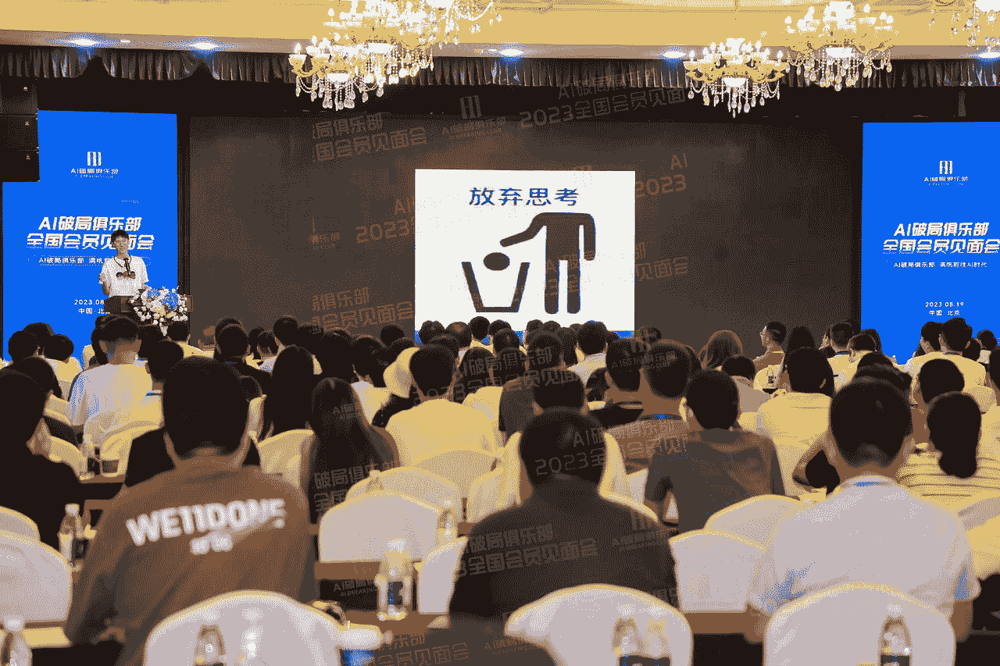

# 自序：

1个月前，我收到AI破局俱乐部创始人洋哥邀请，他想让我给他做一场AI线下大会的演讲

本来是拒绝的，因为我这个人说话太直接了，很讨厌，通常来说不会考虑听者感受

当我发现我要表达的概念和逻辑是对的时候，我就会「效率优先」地直接说出来，听者能不能接受是他的事

对我来说，如果一个人的内心这么脆弱，连真话都听不了，那还是别出来混了

> 回家听妈妈说：“宝贝，没关系，你已经做得足够好了，你很棒了”

所以我怕大会演讲万一被我的粗俗语句搞砸了，就不好了

但洋哥当时在电梯里一直和我说：东子，你行的，你行的

> 这里也特别感谢下洋哥的格局，因为其实洋哥并不知道我具体演讲会讲什么，但还是让我放心说

> 因为破局要吸引的绝对不是因为短期利益，短期价值而进来的人，而是真正长期看好AI，用AI做事的人

最后就应了下来

原定的主题本来是《普通人也能把握的风口！AIGC x 互联网项目》

给大家介绍一些AIGC变现相关的互联网项目，让大家了解具体的一些赚钱项目

但过程中随着我对AI行业的理解增加，我又开始犯病了

准备不讲原来那个，而是讲一个有争议性，有风险的选题

「你在搞个鸡毛的AI」

里面有大量类似

“AI只是看起来有用，实际上没屌用”

“AIGC技术的特点是没有壁垒，没有积累，在大多数领域只是看起来能用”

“你只是在使用AI工具，你搞的根本不是AI”

这样的话，要在一个AI的线下大会上讲

我公司的小伙伴当时说我是不是疯了

“在那么多人的场合，先不管你说的是不是真的，但你也不能说这些比较悲观的东西啊”

我仔细认真地思考了下

如果我说的东西，哪怕会有点片面，哪怕大家听起来可能不舒服，哪怕有人会骂我傻X

但只要确定是有指导意义的，相对正确的，且对他人有更大价值的

那我会更愿意说这些残忍但真实的实话，我自己也能更加快乐的演讲

而不是为了这次演讲活动，讲一些正确的废话，没有太大价值的逼话

于是我就让自己这么任性下去了……

然而到现场时还是出了意外，我发现我的演讲如果完全讲下来可能要超过2个小时

而大会的时间有限，每个嘉宾就30-50分钟时间

于是我只能很痛心地做了一部分删减，事实上每一部分都不想删，因为有可能会让意思表达得没那么完整了

所以为了让我的表达更加完整，才有了后面的这篇完整版文稿

里面灌注了我目前对AI行业与变现赚钱的理解

也许看完后能让你真正清楚自己在AI行业的哪个生态位，未来在这个赛道上应该如何发展

> 里面也借用了粥左罗，吕晓彤，马化腾，李笑来等老师的语句，特此感谢，我从他们身上学到很多

希望能对大家有所帮助！！！

**特注：**

演讲于2023年8月19日，因AI行业发展速度很快，演讲中的部分说辞具有时效性

我只能保证我在此前说的话，都是我在那个时期个人所相信的话，并不能保证我那个时期思考也许有误，也不能保证此后时期各种变化，导致我的思考已经更新了，而没能触达给你

不过我相信，比起你每天都能在网上听的那些话。也许相对片面的，可能会错误的话，会对你更有启发，更有思考价值与指导意义

> 在线下演讲完之后，效果其实远超我预料，我原本只想着影响小小的一部分人就足够了

>

> 但现场很多朋友都在会后来找到我，向我表示感谢，他们此前也有过这样那样的疑惑，在这场演讲里找到了共鸣的答案

>

> 我也很感谢大家，期待和大家的下次交流

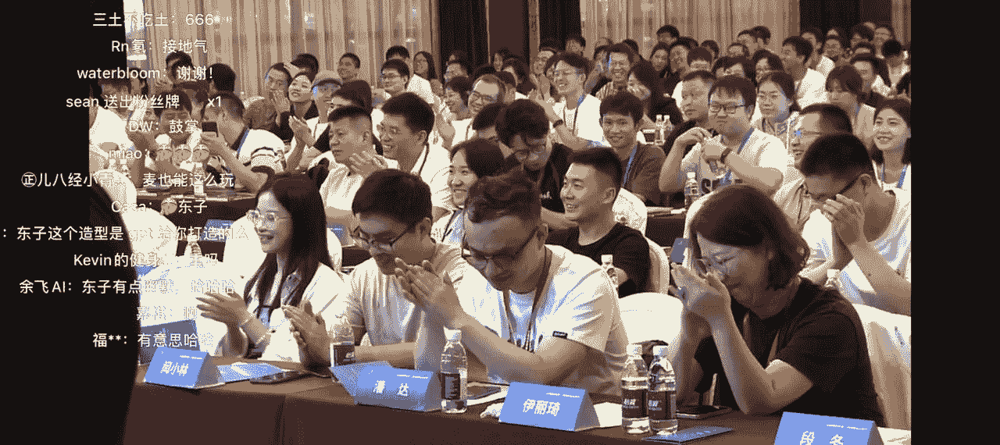

# 《你在搞个鸡毛的AI》演讲完整版文稿

大家好～我是吴东子

可能在场有的朋友，在网上看到过，这个傻乎乎的名字，觉得有点搞笑

但这个名字确实是我身份证上的名字，是我的真名

之前还有一个不识相网友问我说，诶东子老师，吴东子是你的网名吗

那一瞬间我真的很想骂他~

我会起这么搞笑的网名吗？！！

那关于我的自我介绍呢就不给大家浪费时间来说了

因为我觉得自我介绍其实就是在吹牛逼罢了

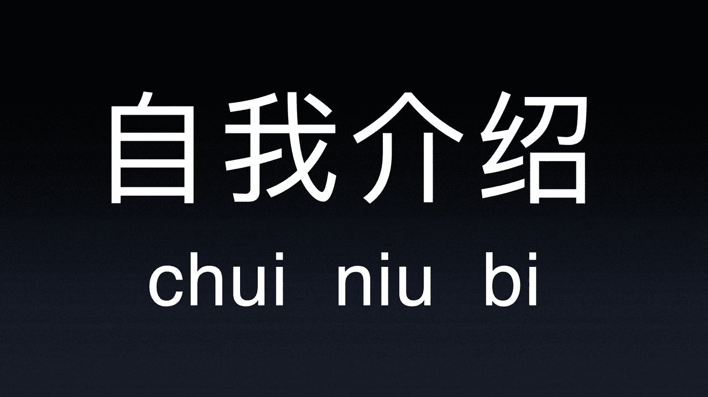

加上我之前的经历也没多牛逼

无非就是什么

旗下孵化多个千万粉丝IP账号啊

累计游戏垂类粉丝2亿+啊

播放量超百亿且日均曝光过亿是吧

开玩笑啊

其实来这里演讲之前呢，我就想到

破局俱乐部现在算是全国最牛逼的AI社群

而今天在我们台下呢，又聚集了几乎是全国最牛逼的一群人是吧

所以我今天的演讲一定也要讲一个特别牛逼的主题

《你在搞个鸡毛的AI！》

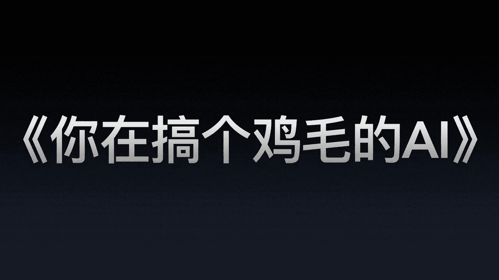

那我今天将从3个 专业 的角度来论证《你在搞个鸡毛的AI》

第一，你搞的究竟是AI，还是钱？

第二，你的行业真的是AI吗？

第三，AI到底有没有鸡毛用？

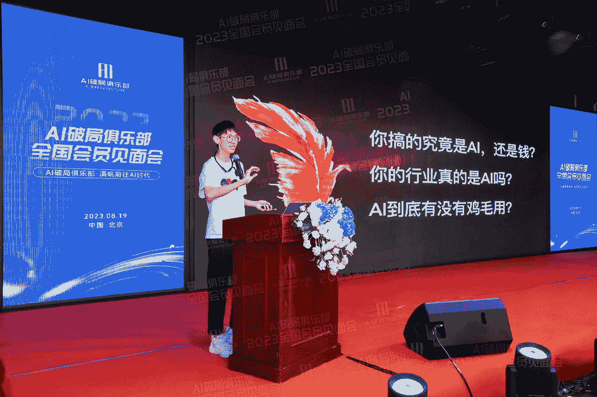

讲完这一大块内容之后呢，演讲的第二部分我会告诉大家

一个普通人如何通过AI领域实现财富跃迁？

虽然我知道大家更想听的是后者

但在我看来，前者的价值其实要大得多

然后大家也看到两部分对应的其实是两个选题相当于两场演讲了

我也是试讲了一遍才意识到我这次演讲可能要拖堂，要讲到一个小时的样子

但一定是把我认为最好的内容分享给大家，同时也因为一个小时实在是太长了

很多非常重要的点我怕漏掉了，就记在了电脑里

你可以看到我右手要控制电脑，左手要拿PPT遥控器，那我麦克风怎么办呢

我专门为这次演讲准备了这样一个，带在脖子上架麦克风的东西

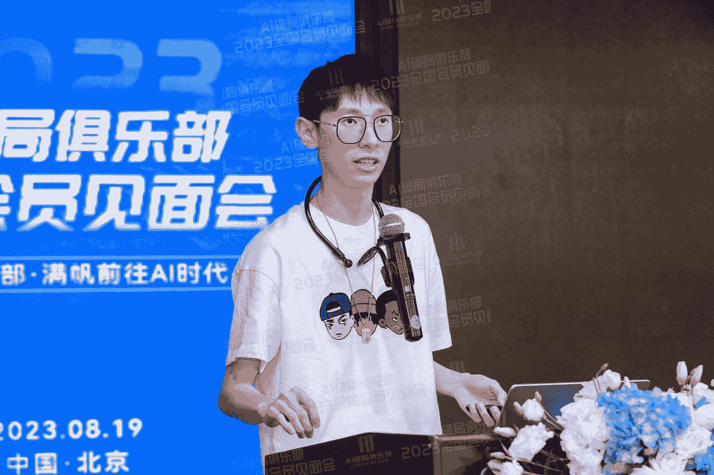

不惜牺牲了我的美貌，让我看起来多少有点傻逼了

所以你们可以看出，我真的有在认真对待这次演讲，对待大家的时间精力hh

好，我们现在开始讲第一个问题：

你搞的究竟是AI，还是钱？

这个社会呢是很浮躁的

当任何一个消息有变成热点的可能时，媒体为了吸引眼球就会用很多让人焦虑的话语

比如

AI不会淘汰你，会用AI的人才会淘汰你

AI不会让你失业，会用AI的人才会让你失业

AI的浪潮来了，我们要拥抱AI时代

这些话我想在座的各位都听过是吧

当然，媒体为了流量这么去做无可厚非

但这个世界上80%人是没有自己的判断力的

一听到这些话就会特别上头地觉得

“啊我也要加入AI行业，争做AI时代的新人才”

那剩下这20%的人里面，有10%的人

稍微有点脑子

他们会稍微思考一下这个到底是不是属于自己的机会，会在那犹豫

这时候呢，你只需要告诉他们：

《早就是优势》

早就是优势！快上车，越早驾驭AI你就越有优势

然后他们就会连仅存的那点脑子都丢掉，稀里糊涂地就上车了

嘴里似乎还说着

“我要做AI超级个体~”

没人可以改变现在AI行业里90%的人都是韭菜，都是笨蛋

不过我知道不会有人听这句话的

因为问题是没人知道谁才是那90%

前段时间很多朋友来找到我咨询AI行业相关的事情

其中一个是这样的

他上来先说了一大堆：

东哥，AI时代来了，我也想拥抱AI时代，我也要ALL in AI，驾驭AI，成为AI超级个体！你能告诉我要怎么样才能驾驭AI吗？

其实我听到这已经知道他是个笨蛋了，但我又不好明说是吧，只能通过反问去暗示他

“你在搞的真的是AI吗？”

他依然信誓旦旦地说：对啊，因为我觉得AI是下一个类似PC互联网，移动互联网一样的革命性技术，我怕错过这个红利期

你们看，普通的词汇很难向人表明清楚意思吧

于是我只好说出那句话

你在搞个鸡毛的AI啊！

你怕错过的不是AI，你真正怕错过的，其实是赚钱

所以呢，一定要先思考清楚自己到底是要搞钱，还是搞AI

AI如果说从2月份随着chatgpt的出现开始火，到现在也6个月了

但绝大多数人说钱钱没赚到，说在搞AI，其实好像也算不上是在搞AI

你哪怕花这6个月的时间去做短视频带货或者任何一个互联网项目

认认真真做好，钱都赚得不少了

所以如果你的最终目的是搞钱，那AI对你来说只是其中一个赛道的选择罢了

在赚钱上，比AI好的赛道其实有很多

你必须很认真且不自欺欺人的判断，AI到底是不是适合你赚钱的机会

那如何初步判断一个赛道的变现难易程度和量级呢

我给大家一个公式：

热点，刚需，实用，大市场，离钱近

我再重复一遍，热点、刚需、实用、大市场、离钱近

这里呢，你会发现AI有两项很重要的没有占到

那就是AI并不刚需、也不实用

这两点，我一个点一个点来讲啊

第一，AI不刚需，很好理解

我半年不用AI相关的产品，逼事没有对吧

但我如果一周不用🛰️

我身边的朋友开始会去想：诶，东子干嘛去了

一个月不用🛰️：东子不会是去旅游了吧

半年不用🛰️：东子不会是去柬埔寨、缅北旅游了吧

第二，AI不实用

这个点很关键，因为很多朋友还是觉得AI是非常实用的

我后面会具体展开来讲，这里呢只小小说明一下

AI这个玩意是很调皮的，因为大多数东西你一看就知道他实不实用

而AI是你看起来很实用，实际上没屌用

但这个玩意又不能证伪

也就是你没法判断，也没法向人证明，到底是AI不好用，还是你不会用

因为看别人都是说AI多好用多好用，多牛逼

你这时候跳出来说AI不好用，不就是在说自己是笨蛋，自己不会用AI吗

所以最终环境呈现出来的就是

“每个人都在说，哇AI好牛逼啊，我每天都在用AI，好有用啊”

但事实真的是这样吗？

一两个月前还不好判断，一两个月后的今天

我相信慢慢开始有越来越多的朋友感觉到了

AI在绝大多数领域，注意我说的是绝大多数领域，不是全部

它就是不好用，只是看起来能用，大家都说好，但真正要用的时候，没有人会真的用

比如AI写营销广告，看起来是很专业很厉害的

但如果你真的是某产品市场部的负责人

你真的要花30万，100万去投放广告的时候

你还会用AI写的文案吗？

大概率是不会的

除非你是竞争对手派来的间谍是吧

也很像创业的时候，如何判断一个项目是真的好，还是看起来好呢

我一般是会去问我身边比较牛的朋友

你觉得这个项目好不好啊，每个人基本都会说好好好

我说好，既然好，你现在马上辞职出来跟我干

他就会说：嗯……那确实这个项目还得再考虑考虑

好啊，关于AI不实用这个点，我上面所说的一定是片面的

因为AI涵盖的范围太广了，在一些特定的领域

比如编程、翻译、灵感，40分批量化

还有说废话上都是特别厉害和实用的

举个例子，大学论文

我知道我在写废话，老师也知道我在废话

但大家都不约而同地装作我写的不是废话

还要让我的废话查重率低一点

这时候用ChatGPT就很有用了

因为大学论文你知道的——看起来有用就行了嘛，不需要真的有用

所以对比起大家平时都能听到的正确的废话

我更愿意告诉大家片面的，带点错误的真话

AI只是看起来有用，但你不会真的用

所以你看，大多数人搞AI是为了搞钱

却没真正清晰的思考过，AI到底适不适合搞钱

但幸好你今天来到了破局的线下大会

你发现了原来真的有人说出了你曾经在心里怀疑过的问题

你就知道了，以后你是可以独立思考的，尽管身边没有人认可你，但你知道你并不孤独

好，回到正题啊，我们刚才讲的是

如果你的最终目的是搞钱需要考虑的一些因素

那如果你的最终目的是搞AI，应该考虑什么

这里我给出马斯克曾经说过的选择人生赛道的三条标准

大家可以自行判断下

第一、有逻辑上可见的成功概率

注意啊，不是有成功概率，而是有逻辑上可见的成功概率

第二、有无论成败，都值得一做的理由

你有没有无论成败，都值得一做的理由

第三、有成固然欣喜败亦喜的安排

这句话换个意思就是说你有没有退路

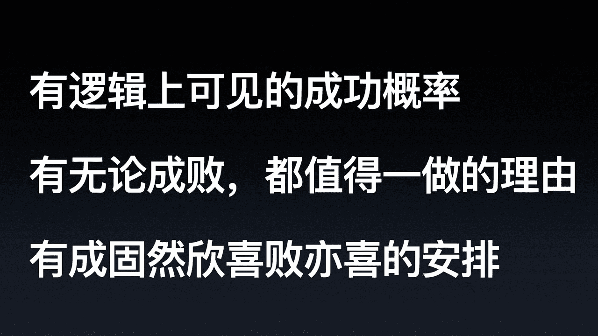

这个三个问题问出来是很有智慧的，因为很多事情的失败都死于自我怀疑的内耗之中

而你如果一开始就没有失败可言，你的心态和能量就会远大于常人

以上是如果你要搞AI需要考虑的标准，接下来我们讲第二个问题

你的行业真的是AI吗？

在讲AI这个行业之前，我们得先知道AI的定义

AI这个概念的定义是很广的

可以分为强人工智能，弱人工智能，专用人工智能，通用人工智能

大到无人驾驶、视觉识别、深度学习这些叫人工智能

小到你用midjourney出个图，大家好像也叫人工智能

但你必须清晰的知道每个人当他在说AI时，这个AI代表的是什么定义

不然思考就会混乱，这是很可怕的

比如马化腾之前说，AI是互联网几百年一遇的机会，类似发明电的工业革命

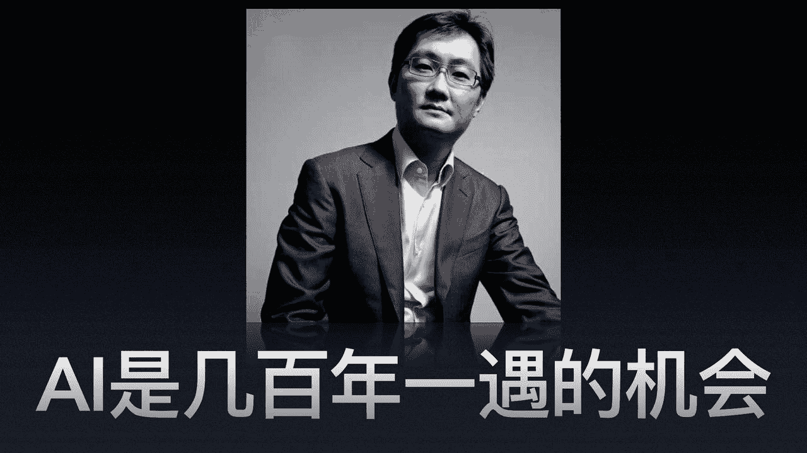

很多人一听到就，卧槽AI屌啊，我也要搞AI

然后继续用Midjourney出一张图

“你搞的那个叫个鸡毛的AI啊！”

为了让大家了解自己是不是真的在搞AI，我把互联网上对AI的行业层次划分找了出来

分为三个层面

第一是基础层，对应干的事情是类似芯片，传感器，这种最底层的基础

第二是技术层，对应干的事情是人工智能的算法，自然语言处理技术等等

第三是应用层，比如无人驾驶，AI教育，大语言模型，图像模型，包括前段时间很火的妙鸭等等

大家可以在里面找下自己的位置

发现好像很难找到是吧

因为更多的人是在第四个层次——使用层

也就是基于chatGPT、midjourney、stable diffusion等AIGC工具的使用为代表的使用层

其实是没有这个层次的，只是我硬编出来的而已

这时候你会发现好像隐隐有一股怪异的感觉

如果我只是使用AI工具的话，也叫搞AI吗？也叫自己在AI行业做事吗？

就好像你每天使用电脑辅助工作，你能说你的行业难道是计算机吗？

你用AI做👸号流量主，你的行业是👸号，而不是AI

你用AI做图片定制，你的行业是互联网项目之私人定制，而不是AI

你用AI做小说推文，你的行业是互联网项目之小说推荐，而不是AI

这并不是在抬杠玩文字游戏啊

而是我真的发现很多朋友竟然把每天使用AI工具，当作是自己已经跟上AI浪潮的现象

那万一真有一天当AI红利来的时候，你会发现这个红利跟你是没太大关系的

所以小总结一下我上面讲的两个概念

第一，你在搞的是AI，还是钱

第二，如果你在搞AI，你会发现，如果只是在AI行业里面的AIGC领域里面使用AIGC工具，那大概率不叫搞AI

或者我们说好听点便是，在AI行业的最边缘

这里进而呢会诞生一个问题：难道把AI工具 使用 得特别好也吃不到红利吗？

就像如果以前学编程这个工具，把编程使用得牛逼不也能赚大钱吗？

好，那就引出了我们第一部分的第三个点了——AI到底有没有鸡毛用？

试想下一个问题

一个1年经验的程序员，和一个10年经验的程序员，他们之间的差距大吗？

显而易见，非常大，因为编程能力是可积累的

通过实战项目的数量增加，一个程序员会变得越来越厉害

当然我说的不是那种混吃等死的10年程序员啊，而是自己有在认真积累10年的程序员

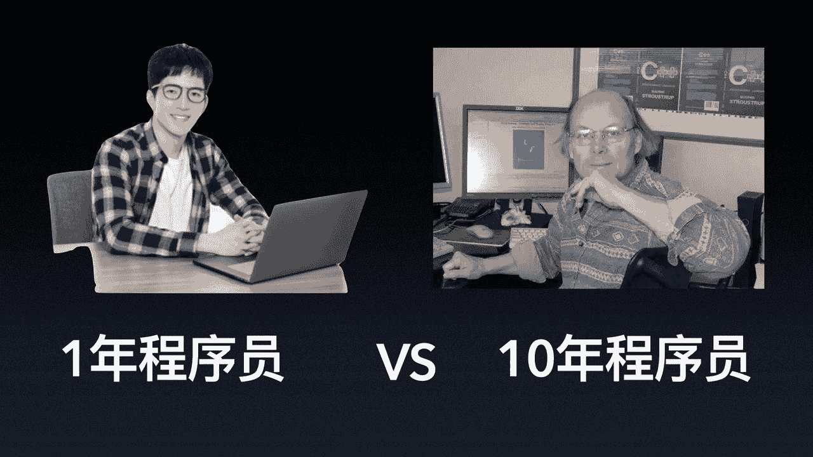

更何况你从头发就能看出来谁更有实力了是吧

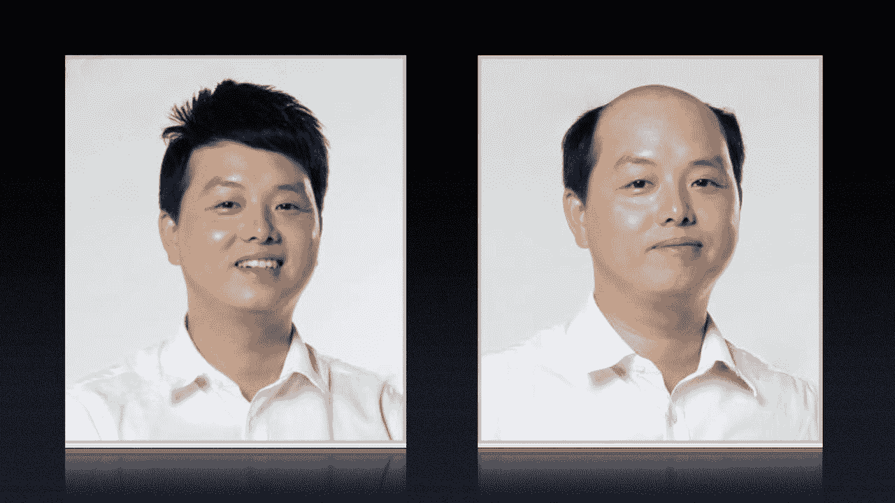

而一个有1年使用AIGC经验的技术人员和一个10年使用AIGC经验的技术人员呢？

哪怕后者这10年都在认真积累呢？

其实差距不大，不是说完全没有差距

而是这个差距相对于其他行业来说，经验所积累的价值几乎没有

因为使用AIGC技术所涉及的成分太少了

他做出来本就是为了让普通大众都能学会和使用的

你想想看是不是

最少的甚至只有一个成分，就是提示词而已

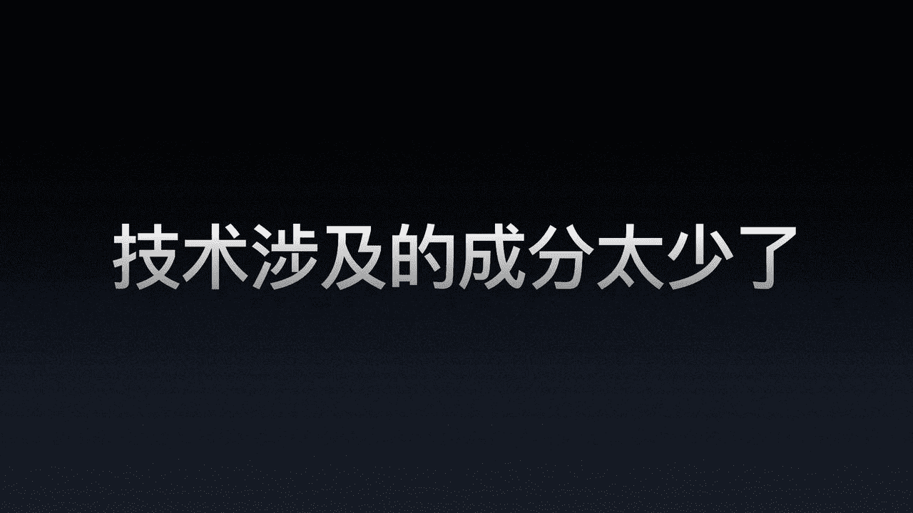

Midjourney上那么多好看的图

动漫的、宠物的、环境的、设计的、插画的

唯一的区别

竟然只是提示词不同而已

我花了半年时间用midjourney做了一张很牛逼的图

而你只需要知道我的同款提示词，就能做出来一模一样的图片

我花了半年时间研究了一套chatgpt的指令

别人只需要知道我的指令，就能做出来一样的效果

我的壁垒无非是在赌，别人能不能不要找到我的这个提示词啊

而最要命的是，找到能做出“类似效果”的提示词其实并不会太难

注意，我指的不是找到一模一样的同款提示词

而是我根据你出来的结果，去反推提示词

我不需要提示词和你的一模一样，只要我的能做出来类似的效果就可以了

这一点如果有真正尝试过的朋友，会发现其实并不难做到，而且未来只会更容易做到

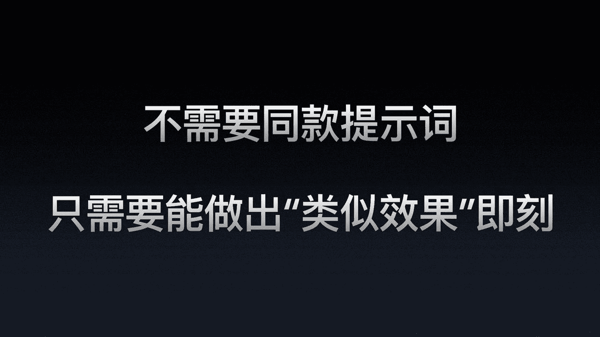

是吧，那成分再多一点的比如stable diffusion

除了提示词，还有大模型的选择，Lora，还有controlnet的使用，成分会多一点

但一样，从技术角度也是没有太大壁垒的

我之前花了7天时间研究出来一套赛博机车的提示词和参数设置

写成文章分享出来之后，大家只需要花1个小时时间学习，就能做出来和我一样水平的图片

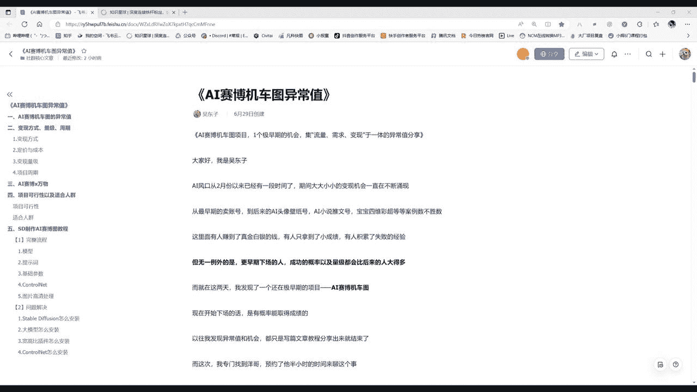

而即便我不分享出来，网上迟早也会有人分享出来，即便网上的人都不分享，事实上不可能是吧

但你持续琢磨，基本也能做出大差不差的效果

举个例子，艺术二维码刚出来的时候，当时有人开价2w一个还记得吗？

后来没过两周，越来越多人会了，价格变到2000一个

再之后一个二维码卖300-500都没多少人买了

而现在你甚至能在别人做的网站上一键生成

这种丝带的也好，那样的也好，都能一键生成

你普通人在使用层怎么玩得过人家企业啊

也就是说AIGC生成的东西本身是有价值的，这个价值对应的价格可能是500，是2万

但价格通常并不由价值决定，而是由供需决定

因为AI技术没有壁垒，供远大求了

导致哪怕价值是高的，最后价格也不高了

后来几乎每一个AIGC直接触达变现的项目，都是呈现一样的现象

也就是最开始那一批能定个高价小薅点钱，过一两周就迅速全部人学会了，价格就定不高了

未来甚至企业做了个一键生成的应用，就更不好定价了

这是AIGC的两个特点：

第一是，纯AIGC技术没有积累，10年的高手和1年的新手差距不会太大

第二是，纯AIGC技术没有壁垒，大家只要想学基本都能会

现在是因为这里面还没有很赚钱，所以更多的人压根都没进来

一旦哪天如果真赚钱了

只要我教会我妈🪜，我妈都能做，那市场会卷到其实赚不了太多钱

AIGC的第三个特点是：大多数情况下看起来牛逼，特定情况下真的牛逼

什么情况是特定情况呢，我们知道，用AIGC技术是几乎0成本，且可批量做出40分内容

这个既是优点也是缺点

我刚才上面说的全部都是从缺点的角度看

但如果我们换个角度去找到把这个优点发挥到极致的应用场景，就会真的牛逼了

说人话就是，如果你能找到一个只需要40分的内容就已经足以满足市场需求的项目，那价值是很大的

比如我刚说的大学论文是一个

还有👸号流量主项目是吧，用AI做些擦边的文章

因为面向的人群大多都是——50-60岁的稍带猥琐气息的中年男人

所以不需要逻辑那么严谨，图一乐就行了

“在那个夜黑风高的晚上，小叔子悄悄溜进了我的房间”

再配上一个SD生成的美女图片是吧

wow~

好啊，不能再看了

不然等下别人说啊原来你们AI大会开的是这样的东西是吧

这就是40分的内容已经足够变现了

我所知道的并且看过数据的，已经有人通过👸号流量主赚到60万了

但人家那不全是AI啊

他本身在AI火之前就在文章领域有积累，非常清晰地洞察人性，知道人喜欢看什么内容了

他的行业也一样是👸号，而不是AI

只是恰好这个领域用上了AI工具起飞了而已

你看，大多数真正赚到钱的，基本都是在

有具体的完整的应用场景下，用上AI赋能，才会起飞的

AI并不会无中生有某个应用场景

在没有具体且完整的应用场景的前提下使用AI，就会造成假象

看起来很牛逼，实际上用不了啊

就像我们都听过AI做设计啊，用AI做故事绘本，做表情包对不对

我们落地的问下去，你用AI做设计

你设计的这个东西谁要，你哪里找客户，这个客户长期且稳定吗，客单价高吗？他如果是商业用，他告诉你这个字体这里要圆润一点，那里要锋利一点，你怎么做

你会发现如果你本身不是设计这个行业的，你很难说什么用AI做设计的

我之前就帮朋友接过一个单子，在这之前我已经明确地告诉客户

AI出来的东西是很随机的，很难控制完美你想要的程度，你确定了我再叫朋友做

他说好，发了需求，你们看看这个需求

背景选择：要有古风的元素，书籍家具或者古建筑

然后又要采用什么对称、层次感或者斜线构图的方式，突出诗句文创冰箱贴的主题和设计，巴拉巴拉

最后朋友也很给力，在这么复杂的信息下依然用AI做出来我觉得很好的图片

冰箱贴纸，冰箱贴

然后发过去，客户又在唧唧歪歪

说冰箱的画面有点复杂啊，要亮色干净简单的那种感觉

最后我说6，不搞了，真接不了

是吧，这才是用AI做设计你会面临的真实问题，你仅仅只是会使用AIGC工具是没用的

只有你本身已经是设计师，每天都在用PS，C4D等工具了

这时你再学会一个AI工具，可以做出来这种AI艺术字，给客户多一种选择，你的价值就上去了

再说一遍

只有这样到具体的行业具体的场景上去，用AI赋能是有用的

但如果你说把一个普通人通过AI工具就变成了AI设计师，显然是扯蛋的

那剩下那些什么用AI做故事绘本的我就不说了，大家可以自己试着问一下，这玩意做出来谁看，你会给你孩子看这样的吗？流量哪里来？你怎么出版？具体卖多少？回答完你会发现，有这时间做这玩意

还不如打两把王者荣耀呢

当然这时候我知道又会有朋友问

如果AI真像你说得那么没用的话，为什么很多画师，很多员工因为AI而被裁了呢

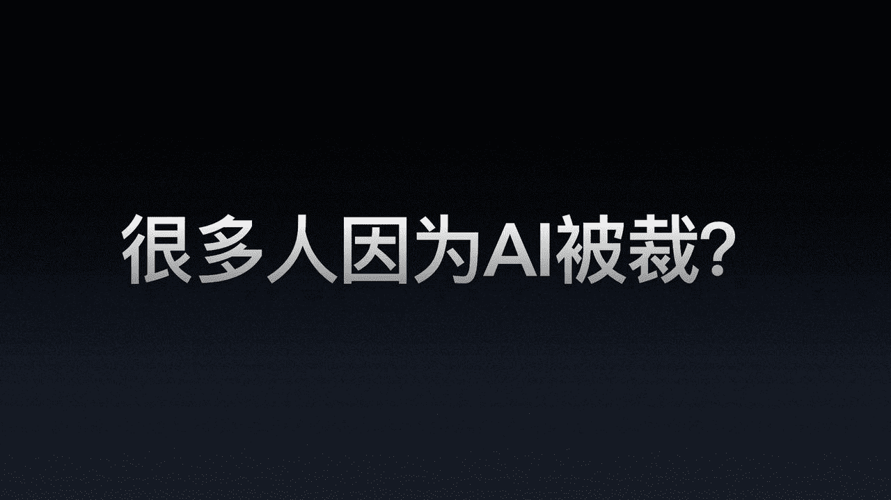

这个问题也是一样很难证伪的

举个例子吧，有相关数据报道，雪糕的销售数量和河边游泳淹死的人的数量是成正比的

那不能说是因为雪糕卖多了导致淹死的人多了

因为本质是夏天到了，天气热是吧

而画师、员工被裁的根本原因，以后不好说啊

至少在当下基本都是因为大环境经济形式不好而被裁的，和AI没有太大关系

无非是一些公司为了更体面一点才说成因为AI裁员

你只需要试想一下，你现在是一个公司的老板

大环境经济形式不好你要裁员了，你难道和大家直接说

“啊，我们公司现在不赚钱了，马上要凉了，只能把大家裁了噢”

那其他员工听到肯定傻了呀

这时有个叫AI的东西刚好火起来了，那肯定用AI来背锅

“咳咳，因为AI的发展，本公司决定大力采用AI降本增效，所以需要进行一轮裁员”

这样就好听多了嘛

好了，再小总结一下

那我上面给大家更新了很多概念的定义

虽然听起来相对不舒服，也没那么容易直接接受，但不管你接不接受，这些现象基本是作为客观事实存在的

越早接受这些残忍的现实，你越能以平和、冷静且正确的视角看待未来

而不是还沉浸在互联网媒体给你描绘的假象当中，在错误的道路上越走越远了

好啊，回顾在这之前我们大多数人是有下面这个这样想法的

竟然指望只通过“使用AI”就实现赚大钱

现在建立了正确的认知再来看，就不会这么想了

所以你接下来会思考的问题就是，一个普通人究竟怎样才能通过AI领域赚钱呢？

首先，判断你自己是一个什么样的人

你真的热爱AI吗

你狂热相信未来AI会改变世界，并且觉得若是没能参与到AI这个行业，自己会特别遗憾吗

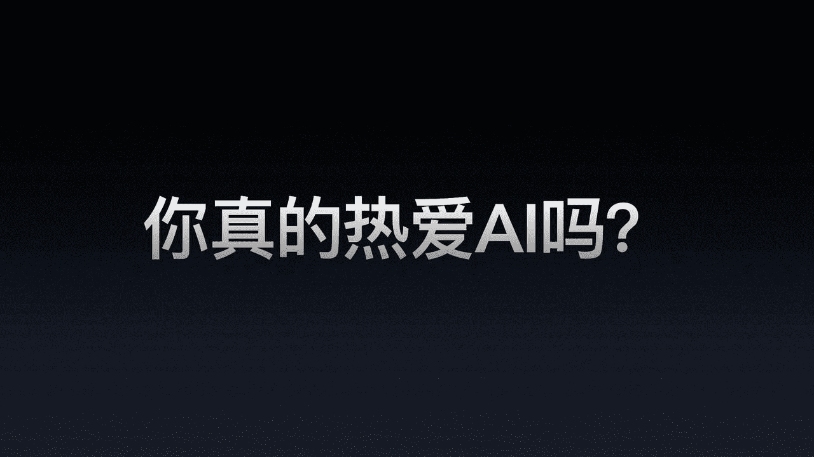

如果是，那很简单

想尽办法加入到AI的前三个层面去，而不是在使用层自我感动

因为如果你真的看好AI，它就应该是一件很长期的事情

哪怕你现在毫无积累，也可以从头开始

如果你不清楚自己是否真的有那么热爱AI，可能处在又想赚钱，又觉得对AI还蛮感兴趣的之间

或者就只想赚钱也行

那你的第一步应该是选择你的赚钱方式

你是要选择副业变现赚小钱，还是选择财富跃迁赚大钱

可能有朋友会说，这还用选吗，能选当然是实现财富跃迁赚大钱呀

其实不对啊，还是要选的

因为我讲的实现财富跃迁一定是通过长期自己的行动去提高实现的概率

而不是哪天突然天降馅饼发大财这种

如果你愿意付诸长期的努力，有足够的耐心，并且坚信通过持续成长，刻意练习所带来的价值是巨大的，同时又愿意接受不确定性，用概率思维来预测和决策

那我是建议你选择一条赚大钱的方向的，在AI领域里，就是加入到前三个层面去

为什么要加那么多前缀呢，我给大家举个例子

你们生活中应该很常见一类人，他现在拿着5-6千块的工资，他想找一份8000，1w块工资的工作

对吧，你发现很奇怪的是，他竟然以为8000块，1万块的工作，是通过“找”实现的

通常你会从他们的嘴里听到

“我要找一份多少多少钱的工作，如果能找到多少钱的工作就好咯”

但事实上，正确的思考应该是，我得先让我自己值8000块1万块

那我才有可能匹配到相关价格的工作

甚至在市场上被低估是很常见的，也就是你价值1万5的时候，你也许才找到价格1万的工作

而如果你只值5000，就算你哪天运气好找到了1万的工作

从长期来看，老板也不是傻子，你迟早被辞退不是么

所以回头看刚才的问题

我说你是要选择副业变现赚小钱，还是选择财富跃迁赚大钱

其实本质也是在问

你是要选择成为一个让自己价值是大钱的人，还是选择再等等看，慢慢走

虽然我更崇尚大家勇敢地选择前者，但我也很明确地知道其实很多人即使想，也没法直接选择前者

家庭的因素，环境的因素，现实的因素

一些是年轻时自己没做对选择，一些是天生的家庭环境

他没法直接抛开这些束缚，只能选择再等等看，慢慢走

在AI领域里也就是先从使用层做副业变现开始做起

副业的定义不是说只能当副业，当主业也是可以的

只是相比起你的主业来说，不稳定性很大，所以我们叫副业

同时通过副业也是有机会在短期内赚个几十万的

只是大多数情况下那都是统计学里跑出来的个例

更多不赚钱的的都沉没进去了

用AI做副业变现，我分为三个方向

给互联网赋能，给企业赋能，和给线下赋能

给互联网赋能，就是用AI技术把现有的互联网项目再做一遍

比如小说推文项目，小说推文项目是什么呢

在知乎，番茄小说这些平台每天都会上新很多小说

你通过截取这些小说的精彩片段，做成内容放到抖音，快手这些公域平台里面

当观众看到一半正兴致盎然的时候

比如“在那个夜晚，小叔子悄悄进了我的房间”是吧

然后突然没得看了

这时候你告诉他这本小说在知乎能看

那被你引导过去充会员看小说的用户，你就能获得佣金

以前的小说推文项目是这样做的

通过一些解压素材当作画面，主要靠文案吸引过去，或者游戏素材当画面

而现在可以利用Chatgpt把小说的文案变成分镜画面，然后导入SD里生成画面

观众看的时候就会有对应的画面，像看动漫一样，流量会更加大

这就是用AI技术，去赋能互联网项目的一个案例

第二种，用AI去做AI书单号，或者数字人带货

就是把带货结合AI再做一遍

第三种，宝宝四维彩超

这个也得稍微解释一下，宝宝四维彩超的意思就是

孕妇快生的时候都会去拍一种四维彩超的照片，用来观察宝宝的生长发育情况

那现在利用AI绘画技术

可以生成宝宝出生后的样子

半个月的，6个月的，1年的这种

看起来好像是预测，其实只是根据轮廓生成一下而已

但是爸爸妈妈也知道这是图一乐的嘛，开心一下就好了

那我们就是通过在网上把这种做成内容，吸引拍了四维彩超的宝妈们

他们付费比如19.9一张，你用AI帮她生成

这类变现模式就是私人定制，同样模式的项目还包括但不限于

AI艺术创意字

AI艺术二维码等等

当然不是什么AI图都适合私人定制的

比如之前也火过的英雄联盟装备高清化，虽然也很有意思，流量很大

但没有人会为这个付费，广告厂商也不会

还有一些有趣的小狗狗啊

一些花草树木，山川河流的图片

好，不能再放了，不然到时候我就要收律师函了

等下法官说开庭的时候请带上你的PPT是吧

那除了上面所说的这些之外，还有很多很多的互联网项目都可以用AI再做一遍，这是给互联网赋能

当然，优缺点也很明显

优点是简单，小白都能做，认认真真做的话，一个月赚万把块钱并不难

但缺点也很明显

第一，上限通常来说不会太高，月收入一般在6位数以下

第二，项目不是很稳定，有可能一下赚个十万，有可能开头几个月都不赚钱

使用层的下一个方向，给B端企业赋能

这个倒是有点算无中生有出来的应用场景了，我举三个例子

AI指令设计师

AI模型训练师

AI企业培训师

一个一个来说，AI指令设计师

也就是帮助企业或者公司原有的工作流设计一个AI指令，从而实现降本增效的作用

比如我是做电影公关的，你给我设计一套指令，可以根据我这个电影生成一百种的不同的好评和读后感

AI模型训练师，帮助企业训练他们需要的模型

比如Lora模型，大模型，或者声音模型，高级点的就是数字人模型

AI企业培训师，这个就不用解释，给企业培训嘛

除了以上这三种呢，可能还有一些类似的职业，但是他们都有一个共同的特点就是

听着都非常高大上，但总感觉哪里怪怪的是吧

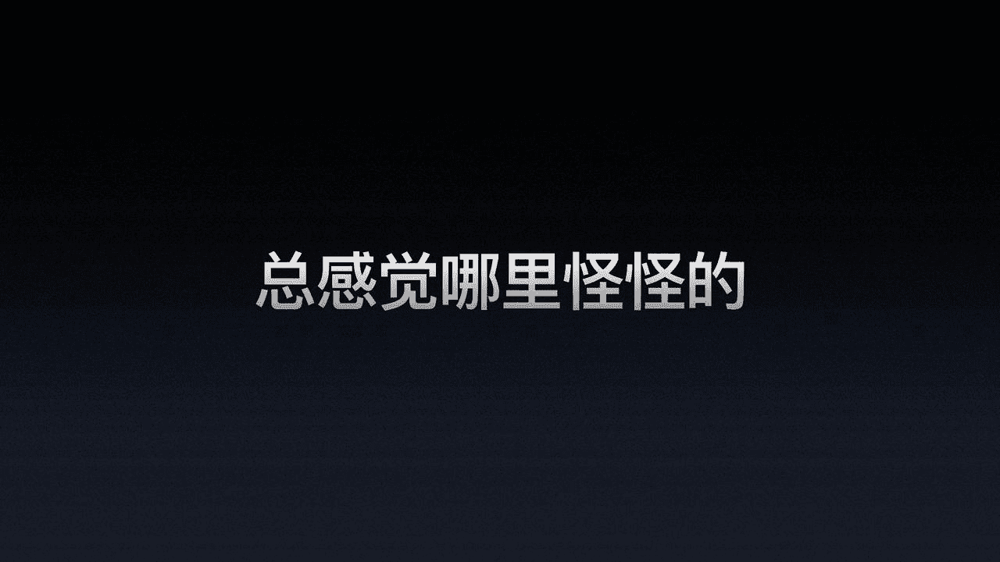

第一是因为永远说不清长期稳定的客户群从哪里来

虽然看起来好像是有这么回事，好像也有需求，好像也能解决啊

但当你真正落地的时候，其实是很难的

就像我上面那个用AI技术做设计的例子，真实面对的时候很多东西包括售后这些要处理的

不是想象的那么简单，我设计一个指令完发过去，领钱就完事了

注意，我说的不是零零散散的几个愿意接触AI试试水，哪怕效果不好也接受的客户

而是长期且稳定的客户群，因为你搞这个事你不是搞十天半月，你肯定要验证可行性的

第二是AI还没到真正提效的阶段

我们前面已经论证过了，AI在大多数应用场景下都只是看起来牛逼，真正要用的时候你是没法提效的

没法提效就没法真正带来价值，没法真正给他人带来价值，就注定这个东西很难长期做下去

而真正能带来价值的呢，很多企业也会下场做

就像一键生成艺术二维码

也有网站可以一键生成艺术字

指令网站可以一键生成对应指令

甚至别人网站也可以直接开展to b的定制指令服务

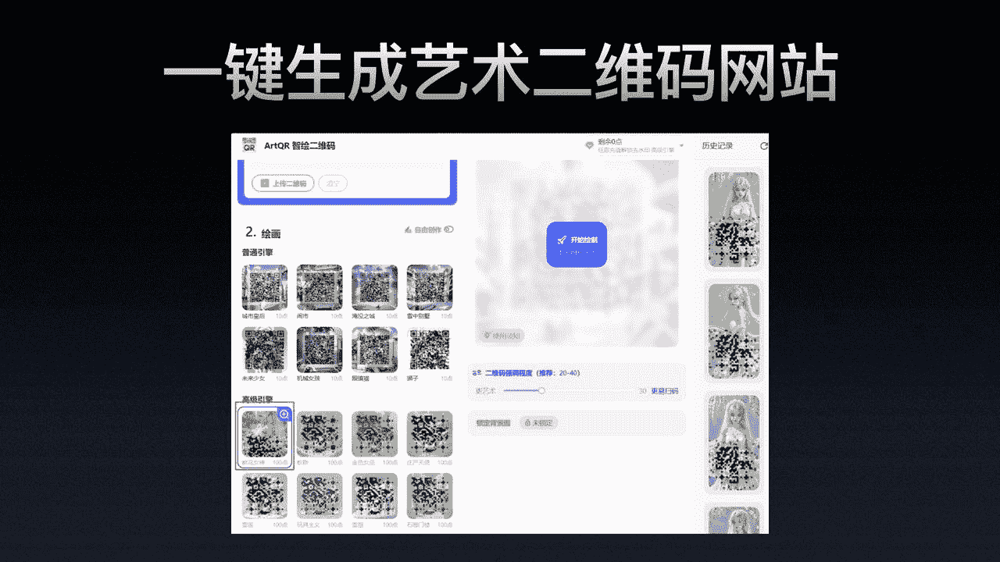

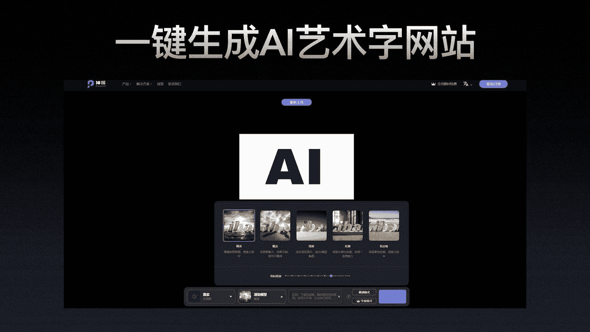

所以也许早期的独立指令设计师或者模型训练师有一定空间

但要么你别赚大钱，你要真赚大钱了，肯定有企业下场和你抢的

第三则是，AI最终一定是面向大众的

最终一定会达到的效果就是傻瓜都能用，像Midjourney一样

现在AI还没牛逼，所以可以通过人的各种骚操作让AI看起来牛逼

而之后AI真的牛逼了，你只需要问AI

我要实现这个需求，我应该怎么样提指令呢，他就已经能告诉你对应的指令了

所以综上，AI使用层的第二个方向——给企业赋能方向

我并没有说不能做啊，也并没有说不看好这些职业

这个大家一定要分清，别等下下来说，吴东子就是个傻逼，吴东子懂个鸡毛是吧

我只是分享了你在选择这个方向时，尽可能需要去考虑到的一些风险点

具体的判断和选择需要大家自己独立思考

接下来我们讲AI使用层的第三个方向——给线下赋能

好，我终于要说到我最推崇的一个方向了，这个是我觉得大家在使用层最有价值的事

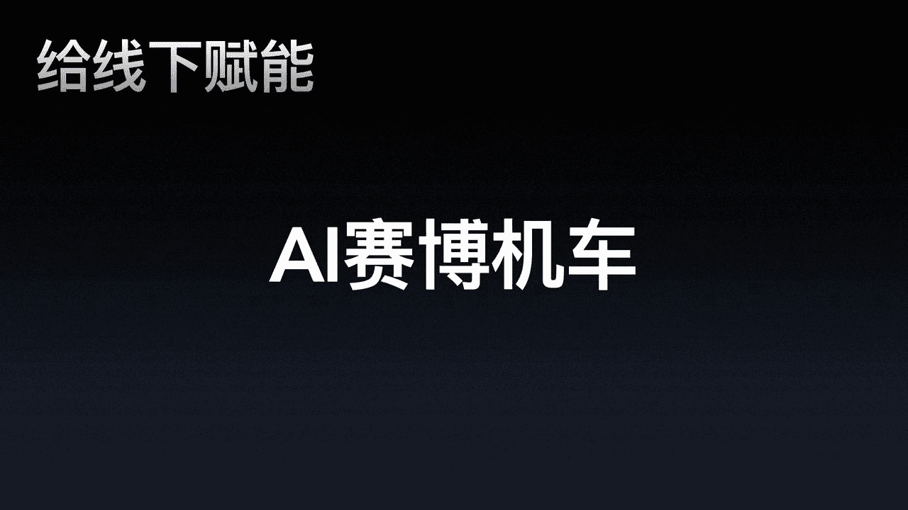

也就是通过AI技术，结合线下的产品或者服务，去做一个服务升级

举个例子，我之前带了很多朋友一起做AI赛博机车这个项目

也就是这个是客户原本真实的照片，通过SD技术变成这种酷炫的照片

一张40-50块去帮客户定制，很多朋友都在这个过程中赚到了钱

但大家越做到后面就越回到培训那套东西，最后都是卖课

教别人做这个，反而赚得多

我并不是说卖课不好，而是这并没有给社会创造多少新的价值

什么叫创造新的价值呢

比如你掌握了生成AI赛博朋克图这个方法

你去找到线下的一些专门的机车摄影师，或者机车俱乐部，去和他们合作

机车俱乐部帮你拉人头，给他圈内的机车爱好者宣传，你给俱乐部分润

机车爱好者通过小小的付费能换来一张这个好看的图片，他开心

俱乐部分润了，俱乐部开心

你有业务了，你开心

而且你只要能和一家俱乐部打通，就能拿来当作案例去和其他俱乐部沟通了

第二个例子，我们前面说到的宝宝四维彩超项目

你拿到线下和一些地方医院合作

当然啊，肯定不是所有医院都会直接接受这种新鲜事物的，我只是提供一个思路

家长们已经花了几百块照一张四维彩超，只要再花20-30块就可以获得一个好看的宝宝图片，爸爸妈妈是开心的

我身边是真的有一个怀孕的朋友，她是完全没了解AI的

单纯在网上看到这些宝宝AI四维彩超感兴趣，就叫他老公去网上找人制作，说明需求是真实存在的

医院提供了新型AI服务，既收获了口碑，又能小赚一笔

你有业务了，你开心

这就是真正的创造了价值

甚至在这个过程中，你手上已经拿到了很多的订单，验证了项目可行性了

为了生产自动化，你寻找志同道合且有能力的朋友

把AIGC技术封装成产品，客户只需要在小程序或者APP上上传图片就能得到结果

那你其实就已经变成了创业的开始，从使用层慢慢过渡到了应用层了

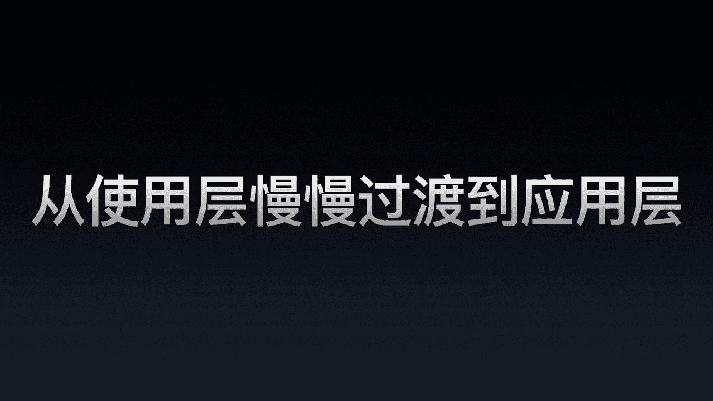

第三个例子，AI真人模特图，你把这样的人台图片，变成AI真人模特

虽然线上已经有很多人在做，但你放到线下的商场去，其实还是有大把大把的人不知道这些玩意

什么？ChatGPT？

ChatPPT吗，还是China GDP啊

你先去人家店里拍个人台的照片，回家生成AI真人模特，然后打印出来

第二次再过去，拿着AI真人模特照片告诉那个服装店老板

你说：老板，你店里放这些人台的目的是不是为了提升顾客的购买体验，让顾客能看到衣服上身是什么效果

而现在如果在人台旁边在夹一张这种小小的AI真人模特照片，让顾客能从更多一个纬度看到衣服上身的模样

你觉得会不会进一步提升了顾客的购买体验呢？

你店里一共有10个这样的人台，每一个我都可以给你制作出对应模特照片出来

同时我可以安排人上门拍照并且帮你把照片打印出来夹在人台旁边

你什么都不用干，一张20块，你第一次只需要给200块

就有可能让你的销售额上涨，就算最后没有上涨，你的顾客购买体验也一定提升了

只需要200块！！！

当然你实际情况需要说得比我详细多了才行

对于一个开在商场里月租动辄几万的服装店老板，还是有非常大的可能性付给你200块尝试的

尤其是你已经拿了他店里的模特照片给他的时候

一个商场你找10家店，一个县城的城区你找10个商场，这里就2w的营收了

而且还是可复购的2w

因为他总要上新衣服的嘛

当然我这么说，一定还只是纸上谈兵，线下真正去做肯定还会遇到很多困难

但是你可以真的等今天大会结束之后就去算这个账，或者算类似其他项目的账

如果算出来如果数据是可行的，其实真的不妨一试

还记得我们前面说的吗，想赚钱，就要接受不确定性，用概率思维来预测和决策

对比起如果我和大家炒各种云里雾里的概念，我相信我的这种纸上谈兵都是有指导意义的

如果今天我在这里和你们说一些逼话，说一些正确的废话，假大空的话

说一说ChatGPT很牛逼，AI时代来了，我们要跟上AI浪潮

这些正确的废话，各位，没有任何意义

因为大家花钱花时间精力来到这，甚至我在群里还看到一个朋友从东莞坐28小时硬卧都要来听的

所以我宁愿说一些片面的，哪怕可能错误，可能会让别人骂我傻逼的话

那给线下赋能还有很多种方式，比如我们商场里之前可以看到彩票机，可以看到游戏机

现在也有AI绘画机

客户上传他们的照片，就能生成对应AI漫改图

具体这个项目有没有搞头，多长周期回本，我也没有算过账

但大家后面可以继续思考一下，给线下赋能，或许会有更多机会

好，那以上就是在使用层做副业变现的三种方向，分别是给互联网赋能，给企业赋能和给线下赋能

我知道大家听了之后肯定有一种感觉是，好像AI也没有那么适合我，难道就没有一种更好的赚钱方式了吗

首先我必须要告诉大家的是

**这个世界是没有秘籍和魔法的**

很多人总误以为别人赚钱是掌握了一条什么不为人知的秘籍，所以终身都想去找到这样一条捷径

其实真没有，赚钱真的是必须要你自己不断去克服一路上遇到的各种困难的

其次呢，那....还是有一个相对清晰的道路可以分享给大家的～

就是AI的第五层--赛道层

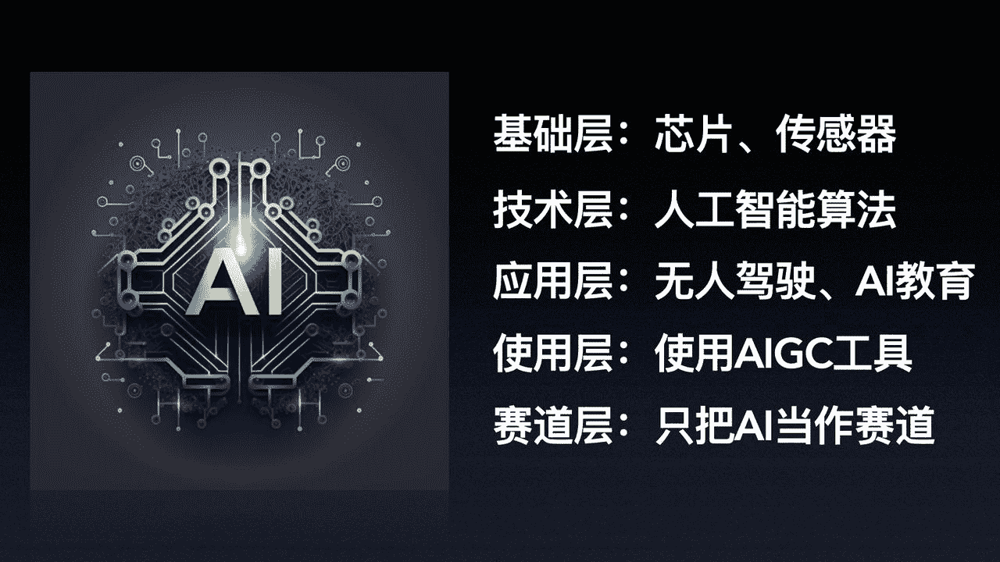

什么意思，就是因为AI在使用层的特点我们已经知道了，那我既不想使用AI，又想吃到AI的红利怎么办

那就选择只是把AI当作赛道

比如AI赛道的自媒体

我这边团队之前起的一个B站账号，2期视频涨粉5000

已经有青椒云的广告找上门来了

那就是我既没有用AI来做具体的事，但是只要这个账号做起来了

如果哪天AI风来了，也能迎风而起

比如洋哥的AI破局俱乐部也是

AI社群，本身并没有用AI做什么事

但如果AI风来了，破局也会直接起飞，从现在的3w人可能一下就到10多20万人

还有一个我也特别喜欢的例子，AIGC应用开发工程师

有那么多人都会使用AIGC技术

可如果说要把这些技术包装成应用，比如小程序，APP，网站，甚至是包装成使用体验良好的软件，就没多少人可以做到了

我们在场很多朋友的用的SD都是秋叶的安装包是吧

那你想AI风来时，他在他的软件上放一个广告，得赚多少钱

而你若是一个程序员，你也可以选择成AIGC赛道的程序员，趁这段时间磨练把AI包装成应用的技术

等AI风来的时候，要么你手头上已经做过足够多这样的项目的

那你再一跳槽，年薪可能就会暴涨

要么你在过程中打造出一个爆款产品，也实现财富跃迁了

以上说的只是三个赛道层的例子，还有很多，但是也不要当成是什么救命稻草

下来又开始说“啊我也要干AI赛道层”

赛道层要想干好其实也不容易，甚至比使用层更难看到结果

第一是因为有门槛，你看我上面说的三个例子

我团队能做AI的自媒体是因为

我们在内容行业已经有足够屌的积累才能一上来就干好

洋哥能干成AI社群，因为他本身就是一个KOL

同时还是每天从早忙到晚才能搞得稍微好一些

大家也会发现最早那批AI社群都没多少还活着的了

AIGC应用开发工程师能干好的前提

肯定也得你本身就是优秀的程序员，这些都是门槛

第二，我们都牺牲了一定程度的确定性，都在赌

只是这个是算完数学期望之后赌

赌会不会有第二波风口，赌第二波风口什么时候来，赌AI什么时候能全面进入大众的生活

如果没赌到，就血亏

或者说熬不到那个时刻，其实就全部功亏一篑了

所以你看，每一种选择都是公平的，并没有所谓的魔法和秘籍

最后我讲讲实现财富跃迁的三种方式

财富跃迁的定义指的是

你的财富获取速度在一个很短的时间内飞速提升，比如你现在月薪6000，一下跳到月入10万，30万。

这个很短的时间指的并不是总时间很短，而是相比起一整个很长的周期内

你的财富获取是在很短的时间内获得的

比如前5年都不赚钱，后面1年就赚了一辈子要赚的钱

但这是有门槛的，我们前面说过了，你得看自己适不适合

财富跃迁通常只有三种方式

第一，创业

你需要投入自己的时间精力金钱成本进去

同时思考你自己是不是做一把手，如果不是，那你选1把手至关重要

这里很关键的是一定要找到一个尽可能对的需求

像妙鸭相机这个产品制造只做了三个月，但在制作之前光思考方向就思考和讨论了一个月，才确定了做写实人像这个方向

第二，加入到快速飞升的小公司

比如小米早期的员工，都拿到了期权和股份，然后稀里糊涂就发了财是吧

这个一半是靠你的洞察力，哪个行业哪间公司在你来看以后会飞升，剩下一半其实也靠运气

第三，加入到一个好行业的大公司

凭借自己的能力坐到高管的位子上，一年拿个百万年薪也不是梦

需要你判断未来国内AI行业哪个大公司会杀出来，然后用自己的能力爬到高位置上

所以如果你说，诶，我又不想创业承担风险，我又怕洞察错哪个小公司了，又怕自己能力不够爬不到大公司的高位置上

那显然你是不适合选择财富跃迁的人

因为本质是你得在这个过程中逐步让自己成为值财富跃迁的人

如果你愿意承担风险，看得更长期长远一点，就从上面三个方向上选择一个最适合的自己，耐心去做就对了

最后给大家举一个妙鸭相机的例子

虽然现在大家都知道妙鸭其实是属于阿里旗下的一个团队啊

很多人知道后会觉得噢，原来是阿里啊，怪不得能跑出来，以此来安慰自己

但我不这么认为

我相信妙鸭团队在早期的时候拿到的资源一定不会比一个小创业公司多多少

一整个阿里兼顾的方向多了去了，怎么可能每个方向都投大量的资源进去呢

更何况妙鸭起初只是阿里六大集团里面的边缘集团阿里大文娱里面的很小的一个项目，甚至都没放在公司主体里

顶多是一个团队，我给你配几个人，给你丢一些预算，然后能做起来最好，做不起来就算了

大厂内部团队的优势无非是人家做起来之后，能够迅速配套对应的资源

比如妙鸭做起来了，能迅速配套需要的软硬件设备

但在做起来之前，我相信一个小型创业团队也是能扳扳手腕的

那一个妙鸭相机的价值是多大呢？

大多数人会以为只是一个小程序火了，能赚个几百万吧

我起初也是这么以为的，但我更愿意相信算账思维，不算不知道，一算还是满出乎意料的

妙鸭最火那段时间已经是一个月前了嘛，前几天一个叫李自然的创业家也做了一个测试

发现自己上传图片之后仍然有10000人在前面，需要等待7小时

如果这样算下来，用10000除以7得到每小时的人数，再乘以24，得到一天的制作人数，乘以9块9元，一天就有35万的营收，一个月是1000万营收

我自己去做的多次测试也是

基本一天也是在25-40w之间

一个月在700-1200万营收之间

当然这是一个不准确的估计，同时这个只是营收不是净利润

不过我们不是要具体知道这个数字，我只需要预估量级就行了

而一个项目如果一个月有一千万的营收，基本估值也在2个亿以上了

所以阿里那么大的财报，现在都要把妙鸭写进去了，可见这个项目不仅是在外人来看，在他们内部看也是起飞的

那妙鸭这个团队，他们自己是说从2月份ChatGPT掀起一波浪潮之后

带头的负责人拉上几名同事，建了一个AIGC破壁小组内部群

用1个月的时间讨论出了 写实人像 这个项目方向，再用3个月的时间打磨出了妙鸭这个具体的产品

所以综合上面所说的

**一个小创业团队，在AI领域，仍然是有机会在短短几个月的时间之**内，就跑出估值几千万的，甚至几亿的项目的

而AI浪潮才刚刚开始，如果这真的是一场新的工业革命，类似于发明电一样的历史机遇

像马化腾说的，早一个月把灯泡拿出来真的不是那么重要

你应该期待的是，5年后10年后，你要通过做什么让自己未来在什么位置上

好了，最后做个大总结

这场演讲分为两个部分，第一部分主要给大家洗去一些错误的概念

我们知道了，自己要去想最终的目的是什么

知道了，我们大多数人现在在做的只是AI的使用层

知道了，AIGC一些很真实但是没人敢说出来的特点

第二部分给大家介绍了AI的五个层面，讲了很多普通人能选择的方向和对应的案例说明

但无论你选择哪个方向，在得到它好处的同时，都需要承担对应的坏处

**继而知道了这个世界没有魔法和秘籍，最本质是要让你**自己在这个过程中成为一个配得上赚大钱的人

前几天雷军也有个很厉害的演讲，但我个人不喜欢天天和大家讲梦想、梦想的力量这个概念

我这个人比较俗，借用李笑来的一句话分享给大家

**“人至践则无敌”**

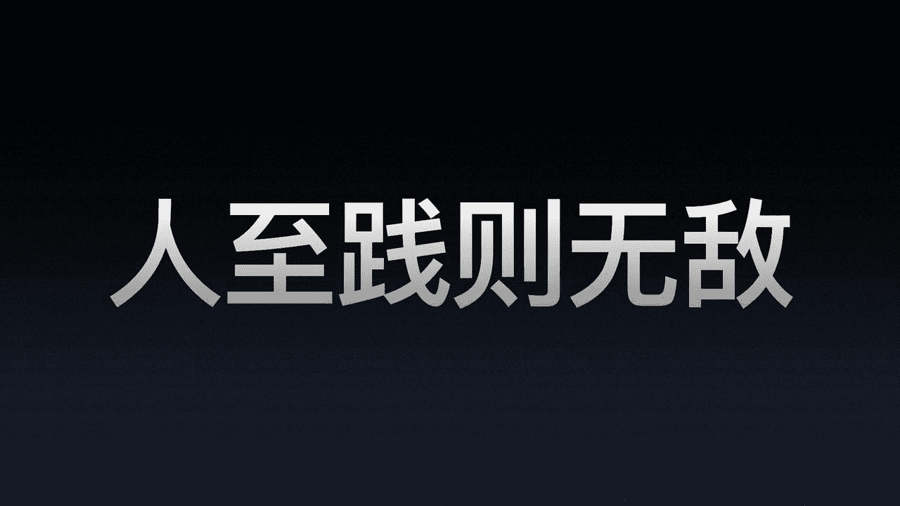

只有践行才能让你变牛逼

我是吴东子，谢谢大家

好了，以上就是我们这篇文章的全部内容

如果你对AI感兴趣的话，可以关注我的👸号：吴东子AI，也欢迎分享给你身边想学AI技术的朋友

里面有我之前发过的所有文章，之后也会持续给大家更新实用的AI干货教程

我是吴东子，用奶奶都能听懂的方式，分享可以落地实操的干货，我们下篇文章再见！