# 2023-08-17一文入门最热的LLM应用开发框架LangChain-今日头条

> 来源：[https://xuqiwei1986.feishu.cn/docx/BtIAdHFtco0BnGxAWOUcKOWQnDc](https://xuqiwei1986.feishu.cn/docx/BtIAdHFtco0BnGxAWOUcKOWQnDc)

> 🔗 原文链接：https://www.toutiao.com/article/7268252747786322490/?log_from=0746135c244d1_1692930132767

## 一文入门最热的LLM应用开发框架LangChain

2023-08-17 19:35 · 腾讯技术工程

作者：腾讯应用宝 MoonWebTeam 团队 jansezhou

> 在人工智能领域的不断发展中，语言模型扮演着重要的角色。特别是大型语言模型（LLM），如 ChatGPT，已经成为科技领域的热门话题，并受到广泛认可。在这个背景下，LangChain 作为一个以 LLM 模型为核心的开发框架出现，为自然语言处理开启了一个充满可能性的世界。借助 LangChain，我们可以创建各种应用程序，包括聊天机器人和智能问答工具。

## 1. LangChain 简介

### 1.1. LangChain 发展史

LangChain 的作者是 Harrison Chase，最初是于 2022 年 10 月开源的一个项目，在 GitHub 上获得大量关注之后迅速转变为一家初创公司。2017 年 Harrison Chase 还在哈佛上大学，如今已是硅谷的一家热门初创公司的 CEO，这对他来说是一次重大而迅速的跃迁。Insider 独家报道，人工智能初创公司 LangChain 在种子轮一周后，再次获得红杉领投的 2000 万至 2500 万美元融资，估值达到 2 亿美元。


### 1.2. LangChain 为什么这么火

LangChain 目前是有两个语言版本（python 和 nodejs）,从下图可以看出来，短短半年的时间该项目的 python 版本已经获得了 54k+的 star。nodejs 版本也在短短 4 个月收货了 7k+的 star，这无疑利好前端同学，不需要会 python 也能快速上手 LLM 应用开发。

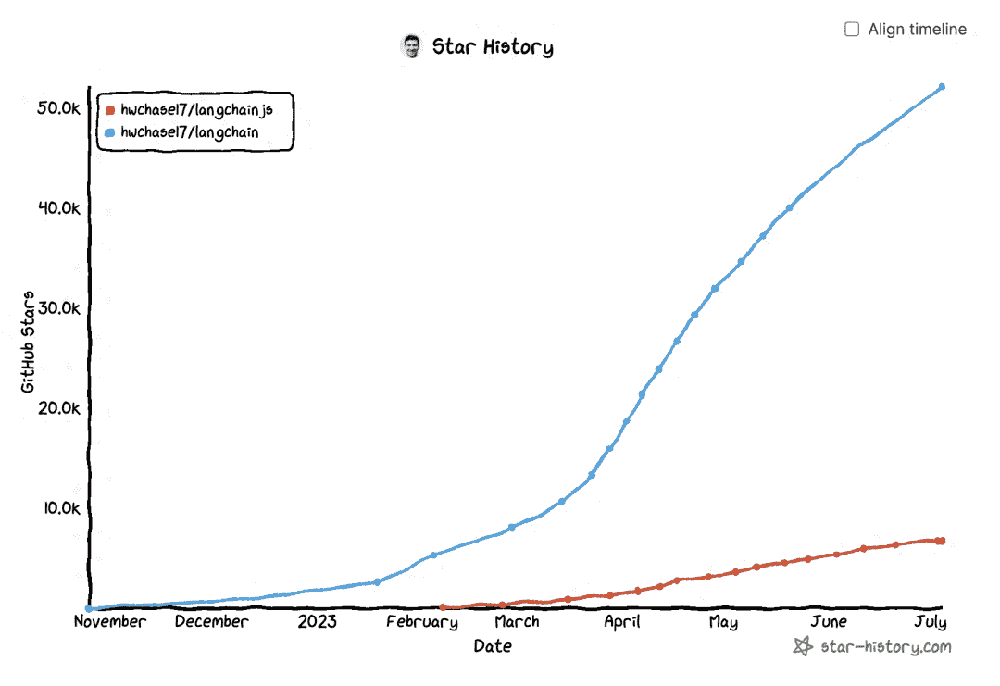

笔者认为 Langchain 作为一个大语言模型应用开发框架，解决了现在开发人工智能应用的一些切实痛点。以 GPT 模型为例：

1. 数据滞后，现在训练的数据是到 2021 年 9 月。
2. token 数量限制，如果让它对一个 300 页的 pdf 进行总结，直接使用则无能为力。
3. 不能进行联网，获取不到最新的内容。
4. 不能与其他数据源链接。

另外作为一个胶水层框架，极大地提高了开发效率，它的作用可以类比于 jquery 在前端开发中的角色，使得开发者可以更专注于创新和优化产品功能。

### 1.3. LLM 应用架构

LangChian 作为一个大语言模型开发框架，是 LLM 应用架构的重要一环。那什么是 LLM 应用架构呢？其实就是指基于语言模型的应用程序设计和开发的架构。

LangChian 可以将 LLM 模型、向量数据库、交互层 Prompt、外部知识、外部工具整合到一起，进而可以自由构建 LLM 应用。

## 2. LangChain 组件

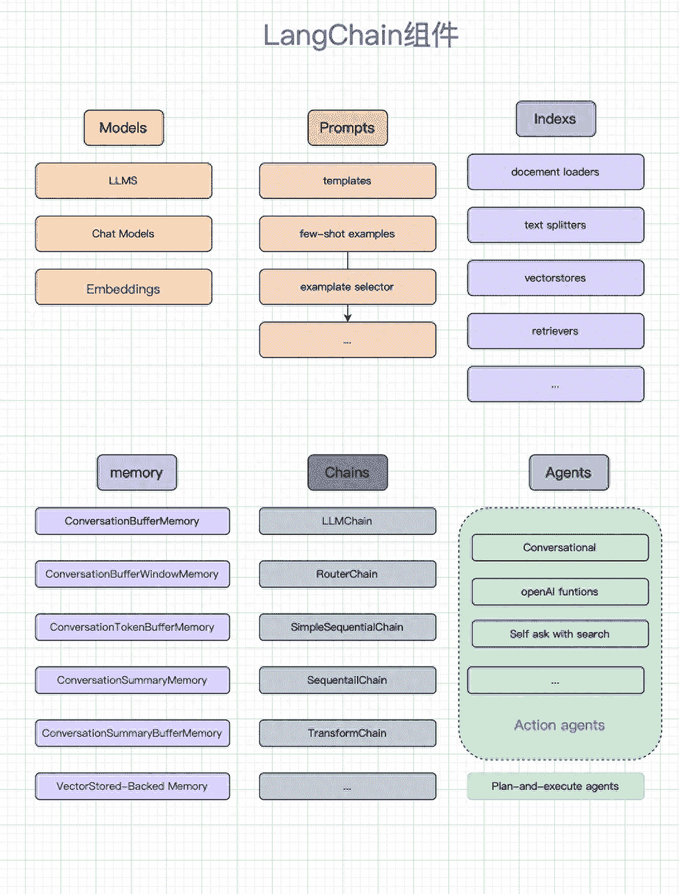

如上图，LangChain 包含六部分组成，分别为：Models、Prompts、Indexes、Memory、Chains、Agents。

### 2.1. Models（模型）

下面我们以具体示例分别阐述下 Chat Modals, Embeddings, LLMs。

#### 2.1.1. 聊天模型

LangChain 为使用聊天模型提供了一个标准接口。聊天模型是语言模型的一种变体。虽然聊天模型在内部使用语言模型，但它们所提供的接口略有不同。它们不是暴露一个 "输入文本，输出文本" 的 API，而是提供了一个以 "聊天消息" 作为输入和输出的接口。

聊天模型的接口是基于消息而不是原始文本。LangChain 目前支持的消息类型有 `AIMessage`、`HumanMessage`、`SystemMessage` 和 `ChatMessage`，其中 `ChatMessage` 接受一个任意的角色参数。大多数情况下，您只需要处理 `HumanMessage`、`AIMessage` 和 `SystemMessage`。

```
# 导入OpenAI的聊天模型，及消息类型
from langchain.chat_models import ChatOpenAI
from langchain.schema import (
    AIMessage,
    HumanMessage,
    SystemMessage
)

# 初始化聊天对象
chat = ChatOpenAI(openai_api_key="...")

# 向聊天模型发问
chat([HumanMessage(content="Translate this sentence from English to French: I love programming.")])
```

OpenAI 聊天模式支持多个消息作为输入。这是一个系统和用户消息聊天模式的例子:

```
messages = [
    SystemMessage(content="You are a helpful assistant that translates English to French."),
    HumanMessage(content="I love programming.")
]
chat(messages)
```

当然也可以进行批量处理，批量输出。

```
batch_messages = [
    [
        SystemMessage(content="You are a helpful assistant that translates English to French."),
        HumanMessage(content="I love programming.")
    ],
    [
        SystemMessage(content="You are a helpful assistant that translates English to French."),
        HumanMessage(content="I love artificial intelligence.")
    ],
]
result = chat.generate(batch_messages)
result
```

上面介绍了聊天的角色处理以及如何进行批量处理消息。我们都知道向 openAI 调用接口都是要花钱的，如果用户问同一个问题，对结果进行了缓存，这样就可以减少接口的调用并且也能加快接口返回的速度。LangChain 也很贴心的提供了缓存的功能。并且提供了两种缓存方案，内存缓存方案和数据库缓存方案，当然支持的数据库缓存方案有很多种。

```
# 导入聊天模型，SQLiteCache模块
import os
os.environ["OPENAI_API_KEY"] = 'your apikey'
import langchain
from langchain.chat_models import ChatOpenAI
from langchain.cache import SQLiteCache

# 设置语言模型的缓存数据存储的地址
langchain.llm_cache = SQLiteCache(database_path=".langchain.db")

# 加载 llm 模型
llm = ChatOpenAI()

# 第一次向模型提问
result = llm.predict('tell me a joke')
print(result)

# 第二次向模型提问同样的问题
result2 = llm.predict('tell me a joke')
print(result2)
```

另外聊天模式也提供了一种流媒体回应。这意味着,而不是等待整个响应返回,你就可以开始处理它尽快。

#### 2.1.2. 嵌入

这个更多的是用于文档、文本或者大量数据的总结、问答场景，一般是和向量库一起使用，实现向量匹配。其实就是把文本等内容转成多维数组，可以后续进行相似性的计算和检索。他相比 fine-tuning 最大的优势就是，不用进行训练，并且可以实时添加新的内容，而不用加一次新的内容就训练一次，并且各方面成本要比 fine-tuning 低很多。

下面以代码展示下 `embeddings` 是什么。

```
# 导入os, 设置环境变量，导入OpenAI的嵌入模型
import os
from langchain.embeddings.openai import OpenAIEmbeddings
os.environ["OPENAI_API_KEY"] = 'your apikey'

# 初始化嵌入模型
embeddings = OpenAIEmbeddings()

# 把文本通过嵌入模型向量化
res = embeddings.embed_query('hello world')
/*
[
   -0.004845875,   0.004899438,  -0.016358767,  -0.024475135, -0.017341806,
    0.012571548,  -0.019156644,   0.009036391,  -0.010227379, -0.026945334,
    0.022861943,   0.010321903,  -0.023479493, -0.0066544134,  0.007977734,
   0.0026371893,   0.025206111,  -0.012048521,   0.012943339,  0.013094575,
   -0.010580265,  -0.003509951,   0.004070787,   0.008639394, -0.020631202,
  -0.0019203906,   0.012161949,  -0.019194454,   0.030373365, -0.031028723,
   0.0036170771,  -0.007813894, -0.0060778237,  -0.017820721, 0.0048647798,
   -0.015640393,   0.001373733,  -0.015552171,   0.019534737, -0.016169721,
    0.007316074,   0.008273906,   0.011418369,   -0.01390117, -0.033347685,
    0.011248227,  0.0042503807,  -0.012792102, -0.0014595914,  0.028356876,
    0.025407761, 0.00076445413,  -0.016308354,   0.017455231, -0.016396577,
    0.008557475,   -0.03312083,   0.031104341,   0.032389853,  -0.02132437,
    0.003324056,  0.0055610985, -0.0078012915,   0.006090427, 0.0062038545,
  ... 1466 more items
]
*/
```

下图是 LangChain 两种语言包支持的 `embeddings`。

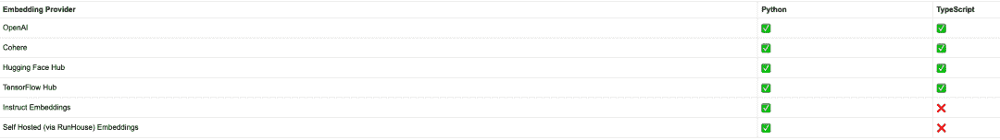

#### 2.1.3. 大语言模型

`LLMS` 是 LangChain 的核心，从官网可以看到 LangChain 继承了非常多的大语言模型。

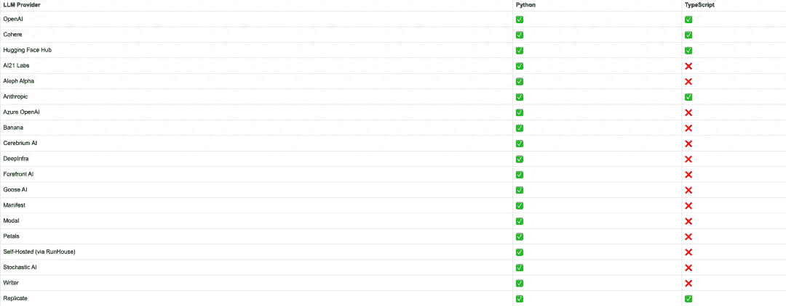

### 2.2. Prompts（提示词）

#### 2.2.1. Prompt Templates

LangChain 提供了 `PromptTemplates`，允许你可以根据用户输入动态地更改提示，如果你有编程基础，这应该对你来说很简单。当用户需要输入多个类似的 `prompt` 时，生成一个 `prompt` 模板是一个很好的解决方案，可以节省用户的时间和精力。下面是一个示例，将 LLM 作为一个给新开商店命名的顾问，用户只需告诉 LLM 商店的主要特点，它将返回 10 个新开商店的名字。

```
from langchain.llms import OpenAI

# 定义生成商店的方法
def generate_store_names(store_features):
    prompt_template = "我正在开一家新的商店，它的主要特点是{}。请帮我想出10个商店的名字。"
    prompt = prompt_template.format(store_features)

    llm = OpenAI()
    response = llm.generate(prompt, max_tokens=10, temperature=0.8)

    store_names = [gen[0].text.strip() for gen in response.generations]
    return store_names

store_features = "时尚、创意、独特"

store_names = generate_store_names(store_features)
print(store_names)
```

这样，用户只需告诉 LLM 商店的主要特点，就可以获得 10 个新开商店的名字，而无需重复输入类似的 `prompt` 内容。另外 `LangChainHub` 包含了许多可以通过 LangChain 直接加载的 `PromptTemplates`。顺便我们也可以通过学习他们的 `Prompt` 设计来给我们以启发。

#### 2.2.2. Few-shot example

Few-shot examples 是一组可用于帮助语言模型生成更好响应的示例。

要生成具有 few-shot examples 的 `prompt`，可以使用 `FewShotPromptTemplate`。该类接受一个 `PromptTemplate` 和一组 few-shot examples。然后，它使用这些 few-shot examples 格式化 `prompt` 模板。

我们再看一个例子，需求是根据用户输入，让模型返回对应的反义词，我们要通过示例来告诉模型什么是反义词, 这就是 few-shot examples（小样本提示）。

```
import os
os.environ["OPENAI_API_KEY"] = 'your apikey'
from langchain import PromptTemplate, FewShotPromptTemplate
from langchain.llms import OpenAI

examples = [
    {"word": "黑", "antonym": "白"},
    {"word": "伤心", "antonym": "开心"},
]

example_template = """
单词: {word}
反义词: {antonym}\n
"""

# 创建提示词模版
example_prompt = PromptTemplate(
    input_variables=["word", "antonym"],
    template=example_template,
)

# 创建小样本提示词模版
few_shot_prompt = FewShotPromptTemplate(
    examples=examples,
    example_prompt=example_prompt,
    prefix="给出每个单词的反义词",
    suffix="单词: {input}\n反义词:",
    input_variables=["input"],
    example_separator="\n",
)

# 格式化小样本提示词
prompt_text = few_shot_prompt.format(input="粗")

# 调用OpenAI
llm = OpenAI(temperature=0.9)

print(llm(prompt_text))
```

#### 2.2.3. Example Selector

如果你有大量的示例，则可以使用 `ExampleSelector` 来选择最有信息量的一些示例，以帮助你生成更可能产生良好响应的提示。接下来，我们将使用 `LengthBasedExampleSelector`，根据输入的长度选择示例。当你担心构造的提示将超过上下文窗口的长度时，此方法非常有用。对于较长的输入，它会选择包含较少示例的提示，而对于较短的输入，它会选择包含更多示例。


```python
import os
os.environ["OPENAI_API_KEY"] = 'your apikey'
from langchain.prompts import PromptTemplate, FewShotPromptTemplate
from langchain.prompts.example_selector import LengthBasedExampleSelector
from langchain.prompts.example_selector import LengthBasedExampleSelector


# These are a lot of examples of a pretend task of creating antonyms.
examples = [
    {"word": "happy", "antonym": "sad"},
    {"word": "tall", "antonym": "short"},
    {"word": "energetic", "antonym": "lethargic"},
    {"word": "sunny", "antonym": "gloomy"},
    {"word": "windy", "antonym": "calm"},
]
# 例子格式化模版
example_formatter_template = """
Word: {word}
Antonym: {antonym}\n
"""
example_prompt = PromptTemplate(
    input_variables=["word", "antonym"],
    template=example_formatter_template,
)

# 使用 LengthBasedExampleSelector来选择例子
example_selector = LengthBasedExampleSelector(
    examples=examples,
    example_prompt=example_prompt,
    # 最大长度
    max_length=25,
)

# 使用 'example_selector' 创建小样本提示词模版
dynamic_prompt = FewShotPromptTemplate(
    example_selector=example_selector,
    example_prompt=example_prompt,
    prefix="Give the antonym of every input",
    suffix="Word: {input}\nAntonym:",
    input_variables=["input"],
    example_separator="\n\n",
)

longString = "big and huge and massive and large and gigantic and tall and much much much much much bigger than everything else"

print(dynamic_prompt.format(input=longString))
```

另外官方也提供了根据最大边际相关性、文法重叠、语义相似性来选择示例。

# 2.3. Indexes（索引）

索引是指对文档进行结构化的方法，以便 LLM 能够更好的与之交互。该组件主要包括：`Document Loaders`（文档加载器）、`Text Splitters`（文本拆分器）、`VectorStores`（向量存储器）以及 `Retrievers`（检索器）。

## 2.3.1. Document Loaders

指定源进行加载数据的。将特定格式的数据，转换为文本。如 CSV、File Directory、HTML、JSON、Markdown、PDF。另外使用相关接口处理本地知识，或者在线知识。如 AirbyteJSON、Airtable、Alibaba Cloud MaxCompute、wikipedia、BiliBili、GitHub、GitBook 等等。

## 2.3.2. Text Splitters

由于模型对输入的字符长度有限制，我们在碰到很长的文本时，需要把文本分割成多个小的文本片段。

文本分割最简单的方式是按照字符长度进行分割，但是这会带来很多问题，比如说如果文本是一段代码，一个函数被分割到两段之后就成了没有意义的字符，所以整体的原则是把语义相关的文本片段放在一起。

LangChain 中最基本的文本分割器是 `CharacterTextSplitter` ，它按照指定的分隔符（默认“\n\n”）进行分割，并且考虑文本片段的最大长度。我们看个例子：

```
from langchain.text_splitter import CharacterTextSplitter

# 初始字符串
state_of_the_union = "..."

text_splitter = CharacterTextSplitter(
    separator = "\\n\\n",
    chunk_size = 1000,
    chunk_overlap  = 200,
    length_function = len,
)

texts = text_splitter.create_documents([state_of_the_union])
```

除了 `CharacterTextSplitter` 以外，LangChain 还支持多个高级文本分割器，如下：

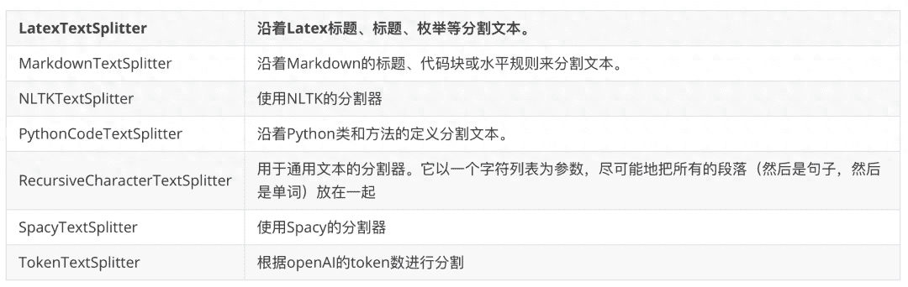

## 2.3.3. VectorStores

存储提取的文本向量，包括 `Faiss`、`Milvus`、`Pinecone`、`Chroma` 等。如下是 LangChain 集成的向量数据库。

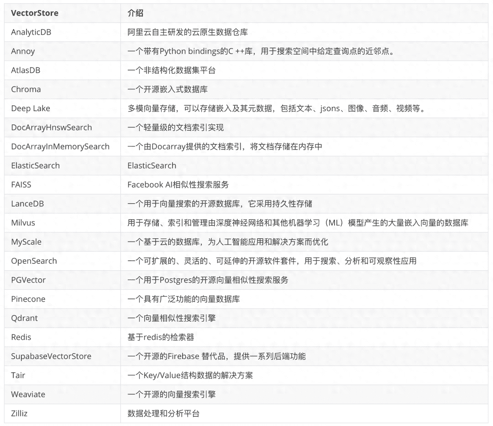

## 2.3.4. Retrievers

检索器是一种便于模型查询的存储数据的方式，LangChain 约定检索器组件至少有一个方法 `get_relevant_texts`，这个方法接收查询字符串，返回一组文档。下面是一个简单的列子：

```
from langchain.chains import RetrievalQA
from langchain.llms import OpenAI
from langchain.document_loaders import TextLoader
from langchain.indexes import VectorstoreIndexCreator
loader = TextLoader('../state_of_the_union.txt', encoding='utf8')

# 对加载的内容进行索引
index = VectorstoreIndexCreator().from_loaders([loader])

query = "What did the president say about Ketanji Brown Jackson"

# 通过query的方式找到语义检索的结果
index.query(query)
```

# 2.4. Chains（链）

链允许我们将多个组件组合在一起以创建一个单一的、连贯的任务。例如，我们可以创建一个链，它接受用户输入，使用 `PromptTemplate` 对其进行格式化，然后将格式化的响应传递给 `LLM`。另外我们也可以通过将多个链组合在一起，或者将链与其他组件组合来构建更复杂的链。

## 2.4.1. LLMChain

`LLMChain` 是一个简单的链，它围绕语言模型添加了一些功能。它在整个 LangChain 中广泛使用，包括在其他链和代理中。它接受一个提示模板，将其与用户输入进行格式化，并返回 `LLM` 的响应。

```
from langchain import PromptTemplate, OpenAI, LLMChain

prompt_template = "What is a good name for a company that makes {product}?"

llm = OpenAI(temperature=0)
llm_chain = LLMChain(
    llm=llm,
    prompt=PromptTemplate.from_template(prompt_template)
)
llm_chain("colorful socks")
```

除了所有 `Chain` 对象共享的 `call` 和 `run` 方法外，`LLMChain` 还提供了一些调用的方法，如下是不同调用方法的说明.

● `call` 方法返回输入和输出键值。

另外可以通过将 `return_only_outputs` 设置为 `True`，可以将其配置为只返回输出键值。

```
llm_chain("corny", return_only_outputs=True)
```

```
    {'text': 'Why did the tomato turn red? Because it saw the salad dressing!'}
```

● `run` 方法返回的是字符串而不是字典。

```
llm_chain.run({"adjective": "corny"})
```

```
    'Why did the tomato turn red? Because it saw the salad dressing!'
```

● `apply` 方法允许你对一个输入列表进行调用

```
input_list = [
    {"product": "socks"},
    {"product": "computer"},
    {"product": "shoes"}
]

llm_chain.apply(input_list)
```

```
    [{'text': '\n\nSocktastic!'},
     {'text': '\n\nTechCore Solutions.'},
     {'text': '\n\nFootwear Factory.'}]
```

● `generate` 方法类似于 `apply` 方法，但它返回的是 `LLMResult` 而不是字符串。`LLMResult` 通常包含有用的生成信息，例如令牌使用情况和完成原因。

```
llm_chain.generate(input_list)
```

```
    LLMResult(generations=[[Generation(text='\n\nSocktastic!', generation_info={'finish_reason': 'stop', 'logprobs': None})], [Generation(text='\n\nTechCore Solutions.', generation_info={'finish_reason': 'stop', 'logprobs': None})], [Generation(text='\n\nFootwear Factory.', generation_info={'finish_reason': 'stop', 'logprobs': None})]], llm_output={'token_usage': {'prompt_tokens': 36, 'total_tokens': 55, 'completion_tokens': 19}, 'model_name': 'text-davinci-003'})
```

● `predict` 方法类似于 `run` 方法，不同之处在于输入键被指定为关键字参数，而不是一个 Python 字典。

```
# Single input example
llm_chain.predict(product="colorful socks")
```

## 2.4.2. SimpleSequentialChain

顺序链的最简单形式，其中每个步骤都有一个单一的输入/输出，并且一个步骤的输出是下一步的输入。

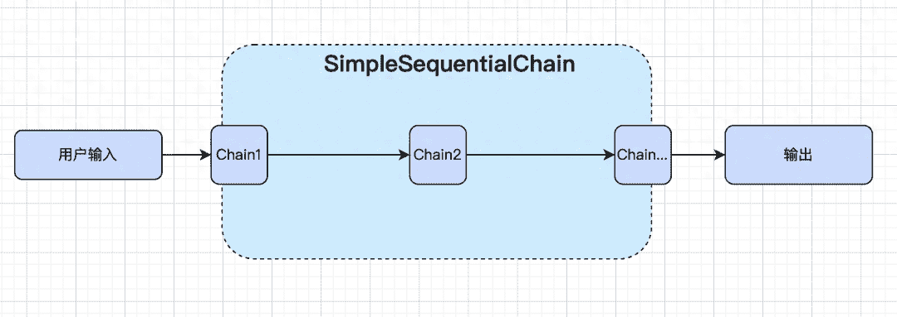

如下就是将两个 `LLMChain` 进行组合成顺序链进行调用的案例。

```
from langchain.llms import OpenAI
from langchain.chains import LLMChain
from langchain.prompts import PromptTemplate
from langchain.chains import SimpleSequentialChain

# 定义第一个chain
llm = OpenAI(temperature=.7)
template = """You are a playwright. Given the title of play, it is your job to write a synopsis for that title.

Title: {title}
Playwright: This is a synopsis for the above play:"""
prompt_template = PromptTemplate(input_variables=["title"], template=template)
synopsis_chain = LLMChain(llm=llm, prompt=prompt_template)

# 定义第二个chain

llm = OpenAI(temperature=.7)
template = """You are a play critic from the New York Times. Given the synopsis of play, it is your job to write a review for that play.

Play Synopsis:
{synopsis}
Review from a New York Times play critic of the above play:"""
prompt_template = PromptTemplate(input_variables=["synopsis"], template=template)
review_chain = LLMChain(llm=llm, prompt=prompt_template)

# 通过简单顺序链组合两个LLMChain
overall_chain = SimpleSequentialChain(chains=[synopsis_chain, review_chain], verbose=True)

# 执行顺序链
review = overall_chain.run("Tragedy at sunset on the beach")
```

## 2.4.3. SequentialChain

相比 `SimpleSequentialChain` 只允许有单个输入输出，它是一种更通用的顺序链形式，允许多个输入/输出。

特别重要的是：我们如何命名输入/输出变量名称。在上面的示例中，我们不必考虑这一点，因为我们只是将一个链的输出直接作为输入传递给下一个链，但在这里我们确实需要担心这一点，因为我们有多个输入。

第一个 `LLMChain`：


```
# 这是一个 LLMChain，根据戏剧的标题和设定的时代，生成一个简介。
llm = OpenAI(temperature=.7)
template = """You are a playwright. Given the title of play and the era it is set in, it is your job to write a synopsis for that title.
# 这里定义了两个输入变量title和era，并定义一个输出变量：synopsis
Title: {title}
Era: {era}
Playwright: This is a synopsis for the above play:"""
prompt_template = PromptTemplate(input_variables=["title", "era"], template=template)
synopsis_chain = LLMChain(llm=llm, prompt=prompt_template, output_key="synopsis")
```

第二个 `LLMChain`：

```
# 这是一个 LLMChain，根据剧情简介撰写一篇戏剧评论。
llm = OpenAI(temperature=.7)
template = """You are a play critic from the New York Times. Given the synopsis of play, it is your job to write a review for that play.
# 定义了一个输入变量：synopsis，输出变量：review
Play Synopsis:
{synopsis}
Review from a New York Times play critic of the above play:"""
prompt_template = PromptTemplate(input_variables=["synopsis"], template=template)
review_chain = LLMChain(llm=llm, prompt=prompt_template, output_key="review")
```

执行顺序链：

```
overall_chain({"title":"Tragedy at sunset on the beach", "era": "Victorian England"})
```

执行结果，可以看到会把每一步的输出都能打印出来。

```
    > Entering new SequentialChain chain...

    > Finished chain.

    {'title': 'Tragedy at sunset on the beach',
     'era': 'Victorian England',
     'synopsis': "xxxxxx",
     'review': "xxxxxxx"}
```

### 2.4.4. TransformChain

转换链允许我们创建一个自定义的转换函数来处理输入，将处理后的结果用作下一个链的输入。如下示例我们将创建一个转换函数，它接受超长文本，将文本过滤为仅前 3 段，然后将其传递到 `LLMChain` 中以总结这些内容。

```
from langchain.chains import TransformChain, LLMChain, SimpleSequentialChain
from langchain.llms import OpenAI
from langchain.prompts import PromptTemplate

# 模拟超长文本
with open("../../state_of_the_union.txt") as f:
    state_of_the_union = f.read()

# 定义转换方法，入参和出参都是字典，取前三段
def transform_func(inputs: dict) -> dict:
    text = inputs["text"]
    shortened_text = "\n\n".join(text.split("\n\n")[:3])
    return {"output_text": shortened_text}

# 转换链：输入变量：text，输出变量：output_text
transform_chain = TransformChain(
    input_variables=["text"], output_variables=["output_text"], transform=transform_func
)
# prompt模板描述
template = """Summarize this text:

{output_text}

Summary:"""
# prompt模板
prompt = PromptTemplate(input_variables=["output_text"], template=template)
# llm链
llm_chain = LLMChain(llm=OpenAI(), prompt=prompt)
# 使用顺序链
sequential_chain = SimpleSequentialChain(chains=[transform_chain, llm_chain])
# 开始执行
sequential_chain.run(state_of_the_union)
# 结果
"""
    ' The speaker addresses the nation, noting that while last year they were kept apart due to COVID-19, this year they are together again.
    They are reminded that regardless of their political affiliations, they are all Americans.';

"""
```

## 2.5. Memory（记忆）

熟悉 openai 的都知道,openai 提供的聊天接口 api，本身是不具备“记忆的”能力。如果想要使聊天具有记忆功能，则需要我们自行维护聊天记录，即每次把聊天记录发给 gpt。具体过程如下

第一次发送：

```
import openai

openai.ChatCompletion.create(
  model="gpt-3.5-turbo",
  messages=[
        {"role": "system", "content": "You are a helpful assistant."},
        {"role": "user", "content": "Hello"},
    ]
)
```

第二次发送就要带上我们第一次的记录：

```
import openai

openai.ChatCompletion.create(
  model="gpt-3.5-turbo",
  messages=[
        {"role": "system", "content": "You are a helpful assistant."},
        {"role": "user", "content": "Hello"},
        {"role": "assistant", "content": "Hello, how can I help you?"},
        {"role": "user", "content": "who is more stylish Pikachu or Neo"},
    ]
)
```

那如果我们一直聊天下去，发送的内容也越来越多，那很可能就碰到 `token` 的限制。聪明的同学会发现，其实我们只保留最近几次的聊天记录就可以了。没错，其实 LangChain 也是这样实现的，不过 LangChain 提供了更多的方法。

langchain 提供了不同的 `Memory` 组件完成内容记忆，如下是目前提供的组件。

### 2.5.1. ConversationBufferMemory

该组件类似我们上面的描述，只不过它会将聊天内容记录在内存中，而不需要每次再手动拼接聊天记录。

### 2.5.2. ConversationBufferWindowMemory

相比较第一个记忆组件，该组件增加了一个窗口参数，会保存最近看 k 论的聊天内容。

### 2.5.3. ConversationTokenBufferMemory

在内存中保留最近交互的缓冲区，并使用 `token` 长度而不是交互次数来确定何时刷新交互。

### 2.5.4. ConversationSummaryMemory

相比第一个记忆组件，该组件只会存储一个用户和机器人之间的聊天内容的摘要。

### 2.5.5. ConversationSummaryBufferMemory

结合了上面两个思路，存储一个用户和机器人之间的聊天内容的摘要并使用 `token` 长度来确定何时刷新交互。

### 2.5.6. VectorStoreRetrieverMemory

它是将所有之前的对话通过向量的方式存储到 `VectorDB`（向量数据库）中，在每一轮新的对话中，会根据用户的输入信息，匹配向量数据库中最相似的 `K` 组对话。

## 2.6. Agents（代理）

一些应用程序需要根据用户输入灵活地调用 `LLM` 和其他工具的链。代理接口为这样的应用程序提供了灵活性。代理可以访问一套工具，并根据用户输入确定要使用哪些工具。我们可以简单的理解为他可以动态的帮我们选择和调用 `chain` 或者已有的工具。代理主要有两种类型 Action agents 和 Plan-and-execute agents。

### 2.6.1. Action agents

行为代理: 在每个时间步，使用所有先前动作的输出来决定下一个动作。下图展示了行为代理执行的流程。

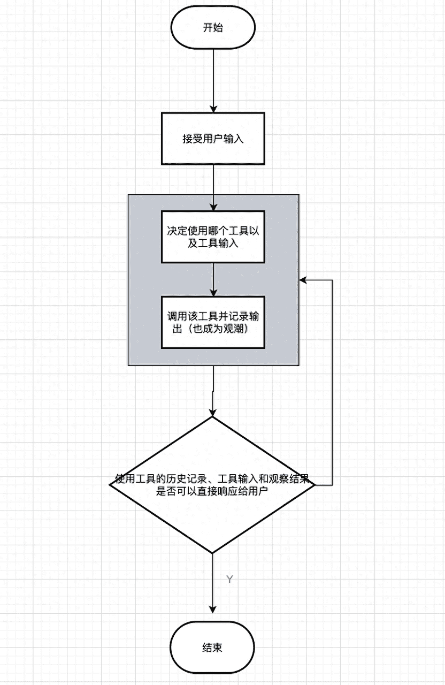

### 2.6.2. Plan-and-execute agents

预先决定完整的操作顺序，然后执行所有操作而不更新计划，下面是其流程。

- 接收用户输入
- 计划要采取的完整步骤顺序
- 按顺序执行步骤，将过去步骤的输出作为未来步骤的输入传递

# 3. LangChain 实战

## 3.1. 完成一次问答

LangChain 加载 `OpenAI` 的模型，并且完成一次问答。

先设置我们的 openai 的 key，然后，我们进行导入和执行。

```
import os
os.environ["OPENAI_API_KEY"] = '你的api key'
from langchain.llms import OpenAI

# 加载 OpenAI 模型，并指定模型名字
llm = OpenAI(model_name="text-davinci-003",max_tokens=1024)

# 向模型提问
result = llm("怎么评价人工智能")
```

## 3.2. 通过谷歌搜索并返回答案

为了实现我们的项目，我们需要使用 Serpapi 提供的 Google 搜索 API 接口。首先，我们需要在 Serpapi 官网上注册一个用户，并复制由 Serpapi 生成的 API 密钥。接下来，我们需要将这个 API 密钥设置为环境变量，就像我们之前设置 `OpenAI` API 密钥一样。

```
import os
os.environ["OPENAI_API_KEY"] = '你的api key'
os.environ["SERPAPI_API_KEY"] = '你的api key'
```

然后，开始编写我的代码。

```
from langchain.agents import load_tools
from langchain.agents import initialize_agent
from langchain.agents import AgentType
from langchain.llms import OpenAI

# 加载 OpenAI 模型
llm = OpenAI(temperature=0)

# 加载 serpapi、语言模型的数学工具
tools = load_tools(["serpapi", "llm-math"], llm=llm)

# 工具加载后都需要初始化，verbose 参数为 True，会打印全部的执行详情
agent = initialize_agent(tools, llm, agent=AgentType.ZERO_SHOT_REACT_DESCRIPTION, verbose=True)

# 执行代理
agent.run("今天是几号？历史上的今天发生了什么事情")
```

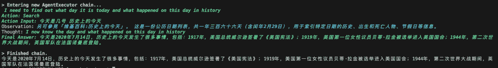

可以看到，正确的返回了日期（有时差），并且返回了历史上的今天。并且通过设置 `verbose` 这个参数为 `True`,可以看到完整的 `chain` 执行过程。将我们的问题拆分成了几个步骤，然后一步一步得到最终的答案。

## 3.3. 对超长文本进行总结

假如我们想要用 openai api 对一个段文本进行总结，我们通常的做法就是直接发给 api 让他总结。但是如果文本超过了 api 最大的 `token` 限制就会报错。这时，我们一般会进行对文章进行分段，比如通过 tiktoken 计算并分割，然后将各段发送给 api 进行总结，最后将各段的总结再进行一个全部的总结。

LangChain 很好的帮我们处理了这个过程，使得我们编写代码变的非常简单。

```
import os
os.environ["OPENAI_API_KEY"] = '你的api key'
from langchain.document_loaders import TextLoader
from langchain.chains.summarize import load_summarize_chain
from langchain.text_splitter import RecursiveCharacterTextSplitter
from langchain import OpenAI

# 获取当前脚本所在的目录
base_dir = os.path.dirname(os.path.abspath(__file__))

# 构建doc.txt文件的路径
doc_path = os.path.join(base_dir, 'static', 'open.txt')

# 通过文本加载器加载文本
loader = TextLoader(doc_path)

# 将文本转成 Document 对象
document = loader.load()

# 初始化文本分割器
text_splitter = RecursiveCharacterTextSplitter(
    chunk_size = 800,
    chunk_overlap = 0
)

# 切分文本
split_documents = text_splitter.split_documents(document)

# 加载 llm 模型
llm = OpenAI(model_name="text-davinci-003", max_tokens=1500)

# 创建总结链
chain = load_summarize_chain(llm, chain_type="refine", verbose=True)

# 执行总结链
chain.run(split_documents)
```

这里解释下文本分割器的 `chunk_overlap` 参数和 `chain` 的 `chain_type` 参数。


`chunk_overlap` 是指切割后的每个 `document` 里包含几个上一个 `document` 结尾的内容，主要作用是为了增加每个 `document` 的上下文关联。比如，`chunk_overlap=0` 时，第一个 `document` 为 aaaaaa，第二个为 bbbbbb；当 `chunk_overlap=2` 时，第一个 `document` 为 aaaaaa，第二个为 aabbbbbb。

`chain_type` 主要控制了将 `document` 传递给 `llm` 模型的方式，一共有 4 种方式：

`stuff`: 这种最简单粗暴，会把所有的 `document` 一次全部传给 `llm` 模型进行总结。如果 `document` 很多的话，势必会报超出最大 `token` 限制的错，所以总结文本的时候一般不会选中这个。

`map_reduce`: 这个方式会先将每个 `document` 进行总结，最后将所有 `document` 总结出的结果再进行一次总结。

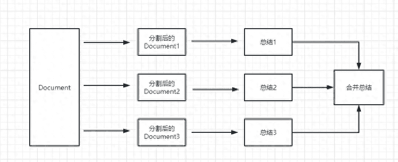

`refine`: 这种方式会先总结第一个 `document`，然后在将第一个 `document` 总结出的内容和第二个 `document` 一起发给 `llm` 模型在进行总结，以此类推。这种方式的好处就是在总结后一个 `document` 的时候，会带着前一个的 `document` 进行总结，给需要总结的 `document` 添加了上下文，增加了总结内容的连贯性。

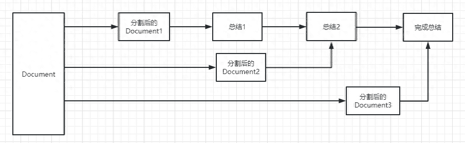

`map_rerank`: 这种一般不会用在总结的 `chain` 上，而是会用在问答的 `chain` 上，他其实是一种搜索答案的匹配方式。首先你要给出一个问题，他会根据问题给每个 `document` 计算一个这个 `document` 能回答这个问题的概率分数，然后找到分数最高的那个 `document` ，在通过把这个 `document` 转化为问题的 `prompt` 的一部分（问题+`document`）发送给 `llm` 模型，最后 `llm` 模型返回具体答案。

## 3.4. 构建本地知识库问答机器人

通过这个可以很方便的做一个可以介绍公司业务的机器人，或是介绍一个产品的机器人。这里主要使用了 `Embedding`（相关性）的能力。

导入 `os`，设置环境变量。导入 `OpenAIEmbeddings`、`Chroma` 向量数据库、`CharacterTextSplitter` 文本分割器、`OpenAI` 模型、`VectorDBQA` 向量数据库数据查询模块及 `DirectoryLoader` 文件夹文档加载器

```
import os
os.environ["OPENAI_API_KEY"] = '你的api key'
from langchain.embeddings.openai import OpenAIEmbeddings
from langchain.vectorstores import Chroma
from langchain.text_splitter import CharacterTextSplitter
from langchain import OpenAI, VectorDBQA
from langchain.document_loaders import DirectoryLoader

# 获取当前脚本所在的目录
base_dir = os.path.dirname(os.path.abspath(__file__))

# 构建doc.txt文件的路径
doc_Directory = os.path.join(base_dir, 'static')

# 加载文件夹中的所有txt类型的文件
loader = DirectoryLoader(doc_Directory, glob='**/*.txt')

# 将数据转成 document 对象，每个文件会作为一个 document
documents = loader.load()

# 初始化加载器
text_splitter = CharacterTextSplitter(chunk_size=100, chunk_overlap=0)

# 切割加载的 document
split_docs = text_splitter.split_documents(documents)

# 初始化 openai 的 embeddings 对象
embeddings = OpenAIEmbeddings()

# 将 document 通过 openai 的 embeddings 对象计算 embedding 向量信息并临时存入 Chroma 向量数据库，用于后续匹配查询
docsearch = Chroma.from_documents(split_docs, embeddings)

# 创建问答对象
qa = VectorDBQA.from_chain_type(llm=OpenAI(), chain_type="stuff", vectorstore=docsearch, return_source_documents=True)

# 进行问答
result = qa({"query": "一年收入是多少？"})
```

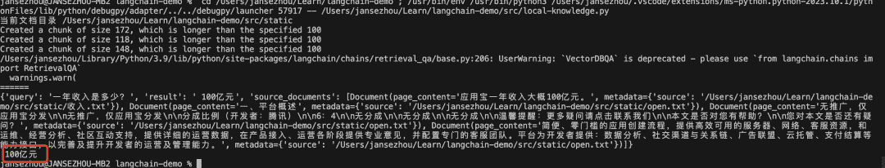

上图中成功的从我们的给到的数据中获取了正确的答案。

## 3.5. 构建向量索引数据库

Home | Chroma

我们上个案例里面有一步是将 `document` 信息转换成向量信息和 `embeddings` 的信息并临时存入 `Chroma` 数据库。

因为是临时存入，所以当我们上面的代码执行完成后，上面的向量化后的数据将会丢失。如果想下次使用，那么就还需要再计算一次 `embeddings`，这肯定不是我们想要的。LangChain 支持的数据库有很多，这个案例介绍下通过 `Chroma` 个数据库来讲一下如何做向量数据持久化。

`chroma` 是个本地的向量数据库，他提供的一个 `persist_directory` 来设置持久化目录进行持久化。读取时，只需要调取 `from_document` 方法加载即可。

```
from langchain.vectorstores import Chroma

# 持久化数据
docsearch = Chroma.from_documents(documents, embeddings, persist_directory="D:/vector_store")
docsearch.persist()

# 从已有文件中加载数据
docsearch = Chroma(persist_directory="D:/vector_store", embedding_function=embeddings)
```

## 3.6. 基于 LangChain 构建的开源应用

基于 LangChain 的优秀项目资源库

基于 LangChain 和 `ChatGLM-6B` 等系列 `LLM` 的针对本地知识库的自动问答

## 4. 总结

随着 LangChain 不断迭代和优化，它的功能将变得越来越强大，支持的范围也将更广泛。无论是处理复杂的语言模型还是解决各种实际问题，LangChain 都将展现出更高的实力和灵活性。然而，我必须承认，我的理解能力和解释能力是有限的，可能会出现错误或者解释不够清晰。因此，恳请读者们谅解。

## 5. 参考文献

● LangChain | LangChain

● LangChain 中文入门教程 - LangChain 的中文入门教程
