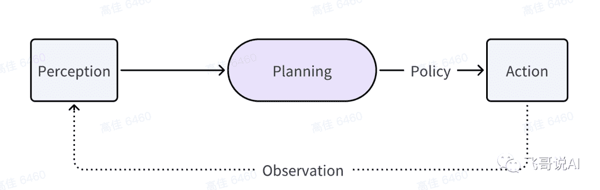
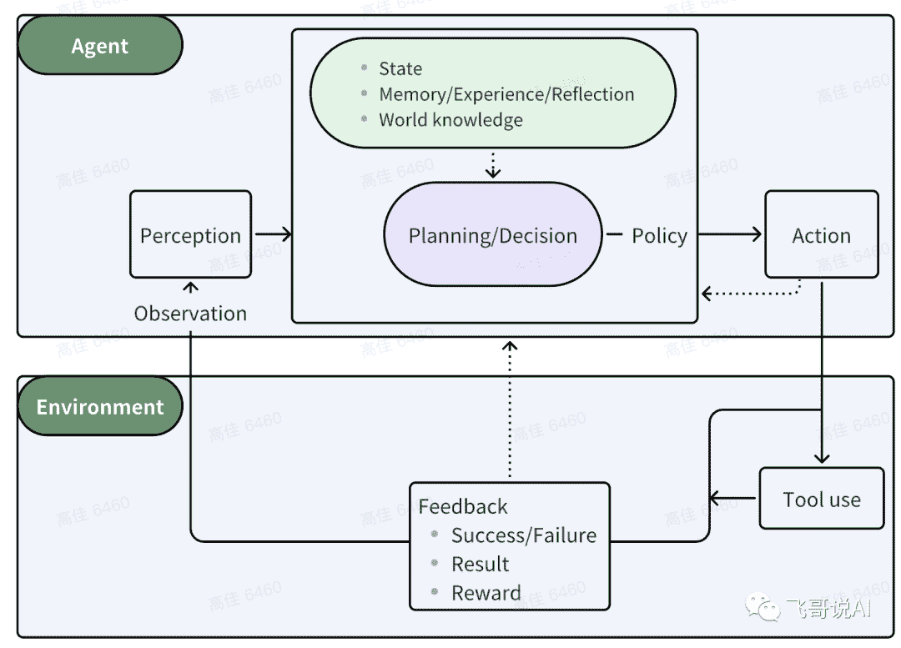
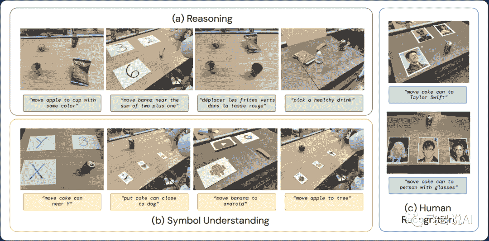
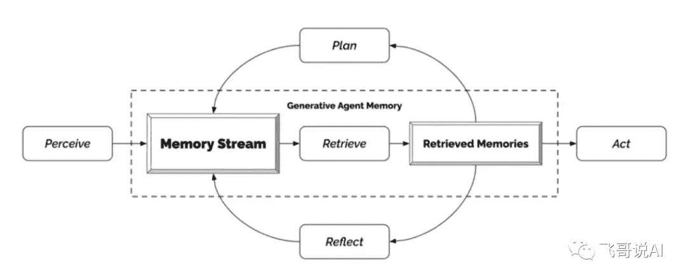
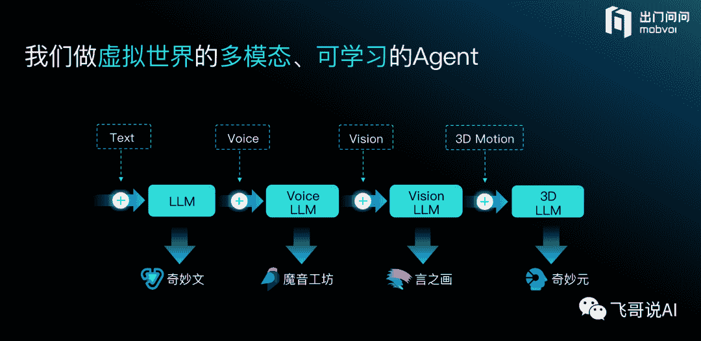
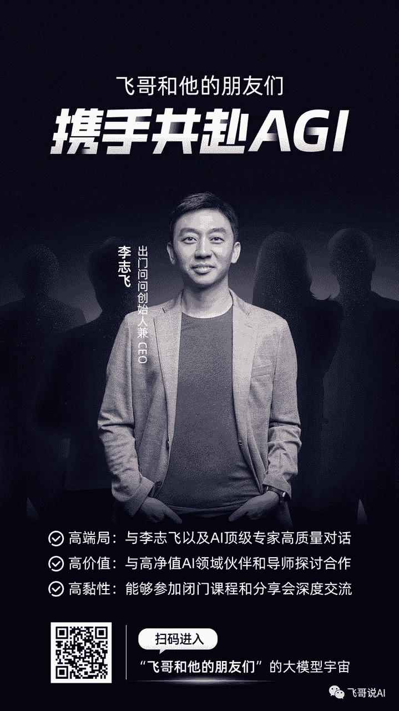

# 2023-08-16大模型下半场，关于Agent的几个疑问

> 来源：https://xuqiwei1986.feishu.cn/docx/RAovdJg5OoDbz5xCGYKc6FDVnTg

> 🔗 原文链接：https://mp.weixin.qq.com/s/cmBc_9hIIzMQa6P6QAYq_g

原创 高佳 飞哥说AI 2023-08-16 15:42 发表于 北京


**作者 | 高佳**

**创意 | 李志飞**

大模型的下半场，迎接寒武纪的`Agent`大爆发。

5.4亿至3.6亿年前，海洋生物破发，相比于以前的单细胞或简单多细胞生物，三叶虫、海绵和脊索动物等更高层次的智能诞生了。类似寒武纪生命大爆发，BabyGPT、AutoGPT、Generative Agents等实验性产品相继出新。

从进化的角度来看，生命体的发展主要通过单元增强和组织增强两种方式实现。这两种增强方式相辅相成，使生命具备了更多样复杂的表达形式。

如同`Agent`——我们希望它是在任何系统中能够独立思考并与环境交互的智能体。

现在它已经有了一颗足够智商的“大脑”，如何让`Agent`像人一样思考和执行——只要给定任何一个目标，它就能自动解决各种问题。是进一步提高智商，增强智能体的“自身”单元；还是借助外部模块，强化“组织”能力？

虽然后今天的`Agent`尚无法完成通用任务，也难以如多细胞之间的社会化分工，形成动态稳定体。但在个体`Agent`的局部模块上，如HuggingGPT，已展示了其使用工具的能力，包括Plug-in成为实际落地的重要里程碑，在大模型的下半场，将是`Agent`寒武纪落地爆发的时刻。

此刻`Agent`的落地瓶颈在哪里？它能否从专用抵达通用？多模态会为`Agent`带来什么？未来格局怎样演进？

就像地球上诞生的第一个细胞一样，即使目前的`Agent`尚无法替代我们在实际工作中的角色，但一切的一切都源于这第一个细胞，它是智能体进化的起点。

即使对`Agent`的落地再迷茫，也要继续“涌现”。

因为`Agent`的成败将是决定这一场GPT革命是否是新一代工业革命的关键。

以下将以结构化的思维来思考，`Agent`何去何从。

## 01 AI Agent究竟是什么？

几天前，拥有25个`Agent`的AI小镇正式开源，「西部世界」AI Town随之构筑，AI Agents之间的互动，将演绎出整个文明的演化进程。

OpenAI联合创始人Andrej Karpathy也高呼：“AI Agent代表着一个疯狂的未来。”

什么是`Agent`？`Agent`一词起源于拉丁语中的Agere，意思是“to do”。在`LLM`语境下，`Agent`可以理解为在某种能自主理解、规划决策、执行复杂任务的智能体。

`Agent`并非ChatGPT升级版，它不仅告诉你“如何做”，更会帮你去做。如果`CoPilot`是副驾驶，那么`Agent`就是主驾驶。



一个精简的`Agent`决策流程，用函数表达式：

```
Agent：P（感知）—> P（规划）—>A（行动）
```

类似人类「做事情」的过程，`Agent`的核心功能，可以归纳为三个步骤的循环：感知(`Perception`)、规划(`Planning`)和行动(`Action`)。

感知(`Perception`)是指`Agent`从环境中收集信息并从中提取相关知识的能力，规划(`Planning`)是指`Agent`为了某一目标而作出的决策过程，行动(`Action`)是指基于环境和规划做出的动作。

其中，`Policy`是`Agent`做出`Action`的核心决策，而行动又通过观察（`Observation`）成为进一步`Perception`的前提和基础，形成自主地闭环学习过程。

这一过程就像马克思主义的「实践论」：“认识从实践开始，经过实践得到了理论的认识，再回到实践中去。”`Agent`也在知行合一中进化。



一个更完整的`Agent`，一定是与环境充分交互的，它包括两部分——一是`Agent`的部分，二是环境的部分。此刻的`Agent`就如同物理世界中的「人类」，物理世界就是人类的「外部环境」。

可以想象，人类与外部环境交互的过程：我们基于对这个世界的全部感知，推导出其隐藏的状态，并结合自己的记忆和对世界的知识理解，进而做出`Planning`、决策和行动；而行动又会反作用于环境，给我们新的反馈，人类结合对反馈的观察，继而再做决策，以此循环往复。

最直观的公式：

```
Agent = LLM+Planning+Feedback+Tool use
```

其中，在做`Planning`的过程中，除了基于现在的状态，还有要记忆、经验，一些对过往的反思和总结，同时还有世界知识。

对比今天的ChatGPT，它其实并非`Agent`，而是一个通用的世界知识，即用来做`Planning`的知识源，它没有基于具体的环境状态，也没有`Memory`、`Experience`和`Reflection`。

当然，ChatGPT基于自身的知识可以做逻辑推理和一定的规划，也可以加向量数据库解决推理问题，加`Reflection`让过程更丰富，如此看来，可将ChatGPT这个端到端的黑盒子变得显性化一点儿——其实符号就是一个非常显性的系统，基于此可以定向纠错，定向提升。

对于`Feedback`，`Agent`基于`Action`得到正向的或试错的反馈、阶段性结果或奖励。`Feedback`有多种形式，如果将与我们聊天的ChatGPT视为一个`Agent`，我们在文本框中敲入的回复就是一种`Feedback`，只不过是一种文本形式的`Feedback`，此时我们对于ChatGPT来说，就是一种环境。RLHF也是一种环境，一种极度简单的环境。

“人类之所以是人类，因为他会使用工具。”

作为智能体，`Agent`也可以借助外部工具扩展功能，使其能够处理更加复杂的任务。比如`LLM`使用天气`API`来获取天气预报信息。如果不调用外部工具，`Action`和`Feedback`也可以直接通过学习`Policy`，应对环境。

可见`Agent`是真正主动释放`LLM`潜能的关键。`LLM`作为核心，`Agent`为`LLM`提供了行动的主观能动性。

今天的`LLM`要怎么落地？`LLM`作为一个智商引擎，其他周边工具均可作为`Prompt`，未来是否会是一个端到端的系统？如果周边的工具不够，是否会有一个更通用的适配框架？

## 02 Agent落地的瓶颈，是因为“智商”不够？

`Agent`本身用到两部分能力，一部分是由`LLM`作为其“智商”或“大脑”的部分，另一部分是基于`LLM`，其外部需要有一个控制器，由它去完成各种`Prompt`，如通过检索增强`Memory`，从环境获得`Feedback`，怎样做`Reflection`等。

`Agent`既需要大脑，也要外部支撑。

针对目前`Agent`在实际落地中的阻碍，其原因是`LLM`自身的“智商”不够，还是其外部的系统化程度不够？

如果外部系统化程度不够的话，它将是一个长期待解决的问题。如果只是智商不够的问题，当GPT-4成为GPT-5，有了更高的智商，即可弥补之前的问题。

那么到底`Agent`的主要瓶颈在哪里？

真正理解这个问题的症结，可以先做错误归因。即在实际的错误中，清晰地归因到底是`LLM`本身的问题，还是`Prompt`的方式不对。

比如向语音助手询问“天气怎么样？”，这个问题本身就存在歧义——指的是哪里的天气？是哪一天的天气？具体想要知道天气中的哪些信息？这些都不是`LLM`本身所能解决的问题，它需要调用外部的工具系统。

如果仅归因“智商”的话，`LLM`只需理解“天气怎么样”，如果有具体的上下文——如“下个月上海的天气怎么样”，`LLM`基于此是否能推断出准确的信息，这是“智商”问题；但具体调用什么工具，执行的参数本身是否准确，这些并非归因于“智商”。

## 03 未来是否能实现一个更加通用的Agent外部框架？

很多人将`LLM`作为`Agent`的实现方式，这太简单粗暴了。比如，仅为`Agent`设定一个目标，定义一些基本的条件约束之后，就期待它能完成自我规划、分解任务、自我提示，甚至调用外部的工具，并给出答案的全部过程。然而，`LLM`本身并不是这样训练的，必然不具备这种能力，但这并非归因于“智商”问题。

从`Agent`落地的角度来说，仍需要外部的逻辑框架。

虽然后目前有许多类别的`Agent`，但大多很粗浅，不够通用。即使是最简单的`Agent`应用，语音助手或智能外呼系统，其复杂性以及如何引入环境`Feedback`等问题，都未得到有效解决。

因此，除了对错误进行更细致的分析外，我们应该研究的一个问题是：除了`LLM`本身足够通用之外，是否会实现一个通用的外部逻辑框架，来解决`Agent`真正落地的问题？

如果我们无法找到外部通用的逻辑框架，那么现在这场所谓的AGI革命可能只是一个泡沫，一个巨大无比的泡沫，它其实可能与上一代NLP并无本质区别。

现阶段`Agent`的落地，不只是“智商”问题，还需要如何借助外部工具从专用抵达通用——而这是更重要的问题。

## 04 Agent如何能有通用的适配环境？——是否需要一个learnable的环境小模型？

把`LLM`放进一个虚拟世界会怎么样？

在游戏《我的世界》中，英伟达开发最新方法Voyager，以15.3倍速点亮科技树，同时获得的独特物品是此前的3.3倍，探索范围是2.3倍。原因归功于GPT-4对游戏规则的深入理解和丰富的知识储备，它来源于预训练过程，而非后续的增强学习。

从这个视角来看，在优化`Agent`的过程中，除了关注`Feedback`，还应该考虑模型如何感知环境。那么通用大脑与环境模型之间的关系如何，怎么配合？`Agent`如何从专用抵达通用？

`Agent`目前还鲜少有很好且通用的落地效果，大多是解决特定场景的特定问题——将`LLM`作为一个通用大脑，通过`Prompt`设计为不同的角色，以完成专用的任务，而非普适性的应用。

这其中的一个关键问题，即`Feedback`将成为`Agent`落地实现的一大制约因素，这一点在`Tool use`中体现得尤为明显。对于一些如查询天气等简单问题，只需设计恰当的`Prompt`即可，但对于复杂的Tools应用，其成功概率会大大降低。

简单粗暴地用`LLM`做出`Agent`，是天方夜谭。

这种做法一方面忽视了`Feedback`的重要性，另一方面，即使`LLM`得到`Feedback`，凭借它的“智商”也可能并不完全理解所有的环境或`Feedback`，更难基于此调整自身行为。

想要真正成功落地`Agent`，是给予`Agent`一个更通用的适配环境，一种可能的解决方案是创建一个专门用于理解和适配环境的小模型，以此和`LLM`交互。

由于最强大脑的“智商”部分——`LLM`（如GPT-4）因为规模太大是很难针对具体`Agent`进行重训的，而小模型是可以适应环境变化、多次训练的。在这个场景中，我们可将`LLM`看作大脑，而小模型就像小脑，作为中间层专门处理环境`Feedback`，与GPT-4交互。

那么，`Agent`从专用到通用的实现路径会是什么？

假设`Agent`最终将落地于100种不同的环境，在目前连最简单的外部应用都难以实现的前提下，最终能否抽象出一个框架模型来解决所有外部通用性问题？

先将某一场景下的`Agent`做到极致——足够稳定且鲁棒，再逐步将它变成通用框架，也许这是实现通用`Agent`的路径之一。

## 05 多模态在`Agent`的发展中有多重要？

现在的GPT-4，是将所有的内容都转化成文本语言，然后人类去`Prompt`它。首先，转化过程可能会丢失信息或产生错误，从而导致结果出现偏差。

GPT的下一个版本，如果它能实现多模态在理解层面的超强能力，那它会不会在一定程度上缓解今天`Agent`的不可靠以及信息丢失与偏差的问题？多模态与`Agent`的关系将是什么样的？

如果`LLM`不需要在真实世界中交互，而只是在虚拟世界中执行特定任务，那么多模态对于完成任务的帮助也许并不大。但如果`LLM`需要与真实世界交互，那么多模态无疑非常重要。

多模态只能解决`Agent`感知上的问题，而无法解决认知的问题。

在很多情况下，如智能客服场景，用户可能会通过多种方式提供信息，多模态具有很好的感知价值，但在解决一些逻辑、推理等核心问题，还差距尚远。

多模态是必然趋势，未来的大模型必然是多模态的大模型，未来的`Agent`也一定是多模态世界中的`Agent`。

当在进行基于文本的`Agent`的开发时，当多模态的分水岭时刻到来，这些`Agent`是在原有基于文本的基础上继续发展，进一步融入多模态特性？还是需要彻底改变原有开发`Agent`的理念和架构，以适应未来的多模态世界？

`Agent`的开发并不需要全部推倒重来，但一旦`Agent`拥有了多模态能力，它将会与现有模型截然不同。比如GPT的下一代版本，它可能会包含一些更加强大的图像等多模态理解功能。我们不必急于立即构建这样的模型，也可以选择先调用这样的模块，即最好将多模态理解功能内置在模型中。

半年后，我们将会看到多模态大模型的到来。而多模态`Agent`的到来，可能会比我们想象中更快。

首先，许多大公司都在储备军火一般地研发多模态。这种量变的积累非常容易引发质变，可能很快就会有实际的产品被推出。其次，人们期待的`Agent`是如同人类一般的助手，他不仅能说话，还能看到、听到、感知到。理论上，一个优秀的`Agent`应该能实现多感官、多模态的交互，`Perception`、`Policy`都需要多模态。

随着RT-2的发布，一种新的视觉语言动作模型VLA，它将多模态大模型塞进机械臂，实现了实体机器人版ChatGPT。



从趋势上看，未来的`Agent`一定是多模态的。`Agent`要成功，多模态也一定是必要的。

在多模态交互方面，数字人也提供了一个很好的示例，它展示了调用外部工具的优势。当大模型调用数字人时，因为形象都已提前设定，我们就无需担心它会突然生成某个政治人物的形象或声音，甚至包括他的幻觉。

尽管美其名曰“生成式AI”，其“生成”部分，最好调用外部工具，以保证其确定性，规避大模型的幻觉。

比如，在多模态交互中，如果想要`LLM`扮演特朗普，并直接生成一支祝贺视频，那么很可能存在风险。如果`LLM`仅生成脚本，然后调用既定的数字人和声音接口合成视频，这样更安全可控。

## 06 多Agent真的会成功吗？

现在的`Agent`还是山顶洞人，但多AI Agents互动会改变一切。

在灵感来自模拟人生游戏的Generative Agents实验中，其每个角色都分别由一个AI Agent控制，它们在沙盒环境中生活和互动，充分体现了将反馈和环境信息转化为行动的过程，实现AI Agents的「社交」。

其中在规划和反应的环节，AI Agents会充分考虑彼此之间的关系，以及一个`Agent`对另一个`Agent`的观察和反馈，来采取下一步动作。

这个有趣的模拟随之引发了一些戏剧化的社会现象，比如「谣言」的扩散、关系记忆等，在实验中经常出现两个AI Agents在聊天中延续他们之前的话题、办Party、呼朋唤友等社交活动。



显然，`Agent`的真正落地，一定是建立在对环境的感知、动态学习，以及不断更新之上的。

## 07 Agent最先在什么场景落地？

早在今年2月，一些在线教育公司开始频繁活跃在大模型的讨论上。“我们的行业，如果再不行动的话就会第一个被颠覆”，在大部分公司还未感受到大模型的冲击时，一家头部在线教育公司的人先做出预判和隐忧。

而哪些行业会最先被`Agent`颠覆，哪些行业不会那么快？

大模型的能力众所周知，但“智商”只是`Agent`落地的一部分。即使OpenAI宣称AGI已经来了，如果你对行业一无所知，也很难做出实际的应用。

就像一位斯坦福的博士，如果不懂一家公司的行业和产品属性，那么工作初期的难度也会很大。所以，我们需要更深入地讨论哪些行业更适合`Agent`落地。

比如可以完全在线化、数字化的在线教育行业，尤其在过去的三年疫情期间，许多线下行业都遭受打击，而在线行业却因为数字化的优势得以较快发展，它也会最先被`Agent`颠覆。相比而言，机器人或传统行业，反而在短时间内较难被颠覆。

目前无论是中国还是美国，新的共识正在逐渐形成：第一是`Agent`需要调用外部工具，第二是调用工具的方式就是输出代码——由`LLM`大脑输出一种可执行的代码，像是一个语义分析器，由它理解每句话的含义，然后将其转换成一种机器指令，再去调用外部的工具来执行或生成答案。

尽管现在的`Function Call`形式还有待改进，但是这种调用工具的方式是非常必要的，是解决幻觉问题的最彻底的手段。

## 08 Agent的未来发展格局是百花齐放还是Winners take all？

未来大模型的竞争格局日渐明朗，必然几家独大，或基于开源。

而未来一两年内，`Agent`的市场格局将会如何，会形成同等的势态么？

由于`Agent`并非能实现通用，`Agent`并非一家独大，而是将形成一个非常长尾的供应商格局。市场上将会有很多`Agent`，每一个`Agent`都由不同的公司运营。

如同上一代NLP，很多AI公司都提供智能客服或自动外呼服务，但每一家公司只能服务少数的客户，无法形成规模效应。基于今天对`Agent`的技术判断，与上一代并无太大区别。

虽然后LLM的语义理解是通用的，但是我们之前讨论过的`Agent`的环境、领域结合并不通用，这会导致市场非常分散，没有强者越强的公司出现。

当然，`Agent`也分为深度（专业）和浅度（通用）两种类型。

出门问问希望做通用的`Agent`。在中国的市场环境下，如果做一个与企业深度结合的`Agent`，最终将成为“外包”，因为它需要私有化部署，集成到企业工作流里。很多公司都会去争抢保险公司、银行、汽车领域的大客户。这将与上一代AI公司的结局非常相似，边际成本很难降低，且没有通用性。

出门问问目前的魔音工坊、奇妙文等AIGC产品都属于面向内容创作者的、介于深度和浅度之间的应用，既不完全属于`consumer`，也不完全属于`enterprise`，同时还有面向企业用户的`CoPilot`，其定位也是在企业里找到具体的「场景」，做相对通用的场景应用。




未来是Agent的世界，在今天的Agent进程下，依然重复昨天AI的故事，私有化部署将面临挑战。

目前，我们正在筹建「飞哥说AI」大模型交流社群，欢迎一起探讨大模型时代的共识和认知，成为AGI时代的共创者。


