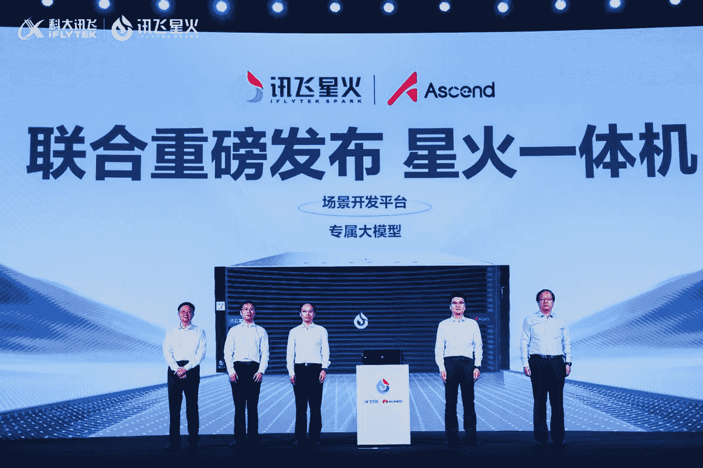

# 2023-08-16强强联合，科大讯飞联合华为发布企业专属大模型一体机_训练_应用_星火

> 来源：[https://xuqiwei1986.feishu.cn/docx/G0gGd6BYYowN4cxj9GKcMmMdnjh](https://xuqiwei1986.feishu.cn/docx/G0gGd6BYYowN4cxj9GKcMmMdnjh)

> 🔗 原文链接： h[ttps://www.sohu.co](https://www.sohu.com/a/712154898_402746)m/a/712154898_40...

# 强强联合，科大讯飞联合华为发布企业专属大模型一体机

[2023-](https://www.sohu.com/a/712154898_402746?spm=smpc.content.content.1.16921763043861iM4ClI)08-16 08:14 来源: 经济新观察

8月15日，讯飞星火认知大模型V2.0升级发布会上，科大讯飞携手华为发布星火一体机，让所有企业都可以在国产自主创新的平台上，更方便、更自主、更安全可控地私有化部署大模型。

开箱可用，内置资源已涵盖10余个专业场景

“星火一体机”是国产软硬件一体化的私有专属大模型解决方案，开箱即可使用，提供从底层算力、AI框架、训练算法、推理能力、应用成效等全栈AI能力，帮助企业打造专属大模型。

星火一体机的训练和推理一体化部署，可用于问答系统、对话生成、知识图谱构建、智能推荐等多个领域的应用，具备大模型预训练、多模态理解与生成、多任务学习和迁移等能力。

科大讯飞在在办公、政务、电力、教育、医疗、工业、司法、金融等行业深耕多年，积累了丰富的场景落地经验。星火一体机内已涵盖办公、代码、运维、客服、营销、采购等10多个场景包，支持对话开发、任务编排、插件执行、知识接入、提示工程等5种定制优化模式，并将持续拓展更多专业场景和模式优化，为客户快速定制企业专属大模型。

星火一体机还针对星火认知智能大模型的训练算法和推理应用进行了硬件的量身定制，可大大降低企业的使用成本。

“双保险”：讯飞保障内容，华为保障算力

科大讯飞董事长刘庆峰在发布会上表示，认知大模型的深度赋能时代已经到来，大模型在企业深度应用的三个关键要素是：第一，安全可控：内容安全，要有正确价值观，算力安全，要在完全自主可控的平台上进行；第二，场景驱动：在看得见摸得着的场景产生实实在在的价值，并能够用数据去证明成效；第三，专属定制：内容匹配需求，基于行业和企业的私域数据构建私有化专属大模型，提升应用效果。

企业应用大模型并不是盲目追风口，要从自身需求出发，让大模型真正结合业务，提升效能、创造价值。场景驱动和专属定制是企业大模型的基础，而安全可控则是底线。

2023年4月28日，中共中央政治局会议就强调：“重视通用人工智能发展,营造创新生态,重视防范风险”；2023年7月，7部委联合发布《生成式人工智能服务管理暂行办法》，再次强调“发展和安全并重”。

在内容安全方面，星火一体机基于讯飞星火认知大模型，针对污语料和幻觉问题，形成立体化的“内容安全机制”。无监督的互联网语料，经过语句判别器、质量判别器、隐私判别器、安全判别器等关卡，得到清洗后的高质量文本；为了解决“幻觉问题”，科大讯飞针对各类型任务构建专业知识库，以类搜索插件技术实现知识获取，基于大模型的理解和概括摘要能力给出答案。

在算力安全上，星火一体机基于昇腾AI硬件、昇思AI开源框架，提供业界领先的大模型训练、推理能力，为大模型全流程创新提供坚实的自主创新算力底座。

“双保险”下，企业能够放心大胆地打造专属大模型。

**强强联合，将打造通用智能新底座**

大模型的研发过程，需要可以支撑千亿参数规模的大模型并行训练的算力和框架，还需要几千张卡同时连续运行。基于此，系统架构以及并行训练的集群能力成为国内大模型研发的关键。

在今年的7月6日，科大讯飞就公布讯飞星火将与昇腾AI强强联合，打造基于中国自主创新的通用智能新底座。一方面，讯飞星火认知大模型基于训练推理一体化设计，实现大模型稀疏化、低精度量化的技术突破，能高效适配昇腾AI，加速大模型的行业落地应用和迭代；另一方面，以昇腾AI为核心，软硬件协同优化，构建算力集中、性能优越、供给稳定、数据安全的大模型训练集群。

此次发布[的星火一体机，是科大](https://www.sohu.com/?strategyid=00001&spm=smpc.content.content.2.16921763043861iM4ClI)讯飞与华为在AI算力、大模型的合作落地之一，将面向行业、企业客户，提供基于专用数据的自主可控私有化大模型，加速推动重点企业的数智化转型升级。国产大模型只有基于中国自主创新的算力底座才有大未来。之后，双方将持续深化合作，放眼全球，联合攻关算力国产化核心难题，实现从单点算力到集群算力、从节点创新到系统创新。  返回搜狐，查看更多

责任编辑：