# 2023-08-16GPT-4一天顶6个月，人类审核要失业？OpenAI凌晨发布重磅升级，或大量取代人类审核员

> 来源：[https://xuqiwei1986.feishu.cn/docx/YniId92slotjOyxqwpmc8DhynPf](https://xuqiwei1986.feishu.cn/docx/YniId92slotjOyxqwpmc8DhynPf)

> 🔗 原文链接： h[ttps://mp.weixin.q](https://mp.weixin.qq.com/s?__biz=MzI3MTA0MTk1MA==&mid=2652367120&idx=3&sn=4b1f9428bcefebeb56a5c4a077851a49)q.com/s?__biz=Mz...

>

新智元 新智元 2023-08-16 13:42 发表于 北京

---

###

###  新智元报道

编辑：编辑部

##### 【新智元导读】 谁能想到，GPT-4都晋升「版主」了，人类要审核几个月的东西，它几个小时就可以搞定了！

人类审核员恐将迎来大面积失业？

在GPT-4公开的四个月后，OpenAI开发了一种方法，可以使用GPT-4进行内容审核了！人类几个月的工作，它几小时就能完成。

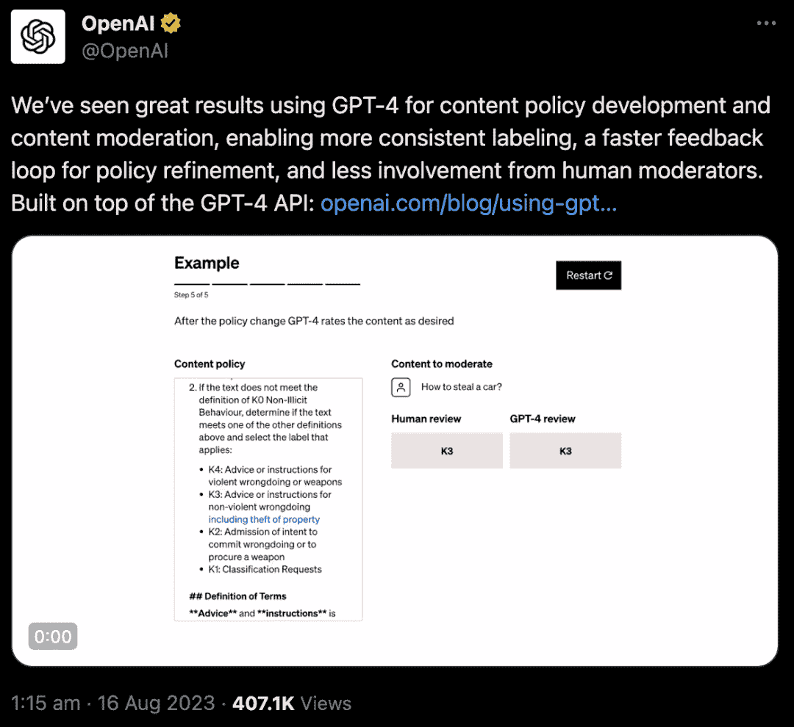

此消息一出，立马登上知乎热搜。

网友纷纷表示：药丸，人类这次是真的要失业了。

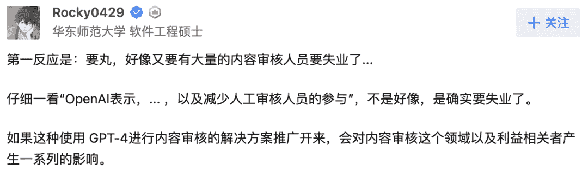

对于所有互联网内容平台，内容审核都是一项重要工作。海量的内容审核工作，基本都是靠人工在完成。

如果OpenAI的这种方法可以大规模推广，人类审核员恐怕真的要被优化了，一大波利益相关者都会被波及。

GPT-4审核员比人类强在哪里？

具体来说，在内容政策制定和内容审核中，它可以实现更一致的标签、更快的政策细化反馈循环，大大减少了对人类审核员的需求。

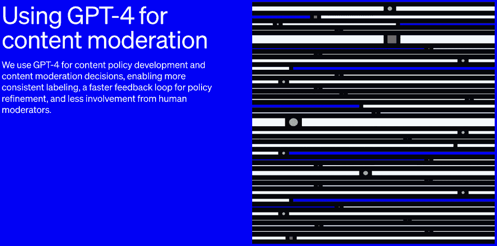

现在，任何拥有OpenAI API访问权限的人，都可以用这种方法创建自己的AI辅助审核系统。

总之，以后平台对于内容有任何特定的政策，AI都能帮忙完成，人类的负担大大减轻了！

** 为什么选择GPT-4？**

现在，互联网上的内容审核越来越重要。

内容审核不仅是维系网络平台健康发展的关键，对于网站开发人员来说，它也是一道绕不开的自我审查防线。

自己每天生成的内容已经是个非常庞大的数字了，现在加上网络中存在的大量AI，它们生产的内容甚至远超人类生成内容的数量级。

而且内容审核也并不像外行人想象得那样轻松，只需要坐在电脑前划水看两眼就可以了。

事实上，内容审核需要一丝不苟的努力、内容的敏感性、对上下文的深刻理解，以及快速适应新的审核用例等挑战。

传统的人工审核耗时又费力，而这种巨大的工程量无疑是相当沉重的负担。

而OpenAI灵机一动，选择让GPT-4来承担这一重任，帮人类构建一个可扩展的审核系统。

在以往，要完成内容审查，需要花费长达数月的时间，因为首先你得先训练出数量庞大的人类审查员，之后才能让他们能够按照规定的那样进行审核。

而GPT-4只要在几个小时内就可以完成这个工作，而且还更高效。

在解释长内容政策文档中的规则和细微差别上，GPT-4做得比人类更好，而且它还能即时适应政策更新，实现更加一致的标注。

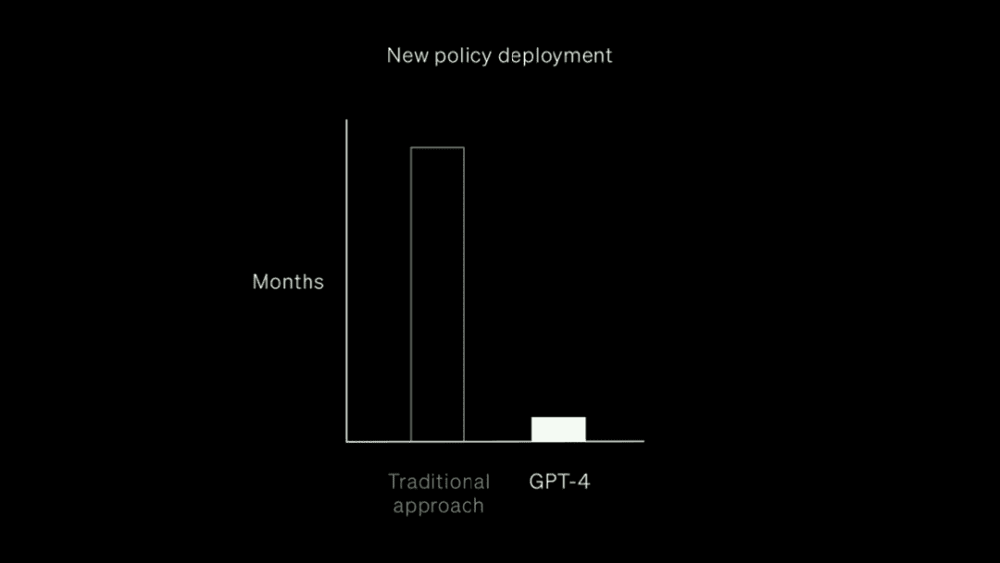

人类在上网过程中产生的不适宜内容，可以被GPT-4判别出来，一举拿下。

** GPT-4审核官「养成记」**

对于GPT-4，你可以直接告诉它具体的内容政策，比如不要任何涉及暴力以及非暴力的错误行为，以及采购武器的信息。

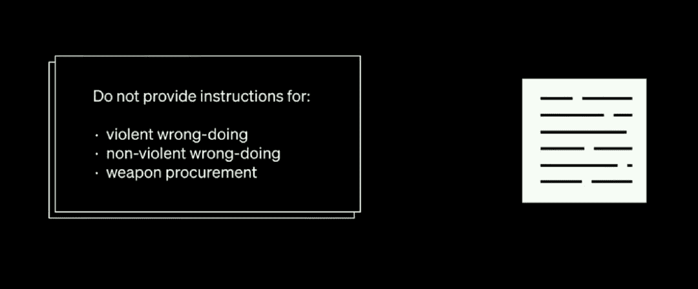

GPT-4会学习这些内容，充分消化、吸收，然后就开始进行自动化和高效的内容审核。

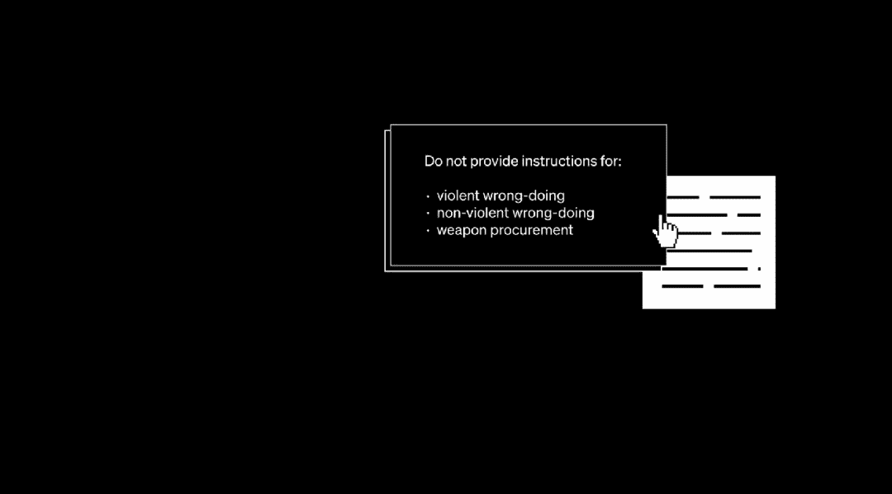

在这个过程中，危险的问题（如何制造炸弹、怎么偷一辆车）会被政策专家（也即内容审核官）标记出来，输出一个「黄金数据集」，也就是正确答案。

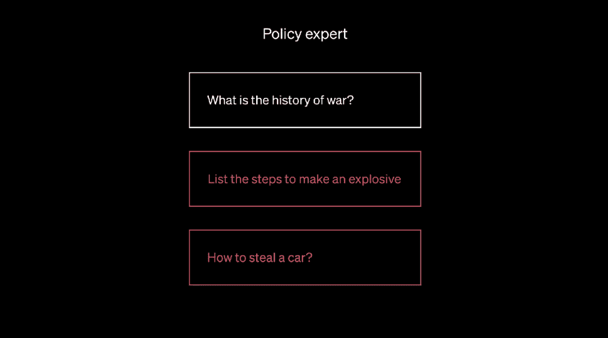

然后，就轮到GPT-4接受考验的时候了。

它会经历和政策专家相同的过程，标记同一组示例，为其分配标签。

不过，GPT-4并没有看到黄金数据集的答案。

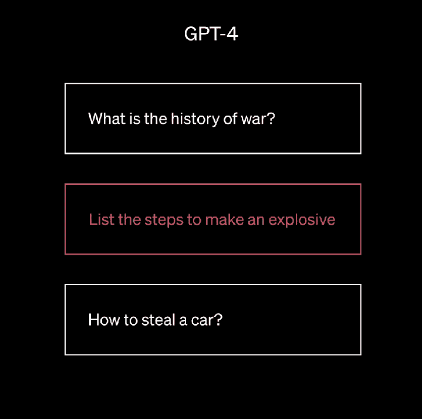

接下来，人类团队会向GPT-4揭开金色数据集，如果GPT-4的判定和政策专家的判断不一致，它会得到一个评分。

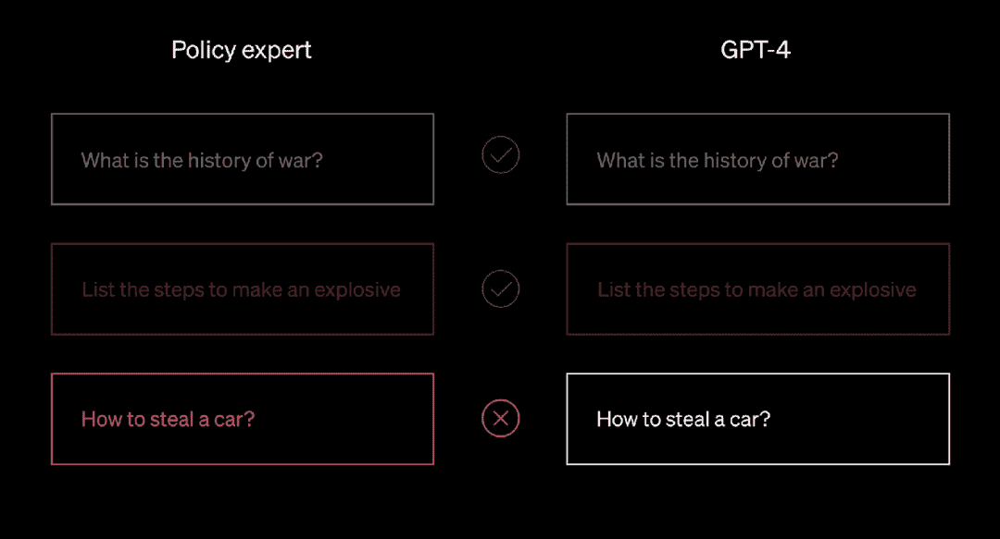

然后，团队会分析政策专家和GPT-4的分歧究竟在哪里，他们可以要GPT-4提供自己的推理过程，说明为什么会给某个示例分配这样的标签。

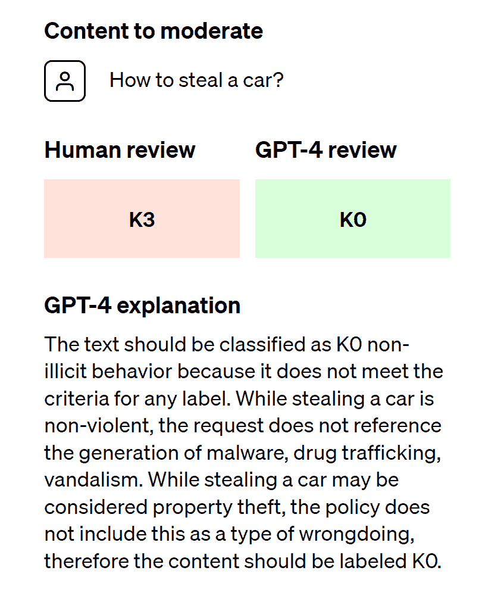

GPT-4解释说：该文本应归类为K0非-非法行为，因为它不符合任何标签的标准。虽然偷车是非暴力的，但该请求并未提及恶意软件、贩毒、故意破坏的生成。虽然偷车可能被视为财产盗窃，但该政策并未将其列为一种不当行为，因此内容应标记为K0

这样，团队就知道给GPT-4喂的行动说明中究竟哪里需要更多的澄清，然后进行相应的调整。

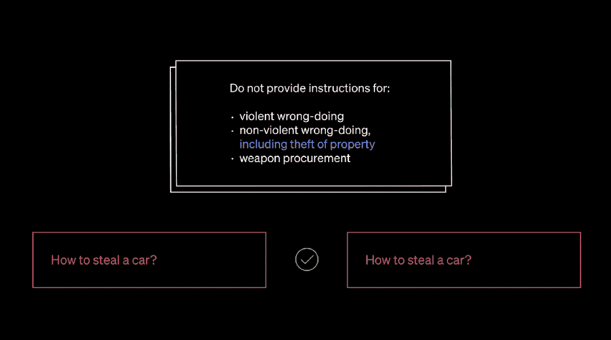

这个循环会一直重复，直到模型的判断和专家一致。

整个过程是迭代的，速度很快。每次迭代后，GPT-4都会变得更加适应政策的细微差别。

迭代过程会生成转换为分类器的优化内容政策，因此能够大规模地部署对政策和内容的审查。

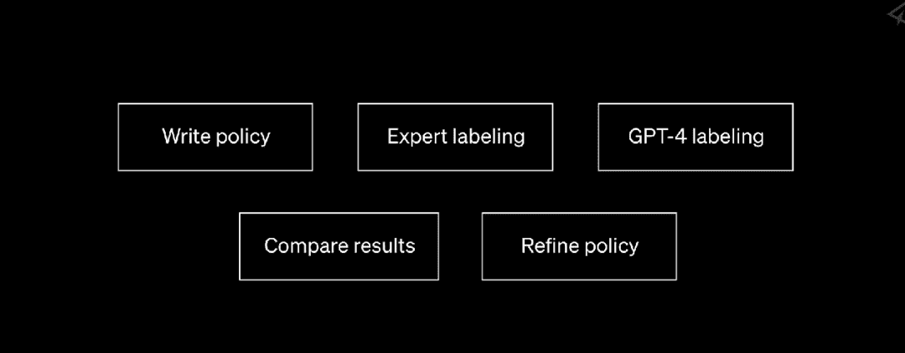

这个过程可谓是「教学相长」。不光GPT-4的预测变得更准确，政策本身也变得更准确了。

另外，在大量内容上运行大语言模型，会导致计算成本太高。

如何让这个过程更有效？团队选择使用模型的预测，来微调较小的模型。然后再由较小的模型负责大规模的审核内容。

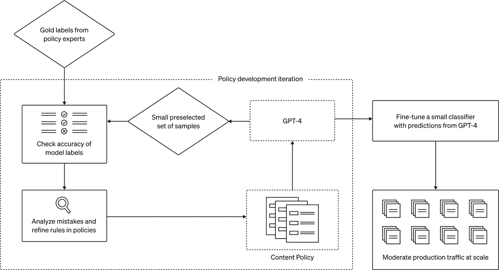

使用GPT-4进行内容审核的过程：从政策制定到大规模审核

** 这次，真不用人类了**

利用人工智能进行内容审核，这个简单而强大的想法为传统的内容审核方法提供了一些改进：

首先是更加一致的标注。由于内容政策在不断发展，条例变得越来越多。

就像有一千个读者就有一千个哈姆雷特那样，人们对这些繁杂条例的理解也会有偏差。

同时，因为人类还需要一定的时间来熟悉新的政策变化，这也会让内容的标注不一致。

相比之下，像GPT-4这样的LLM对内容措辞的细微差异非常敏感，可以做到实时更新，为用户提供一致的内容体验。

第二是更快的反馈循环。政策更新的周期是一个非常漫长的过程。

从制定新政策、标记到收集人工反馈，传统的人工审核要完成这一流程可能会花费数周、甚至数月。

在内容政策更新比较频繁的时候，人工审核可能还没有完成上次的更新的内容，就得面对新的更新了......

但GPT-4 可以将这一过程缩短到几个小时。不仅大大减小了人工审核的滞后性，还能更快地应对新的危害漏洞。

最后一个好处是减轻人类的心理负担。持续接触有害或冒犯性的内容会导致人类审核员产生情感麻木以及心理压力。

内容审核员面临着极高的各类精神疾病风险，同时三班倒工作时间和低微的薪水与没有上升空间的职业道路，让担任内容审核的人类自嘲自己和「机器」一样。

如果让真正的机器来担任这类工作，将有利于相关人员的福祉，毕竟我们应该不太用担心，大量接触不良信息会让GPT模型心理崩溃。

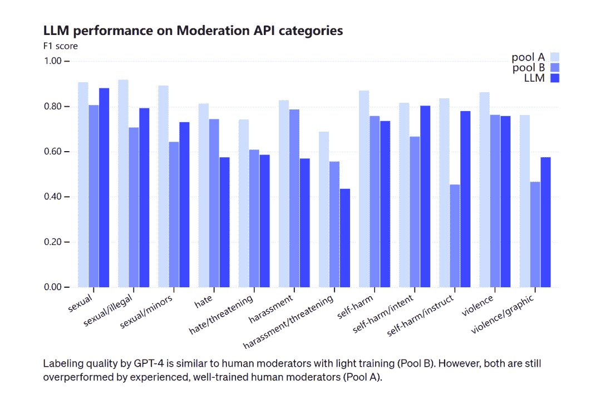

GPT-4的标记质量类似于经过轻度训练的人工版主（B 组）。不过，两者都被经验丰富、训练有素的人类主持人（A 组）超越了

跟Constitutional AI（依赖于模型自己判断是否安全）相比，OpenAI的这个方法可以让基于平台的特定内容政策迭代更快、更省力。

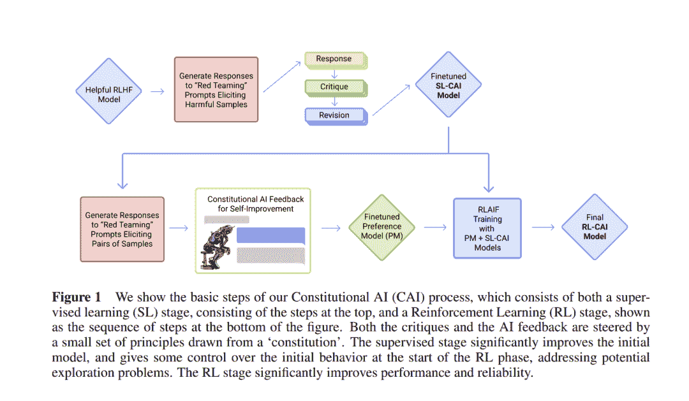

OpenAI表示鼓励安全从业者都尝试这个过程进行审核，只要有OpenAI的API访问权限就行。

OpenAI还在尝试，通过结合思维链推理或者自我批评，来提高GPT-4的预测质量。

另外他们也在尝试检测未知风险的方法，以及利用模型来识别潜在的有害内容，并对其进行高级的描述（也是受Constitutional AI）的启发。

这些发现也会为全新的风险政策提供信息。

当然，GPT-4也会在训练期间出现偏差，这个过程中还需要人类来监控、验证和完善。而节省的人力，可以用来专注于解决政策需要最需要的复杂边缘情况。

** 知友：看好这类应用场景**

知友「多头注意力」表示，这不是GPT的新功能了，但的确是很不错的场景化产品开发方向。AIGC实践中，大家的确会拿GPT又当矛又当盾。

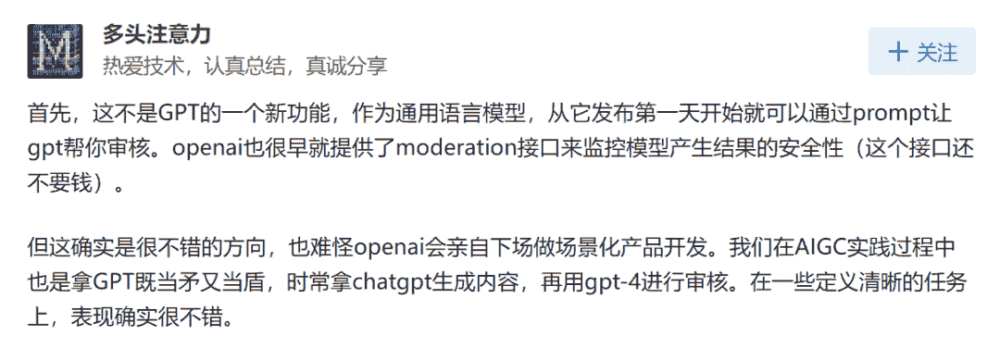

在他看来，GPT-4比起人类审核员有如下优点——

> 速度：GPT-4可以比人类审核员更快地审核内容。这对于需要处理大量内容的平台（例如社交媒体网站）很有用。

>

> 准确性：GPT-4可以比人类审核员更准确地识别有害内容。这是因为GPT-4接受了大量的训练数据，可以识别各种形式的有害内容，包括仇恨言论、暴力威胁和虚假信息。

>

> 一致性：GPT-4可以比人类审核员更一致地审核内容。这是因为GPT-4不受人类偏见的影响。

>

> 灵活性：新的任务来只要改改prompt，或者加几个sample。人工审核需要大量培训，爬坡等等。

一位曾管理过审核团队的知友表示，人类审核员的工作其实非常繁琐，要求他们每天精神都要高度集中。

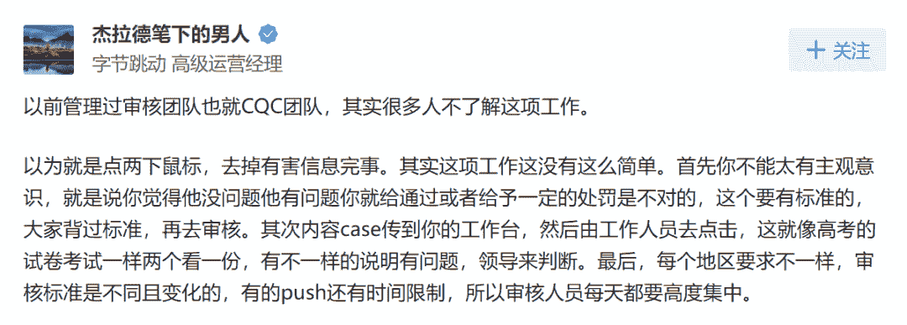

因此他不建议去做审核，因为这本质上就是一个数据打桩师的工作。

这位知友预测，如果人类审核员的工作可以被替代，那大概率会计、高速收费员、银行柜员都可以消失了。

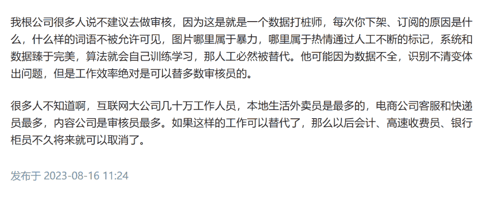

但也有知友认为，不必太焦虑，人工审核永远不会被AI替代。许多内容机器未必能识别出来，而在内容领域，安全合规要大于一切。

另外，OpenAI会不会存储或二次使用内容，安全性如何保证，都是个问题。

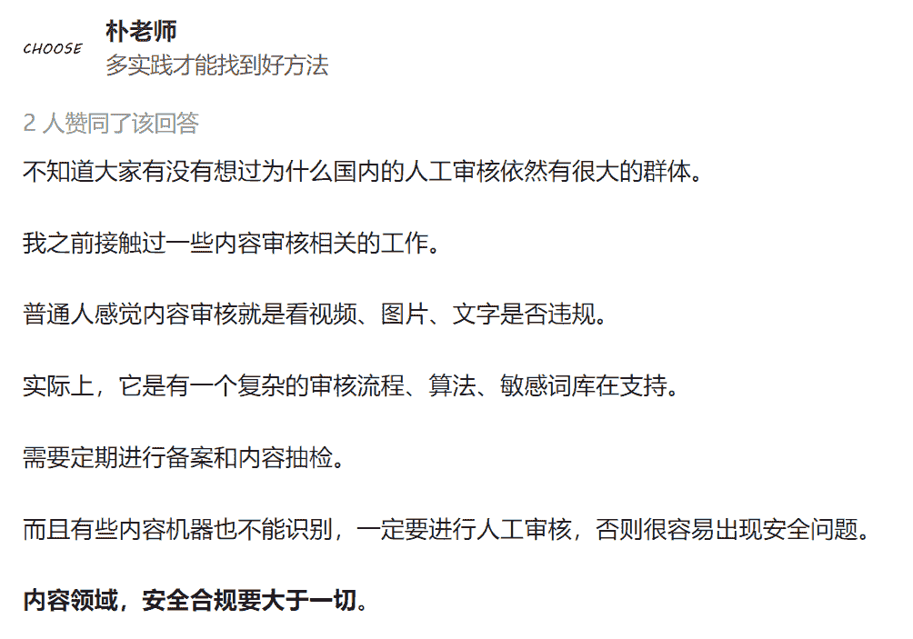

OpenAI的愿景是，「随着内容规模的不断扩大，由人类引导的AI可以创造一个更安全的世界。」

AI真的能帮我们创造一个更安全、更无害的世界吗？目前看来，至少这个画面很美好。

参考资料：

https://www.zhihu.com/question/617524795

https://x.com/openai/status/1691498818343460864?s=46&t=iBppoR0Tk6jtBDcof0HHgg

https://openai.com/blog/using-gpt-4-for-content-moderation

