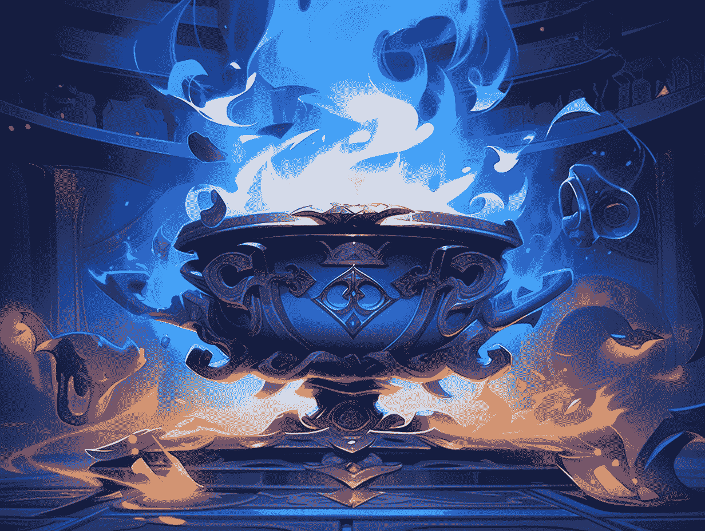
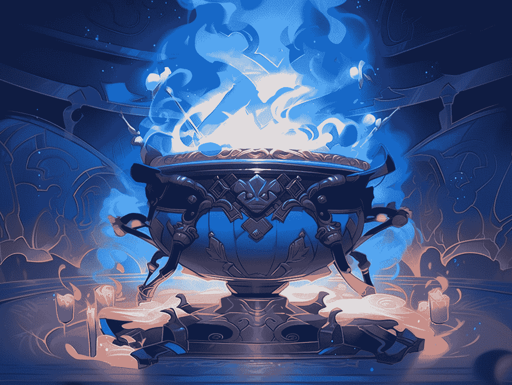
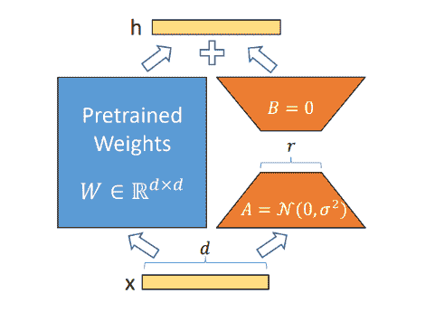
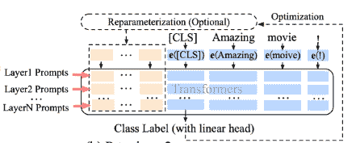
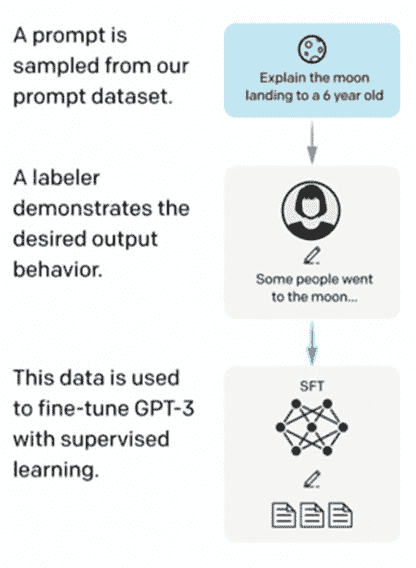
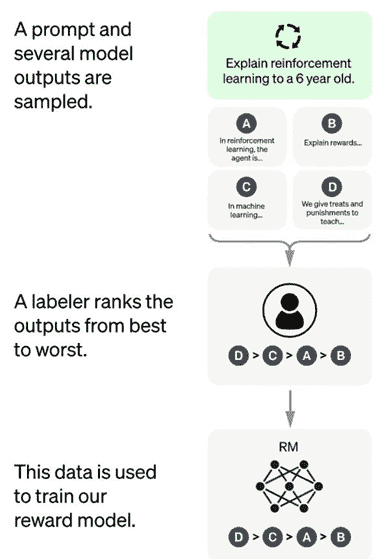
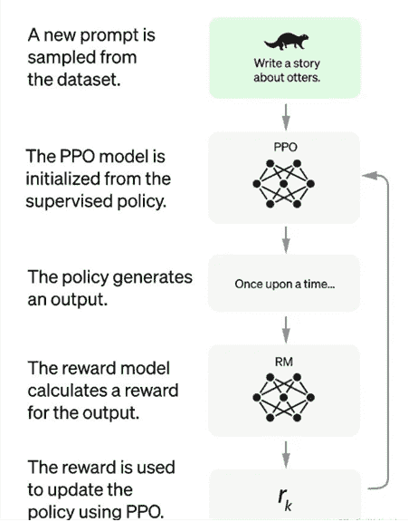

# 大模型炼丹手册-理论篇

> 来源：[https://xuqiwei1986.feishu.cn/docx/LNHxd4JRKoFwr2xjGyscfX6Anlg](https://xuqiwei1986.feishu.cn/docx/LNHxd4JRKoFwr2xjGyscfX6Anlg)

## 序言

### 一）大还丹的崛起

在修真界，人们一直渴望拥有一种神奇的「万能型丹药」，可包治百病。

但遗憾的是，在很长的一段时间里，炼丹师们只能对症炼药。每一枚丹药，都是特效药，专治一种病。这样就导致，每遇到一个新的问题，都需要针对性的炼制，炼丹师们苦不堪言，修真者们吐槽一片。

在那个时代，丹药尺寸普遍比较小，姑且称之为「小还丹」。

经过不断的探索和尝试，炼丹师们发现，随着灵材数量和丹药尺寸的增大，丹药的疗效会更好、更具通用性；特别是，当丹药增大到一定尺寸时，在各种「疑难杂症」上会突然表现出惊人的效果。

区别之前的「小还丹」，我们将这类尺寸较大的丹药称之为「大还丹」。

尔后，随着`ChatGPT`这粒超级大还丹的问世，其惊人的疗效、极佳的通用性，在整个修真界掀起了一阵狂风骤雨。

一时之间，各大仙门争相炼制大还丹，收集灵材、抢购真火，唯恐落后。

自此，修真界迈入了「大还丹」时代。

> 注释：

> 1、万能型丹药：通用模型，一个模型可解决多类不同的任务，如翻译、问答、写作、码代码等等。

> 2、小还丹：小模型，模型参数几百兆至几亿不等，一般只能解决单一任务。

> 3、大还丹：大模型（`large language model`，简称 `LLM`），特指模型参数达到 10 亿级别以上的模型，如 `chatglm`（60 亿）、`OpenLLaMA`（130 亿）、`gpt3`（1750 亿）等。

### 二）大还丹的不足

`ChatGPT`的问世和成功，在全球掀起了一阵大模型热潮，大家都开始研究、使用大模型。

但是，实际应用的时候发现，对于一些特定的专属知识领域，大模型的表现却不尽如人意。这在很大程度上限制了大模型的落地使用。

那么，怎样才能提高大模型在特定知识上的表现呢？

目前有两种方案：

（[大模型专属知识库搭建 SOP](https://e0749igednw.feishu.cn/docx/HQ5rdPQP6o4AlZxpe9ecMkVNn1e)）外挂知识库：向模型提问时，额外给他一些专有知识中的相关信息，让他从中找到正确的答案。具体做法见我之前的一篇文章：  。

这个方案的优点是可以快速实现、不涉及模型训练，门槛相对较低。但同样的，缺点也很明显：效果上限较低，只能覆盖 60% - 80% 的问答场景。

（2）大模型垂直领域训练：采用大模型在专有知识上进行训练，让模型好好学习这些知识。这也是本篇文章的主题。相比方案 1，它的优点是效果上限高，灵活性强，可以针对不同领域的知识做定制化训练和优化。但对应的，它的操作难度较大、门槛较高，对于数据、算力、模型训练均有较高的要求。

随着大模型研究和应用的逐渐深入，社区开源大模型越来越丰富；同时，十亿、百亿级别的大模型采用单卡就可以微调、部署。之前我们只能临渊羡鱼，终于有机会可以训练大模型了，真是喜极而泣。

本着学习、总结、分享、交流的原则，我决定写下这本大模型训练（炼丹）入门手册。由于我之前接触、训练的基本都是小模型，大模型训练的经验较少，也是边学边实践。如有错误，欢迎大家交流指正。

## 一、 何为炼丹

> 所谓炼丹，就是将大量灵材使用丹炉将其凝炼成丹。炼成的灵丹蕴含灵材的大部分特性，方便携带，容易吸收。高级仙丹在炼制中更是能吸收天地灵气从而引发天地异象。

> 深度学习的模型训练就是炼丹。把精选原始数据，按照神经网络的规定法则通过计算框架提炼，从而得到一个远小于数据数倍的模型。         --摘自李沐大神《深度学习·炼丹入门》

在业内，模型训练有一个形象、有趣的名字，「炼丹」；而算法工程师，就是修仙小说中的「炼丹师」。

看起来好像很NB的样子，其实做的都是一些脏活、累活🤣。

要想炼一炉神丹妙药，灵材、丹方、丹炉、真火、炼制，缺一不可。除此之外，你还需要一点可遇不可求的运气。

### 一） 灵材

灵材，就是模型训练中用到的数据。

业内经常有一句话，「数据决定了模型的上限」。这是很自然的道理，原材料是炼丹之始，只有优质的灵材才有可能炼出绝世好药。

所以，我们需要对原材料，即数据，进行严格的把控和清洗，业内称之为「数据清洗」。其目的，就是为了去除原材料中的杂质，以免影响丹药成色。

除了灵材质量，炼丹对灵材数量也有一定的要求。丹药尺寸（即模型参数量）越大，需要的灵材也越多。

像`ChatGPT`这粒超级大还丹，参数达到千亿级别，训练所用的数据多达45TB。

总而言之，优质且巨量的灵材，是炼制大还丹的首要条件；其收集、清洗、处理的过程是一项极为繁复、浩大的工程，一般只有财力雄厚的仙门巨擘才能完成，如openai、谷歌、百度等。

好在修仙界中的一些公会、学院，会提供一些免费共享的灵材，供广大普通炼丹师练手，不至于出现「难为无米之炊」的窘境。

### 二）丹方

丹方，就是具体的模型结构。

在以前，针对不同领域的问题，丹方也不同。但现在，`transformer` 类模型开始出现一统炼丹界的趋势，在自然语言处理、计算机视觉等不同领域均有出色的表现。

而`transformer`类丹方，目前主要有三个流派：自回归、自编码、`encoder-decoder`。

+ 自回归的代表模型是`GPT`，它的注意力是单向的，即处理文字的时候，只能从左向右看，天然适合生成任务。

+ 自编码的代表模型是`bert`，它的注意力是双向的，即可以观测文字的上下文，更适合语言理解任务。

+ `encoder-decoder`的代表模型是`T5`、`BART`，结合了上面两种结构的特点，`encoder`部分的注意力是双向的，`decoder`部分的注意力是单向的。

> 上述涉及的专业知识较多，此处不详细展开，非专业内也不必深究。

在修真界，针对不同疗效领域，均有丹方排行榜。榜上有名的丹方，均是红极一时、制霸一方的杰作。

各大仙门、学院中的优秀炼丹师，皆以发明`top`丹方为目标。顶级丹方的发明创造，是一个炼丹师的荣耀勋章，也是通往豪门世家的门票。

值得一提的是，`transformer`类丹方最初是由仙家巨头`Google`门下炼丹师提出。目前几乎所有主流的大模型都是基于`transformer`结构改造设计的。

### 三） 丹炉

丹炉，就是模型训练所用的框架。

一款好的丹炉，使用简单，功能强大，可以有效使用真火之力，保证炼丹过程顺利进行。

目前修仙界主流的丹炉均由仙家豪门打造，如 `goole` 的 `TensorFlow`，`facebook` 的 `pytorch`，百度的 `PaddlePaddle`等。这些丹炉均可以满足正常的炼丹要求，炼丹师可根据个人喜好自行选择。

不过，炼制大还丹时，可能还需要其他的丹炉套件搭配使用，如`Accelerate`、`DeepSpeed`等。

### 四） 真火

真火，就是`GPU`。

真火的强度、数量，直接决定了炼丹的资格及效率。炼丹师们都渴望用上最好的真火，享受极致的炼丹体验。

试想，炼制同样一枚丹药，使用「青莲地心火」可能需要一天，而使用「净莲妖火」只需要几个小时，效率相差几倍。

随着各大仙门争相炼制大还丹，对真火的需求猛增，导致真火供不应求。以炼制`GPT-3.5`为例，仅预训练阶段，单次炼制就需要几千朵真火。

财力雄厚的仙门和炼丹师，会花费巨额灵石购买`NVIDIA`锻造的真火，如`V100`、`A100`、`H100`等；如我等散修，最适合花少量灵石租借真火。

### 五） 炼制

灵材、丹方、丹炉、真火皆备，就可以开始炼制了。

具体的，将灵材置于丹炉中，并在丹炉中按照丹方布好灵阵（模型结构），利用真火让灵材在灵阵中游走一个来回，将提炼出来的丝缕灵气纳入灵丹内。如此持续百万次，直至丹成。

受灵材数量、丹方复杂度、真火数量质量等影响，丹药成型时间几小时到几天不等。而超级大还丹，单次炼制就可能长达七七四十九天。

炼丹的失败率是很高的，经常容易出现爆丹、甚至爆炉的情况；即使丹成，也可能成色不佳。炼丹师需要不断的去尝试、调整炼制的过程和细节，甚至推倒重来。比如，灵材的配比、丹方的选择、丹力的控制等等。

总而言之，炼制就是一个不断试错的过程，直至获得想要的结果。

## 二、 大还丹炼制之法

随着丹药尺寸的增大，炼制所需的灵材、真火也越多，炼制工序也越复杂。

要想从头开始炼制一枚大还丹，是极其消耗财力、物力、人力的。

此处基于 `gpt-3.5` ，讲述大还丹的炼制过程。

### 一） 预炼

要炼大还丹，必先「预炼」，即预训练。

#### 1、预炼灵材

预炼，是炼制过程的第一步，也是最重要的一步。根据炼丹大师的手记，丹药的疗效，主要来自于预训练阶段。

这个阶段，需要准备海量的、不同种类的灵材。要想丹药能医头，就需要投入医头的药材；要想医脚，就要投入医脚的药材。

> 此处仅做类比，方便理解，忽略药理医学。

具体而言，在预训练阶段，模型阅读、学习了海量的文本，包括各类书籍、论文、网页、代码等等。这些文本里蕴含了丰富多样的信息，是模型学习知识、获取各项能力的源头。

#### 2、 预炼任务

我们知道，漫无目的地看书，学习效果是很差的。为了让模型更好的学习、吸收知识，我们给它加了一项任务。

这个任务形式也很简单，大家可能都经历过：当看到书中的某一段话时，你的爸爸或妈妈突然用手把后半部分给遮住，问你后面可能会写什么？答对了，有糖吃；答错了，吃「栗子」。

> 注：上述是`GPT`类单向模型的预训练任务形式。而像`Bert`之类的双向模型，其任务形式类似完型填空，根据上下文猜中间的词。

这个时候你会怎么办？仔细阅读前文，理解文字描述的背景、情境等信息，结合自己的知识储备，琢磨后文最可能出现的文字，然后给出答案。

如果答对了，很好，你获得了成功的经验和奖励；如果答错了，你会对照着答案思考、复盘，争取下次答对，避免受罚。

如此循环往复，你就可以极大地提升自己的阅读理解能力，并从文字中获取大量有用的信息和知识。

这就是模型在预训练阶段的学习过程。

#### 3、预炼方法

预炼过程，会对整个丹药进行炼制。所以，丹药的每个部分都在发生变化。

> 即预训练阶段，模型所有的参数都会进行调整

由于丹药尺寸巨大、炼制灵材巨多，预炼需要消耗大量的真火之力。同时，炼制时间也极为漫长。

预炼完成后，丹药已具雏形，谓之「丹胚」。

### 二） 精炼

预炼之后，大还丹已蕴藏洪荒药力，但藏而不露，难以见效。

为了激发大还丹中的药力，需要「精炼」，即指令微调。

#### 1、 何为精炼？

即，什么是指令微调？

所谓指令，其实就是我们人类可理解的语言形式，可以是一个问题、或一个任务，如「你瞅啥」、「再瞅一个试试」。你需要模型能够回答什么问题、完成什么任务，就让模型学习如何去回答这些问题、解决这些任务，这就是指令微调。

所谓微调，是指在已经训练过的模型的基础上，继续对模型进行训练。前面我们已经进行过预炼，再接着进行精炼，即为微调。

#### 2、为何精炼？

前面讲，精炼的目的是为了「激发」丹药之力，即「解锁」模型的能力。为什么会出现这种情况？

这里我们举个具体的例子：

比如说，预训练阶段，模型看过这么一段话：「北京市（Beijing），简称“京”，古称燕京、北平，是中华人民共和国首都、直辖市、国家中心城市、超大城市 」。

那么，如果你告诉它「北京市（Beijing），简称“京”，古称燕京、北平，是中华人民共和国」，让它回答下文，它

可能会答的八九不离十。因为它在预训练阶段的学习任务就是根据上文预测下文，他记住了这段话。

但这时，我问了一个问题，「你知道中华人民共和国的首是哪座城市吗？」，模型可能就答不上来。也许你会觉得，答案不就在之前的文字里吗，这么简单。但是，模型在预训练阶段，一直都是在读书，尽管它储备了大量的知识，但它还不知道如何应用，不明白你到底要它做什么。

如果我们在精炼阶段，让模型看这样一句话：「你知道中华人民共和国的首都是哪座城市吗？中华人民共和国的首都是北京」，它就能理解这个问题，学会解决该类问题的正确方式。下次再遇到类似的问题，它就知道如何去自己的知识记忆中找到对应的答案。

> 回顾上述过程，是不是和我们学习语文很像？老师让我们读文章、背文章，我们读得震天响、背得滚瓜烂熟。老师抽查，让我们背诵部分段落，我们咔咔一阵背。老师问我们读懂了吗？我们自信地说读懂了。老师接着考了几个问题，我们沉默了。。。那些五花八门的阅读理解题，那些万变不离其宗的答题套路，不对着答案反复练习，你想破脑袋也得不了高分。

一句话总结：预训练赋予了模型海量的知识和信息，指令微调解锁了模型使用知识解决不同问题的能力。

#### 3、精炼灵材

精炼阶段，对灵材数量的要求没有那么高，一般几万道灵材即可进行精炼；但对于灵材的质量，却有较高的要求。

炼丹师需要仔细核验灵材质量，去其糟粕、取其精华。

另一方面，如上文所说，精炼阶段的灵材形式，与预炼阶段有较大的不同。

预炼阶段，灵材为书籍、论文、网页百科等。而精炼的灵材，与模型需要解决的具体问题有关，一般是问答、对话等。

#### 4、精炼任务

精炼的任务和预炼一样，还是根据上文预测下文。

#### 5、精炼方法

精炼阶段的方法与预炼有所不同。

为了尽可能的保留预炼阶段注入的药力，同时提升炼制效率，炼丹师一般会选择预炼丹胚的一小部分进行炼制、甚至保证原有丹药不变融入新的丹药。

以下是常见的几种精炼之法：

##### 1）`Freeze`

冻结原有模型的大部分参数，只对小部分参数进行训练。

##### 2）`LORA`

在原有模型上新增额外的参数，模型原有参数冻结，仅训练新增的参数。

##### 3）`P-Tuning V2`

与`LORA`类似，也是原有模型参数冻结，新增训练参数；但是参数增加的方式和位置不同。

综合其他炼丹师的经验，一般推荐选择 `LORA` 或 `P-Tuning V2` 方法。

### 三） 强炼

这里的强炼，即 `RLHF` ，基于人类反馈的强化学习。

#### 1、 何为强炼？

首先，我们来了解下强化学习。通俗来讲，强化学习是指个体通过与环境的交互、反馈来学习。

而大模型所用到的基于人类反馈的强化学习，就是指模型通过与人类的交互、反馈来学习。

这个学习方式，其实我们每个人都非常熟悉，并且贯穿了我们的求学生涯。

想想读书期间我们与老师是怎么互动的？课堂上老师提问，我们做出回答，老师评论答的是好是坏；课后老师布置习题，我们做完后，老师确认做的是对是错。整个过程，我们基于老师的反馈结果，不断思考、总结、进步，以取得更好的成绩。

而大模型的强炼过程也是类似的。人类作为老师，模型作为学生；人类给模型输入问题，模型输出答案，然后人类对答案进行评分；答的越好，奖励越多。这样，一步步指导模型取得更好的成绩。

#### 2、 为何强炼？

前面所说，精炼之后，模型可以理解我们人类给出的指令，并做出相应的回答。

但是，精炼的数据规模有限；而且，精炼之后模型的表现还没有那么惊艳。

类比我们人类的学习方式，精炼（监督指令微调）的过程，就像是给模型输入了一些例题，包含题目和答案，让模型依葫芦画瓢；目标是模型遇到类似的问题，尽可能生成和参考答案相近的内容。

但例题的数量是有限的，模型学到的东西也是有限的。要想进一步提高，直接的办法就是「题海战术」。让模型接触、处理海量的问题，并且从人类的准则、期望和价值观出发，对模型的答案进行反馈，引导模型给出更符合我们人类一般期望的回答。

这样，经过强炼之后，模型就表现得更加「知你」、「懂你」、「合你心意」。

#### 3、 强炼之法

##### 1）准备学生模型

强炼是在精炼模型上继续训练的，所以首先需要完成上述的模型精炼过程。为方便后续理解，精炼好的模型我们称之为「学生模型」。

##### 2）训练教师模型

上面我们讲到，强炼过程中会让学生模型做海量的练习题，然后对学生模型的答案打分。这样就会出现一个难题，打分工作量太大。如果人工打分的话，时间成本、人力成本都是难以接受的。

怎么办呢？训练一个打分模型，我们称之为「教师模型」，代替人工完成打分动作。

具体做法：

+ 数据标注：准备一些问题，让学生模型给出多个答案，然后由标注员对这些答案进行排序。

+ 打分模型训练：将问题和人工标注的答案排序输入给模型，让模型对各个答案进行打分，目标是各个答案的分数排序与人工标注的顺序一致。这样，打分模型就可以学到人类的打分标准。

##### 3）训练学生模型

学生模型和教师模型就绪之后，我们就可以对学生模型进行训练了。

给学生模型输入海量的问题，让学生模型作答；教师模型对答案进行评分，答的好就给个枣儿，答的不好就给个「栗子」；学生模型根据教师模型的反馈进行自我更新、迭代，不断进步，最终成长为学霸。

至此，大模型的整个炼制流程终于结束了！

## 三、 炼制方法怎么选？

总结上述的大还丹炼制流程，分为预炼、精炼和强炼三个阶段，并具有以下特点：

+ 预炼：需要海量灵材、真火，炼制时间长，非豪门巨富难以承受；

+ 精炼：仅需少量灵材、真火即可完成，炼制时间短，性价比高；

+ 强炼：炼制过程复杂、炼制难度较大，非技艺高超者难以胜任。

如果从零开始炼制一款大还丹，代价是极其高昂的。

所以，如果你想炼制一款垂直领域的大模型，我们可根据自身情况选择其中的部分工序：

（1）如果你的垂直领域数据较少，可以选择已经训练好（即完成预炼、精炼和强炼所有阶段）的开源模型（如 `ChatGLM`、`LLaMA` 等）继续进行训练，实现较快、门槛相对较低；但原有模型的通用能力会下降。

# 炼丹与模型炼制
## 预炼与精炼
如果你的垂直领域数据多，且有充足的`GPU`资源，那么可以选择在仅完成预炼的`base`模型上接着进行预炼、精炼，炼制时间较长，难度较高，但炼制成功后模型的效果更好。

## 强炼
如果你拥有高超的炼丹技艺，可以选择加上强炼，获得更好的模型效果。

> 以上参考各大炼丹师之炼丹心得，如有不当，欢迎指正。

## 总结

炼丹之事，繁杂琐碎；

炼丹之路，道阻且长。

然，一枚顶级大还丹，可纳万物，可治百病，可衍生无穷变化。

无数炼丹师们，在炼制大还丹的路上，一往无前......

---

最后，需要交流炼丹相关的问题，可添加🛰️号 `j_rivet`
