# AI + 拆书（ AI 破局俱乐部快闪图文分享材料）

> 来源：[https://xuqiwei1986.feishu.cn/docx/RF7hduLSGoSEEyxCsvUczd7rnkh](https://xuqiwei1986.feishu.cn/docx/RF7hduLSGoSEEyxCsvUczd7rnkh)

#  一 、AI + 拆书 分享前的热场

大家好我是 依然 smile's  AI 破局俱乐部 0029 号初创合伙人，小伙伴们可以叫我   依然

感谢 AI 破局俱乐部给了我这样一个机会，与大家分享这期快闪 《AI + 拆书》 。同样这得感谢洋哥、竹子姐的信任，以及洋哥团队打造的 AI 破局俱乐部知识星球。在这学习期间我受益匪浅、收获颇多。

以前是一学习就焦虑，现在是不学习很焦虑。有没有小伙伴拥有同样的感受？

此次分享结束后，我会留时间回答小伙伴们的问题。

今天得主要分享四个部内容：

AI + 拆书的概念

AI + 拆书成果展示

如何利用  AI  +  拆书

AI + 拆书的商业前景

# 二、 分享前抛出的问题

开始前：抛给大家几个问题去思考。

1）大家大胆想一下，一年你可以读多少本书？

2）你是否感受过 2 分钟写完一本书的核心内容，5 分钟读完一本书的快感？

3）拆书稿真的可以实现月入过万吗？

4）如果你在朋友圈每天发一本读书心得，会产生什么神奇效果？

大家可以先带着问题来进入我们的 AI + 拆书 分享。

# 三、自我介绍

下面我先简单介绍下自己：

昵称：依然smile's

城市：拉萨|成都|重庆

从业经历：10年网络安全专家（目前在职），网络安全讲师，网络工程师，法律计算机双学位获得者。跑过底层滴滴，外卖，做过粮油门店，火锅店等等（你想像的我都可能干过）

特点：超强执行力 + 坚持力 + 学习力

目前从事 AI 方面的内容有： AI + 写作（百家号）、AI + 网络安全（ CTF 方向）、AI + 绘画（赛博朋克）、

AI + 拆书（无偿服务于 500+ 樊登读书群友）

成果：赛博机车项目、百家号收入一小笔

目前探索方向： AI + 拆书

我的目的是帮助读者对这本书有一个基本的了解，明白这本书讲了什么内容，它能为我们带来什么，以及如何在工作、生活、学习等方面获得启发。

当然小伙伴们也可以去尝试着做商业模式，这里后面我也会给大家一个方向和基本的商业操作模式。

接下来，废话不多说，我们直接进入正题。

# 四、AI + 拆书的概念

我们先来了解几个概念：

## 一）什么是拆书？

**拆书：**是指将一本书或文章的内容进行分解，将其拆解成多个部分，以便更好地理解和吸收。拆书的过程可以是手动进行的，也可以使用自动化工具辅助完成。

我们这里主要分享的是如何利用 AI 去辅助拆解一本书。

## 二）拆书的目的是什么？

**拆书的目的：**是为了更好地理解和吸收书籍或文章的内容，同时也是为了将这些内容进行重新组织和整合，以便更好地满足自己的学习需求或解决实际问题。通过拆书，读者可以更深入地理解作者的观点和思路，同时也可以更好地将这些观点和思路应用于自己的生活和工作中。

## 三）拆书的商业价值？

**拆书的商业价值：**在于能够帮助企业或个人更好地理解和学习各种知识技能，提高自身能力和竞争力。例如，一个企业可以将一本关于市场研究的书籍进行拆解，将其中的各种市场研究方法和技巧进行分解，然后结合自己的实际情况进行学习和应用，从而提高自己的市场研究能力。

同样，一个人也可以通过拆书的方式来学习各种技能和知识，提高自己的职业能力和竞争力。因此，拆书具有很高的商业价值和应用前景。

在开始前我先为小伙伴展示下我的一些拆书经历。

# 五、AI + 拆书成果展示

## 一）第一次尝试 AI + 拆解 《幸福的勇气》这本书得到群内书友的正反馈

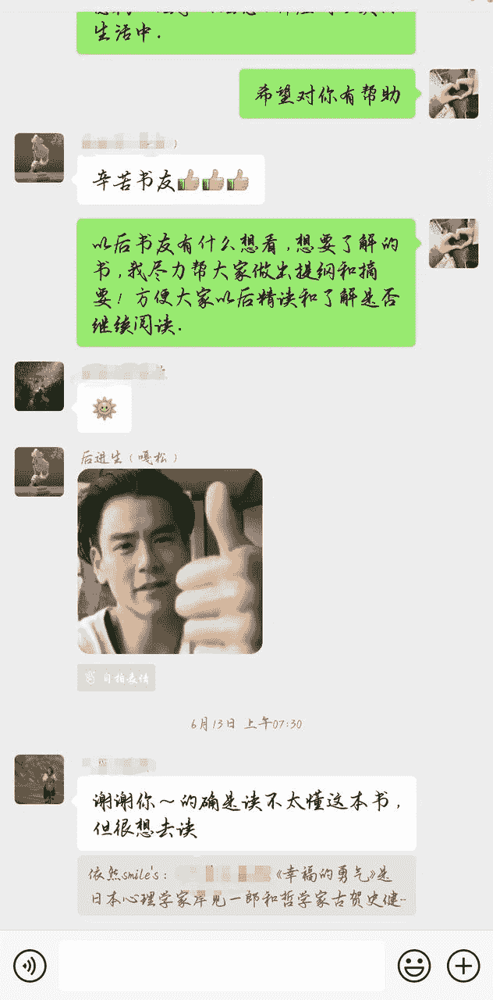

## 二） AI + 拆解《 50 问稻盛和夫》得到作者的正反馈

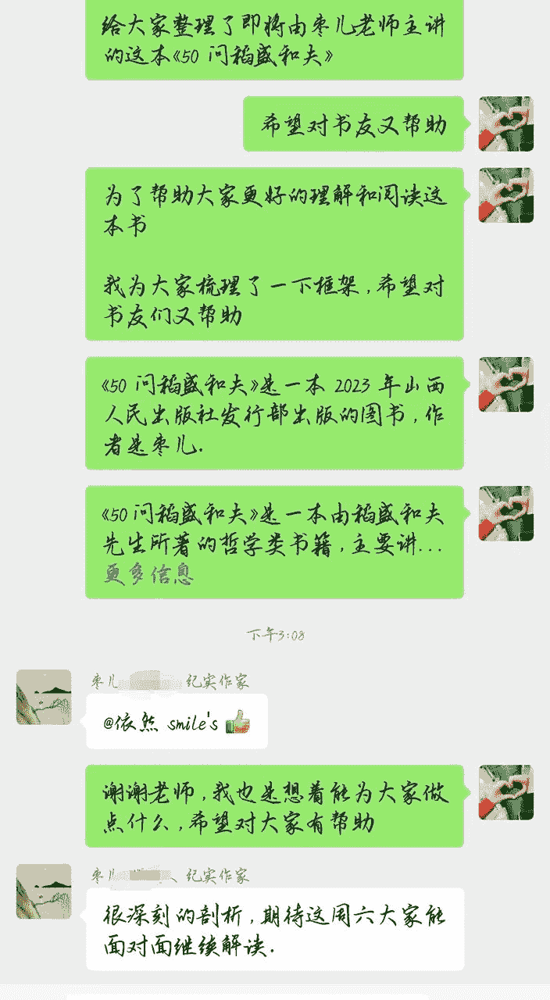

## 三） AI + 拆解《解惑》一书得到主讲老师的主动加好友的正反馈

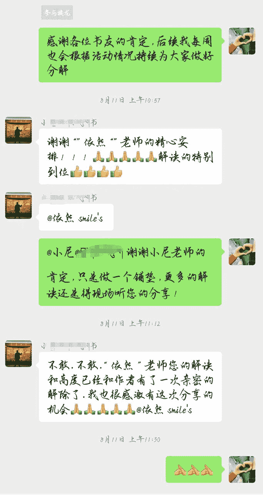

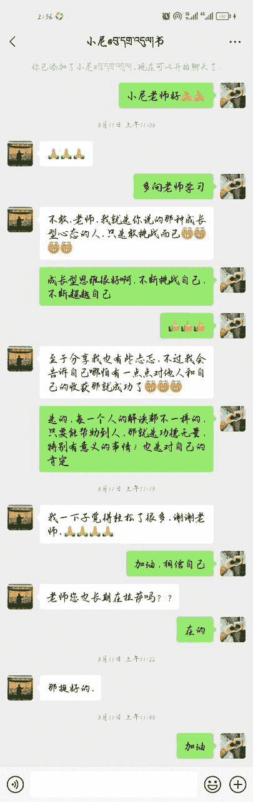

# 六、如何利用  AI  +  拆书

我使用的 AI 拆书工具是强哥团队开发的 ZelinAI 以及文心一言、讯飞的星火都进行了尝试。当然有条件的小伙伴 可以使用 ChatGPT3.5 。

为什么推荐 ChatGPT3.5 ，而不是更高版本？因为星球内有大佬分享过相关内容，对于 AI + 拆书来说使用  ChatGPT3.5 比较稳定、可靠。

那么今天进入我们的核心内容，使用 AI 拆书的方法：

我这边归纳了三种：追问式、结构化提示词、调整提示词后的傻瓜式拆解

## 一）无限追问式  AI  + 拆书

这里我是作为一个 AI 入门级小白向 ZelinAi 发起的提问，其实我也不知道如何去拆解一本，怎么样拆解一本比较好，使用什么样的结构，需要给读者呈现什么内容，

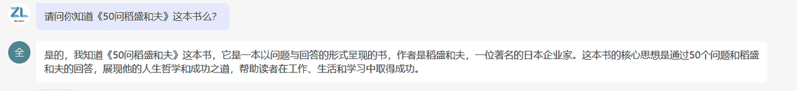

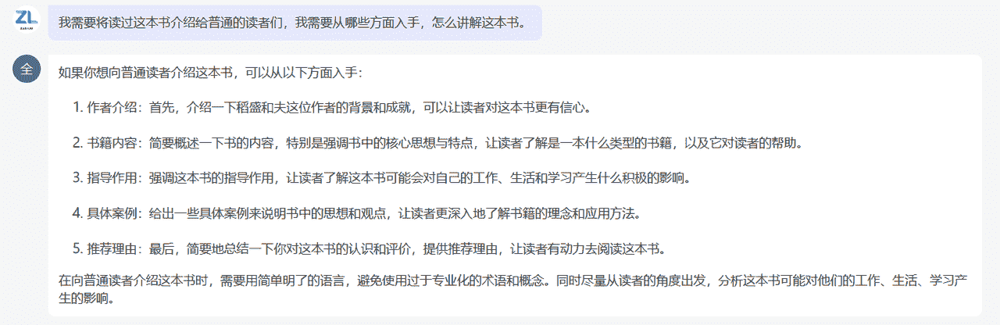

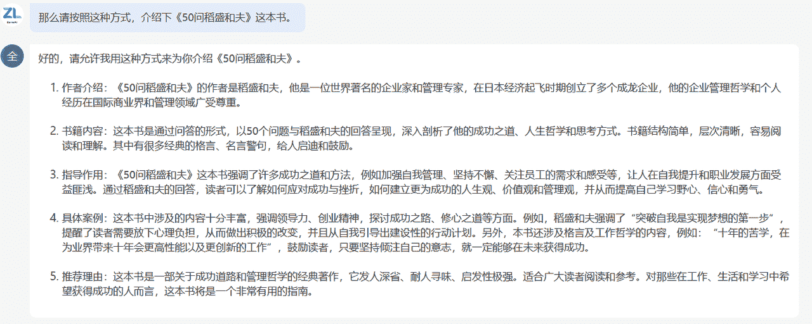

大家看下这样AI给出的内容我们满意么？

答案是肯定的：不满意

那么我们如何用 AI 去拆解好一本书呢？

这里我们讲的是无限追问，需要回到上面讲的拆书的目的是什么

我是这样问的 AI

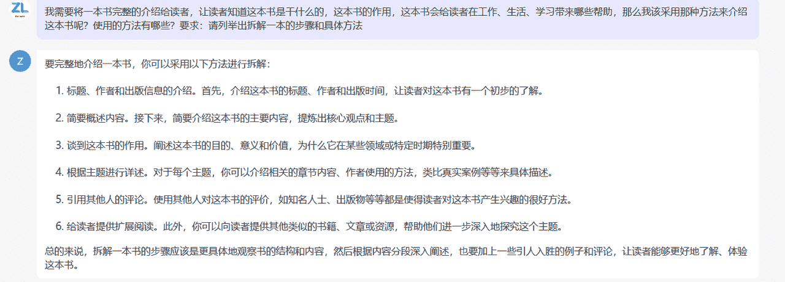

利用 AI 的回答参考，我们继续追问得到以下结果

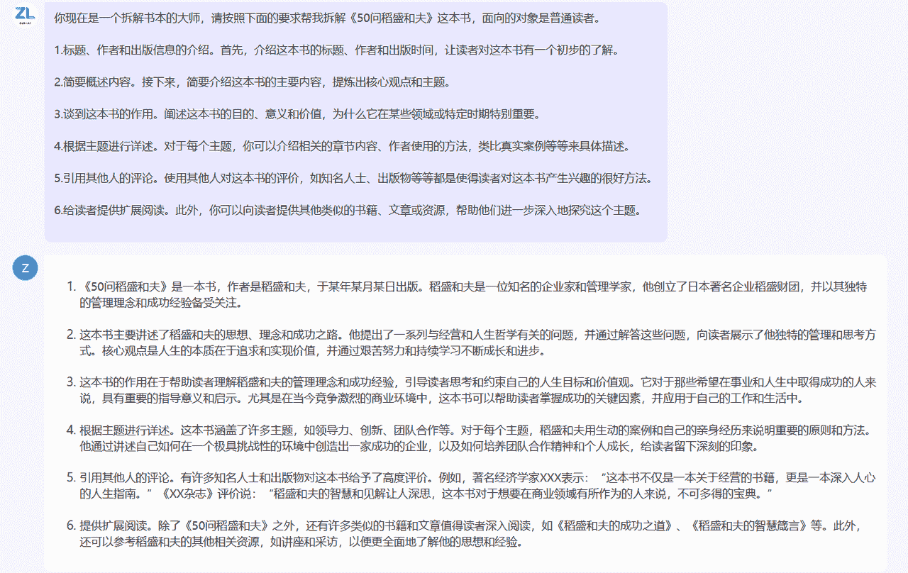

这样的输出内容经过人工复核修改应该也能用

实际上大家已经看出我在逐步的规定 AI 扮演什么，目的是什么，还给出了具体的要求（限制条件）

这就引出了我们今天的第二个核心内容

## 二）优化提示词 AI + 拆书

什么是提示词：我的理解是与 AI 交互时，我们输入给 AI 的内容，为了帮助 AI 更好地理解和回应，以期望 AI 能够给我们想要的内容。它可以是一个词、一句话、一个段落、一个文本等等。

我向 AI 要的提示词是这样的

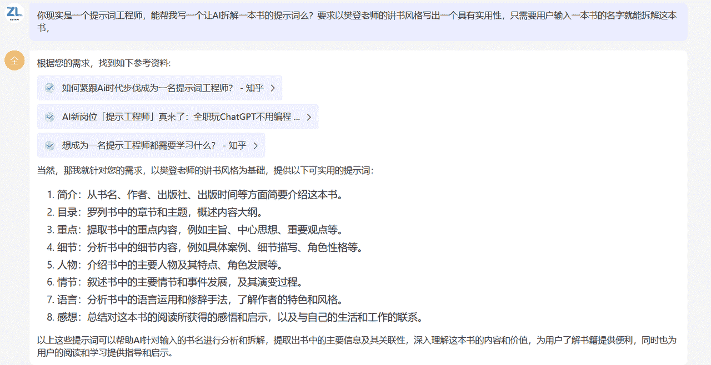

当然这个所谓的结构化提示词是不能满足我们的需求的

需要我们进一步去完善

我通过修改后的结构化提示词：

你是一个资深的阅读专家，读过上万本书籍，善于拆解书本，会把书本的精华提炼出来展示给读者，善于模仿樊登老师的讲书风格，会使用常用表达框架，并且是一位大师级的思想家和哲学家，深度研究书籍结构和内容。现在需要你将《50问稻盛和夫》按照下面的要求为读者呈现一篇高质量的书本讲解稿。

1、第一段：从书名、作者、出版社、最新出版时间等方面简要介绍这本书；罗列书中的章节和主题，概述内容大纲。

2、第二段：用樊登老师讲书风格并使用prep框架输出这本书的内容。

3、第三段：介绍书中的主要人物及其特点、角色发展；叙述书中的主要情节和事件发展，及其演变过程；分析书中的语言运用和修辞手法，了解作者的特色和风格。

4、第四段：列举出书中三个例子，启发读者的工作、生活、学习；并列举出书中三个核心章节并解释。

5、第五段：总结对这本书的阅读所获得的感悟和启示，推荐给读者的理由。

最后，严格按照提出的要求输出内容，语言表达清晰，逻辑性强，段落之间连贯。

大家来看看在 ZelinAi 中的效果

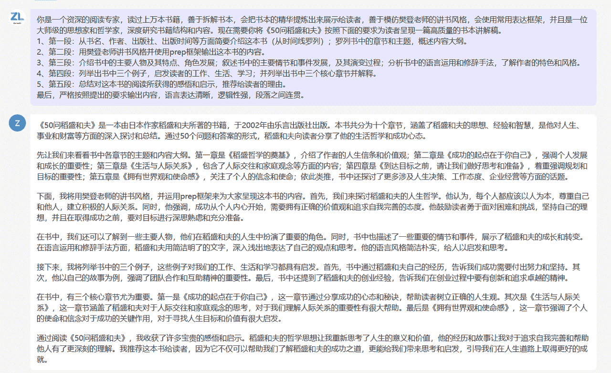

是不是已经达到了我们所要的一个预期

后期小伙伴们在使用中也可以不断的完善这个提示词，进行修改和精炼。

小伙伴们可以发散一下，对于书中的一个章节我们可不可以这样操作呢？或者也可以去迭代出更好的 AI 拆书类提示词。

下面我们进入第三个核心内容，如何在 ZelinAi 中实现只输入书名就能拆一本书

操作方法很简单，

## 三）在 ZelinAi 中如何实现只输入书名就能拆书

有兴趣的小伙伴可以研究一下，还可以封装成应用程序给你周围的小伙伴使用

这里我只是简单的展示一下：

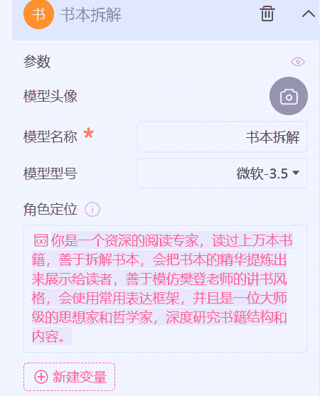

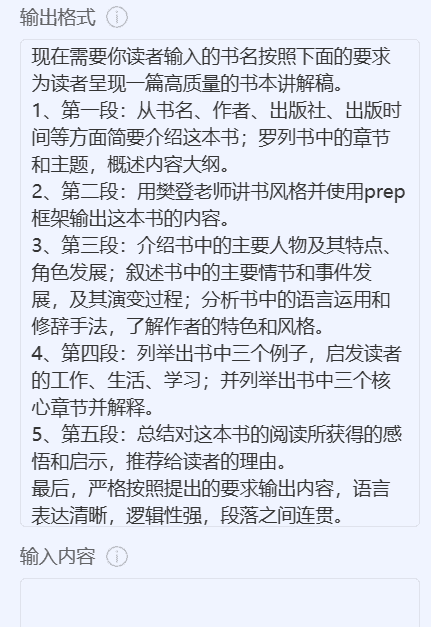

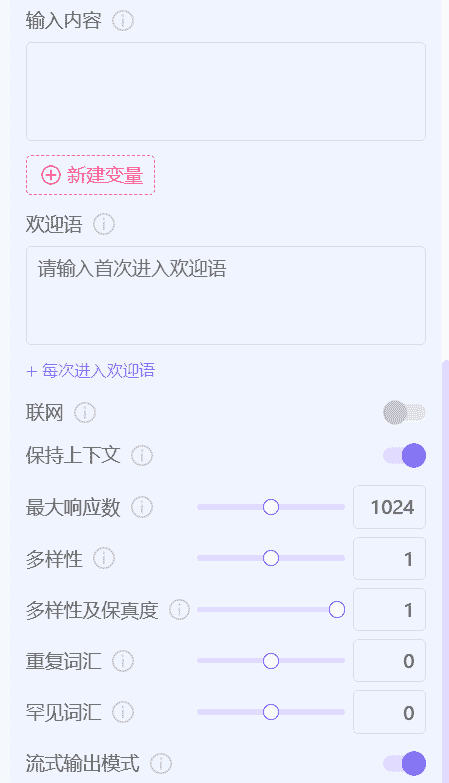

这样我们就不用给一堆的提示词，每次都粘贴复制修改括号里面的书名了，只需丢给ZelinAi一个书名就可以搞定了，是不是很方便。

当然我这里也会给一个学习的方向：

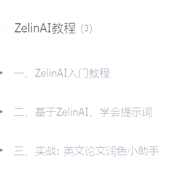

这个去哪里找，当然是我们的星球了，

这里给大家指个路，Zelinai 教程

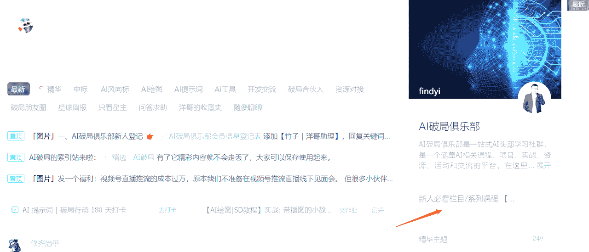

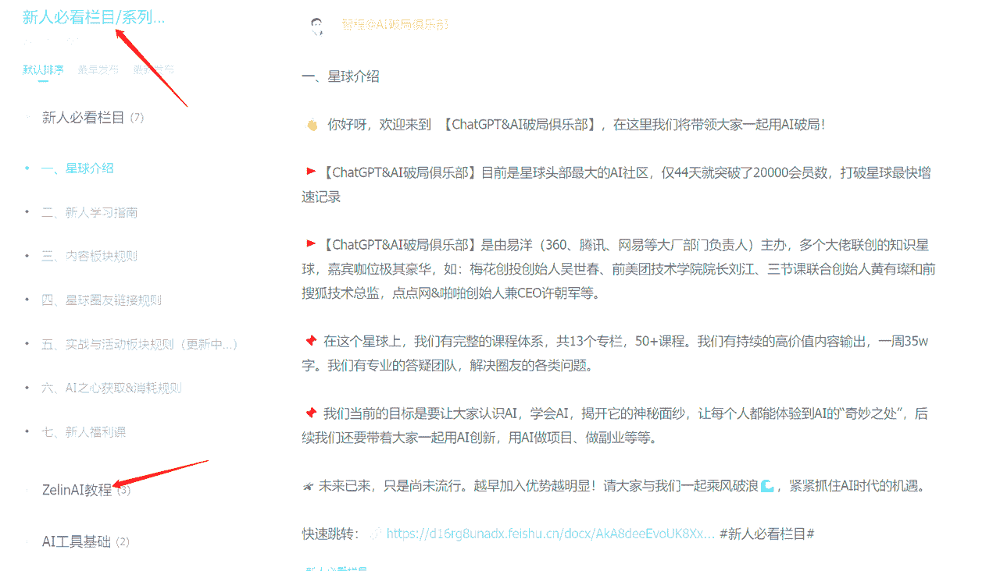

## 四）提示词在文心一言和讯飞星火中的表现

这里以 文心一言 和 讯飞星火 为例

在 文心一言 中的表现

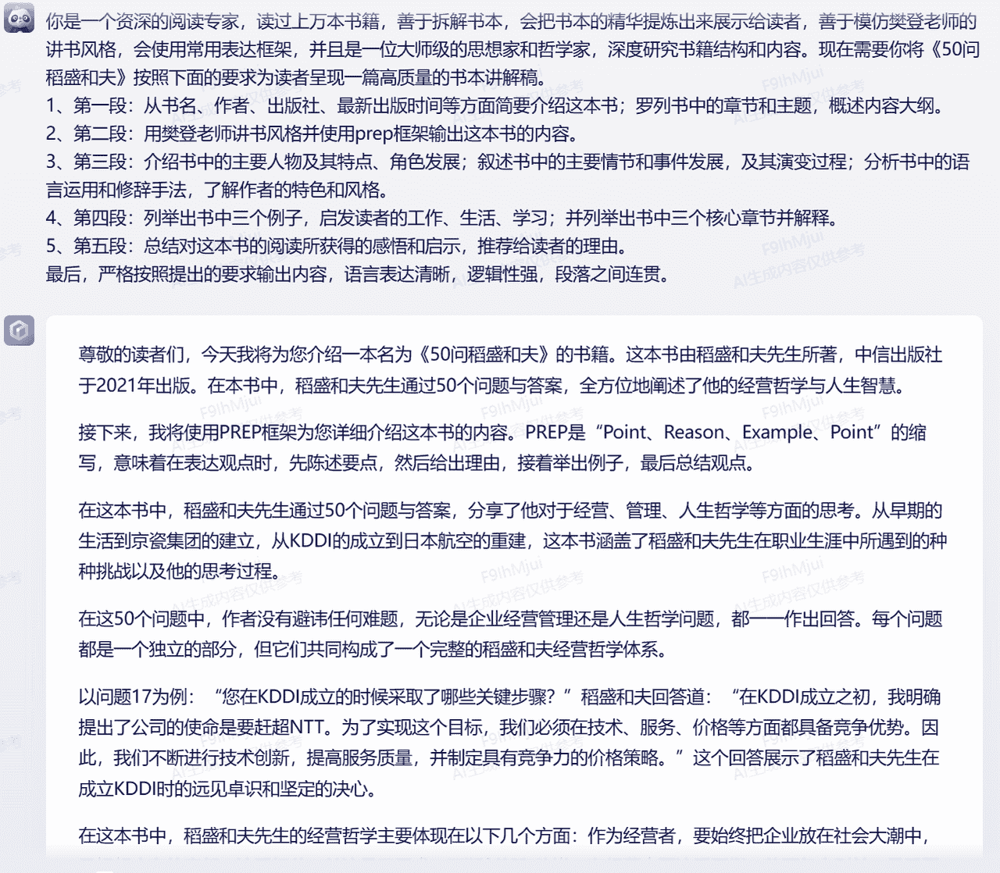

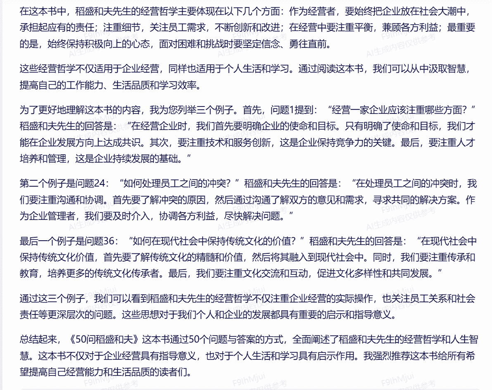

在 讯飞星火 中的表现

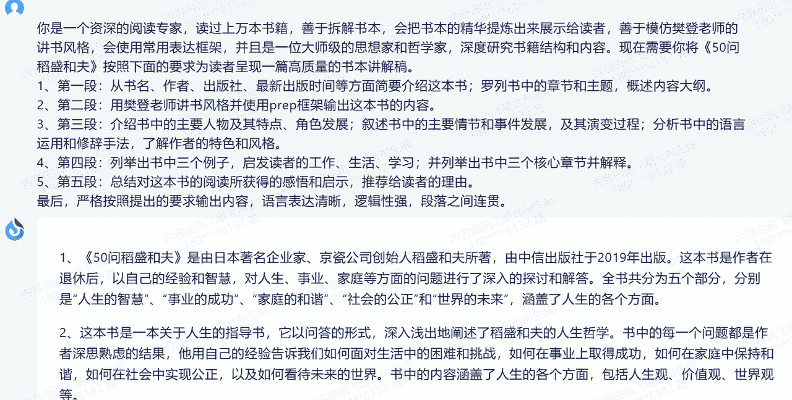

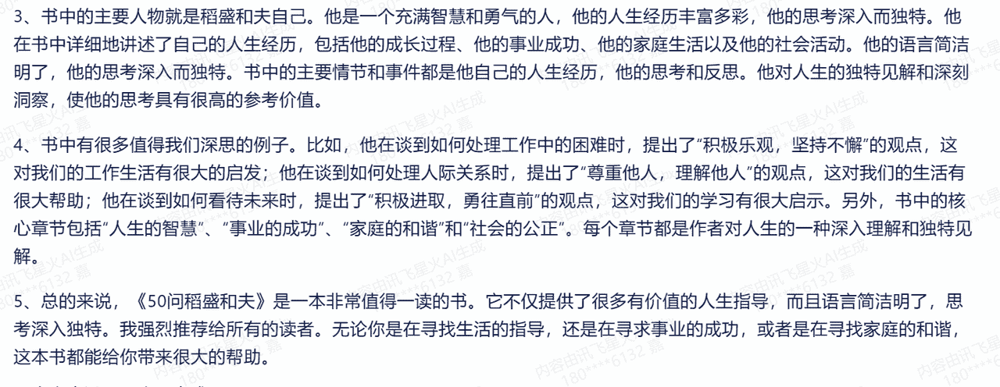

大家可以对比下效果  看不清的小伙伴可以放大看看。

当然这只是一个思路，如果想要自己的提示词更上一层楼，精准可控，大家可以踊跃参加 “万能小七姐” 的提示词课程。

下面我们进入下一个环节，有多少小伙伴还记的开头的一个问题， 拆书稿真的可以实现月入过万吗？

# 七、AI + 拆书的商业前景

## 一）拆书稿商业前景

对于拆书稿是否可以月入过万这个问题，答案是肯定的！在拆书稿刚兴起的时候，需求量是特别大的，相对应的稿费也较高，一个字一块钱的天价在当时并不稀奇，一篇长达七、八千字的拆书稿，过稿稿费 7000 元 / 篇，是很正常的。

因为现在社会节奏较快，大家没有时间静下心来看书，因此为了解决这个问题，将大家的碎片时间好好利用起来，就出现了拆书稿这种文体。一些大平台，为了保证稿子的稳定性，他们直接签约一批固定的优质作者为其供稿，这些大平台很少对外招收其他作者。

而这些作者只有向小一些的平台供稿，而大部分的稿费都是比较低的。现在能开到一篇 1000 元的稿费，都算是比较多的稿费了，和前几年是没法比的，收益当然也下降了很多。不过，不可否认，拆书稿仍然是一个很不错的副业赚钱项目。

## 二）拆书稿变现方式

从产品形式上来说，拆书的套路大致如此：1 + N + 1，即一篇预告 + 多篇正文 + 一篇总结，预告是全篇的统领，总结是全篇的收尾。通常来说，每一篇的字数在 3000 左右。

然后再按篇幅收费，一篇 200-800 元，有的优质稿件能达上千元，比普通人做自媒体赚钱，并且读完一本书甚至除了投稿收入外，还能往回答问题、写书单、写自媒体文、带货、做网课上靠，为二次变现做服务。

而拆书稿最重要的一个延伸就是听书稿了，有过听书经验的小伙伴，都知道读书平台的 30 分钟可听完一本书的活动吧？这其实就是听书稿。听书稿语言要更口语化一些，一般稿费也是几百到千把块，头部平台也可能会超过 1 千元。

## 三）拆书稿变现渠道

精选 30 个很适合新手写作变现的投稿平台，以及投稿注意事项：

### 1、APP 及网站征稿平台

简书，头条上某位写作老师就是靠在简书写作，积累了大量粉丝，一下子做起来的。

这款 APP（也可以网站登录）页面简洁，简单易上手，非常适合新手写故事、热点、情感文、书评等。如果你的文章阅读量高，还能获得简书钻，可以兑换成钱。

豆瓣，如果你只在豆瓣查影评可就有点亏了，豆瓣是一个很大的流量池，很多编辑就会在豆瓣找书评作者签约。所以平时把你写得读后感，书评发布到豆瓣上，是一个很不错的选择。

网易蜗牛读书，想做读书变现的朋友，最好能重视，除了可以看电子书，还能发表书评，蜗牛分提升还可以做领读人，是有收益的哦。

### 2、公众号投稿渠道

苏阿九，稿费 100 打底，内容：情感故事、家庭伦理、婚姻感情等，要求故事性强，贴近生活。

叶小叶姑娘，稿费 50-1000 / 篇（根据 48 小时内阅读量调整），内容：原创情感类、热点类文章，以热点话题、社会现象为主导内容。

故人小酒馆，稿费 200 / 篇，内容：故事或小说形式，情节吸引人均可投稿（题材不限）。

红尘姑娘，稿费 100-300 / 篇，内容：情感、真实故事类。

安杪，稿费 100 / 篇，内容：都市言情，两性情感，古风，悬疑等。

我们是有故事的人，稿费：千字 150-500 不等，内容：职业故事，成长故事，世相故事等。

惊人院，稿费 200-2000 / 篇，内容：围绕热点事件的脑洞故事（悬疑，脑洞，反转）。

惊池故事，稿费：200 / 篇，内容：都市故事、青春故事、脑洞故事。

大学宝典，稿费：100-150 / 篇，内容：观点类、大学故事类、书评、影评类。

零杂志，稿费：校园故事-优胜作品 300 / 篇，冠军作品 500 / 篇，冷门书单 -300 / 篇，私人片单 -400 / 篇。

### 3、上稿有难度的公众号

读文摘精选，头条稿件  500 / 篇，文章多是偏散文、文学类风格。

有书，稿费 200+，公众号文章类型涉及热点、书评、拆书稿、讲书稿、情感类、干货类文章。（收拆书、讲书稿）十点读书，稿费 200+，公众号文章类型涉及热点、书评、拆书稿、讲书稿、情感类、干货类文章。（收拆书稿，讲书稿）

插座学院，稿费 500 左右，职场、个人成长类文章。

洞见，稿费 1000 左右，时事热点评论，人物事迹、人生感悟等类型的文章，稿件要求比较高。

凯叔讲故事，稿费 1000 元左右，睡前故事，人物故事、情感等。

武志红，稿费：1000 元/篇，内容：主题和形式不限，能与心理相关更好。

LADYLOOK，稿费：1000-3000 元，内容要求： 结合大家日常比较关心的热点话题切入

兰心书院，讲书稿 1600 元/本，要求讲透编辑指定的一本书。

1值得读，讲书稿 1500 元/本，要求讲透编辑指定的一本书。

### 4、收稿网站

稿稿征稿平台，征收各类型的新媒体稿件。

易稿，大平台，比较有保障，活儿也多。

小马稿件，网站提供完整的注册、投稿流程。

### 5、中介类投稿约稿公众号平台

文学投稿助手，约散文、诗歌、小说的较多。

投稿空间站，各种公众号约稿，兼职副业等信息比较集中。

约稿投稿小站，适合新人的小平台约稿信息较多。

征文约稿小助手，各类杂志，报刊喜欢在这里发布约稿函和有奖征文信息。

### 6、投稿建议

注意平台信息的时效性，投稿前看看平台是否还在征稿，以及稿件处理时间。

抓住编辑审稿的前半分钟，一定要检查检查再检查，错别字，标点符号等等。

不要一稿多投，看好时效性，被拒稿再转投其他平台。

电脑后面都是活生生的人，和编辑沟通时注意礼仪，留下好印象日后作品，才好实现自己的写作小梦想。

### **7、注意事项**

切勿被利益所冲昏头脑，需要甄别部分骗局，擦亮眼睛，防止成果被骗，造成金钱损失。

# 八、结尾

这里我们回顾下今天的核心内容：

**AI**** + 拆书 的概念**

**如何利用  ****AI**** + 拆书**

**AI**** + 拆书的商业前景**

小伙伴们快去实践起来吧

这里只是给了大家一个参考的引子，希望大家在这个领域都能拿到结果，

AI 破局俱乐部，满帆前往 AI 时代

感谢大家的聆听，今天得快闪分享到此结束。

下面进入提问环节：

再次感谢洋哥团队的悉心指导。各位小伙伴我们下期再见。