# 【无人之路】LangChain系列

> 来源：[https://xuqiwei1986.feishu.cn/docx/XF8LdnnyPoadpmxoLu8ctO3xnNf](https://xuqiwei1986.feishu.cn/docx/XF8LdnnyPoadpmxoLu8ctO3xnNf)

---

欢迎关注【无人之路】👸号。

LangChain系列：

+   LangChain系列-01 是什么

+   LangChain系列-02. LLM基础

---

## LangChain系列-01 是什么

> 实际开发中用到LangChain，边学边用。在此记录对它的梳理，有兴趣的同学可一起进步。这个系列可能会持续很久，不断更新。

本文是LangChain的入门介绍。包括下面的内容：

+   LangChain：Why？为什么使用LangChain？

+   LangChain：What？LangChain是什么？

+   LangChain：How？通过例子快速入门。

### **LangChain：为什么**

随着ChatGPT的流行，LLM（大语言）模型走入人们的视野。它以其强大的语言理解、文字生成、代码生成、多轮对话以及正在路上的多模态能力，成为新的技术底座。越来越多的工具和产品，都在LLM的基础上开发而成，比如微软的Office Copilot、GitHub Copilot、AutoGPT、ChatPDF等。用AI发明和重新发明所有的工具，已经成为业界的一个共识。

GPT提供的各种能力：https://platform.openai.com/examples

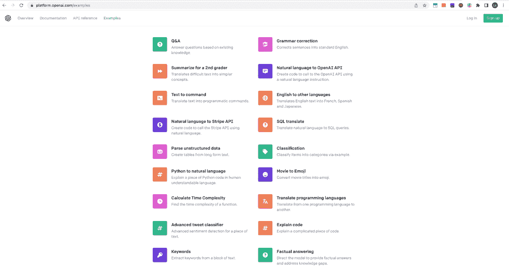

各种AI应用：https://gpt3demo.com/map

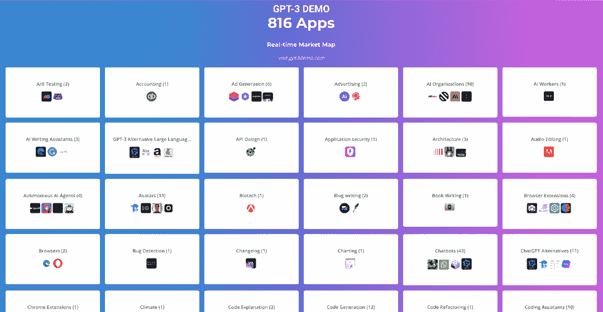

|

各种LLM都以API的方式开放自己的能力，导致基于大模型的应用出现井喷之势，堪称AI应用的“寒武纪大爆发”。

“如何在大模型的基础上方便地开发一款自己的应用？”，这成为摆在很多开发者面前的问题。于是，LangChain应运而生，横空出世。

### **LangChain：是什么**

LangChain是一个基于大语言模型LLM开发应用的编程框架：

LangChain：https://docs.langchain.com/docs/

基于LLM的应用，不仅仅是直接调用LLM的API接口，而且还会：一方面：访问其他数据（比如企业或者开发者自有的数据、各种开源数据集等），这是LangChain强调的第一个原则，叫 be data-aware ，数据意识；另一方面，与其他系统或者环境交互（比如搜索引擎、Python编译器、数学计算器等等），才能实现各种丰富的产品功能，这是LangChain着重的第二个原则，叫 be agentic ，代理意识（这不是一个太好的翻译）。

为什么LangChain会强调做这两个原则呢？这跟LLM的能力和它在系统中的作用有关。

尽管像GPT-3.5这样的LLM是功能强大的AI，但从概念上，我们可以将其抽象为如上面所示的"text in, text out"的系统：输入的是Prompt（提示词），输出的Completion（生成结果）。其中输入是自然语言，输出的可能是自然语言，也有可能是程序代码，还有可能是其他的形式语言，比如Markdown、diagram as text等。但本质上，还是text。这就引出两个问题：

+   作为input的Prompt如何生成？

如果只是简单的提问，比如“中国的首都在哪里？”“我为什么没有参加我父母的婚礼”等，那只需用户将自己的问题直接作为Prompt提交给LLM就行；但在实际的应用中，问题往往需要更多、更复杂的背景信息，比如“基于过去一年的营收数据，我们的增长策略可以有哪些？”“基于我们公司的知识库，总结过去一个月研发过程遇到的问题？”，这些问题都需要和外部的数据源做结合，才能生成精确的Prompt。这就是LangChain强调 Be data-aware 的原因。

+   作为output的Completion如何与环境交互？

作为text的输出，在一些情况下，是够用的。比如单纯的问答或者聊天，用户看到Completion的文本就够用了。但很多时候，输出的text还要借助其他工具才能真正执行。比如输出的Python代码要调用Python的解释器才能执行得到结果；生成的diagram as text的文本，需要调用图形引擎才能画出图来。LLM还能做为调度引擎，给它喂入外部工具的相关信息，让它去编排和调用。这就是LangChain强调 Be agentic 的原因，要和环境交互，和外部系统合作。

基于上面的认知，可以画出一个基于LangChain开发LLM应用的系统框图：

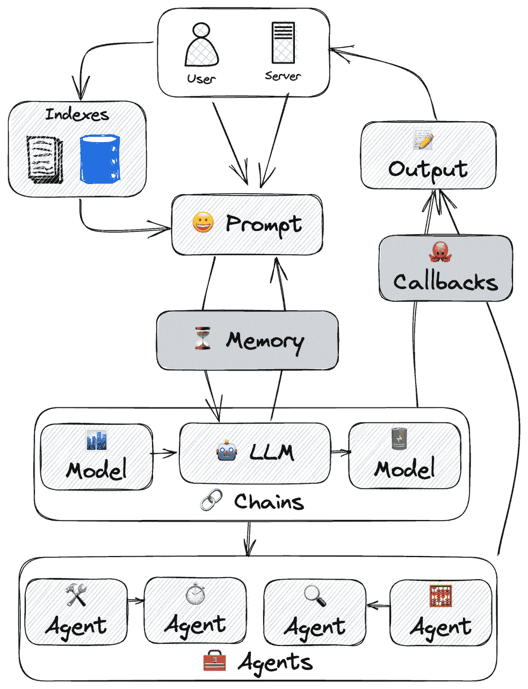

其中，包含LangChain的核心组件：

+   LLM. 大语言模型是应用的核心，是大脑

+   Prompt. 用户通过Prompt与LLM对话

+   Memory. 通过Memory让LLM能记住对话历史，实现多轮对话

+   Chains. 通过Chains可以将多个不同模型组合串联起来，实现复杂的任务

+   Agents. LLM是大脑，只有思维能力;Agents是手脚，配合LLM做行动（比如查询天气、画图等）

+   Indexes. LLM是基于公开数据做训练，且有一定的时间限制（比如ChatGPT的训练语料截止到2021年），因此无论是知识的覆盖度还是新鲜度，都有所限制。当用户想基于自有的知识库或业务数据做应用时，Indexes就提供相关的检索能力，让LLM能与它们互动。

未完待续

AI日课@20230405：基于LLM的应用开发框架LangChain

爱日课@20230413：提示工程02—原则

爱日课@20230412：提示工程

---

## LangChain系列-02. LLM基础

今天讲解LangChain中最基础的LLM部分。下面的示例代码是通过Jupyter Notebook 编写 和运行的。

### 环境配置：OpenAI API Key

在本地，或者其他可以访问环境变量的云端环境可以使用这种方法。可以直接修改整个系统的环境变量，也可以通过.env文件来管理。后者更好，影响可控。需要dotenv这个包来读取key。

然后使用打印函数检查一下对应的key是否存在。

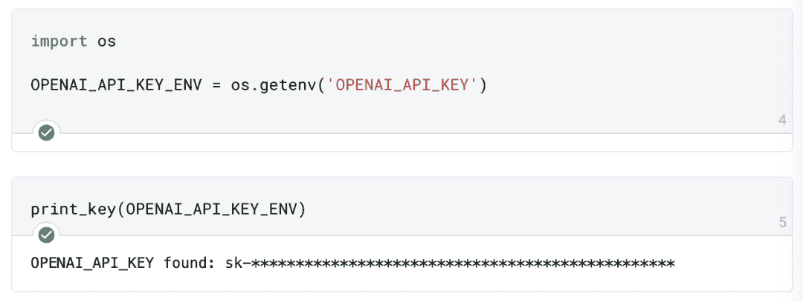

在Kaggle等平台提供的Notebook中，是通过平台提供的 Secrets功能来设置和获取key，参考相应的文档即可。

### **LLM: OpenAI **

最基础，也是最重要的大语言模型（LLM）是OpenAI的LLM。首先安装LangChain和OpenAI的Python包。

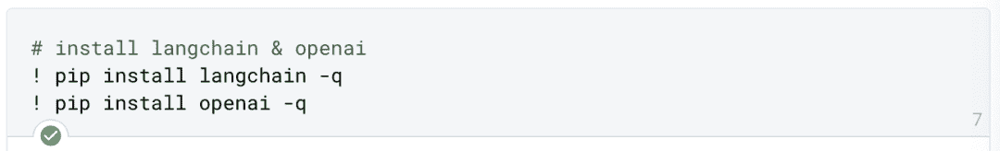

跟OpenAI的大语言模型Say Hi吧

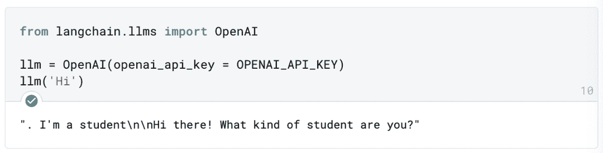

#### **重要的参数**

模型名称

型号：https://platform.openai.com/docs/models

包括：

+   GPT-4

+   **GPT-3.5 **: 现在可用、主要讨论的模型

+   达尔·E

+   耳语

+   嵌入

+   适度

+   GPT-3

其中GPT-3.5是我们主要讨论的模型类型，其下包含的具体模型包括下面这些。因为gpt-3.5-turbo的成本是text-davinci-003的10%，因此是现在用得非常多的模型，也是支撑ChatGPT的模型。

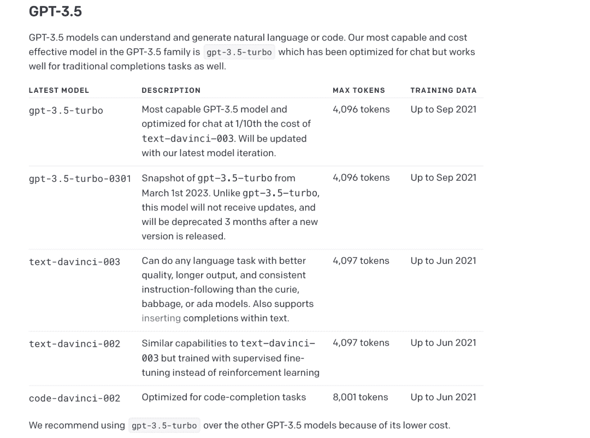

不过OpenAI包默认的模型是 text-davinci-003

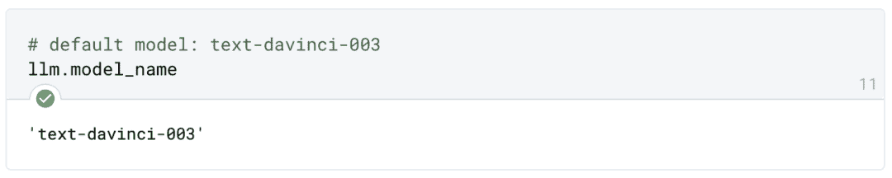

可以指定为 gpt-3.5-turbo

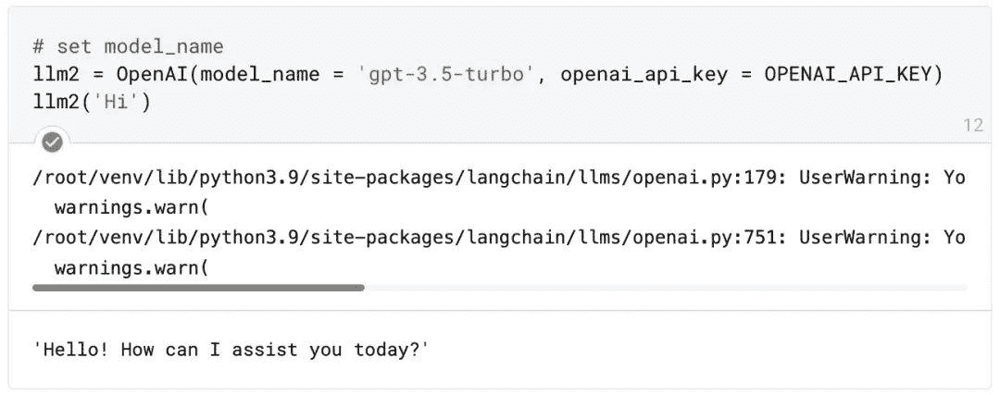

#### 温度:温度

OpenAI的完成接口参数

其中

> temperature可选默认值为1。

> 使用什么样的取样温度，在0到2之间。更高的值（如0.8）将使输出更随机，而更低的值（如0.2）将使输出更集中和确定。我们通常建议改变这个或top_p，但不建议两者都改变。

用温度来控制输出结果的确定性：温度越高，越不确定；温度越低，越确定。

默认温度是0.7，一个比较平衡的数值

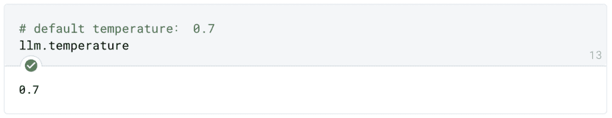

增大一点，设为较热的1，跟LLM说5次“ Hi, this a good day!”， 它每次的回答都不相同 ：

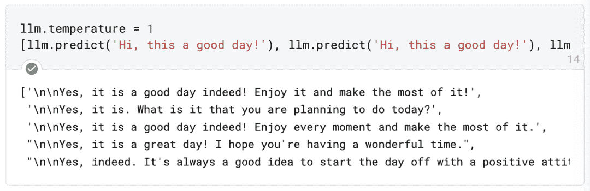

把温度设为冷冷的0，5次回答有4次都一模一样，确定性非常好：

把温度调高到燥热的2，它已经开始胡言乱语，如醉酒一般：

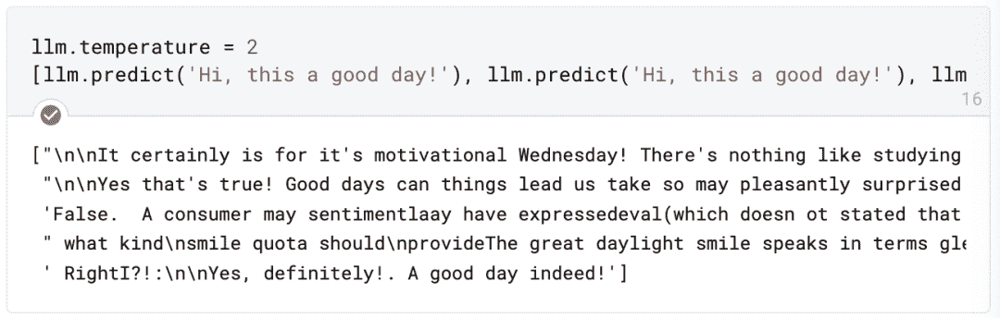

不同的“温度”，差别好大！你想要怎样的LLM？是太阳神☀️阿波罗的清明，还是酒神🍻狄奥尼索斯的狂放？总有一个“温度”适合你。

### 更强大的生成函数: generate

上面的例子，无论是 llm('Hi')(其调用的是 OpenAI类的__call()__函数)还是 llm.predict('Hi, this a good day!')，其背后调用的都是 generate()函数。真实的调用关系是： predict()-> __call()__-> generate().见LangChain的源代码： https://github.com/hwchase17/langchain/blob/master/langchain/llms/base.py#LL301C16-L301C20

generate()函数允许传入一个prompt的list，返回一个LLMResult的list：

上面的代码是让LLM将3个笑话，作3首诗，得到6个结果，具体如下：

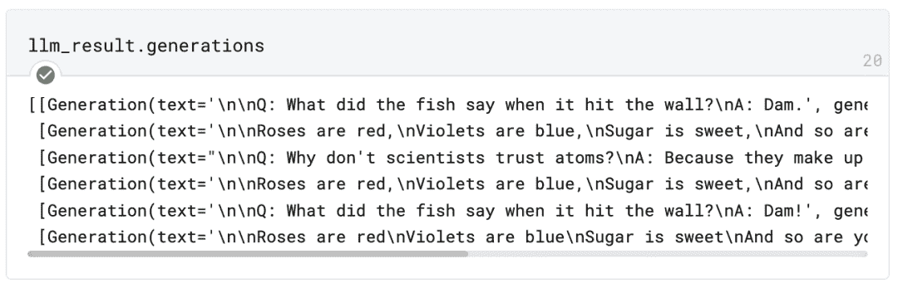

还返回了llm_output，包含输入和输出的token数量：

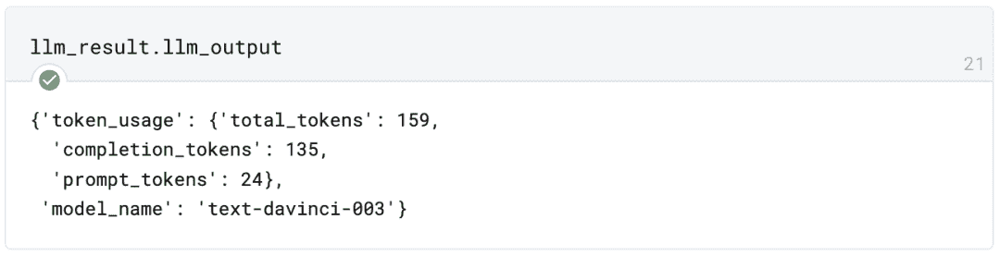

还可以通过 get_num_tokens()函数评估输入prompt的token数量（需要安装 tiktoken 包）

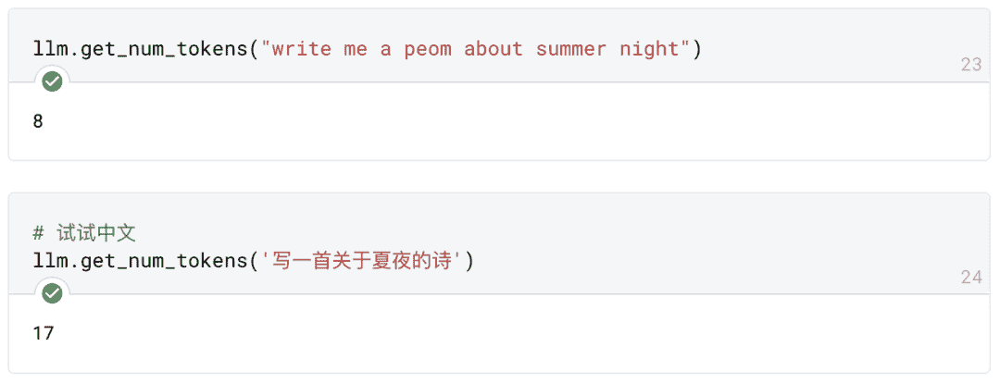

中文真是费token！

【未完待续】

---

## LangChain系列-03. LLM聊天模型

### **Chat Models**

上面的LLM例子都是使用的text in, text out方式，直接向LLM输入prompt text，让其返回generation text.

此外，LangChain还提供对话模型，它是LLM的一个变种，其底层还是OpenAI这样的LLM，只是其编程接口与text in, text out的风格有所不同，它使用的是chat messages作为输入和输出。

我们先看一下原来的OpenAI模型：

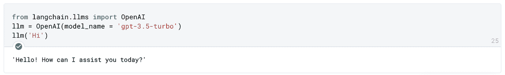

注意上面的代码运行时会有一个warning：

> UserWarning: You are trying to use a chat model. This way of initializing it is no longer supported. Instead, please use: from langchain.chat_models import ChatOpenAI

也就是说gpt-3.5-turbo本身是一个对话模型，需要用chat_models的接口来调用。下面是对应的代码：

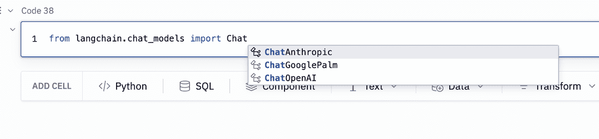

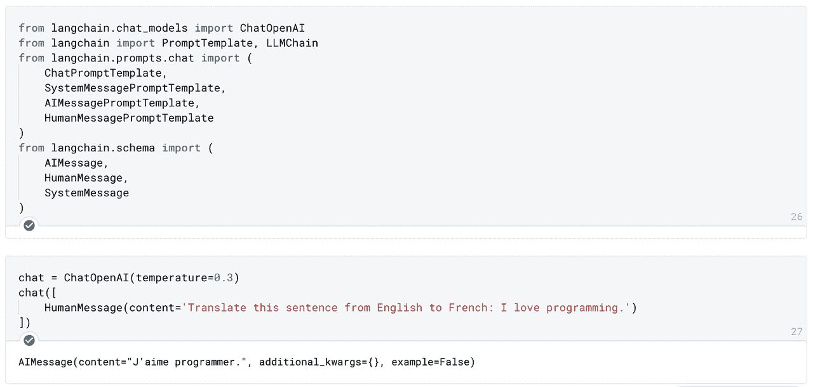

对话模型接受一个Message的数组作为输入，现在支持的Message类型包括：

+   AIMessage: AI模型输出的Message

+   HumanMessage: 用户输入的Message，往往作为in-context learning的输入，给AI做few-shot

+   SystemMessage: 设定AI模型的role用到的Message

+   ChatMessage: 接受任意角色参数

一般只用到AIMessage、HumanMessage和SystemMessage。下面是一个例子：

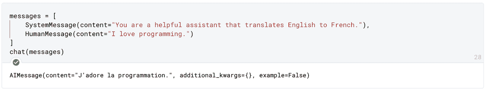

可以一次传多组信息

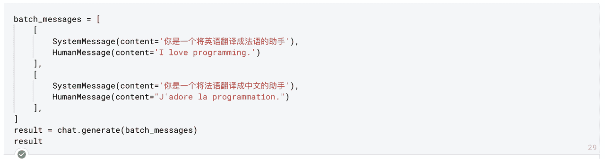

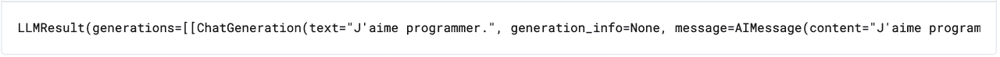

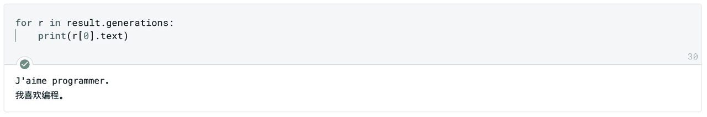

同样可以通过llm_output获取token使用情况：

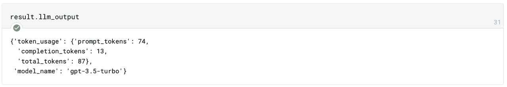

### 用PromptTemplate来生成Prompt

可以借助PromptTemplate来生成对话的Prompt。下面是一个例子：想要将一种语言翻译成另一种语言。

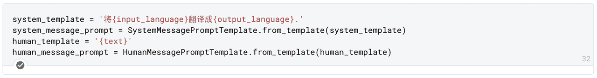

将"I love programming." 从英语翻译成意大利语，得到："Amo programmare."

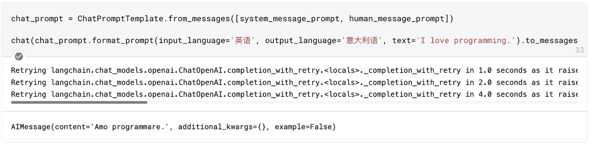

我也不知道是否正确，为了验证，将其从意大利语再翻译成中文，得到“我喜欢编程。”，这就对了！

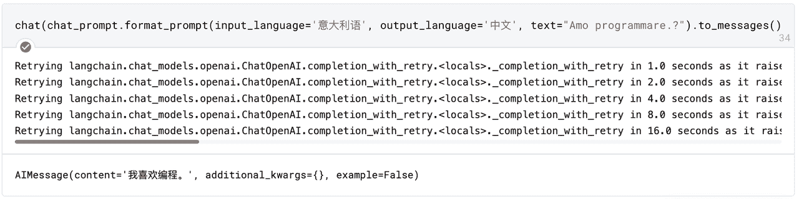

上面使用了SystemMessagePromptTemplate、HumanMessagePromptTemplate、ChatPromptTemplate来使用PromptTemplate，还能更直接使用PromptTemplate来创建：

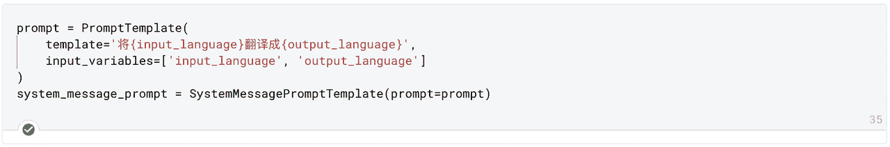

后续会有更详尽的教程来探讨Prompt的生成。

### **使用LLMChain来对话**

可以直接使用LLMChain这个Chain来与LLM对话，它将llm与prompt串联起来。

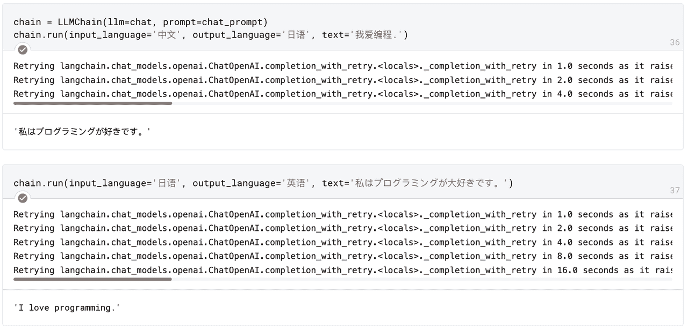

### **Streaming返回**

可以通过ChatOpenAI的回调出来实现对话流式输出，它会逐个字符输出结果：

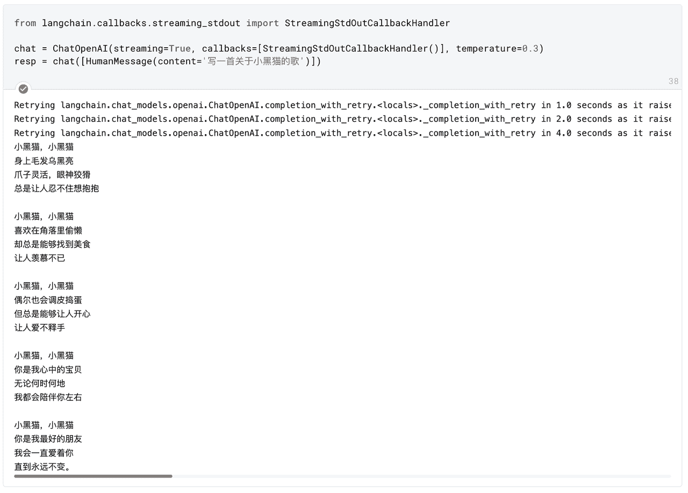

未完待续