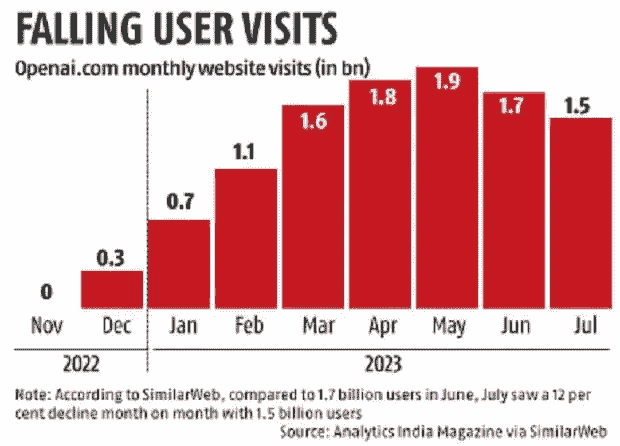
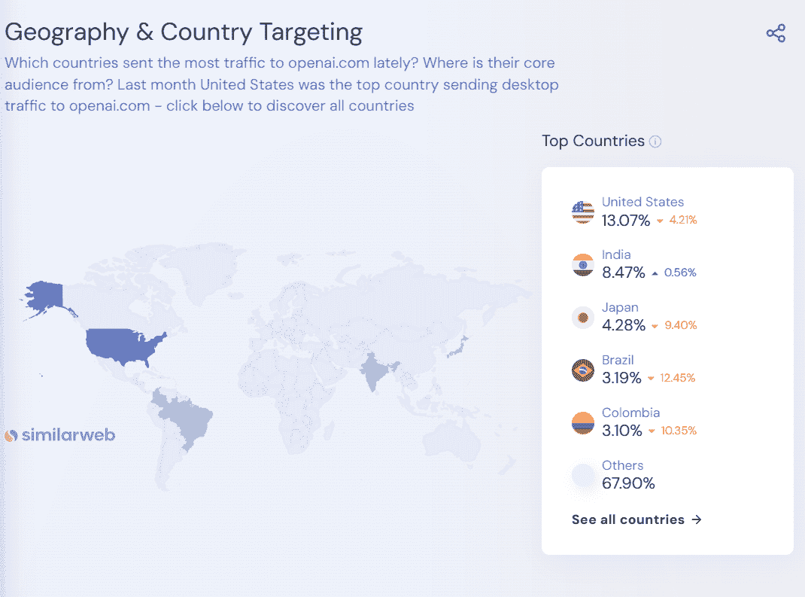
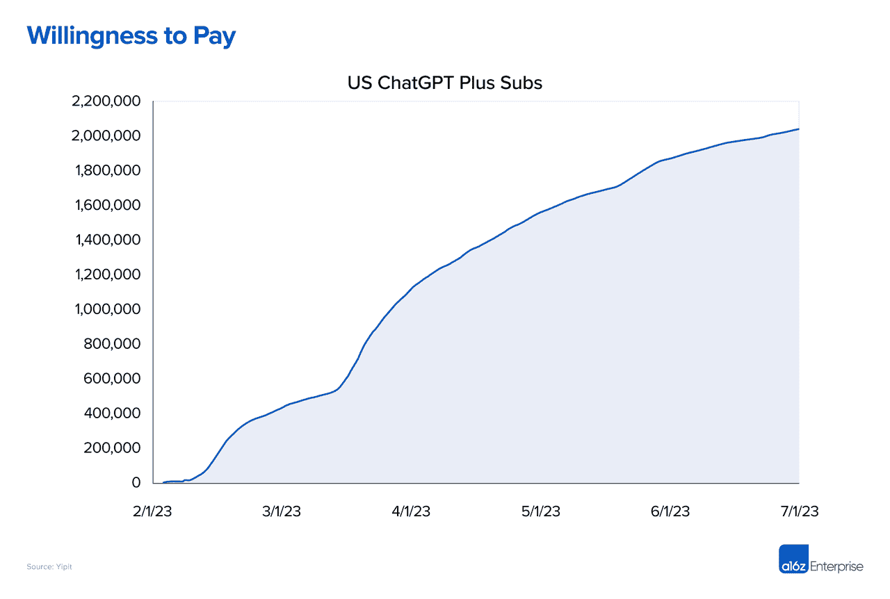

# 2023-08-14关于OpenAI最新的营收和成本数据估算：包括ChatGPT Plus付费用户数以及OpenAI的月度成本等

> 来源：[https://xuqiwei1986.feishu.cn/docx/HULod7LIbo95AWx47h8cKSuUnnf](https://xuqiwei1986.feishu.cn/docx/HULod7LIbo95AWx47h8cKSuUnnf)

> 🔗 原文链接： h[ttps://www.datalea](https://www.datalearner.com/blog/1051692014439635)rner.com/blog/10...

>

标签： [#ChatGPT# ](https://www.datalearner.com/blog/blog_list/tag/ChatGPT)[#OpenAI# ](https://www.datalearner.com/blog/blog_list/tag/OpenAI) 时间：2023/08/14 20:25:08

尽管OpenAI是当前全球最耀眼的创业公司，但是由于其没有上市，对于它的业务和营收数据大家都无从得知。今天， Analytics India Magazine披露说ChatGPT每天的运行成本70万美元左右，而一些第三方监测公司也披露了一些估算数据，可以大致推算出OpenAI的业务和营收情况，本文简单给大家梳理一下。

+   OpenAI网站的月度访问数下降到15亿

+   ChatGPT的Plus付费用户达到200万

+   ChatGPT的运营成本是每天70万美元

+   OpenAI未来营收预计

+   参考数据来源

####  OpenAI网站的月度访问数下降到15亿

这是来自SimialarWeb的数据，如下图所示，OpenAI的网站访问量从2022年12月份开始飙升，到2023年五月份达到顶峰，月度访问量达到19亿，而后开始下降，六月份七月份每个月下降2亿用户，在七月份的用户数下降到了15亿。

从地理位置看，美国地区访问量占比4.21%，其次是印度，占比8.47%。

####  ChatGPT的Plus付费用户达到200万

付费用户数据来自A16Z的统计。A16Z是来自美国硅谷的风投公司，成立于2009年，全称Andreessen Horowitz。截止2022年4月份，该公司管理282亿美元的资产。

a16z显示ChatGPT Plus付费用户从2023年2月份开始成指数级增长， 七月份ChatGPT Plus付费用户已经达到200万 。

按照订阅费20美元计算， **OpenAI凭借ChatGPT **Plus月度收入就达到了4000万美金 ！

按照SimilarWeb的监测数据，7月份OpenAI的网站访问量15亿，平均每个用户访问时间是4分钟22秒。有42.24%的用户只访问OpenAI的一个页面，平均每个用户访问4.36个页面，那么可以这样估算，假设ChatGPT Plus用户也是平均访问4.36个页面，那么付费用户的比例约200万*4.36/15亿，也就是约千分之5.8的用户是付费用户。那么，简单的估算就是 ChatGPT的付费订阅比例约0.58%左右 。也就是说1000个人中可能有6个人付费，那么相比较免费用户承担的计算成本，这个比例还是有点低哦（注意，这是十分粗略的估算）~

####  ChatGPT的运营成本是每天70万美元

这个数据来自于印度的媒体Analytics India Magazine。根据报道，目前OpenAI每天支持ChatGPT的运行成本是70万美元，这意味着 OpenAI每个月的费用成本在2100万美金左右 。

根据a16z的数据，七月份ChatGPT获得的收入是一个月40**00万美元，除去2100万美元**的成本， 月度利润在2000万美元左右 ！这样一算，保持这样的规模，OpenAI单单依靠ChatGPT一年就能获得2.4亿美元左右的净利润。

这里并不包含API的费用。

####  OpenAI未来营收预计

根据OpenAI的估计，2023年该公司收入将达到2亿美元，2024年的收入在10亿美元左右。

如果今年剩下六个月时间，ChatGPT的付费用户保持在200万，那么今年剩余5个月就可以帮OpenAI获得2亿美元的收入了，显示是超过了既定目标。

那么， **如**果明年能够保持一个月400万的付费用户，那么OpenAI一年的收入单靠ChatGPT Plus也就达到10亿美元左右 ，十分轻松！

如果ChatGPT可以放松一点对付费用户的严格限制，相信也会有一大批忠实用户愿意给钱！这部分用户，你们懂的~

不过，随着Claude等产品的发力，OpenAI可能没那么容易领先哦~

####  参考数据来源

[Cha](https://www.business-standard.com/amp/companies/news/chatgpt-costs-700-000-daily-maker-may-go-bankrupt-in-2024-report-123081300627_1.html)tGPT每天运营成本数据来源： https://www.business-standard.com/amp/companies/news/chatgpt-costs-700-000-daily-maker-may-go-bankrupt-in-2024-report-123081300627_1.html

[a](https://twitter.com/auchenberg/status/1690918600930889728)16z的月度ChatGPT付费数据： https://twitter.com/auchenberg/status/1690918600930889728

[S](https://www.similarweb.com/website/openai.com/#interests)imilarWeb的OpenAI月度用户访问数据： https://www.similarweb.com/website/openai.com/#interests

##### 欢迎大家关注DataLearner官方微信，接受最新的AI技术推送

##### 我们建立了一个AI技术交流讨论群，目前1/2群已满，请大家加入3群交流，大家可以在群里讨论AI相关的技术问题和进展~若二维码失效可以先加我的微信（微信号：datalearner_ai）再进群哦~ 微信账号二维码

