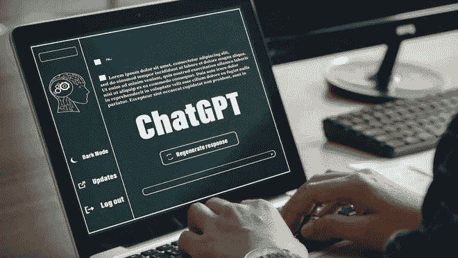

# 2023-08-14国际大公司（含银行）对员工用ChatGPT的态度及原因

> 来源：[https://xuqiwei1986.feishu.cn/docx/HkoCdpz7UoeIFaxnrMiccgoen3d](https://xuqiwei1986.feishu.cn/docx/HkoCdpz7UoeIFaxnrMiccgoen3d)

> 🔗 原文链接： h[ttps://www.163.com](https://www.163.com/dy/article/IC3F305Q0556278W.html)/dy/article/IC3F...

>

许多大公司已限制或禁止员工使用ChatGPT[1]。Business Insider汇编了一份禁止或限制员工使用人工智能的大公司名单[2]：

## Apple

+   苹果方面表示，人工智能可能导致机密数据泄露。今年5月，该公司禁止员工使用ChatGPT、GitHub CoPilot和其他人工智能工具。

## Spotify

+   该流媒体服务禁止其员工使用ChatGPT，此前Spotify在5月份删除了数万首人工智能生成的歌曲。

## Verizon

+   这家电信巨头宣布其公司内禁用ChatGPT，以防止出现源码泄露或客户信息失控的风险。

## 富国银行

+   这家银行限制员工使用ChatGPT。通过这种方式，他们希望避免与第三方软件供应商产生隐私纠纷。

## 三星

+   当公司得知有部分员工向聊天机器人上传机密代码时，该聊天机器人随即被禁。

## 德意志银行

+   这家金融公司禁止员工在工作场所使用ChatGPT，以防止机密数据泄露。不过，自今年2月份以来，这家银行允许一些专家出于"合理目的"使用人工智能工具，同时，该公司也正在积极研究如何让员工安全地使用生成式人工智能工具。

## 摩根大通

+   这家银行控股公司暂时禁止员工使用ChatGPT。这一举措是在今年2月份宣布的。

## 亚马逊

+   今年1月份，公司法务部门警告员工不要向聊天机器人提供“任何亚马逊的保密信息”。此决定是在公司发现ChatGPT会泄露反映零售商内部数据的对话内容后作出的。

## iHeartRadio

+   这家美国流媒体和广播平台已经禁止员工在所有公司设备上使用ChatGPT和其他AI技术。这一决定是为了避免损害iHeartRadio品牌形象，同时也担心会因疏忽泄露机密信息。

## 诺斯罗普-格鲁曼公司

+   该防务公司也禁止使用ChatGPT。“在经过测试并发现可以安全使用之前，不会与人工智能共享数据。”

## 花旗集团

+   这家跨国银行公司在2月份禁止员工使用ChatGPT。不过，有部分员工的禁令已解除。

## 美国银行

+   该银行禁止员工为工作目的使用ChatGPT。管理层认为，像ChatGPT这样的技术在用于商业通信之前应该先进行测试。

## 高盛

+   禁止员工使用ChatGPT，以避免出现与第三方软件相关的合规问题，但这并不妨碍其开发自己的人工智能工具。

## 咨询公司埃森哲也榜上有名

+   不过，该公司并未正式禁止使用ChatGPT或其他AI工具，其在保护客户数据方面向来非常谨慎。

参考：

[1]https://www.94c.cc/info/which-companies-prohibit-employees-from-using-chatgpt-2023-7.html

[2]https://vctr.media/ua/vy-tochno-yih-znayete-czi-11-kompanij-zaboronyly-spivrobitnykam-vykorystovuvaty-chatgpt-190541/