# 2023-08-13在大模型的时代浪潮上起舞！

> 来源：[https://xuqiwei1986.feishu.cn/docx/Xqk7d4ZnNoamHax1765cqbH9nGg](https://xuqiwei1986.feishu.cn/docx/Xqk7d4ZnNoamHax1765cqbH9nGg)

> 🔗 原文链接： h[ttps://mp.weixin.q](https://mp.weixin.qq.com/s/GhdHqiLfigN9jZQZmdmzCA)q.com/s/GhdHqiLf...

>

原创 CSDN AI科技大本营 2023-08-13 14:10 发表于 北京

作者 | 王启隆

责编 | 袁滚滚

出品 | CSDN（ID：CSDNnews）

上世纪的“广 告教父”大卫·奥格威在世时一直营销着一个 概念：“在现代商业世界，如果你不能将所创造的东西卖出去，只成为一个富有创意的思想家是毫无用处的。”

回顾历史上的每一次变迁，从学术创意到切实部署的轨迹勾勒出进步的蓝图 ，有如从概念到商业化的过程。随着 GPT 等大模型技术的高速成长和普及，模型的开源资源、部署训练架构、算力成本成为大模型应用落地和企业盈亏 ROI 的关键分水岭，重要性不低于模型精度。

继今年 3 月的 [首届 NPCon 大会 ](http://mp.weixin.qq.com/s?__biz=MjM5MjAwODM4MA==&mid=2650964214&idx=1&sn=cef3c0f195dcae758351b4bb5167f4bc&chksm=bd5af1258a2d7833a5460601336d5cda301419690c9073cb96fc5fac2fe1498dfa71b55ecab7&scene=21#wechat_redirect)探讨了 ChatGPT 对技术社区的影响之后 ， 8 月 12 日， CSDN、《新程序员》联合主办的“ 新程序员大会（NPCon）：AI 模型技术与应用峰会 ” 于北京格兰云天大酒店再度揭幕。

本次峰会主题围绕「全链路搭建 AI 研发底座」展开，是 CSDN 今年推出的“AI 主题季”系列活动之一。峰会活动分别会在北京、上海、深圳、成都四城举行，北京站现场邀请到 千芯科技董事长陈巍，Dify.AI 创始人张路宇，美团基础研发平台视觉智能部软件开发工程师张旭 ，浪潮信息人工智能与高性能应用软件部 AI 架构师Owen Zhu，CSDN 研发副总监梁灏， 围绕算力资源运维、模型训练部 署、 AI 能力构建等方面，为不同规模阶段的企业、团队、个人开发者，提供如何构建 AI 基础设施、实现工程落地，提供全链路的建议和方案。

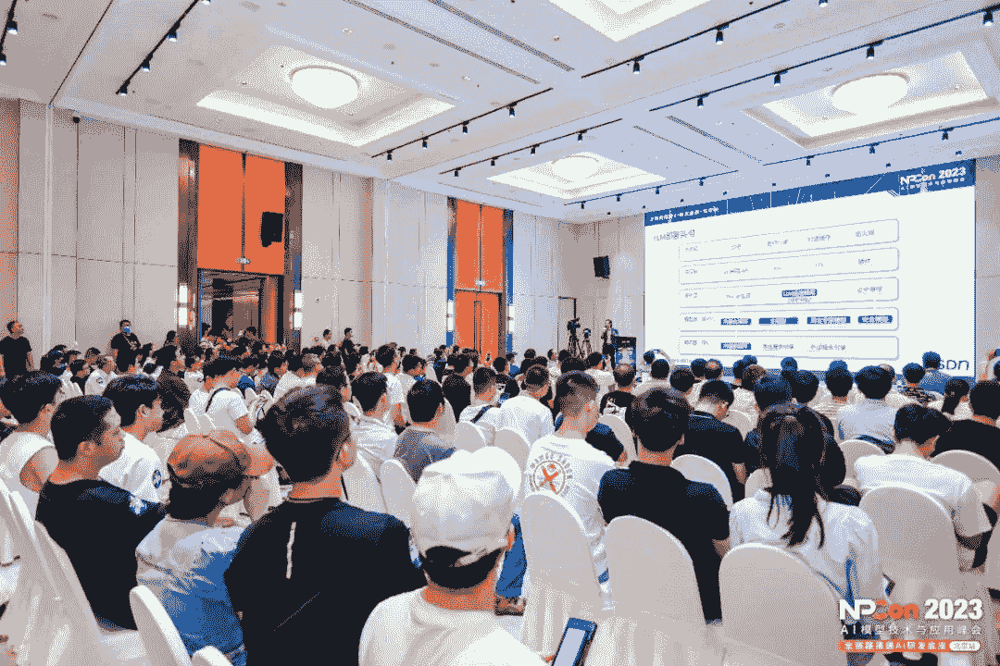

以下是本次“AI 模型技术与应用峰会”的演讲精华。

**部署就是大模型的成败关键**

首先， 知乎科技领域答主@陈巍谈芯、千芯科技董事长、人工智能算法 -芯片协同设计专家陈巍带来了分享《大模型涌现，如何部署训练架构与算力芯片》。他的核心观点在于强调大模型训练和部署过程中的技术优化、隐私保护、成本效益以及未来芯片发展的重要性。

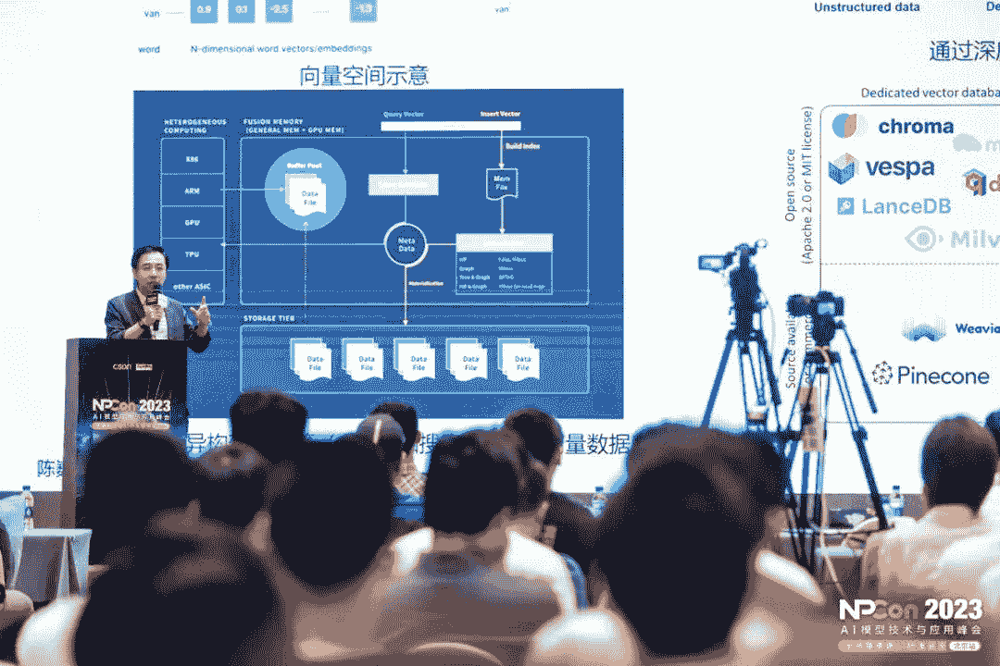

知乎科技领域答主@陈巍谈芯、千芯科技董事长 陈巍

陈巍指出，大模型的本质是对知识的压缩和对输入的反馈，一个常见大模型的生存周期分为模型的计划、高质量数据的收集、模型的建模和部署三个阶段。其中，部署是大模型成败和能否盈利的关键。

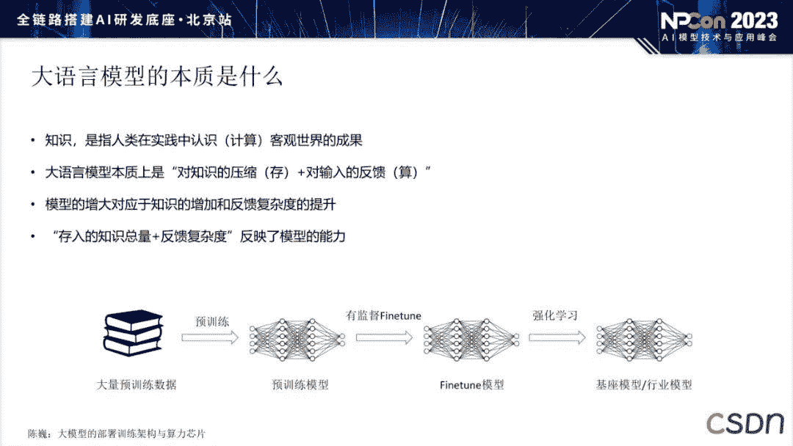

他认为，在大模型训练和部署中，使用并行化技术（如数据并行、模型并行、张量并行）可以充分利用计算资源，提高效率。他强调通过优化通信，减少数据传输冗余，可以降低计算芯片之间的通信成本，从而提升整体训练效率。

陈巍关注大模型部署中的隐私问题，特别是个性化数据和敏感信息的保护。他介绍了隐私保护技术，如将个人数据合并以降低隐私风险，并限制模型输出中的敏感信息。陈巍强调，对于涉及个人隐私和敏感信息的部署，必须采取适当的隐私保护措施。

此外，陈巍提出了不同的方法来降低大模型训练和部署的成本。他介绍了模型训练成本的评估方法，包括如何通过数据大小和训练条件来优化成本。他还探讨了不同算力芯片（CPU、GPU、DSA、TPU）的应用，以及如何通过合理的策略来降低成本。

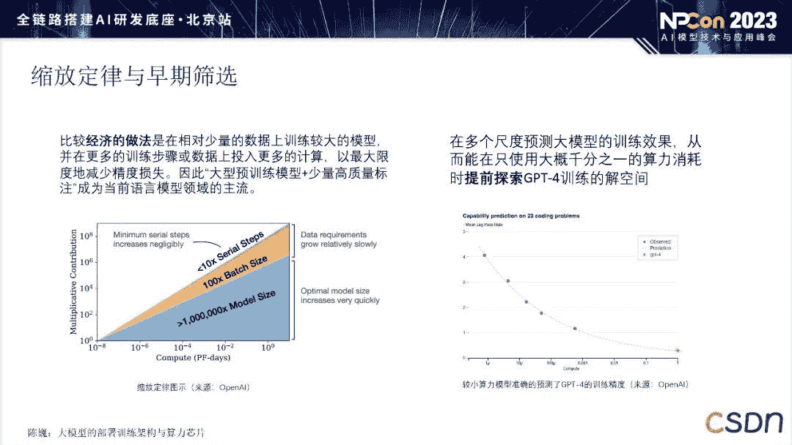

最后，陈巍强调未来芯片的发展可能对大模型训练和部署产生影响，特别是在现有 GPU 生态受到限制的情况下。他认为在不同的算力芯片中，TPU 和 DSA 可能逐渐代替传统的 GPU 应用。陈巍呼吁采取合适的技术策略和隐私保护措施，以降低成本、提高效率，并关注未来芯片趋势对于人工智能产业的影响。

**Agent 是大模型未来**

**最有想象力、最有前景的方向**

“Agent 是 LLM（大语言模型）的最有前景的方向。一旦技术成熟，短则几个月，长则更久，它可能就会创造出超级个体。这解释了我们 为何 对开源模型和 Agent 兴奋，即便投产性不高，但是我们能想象自己有了 Agent 之后就可以没日没夜地以百倍效率做现在手上的工作。未来可能会有 Agent 网络，每家公司甚至每个人都有自己的Agent，互相调用形成网络效应，带来繁荣的生态。”，Dify.AI 创始人张路宇在主题演讲中如是说道。

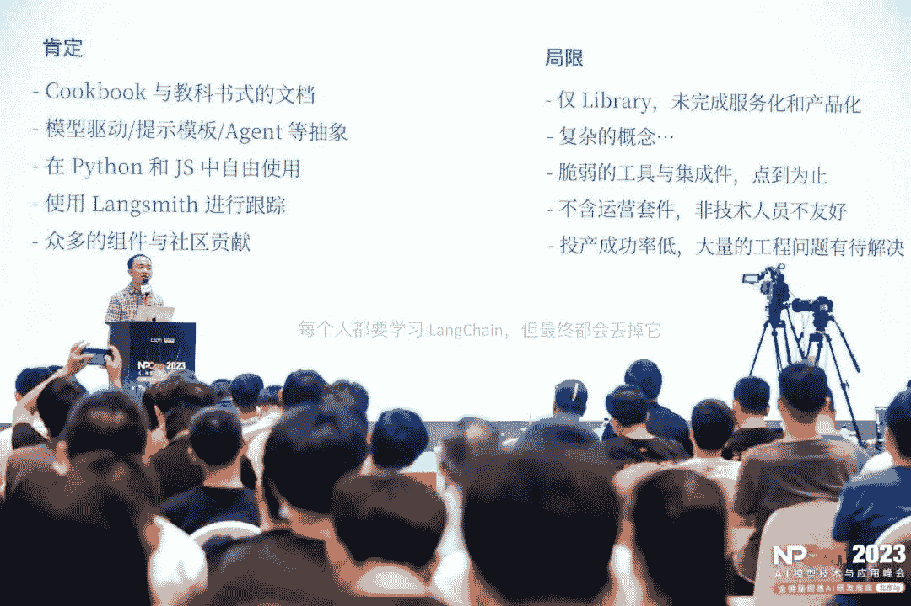

Dify.AI 创始人& CEO 张路宇

张路宇指出，开发者在应用大模型时常常面临向量数据库、Agent编排等问题，并且许多开发者在初期都需要解决相似的难题，导致效率低下。尽管有大量应用和模型，实际投产的应用比例只有 5% 左右。

由此，张路宇强调了自动代理（Auto Agent）在推理模型、编程范式和应用构建方面的重要性和挑战。他提出了“规划、记忆、工具的使用和总结与反思”这四个关键要素来解释自动代理的推理过程。他强调了规划过程的重要性，将任务分解为多个步骤，并介绍了长期记忆和短期记忆的概念，探讨如何适时调用工具、合理使用人类输入、进行多轮对话，并强调推理性能、透明性和成本控制等方面的挑战。

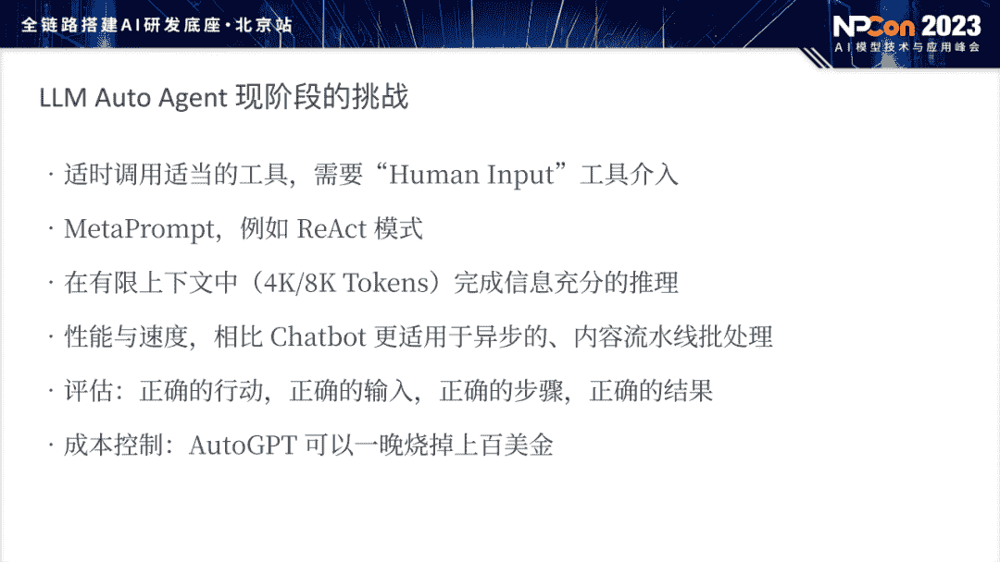

张路宇提到 LangChain 作为一个学习大模型应用开发的教科书，提供了抽象概念和工具。但 他也指出了 LangChain 的局限性，特别是在工具和集成键方面的脆弱性，以及不适合非技术人员的参与。他说道：“ 每个人都要学习 LangChain ，但最终都会丢掉它。 ”

演讲中，张路宇引入了 MetaPrompt 的概念，将其描述为一种结构化的提示方式，可引导模型进行复杂的推理和行动。他指出，MetaPrompt 是引导大模型执行任务的关键工具，将用户问题、前期反思、工具调用和模式以特定格式描述成提示。

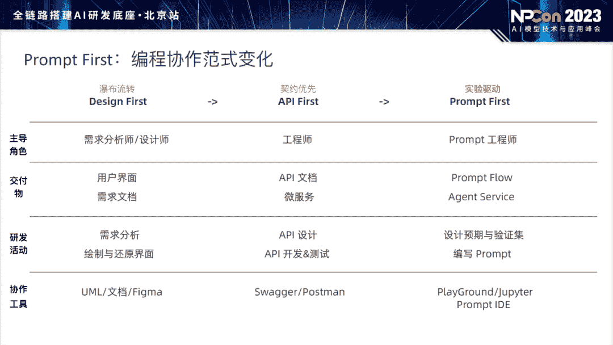

张路宇认为，面对大模型的开发，传统的编程范式已经不再适用。他提出了一种新的编程范式，即 "prompt first"。在大模型应用开发中，传统的需求分析和 API 文档设计可能不再适用。相反，他强调在设计应用之前应先考虑模型的输入提示（prompt），并用这种方式引导模型执行任务。

**如何高效推理，**

仍是 大模型时代 亟需解决的挑战

紧接着， 美团基础研发平 台视觉智能部软件开发工程师张旭在发表《 美团视觉 GPU 推理服务部署架构优化的实践 》主题演讲中表示，GPU 利用率低的问题正日益凸显，其核心症结在于模型服务存在性能瓶颈。通过拆分微服务、优化部署架构以及综合考虑多个优化层面，将模型 CPU 和 GPU 运算部分解耦，能实现模型部署工程的性能优化，让服务性能成倍提升。

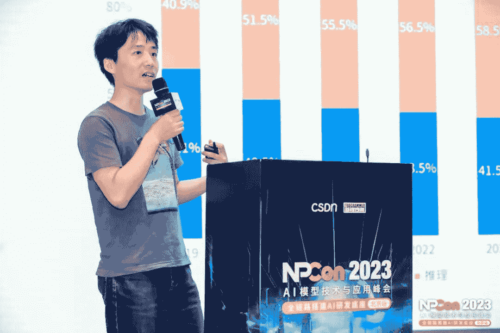

美团基础研发平台视觉智能部软件开发工程师 张旭

随着技术应用在线服务推理资源不断增加，GPU 推理资源的使用比例逐年上升，但 GPU 的利用率却一直在被浪费。张旭透露，业界的真实 GPU 利用率哪怕乐观估计也只有 20％ 左右。造成服务 GPU 利用率低下的重要原因之一是模型服务本身存在性能瓶颈，在极限压力情况下也无法充分利用 GPU 资源。

乍一看，模型部署十分完善，事实上，当前的模型优化不彻底，部分算子无法优化加速，多模型的串联部署也很困难。在 GPU 异构计算体系下，模型中 CPU 和 GPU 运算之间还存在相互影响的问题。 张旭指出，这种影响会导致 CPU 和 GPU 无法同时充分利用，从而降低了推理服务的整体性能。

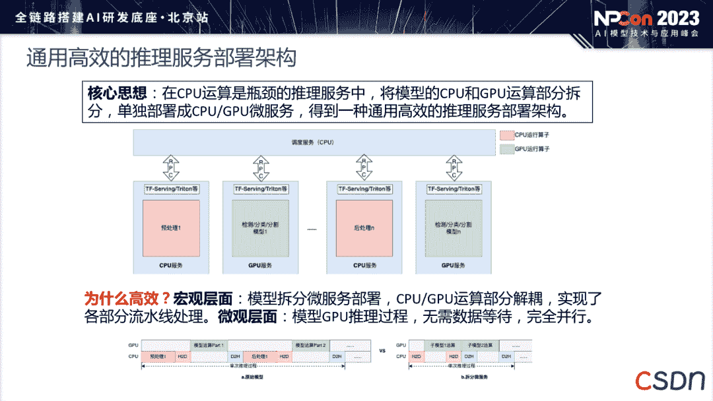

为此，张旭提出了解决 CPU/GPU 互相影响问题的一种优化方法，即将模型中的 CPU 和 GPU 运算部分分别拆分为独立的微服务。他通过实际案例演示，将预处理和后处理部分独立到通用 CPU 服务，主干网络部分部署在 GPU 上，从而实现了更高的 GPU 利用率和整体性能提升。

在复杂视觉场景下，多模型的组合会引发更严重的 GPU/CPU 影响问题。张旭通过实例说明了针对多模型组合的场景，同样可以采用 CPU/GPU 拆分部署的方式，将不同模型部分分别部署，以解决性能瓶颈问题。他强调不同优化层面之间的相互影响和迭代优化的重要性，以实现性能的持续提升。

算力是驱动大模型创新和进步的基石

在现代人工智能领域，算力扮演着推动创新、实现突破的核心驱动力。浪潮信息人工智能与高性能应用软件部 AI 架构师Owen以《AI 大模型算力系统分析》为主题，强调了算力、算法、数据和系统架构等多个方面的综合优化对于大规模模型训练的成功至关重要。

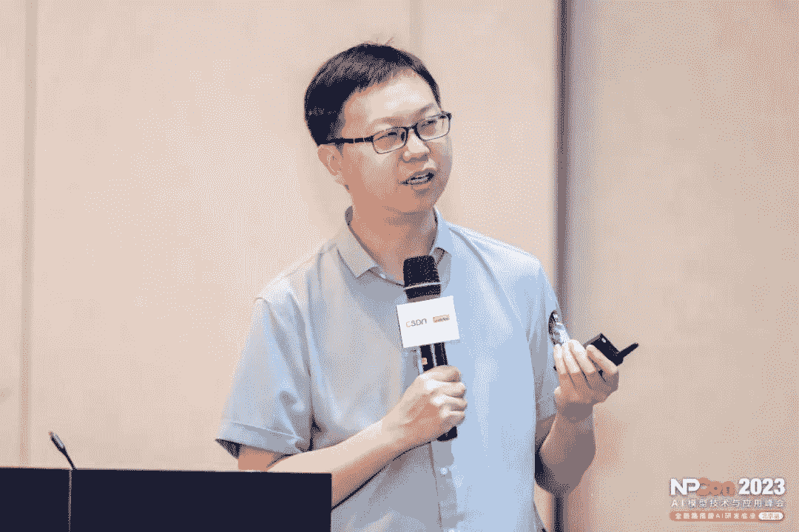

浪潮信息人工智能与高性能应用软件部 AI 架构师 Owen

浪潮信息早在2020年就开始布局和投入AI大模型技术的研发，Owen从“源”大模型的研发历程切入，讲解了大模型研发过程中的数据、算力和算法等各方面的挑战。并指出国内企业在上半年对算力的需求增加，尤其在大型模型训练方面。他强调了 GPT-3 和 GPT-4 等模型的重要性，同时提到了中国企业在这一领域的竞争和发展前景。强调了算力投入是评估模型能力一个重要指标。

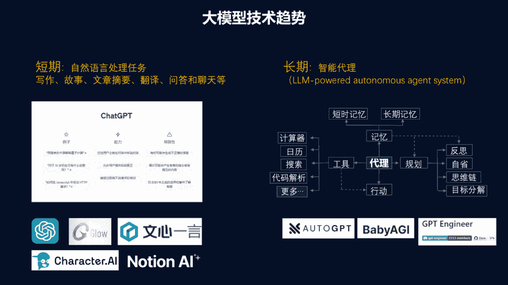

随后，Owen探讨了大模型研发过程中预训练、微调和模型推理等环节的核心关键因素和主要计算特征。并强调，未来大模型的产业化发展是一套复杂的系统工程，构建高效稳定的算力平台是核心要义，成熟的算法、数据产业链，配套工具链及丰富的生态链是关键因素，我们亟需以系统的方式寻找最优解。

用好工具，人人都是 AI 应用开发者

在闪**电演讲环节，CS**DN 研发副 总监梁灏先是介绍了自己的经历：将开源 iView 从 0 做到 20,000 Star ，最大的感受便是好的工 具能让开发更简单。而他要介绍的 InsCode ，正 是这样的平台。

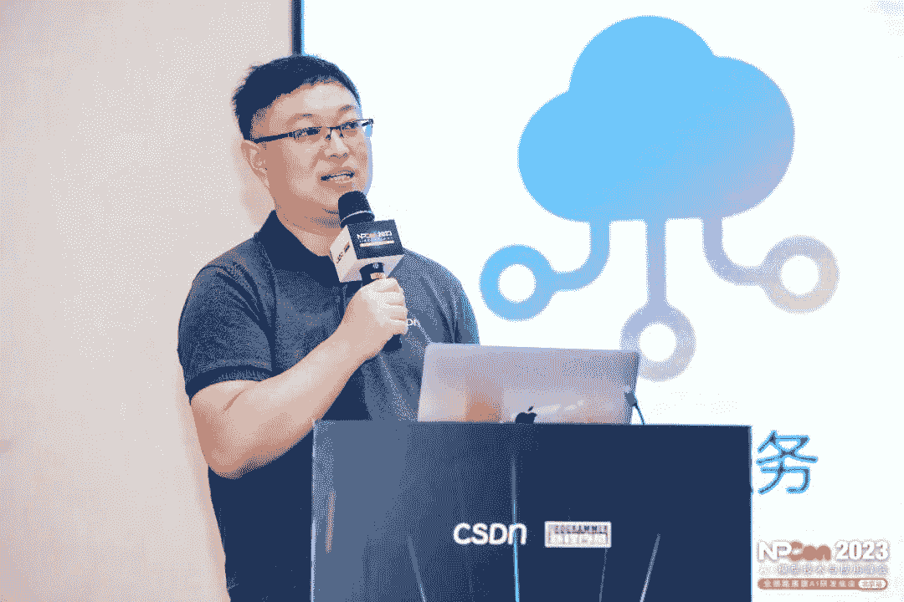

CSDN 研发副总监 梁灏

InsCode 是 CSDN 于 2023 年推出的一站式应用开发工具和服务平台。它在浏览器中实现从编码到部署的完整过程。仅仅在四个多月内，InsCode 就吸引了超过 5 万注册用户，其中一半以上为开发用户。累计创建了 4 万多个项目，其中许多项目已经公开发布或部署到社区。梁灏指出，InsCode 彻底改变了传统的开发流程，使用户能够在线上完成应用的开发、部署、运维和运营，从而使应用开发变得更加简单。

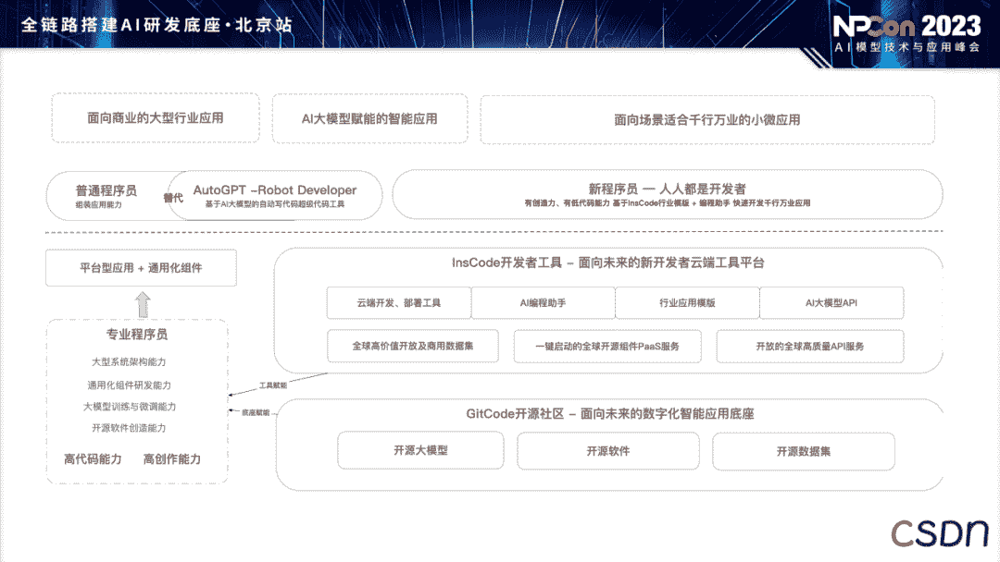

梁灏强调了 InsCode 在 AI 时代的地位，尤其是其面向开发者的 AI 服务。他提到，专业程序员可以借助 InsCode 提高开发效率和创造能力，普通程序员可以通过生成式 AI 工具减轻编码工作，而泛开发者甚至可以利用模板和自然语言提交需求，快速开发多样化的应用。正如 CSDN 的 Slogan：人人都是开发者。

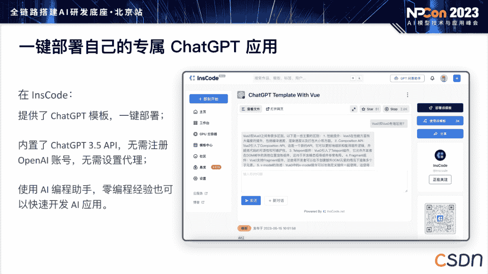

最后，InsCode 联合创新工场盛大召开 AI 应用编程大赛，目前活动已处于启动阶段，欢迎读者们访问 inscode.net 进行报名或者参赛，赢取丰厚奖金。

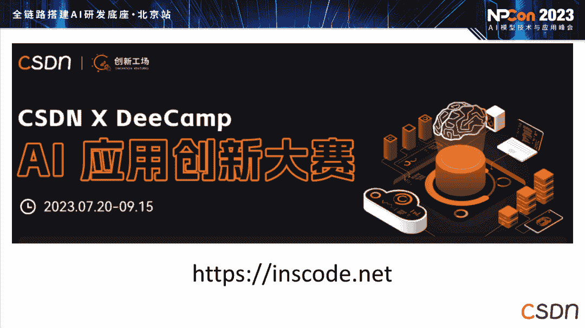

**开谈：AI 时代的研发新范式**

**与开发者能力演进**

在本次论坛的《开谈》环节，由 CSDN 人工智能技术编**辑团队主**持，华为诺亚方舟实验室技术专家 **董振华**** ，投**研机构 INP（Infra **Nati**ve Partners）创始人 丁宁 ，CodeGeeX 团队算法专家 沈磊 ，聆心智能创始人& CTO 郑叔亮 作为嘉宾的圆桌对话正式展开。

本次《开谈》的主题为“AI 时代的研发新范式与开发者能力演进”，五位技术专家聚焦于过去一年内 AI 技术和模型的快速发展，特别是大模型的涌现以及与模型开发相关的基础设施和应用技术的突破，探讨大模型的未来走向，未来编程语言和开发范式的影响，以及如何通过工具提高效率、学习 AI 知识和技能并在竞争激烈的领域中保持竞争力。

”模型团队应该更关注模型效果，也要努力做具体应用。扩大模型参数量至两倍所产生的效果，远高于对其做加倍预训练所呈现的效果。夯实大模型 L0 层能力、对行业模型进行优化是我们的努力方向。”， 华为诺亚方舟实验室技术专家 董振华 分享道。

董振华是研究者，也是《新程序员》的忠实读者。他从研究者的角度强调开源在追赶人工智能技术方面的重要作用，认为开源可以帮助解决人工智能技术以及大模型的问题，使其更好地落地和应用。未来，不同规模阶段的企业、团队和开发者都应该拥抱开源，将先进的技术借鉴于开源社区，从而形成更有条理的发展模式，不仅仅是商业公司的行为。

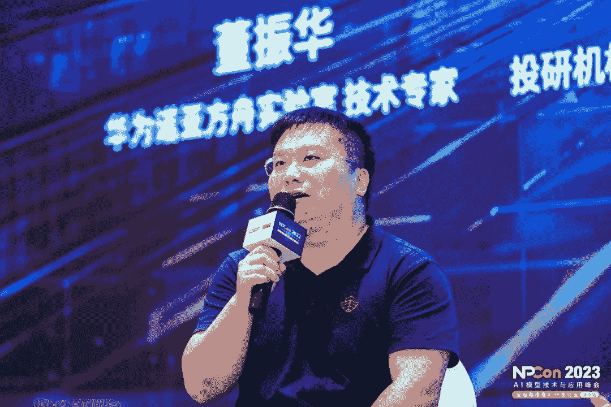

华为诺亚方舟实验室技术专家 董振华

当谈及大模型生态的问题时， **投研机构 INP（InfraNa**tive Partners）创始人丁宁 回答：“大模型生态从商业考虑，相比面向具体任务做模型 Finetune，要更关注其通用能力；与过去模型参数内仅是特征提取器不同，现在还包含意识形态、价值观等要素给大模型生态商业化带来更多不确定性。”

丁宁**从不**同类型的创业公司角度，分析了商业应用与研究阶段的优先级问题。 他将创业公司分为几类，包括做 Foundation Model 的、做 Fine-Tuning 的以及使用平台集成的。 丁宁认为， 在 Foundation Model 阶段，重点在于搭建可扩展的算力集群、高性能网络以及高性能数据存储基础设施，设计精巧的逼近实验以求尽可能高 的 提高单次模型训练ROI，力求用最小的成本换取最大的实验进展。

**在Fine-Tuning阶段，重点在于如何将大语言模型应用于特定领域，并**解决训练和数据管理等基础设施问题，但更重要的是建立数据的内循环与业务的外循环。  如果不去接触模型训练，他强调了应用工具和服务的重要性，如何将大语言模型与现有技术结合，提供工具的同时也要提供持续的服务，例如合规、安全监控、线上业务持续性保障等实际应用价值。

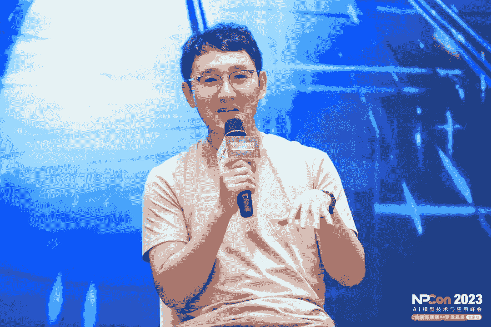

投研机构 INP（Infra Native Partners）创始人 丁宁

CodeGeeX 团队算法专家 沈磊 则强调了在使用大模型方面的实践建议和团队协作的重要性：“我的建议是要拥抱新的工具和功能。对于个人开发者或者公司来说，使用辅助工具可以显著提升编程效率，甚至提高 10% 的效率对于一个人来说也是很可观的进步。当我们面对变化时，要勇于接受并尝试新的技能和工具，这将对个人和团队都非常有帮助。”

**沈磊**为想要使用大模型的公司或个人给出建议，首先尝试使用开源的模型和插件。这可以帮助他们在实际场景中试用模型和微调代码，了解模型效果，从而在做出关于使用什么样的模型、框架和机器配置的决定时更具有理性和经验。

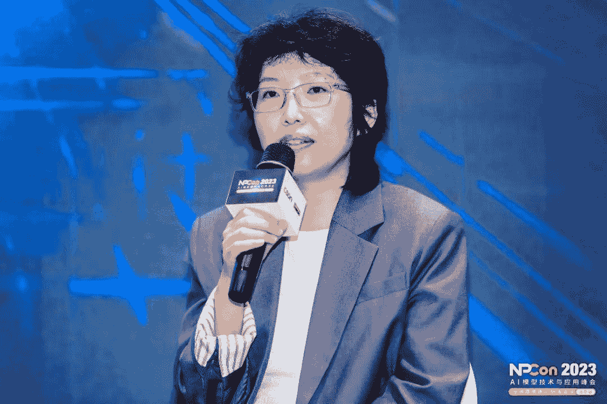

CodeGeeX 团队算法专家 沈磊

**在开源领**域的话题上，聆心智能**创始人& CTO 郑叔亮 阐释了自己的观点： “开源模型让创业者借助大平台搭建原型**、实现核心创新突破并快速交付产品，制造多赢的局面。但初创公司仍需厘清其中存在的安全性和价值观风险，才能在开源的土壤生根发芽。”

对于未来可 能会创造的机遇，郑叔亮表示：“ 在我们上学的时候，编译原理课程需要花两个学期来完成一个编译器，数据库课程则要求编写一个 DBMS 系统，本科阶段的大作业基本都是这样的。 这种经历让我们在面对新技术时更加从容，不会对挑战、威胁或恐慌过于担忧，而是欣然接受新鲜事物。 简而言之，如果我们不能成为创造浪潮的人，至少应该成为在浪潮上跳舞的人。虽然只有少数人会创造这波浪潮，但更多的人可以站在潮头，享受其中的乐趣。 ”

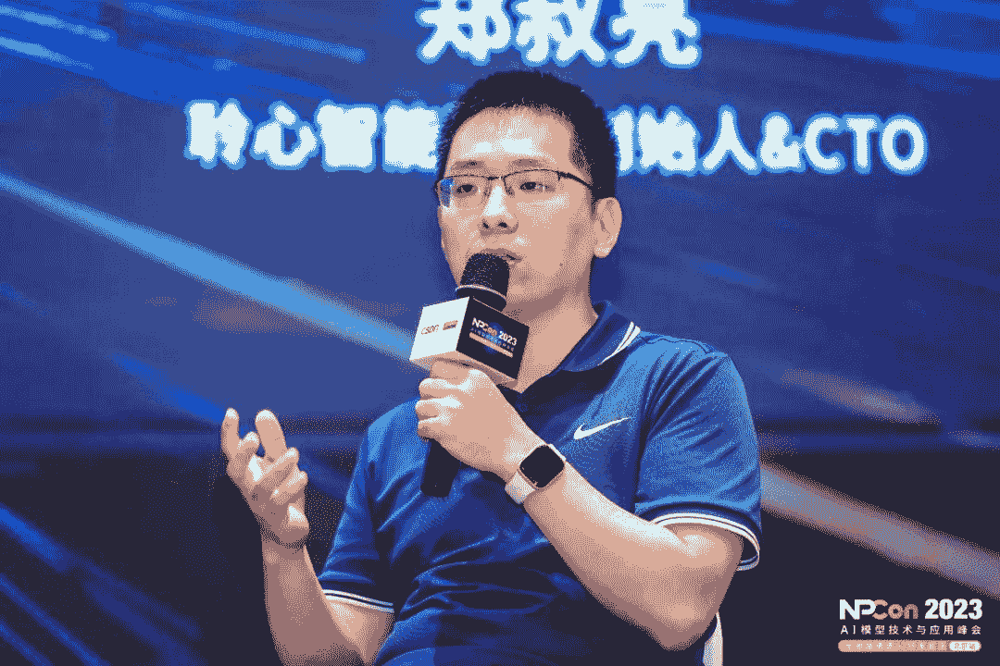

聆心智能创始人& CTO 郑叔亮

**大模型时代的新程序员**

NPCon 中的“NP”是“New Programmer”（新程序员）的缩写，它承载着两重含义。首先，它象征着《新程序员》杂志，这是 CSDN 延续近 20 年的《程序员》杂志的全新篇章。其次，它象征着我们站在人工智能纪元的起点，或许将亲历程序员职业范式的巨变，成为新一代的程序员。

CSDN 这些年一直在持续关注人工智能 技术这一赛道，与其**他**以 AI 为主题的垂直媒体不同的是， CSDN 拥有近五千万开发者社区规模的平台，除了关注科研突破和商业应用外，更着重关心人工智能应用的工程实现。 当前，人工智能技术不断刷新能力极限，各种相关新闻层出不穷，然而实际情况是，我们在基础设施、工程实施、成本以及应用落地方面依然面临着漫长的前行之路。

不论我们是创新的推动者还是变革的见证者，我们都应该迈出那一步，踏上旅程。若“新程序员”不能成为浪潮的奠基者，至少应当成为其中的弄潮儿。新程序员们会怀揣着创业的精神，始终保持持续学习的状态。如此一来，我们的努力才会更具深远的意义。

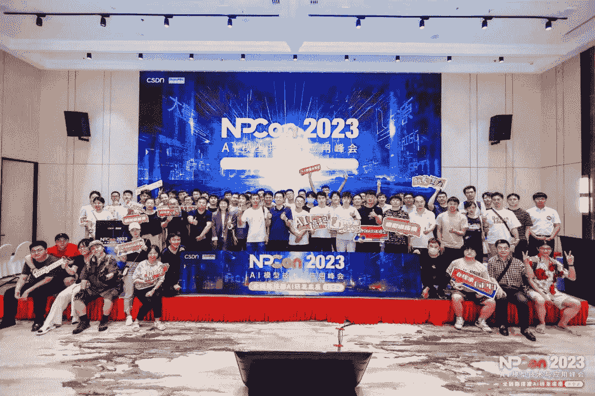

与此同时，CSDN 也将持续更新 AIGC 和大模型技术的发展动态，为广大技术爱好者提供最新的技术资讯和最优质的学习资源与工具，成就更多技术人与开发者，欢迎关注。