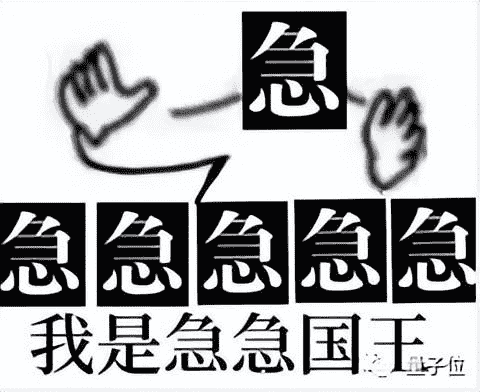
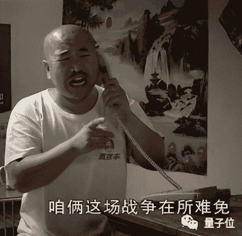
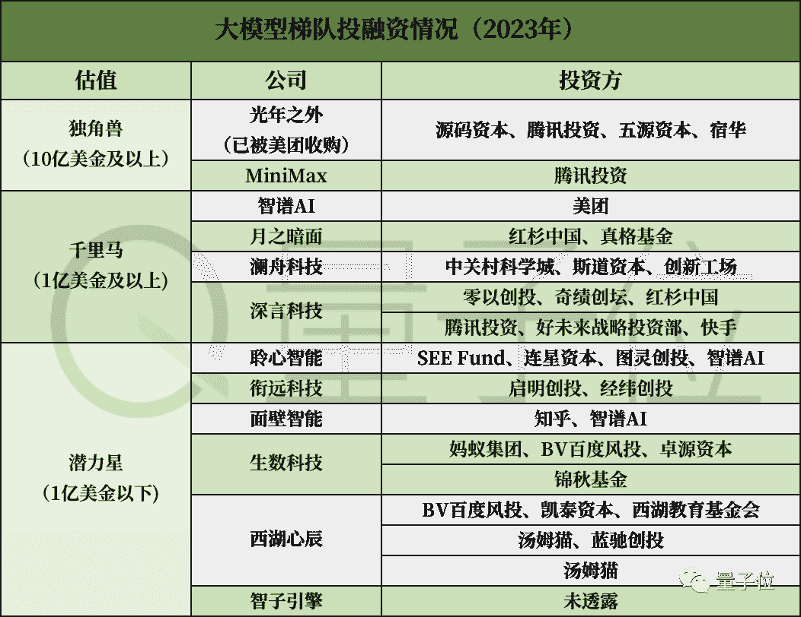
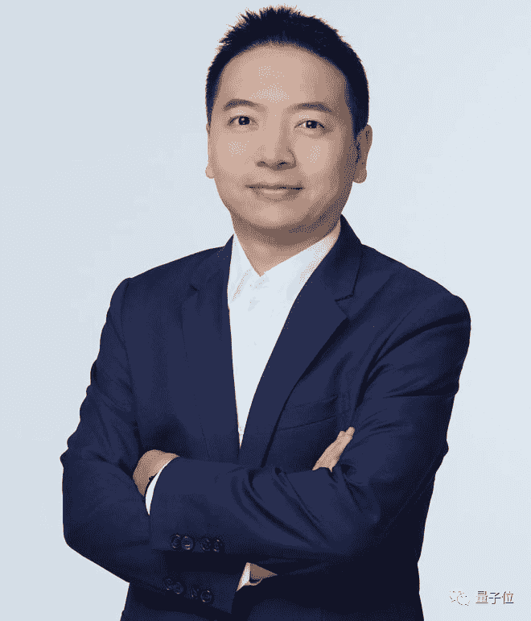
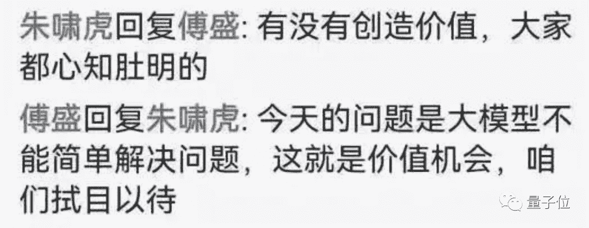

# 2023-08-13国产大模型已无公司可投-今日头条

> 来源：[https://xuqiwei1986.feishu.cn/docx/PkrMd9Qlyo5PymxV7B6c2zjmnqN](https://xuqiwei1986.feishu.cn/docx/PkrMd9Qlyo5PymxV7B6c2zjmnqN)

> 🔗 原文链接： h[ttps://www.toutiao](https://www.toutiao.com/article/7266656185049481764/?log_from=2693cbeba6ab1_1692011509752).com/article/726...

> 国产大模型已无公司可投

原创 2023-08-13 12:19 · 量子位

> 衡宇 发自 凹非寺

> 量子位 | 公众号 QbitAI

大模型创投市场，来到了 **“无公司可投” **的新阶段。

创业者想要钱，但新轮次大额融资越来越难；投资人难以寻求合适的标的，看得中的投不上、投得起的看不上。

这样的现象既在意料之外，又实属情理之中。

万箭齐发小半年，普通人对AI与大模型的使用频率下滑，当激情趋于平缓，就连领头羊ChatGPT的访问量增速都开始放缓。

**但这个赛道的卷和拥挤远未停歇 **：

作为最早一批AI初创公司，深耕轻量模型的一支团队，已经直奔独角兽而去；不断涌现AIGC创企的清华系，又一家专注对话系统的AI公司新近入场，还有本科毕业生创业的AI助手，开启beta测试不久。

一边，热门玩家的融资进展并算不得顺风顺水；另一边新公司、新产品不断挤向赛道。

就是现在，现实终于开始敲响警钟：

狂热正在褪去， AI初创公司正在创投市场上经历更大的考验 ，或许，洗牌已悄然而至。

# 赛道资源有限，时间窗口短暂

OpenAI一往无前，在它的带动和刺激下，国内，大模型创企争先恐后迸发。

但愈往后走，需要直面的考验和困难也越来越明显：

首先——

# 赛道有限

**今天，几乎每一家大模型创业公**司都能敏锐地感觉到，这条赛道虽然火热，但 赛道资源有限，时间窗口短暂 。

ChatGPT的每一次更新，都在挤占创业公司的生存空间，连18个月从白手起家到估值15亿美元的AIGC明星独角兽Jasper，也开始进行了裁员行动。

再看开源领域，以LLaMA-2为代表，整体实力也在迅速增强。

纵向对比，相继奔赴大模型创业的公司太多了。据不完全统计，包**含通用与垂直、开源与闭源**不同类型在内， 国产大模型数量已超百家 。

能直观感受到，短短半年时间内，就在这百家之间， 明星、小巨头几乎以泉涌的速度出现 。

最为耀眼的明星之一， **MiniMax **，一路凯歌向独角兽行列迈进。据市场消息，国内最早下场的一支团队，走轻量化路线，也已直奔10亿美金估值而去。

这令人兴奋，也令人咋舌：

哪怕是在热钱最多的互联网时期，6个月时间估值狂飙，也几乎是天方夜谭般的存在。

更别提光年之外这样的特例——被美团收购之前，在没有demo流出的情况下，用时4个月，估值超10亿美元。

明星耀眼，意味着它们将占据大模型赛道上的绝大部分位置， 剩余99%玩家的资源抢夺战，注定激烈 。

# 创投支撑，开始扎堆

在这样的大环境下，半年过去，真正坐上牌桌的投资方，“扎堆”现象格外明显。

**根据已经曝光的市场估**值，量子位对 2023年1月以来 ，大模型创投圈有所动作的公司和投资方做了整理归纳。

△量子位根据公开资料整理，仅限2023年

表格之外，零一万物、百川智能等明星公司的最新估值还蛰伏水下，不为外人所知。

但表格内的信息足以让人发现，大模型创业时代，VC的赌徒游戏很有规律可循：

要么， **认准头部 **。

典型例子是过去半年中，出手最为频繁几家，如以腾讯投资为代表的大厂战投/风投，或自身在赛道上一路飞驰的智谱AI。

对它们而言，鸡蛋既不会放在同一个篮子里，也不会放在太多篮子里，更不太会放在头部梯队以外的篮子里。

要么， **坚定地选择某一家被投企业 **。

如同汤姆猫对西湖心辰的一路加码，或是知乎对面壁智能的持续看好，自己合伙人、CTO出任对方董事兼CEO那种。

△知乎合伙人、CTO李大海出任面壁智能CEO

# 想要高估值，需面对瓶颈期

再者说，纵使创投市场无人不谈大模型，但能够投出的钱是有限的**，并且在美元基金撤**退渐远的境况下，这些 钱不热，更不算多 。

量子位获悉，一家数月前宣布入局大模型的初创团队，在与资方的洽谈中并不是一帆风顺，目前对外报价已经压至1亿美金之下，远低于最初预期。

讨论火热，但融资不易，不止体现于此。

大模型创业还只处于上升期，高估值等同于被投公司未来需要承担更高的成长预期和盈利压力。

市场消息是， **融资轮次越往后、估值越高、需要的真金白银越多**，对真实能力和技术商用的检验也就越严苛 。

直到今天，10亿美元的估值额度，已经成为了普通大模型初创公司难以望其项背的天花板；在达到这个数额之前，10亿人民币，同样不容轻松迈过。

# 渐渐迎来第一波冷静期

然而，这批创企面临的资金挑战，从一开始就格外艰巨。

**模型训练成本高、数据获取难、**顶级技术人员奇货可居，一言以蔽之， 想做大模型，必得花钱如流水。

现在还要面临转化为实际业务难等问题，方方面面禁锢着诸多大模型公司的技术商业化和进一步快速增长。

# 求并购成并行选项

**于是，当新**轮次大额融资越来越难时， 并购抱团 开始成为并行选项。

量子位最新获悉，一家清华系AI大模型公司，被曝正以10亿人民币估值寻找新一轮融资。

该公司同时在以1亿美金的价格，在市场求并购。这一价格，与其完成上轮融资时的估值平价。

来自资本市场的消息还传出，同出清华一脉的智谱AI，正在就并购事宜接触该团队。

这并不是独一份的生存思路，历史总有可以镜鉴的相似性：

今年4月，光年之外完成对AI深度学习框架公司一流科技的收购，持有其约46.52%股权。

彼时，已经完成4轮融资的一流科技屡屡融资不顺，差点倒在AI 2.0浪潮兴起之前；而王慧文自立山头，急需引入行业资源增强竞争力量，为“打造中国OpenAI”储备力量。

后来的故事大家都知道了，王慧文因病隐退，一流科技随光年之外归入美团麾下。

# 投资方坚持“保守”路线

王慧文激流退场的意外，在某种程度上**坚定了**大多数投资机构共同的态度，那就是 保守 。

不少一线投资人吐露道，市场上的项目看了很多、聊了很多，但最终锚定的标的寥寥无几。

如上文所言， **资本集中押注 **，狩猎目标集中在3-5个选手身上，通往成功的机会被极限压缩。

马太效应的加剧，让有望突围的创业公司数量更进一步缩小，但纵观市场上叫得上名字的公司，要价都扶摇直上。

就算对“AI 2.0时代有比互联网大10倍的机会”深信不疑，但 是否值如此高昂的价格，却是一个问号 。

毕竟拉起队伍后，大模型商业模式不明确，盈利点不清晰，许多创业项目还停留在概念验证阶段。

**到训出大模型、拿出真产品，**甚至赶上GPT-3.5，赛道上的 国内选手们要走的路还挺长 。

部分投资人干脆放弃看大模型项目，转向infra层面看芯片、看硬件的老路。

> 等年底他们发布模型，试过深浅再说。

# 仍持观望态度

投资人们举着棋子不敢轻易尝试，还没买到入场券的，有的在观望，会不会在开源领域出现比LlaMA-2更厉害的模型，让大家都没得玩？

还有的 **在等应用层的机会 **。

只不过就会回到月前的朱啸虎和傅盛在朋友圈之争，对于know how略显单薄的应用层而言，“有没有创造价值，大家都心知肚明的，不要太高期望值就好。”

以及，实际情况中，自身根本建立在别人提供的API上，对创业公司是否不太友好？

在这样的高呼声中，人们心中的疑虑加剧：

真的能在短时间内做成吗？做出后，效果离GPT-4还差多远？有一定的实力，能找到合适的商业化落地场景吗？投入与价值是否真的成正比？

本来没出手的投资方，似乎更不着急了。

8个月前，ChatGPT一石激起千层浪；6个月前，国内的大模型赛道开始备受瞩目，热度逐渐如日中天。

到现在， 想走大模型路线通向AGI的人依旧络绎不绝 。

头号玩家们每周仍然要见数不清的投资者，梯队前列公司的估价持续走高，新兴的后起之秀还在源源不断奔向赛场。

同时面对的还有更为冷静和严苛的评价目光，来自投资人，来自业界，还来自自身——且多少带着与日俱增的质疑。

大火热炒半年，大模型身下燃烧的大火开始转向小火模式，在年初“宣布入局”和年底“模型/产品问世”之间的这段空隙，种种迹象表明， 大模型创投界渐渐迎来了第一波冷静期 。

— 完 —

量子位 QbitAI · 头条号签约

关注我们，第一时间获知前沿科技动态